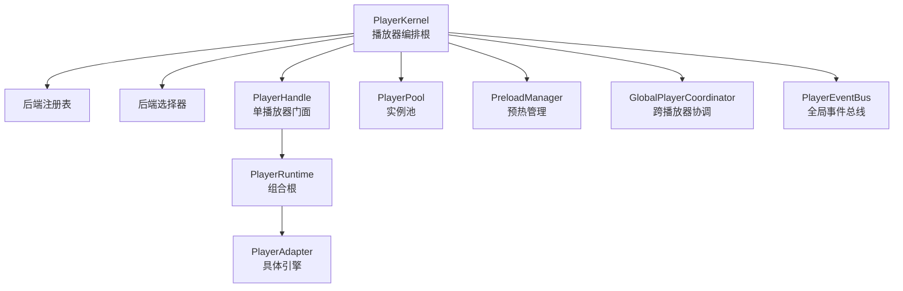
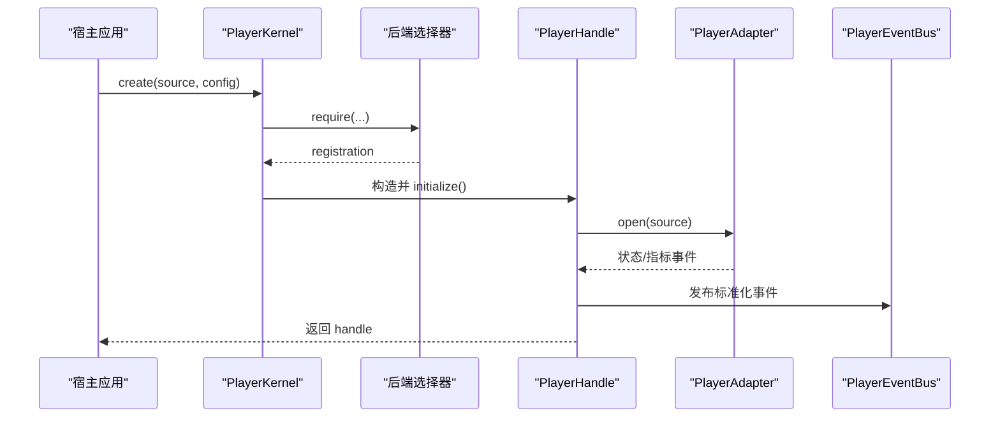
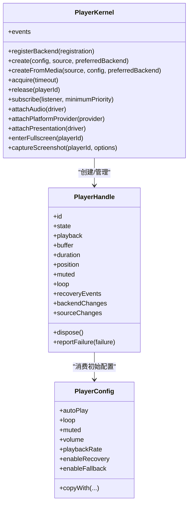
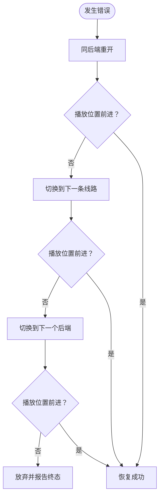

# API 参考

<cite>
**本文引用的文件**   
- [README.md](file://README.md)
- [player_kernel.dart](file://packages/media_core/lib/kernel/player_kernel.dart)
- [player_handle.dart](file://packages/media_core/lib/kernel/player_handle.dart)
- [player_config.dart](file://packages/media_core/lib/core/player_config.dart)
- [architecture.md](file://doc/en/architecture.md)
</cite>

## 目录
1. [简介](#简介)
2. [项目结构](#项目结构)
3. [核心组件](#核心组件)
4. [架构总览](#架构总览)
5. [详细组件分析](#详细组件分析)
6. [依赖关系分析](#依赖关系分析)
7. [性能与资源特性](#性能与资源特性)
8. [UI 组件与样式](#ui-组件与样式)
9. [高级控制器：直播、弹幕等](#高级控制器直播弹幕等)
10. [配置选项完整清单](#配置选项完整清单)
11. [故障排查指南](#故障排查指南)
12. [结论](#结论)

## 简介
本 API 参考面向 Media Core 的开发者，聚焦以下目标：
- 给出 PlayerKernel、PlayerHandle、PlayerConfig 等核心类的权威接口说明。
- 明确公共方法的参数、返回值、异常行为与使用场景。
- 覆盖 UI 组件（MediaCorePlayerView）的属性、事件回调与样式定制。
- 介绍高级控制器（如 LivePlaybackController、DanmakuController）的职责边界与接入方式。
- 提供配置项完整列表、默认值与推荐实践。
- 通过图示和示例路径帮助快速定位实现细节。

## 项目结构
Media Core 采用“内核 + 能力包”的分层组织：
- 内核负责会话、代际、命令串行化、恢复决策、池化、事件归一化等编排逻辑。
- 能力包按职责拆分：后端适配、UI、系统媒体面、平台探针、直播、弹幕、下载、录播等。
- 示例应用把每个能力做成可运行页面，便于对照理解。

图表来源
- [player_kernel.dart:50-101](file://packages/media_core/lib/kernel/player_kernel.dart#L50-L101)
- [player_handle.dart:111-148](file://packages/media_core/lib/kernel/player_handle.dart#L111-L148)

章节来源
- [README.md:3-12](file://README.md#L3-L12)
- [README.md:55-90](file://README.md#L55-L90)

## 核心组件
本节聚焦三个最常用入口：
- PlayerKernel：创建/释放播放器、选择后端、全局事件与能力挂载。
- PlayerHandle：单个播放器的运行时门面，暴露播放控制、状态、截图、恢复等。
- PlayerConfig：播放器初始配置，声明媒体类型、解码偏好、自动行为与恢复策略。

章节来源
- [player_kernel.dart:50-101](file://packages/media_core/lib/kernel/player_kernel.dart#L50-L101)
- [player_handle.dart:111-148](file://packages/media_core/lib/kernel/player_handle.dart#L111-L148)
- [player_config.dart:8-18](file://packages/media_core/lib/core/player_config.dart#L8-L18)

## 架构总览
Media Core 的核心流程是：
- 通过 PlayerKernel.create 或 createFromMedia 创建 PlayerHandle。
- Kernel 解析源、选择后端、初始化适配器并打开源。
- Handle 串联 Session、Playback、Geometry、Lifecycle、Recovery 等控制器。
- 所有公开操作进入序列化队列，避免并发破坏状态。
- 错误由 RecoveryLadder 统一决策：同后端重开 → 换线路 → 换后端 → 放弃。

图表来源
- [player_kernel.dart:304-400](file://packages/media_core/lib/kernel/player_kernel.dart#L304-L400)
- [player_handle.dart:162-208](file://packages/media_core/lib/kernel/player_handle.dart#L162-L208)

章节来源
- [README.md:55-90](file://README.md#L55-L90)
- [player_kernel.dart:304-400](file://packages/media_core/lib/kernel/player_kernel.dart#L304-L400)

## 详细组件分析

### PlayerKernel API
PlayerKernel 是框架编排根，负责：
- 注册/注销后端。
- 创建/获取/释放播放器。
- 从 MediaSource 创建播放器。
- 获取空闲播放器（池化）。
- 全局事件订阅。
- 挂载音频、平台能力、呈现驱动。
- 全屏/PiP/悬浮窗请求。
- 抓帧。

关键方法与语义
- registerBackend(registration)：注册后端；未注册时选择器会抛出配置错误。
- unregisterBackend(id)：移除后端。
- create({config, source, preferredBackend})：创建播放器；若 open 失败会释放句柄并抛出异常。
- createFromMedia(source, {config, preferredBackend})：从结构化媒体源创建；不支持时抛出 UnsupportedError。
- acquire({timeout})：从池中获取空闲句柄；无可用则返回 null。
- get(playerId)/operator：按 ID 查找句柄。
- handles：当前所有活跃句柄。
- sessionOf(playerId)：查询会话。
- release(playerId)：彻底释放句柄，清理协调器、池、事件绑定。
- preload(source, priority)：加入预热队列。
- events / subscribe(listener, {minimumPriority})：全局事件流与订阅。
- attachAudio(driver)/detachAudio()：挂载/卸载音频能力驱动。
- attachPlatformProvider(provider)/detachPlatformProvider()：挂载/卸载平台能力探针。
- attachPresentation(driver)/detachPresentation()：挂载/卸载呈现驱动。
- enterFullscreen/exitFullscreen/enterPip/exitPip/enterFloating/exitFloating：请求呈现模式；未挂载驱动或未知玩家抛 StateError。
- captureScreenshot(playerId, {options})：抓帧；未知玩家或无可捕获画面返回 null。

异常与边界
- create 中 open 失败会先 release(handle) 再抛出原始异常。
- 呈现相关方法在未挂载驱动或未知 playerId 时抛 StateError。
- planFor(MediaSource, {preferredBackend}) 不会为不支持源抛错，而是返回 UnsupportedPlan，由调用方决定处理。

使用建议
- 首次启动需至少注册一个后端。
- 需要系统通知/锁屏时，先 enable 系统媒体面，再 attachAudio。
- 需要设备硬解/分辨率上限等事实，attachPlatformProvider。
- 需要全屏/PiP/悬浮窗，attachPresentation。

章节来源
- [player_kernel.dart:115-159](file://packages/media_core/lib/kernel/player_kernel.dart#L115-L159)
- [player_kernel.dart:268-298](file://packages/media_core/lib/kernel/player_kernel.dart#L268-L298)
- [player_kernel.dart:304-400](file://packages/media_core/lib/kernel/player_kernel.dart#L304-L400)
- [player_kernel.dart:424-440](file://packages/media_core/lib/kernel/player_kernel.dart#L424-L440)
- [player_kernel.dart:446-515](file://packages/media_core/lib/kernel/player_kernel.dart#L446-L515)
- [player_kernel.dart:521-549](file://packages/media_core/lib/kernel/player_kernel.dart#L521-L549)
- [player_kernel.dart:555-626](file://packages/media_core/lib/kernel/player_kernel.dart#L555-L626)
- [player_kernel.dart:632-716](file://packages/media_core/lib/kernel/player_kernel.dart#L632-L716)

### PlayerHandle API
PlayerHandle 是单个播放器的运行时门面，负责：
- 播放控制：open/openMedia/play/pause/stop/seek/setVolume/setRate 等。
- 状态读取：state/playback/buffer/duration/position/progress/muted/loop 等。
- 生命周期：initialize/dispose/recycle/activate 等。
- 截图：captureScreenshot(options)。
- 恢复：reportFailure/recoveryEvents/recoveryLadder/snapshot 等。
- 后端切换：backendChanges/stream 与 adapterEvents/stream。
- 源变更：sourceChanges/stream。
- 引擎选项：setEngineOption/getEngineOptions 等（在扩展部分）。

关键属性与方法（节选）
- id/sessionId/generationId/backendId/backendCapabilities：身份与后端信息。
- state/playbackStream/stateChanges：语义状态与流。
- buffer/buffered/duration/position/progress/isPlaying：播放进度与缓冲。
- muted/volume/rate/loop：静音、音量、倍速、循环。
- snapshots/snapshot/combinedSnapshot/lifecycle/recovery：诊断快照。
- session/sessionController/playbackController/geometryController/lifecycleController/runtime：内部控制器访问。
- recoveryEvents/adapterEvents/backendChanges/sourceChanges：事件流。
- dispose()：释放句柄及所有子模块。

异常与边界
- 恢复步骤若缺少源或后端未注册，会抛 StateError。
- 已 disposed 的句柄执行恢复相关方法会抛 StateError。
- 操作序列化保证顺序，但 Dart Future 取消不能强制中断原生调用；通过 generation 守卫防止旧操作提交状态。

最佳实践
- 监听 backendChanges 以重建自定义覆盖层或缓存后端能力。
- 使用 combinedSnapshot 做一次性诊断快照。
- 对直播等自管恢复的场景，关闭 handle 自身恢复，仅上报事件。

章节来源
- [player_handle.dart:87-109](file://packages/media_core/lib/kernel/player_handle.dart#L87-L109)
- [player_handle.dart:111-148](file://packages/media_core/lib/kernel/player_handle.dart#L111-L148)
- [player_handle.dart:162-208](file://packages/media_core/lib/kernel/player_handle.dart#L162-L208)
- [player_handle.dart:399-519](file://packages/media_core/lib/kernel/player_handle.dart#L399-L519)
- [player_handle.dart:521-555](file://packages/media_core/lib/kernel/player_handle.dart#L521-L555)
- [player_handle.dart:557-604](file://packages/media_core/lib/kernel/player_handle.dart#L557-L604)
- [player_handle.dart:614-683](file://packages/media_core/lib/kernel/player_handle.dart#L614-L683)
- [player_handle.dart:689-747](file://packages/media_core/lib/kernel/player_handle.dart#L689-L747)

### PlayerConfig API
PlayerConfig 是不可变配置对象，描述播放器创建与初始偏好：
- 标识与媒体：name、mediaType、mediaCapabilities、sourceId。
- 行为：autoInitialize、autoPlay、loop、preload、keepAlive、pauseWhenBackgrounded。
- 输出与解码：muted、volume、playbackRate、preferHardwareDecoding、enableAudio、enableVideo、enableSubtitles、enableBuffering。
- 恢复与诊断：enableRecovery、enableFallback、enableMetrics、enableDiagnostics、maxRecoveryAttempts、maxFallbackAttempts。
- 便捷判断：isAudioOnly/isVideoOnly/isAudioVideo/requiresVideoRenderer/canRecover/canFallback/isMinimal 等。
- 不可变修改：copyWith 与一系列 withXxx 方法。
- 预设：defaults/minimal/audioOnly/videoOnly/audioVideo。

默认值要点
- autoInitialize=true、autoPlay=false、loop=false、muted=false。
- volume=默认常量、playbackRate=默认常量。
- preferHardwareDecoding=true、enableAudio=true、enableVideo=true。
- enableRecovery=true、enableFallback=true、enableMetrics=true、enableDiagnostics=false。
- maxRecoveryAttempts/maxFallbackAttempts 取常量默认值。

使用建议
- 音频类场景用 audioOnly 预设。
- 极简渲染或测试用 minimal 预设。
- 通过 copyWith 派生不同场景的配置。

章节来源
- [player_config.dart:8-18](file://packages/media_core/lib/core/player_config.dart#L8-L18)
- [player_config.dart:19-55](file://packages/media_core/lib/core/player_config.dart#L19-L55)
- [player_config.dart:57-136](file://packages/media_core/lib/core/player_config.dart#L57-L136)
- [player_config.dart:138-263](file://packages/media_core/lib/core/player_config.dart#L138-L263)
- [player_config.dart:265-368](file://packages/media_core/lib/core/player_config.dart#L265-L368)
- [player_config.dart:370-484](file://packages/media_core/lib/core/player_config.dart#L370-L484)
- [player_config.dart:486-591](file://packages/media_core/lib/core/player_config.dart#L486-L591)

## 依赖关系分析
- PlayerKernel 依赖：后端注册表、选择器、源服务、事件总线、池、预热管理器、全局协调器、媒体源规划器。
- PlayerHandle 依赖：PlayerRuntime（含 Session/Playback/Geometry/Lifecycle）、RecoveryLadder、OperationRegistry/Tracker、EventBus。
- 能力包通过 KernelAudioDriver/KernelPresentationDriver/PlatformProvider 等接口挂载到内核，内核不反向依赖能力包。

图表来源
- [player_kernel.dart:115-159](file://packages/media_core/lib/kernel/player_kernel.dart#L115-L159)
- [player_handle.dart:162-208](file://packages/media_core/lib/kernel/player_handle.dart#L162-L208)
- [player_config.dart:19-55](file://packages/media_core/lib/core/player_config.dart#L19-L55)

章节来源
- [README.md:178-185](file://README.md#L178-L185)

## 性能与资源特性
- 池化：PlayerKernel.acquire 从池复用句柄，减少解码器重建成本。
- 预热：PlayerKernel.preload 将源加入预热队列，按优先级调度。
- 内存记账：内核持有 MemoryAccount，按贡献者统计；压力阈值驱动四级压力响应。
- 日志分级：默认静默，按需开启 debug/trace，支持分类与环缓冲区。
- 恢复预算：maxRecoveryAttempts/maxFallbackAttempts 限制重试次数，避免无限回退。

章节来源
- [README.md:126-147](file://README.md#L126-L147)
- [player_kernel.dart:521-537](file://packages/media_core/lib/kernel/player_kernel.dart#L521-L537)
- [player_kernel.dart:446-469](file://packages/media_core/lib/kernel/player_kernel.dart#L446-L469)

## UI 组件与样式
- MediaCorePlayerView：封装视频渲染与控制条，支持六套设计语言（material/cupertino/fluent/macos/yaru/neumorphic），可通过 style 参数强制风格。
- 自定义界面：MediaPlayerView（仅视频）+ PlayerControlsController（状态与动作）+ PlayerControlsTheme（令牌）。

使用建议
- 简单集成直接使用 MediaCorePlayerView(handle: handle)。
- 需要深度定制时，拆分为 MediaPlayerView 与独立控制条。

章节来源
- [README.md:31-53](file://README.md#L31-L53)

## 高级控制器：直播、弹幕等
- LivePlaybackController：直播场景专用控制器，负责线路/引擎扫描、看门狗、宿主节奏 retry；其任务队列独立于主链，且会禁用 handle 自身恢复以避免多路恢复竞争。
- DanmakuController：弹幕传输契约 + 消息归一化 + 去重/积压闸门 + 内容过滤 + 会话围栏；与主播放链解耦，宿主提供 DanmakuTransport 与 DanmakuSink。

接入要点
- 直播：优先使用 LivePlaybackController，避免与 handle 恢复同时运行。
- 弹幕：通过 DanmakuController 对接上游协议，使用 DanmakuOverlaySession 管理可见性与显示。

章节来源
- [architecture.md:82-95](file://doc/en/architecture.md#L82-L95)

## 配置选项完整清单
以下为 PlayerConfig 的关键字段、默认值与用途摘要：
- name：可选名称，用于诊断与日志。
- mediaType：媒体类型（audio/video/audioVideo）。
- mediaCapabilities：更细粒度的媒体能力。
- sourceId：关联的源标识。
- autoInitialize：是否自动初始化，默认 true。
- autoPlay：打开后是否自动播放，默认 false。
- loop：完成后是否循环，默认 false。
- muted：初始静音，默认 false。
- volume：初始音量，默认常量。
- playbackRate：初始倍速，默认常量。
- preload：是否启用预加载，默认 true。
- keepAlive：脱离 UI 时是否保持资源存活，默认 true。
- pauseWhenBackgrounded：后台是否暂停，默认 defer to KernelOptions。
- preferHardwareDecoding：是否优先硬件解码，默认 true。
- enableAudio/enableVideo/enableSubtitles/enableBuffering：开关各类输出与缓冲，默认 true。
- enableRecovery/enableFallback：是否允许自动恢复与后端回退，默认 true。
- enableMetrics/enableDiagnostics：是否收集指标与诊断，默认 true/false。
- maxRecoveryAttempts/maxFallbackAttempts：最大尝试次数，默认常量。

推荐配置
- 通用点播：PlayerConfig.defaults。
- 纯音频：PlayerConfig.audioOnly。
- 纯视频：PlayerConfig.videoOnly。
- 极简/测试：PlayerConfig.minimal。

章节来源
- [player_config.dart:19-55](file://packages/media_core/lib/core/player_config.dart#L19-L55)
- [player_config.dart:57-136](file://packages/media_core/lib/core/player_config.dart#L57-L136)
- [player_config.dart:486-520](file://packages/media_core/lib/core/player_config.dart#L486-L520)

## 故障排查指南
常见问题与定位思路
- 无法播放：检查是否已注册后端；planFor 返回 UnsupportedPlan 时需调整后端或源。
- 自动恢复无效：确认 enableRecovery/enableFallback 与 max 尝试次数；直播场景应禁用 handle 自身恢复，交由 LivePlaybackController。
- 截图为空：可能无源或双通道均无法捕获；检查 PlayerHandle.captureScreenshot 返回值。
- 呈现模式失败：确保已 attachPresentation，且 playerId 存在。
- 事件风暴：多个恢复回路并行会导致状态混乱；遵循“一个决策点”原则。

恢复链路概览

图表来源
- [README.md:92-103](file://README.md#L92-L103)

章节来源
- [player_kernel.dart:632-716](file://packages/media_core/lib/kernel/player_kernel.dart#L632-L716)
- [player_handle.dart:614-683](file://packages/media_core/lib/kernel/player_handle.dart#L614-L683)
- [README.md:92-103](file://README.md#L92-L103)

## 结论
Media Core 通过 PlayerKernel 提供统一的编排入口，通过 PlayerHandle 暴露稳定的运行时门面，并通过 PlayerConfig 声明式地定义初始行为。结合 UI 组件与高级控制器，开发者可以在不同场景下获得一致、可靠且可扩展的播放体验。遵循“能力靠声明、一个决策点、序列化即正确性”的原则，可以避免常见的并发与恢复竞态问题，获得更可预测的行为与更好的性能表现。