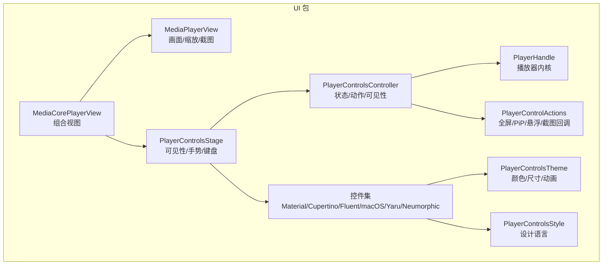
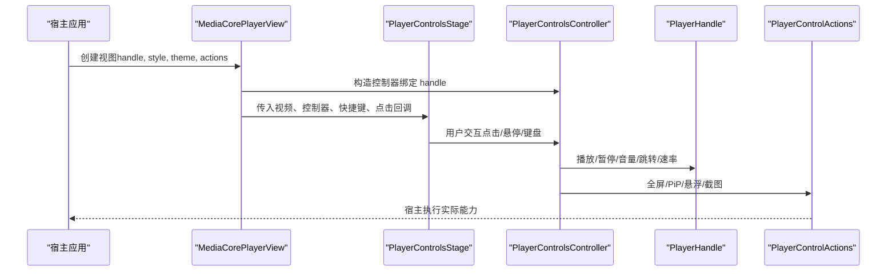
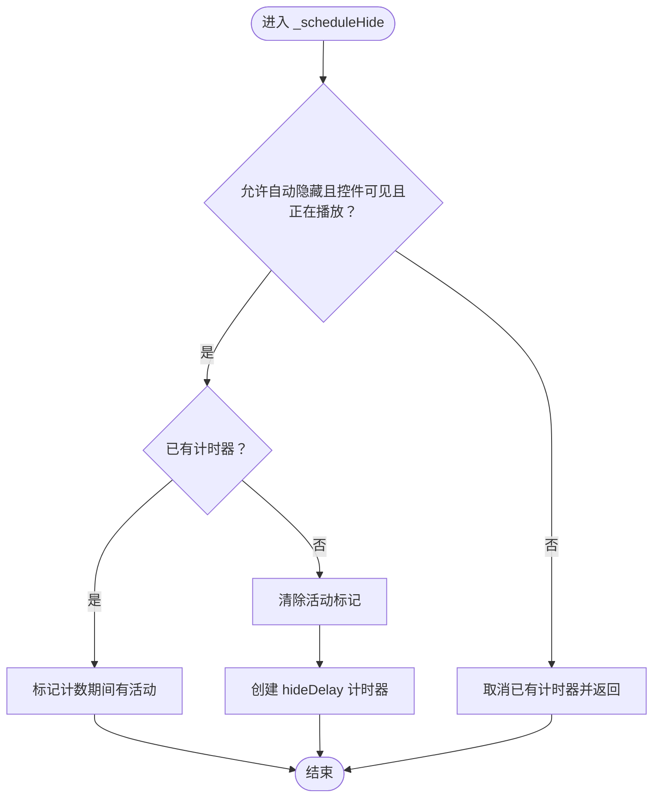
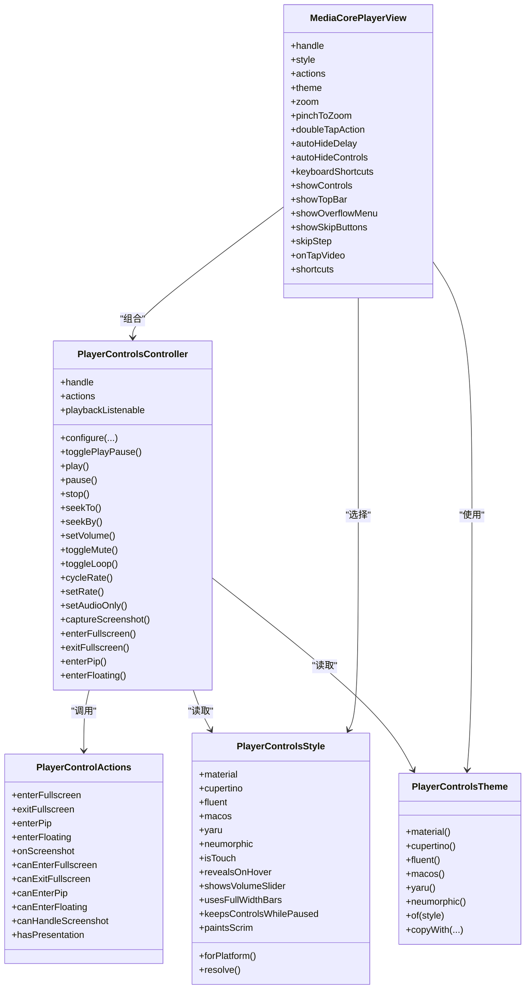

# UI 组件 API

<cite>
**本文引用的文件**   
- [media_core_player_view.dart](file://packages/media_core_ui/lib/src/media_core_player_view.dart)
- [player_control_actions.dart](file://packages/media_core_ui/lib/src/common/player_control_actions.dart)
- [player_controls_style.dart](file://packages/media_core_ui/lib/src/common/player_controls_style.dart)
- [player_controls_theme.dart](file://packages/media_core_ui/lib/src/common/player_controls_theme.dart)
- [player_controls_controller.dart](file://packages/media_core_ui/lib/src/common/player_controls_controller.dart)
- [README.md](file://packages/media_core_ui/README.md)
</cite>

## 目录
1. [简介](#简介)
2. [项目结构](#项目结构)
3. [核心组件](#核心组件)
4. [架构总览](#架构总览)
5. [详细组件分析](#详细组件分析)
6. [依赖关系分析](#依赖关系分析)
7. [性能与内存优化](#性能与内存优化)
8. [故障排查指南](#故障排查指南)
9. [结论](#结论)
10. [附录：API 速查表](#附录api-速查表)

## 简介
本文件面向使用 media_core_ui 的开发者，系统化说明播放器 UI 控制层的核心 API，包括主视图 MediaCorePlayerView、控件控制器 PlayerControlsController、动作接口 PlayerControlActions、设计语言 PlayerControlsStyle 与主题 PlayerControlsTheme。文档覆盖属性、事件回调、定制选项、手势与键盘交互、无障碍与多平台适配，并提供性能优化与内存管理建议。

## 项目结构
media_core_ui 将“控制逻辑”与“视觉风格”解耦：
- common 目录提供共享能力：播放状态镜像、可见性控制、主题令牌、进度条、按钮、图标、键盘映射、以及把上下栏叠加在画面上的 PlayerControlsStage。
- material/cupertino/fluent/macos/yaru/neumorphic 各实现一套无状态控件集，仅渲染控制器状态并调用同一组动作。

图表来源
- [media_core_player_view.dart:46-337](file://packages/media_core_ui/lib/src/media_core_player_view.dart#L46-L337)
- [player_controls_controller.dart:10-30](file://packages/media_core_ui/lib/src/common/player_controls_controller.dart#L10-L30)
- [player_controls_style.dart:4-28](file://packages/media_core_ui/lib/src/common/player_controls_style.dart#L4-L28)
- [player_controls_theme.dart:49-63](file://packages/media_core_ui/lib/src/common/player_controls_theme.dart#L49-L63)

章节来源
- [README.md:5-14](file://packages/media_core_ui/README.md#L5-L14)

## 核心组件
- MediaCorePlayerView：一个可放入屏幕的组合视图，负责装配画面、控件、手势与键盘；支持强制风格、替换主题、注入控制器或整条控件栏。
- PlayerControlsController：所有控件集的共享控制器，负责镜像播放状态、暴露动作、管理控件可见性与自动隐藏。
- PlayerControlActions：宿主侧能力回调集合（全屏、退出全屏、画中画、悬浮窗口、截图），以“回调是否存在”决定按钮是否显示。
- PlayerControlsStyle：设计语言枚举，定义 Material、Cupertino、Fluent、macOS、Yaru、Neumorphic 的外观与行为差异。
- PlayerControlsTheme：颜色、尺寸、文本样式、进度条形状、按钮反馈、面板模糊/阴影等视觉令牌，按风格提供默认值并可深度覆盖。

章节来源
- [media_core_player_view.dart:46-84](file://packages/media_core_ui/lib/src/media_core_player_view.dart#L46-L84)
- [player_controls_controller.dart:10-30](file://packages/media_core_ui/lib/src/common/player_controls_controller.dart#L10-L30)
- [player_control_actions.dart:3-25](file://packages/media_core_ui/lib/src/common/player_control_actions.dart#L3-L25)
- [player_controls_style.dart:4-28](file://packages/media_core_ui/lib/src/common/player_controls_style.dart#L4-L28)
- [player_controls_theme.dart:49-63](file://packages/media_core_ui/lib/src/common/player_controls_theme.dart#L49-L63)

## 架构总览
MediaCorePlayerView 作为入口，内部组装 MediaPlayerView（画面）、PlayerControlsStage（可见性/手势/键盘）和具体控件集；控件集通过 PlayerControlsController 读取播放状态并调用 PlayerControlActions 中的宿主回调。

图表来源
- [media_core_player_view.dart:303-327](file://packages/media_core_ui/lib/src/media_core_player_view.dart#L303-L327)
- [player_controls_controller.dart:372-520](file://packages/media_core_ui/lib/src/common/player_controls_controller.dart#L372-L520)
- [player_control_actions.dart:26-74](file://packages/media_core_ui/lib/src/common/player_control_actions.dart#L26-L74)

## 详细组件分析

### MediaCorePlayerView 主视图
职责
- 装配 MediaPlayerView（画面、对齐、镜像、背景色、捕获边界、缩放）。
- 根据 PlayerControlsStyle 选择控件集，或通过 controls 插槽完全替换。
- 管理控件可见性策略（自动隐藏、暂停时保留、顶部栏/溢出菜单/跳过按钮开关）。
- 处理双击动作（缩放或全屏）与捏合缩放。
- 传递键盘快捷键与自定义快捷键映射。

关键属性与行为
- handle：播放器句柄。
- style/styleResolver：设计语言或解析器。
- actions：宿主能力回调集合。
- theme：主题令牌。
- zoom/pinchToZoom/doubleTapAction：缩放相关。
- autoHideDelay/autoHideControls/keepControlsWhilePaused：可见性策略。
- keyboardShortcuts/showControls/showTopBar/showOverflowMenu/showSkipButtons/skipStep：UI 展示与行为开关。
- onTapVideo：视频区域点击回调。
- shortcuts：自定义快捷键映射。

章节来源
- [media_core_player_view.dart:46-84](file://packages/media_core_ui/lib/src/media_core_player_view.dart#L46-L84)
- [media_core_player_view.dart:303-337](file://packages/media_core_ui/lib/src/media_core_player_view.dart#L303-L337)

### PlayerControlsController 控制器
职责
- 镜像 PlayerHandle 的播放状态，提供 isPlaying/isBuffering/canSeek/isLive/volume/rate/title 等只读属性。
- 暴露统一动作：play/pause/stop/seekTo/seekBy/setVolume/toggleMute/toggleLoop/cycleRate/setRate/setAudioOnly。
- 截图 captureScreenshot 会触发 actions.onScreenshot。
- 管理控件可见性：reveal/hide/toggle/setControlsVisible，含自动隐藏计时器与“悬停活动”去抖。
- 对外暴露 playbackListenable（高频 tick）与自身 ChangeNotifier（结构性变化）。

重要方法
- configure(style/theme/hideDelay/autoHide/keepVisibleWhenPaused/actions)：动态更新控制器配置。
- togglePlayPause/play/pause/stop/seekTo/seekBy/setVolume/toggleMute/toggleLoop/cycleRate/setRate/setAudioOnly/captureScreenshot/enterFullscreen/exitFullscreen/enterPip/enterFloating。

章节来源
- [player_controls_controller.dart:10-30](file://packages/media_core_ui/lib/src/common/player_controls_controller.dart#L10-L30)
- [player_controls_controller.dart:98-194](file://packages/media_core_ui/lib/src/common/player_controls_controller.dart#L98-L194)
- [player_controls_controller.dart:205-254](file://packages/media_core_ui/lib/src/common/player_controls_controller.dart#L205-L254)
- [player_controls_controller.dart:260-318](file://packages/media_core_ui/lib/src/common/player_controls_controller.dart#L260-L318)
- [player_controls_controller.dart:330-366](file://packages/media_core_ui/lib/src/common/player_controls_controller.dart#L330-L366)
- [player_controls_controller.dart:372-520](file://packages/media_core_ui/lib/src/common/player_controls_controller.dart#L372-L520)

#### 可见性自动隐藏流程

图表来源
- [player_controls_controller.dart:330-366](file://packages/media_core_ui/lib/src/common/player_controls_controller.dart#L330-L366)

### PlayerControlActions 动作接口
职责
- 承载宿主侧能力回调：enterFullscreen/exitFullscreen/enterPip/enterFloating/onScreenshot。
- 通过“回调是否为空”决定是否显示对应按钮，避免“不可用但可点击”的控件。
- 提供 canEnterFullscreen/canExitFullscreen/canEnterPip/canEnterFloating/canHandleScreenshot/hasPresentation 等可用性判断。
- KernelPlayerControlActions 将回调桥接到 PlayerKernel 的 presentationDriver，并在未挂载驱动时拒绝呈现类操作。

常用模式
- 直接传 const PlayerControlActions.none 表示仅播放能力。
- 使用 KernelPlayerControlActions(kernel, playerId) 一键接入内核的全屏/PiP/悬浮能力。

章节来源
- [player_control_actions.dart:3-25](file://packages/media_core_ui/lib/src/common/player_control_actions.dart#L3-L25)
- [player_control_actions.dart:26-103](file://packages/media_core_ui/lib/src/common/player_control_actions.dart#L26-L103)
- [player_control_actions.dart:105-155](file://packages/media_core_ui/lib/src/common/player_control_actions.dart#L105-L155)

### PlayerControlsStyle 设计语言
职责
- 定义六种设计语言：material、cupertino、fluent、macos、yaru、neumorphic。
- 提供 forPlatform/resolve 获取平台默认风格；Web 默认 fluent。
- 暴露风格特性：isTouch（是否触控优先）、revealsOnHover（悬停揭示）、showsVolumeSlider（是否显示音量滑块）、usesFullWidthBars（是否全宽栏）、keepsControlsWhilePaused（暂停时保留控件）、paintsScrim（是否绘制遮罩）。

章节来源
- [player_controls_style.dart:4-28](file://packages/media_core_ui/lib/src/common/player_controls_style.dart#L4-L28)
- [player_controls_style.dart:51-75](file://packages/media_core_ui/lib/src/common/player_controls_style.dart#L51-L75)
- [player_controls_style.dart:77-122](file://packages/media_core_ui/lib/src/common/player_controls_style.dart#L77-L122)

### PlayerControlsTheme 主题
职责
- 集中定义前景/次要/强调色、遮罩、进度条颜色与形状、图标尺寸、轨道高度、圆角、内边距、标题/时间文本样式、自动隐藏时长、按钮反馈皮肤、面板模糊/阴影等。
- 为每种风格提供默认构造函数（material/cupertino/fluent/macos/yaru/neumorphic），并通过 of(style) 快速构建。
- 提供 copyWith 进行局部覆盖，无需复制整个主题。

关键类别
- PlayerControlButtonSkin：ripple/translucent/hover/flat/soft。
- PlayerProgressThumb：none/circle/dot。
- PlayerProgressTrack：plain/inset。

章节来源
- [player_controls_theme.dart:6-47](file://packages/media_core_ui/lib/src/common/player_controls_theme.dart#L6-L47)
- [player_controls_theme.dart:49-63](file://packages/media_core_ui/lib/src/common/player_controls_theme.dart#L49-L63)
- [player_controls_theme.dart:101-309](file://packages/media_core_ui/lib/src/common/player_controls_theme.dart#L101-L309)
- [player_controls_theme.dart:311-323](file://packages/media_core_ui/lib/src/common/player_controls_theme.dart#L311-L323)
- [player_controls_theme.dart:325-433](file://packages/media_core_ui/lib/src/common/player_controls_theme.dart#L325-L433)
- [player_controls_theme.dart:435-504](file://packages/media_core_ui/lib/src/common/player_controls_theme.dart#L435-L504)

### 高级交互：手势、键盘与无障碍
- 手势
  - 捏合缩放：由 MediaCorePlayerView 的 pinchToZoom 控制，内部启用 MediaPlayerView.enablePinchZoom。
  - 双击缩放/全屏：doubleTapAction 支持缩放或全屏；双击全屏通过 controller.enterFullscreen 触发。
  - 视频点击：onTapVideo 透传，同时 PlayerControlsStage 负责切换控件可见性。
- 键盘
  - keyboardShortcuts 开启默认快捷键；shortcuts 可注入自定义快捷键映射。
- 无障碍
  - 控件集基于 Flutter 原生控件绘制，继承系统语义与焦点行为；通过主题与图标替换可进一步适配品牌与可读性。

章节来源
- [media_core_player_view.dart:66-84](file://packages/media_core_ui/lib/src/media_core_player_view.dart#L66-L84)
- [media_core_player_view.dart:303-327](file://packages/media_core_ui/lib/src/media_core_player_view.dart#L303-L327)
- [README.md:44-45](file://packages/media_core_ui/README.md#L44-L45)

### UI 定制示例与实践要点
- 强制风格与自带主题覆盖
  - 通过 style 指定 PlayerControlsStyle.fluent，并使用 PlayerControlsTheme.of(PlayerControlsStyle.fluent) 传入 theme。
  - 关闭捏合缩放、设置双击为全屏、显式传入 PlayerControlActions 的全屏/PiP/截图回调。
- 仅使用控件栏
  - 外部创建 PlayerControlsController(handle, actions)，再使用任意控件集（如 CupertinoPlayerControls）并传入主题。
- 响应式与多平台
  - 使用 PlayerControlsStyle.resolve() 或 forPlatform(platform) 获取平台默认风格；Web 默认 fluent。
  - Linux 默认 yaru，其他发行版可显式传 material/fluent。
- 自定义控件布局
  - 通过 controls 插槽完全替换控件栏，结合 PlayerControlsController 的状态与动作实现自有布局。

章节来源
- [README.md:16-42](file://packages/media_core_ui/README.md#L16-L42)
- [README.md:46-59](file://packages/media_core_ui/README.md#L46-L59)

## 依赖关系分析

图表来源
- [media_core_player_view.dart:64-84](file://packages/media_core_ui/lib/src/media_core_player_view.dart#L64-L84)
- [player_controls_controller.dart:41-92](file://packages/media_core_ui/lib/src/common/player_controls_controller.dart#L41-L92)
- [player_control_actions.dart:26-103](file://packages/media_core_ui/lib/src/common/player_control_actions.dart#L26-L103)
- [player_controls_style.dart:29-122](file://packages/media_core_ui/lib/src/common/player_controls_style.dart#L29-L122)
- [player_controls_theme.dart:64-323](file://packages/media_core_ui/lib/src/common/player_controls_theme.dart#L64-L323)

## 性能与内存优化
- 双通知路径
  - 结构性变更（播放/暂停/音量/速率/源/可见性/能力）走 ChangeNotifier，避免频繁重建。
  - 位置驱动的进度条/时间标签订阅 playbackListenable，减少不必要的 widget 重建。
- 自动隐藏计时器优化
  - 悬停活动去抖：在计时器运行期间记录活动，到期后若检测到活动则重新安排一次完整周期，避免每次指针移动都新建 Timer。
- 截图与回调
  - captureScreenshot 仅在引擎支持且存在画面时可用；onScreenshot 回调由宿主决定保存/分享/预览，避免库层持有状态。
- 主题与样式
  - 使用 copyWith 局部覆盖主题，避免重复构造大对象。
  - 非触控风格（fluent/macos/yaru）默认不显示音量滑块，避免与系统音量面板冲突。

章节来源
- [player_controls_controller.dart:31-40](file://packages/media_core_ui/lib/src/common/player_controls_controller.dart#L31-L40)
- [player_controls_controller.dart:330-366](file://packages/media_core_ui/lib/src/common/player_controls_controller.dart#L330-L366)
- [player_controls_controller.dart:476-492](file://packages/media_core_ui/lib/src/common/player_controls_controller.dart#L476-L492)
- [player_controls_style.dart:96-106](file://packages/media_core_ui/lib/src/common/player_controls_style.dart#L96-L106)

## 故障排查指南
- 截图按钮不显示
  - 检查 PlayerControlActions.onScreenshot 是否为空；为空则不会渲染截图按钮。
  - 确认 PlayerHandle.canCaptureScreenshot 为 true（引擎支持且画面存在）。
- 全屏/PiP/悬浮按钮不显示
  - 检查 enterFullscreen/exitFullscreen/enterPip/enterFloating 回调是否为空。
  - 使用 KernelPlayerControlActions 时，确保 PresentationDriver 已挂载到 PlayerKernel，否则 will report “no”。
- 控件不自动隐藏
  - 检查 autoHideControls 与 keepControlsWhilePaused 的设置；暂停状态下可能保持显示。
  - 确认 hideDelay 与 theme.hideDelayOr(override) 未被覆盖为较长时长。
- 双击无效
  - doubleTapAction 需设置为 fullscreen 或 zoom；若为 null 或其他值，不会触发对应行为。
- 音量滑块不可见
  - 触控风格（material/cupertino/neumorphic）默认不显示音量滑块；桌面风格（fluent/macos/yaru）才显示。

章节来源
- [player_control_actions.dart:58-74](file://packages/media_core_ui/lib/src/common/player_control_actions.dart#L58-L74)
- [player_control_actions.dart:138-154](file://packages/media_core_ui/lib/src/common/player_control_actions.dart#L138-L154)
- [player_controls_controller.dart:176-180](file://packages/media_core_ui/lib/src/common/player_controls_controller.dart#L176-L180)
- [player_controls_controller.dart:260-318](file://packages/media_core_ui/lib/src/common/player_controls_controller.dart#L260-L318)
- [player_controls_style.dart:96-106](file://packages/media_core_ui/lib/src/common/player_controls_style.dart#L96-L106)

## 结论
media_core_ui 通过“控制逻辑 + 视觉风格”的解耦设计，让同一套控制行为可在六种设计语言中一致运行。MediaCorePlayerView 提供开箱即用的组合视图，PlayerControlsController 统一管理状态与动作，PlayerControlActions 以回调形式暴露宿主能力，PlayerControlsStyle 与 PlayerControlsTheme 分别负责风格选择与视觉定制。借助该体系，开发者可以高效实现跨平台、可定制、高性能的播放器 UI。

## 附录：API 速查表
- MediaCorePlayerView
  - 属性：handle、style、styleResolver、actions、theme、zoom、pinchToZoom、doubleTapAction、autoHideDelay、autoHideControls、keepControlsWhilePaused、keyboardShortcuts、showControls、showTopBar、showOverflowMenu、showSkipButtons、skipStep、onTapVideo、shortcuts。
  - 行为：装配画面与控件、处理双击/捏合缩放、管理可见性与键盘。
- PlayerControlsController
  - 状态：playbackListenable、isPlaying、isBuffering、hasSource、canSeek、isLive、position、duration、volume、isMuted、isLooping、rate、title、canCaptureScreenshot、controlsVisible、autoHides、style、theme。
  - 动作：togglePlayPause/play/pause/stop/seekTo/seekBy/setVolume/toggleMute/toggleLoop/cycleRate/setRate/setAudioOnly/captureScreenshot/enterFullscreen/exitFullscreen/enterPip/enterFloating。
  - 可见性：revealControls/hideControls/toggleControls/setControlsVisible/configure。
- PlayerControlActions
  - 回调：enterFullscreen、exitFullscreen、enterPip、enterFloating、onScreenshot。
  - 可用性：canEnterFullscreen、canExitFullscreen、canEnterPip、canEnterFloating、canHandleScreenshot、hasPresentation。
  - 扩展：KernelPlayerControlActions(kernel, playerId)。
- PlayerControlsStyle
  - 枚举：material、cupertino、fluent、macos、yaru、neumorphic。
  - 工厂：forPlatform、resolve。
  - 特性：isTouch、revealsOnHover、showsVolumeSlider、usesFullWidthBars、keepsControlsWhilePaused、paintsScrim。
- PlayerControlsTheme
  - 默认：material()/cupertino()/fluent()/macos()/yaru()/neumorphic()/of(style)。
  - 属性：foreground、foregroundMuted、scrim、surface、border、blur、shadowLight、shadowDark、shadowDepth、pillPadding、accent、progressTrack、progressBuffered、progressPlayed、progressThumb、iconSize、primaryIconSize、compactIconSize、trackHeight、trackHeightWhileDragging、thumbRadius、contentPadding、barGap、controlButtonRadius、titleTextStyle、timeTextStyle、hideDelay、icons、buttonSkin、progressThumbShape、progressTrackShape、hoverHighlight。
  - 工具：copyWith、hideDelayOr、hasHoverHighlight、isTranslucent、isSoft。

章节来源
- [media_core_player_view.dart:64-84](file://packages/media_core_ui/lib/src/media_core_player_view.dart#L64-L84)
- [player_controls_controller.dart:98-194](file://packages/media_core_ui/lib/src/common/player_controls_controller.dart#L98-L194)
- [player_controls_controller.dart:205-520](file://packages/media_core_ui/lib/src/common/player_controls_controller.dart#L205-L520)
- [player_control_actions.dart:26-155](file://packages/media_core_ui/lib/src/common/player_control_actions.dart#L26-L155)
- [player_controls_style.dart:29-122](file://packages/media_core_ui/lib/src/common/player_controls_style.dart#L29-L122)
- [player_controls_theme.dart:64-504](file://packages/media_core_ui/lib/src/common/player_controls_theme.dart#L64-L504)