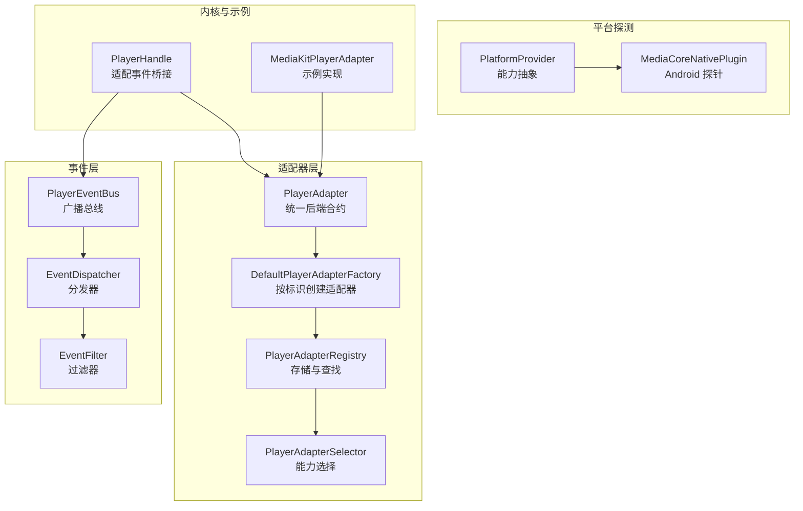
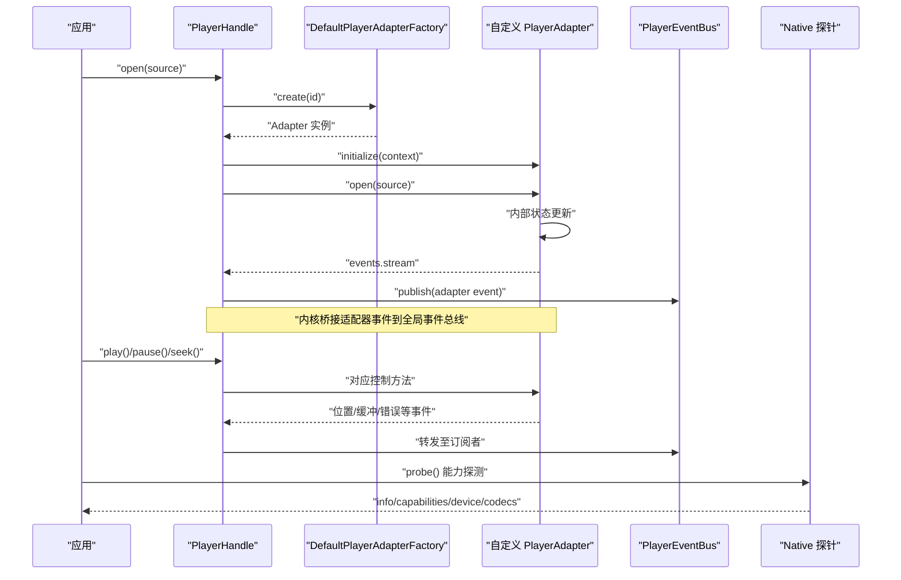
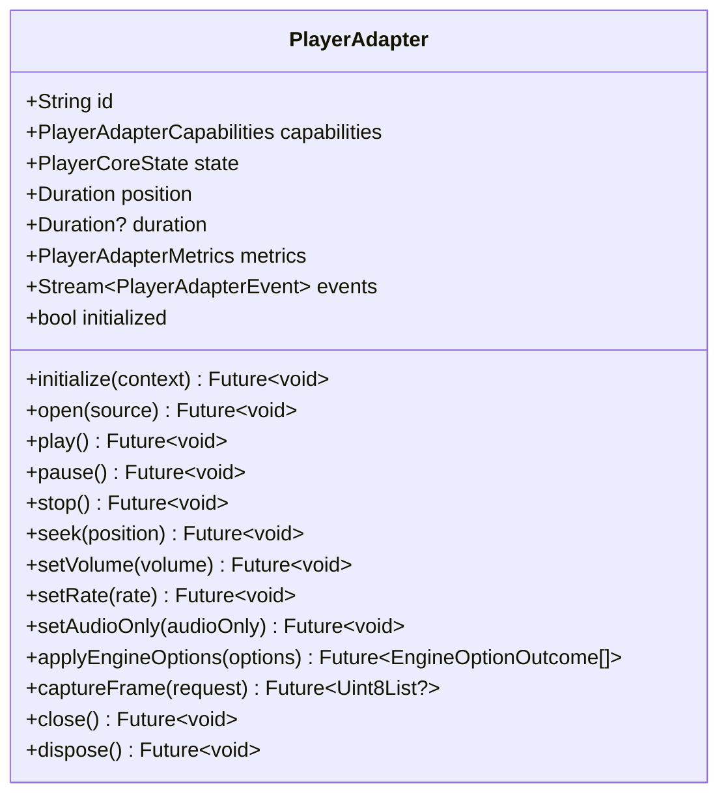
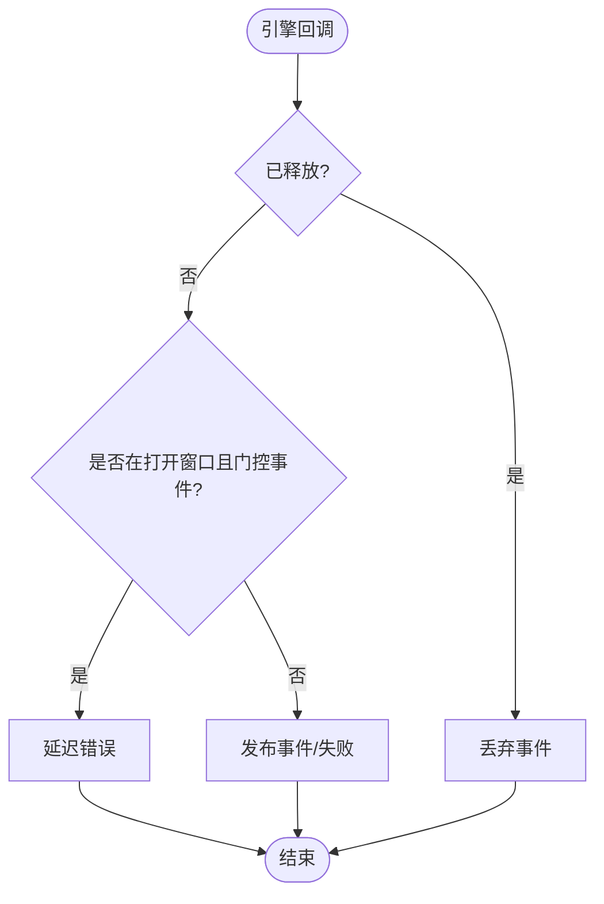
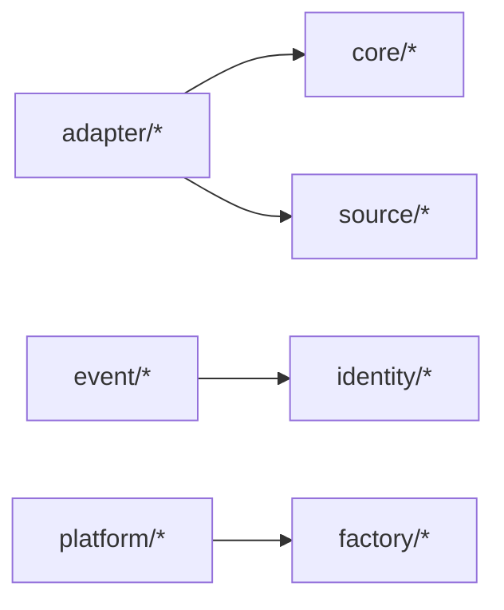
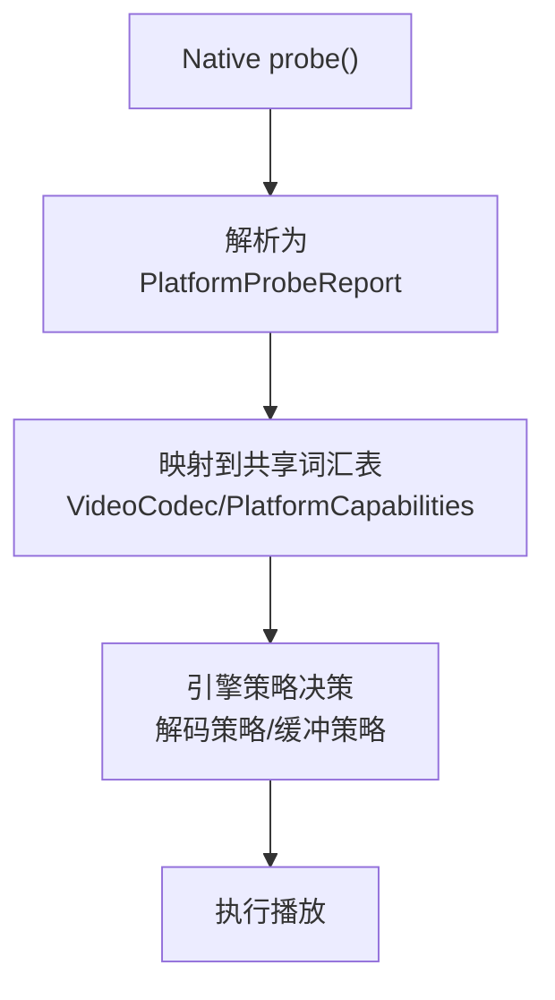
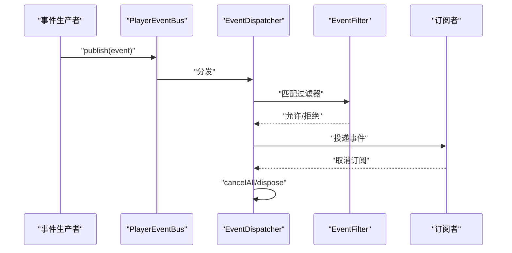

# 扩展开发 API

<cite>
**本文引用的文件**   
- [packages/media_core/lib/adapter/player_adapter.dart](file://packages/media_core/lib/adapter/player_adapter.dart)
- [packages/media_core/lib/adapter/player_adapter_base.dart](file://packages/media_core/lib/adapter/player_adapter_base.dart)
- [packages/media_core/lib/adapter/player_adapter_event.dart](file://packages/media_core/lib/adapter/player_adapter_event.dart)
- [packages/media_core/lib/adapter/player_adapter_factory.dart](file://packages/media_core/lib/adapter/player_adapter_factory.dart)
- [packages/media_core/lib/kernel/player_handle.dart](file://packages/media_core/lib/kernel/player_handle.dart)
- [packages/media_core/lib/event/player_event_bus.dart](file://packages/media_core/lib/event/player_event_bus.dart)
- [packages/media_core/lib/event/event_dispatcher.dart](file://packages/media_core/lib/event/event_dispatcher.dart)
- [packages/media_core/lib/event/event_filter.dart](file://packages/media_core/lib/event/event_filter.dart)
- [packages/media_core/lib/event/event_context.dart](file://packages/media_core/lib/event/event_context.dart)
- [packages/media_core/lib/event/event_priority.dart](file://packages/media_core/lib/event/event_priority.dart)
- [packages/media_core/lib/event/player_event_type.dart](file://packages/media_core/lib/event/player_event_type.dart)
- [doc/zh-Hans/adapter.md](file://doc/zh-Hans/adapter.md)
- [doc/zh-Hans/event.md](file://doc/zh-Hans/event.md)
- [doc/zh-Hans/platform.md](file://doc/zh-Hans/platform.md)
- [packages/media_core_native/android/src/main/java/com/mediacore/nativeprobe/MediaCoreNativePlugin.java](file://packages/media_core_native/android/src/main/java/com/mediacore/nativeprobe/MediaCoreNativePlugin.java)
- [packages/media_core_native/test/platform_probe_test.dart](file://packages/media_core_native/test/platform_probe_test.dart)
- [packages/media_core_native/README.md](file://packages/media_core_native/README.md)
- [packages/media_core_media_kit/lib/src/media_kit_player_adapter.dart](file://packages/media_core_media_kit/lib/src/media_kit_player_adapter.dart)
</cite>

## 目录
1. [引言](#引言)
2. [项目结构](#项目结构)
3. [核心组件](#核心组件)
4. [架构总览](#架构总览)
5. [详细组件分析](#详细组件分析)
6. [依赖关系分析](#依赖关系分析)
7. [性能与能力驱动机制](#性能与能力驱动机制)
8. [事件总线使用指南](#事件总线使用指南)
9. [自定义 PlayerAdapter 完整流程](#自定义-playeradapter-完整流程)
10. [调试、测试与生产部署最佳实践](#调试测试与生产部署最佳实践)
11. [结论](#结论)

## 引言
本文件面向希望为 media_core 接入新播放后端的扩展开发者，系统性说明如何基于 PlayerAdapter 抽象实现自定义播放器适配器，并围绕能力驱动机制、事件总线、生命周期管理、媒体源处理与兼容性检查给出可操作的指导。文档同时提供架构图、时序图与流程图，帮助读者从整体到细节理解系统行为。

## 项目结构
media_core 将“适配器层”与“事件层”解耦：
- 适配器层负责统一后端合约、工厂创建、注册与选择；
- 事件层负责不可变事件定义、总线分发与过滤订阅；
- 平台探测模块负责设备能力、编解码能力与运行环境信息上报；
- 内核层在运行时组合这些能力，完成适配器的选择、绑定与事件桥接。

图表来源
- [packages/media_core/lib/adapter/player_adapter.dart:12-133](file://packages/media_core/lib/adapter/player_adapter.dart#L12-L133)
- [packages/media_core/lib/adapter/player_adapter_factory.dart:30-93](file://packages/media_core/lib/adapter/player_adapter_factory.dart#L30-L93)
- [packages/media_core/lib/kernel/player_handle.dart:205-239](file://packages/media_core/lib/kernel/player_handle.dart#L205-L239)
- [packages/media_core/lib/event/player_event_bus.dart](file://packages/media_core/lib/event/player_event_bus.dart)
- [packages/media_core/lib/event/event_dispatcher.dart](file://packages/media_core/lib/event/event_dispatcher.dart)
- [packages/media_core/lib/event/event_filter.dart](file://packages/media_core/lib/event/event_filter.dart)
- [packages/media_core_native/android/src/main/java/com/mediacore/nativeprobe/MediaCoreNativePlugin.java:28-55](file://packages/media_core_native/android/src/main/java/com/mediacore/nativeprobe/MediaCoreNativePlugin.java#L28-L55)
- [packages/media_core_media_kit/lib/src/media_kit_player_adapter.dart:162-198](file://packages/media_core_media_kit/lib/src/media_kit_player_adapter.dart#L162-L198)

章节来源
- [doc/zh-Hans/adapter.md:1-33](file://doc/zh-Hans/adapter.md#L1-L33)
- [doc/zh-Hans/event.md:1-31](file://doc/zh-Hans/event.md#L1-L31)
- [doc/zh-Hans/platform.md:1-31](file://doc/zh-Hans/platform.md#L1-L31)

## 核心组件
- PlayerAdapter：统一的后端合约，定义 open/play/pause/stop/seek/setVolume/setRate/close/dispose 等控制方法，以及 state/events/metrics/capabilities 等只读属性。
- PlayerAdapterBase：基础实现，封装事件发射、错误上报、状态同步等通用逻辑。
- PlayerAdapterEvent：闭集事件模型，包含 opened/playing/paused/buffering/completed/position/duration/videoSize/volume/rate/error 等。
- DefaultPlayerAdapterFactory：默认工厂，按 id 创建适配器实例，支持注册/注销。
- PlayerEventBus/EventDispatcher/EventFilter：事件总线、分发器与过滤器，支持过滤订阅、一次性直达投递与优先级排序。
- PlatformProvider/Native 探针：平台能力与编解码能力探测，向 Dart 侧暴露 info/capabilities/device/codecs 等数据。

章节来源
- [packages/media_core/lib/adapter/player_adapter.dart:12-133](file://packages/media_core/lib/adapter/player_adapter.dart#L12-L133)
- [packages/media_core/lib/adapter/player_adapter_base.dart:764-814](file://packages/media_core/lib/adapter/player_adapter_base.dart#L764-L814)
- [packages/media_core/lib/adapter/player_adapter_event.dart:7-181](file://packages/media_core/lib/adapter/player_adapter_event.dart#L7-L181)
- [packages/media_core/lib/adapter/player_adapter_factory.dart:30-93](file://packages/media_core/lib/adapter/player_adapter_factory.dart#L30-L93)
- [doc/zh-Hans/event.md:1-31](file://doc/zh-Hans/event.md#L1-L31)
- [doc/zh-Hans/platform.md:1-31](file://doc/zh-Hans/platform.md#L1-L31)

## 架构总览
下图展示从应用调用到后端事件回传的端到端路径，包括适配器选择、事件桥接与能力探测的参与点。

图表来源
- [packages/media_core/lib/kernel/player_handle.dart:205-239](file://packages/media_core/lib/kernel/player_handle.dart#L205-L239)
- [packages/media_core/lib/adapter/player_adapter_factory.dart:52-93](file://packages/media_core/lib/adapter/player_adapter_factory.dart#L52-L93)
- [packages/media_core/lib/adapter/player_adapter.dart:68-132](file://packages/media_core/lib/adapter/player_adapter.dart#L68-L132)
- [packages/media_core/lib/event/player_event_bus.dart](file://packages/media_core/lib/event/player_event_bus.dart)
- [packages/media_core_native/android/src/main/java/com/mediacore/nativeprobe/MediaCoreNativePlugin.java:28-55](file://packages/media_core_native/android/src/main/java/com/mediacore/nativeprobe/MediaCoreNativePlugin.java#L28-L55)

## 详细组件分析

### PlayerAdapter 接口契约
- 标识与能力：id、capabilities 描述是否支持直播、seek、PiP、硬解、截图等。
- 状态与指标：state、metrics、position、duration。
- 生命周期：initialize/open/play/pause/stop/seek/setVolume/setRate/setAudioOnly/applyEngineOptions/captureFrame/close/dispose。
- 事件流：events 输出 PlayerAdapterEvent 序列。

图表来源
- [packages/media_core/lib/adapter/player_adapter.dart:12-133](file://packages/media_core/lib/adapter/player_adapter.dart#L12-L133)

章节来源
- [packages/media_core/lib/adapter/player_adapter.dart:12-133](file://packages/media_core/lib/adapter/player_adapter.dart#L12-L133)

### PlayerAdapterBase 基础实现要点
- 位置与时长变更：通过 emitPositionChanged/emitDurationChanged 发布事件。
- 音量变更：emitVolumeChanged。
- 引擎错误上报：reportEngineError 将底层错误转换为统一错误模型，并在打开窗口内延迟上报或失败时触发 fail。

图表来源
- [packages/media_core/lib/adapter/player_adapter_base.dart:764-814](file://packages/media_core/lib/adapter/player_adapter_base.dart#L764-L814)

章节来源
- [packages/media_core/lib/adapter/player_adapter_base.dart:764-814](file://packages/media_core/lib/adapter/player_adapter_base.dart#L764-L814)

### PlayerAdapterEvent 事件模型
- 事件类型覆盖打开、播放、暂停、停止、缓冲、进度、时长、视频尺寸、音量、速率、元数据、播放列表、客户端消息、日志、错误等。
- 事件为不可变值对象，便于跨模块追踪与比较。

章节来源
- [packages/media_core/lib/adapter/player_adapter_event.dart:7-181](file://packages/media_core/lib/adapter/player_adapter_event.dart#L7-L181)

### DefaultPlayerAdapterFactory 工厂
- 按 id 创建适配器，支持 register/unregister/clear/count。
- 未注册的 id 会抛出 StateError，便于早期发现配置问题。

章节来源
- [packages/media_core/lib/adapter/player_adapter_factory.dart:30-93](file://packages/media_core/lib/adapter/player_adapter_factory.dart#L30-L93)

### PlayerHandle 内核桥接
- 维护当前适配器、事件流、后端切换与恢复策略。
- 对外暴露 adapterEvents/backendChanges/sourceChanges 等稳定流，屏蔽后端切换带来的订阅失效。

章节来源
- [packages/media_core/lib/kernel/player_handle.dart:205-239](file://packages/media_core/lib/kernel/player_handle.dart#L205-L239)
- [packages/media_core/lib/kernel/player_handle.dart:532-558](file://packages/media_core/lib/kernel/player_handle.dart#L532-L558)

### MediaKitPlayerAdapter 示例参考
- 持有底层播放器实例、视频控制器与订阅集合。
- 根据平台探针结果决定解码策略，避免无意义的硬解尝试。
- 对直播源忽略变速以避免音高偏移。

章节来源
- [packages/media_core_media_kit/lib/src/media_kit_player_adapter.dart:162-198](file://packages/media_core_media_kit/lib/src/media_kit_player_adapter.dart#L162-L198)

## 依赖关系分析
- 适配器层依赖 core（状态）、source（媒体源）与 freezed/equatable（不可变值）。
- 事件层依赖 identity（多种 ID）与 clock/equatable。
- 平台探测层为叶子模块，零内部跨模块依赖，原生检测委托给 PlatformProvider 实现。

图表来源
- [doc/zh-Hans/adapter.md:29-33](file://doc/zh-Hans/adapter.md#L29-L33)
- [doc/zh-Hans/event.md:27-31](file://doc/zh-Hans/event.md#L27-L31)
- [doc/zh-Hans/platform.md:24-31](file://doc/zh-Hans/platform.md#L24-L31)

章节来源
- [doc/zh-Hans/adapter.md:29-33](file://doc/zh-Hans/adapter.md#L29-L33)
- [doc/zh-Hans/event.md:27-31](file://doc/zh-Hans/event.md#L27-L31)
- [doc/zh-Hans/platform.md:24-31](file://doc/zh-Hans/platform.md#L24-L31)

## 性能与能力驱动机制
能力驱动机制贯穿“探测—决策—执行”全链路：
- 平台探测：Native 探针返回 info/capabilities/device/codecs 四段数据，缺失字段表示“未知”，而非“不支持”。
- 能力解析：Dart 侧将原始能力映射为共享词汇表，如 VideoCodec、PlatformType、PlatformCapabilities 等。
- 决策优化：例如当设备缺少某编解码硬解时，直接软解，避免浪费一次注定失败的硬解尝试；低内存设备调整缓冲上限。

图表来源
- [packages/media_core_native/android/src/main/java/com/mediacore/nativeprobe/MediaCoreNativePlugin.java:28-55](file://packages/media_core_native/android/src/main/java/com/mediacore/nativeprobe/MediaCoreNativePlugin.java#L28-L55)
- [packages/media_core_native/android/src/main/java/com/mediacore/nativeprobe/MediaCoreNativePlugin.java:185-202](file://packages/media_core_native/android/src/main/java/com/mediacore/nativeprobe/MediaCoreNativePlugin.java#L185-L202)
- [packages/media_core_native/android/src/main/java/com/mediacore/nativeprobe/MediaCoreNativePlugin.java:232-257](file://packages/media_core_native/android/src/main/java/com/mediacore/nativeprobe/MediaCoreNativePlugin.java#L232-L257)
- [packages/media_core_native/README.md:80-106](file://packages/media_core_native/README.md#L80-L106)
- [packages/media_core_native/test/platform_probe_test.dart:38-95](file://packages/media_core_native/test/platform_probe_test.dart#L38-L95)

章节来源
- [packages/media_core_native/README.md:80-106](file://packages/media_core_native/README.md#L80-L106)
- [packages/media_core_native/test/platform_probe_test.dart:38-95](file://packages/media_core_native/test/platform_probe_test.dart#L38-L95)

## 事件总线使用指南
- PlayerEventBus：广播总线，提供 publish/publishAll、subscribe/subscribeOnce、next(filter)、dispose。
- EventDispatcher：注册过滤订阅，dispatchTo 一次性直达投递，cancelAll/dispose。
- EventFilter：AllowAllEventTypeFilter、EventTypeFilter、EventPriorityFilter、EventContextFilter、CompositeEventFilter（可组合）。
- EventContext：携带 playerId/sessionId/slotId/sourceId/operationId/requestId/generationId 及时间戳，便于跨模块追踪。
- EventPriority：low/normal/high/critical 与排序包装。
- PlayerEventType：17 个事件类别枚举，用于分类与过滤。

图表来源
- [packages/media_core/lib/event/player_event_bus.dart](file://packages/media_core/lib/event/player_event_bus.dart)
- [packages/media_core/lib/event/event_dispatcher.dart](file://packages/media_core/lib/event/event_dispatcher.dart)
- [packages/media_core/lib/event/event_filter.dart](file://packages/media_core/lib/event/event_filter.dart)
- [packages/media_core/lib/event/event_context.dart](file://packages/media_core/lib/event/event_context.dart)
- [packages/media_core/lib/event/event_priority.dart](file://packages/media_core/lib/event/event_priority.dart)
- [packages/media_core/lib/event/player_event_type.dart](file://packages/media_core/lib/event/player_event_type.dart)

章节来源
- [doc/zh-Hans/event.md:1-31](file://doc/zh-Hans/event.md#L1-L31)

## 自定义 PlayerAdapter 完整流程

### 第一步：声明能力与上下文
- 在 PlayerAdapterCapabilities 中声明是否支持直播、seek、PiP、硬解、截图、音频独占等。
- 在 PlayerAdapterContext 中注入平台能力、设备信息与编解码能力，供适配器做策略决策。

章节来源
- [packages/media_core/lib/adapter/player_adapter.dart:41-66](file://packages/media_core/lib/adapter/player_adapter.dart#L41-L66)
- [doc/zh-Hans/platform.md:11-22](file://doc/zh-Hans/platform.md#L11-L22)

### 第二步：实现生命周期控制
- initialize：初始化底层引擎，必要时读取 PlatformProvider 的能力。
- open：加载媒体源，准备解码与渲染。
- play/pause/stop：控制播放状态。
- seek：跳转到指定位置。
- setVolume/setRate：设置音量与速率。
- setAudioOnly：仅音频模式（需声明 capability）。
- applyEngineOptions：透传引擎选项并返回 EngineOptionOutcome。
- captureFrame：使用引擎原生 API 捕获帧。
- close/dispose：释放资源。

章节来源
- [packages/media_core/lib/adapter/player_adapter.dart:68-132](file://packages/media_core/lib/adapter/player_adapter.dart#L68-L132)

### 第三步：事件与状态同步
- 使用 PlayerAdapterBase 提供的 emitPositionChanged/emitDurationChanged/emitVolumeChanged 发布事件。
- 使用 reportEngineError 统一上报错误，注意打开窗口的门控与延迟上报。
- 确保 events 流稳定，即使后端切换，上层仍可通过 PlayerHandle.adapterEvents 保持稳定订阅。

章节来源
- [packages/media_core/lib/adapter/player_adapter_base.dart:764-814](file://packages/media_core/lib/adapter/player_adapter_base.dart#L764-L814)
- [packages/media_core/lib/kernel/player_handle.dart:532-558](file://packages/media_core/lib/kernel/player_handle.dart#L532-L558)

### 第四步：注册与选择
- 通过 DefaultPlayerAdapterFactory.register 注册你的适配器 id 与创建函数。
- 由 PlayerAdapterSelector 依据 SourceDescriptor 与 capabilities 选择最佳适配器，并提供候补列表。

章节来源
- [packages/media_core/lib/adapter/player_adapter_factory.dart:52-93](file://packages/media_core/lib/adapter/player_adapter_factory.dart#L52-L93)
- [doc/zh-Hans/adapter.md:11-21](file://doc/zh-Hans/adapter.md#L11-L21)

### 第五步：能力驱动与兼容性检查
- 读取 PlatformProvider 的 capabilities/device/codecs，决定是否启用硬解、PiP、后台播放等。
- 若平台未报告某能力，视为“未知”，让引擎自行尝试，而不是直接拒绝。

章节来源
- [packages/media_core_native/README.md:80-106](file://packages/media_core_native/README.md#L80-L106)
- [packages/media_core_native/test/platform_probe_test.dart:38-95](file://packages/media_core_native/test/platform_probe_test.dart#L38-L95)

### 第六步：集成事件总线
- 将适配器事件经 PlayerHandle 桥接到 PlayerEventBus，供 UI 与业务订阅。
- 使用 EventFilter 进行事件过滤，结合 EventContext 与 EventPriority 做精细化订阅。

章节来源
- [packages/media_core/lib/kernel/player_handle.dart:205-239](file://packages/media_core/lib/kernel/player_handle.dart#L205-L239)
- [doc/zh-Hans/event.md:11-21](file://doc/zh-Hans/event.md#L11-L21)

## 调试、测试与生产部署最佳实践

### 调试技巧
- 观察 PlayerHandle.adapterEvents 与 backendChanges，确认后端切换与事件稳定性。
- 使用 reportEngineError 统一上报错误，结合 EventContext 定位 playerId/sessionId/sourceId 等上下文。
- 在 Android 侧打印 MediaCoreNativePlugin 的 probe 返回，确认 info/capabilities/device/codecs 是否符合预期。

章节来源
- [packages/media_core/lib/kernel/player_handle.dart:205-239](file://packages/media_core/lib/kernel/player_handle.dart#L205-L239)
- [packages/media_core/lib/adapter/player_adapter_base.dart:790-814](file://packages/media_core/lib/adapter/player_adapter_base.dart#L790-L814)
- [packages/media_core_native/android/src/main/java/com/mediacore/nativeprobe/MediaCoreNativePlugin.java:28-55](file://packages/media_core_native/android/src/main/java/com/mediacore/nativeprobe/MediaCoreNativePlugin.java#L28-L55)

### 测试方法
- 使用 FakePlatformProvider 替换平台能力，验证不同设备场景下的行为。
- 校验 PlatformProbeReport.fromPayload 的解析逻辑，确保“未知”与“不支持”的区别正确。
- 针对事件过滤与订阅，编写用例覆盖 AllowAll/EventType/EventPriority/EventContext/Composite 过滤器。

章节来源
- [packages/media_core/testing/fake_platform.dart:36-65](file://packages/media_core/testing/fake_platform.dart#L36-L65)
- [packages/media_core_native/test/platform_probe_test.dart:38-95](file://packages/media_core_native/test/platform_probe_test.dart#L38-L95)
- [doc/zh-Hans/event.md:11-21](file://doc/zh-Hans/event.md#L11-L21)

### 生产部署建议
- 明确声明 PlayerAdapterCapabilities，避免过度承诺导致运行时降级。
- 对缺失的平台能力保持“未知”语义，交由引擎自测，减少误判。
- 在应用启动阶段完成适配器注册与能力探测，尽早暴露配置错误。
- 使用 EventPriority 与 EventFilter 限制高频事件（如 position）对 UI 的压力。

章节来源
- [packages/media_core/lib/adapter/player_adapter.dart:41-66](file://packages/media_core/lib/adapter/player_adapter.dart#L41-L66)
- [packages/media_core_native/README.md:80-106](file://packages/media_core_native/README.md#L80-L106)
- [doc/zh-Hans/event.md:11-21](file://doc/zh-Hans/event.md#L11-L21)

## 结论
通过 PlayerAdapter 统一合约、DefaultPlayerAdapterFactory 工厂、PlayerEventBus 事件总线与 PlatformProvider 能力探测，media_core 提供了可扩展、可观测、可测试的播放器扩展体系。开发者只需遵循接口契约、正确声明能力、合理桥接事件，即可快速接入新的后端引擎，并在多平台环境下获得一致体验。