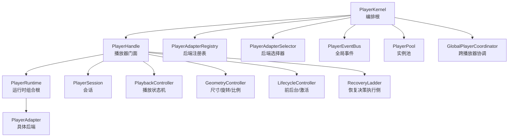
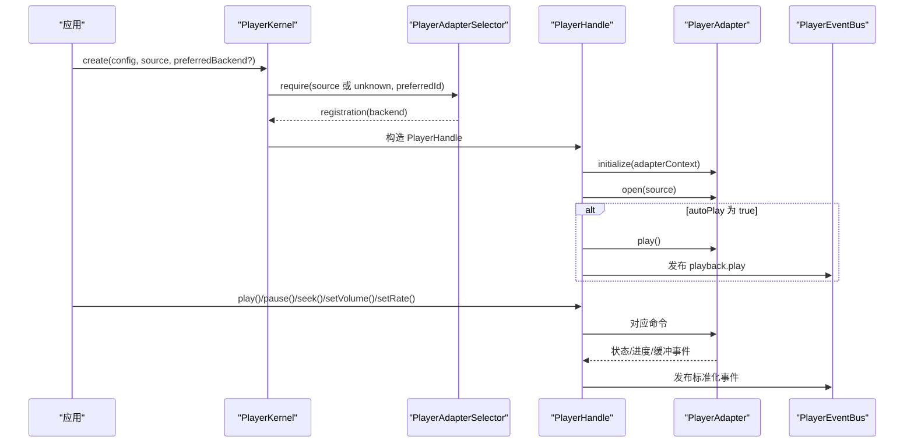
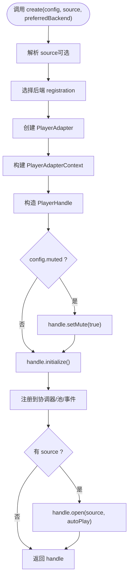
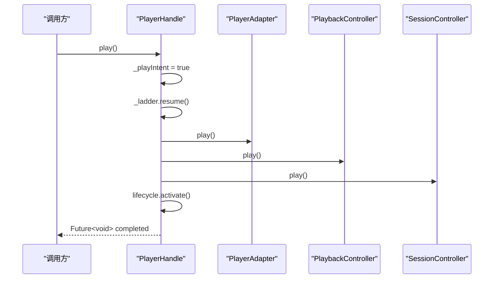
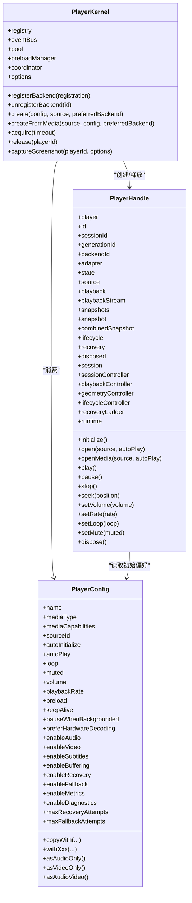

# 核心 API

<cite>
**本文引用的文件**   
- [packages/media_core/lib/kernel/player_kernel.dart](file://packages/media_core/lib/kernel/player_kernel.dart)
- [packages/media_core/lib/kernel/player_handle.dart](file://packages/media_core/lib/kernel/player_handle.dart)
- [packages/media_core/lib/kernel/player_handle_playback.dart](file://packages/media_core/lib/kernel/player_handle_playback.dart)
- [packages/media_core/lib/kernel/player_handle_operations.dart](file://packages/media_core/lib/kernel/player_handle_operations.dart)
- [packages/media_core/lib/core/player_config.dart](file://packages/media_core/lib/core/player_config.dart)
- [packages/media_core/lib/kernel/KernelOptions.dart](file://packages/media_core/lib/kernel/kernel_options.dart)
- [README.md](file://README.md)
</cite>

## 目录
1. [引言](#引言)
2. [项目结构](#项目结构)
3. [核心组件](#核心组件)
4. [架构总览](#架构总览)
5. [详细组件分析](#详细组件分析)
6. [依赖关系分析](#依赖关系分析)
7. [性能与资源特性](#性能与资源特性)
8. [错误处理与排错指南](#错误处理与排错指南)
9. [结论](#结论)
10. [附录：完整使用流程](#附录完整使用流程)

## 引言
本文面向需要直接使用 Media Core 播放器内核的开发者，聚焦以下三类核心 API：
- `PlayerKernel`：播放器编排根、后端选择、全局事件与池化入口。
- `PlayerHandle`：单个播放器的门面，统一对外暴露播放控制、生命周期、恢复与诊断能力。
- `PlayerConfig`：播放器创建与初始行为配置，包括解码偏好、缓冲、恢复与回退开关等。

文档重点说明：
- `PlayerKernel.create()` 的参数、生命周期和资源分配机制。
- `PlayerHandle` 的公共播放控制方法：`play()`、`pause()`、`seek()`、`setVolume()`、`setRate()`、`stop()`、`open()`、`dispose()` 等。
- `PlayerConfig` 的配置项含义、推荐值与常见陷阱。
- 初始化、配置、播放、事件监听、错误处理的完整流程示例路径。

## 项目结构
Media Core 的核心逻辑集中在 `packages/media_core` 中，其中与本文直接相关的三个关键文件如下：
- `kernel/player_kernel.dart`：定义 `PlayerKernel`，负责注册后端、选择引擎、创建和释放 `PlayerHandle`，并维护全局事件总线、池、预加载与跨播放器协调器。
- `kernel/player_handle.dart`：定义 `PlayerHandle`，组合运行时模块（适配器、会话、播放控制器、几何控制器、生命周期控制器、恢复梯级），并暴露所有公开操作。
- `core/player_config.dart`：定义不可变的 `PlayerConfig`，描述播放器创建时的初始偏好和能力声明。

**图表来源**
- [packages/media_core/lib/kernel/player_kernel.dart:50-101](file://packages/media_core/lib/kernel/player_kernel.dart#L50-L101)
- [packages/media_core/lib/kernel/player_handle.dart:111-148](file://packages/media_core/lib/kernel/player_handle.dart#L111-L148)

**章节来源**
- [packages/media_core/lib/kernel/player_kernel.dart:50-101](file://packages/media_core/lib/kernel/player_kernel.dart#L50-L101)
- [packages/media_core/lib/kernel/player_handle.dart:111-148](file://packages/media_core/lib/kernel/player_handle.dart#L111-L148)

## 核心组件
本节对 `PlayerKernel`、`PlayerHandle`、`PlayerConfig` 的职责边界进行概览式说明，并在后续章节展开接口规格。

| 组件 | 职责 | 不负责 | 典型使用者 |
|---|---|---|---|
| `PlayerKernel` | 创建/释放播放器、选择后端、提供全局事件与协作对象、管理池与预加载 | 不直接解码、不持有单播放器播放状态、不驱动恢复决策 | 应用启动层、页面级播放器工厂 |
| `PlayerHandle` | 单个播放器的唯一操作入口；序列化命令、桥接适配器事件、执行恢复步骤、发布标准化事件 | 不拥有适配器/会话/控制器的所有权（由 `PlayerRuntime` 组合） | UI 控件、业务控制器、测试 |
| `PlayerConfig` | 描述播放器创建与初始行为偏好；不包含运行时会话或控制器引用 | 不保存运行时状态、不决定调度策略 | `PlayerKernel.create()` 调用方 |

**章节来源**
- [packages/media_core/lib/kernel/player_kernel.dart:50-101](file://packages/media_core/lib/kernel/player_kernel.dart#L50-L101)
- [packages/media_core/lib/kernel/player_handle.dart:111-148](file://packages/media_core/lib/kernel/player_handle.dart#L111-L148)
- [packages/media_core/lib/core/player_config.dart:8-18](file://packages/media_core/lib/core/player_config.dart#L8-L18)

## 架构总览
Media Core 的核心流程可以概括为：
1. 宿主注册一个或多个后端适配（如 media_kit、ijk、better_player、fvp）。
2. 通过 `PlayerKernel.create()` 传入 `PlayerSource` 与 `PlayerConfig`。
3. `PlayerKernel` 解析源、选择后端、构造 `PlayerAdapterContext`、创建 `PlayerHandle`。
4. `PlayerHandle` 初始化运行时、打开源、按配置决定是否自动播放。
5. 所有播放命令通过 `PlayerHandle` 序列化执行，并通过 `PlayerEventBus` 发布标准化事件。

**图表来源**
- [packages/media_core/lib/kernel/player_kernel.dart:304-400](file://packages/media_core/lib/kernel/player_kernel.dart#L304-L400)
- [packages/media_core/lib/kernel/player_handle_playback.dart:96-280](file://packages/media_core/lib/kernel/player_handle_playback.dart#L96-L280)
- [packages/media_core/lib/kernel/player_handle_playback.dart:309-367](file://packages/media_core/lib/kernel/player_handle_playback.dart#L309-L367)

## 详细组件分析

### PlayerKernel：播放器编排根
`PlayerKernel` 是 Media Core 的编排根，主要职责包括：
- 注册/注销后端。
- 根据 `PlayerSource` 或 `MediaSource` 选择最佳后端。
- 创建 `PlayerHandle` 并管理其生命周期。
- 暴露全局事件总线、播放器池、预加载管理器、跨播放器协调器。
- 可选地观察 Flutter 生命周期以支持后台暂停。

#### 构造函数与依赖
`PlayerKernel` 的构造函数接受多个可选依赖，默认懒加载：
- `registry`：后端注册表。
- `selector`：后端选择器。
- `sourceService`：源解析服务。
- `eventBus`：全局事件总线。
- `pool`：播放器实例池。
- `preloadManager`：预加载管理器。
- `coordinator`：跨播放器协调器。
- `planner`：媒体源规划器。
- `options`：内核级选项 `KernelOptions`。

#### create() 方法与参数
`create()` 是 `PlayerSource` 的入口，签名如下：
- `config`：`PlayerConfig`，默认 `PlayerConfig.defaults`。
- `source`：`PlayerSource?`，可为空，表示先创建无源的播放器。
- `preferredBackend`：`String?`，可选指定首选后端 ID。

内部流程：
1. 若提供 `source`，则通过 `SourceService` 解析。
2. 通过 `selector.require()` 选择后端。
3. 生成 `PlayerIdentity`、`SessionId`，创建 `PlayerAdapter`。
4. 构造 `PlayerAdapterContext`，注入音量、速率、硬件加速、音视频开关、平台能力。
5. 构造 `PlayerHandle`，并根据 `config.muted` 设置静音。
6. 启用或禁用引擎回退：`options.enableFallback && config.enableFallback`。
7. 调用 `handle.initialize()`。
8. 将 handle 注册到全局协调器、池、事件追踪。
9. 若提供了 `source`，则调用 `handle.open(source, autoPlay: config.autoPlay)`。
10. 返回 `PlayerHandle`。

**图表来源**
- [packages/media_core/lib/kernel/player_kernel.dart:304-400](file://packages/media_core/lib/kernel/player_kernel.dart#L304-L400)

**章节来源**
- [packages/media_core/lib/kernel/player_kernel.dart:115-159](file://packages/media_core/lib/kernel/player_kernel.dart#L115-L159)
- [packages/media_core/lib/kernel/player_kernel.dart:304-400](file://packages/media_core/lib/kernel/player_kernel.dart#L304-L400)

### PlayerHandle：播放器门面
`PlayerHandle` 是单个播放器的唯一操作入口，组合了运行时模块并暴露所有公开操作。它不负责拥有适配器、会话或控制器的所有权，而是协调它们的行为。

#### 公共属性概览
- `player`：逻辑播放器身份。
- `id`：播放器 ID。
- `sessionId`：当前会话 ID。
- `generationId`：当前播放代际 ID。
- `backendId`：当前后端 ID。
- `backendCapabilities`：当前后端能力。
- `adapter`：当前适配器。
- `state`：适配器语义状态。
- `metrics`：适配器指标。
- `source`：当前已打开的源。
- `timeline`：媒体时间线（复合源对齐后）。
- `playback`：当前播放状态。
- `playbackStream`：播放状态流。
- `snapshots`：会话快照流。
- `snapshot`：最新会话快照。
- `combinedSnapshot`：聚合快照。
- `lifecycle`：生命周期快照。
- `recovery`：恢复快照。
- `disposed`：是否已释放。
- `session`：播放器会话。
- `sessionController`：会话控制器。
- `playbackController`：播放控制器。
- `geometryController`：几何控制器。
- `lifecycleController`：生命周期控制器。
- `recoveryLadder`：恢复梯级。
- `runtime`：运行时组合根。

#### 公共播放控制方法
以下方法均通过 `_enqueue` 序列化执行，并通过 `_record` 记录操作轨迹：

| 方法 | 参数 | 返回值 | 行为说明 | 异常与边界 |
|---|---|---|---|---|
| `initialize()` | 无 | `Future<void>` | 初始化适配器与生命周期，发布 `player.initialized` 事件。 | 由内核在构造后调用；重复调用安全。 |
| `open(source, {autoPlay})` | `PlayerSource`、可选 `bool autoPlay` | `Future<void>` | 打开源，重置恢复，重建会话代际，应用音量/速率，必要时自动播放。 | 若源打开失败且仍属当前操作，会清理后端状态。 |
| `openMedia(source, {autoPlay})` | `MediaSource`、可选 `bool autoPlay` | `Future<void>` | 先规划 `MediaSource`，再转为 `PlayerSource` 打开；不支持时抛出 `UnsupportedError`。 | 仅当规划结果为 `UnsupportedPlan` 时抛错。 |
| `play()` | 无 | `Future<void>` | 标记播放意图，恢复恢复梯级，调用适配器/播放/会话播放，激活生命周期。 | 若无打开源会抛 `StateError`。 |
| `pause()` | 无 | `Future<void>` | 暂停播放意图，挂起恢复，取消活跃操作，依次调用适配器/播放/会话暂停。 | 若无打开源会抛 `StateError`。 |
| `stop()` | 无 | `Future<void>` | 停止播放，清空会话状态，暂停生命周期，发布 `playback.stop`。 | 无源时直接返回。 |
| `seek(position)` | `Duration position` | `Future<void>` | 序列化解码器 seek，更新播放位置并发布 `playback.seek`。 | 若无打开源会抛 `StateError`。 |
| `setVolume(volume)` | `double volume` | `Future<void>` | 音量 0.0–1.0，未就绪时排队，就绪后应用并合并请求。 | 不会因源未就绪抛错；值会被 clamp。 |
| `setRate(rate)` | `double rate` | `Future<void>` | 播放速率，未就绪时排队，就绪后应用并合并请求。 | 不会因源未就绪抛错。 |
| `setLoop(loop)` | `bool loop` | `Future<void>` | 设置完成后是否循环。 | 立即生效于下一次完成事件。 |
| `setMute(muted)` | `bool muted` | `Future<void>` | 静音实现为音量记账：静音设 0，取消静音恢复原音量。 | 可在源打开前调用。 |
| `dispose()` | 无 | `Future<void>` | 释放所有资源，关闭订阅、控制器、事件流，清理操作记录。 | 可重复调用；内部会跳过已释放实例。 |

**图表来源**
- [packages/media_core/lib/kernel/player_handle_playback.dart:309-367](file://packages/media_core/lib/kernel/player_handle_playback.dart#L309-L367)

**章节来源**
- [packages/media_core/lib/kernel/player_handle.dart:162-208](file://packages/media_core/lib/kernel/player_handle.dart#L162-L208)
- [packages/media_core/lib/kernel/player_handle.dart:399-519](file://packages/media_core/lib/kernel/player_handle.dart#L399-L519)
- [packages/media_core/lib/kernel/player_handle_playback.dart:75-280](file://packages/media_core/lib/kernel/player_handle_playback.dart#L75-L280)
- [packages/media_core/lib/kernel/player_handle_playback.dart:309-605](file://packages/media_core/lib/kernel/player_handle_playback.dart#L309-L605)
- [packages/media_core/lib/kernel/player_handle_operations.dart:10-126](file://packages/media_core/lib/kernel/player_handle_operations.dart#L10-L126)

### PlayerConfig：播放器配置
`PlayerConfig` 是不可变配置，描述播放器如何创建以及初始运行偏好。它不包含运行时会话、适配器、操作或播放控制器引用。

#### 关键配置项
| 配置项 | 类型 | 默认值 | 作用 | 推荐值与注意事项 |
|---|---|---:|---|---|
| `name` | `String?` | `null` | 可读名称，用于日志与诊断。 | 建议为每个播放器设置业务标识。 |
| `mediaType` | `PlayerMediaType?` | `null` | 声明媒体类型。 | 音频、视频、音视频三态。 |
| `mediaCapabilities` | `MediaCapabilities?` | `null` | 详细媒体能力。 | 更精确的能力描述优于只靠 `mediaType`。 |
| `sourceId` | `SourceId?` | `null` | 关联源标识。 | 便于追踪来源。 |
| `autoInitialize` | `bool` | `true` | 是否自动初始化。 | 通常保持默认。 |
| `autoPlay` | `bool` | `false` | 打开后是否自动播放。 | 列表页建议 false，首屏可考虑 true。 |
| `loop` | `bool` | `false` | 完成后是否循环。 | 短视频/广告常用。 |
| `muted` | `bool` | `false` | 初始是否静音。 | 自动播放场景常设为 true。 |
| `volume` | `double` | `defaultVolume` | 初始音量。 | 必须在 0.0–1.0。 |
| `playbackRate` | `double` | `defaultPlaybackRate` | 初始播放速率。 | 超出范围会断言失败。 |
| `preload` | `bool` | `true` | 是否尽可能预加载。 | 列表/信息流建议开启。 |
| `keepAlive` | `bool` | `true` | 分离时是否保持资源存活。 | 频繁切换页面可关闭以节省内存。 |
| `pauseWhenBackgrounded` | `bool?` | `null` | 离开前台是否暂停。 | null 时委托给 `KernelOptions.pauseWhenBackgrounded`。 |
| `preferHardwareDecoding` | `bool` | `true` | 是否优先硬解。 | 移动端建议开启；软解作为兜底。 |
| `enableAudio` | `bool` | `true` | 是否启用音频输出。 | 纯视频场景可关闭。 |
| `enableVideo` | `bool` | `true` | 是否启用视频输出。 | 纯音频场景应关闭。 |
| `enableSubtitles` | `bool` | `true` | 是否启用字幕处理。 | 不需要时可关闭以减少开销。 |
| `enableBuffering` | `bool` | `true` | 是否启用缓冲支持。 | 直播/弱网需权衡。 |
| `enableRecovery` | `bool` | `true` | 是否启用自动恢复。 | 自定义恢复链路时可关闭。 |
| `enableFallback` | `bool` | `true` | 是否启用后端/源回退。 | 单线路强控业务可关闭。 |
| `enableMetrics` | `bool` | `true` | 是否收集运行时指标。 | 生产环境可按需关闭。 |
| `enableDiagnostics` | `bool` | `false` | 是否启用诊断收集。 | 排查问题时开启。 |
| `maxRecoveryAttempts` | `int` | `maxRecoveryAttempts` | 最大恢复尝试次数。 | 非负数；0 表示禁用恢复。 |
| `maxFallbackAttempts` | `int` | `maxFallbackAttempts` | 最大回退尝试次数。 | 非负数；0 表示禁用回退。 |

#### 便捷构造与派生
- `PlayerConfig.defaults`：默认配置。
- `PlayerConfig.minimal`：最小功能集配置。
- `PlayerConfig.audioOnly`：纯音频配置。
- `PlayerConfig.videoOnly`：纯视频配置。
- `PlayerConfig.audioVideo`：音视频配置。
- `copyWith(...)`：选择性替换字段。
- `withXxx(...)`：链式风格修改器。
- `asAudioOnly()` / `asVideoOnly()` / `asAudioVideo()`：快速切换媒体模式。

#### 能力判断辅助
- `isAudioOnly` / `isVideoOnly` / `isAudioVideo`：基于 `mediaCapabilities`、`mediaType` 或 `enableAudio`/`enableVideo` 推导。
- `requiresVideoRenderer`：是否需要视频渲染器。
- `hasAudioOutput` / `hasVideoOutput`：输出能力。
- `canRecover` / `canFallback`：是否允许恢复/回退。
- `isNormalPlaybackRate` / `isFastPlayback` / `isSlowPlayback`：速率判断。
- `isMinimal`：是否使用最小功能集。

**章节来源**
- [packages/media_core/lib/core/player_config.dart:8-55](file://packages/media_core/lib/core/player_config.dart#L8-L55)
- [packages/media_core/lib/core/player_config.dart:57-136](file://packages/media_core/lib/core/player_config.dart#L57-L136)
- [packages/media_core/lib/core/player_config.dart:138-263](file://packages/media_core/lib/core/player_config.dart#L138-L263)
- [packages/media_core/lib/core/player_config.dart:265-520](file://packages/media_core/lib/core/player_config.dart#L265-L520)
- [packages/media_core/lib/core/player_config.dart:486-520](file://packages/media_core/lib/core/player_config.dart#L486-L520)

## 依赖关系分析
`PlayerKernel` 与 `PlayerHandle` 的依赖关系体现“编排层”与“门面层”的清晰分工：

**图表来源**
- [packages/media_core/lib/kernel/player_kernel.dart:115-159](file://packages/media_core/lib/kernel/player_kernel.dart#L115-L159)
- [packages/media_core/lib/kernel/player_handle.dart:162-208](file://packages/media_core/lib/kernel/player_handle.dart#L162-L208)
- [packages/media_core/lib/core/player_config.dart:19-55](file://packages/media_core/lib/core/player_config.dart#L19-L55)

**章节来源**
- [packages/media_core/lib/kernel/player_kernel.dart:115-159](file://packages/media_core/lib/kernel/player_kernel.dart#L115-L159)
- [packages/media_core/lib/kernel/player_handle.dart:162-208](file://packages/media_core/lib/kernel/player_handle.dart#L162-L208)
- [packages/media_core/lib/core/player_config.dart:19-55](file://packages/media_core/lib/core/player_config.dart#L19-L55)

## 性能与资源特性
从源码可见，Media Core 在性能与资源管理方面采用以下策略：

1. **操作序列化**：所有后端操作通过 `_enqueue` 串行执行，避免并发冲突。
2. **代际守卫**：通过 `_operationGeneration` 防止陈旧操作提交状态。
3. **取消令牌**：通过 `OperationCancelToken` 取消活跃的播放/恢复延续，但不随意抢占音量/速率滑块请求。
4. **请求合并**：`_volumeRequest` 与 `_rateRequest` 合并滑动过程中的中间请求，只保留最终值。
5. **队列清理**：操作记录在开始新操作时修剪终端记录，避免无限增长。
6. **池化与复用**：`PlayerKernel.acquire()` 可从池中获取空闲播放器，减少解码器重建。
7. **预加载管理**：`PreloadManager` 按优先级排序预加载请求。
8. **内存贡献者**：内核通过 `MemoryAccount` 上报内存贡献，配合 `MediaCoreMemory` 做压力治理。

这些机制共同保证：
- 播放命令顺序确定。
- 生命周期转换不会留下脏状态。
- 高频 UI 交互不会打断底层播放。
- 多播放器场景下资源可控。

**章节来源**
- [packages/media_core/lib/kernel/player_handle_operations.dart:10-126](file://packages/media_core/lib/kernel/player_handle_operations.dart#L10-L126)
- [packages/media_core/lib/kernel/player_handle_operations.dart:132-225](file://packages/media_core/lib/kernel/player_handle_operations.dart#L132-L225)
- [packages/media_core/lib/kernel/player_handle_playback.dart:498-605](file://packages/media_core/lib/kernel/player_handle_playback.dart#L498-L605)
- [packages/media_core/lib/kernel/player_kernel.dart:442-469](file://packages/media_core/lib/kernel/player_kernel.dart#L442-L469)

## 错误处理与排错指南

### 常见异常来源
| 场景 | 可能异常 | 原因 | 处理建议 |
|---|---|---|---|
| 对未打开源调用 `play()` / `pause()` / `seek()` | `StateError` | `_ensureSource()` 检查失败 | 确保先 `open()` 或等待 `autoPlay` 完成。 |
| 对已释放的 `PlayerHandle` 调用方法 | `StateError` | `_ensureNotDisposed()` 检查失败 | 在 `dispose()` 后不再调用任何方法。 |
| `openMedia()` 遇到不支持的计划 | `UnsupportedError` | `MediaSourcePlanner` 返回 `UnsupportedPlan` | 检查 `MediaSource` 结构与后端能力。 |
| 没有附加呈现驱动调用全屏/PiP/悬浮 | `StateError` | `attachPresentation` 未调用 | 先调用 `attachPresentation`。 |
| 恢复步骤缺少源或后端 | `StateError` | 恢复上下文不完整 | 检查 `setSourceCandidates` 与后端注册。 |

### 恢复与回退最佳实践
- 恢复的唯一决策点是 `RecoveryLadder`，消费者通过 `reportFailure` 上报失败，通过 `recoveryEvents` 观察决策。
- 不要同时运行多个恢复循环，否则会出现多次引擎创建/销毁风暴。
- 如果业务层有自己的重试逻辑，应通过 `setEngineFallbackEnabled(false)` 关闭 handle 级别的自动回退。
- 对于直播多线路，务必通过 `setSourceCandidates` 提供候选源，否则恢复无法换线。

### 排错清单
1. 确认至少注册了一个后端。
2. 确认 `PlayerConfig.volume` 与 `playbackRate` 在合法范围内。
3. 确认 `enableRecovery` 与 `enableFallback` 是否符合预期。
4. 监听 `onOperation` 查看实际执行顺序。
5. 监听 `recoveryEvents` 查看恢复是否被触发及走到哪一步。
6. 监听 `adapterEvents` 与 `playbackStream` 区分适配器事件与语义状态。
7. 使用 `combinedSnapshot` 获取一次性聚合快照，便于调试 UI 与内核状态不一致。

**章节来源**
- [packages/media_core/lib/kernel/player_handle_operations.dart:227-239](file://packages/media_core/lib/kernel/player_handle_operations.dart#L227-L239)
- [packages/media_core/lib/kernel/player_handle_playback.dart:309-335](file://packages/media_core/lib/kernel/player_handle_playback.dart#L309-L335)
- [packages/media_core/lib/kernel/player_handle_playback.dart:457-496](file://packages/media_core/lib/kernel/player_handle_playback.dart#L457-L496)
- [packages/media_core/lib/kernel/player_handle.dart:614-683](file://packages/media_core/lib/kernel/player_handle.dart#L614-L683)

## 结论
Media Core 的核心 API 围绕三个层次组织：
- `PlayerKernel` 负责“选谁播、怎么建、怎么收”。
- `PlayerHandle` 负责“对这一个播放器做什么”。
- `PlayerConfig` 负责“这个播放器一开始应该怎样”。

正确使用的关键在于：
- 用 `PlayerKernel.create()` 创建播放器，而不是直接构造 `PlayerHandle`。
- 用 `PlayerHandle` 作为唯一播放控制入口。
- 用 `PlayerConfig` 表达初始偏好，而不是在运行时散乱设置。
- 用 `onOperation`、`recoveryEvents`、`adapterEvents`、`playbackStream` 做可观测性。
- 用 `dispose()` 释放资源，避免泄漏。

## 附录：完整使用流程

### 初始化播放器
推荐流程：
1. 初始化 Flutter binding。
2. 初始化后端适配器。
3. 启用系统媒体面（可选）。
4. 创建 `PlayerKernel` 并注册后端。
5. 调用 `kernel.create()` 传入 `PlayerSource` 与 `PlayerConfig`。
6. 将返回的 `PlayerHandle` 交给 UI 控件。

参考示例路径：
- [README.md:14-43](file://README.md#L14-L43)

### 播放控制流程
推荐流程：
1. 调用 `handle.open(source)` 或依赖 `autoPlay`。
2. 如需手动控制，调用 `handle.play()`。
3. 用户暂停时调用 `handle.pause()`。
4. 拖动进度条时调用 `handle.seek(position)`。
5. 调整音量时调用 `handle.setVolume(volume)`。
6. 调整倍速时调用 `handle.setRate(rate)`。
7. 结束播放时调用 `handle.stop()`。
8. 页面销毁时调用 `handle.dispose()`。

参考实现路径：
- [packages/media_core/lib/kernel/player_handle_playback.dart:96-280](file://packages/media_core/lib/kernel/player_handle_playback.dart#L96-L280)
- [packages/media_core/lib/kernel/player_handle_playback.dart:309-605](file://packages/media_core/lib/kernel/player_handle_playback.dart#L309-L605)

### 配置推荐
- 普通视频播放：使用 `PlayerConfig.defaults`，按需开启 `autoPlay`。
- 列表页播放：`autoPlay: false`，`preload: true`，`keepAlive: false`。
- 自动播放但无声：`autoPlay: true`，`muted: true`。
- 纯音频：使用 `PlayerConfig.audioOnly`。
- 纯视频：使用 `PlayerConfig.videoOnly`。
- 需要自愈：保持 `enableRecovery: true` 与 `enableFallback: true`。
- 需要最小开销：使用 `PlayerConfig.minimal`。

参考配置路径：
- [packages/media_core/lib/core/player_config.dart:486-520](file://packages/media_core/lib/core/player_config.dart#L486-L520)