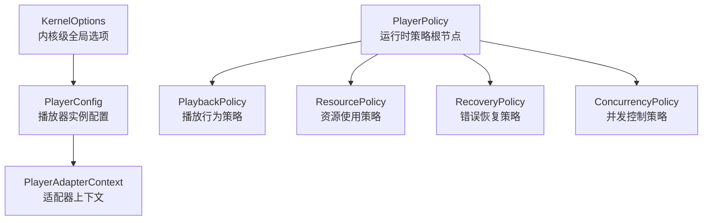
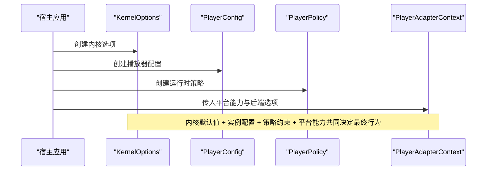
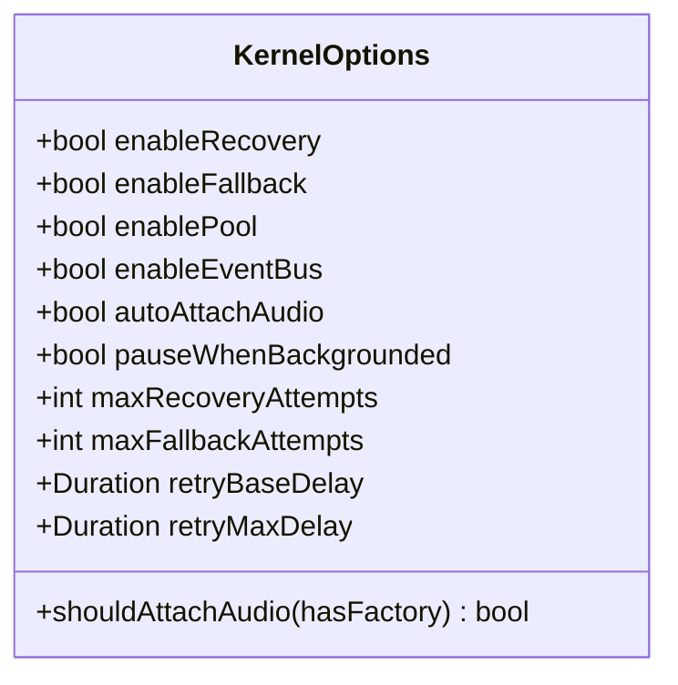
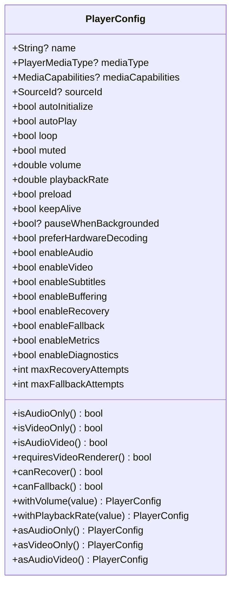
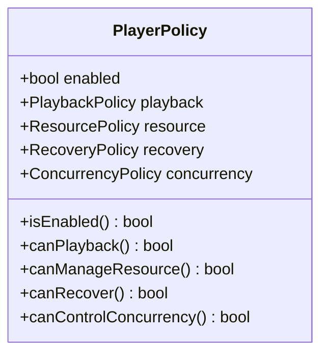
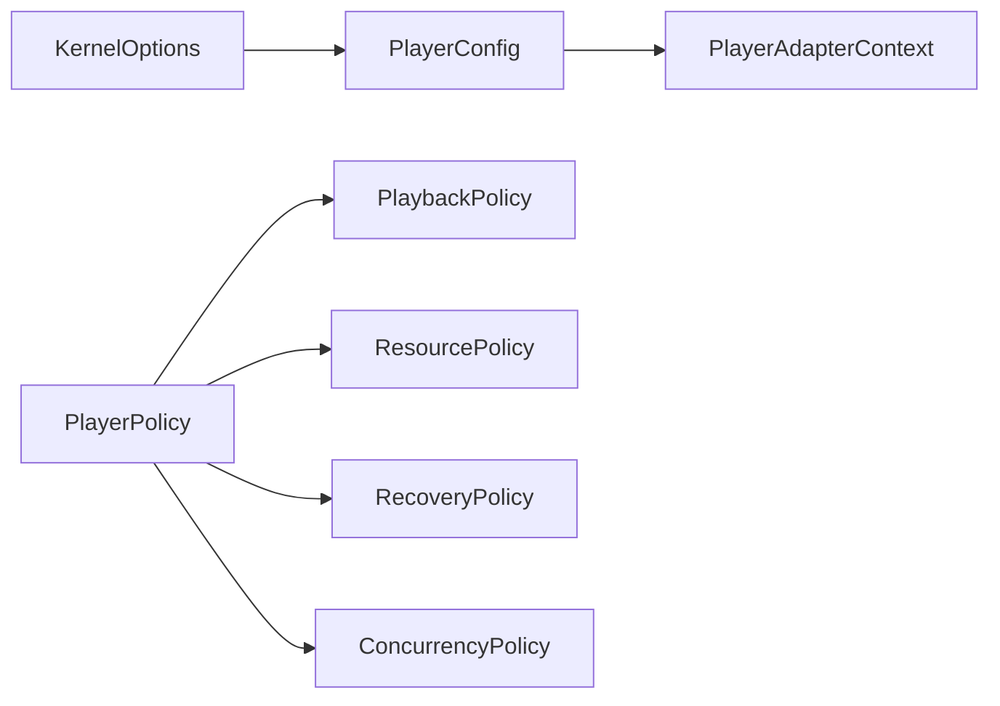
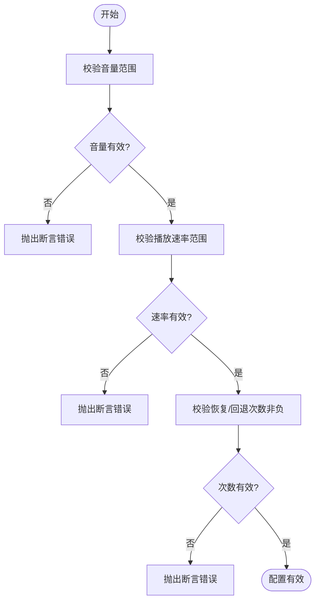

# 配置选项 API

<cite>
**本文引用的文件**   
- [player_config.dart](file://packages/media_core/lib/core/player_config.dart)
- [kernel_options.dart](file://packages/media_core/lib/kernel/kernel_options.dart)
- [player_policy.dart](file://packages/media_core/lib/policy/player_policy.dart)
- [playback_policy.dart](file://packages/media_core/lib/policy/playback_policy.dart)
- [resource_policy.dart](file://packages/media_core/lib/policy/resource_policy.dart)
- [recovery_policy.dart](file://packages/media_core/lib/policy/recovery_policy.dart)
- [concurrency_policy.dart](file://packages/media_core/lib/policy/concurrency_policy.dart)
- [player_adapter_context.dart](file://packages/media_core/lib/adapter/player_adapter_context.dart)
</cite>

## 目录
1. [简介](#简介)
2. [项目结构](#项目结构)
3. [核心组件](#核心组件)
4. [架构总览](#架构总览)
5. [详细组件分析](#详细组件分析)
6. [依赖关系分析](#依赖关系分析)
7. [性能相关配置](#性能相关配置)
8. [平台特定差异](#平台特定差异)
9. [推荐配置模板](#推荐配置模板)
10. [配置验证与错误处理](#配置验证与错误处理)
11. [故障排查指南](#故障排查指南)
12. [结论](#结论)

## 简介
本文件系统化文档化播放器内核的配置体系，覆盖 PlayerConfig、PlayerPolicy（及其子策略 PlaybackPolicy、ResourcePolicy、RecoveryPolicy、ConcurrencyPolicy）与 KernelOptions 的全部属性、默认值、作用机制、取值范围与相互影响。同时给出性能优化参数说明、平台差异、常见场景的推荐配置模板，以及配置校验与错误处理机制。

## 项目结构
配置体系由三层组成：
- 内核级全局选项 KernelOptions：控制跨切面行为（恢复、回退、事件总线、池化、后台暂停等）。
- 玩家实例配置 PlayerConfig：描述单个播放器的创建与初始偏好（自动初始化、自动播放、音量、解码偏好、功能开关等）。
- 运行时策略 PlayerPolicy：聚合播放、资源、恢复、并发等策略，提供全局规则与能力开关。

图表来源
- [kernel_options.dart:1-128](file://packages/media_core/lib/kernel/kernel_options.dart#L1-L128)
- [player_config.dart:1-591](file://packages/media_core/lib/core/player_config.dart#L1-L591)
- [player_policy.dart:1-143](file://packages/media_core/lib/policy/player_policy.dart#L1-L143)
- [playback_policy.dart:1-123](file://packages/media_core/lib/policy/playback_policy.dart#L1-L123)
- [resource_policy.dart:1-156](file://packages/media_core/lib/policy/resource_policy.dart#L1-L156)
- [recovery_policy.dart:1-169](file://packages/media_core/lib/policy/recovery_policy.dart#L1-L169)
- [concurrency_policy.dart:1-130](file://packages/media_core/lib/policy/concurrency_policy.dart#L1-L130)
- [player_adapter_context.dart:47-98](file://packages/media_core/lib/adapter/player_adapter_context.dart#L47-L98)

章节来源
- [kernel_options.dart:1-128](file://packages/media_core/lib/kernel/kernel_options.dart#L1-L128)
- [player_config.dart:1-591](file://packages/media_core/lib/core/player_config.dart#L1-L591)
- [player_policy.dart:1-143](file://packages/media_core/lib/policy/player_policy.dart#L1-L143)

## 核心组件
本节概述三类核心配置的职责边界与关键属性。

- KernelOptions
  - 职责：定义内核级默认值、恢复与回退预算、事件总线与池化开关、后台暂停策略、音频驱动自动挂载。
  - 关键点：为每个新播放器提供“起点”预算与策略；不维护单播放器状态。

- PlayerConfig
  - 职责：描述播放器如何创建与初始运行偏好；不包含运行时会话或控制器引用。
  - 关键点：音量、播放速率、预加载、硬件解码偏好、功能开关（音频/视频/字幕/缓冲）、诊断与指标收集、恢复与回退次数上限。

- PlayerPolicy
  - 职责：聚合播放、资源、恢复、并发策略，提供全局开关与能力判断。
  - 关键点：enabled 作为策略系统总开关；各子策略决定具体行为。

章节来源
- [kernel_options.dart:1-128](file://packages/media_core/lib/kernel/kernel_options.dart#L1-L128)
- [player_config.dart:1-591](file://packages/media_core/lib/core/player_config.dart#L1-L591)
- [player_policy.dart:1-143](file://packages/media_core/lib/policy/player_policy.dart#L1-L143)

## 架构总览
下图展示配置在系统中的协作关系：KernelOptions 提供内核级默认值；PlayerConfig 指定实例级偏好；PlayerPolicy 通过子策略约束运行时行为；PlayerAdapterContext 将平台能力与后端选项注入到适配层。

图表来源
- [kernel_options.dart:1-128](file://packages/media_core/lib/kernel/kernel_options.dart#L1-L128)
- [player_config.dart:1-591](file://packages/media_core/lib/core/player_config.dart#L1-L591)
- [player_policy.dart:1-143](file://packages/media_core/lib/policy/player_policy.dart#L1-L143)
- [player_adapter_context.dart:47-98](file://packages/media_core/lib/adapter/player_adapter_context.dart#L47-L98)

## 详细组件分析

### KernelOptions（内核选项）
- 作用机制
  - enableRecovery / enableFallback：开启内核级自动恢复与后端回退。
  - enablePool / enableEventBus：是否加入播放器池、是否发布内核事件。
  - autoAttachAudio：是否自动挂载平台音频会话驱动（需能力包已安装）。
  - pauseWhenBackgrounded：应用进入后台时是否暂停所有内核管理的播放句柄。
  - maxRecoveryAttempts / maxFallbackAttempts：每类错误的最大尝试次数（可被 PlayerConfig 覆盖）。
  - retryBaseDelay / retryMaxDelay：线性退避重试的基础延迟与上限。

- 默认值与取值范围
  - 布尔型开关默认多为 true。
  - 重试延迟以 Duration 表示，基础延迟秒级，上限秒级。
  - 最大尝试次数来自常量，非负整数。

- 与其他配置的交互
  - PlayerConfig 中的 enableRecovery / enableFallback 与 max*Attempts 会覆盖内核默认值。
  - shouldAttachAudio(hasFactory) 需要能力工厂存在且 autoAttachAudio 为真才挂载音频驱动。

图表来源
- [kernel_options.dart:1-128](file://packages/media_core/lib/kernel/kernel_options.dart#L1-L128)

章节来源
- [kernel_options.dart:1-128](file://packages/media_core/lib/kernel/kernel_options.dart#L1-L128)

### PlayerConfig（播放器配置）
- 作用机制
  - 生命周期与启动：autoInitialize、autoPlay、loop、preload、keepAlive。
  - 媒体输出：enableAudio、enableVideo、enableSubtitles、preferHardwareDecoding。
  - 播放控制：muted、volume、playbackRate。
  - 可靠性：enableBuffering、enableRecovery、enableFallback、maxRecoveryAttempts、maxFallbackAttempts。
  - 观测性：enableMetrics、enableDiagnostics。
  - 背景行为：pauseWhenBackgrounded（可为空，为空则委托给 KernelOptions.pauseWhenBackgrounded）。

- 默认值与取值范围
  - volume 范围受常量约束（0.0~1.0），超出会被断言拦截。
  - playbackRate 范围受常量约束，超出会被断言拦截。
  - maxRecoveryAttempts / maxFallbackAttempts 必须为非负整数。

- 派生属性与便捷方法
  - isAudioOnly / isVideoOnly / isAudioVideo：根据 MediaCapabilities 或 mediaType 推导媒体模式。
  - requiresVideoRenderer：是否需要视频渲染器。
  - canRecover / canFallback：结合开关与最大尝试次数判断是否允许恢复/回退。
  - with* 系列方法用于不可变更新；asAudioOnly/asVideoOnly/asAudioVideo 快速构造专用配置。

图表来源
- [player_config.dart:1-591](file://packages/media_core/lib/core/player_config.dart#L1-L591)

章节来源
- [player_config.dart:1-591](file://packages/media_core/lib/core/player_config.dart#L1-L591)

### PlayerPolicy（运行时策略根）
- 作用机制
  - enabled：全局启用策略系统。
  - playback：播放行为策略（自动播放、跳转、循环、缓冲行为、起始位置、最大跳转步长）。
  - resource：资源使用策略（解码器数量、带宽限制、压力降级、软件解码回退）。
  - recovery：错误恢复策略（重试次数、指数退避、网络/解码错误重试、后端/源回退）。
  - concurrency：并发控制策略（玩家实例、源加载、解码初始化、网络请求、录制任务上限）。

图表来源
- [player_policy.dart:1-143](file://packages/media_core/lib/policy/player_policy.dart#L1-L143)

章节来源
- [player_policy.dart:1-143](file://packages/media_core/lib/policy/player_policy.dart#L1-L143)

#### PlaybackPolicy（播放行为策略）
- 关键属性
  - autoPlay、allowSeek、allowBackwardSeek、loop、pauseOnBuffering、resumeAfterBuffering、startPosition、maxSeekSeconds。
- 能力判断
  - canSeekForward、canSeekBackward。

章节来源
- [playback_policy.dart:1-123](file://packages/media_core/lib/policy/playback_policy.dart#L1-L123)

#### ResourcePolicy（资源使用策略）
- 关键属性
  - enabled、maxDecoderCount、maxHardwareDecoderCount、maxBandwidthMbps、releaseOnPressure、reduceQualityOnPressure、stopPreloadOnPressure、allowSoftwareDecodeFallback。
- 能力判断
  - canAllocateDecoder(currentCount)、canAllocateHardwareDecoder(currentCount)、exceedsBandwidth(currentMbps)、shouldRelease()。

章节来源
- [resource_policy.dart:1-156](file://packages/media_core/lib/policy/resource_policy.dart#L1-L156)

#### RecoveryPolicy（错误恢复策略）
- 关键属性
  - enabled、maxRetryCount、retryDelay、exponentialBackoff、maxRetryDelay、retryOnNetworkError、retryOnDecoderError、allowBackendFallback、allowSourceFallback。
- 能力判断与计算
  - canRetry(retryCount)、getRetryDelay(retryCount)、canFallback()。

章节来源
- [recovery_policy.dart:1-169](file://packages/media_core/lib/policy/recovery_policy.dart#L1-L169)

#### ConcurrencyPolicy（并发控制策略）
- 关键属性
  - maxPlayers、maxSourceLoads、maxDecoderInitializations、maxNetworkRequests、maxRecordings、enableConcurrencyLimit。
- 能力判断
  - canCreatePlayer(currentCount)、canLoadSource(currentCount)、canInitializeDecoder(currentCount)。

章节来源
- [concurrency_policy.dart:1-130](file://packages/media_core/lib/policy/concurrency_policy.dart#L1-L130)

### PlayerAdapterContext（适配器上下文）
- 作用
  - 承载 PlayerIdentity 配置、后端选项 Map、平台能力（PlatformCapabilities）、设备画像（PlatformDeviceProfile）、编解码能力（PlatformCodecCapabilities）、调试开关。
  - 提供 option<T>(key) 读取后端选项、putOption(key, value) 写入选项。

章节来源
- [player_adapter_context.dart:47-98](file://packages/media_core/lib/adapter/player_adapter_context.dart#L47-L98)

## 依赖关系分析
- KernelOptions 与 PlayerConfig
  - KernelOptions 提供内核级默认值；PlayerConfig 可覆盖部分行为（如恢复/回退开关与次数上限）。
  - pauseWhenBackgrounded 在 PlayerConfig 中可为空，为空时采用 KernelOptions 的值。

- PlayerPolicy 与子策略
  - PlayerPolicy.enabled 控制策略系统整体可用性；各子策略在此基础上生效。
  - ResourcePolicy 与 ConcurrencyPolicy 共同约束解码器与并发上限。
  - RecoveryPolicy 决定重试与回退策略，并与 KernelOptions 的重试预算协同。

- PlayerConfig 与 PlayerAdapterContext
  - PlayerConfig 声明媒体类型与能力；PlayerAdapterContext 携带平台探测结果与后端选项，供适配层决策。

图表来源
- [kernel_options.dart:1-128](file://packages/media_core/lib/kernel/kernel_options.dart#L1-L128)
- [player_config.dart:1-591](file://packages/media_core/lib/core/player_config.dart#L1-L591)
- [player_policy.dart:1-143](file://packages/media_core/lib/policy/player_policy.dart#L1-L143)
- [playback_policy.dart:1-123](file://packages/media_core/lib/policy/playback_policy.dart#L1-L123)
- [resource_policy.dart:1-156](file://packages/media_core/lib/policy/resource_policy.dart#L1-L156)
- [recovery_policy.dart:1-169](file://packages/media_core/lib/policy/recovery_policy.dart#L1-L169)
- [concurrency_policy.dart:1-130](file://packages/media_core/lib/policy/concurrency_policy.dart#L1-L130)
- [player_adapter_context.dart:47-98](file://packages/media_core/lib/adapter/player_adapter_context.dart#L47-L98)

## 性能相关配置
- 缓冲区与缓冲行为
  - PlayerConfig.enableBuffering：是否启用缓冲支持。
  - PlaybackPolicy.pauseOnBuffering / resumeAfterBuffering：缓冲期间暂停与恢复行为。
  - ResourcePolicy.stopPreloadOnPressure：内存压力下停止预加载。

- 解码器选择与数量
  - PlayerConfig.preferHardwareDecoding：优先硬件解码。
  - ResourcePolicy.maxDecoderCount / maxHardwareDecoderCount：解码器与硬件解码器上限。
  - ResourcePolicy.allowSoftwareDecodeFallback：允许软件解码回退。

- 内存与带宽
  - ResourcePolicy.releaseOnPressure / reduceQualityOnPressure：内存压力下释放资源与降低质量。
  - ResourcePolicy.maxBandwidthMbps：带宽上限（Mbps）。

- 并发与实例数
  - ConcurrencyPolicy.maxPlayers / maxSourceLoads / maxDecoderInitializations / maxNetworkRequests / maxRecordings：各类并发上限。
  - ConcurrencyPolicy.enableConcurrencyLimit：是否启用并发限制。

- 恢复与回退对性能的影响
  - RecoveryPolicy.exponentialBackoff / maxRetryDelay：指数退避与最大重试延迟，避免雪崩。
  - KernelOptions.retryBaseDelay / retryMaxDelay：内核级重试延迟上下限。

章节来源
- [player_config.dart:1-591](file://packages/media_core/lib/core/player_config.dart#L1-L591)
- [playback_policy.dart:1-123](file://packages/media_core/lib/policy/playback_policy.dart#L1-L123)
- [resource_policy.dart:1-156](file://packages/media_core/lib/policy/resource_policy.dart#L1-L156)
- [concurrency_policy.dart:1-130](file://packages/media_core/lib/policy/concurrency_policy.dart#L1-L130)
- [recovery_policy.dart:1-169](file://packages/media_core/lib/policy/recovery_policy.dart#L1-L169)
- [kernel_options.dart:1-128](file://packages/media_core/lib/kernel/kernel_options.dart#L1-L128)

## 平台特定差异
- Android/iOS
  - KernelOptions.autoAttachAudio：若能力包已安装（例如媒体会话），内核会自动挂载平台音频驱动，便于通知栏与系统媒体控制。
  - KernelOptions.pauseWhenBackgrounded：默认开启，应用进入后台时暂停所有内核管理句柄；关闭后适合音乐/有声书等后台播放场景，由宿主负责用户提示与后台执行权限。
  - PlayerConfig.pauseWhenBackgrounded：可为空，为空时继承 KernelOptions 设置；适用于列表页多个播放器中仅主播放保持后台播放的场景。

- 桌面端
  - 通常不需要自动挂载平台媒体会话；可根据需求关闭 autoAttachAudio。
  - 资源与并发上限可适当提高（如 maxDecoderCount、maxPlayers），以提升多窗口或多标签体验。

- 通用
  - PlayerAdapterContext.platform / device / codecs：由平台探测填充，适配层据此选择最佳后端与解码路径。

章节来源
- [kernel_options.dart:1-128](file://packages/media_core/lib/kernel/kernel_options.dart#L1-L128)
- [player_config.dart:1-591](file://packages/media_core/lib/core/player_config.dart#L1-L591)
- [player_adapter_context.dart:47-98](file://packages/media_core/lib/adapter/player_adapter_context.dart#L47-L98)

## 推荐配置模板
以下为不同场景下的建议配置方向（以属性组合为主，非代码片段）：

- 移动端优化（省电与流畅）
  - PlayerConfig：preferHardwareDecoding=true；enableBuffering=true；enableSubtitles=false；enableDiagnostics=false；preload=true；keepAlive=false。
  - ResourcePolicy：maxDecoderCount=2；maxHardwareDecoderCount=1；maxBandwidthMbps=10；releaseOnPressure=true；reduceQualityOnPressure=true；stopPreloadOnPressure=true；allowSoftwareDecodeFallback=true。
  - ConcurrencyPolicy：maxPlayers=2；maxSourceLoads=2；maxDecoderInitializations=1；maxNetworkRequests=4；enableConcurrencyLimit=true。
  - RecoveryPolicy：maxRetryCount=3；exponentialBackoff=true；maxRetryDelay=30s；retryOnNetworkError=true；retryOnDecoderError=true；allowBackendFallback=true；allowSourceFallback=true。
  - KernelOptions：pauseWhenBackgrounded=true；autoAttachAudio=true（若使用媒体会话）；retryBaseDelay=1s；retryMaxDelay=8s。

- 桌面端高性能（多实例与高吞吐）
  - PlayerConfig：preferHardwareDecoding=true；enableBuffering=true；enableSubtitles=true；enableMetrics=true；enableDiagnostics=false；preload=true；keepAlive=true。
  - ResourcePolicy：maxDecoderCount=6；maxHardwareDecoderCount=4；maxBandwidthMbps=50；releaseOnPressure=false；reduceQualityOnPressure=false；stopPreloadOnPressure=false；allowSoftwareDecodeFallback=true。
  - ConcurrencyPolicy：maxPlayers=8；maxSourceLoads=8；maxDecoderInitializations=4；maxNetworkRequests=16；enableConcurrencyLimit=true。
  - RecoveryPolicy：maxRetryCount=5；exponentialBackoff=true；maxRetryDelay=60s；retryOnNetworkError=true；retryOnDecoderError=true；allowBackendFallback=true；allowSourceFallback=true。
  - KernelOptions：pauseWhenBackgrounded=false；autoAttachAudio=false；retryBaseDelay=1s；retryMaxDelay=10s。

- 低内存设备（稳定优先）
  - PlayerConfig：preferHardwareDecoding=true；enableBuffering=true；enableSubtitles=false；enableMetrics=false；enableDiagnostics=false；preload=false；keepAlive=false。
  - ResourcePolicy：maxDecoderCount=1；maxHardwareDecoderCount=1；maxBandwidthMbps=5；releaseOnPressure=true；reduceQualityOnPressure=true；stopPreloadOnPressure=true；allowSoftwareDecodeFallback=true。
  - ConcurrencyPolicy：maxPlayers=1；maxSourceLoads=1；maxDecoderInitializations=1；maxNetworkRequests=2；enableConcurrencyLimit=true。
  - RecoveryPolicy：maxRetryCount=2；exponentialBackoff=true；maxRetryDelay=20s；retryOnNetworkError=true；retryOnDecoderError=true；allowBackendFallback=true；allowSourceFallback=true。
  - KernelOptions：pauseWhenBackgrounded=true；autoAttachAudio=false；retryBaseDelay=1s；retryMaxDelay=8s。

## 配置验证与错误处理
- PlayerConfig 构造断言
  - volume 必须在合法范围内（0.0~1.0），否则抛出断言错误。
  - playbackRate 必须在支持的范围内，否则抛出断言错误。
  - maxRecoveryAttempts 与 maxFallbackAttempts 必须非负，否则抛出断言错误。

- 派生能力判断
  - canRecover：当 enableRecovery=true 且 maxRecoveryAttempts>0 时才允许恢复。
  - canFallback：当 enableFallback=true 且 maxFallbackAttempts>0 时才允许回退。
  - isMinimal：当多项可选功能均关闭时为最小配置，有助于节省资源。

- 策略能力判断
  - ResourcePolicy.canAllocateDecoder/currentCount：在未启用资源管理时直接放行，否则比较当前计数与上限。
  - ResourcePolicy.exceedsBandwidth/currentMbps：未启用时不判定超限；启用后超过阈值返回 true。
  - RecoveryPolicy.canRetry/retryCount：未启用恢复策略时不允许重试；否则比较当前重试次数与上限。
  - RecoveryPolicy.getRetryDelay/retryCount：支持指数退避并限制最大延迟，避免溢出与异常延迟。
  - ConcurrencyPolicy.canCreatePlayer/canLoadSource/canInitializeDecoder：未启用并发限制时放行；否则比较当前计数与上限。

图表来源
- [player_config.dart:1-591](file://packages/media_core/lib/core/player_config.dart#L1-L591)

章节来源
- [player_config.dart:1-591](file://packages/media_core/lib/core/player_config.dart#L1-L591)
- [resource_policy.dart:1-156](file://packages/media_core/lib/policy/resource_policy.dart#L1-L156)
- [recovery_policy.dart:1-169](file://packages/media_core/lib/policy/recovery_policy.dart#L1-L169)
- [concurrency_policy.dart:1-130](file://packages/media_core/lib/policy/concurrency_policy.dart#L1-L130)

## 故障排查指南
- 现象：音量或播放速率报错
  - 检查 PlayerConfig.volume 与 PlayerConfig.playbackRate 是否在合法范围。
  - 参考断言逻辑与常量约束进行修正。

- 现象：频繁恢复失败或卡顿
  - 检查 RecoveryPolicy.maxRetryCount、exponentialBackoff、maxRetryDelay。
  - 检查 KernelOptions.retryBaseDelay、retryMaxDelay 是否合理。
  - 确认 ResourcePolicy.allowSoftwareDecodeFallback 是否开启以应对硬件解码失败。

- 现象：内存压力大导致崩溃或降质
  - 检查 ResourcePolicy.releaseOnPressure、reduceQualityOnPressure、stopPreloadOnPressure。
  - 调整 maxDecoderCount、maxHardwareDecoderCount 与 maxBandwidthMbps。

- 现象：并发过高导致资源争用
  - 检查 ConcurrencyPolicy.maxPlayers、maxSourceLoads、maxDecoderInitializations、maxNetworkRequests。
  - 确保 enableConcurrencyLimit=true。

- 现象：后台播放行为不符合预期
  - 检查 KernelOptions.pauseWhenBackgrounded 与 PlayerConfig.pauseWhenBackgrounded（为空时继承内核设置）。
  - 如需后台播放，关闭 pauseWhenBackgrounded 并确保宿主正确处理媒体会话与后台权限。

章节来源
- [player_config.dart:1-591](file://packages/media_core/lib/core/player_config.dart#L1-L591)
- [recovery_policy.dart:1-169](file://packages/media_core/lib/policy/recovery_policy.dart#L1-L169)
- [resource_policy.dart:1-156](file://packages/media_core/lib/policy/resource_policy.dart#L1-L156)
- [concurrency_policy.dart:1-130](file://packages/media_core/lib/policy/concurrency_policy.dart#L1-L130)
- [kernel_options.dart:1-128](file://packages/media_core/lib/kernel/kernel_options.dart#L1-L128)

## 结论
本 API 文档系统化梳理了 KernelOptions、PlayerConfig 与 PlayerPolicy（含 PlaybackPolicy、ResourcePolicy、RecoveryPolicy、ConcurrencyPolicy）的配置项、默认值、作用机制与相互影响。通过合理的性能参数调优与平台差异化设置，可在移动端、桌面端与低内存设备上获得更稳定的播放体验。建议在业务侧依据场景选择合适的配置模板，并结合配置验证与错误处理机制进行健壮性保障。