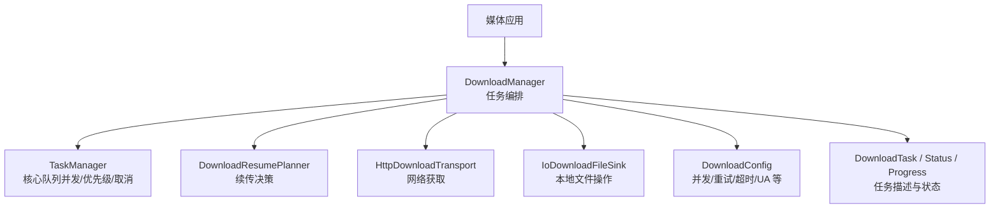
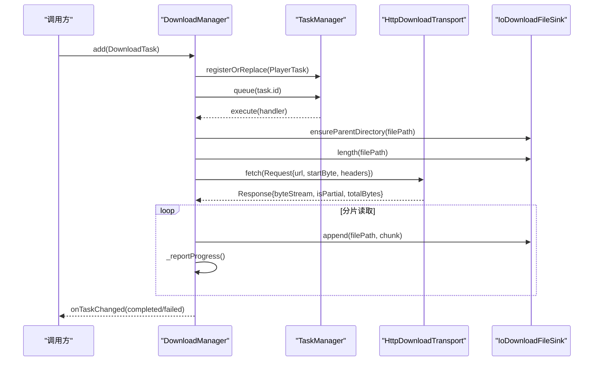
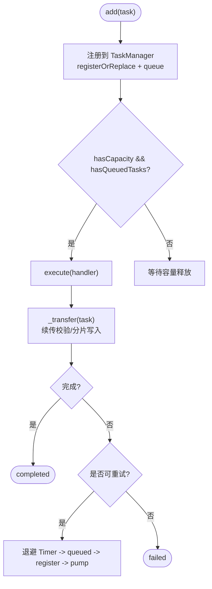
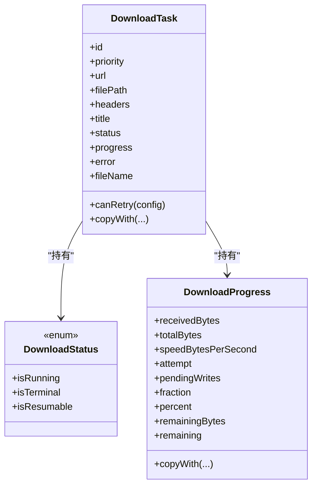
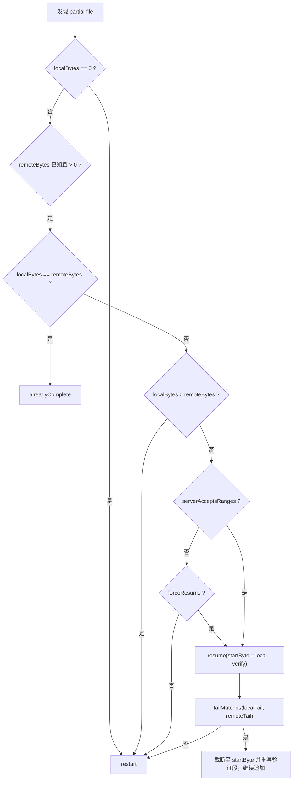
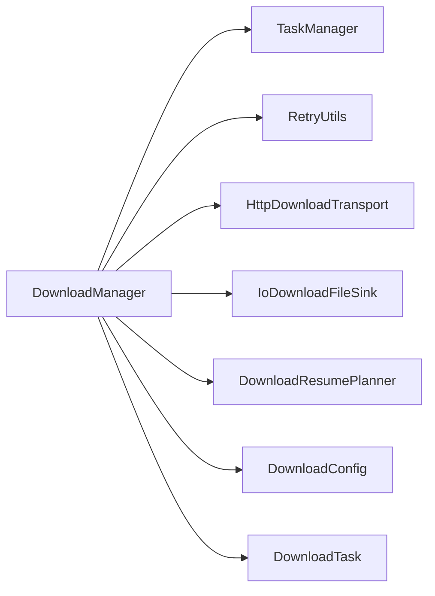
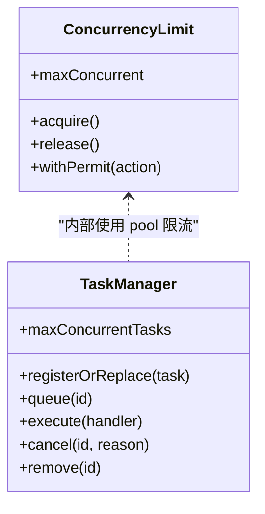
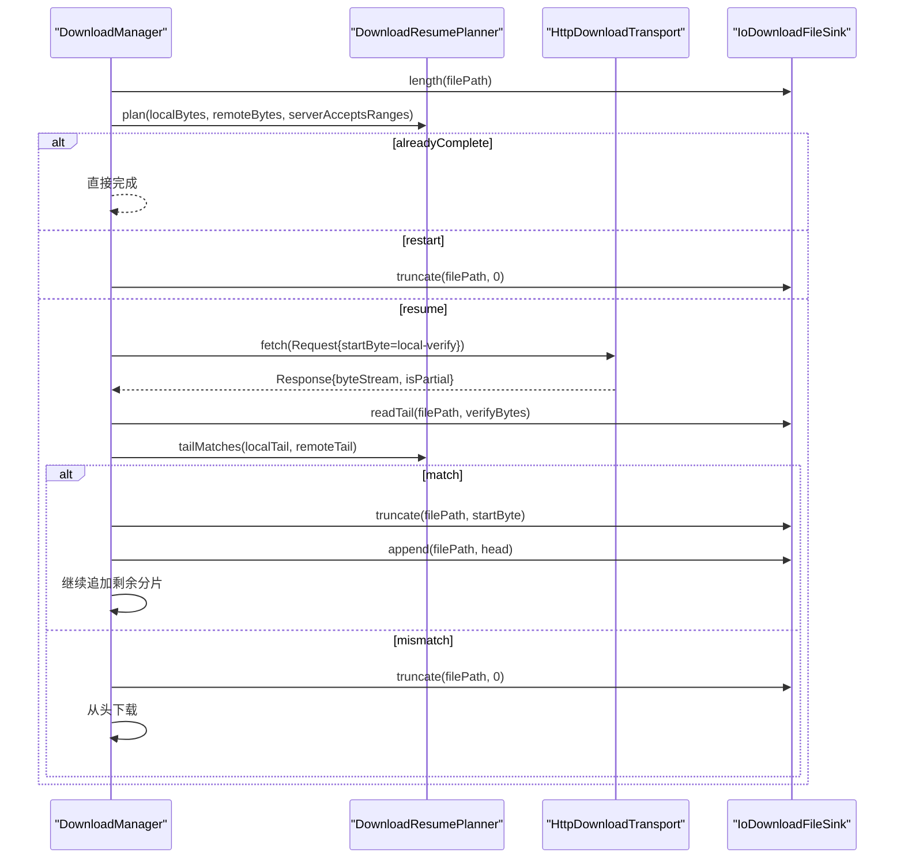

# 下载管理 API

<cite>
**本文引用的文件**   
- [packages/media_core_download/lib/media_core_download.dart](file://packages/media_core_download/lib/media_core_download.dart)
- [packages/media_core_download/README.md](file://packages/media_core_download/README.md)
- [packages/media_core_download/lib/src/download_manager.dart](file://packages/media_core_download/lib/src/download_manager.dart)
- [packages/media_core_download/lib/src/download_config.dart](file://packages/media_core_download/lib/src/download_config.dart)
- [packages/media_core_download/lib/src/download_task.dart](file://packages/media_core_download/lib/src/download_task.dart)
- [packages/media_core_download/lib/src/download_status.dart](file://packages/media_core_download/lib/src/download_status.dart)
- [packages/media_core_download/lib/src/download_progress.dart](file://packages/media_core_download/lib/src/download_progress.dart)
- [packages/media_core_download/lib/src/download_resume.dart](file://packages/media_core_download/lib/src/download_resume.dart)
- [packages/media_core_download/lib/src/download_transport.dart](file://packages/media_core_download/lib/src/download_transport.dart)
- [packages/media_core_download/lib/src/download_file_sink.dart](file://packages/media_core_download/lib/src/download_file_sink.dart)
- [packages/media_core_download/test/download_manager_test.dart](file://packages/media_core_download/test/download_manager_test.dart)
- [doc/zh-Hans/task.md](file://doc/zh-Hans/task.md)
- [packages/media_core/lib/concurrency/concurrency_limit.dart](file://packages/media_core/lib/concurrency/concurrency_limit.dart)
</cite>

## 目录
1. [简介](#简介)
2. [项目结构](#项目结构)
3. [核心组件](#核心组件)
4. [架构总览](#架构总览)
5. [详细组件分析](#详细组件分析)
6. [依赖关系分析](#依赖关系分析)
7. [性能与并发特性](#性能与并发特性)
8. [断点续传机制](#断点续传机制)
9. [API 参考：DownloadManager 任务管理接口](#api-参考downloadmanager-任务管理接口)
10. [使用示例与最佳实践](#使用示例与最佳实践)
11. [故障排查指南](#故障排查指南)
12. [结论](#结论)

## 简介
本文件面向需要集成“下载管理”能力的开发者，重点说明以下能力：
- 基于核心 TaskManager 的有界并发队列、优先级调度与取消语义。
- DownloadManager 的任务添加、暂停/恢复、重试、清理等生命周期管理。
- 断点续传处理器 DownloadResumePlanner 的分片校验、完整性验证与失败回退策略。
- 网络传输抽象 DownloadTransport / HttpDownloadTransport 与本地文件抽象 DownloadFileSink / IoDownloadFileSink。
- 进度节流、内存记账、错误处理与重试预算等工程化实践。

该模块复用 media_core 核心的任务模型（TaskId、PlayerTask、TaskState、TaskPriority、RetryUtils），不重复实现调度与重试策略，仅补充下载特有的“暂停语义”和“续传校验”。

**章节来源**
- [packages/media_core_download/README.md:1-73](file://packages/media_core_download/README.md#L1-L73)
- [doc/zh-Hans/task.md:1-26](file://doc/zh-Hans/task.md#L1-L26)

## 项目结构
media_core_download 包以“职责拆分 + 可替换实现”的方式组织：
- 对外导出统一入口：media_core_download.dart
- 配置与数据模型：DownloadConfig、DownloadTask、DownloadStatus、DownloadProgress
- 核心编排：DownloadManager（任务注册、调度、暂停/恢复、重试、清理）
- 断点续传决策：DownloadResumePlanner
- 可替换层：DownloadTransport（网络）、DownloadFileSink（文件 IO）

**图表来源**
- [packages/media_core_download/lib/src/download_manager.dart:74-149](file://packages/media_core_download/lib/src/download_manager.dart#L74-L149)
- [packages/media_core_download/lib/src/download_resume.dart:45-122](file://packages/media_core_download/lib/src/download_resume.dart#L45-L122)
- [packages/media_core_download/lib/src/download_config.dart:1-82](file://packages/media_core_download/lib/src/download_config.dart#L1-L82)
- [packages/media_core_download/lib/src/download_task.dart:7-102](file://packages/media_core_download/lib/src/download_task.dart#L7-L102)

**章节来源**
- [packages/media_core_download/lib/media_core_download.dart:1-33](file://packages/media_core_download/lib/media_core_download.dart#L1-L33)
- [packages/media_core_download/lib/src/download_manager.dart:29-73](file://packages/media_core_download/lib/src/download_manager.dart#L29-L73)

## 核心组件
- DownloadManager：下载队列入口，负责任务注册、调度、暂停/恢复、重试、清理、进度上报与内存记账。
- DownloadTask：任务值对象，包含 URL、目标路径、优先级、请求头、标题、状态、进度与错误信息。
- DownloadStatus：任务生命周期状态（idle/queued/running/paused/stopped/completed/failed/cancelled）。
- DownloadProgress：传输进度（已接收字节、总字节、速度、尝试次数、待写入数）。
- DownloadConfig：并发上限、重试次数、退避延迟、超时、重定向、强制续传、尾部校验字节数、User-Agent。
- DownloadResumePlanner：断点续传决策器，决定 restart/resume/alreadyComplete，并提供尾部一致性校验。
- DownloadTransport / HttpDownloadTransport：网络获取抽象，支持 Range 分片、Content-Range 解析、重定向与超时。
- DownloadFileSink / IoDownloadFileSink：本地文件抽象，提供 ensureParentDirectory、length、append、truncate、readTail、delete 等操作。

**章节来源**
- [packages/media_core_download/lib/src/download_manager.dart:74-149](file://packages/media_core_download/lib/src/download_manager.dart#L74-L149)
- [packages/media_core_download/lib/src/download_task.dart:7-102](file://packages/media_core_download/lib/src/download_task.dart#L7-L102)
- [packages/media_core_download/lib/src/download_status.dart:1-45](file://packages/media_core_download/lib/src/download_status.dart#L1-L45)
- [packages/media_core_download/lib/src/download_progress.dart:1-73](file://packages/media_core_download/lib/src/download_progress.dart#L1-L73)
- [packages/media_core_download/lib/src/download_config.dart:1-82](file://packages/media_core_download/lib/src/download_config.dart#L1-L82)
- [packages/media_core_download/lib/src/download_resume.dart:45-122](file://packages/media_core_download/lib/src/download_resume.dart#L45-L122)

## 架构总览
DownloadManager 将下载任务映射为 media_core 的 PlayerTask，交由 TaskManager 进行并发限制、优先级排序与取消；自身专注下载领域逻辑：暂停语义、续传校验、重试预算与进度节流。

**图表来源**
- [packages/media_core_download/lib/src/download_manager.dart:379-419](file://packages/media_core_download/lib/src/download_manager.dart#L379-L419)
- [packages/media_core_download/lib/src/download_manager.dart:497-628](file://packages/media_core_download/lib/src/download_manager.dart#L497-L628)
- [packages/media_core_download/lib/src/download_manager.dart:641-676](file://packages/media_core_download/lib/src/download_manager.dart#L641-L676)

**章节来源**
- [packages/media_core_download/lib/src/download_manager.dart:49-73](file://packages/media_core_download/lib/src/download_manager.dart#L49-L73)
- [packages/media_core_download/lib/src/download_manager.dart:379-419](file://packages/media_core_download/lib/src/download_manager.dart#L379-L419)

## 详细组件分析

### DownloadManager：任务编排与并发控制
- 通过 TaskManager(maxConcurrentTasks: config.maxConcurrent) 创建固定容量的核心队列，确保并发上限在构造时确定。
- add/start/pause/resume/cancel/retry/clear/remove 等方法覆盖完整任务生命周期。
- 进度事件按 200ms 窗口节流，避免高频 UI 刷新与内存记账开销。
- 内存记账使用 MediaCoreMemory，对运行中任务按 receivedBytes 或默认缓冲估算上报。
- 失败走 RetryUtils.backoff 与 until(maxAttempts)，与框架其他模块保持一致的重试策略。

**图表来源**
- [packages/media_core_download/lib/src/download_manager.dart:153-185](file://packages/media_core_download/lib/src/download_manager.dart#L153-L185)
- [packages/media_core_download/lib/src/download_manager.dart:406-483](file://packages/media_core_download/lib/src/download_manager.dart#L406-L483)
- [packages/media_core_download/lib/src/download_manager.dart:696-753](file://packages/media_core_download/lib/src/download_manager.dart#L696-L753)

**章节来源**
- [packages/media_core_download/lib/src/download_manager.dart:74-149](file://packages/media_core_download/lib/src/download_manager.dart#L74-L149)
- [packages/media_core_download/lib/src/download_manager.dart:153-315](file://packages/media_core_download/lib/src/download_manager.dart#L153-L315)
- [packages/media_core_download/lib/src/download_manager.dart:379-483](file://packages/media_core_download/lib/src/download_manager.dart#L379-L483)
- [packages/media_core_download/lib/src/download_manager.dart:696-753](file://packages/media_core_download/lib/src/download_manager.dart#L696-L753)

### DownloadTask / DownloadStatus / DownloadProgress
- DownloadTask 承载下载元数据与运行时状态，支持 copyWith 更新状态与进度。
- DownloadStatus 定义 idle/queued/running/paused/stopped/completed/failed/cancelled，并给出 isRunning/isTerminal/isResumable 判断。
- DownloadProgress 提供 fraction/percent/remainingBytes/remaining 等便捷计算，以及 attempt 与 pendingWrites 暴露给上层诊断。

**图表来源**
- [packages/media_core_download/lib/src/download_task.dart:7-102](file://packages/media_core_download/lib/src/download_task.dart#L7-L102)
- [packages/media_core_download/lib/src/download_status.dart:1-45](file://packages/media_core_download/lib/src/download_status.dart#L1-L45)
- [packages/media_core_download/lib/src/download_progress.dart:1-73](file://packages/media_core_download/lib/src/download_progress.dart#L1-L73)

**章节来源**
- [packages/media_core_download/lib/src/download_task.dart:7-102](file://packages/media_core_download/lib/src/download_task.dart#L7-L102)
- [packages/media_core_download/lib/src/download_status.dart:1-45](file://packages/media_core_download/lib/src/download_status.dart#L1-L45)
- [packages/media_core_download/lib/src/download_progress.dart:1-73](file://packages/media_core_download/lib/src/download_progress.dart#L1-L73)

### DownloadConfig：并发与重试参数
- maxConcurrent：同时运行的下载数量，默认 3。
- maxAttempts：每个任务最大尝试次数。
- retryDelay：退避基础延迟。
- timeout：连接/读取超时。
- maxRedirects：跟随重定向的最大次数。
- forceResume：即使服务器未声明 accept-ranges，也允许尝试续传（谨慎开启）。
- verifyTailBytes：续传前从尾部重新读取并对比的字节数。
- userAgent：每次请求携带的 User-Agent。

**章节来源**
- [packages/media_core_download/lib/src/download_config.dart:1-82](file://packages/media_core_download/lib/src/download_config.dart#L1-L82)

### DownloadResumePlanner：断点续传决策
- plan(localBytes, remoteBytes, serverAcceptsRanges) 返回 restart/resume/alreadyComplete 决策。
- resume 时通过 Range 请求尾部 verifyTailBytes 字节并与本地比对，匹配则截断至验证起点并重写验证段后继续追加。
- tailMatches(localTail, remoteTail) 逐字节比较，长度不一致或任一为空即视为不匹配。

**图表来源**
- [packages/media_core_download/lib/src/download_resume.dart:45-122](file://packages/media_core_download/lib/src/download_resume.dart#L45-L122)
- [packages/media_core_download/lib/src/download_manager.dart:527-628](file://packages/media_core_download/lib/src/download_manager.dart#L527-L628)

**章节来源**
- [packages/media_core_download/lib/src/download_resume.dart:45-122](file://packages/media_core_download/lib/src/download_resume.dart#L45-L122)
- [packages/media_core_download/lib/src/download_manager.dart:527-628](file://packages/media_core_download/lib/src/download_manager.dart#L527-L628)

### DownloadTransport / DownloadFileSink：可替换的网络与存储层
- DownloadTransport / HttpDownloadTransport：封装 HTTP 下载，支持 Range 分片、Content-Range 解析、重定向与超时。
- DownloadFileSink / IoDownloadFileSink：封装本地文件操作，提供 ensureParentDirectory、length、append、truncate、readTail、delete 等。
- 宿主可为 Web 平台提供自定义 Transport/FileSink 实现。

**章节来源**
- [packages/media_core_download/lib/src/download_transport.dart](file://packages/media_core_download/lib/src/download_transport.dart)
- [packages/media_core_download/lib/src/download_file_sink.dart](file://packages/media_core_download/lib/src/download_file_sink.dart)
- [packages/media_core_download/README.md:61-67](file://packages/media_core_download/README.md#L61-L67)

## 依赖关系分析
- DownloadManager 依赖 core 的 TaskManager 做并发与优先级调度，依赖 RetryUtils 做退避与重试预算。
- DownloadManager 组合 DownloadTransport 与 DownloadFileSink，解耦网络与存储实现。
- DownloadResumePlanner 依赖 DownloadConfig 中的 verifyTailBytes 与 forceResume。
- DownloadTask 依赖 TaskId 与 TaskPriority，与核心任务模型一致。

**图表来源**
- [packages/media_core_download/lib/src/download_manager.dart:74-149](file://packages/media_core_download/lib/src/download_manager.dart#L74-L149)
- [packages/media_core_download/lib/src/download_resume.dart:45-122](file://packages/media_core_download/lib/src/download_resume.dart#L45-L122)
- [packages/media_core_download/lib/src/download_task.dart:1-6](file://packages/media_core_download/lib/src/download_task.dart#L1-L6)

**章节来源**
- [packages/media_core_download/lib/src/download_manager.dart:49-73](file://packages/media_core_download/lib/src/download_manager.dart#L49-L73)

## 性能与并发特性
- 有界并发：TaskManager(maxConcurrentTasks: config.maxConcurrent) 在构造时固定容量，避免动态扩容带来的不确定性。
- 优先级调度：DownloadTask.priority 映射到 TaskPriority，由核心队列按优先级、创建时间与 ID 确定性排序。
- 进度节流：onTaskChanged 每 200ms 窗口发一次进度，首块立即上报，终态带精确字节数，中间过程节流。
- 内存记账：运行中任务按 receivedBytes 或默认缓冲估算上报，暂停任务不计入占用。
- 重试退避：使用 RetryUtils.backoff(attempt, base: retryDelay) 与 until(maxAttempts) 控制重试预算与间隔。

**图表来源**
- [packages/media_core/lib/concurrency/concurrency_limit.dart:35-111](file://packages/media_core/lib/concurrency/concurrency_limit.dart#L35-L111)
- [doc/zh-Hans/task.md:11-21](file://doc/zh-Hans/task.md#L11-L21)

**章节来源**
- [packages/media_core_download/lib/src/download_manager.dart:117-126](file://packages/media_core_download/lib/src/download_manager.dart#L117-L126)
- [packages/media_core_download/lib/src/download_manager.dart:326-338](file://packages/media_core_download/lib/src/download_manager.dart#L326-L338)
- [packages/media_core_download/lib/src/download_manager.dart:696-753](file://packages/media_core_download/lib/src/download_manager.dart#L696-L753)
- [packages/media_core/lib/concurrency/concurrency_limit.dart:35-111](file://packages/media_core/lib/concurrency/concurrency_limit.dart#L35-L111)

## 断点续传机制
- 当存在 partial file 时，先通过 DownloadResumePlanner.plan 决定 restart/resume/alreadyComplete。
- resume 路径：向服务端请求 Range: bytes=<localBytes - verifyTailBytes>-，取回尾部 verifyTailBytes 字节与本地尾部比对。
- 匹配：truncate 到验证起点，重写验证段，然后继续 append。
- 不匹配：truncate(0) 从头下载，避免“播到某点就断”的难以排查的损坏文件。
- 若服务端忽略 Range 返回完整内容，自动 truncate 并从 0 开始重新下载。

**图表来源**
- [packages/media_core_download/lib/src/download_resume.dart:45-122](file://packages/media_core_download/lib/src/download_resume.dart#L45-L122)
- [packages/media_core_download/lib/src/download_manager.dart:527-628](file://packages/media_core_download/lib/src/download_manager.dart#L527-L628)

**章节来源**
- [packages/media_core_download/lib/src/download_resume.dart:45-122](file://packages/media_core_download/lib/src/download_resume.dart#L45-L122)
- [packages/media_core_download/lib/src/download_manager.dart:527-628](file://packages/media_core_download/lib/src/download_manager.dart#L527-L628)

## API 参考：DownloadManager 任务管理接口
- add(task)：添加任务到队列；同一 id 非终态不可替换。
- remove(id, deleteFile=false)：移除任务及可选删除部分文件。
- start(id)：启动排队任务；若已在队列或运行中则幂等。
- pause(id)：暂停运行中或排队中的任务；保留 partial file。
- resume(id)：恢复暂停或停止的任务。
- cancel(id)：标记任务为已取消；保留 partial file。
- retry(id)：清空重试预算并重新入队。
- clearCompleted()：清理已完成任务。
- updateConfig(config)：更新配置（maxConcurrent 需重建实例才生效）。
- onTaskChanged：订阅任务变化与进度。
- runningCount / canStartMore：查看当前运行数与是否有容量。
- task(id)：查询任务。
- queue：暴露底层 TaskManager 供宿主观察指标。

注意：
- 进度事件按 200ms 窗口节流，首块与终态不受节流影响。
- 暂停语义使任务离开核心队列，避免空闲槽位自动重启。
- 续传校验失败会触发从头下载，而非追加损坏片段。

**章节来源**
- [packages/media_core_download/lib/src/download_manager.dart:153-315](file://packages/media_core_download/lib/src/download_manager.dart#L153-L315)
- [packages/media_core_download/lib/src/download_manager.dart:117-126](file://packages/media_core_download/lib/src/download_manager.dart#L117-L126)
- [packages/media_core_download/lib/src/download_manager.dart:641-676](file://packages/media_core_download/lib/src/download_manager.dart#L641-L676)

## 使用示例与最佳实践

### 批量下载
- 多次调用 add 添加多个 DownloadTask，利用 TaskManager 的优先级与并发上限自动调度。
- 建议为不同业务设置不同 priority，例如“用户主动点击”的高优先级，“后台预取”的低优先级。

**章节来源**
- [packages/media_core_download/lib/src/download_manager.dart:379-419](file://packages/media_core_download/lib/src/download_manager.dart#L379-L419)

### 限速控制
- 通过 DownloadConfig.maxConcurrent 控制并发下载数量，间接限制带宽占用。
- 结合系统资源压力（如内存/IO）动态调整 maxConcurrent，避免拖慢整体体验。

**章节来源**
- [packages/media_core_download/lib/src/download_config.dart:19-25](file://packages/media_core_download/lib/src/download_config.dart#L19-L25)

### 后台下载
- 使用 pause/resume 保持 partial file，进程重建后可恢复。
- 将任务持久化到宿主存储，并在启动时根据 filePath 与远端大小决定是否续传。

**章节来源**
- [packages/media_core_download/lib/src/download_manager.dart:317-357](file://packages/media_core_download/lib/src/download_manager.dart#L317-L357)
- [packages/media_core_download/README.md:54-60](file://packages/media_core_download/README.md#L54-L60)

### 网络优化
- 合理设置 timeout、maxRedirects、userAgent，避免被服务端拒绝或误判。
- 对于不支持 Range 的服务端，谨慎开启 forceResume，避免整文件覆盖导致的数据损坏。

**章节来源**
- [packages/media_core_download/lib/src/download_config.dart:33-58](file://packages/media_core_download/lib/src/download_config.dart#L33-L58)

### 存储管理
- 使用 IoDownloadFileSink.ensureParentDirectory 确保目录存在。
- 使用 truncate/readTail 配合续传校验，保证文件完整性。
- 清理已完成任务时使用 clearCompleted，减少 UI 与内存负担。

**章节来源**
- [packages/media_core_download/lib/src/download_manager.dart:497-506](file://packages/media_core_download/lib/src/download_manager.dart#L497-L506)
- [packages/media_core_download/lib/src/download_manager.dart:678-694](file://packages/media_core_download/lib/src/download_manager.dart#L678-L694)

### 错误处理
- 捕获 onTaskChanged 中的 failed 状态，结合 error 字段展示原因。
- 使用 retry 重置尝试次数并重新入队；超过 maxAttempts 后不再自动重试。
- 区分 _ResumeMismatch（续传校验失败）与普通网络错误，前者会触发从头下载。

**章节来源**
- [packages/media_core_download/lib/src/download_manager.dart:696-753](file://packages/media_core_download/lib/src/download_manager.dart#L696-L753)
- [packages/media_core_download/lib/src/download_manager.dart:510-524](file://packages/media_core_download/lib/src/download_manager.dart#L510-L524)

## 故障排查指南
常见问题与定位要点：
- 任务无法启动：检查 TaskManager 是否已满（runningCount/canStartMore），确认 add 是否抛出 StateError（重复 id 且非终态）。
- 续传无效：确认服务端是否支持 Range；若 ignore Range，会自动从头下载。
- 文件损坏：检查 verifyTailBytes 是否过小；必要时增大或关闭 forceResume。
- 进度不更新：确认 onTaskChanged 监听是否存在；注意 200ms 节流窗口。
- 内存增长：检查运行中任务数量与 receivedBytes；暂停任务不应计入内存占用。

测试用例覆盖的关键场景：
- 并发上限与任务顺序执行。
- 续传成功与续传失败回退。
- 服务端忽略 Range 的处理。
- 已完成文件跳过。
- 暂停/恢复与取消行为。
- 重试预算耗尽后的失败状态。

**章节来源**
- [packages/media_core_download/test/download_manager_test.dart:322-456](file://packages/media_core_download/test/download_manager_test.dart#L322-L456)

## 结论
media_core_download 以最小侵入方式复用核心任务模型，提供稳定可靠的下载管理能力：
- 通过 TaskManager 获得一致的并发、优先级与取消语义。
- 通过 DownloadResumePlanner 保障断点续传的完整性与安全性。
- 通过 DownloadTransport/DownloadFileSink 解耦网络与存储实现，便于跨平台扩展。
- 通过进度节流与内存记账提升整体性能与可观测性。

在实际工程中，建议：
- 明确任务优先级，区分前台与后台下载。
- 合理配置并发与超时，平衡吞吐与用户体验。
- 谨慎启用 forceResume，优先依赖服务端 Range 能力。
- 持久化任务与 partial file，支持进程重建后恢复。
- 完善错误上报与日志，结合 RetryUtils 的统一重试策略进行排障。