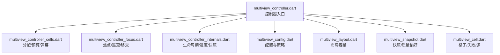
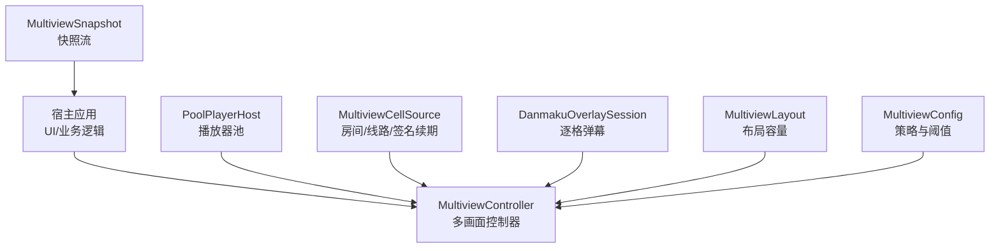
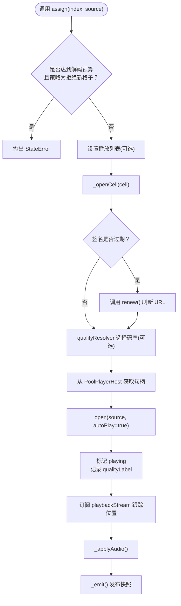
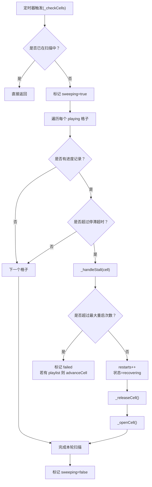
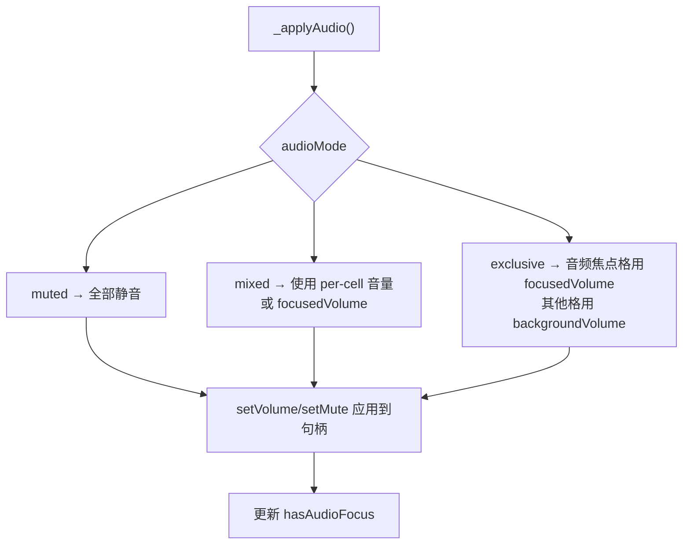
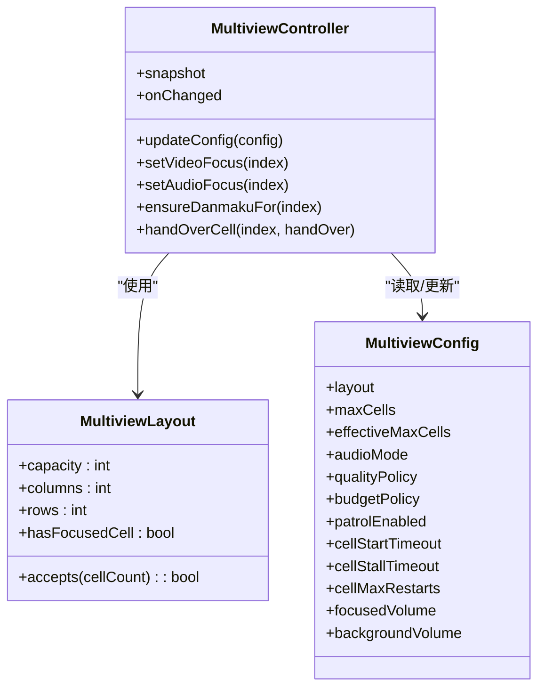
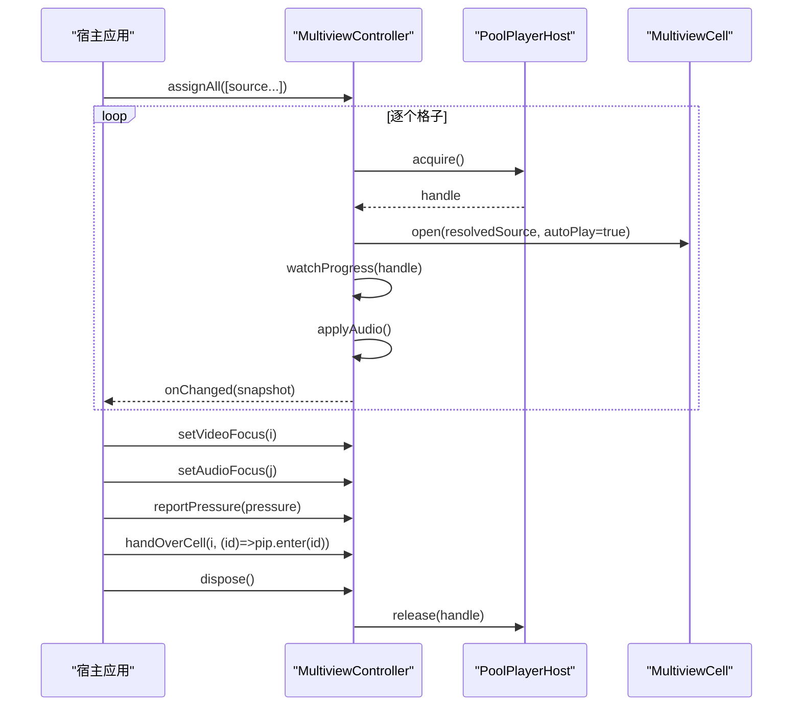
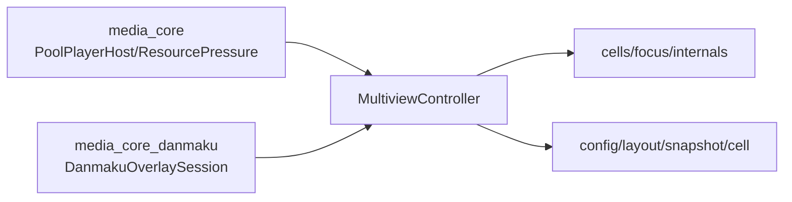

# 多画面监控 API

<cite>
**本文引用的文件**   
- [multiview_controller.dart](file://packages/media_core_multiview/lib/src/multiview_controller.dart)
- [multiview_config.dart](file://packages/media_core_multiview/lib/src/multiview_config.dart)
- [multiview_layout.dart](file://packages/media_core_multiview/lib/src/multiview_layout.dart)
- [multiview_snapshot.dart](file://packages/media_core_multiview/lib/src/multiview_snapshot.dart)
- [multiview_cell.dart](file://packages/media_core_multiview/lib/src/multiview_cell.dart)
- [multiview_controller_cells.dart](file://packages/media_core_multiview/lib/src/multiview_controller_cells.dart)
- [multiview_controller_focus.dart](file://packages/media_core_multiview/lib/src/multiview_controller_focus.dart)
- [multiview_controller_internals.dart](file://packages/media_core_multiview/lib/src/multiview_controller_internals.dart)
- [README.md](file://packages/media_core_multiview/README.md)
- [multiview_demo_page.dart](file://example/lib/pages/multiview_demo_page.dart)
</cite>

## 目录
1. [简介](#简介)
2. [项目结构](#项目结构)
3. [核心组件](#核心组件)
4. [架构总览](#架构总览)
5. [详细组件分析](#详细组件分析)
6. [依赖关系分析](#依赖关系分析)
7. [性能与资源管理](#性能与资源管理)
8. [故障排查指南](#故障排查指南)
9. [结论](#结论)
10. [附录：API 速查](#附录api-速查)

## 简介
本文件面向“多画面监控”场景，系统化说明 `MultiviewController` 的多播放器协调管理机制。重点覆盖：
- 逐格健康度监控：播放状态检测、停滞恢复、异常告警与预算策略。
- 唯一音频归属：在多画面下保证音频输出正确性，支持独占、静音、混合模式。
- 监控式视频墙布局：网格布局、缩放适配、焦点切换与弹幕路由。
- 实际应用示例：监控大屏、分屏对比、批量管理与轮播房间。
- 性能调优与资源管理：解码预算、内存记账、压力响应与最佳实践。

## 项目结构
多画面模块以控制器为核心，按职责拆分为多个部分文件：
- 控制器入口与生命周期：[multiview_controller.dart](file://packages/media_core_multiview/lib/src/multiview_controller.dart)
- 配置与策略：[multiview_config.dart](file://packages/media_core_multiview/lib/src/multiview_config.dart)
- 布局定义：[multiview_layout.dart](file://packages/media_core_multiview/lib/src/multiview_layout.dart)
- 快照与质量偏好：[multiview_snapshot.dart](file://packages/media_core_multiview/lib/src/multiview_snapshot.dart)
- 格子模型与失败信息：[multiview_cell.dart](file://packages/media_core_multiview/lib/src/multiview_cell.dart)
- 分配、释放、预算与弹幕会话：[multiview_controller_cells.dart](file://packages/media_core_multiview/lib/src/multiview_controller_cells.dart)
- 焦点、巡更与手递播放器：[multiview_controller_focus.dart](file://packages/media_core_multiview/lib/src/multiview_controller_focus.dart)
- 打开/关闭、进度监听、停滞恢复与快照发布：[multiview_controller_internals.dart](file://packages/media_core_multiview/lib/src/multiview_controller_internals.dart)

**图表来源** 
- [multiview_controller.dart:10-22](file://packages/media_core_multiview/lib/src/multiview_controller.dart#L10-L22)
- [multiview_config.dart:57-154](file://packages/media_core_multiview/lib/src/multiview_config.dart#L57-L154)
- [multiview_layout.dart:9-57](file://packages/media_core_multiview/lib/src/multiview_layout.dart#L9-L57)
- [multiview_snapshot.dart:6-28](file://packages/media_core_multiview/lib/src/multiview_snapshot.dart#L6-L28)
- [multiview_cell.dart:4-106](file://packages/media_core_multiview/lib/src/multiview_cell.dart#L4-L106)

**章节来源**
- [multiview_controller.dart:10-22](file://packages/media_core_multiview/lib/src/multiview_controller.dart#L10-L22)
- [README.md:1-16](file://packages/media_core_multiview/README.md#L1-L16)

## 核心组件
- MultiviewController：多画面墙的主控制器，负责播放器池借用、格子生命周期、焦点与音频归属、预算控制、停滞恢复与快照发布。
- MultiviewConfig：墙的可调参数，包括布局、最大格子数、音频模式、质量策略、预算策略、巡更开关与超时等。
- MultiviewLayout：固定网格形状及其容量、行列数与是否含焦点格。
- MultiviewSnapshot：不可变快照，供宿主渲染 UI；包含格子列表、布局、焦点索引、音频索引、资源压力与预算超限标志。
- MultiviewCell/MultiviewCellSource/MultiviewCellFailure：格子状态、播放源（含签名过期续期）、失败类型与尝试次数。
- 扩展部分：cells/focus/internals 分别承载分配与预算、焦点与巡更、生命周期与进度检查。

关键职责边界：
- 不渲染网格：由宿主根据 snapshot 绘制。
- 不解析房间与线路：宿主提供 MultiviewCellSource，可注入 qualityResolver。
- 不拥有页面或悬浮窗：通过 handOverCell 把播放器交给宿主的 PiP/小窗。

**章节来源**
- [multiview_controller.dart:39-73](file://packages/media_core_multiview/lib/src/multiview_controller.dart#L39-L73)
- [multiview_config.dart:57-154](file://packages/media_core_multiview/lib/src/multiview_config.dart#L57-L154)
- [multiview_layout.dart:9-57](file://packages/media_core_multiview/lib/src/multiview_layout.dart#L9-L57)
- [multiview_snapshot.dart:30-64](file://packages/media_core_multiview/lib/src/multiview_snapshot.dart#L30-L64)
- [multiview_cell.dart:4-106](file://packages/media_core_multiview/lib/src/multiview_cell.dart#L4-L106)

## 架构总览
下图展示多画面监控的整体交互：宿主提供播放器池与业务源，控制器编排 N 个格子，统一处理音频、焦点、预算与停滞恢复，并向宿主推送快照。

**图表来源** 
- [multiview_controller.dart:74-147](file://packages/media_core_multiview/lib/src/multiview_controller.dart#L74-L147)
- [multiview_controller_cells.dart:10-54](file://packages/media_core_multiview/lib/src/multiview_controller_cells.dart#L10-L54)
- [multiview_controller_internals.dart:10-82](file://packages/media_core_multiview/lib/src/multiview_controller_internals.dart#L10-L82)
- [multiview_snapshot.dart:30-64](file://packages/media_core_multiview/lib/src/multiview_snapshot.dart#L30-L64)

## 详细组件分析

### 多播放器协调与格子生命周期
- 分配与批量分配：assign/assignAll 将房间分配到格子并启动；若启用拒绝新格子策略且已达预算，直接抛出 StateError。
- 播放列表轮转：advanceCell 在失败或结束时切换到下一个房间，避免死循环重试同一离线房间。
- 停止/暂停/恢复：stopCell/pauseCell/resumeCell 精细控制单个格子；暂停的格子跳过停滞看门狗。
- 手动音量覆盖：setCellVolume/clearCellVolume 对当前被听格子进行音量覆盖，静音优先级最高。
- 播放器复用：_handleFor 复用已存在的句柄；_releaseCell 先 pause 再 recycle 归还给 host，避免冷启动开销。

**图表来源** 
- [multiview_controller_cells.dart:10-54](file://packages/media_core_multiview/lib/src/multiview_controller_cells.dart#L10-L54)
- [multiview_controller_internals.dart:10-82](file://packages/media_core_multiview/lib/src/multiview_controller_internals.dart#L10-L82)

**章节来源**
- [multiview_controller_cells.dart:10-196](file://packages/media_core_multiview/lib/src/multiview_controller_cells.dart#L10-L196)
- [multiview_controller_internals.dart:10-146](file://packages/media_core_multiview/lib/src/multiview_controller_internals.dart#L10-L146)

### 逐格健康度监控与停滞恢复
- 定时扫描：每 2 秒 _checkCells 遍历所有 playing 格子，比较最近一次位置更新时间与 cellStallTimeout。
- 停滞判定：超过阈值则标记 stallFailure，进入 recovering 状态并重启；超过 cellMaxRestarts 后标记 failed。
- 播放列表保护：耗尽重启预算时，有 playlist 的格子自动 advanceCell，避免“盯着一帧不动”。
- 并发防护：_sweeping/_rotating 防止周期性任务重复执行导致“幽灵重启风暴”。

**图表来源** 
- [multiview_controller_internals.dart:237-344](file://packages/media_core_multiview/lib/src/multiview_controller_internals.dart#L237-L344)

**章节来源**
- [multiview_controller_internals.dart:237-344](file://packages/media_core_multiview/lib/src/multiview_controller_internals.dart#L237-L344)

### 唯一音频归属与音量策略
- 三种音频模式：
  - exclusive：仅一个格子可听，默认与监控墙最常用。
  - muted：全部静音。
  - mixed：各格独立音量（不混音），适合提示音+主声组合。
- 焦点分离：视频焦点（focusedIndex）与音频焦点（audioIndex）可不同；muteAll 会记住静音前的模式，取消静音时恢复原模式。
- 音量计算：优先使用 per-cell 手动音量覆盖；exclusive 模式下非音频焦点格使用 backgroundVolume（默认 0）。

**图表来源** 
- [multiview_controller_internals.dart:167-202](file://packages/media_core_multiview/lib/src/multiview_controller_internals.dart#L167-L202)
- [multiview_controller_focus.dart:50-70](file://packages/media_core_multiview/lib/src/multiview_controller_focus.dart#L50-L70)

**章节来源**
- [multiview_controller_internals.dart:167-202](file://packages/media_core_multiview/lib/src/multiview_controller_internals.dart#L167-L202)
- [multiview_controller_focus.dart:10-70](file://packages/media_core_multiview/lib/src/multiview_controller_focus.dart#L10-L70)

### 监控式视频墙的布局、缩放与焦点切换
- 布局能力：single/dual/quad/nine/focus，focus 布局有一个大格+底部轨道。
- 有效容量：effectiveMaxCells = min(layout.capacity, maxCells)，用于预算与分配上限。
- 焦点切换：setVideoFocus 标记视频焦点，影响质量偏好与弹幕路由；setAudioFocus 标记音频焦点。
- 弹幕路由：danmakuOnlyOnFocused 决定只喂给焦点格还是全量开启；每格独立 DanmakuOverlaySession。
- 缩放适配：宿主根据 layout.columns/rows 与单元格尺寸计算缩放；本包不直接渲染，但提供 playerId 以便宿主绑定到具体播放器表面。

**图表来源** 
- [multiview_layout.dart:9-57](file://packages/media_core_multiview/lib/src/multiview_layout.dart#L9-L57)
- [multiview_config.dart:57-154](file://packages/media_core_multiview/lib/src/multiview_config.dart#L57-L154)
- [multiview_controller.dart:183-215](file://packages/media_core_multiview/lib/src/multiview_controller.dart#L183-L215)
- [multiview_controller_focus.dart:10-91](file://packages/media_core_multiview/lib/src/multiview_controller_focus.dart#L10-L91)
- [multiview_controller_internals.dart:220-231](file://packages/media_core_multiview/lib/src/multiview_controller_internals.dart#L220-L231)

**章节来源**
- [multiview_layout.dart:9-57](file://packages/media_core_multiview/lib/src/multiview_layout.dart#L9-L57)
- [multiview_config.dart:81-154](file://packages/media_core_multiview/lib/src/multiview_config.dart#L81-L154)
- [multiview_controller_focus.dart:10-91](file://packages/media_core_multiview/lib/src/multiview_controller_focus.dart#L10-L91)
- [multiview_controller_internals.dart:220-231](file://packages/media_core_multiview/lib/src/multiview_controller_internals.dart#L220-L231)

### 实际应用场景与示例
- 监控大屏：九宫格布局，开启自动巡更，结合 reportPressure 动态降频。
- 分屏对比：dual/quad 布局，分别设置视频焦点与音频焦点，实现“看 A 听 B”。
- 批量管理：assignAll 一次性分配多个房间；clearAll 一键清空。
- 轮播房间：为格子传入 playlist，失败或结束后自动前进到下一个房间。
- 示例参考：示例页演示了创建墙、分配房间、设置焦点、报告压力、移交播放器与释放资源。

**图表来源** 
- [multiview_controller_cells.dart:56-63](file://packages/media_core_multiview/lib/src/multiview_controller_cells.dart#L56-L63)
- [multiview_controller_internals.dart:118-146](file://packages/media_core_multiview/lib/src/multiview_controller_internals.dart#L118-L146)
- [multiview_controller_focus.dart:72-91](file://packages/media_core_multiview/lib/src/multiview_controller_focus.dart#L72-L91)
- [multiview_controller.dart:237-259](file://packages/media_core_multiview/lib/src/multiview_controller.dart#L237-L259)

**章节来源**
- [README.md:18-56](file://packages/media_core_multiview/README.md#L18-L56)
- [multiview_demo_page.dart:35-87](file://example/lib/pages/multiview_demo_page.dart#L35-L87)

## 依赖关系分析
- 外部依赖：
  - media_core：PoolPlayerHost、ResourcePressure、MemoryAccount 等核心能力。
  - media_core_danmaku：DanmakuOverlaySession 逐格弹幕队列。
- 内部耦合：
  - controller 与 cells/focus/internals 三部分通过 part 文件强内聚。
  - config/layout/snapshot/cell 作为值对象被 controller 消费。
- 潜在风险：
  - 若未注入 qualityResolver，质量策略不会生效（文档明确声明）。
  - 宿主需正确维护 PlayerIdentity 与 UI 绑定，否则 playerId 变化无法反映到视图。

**图表来源** 
- [multiview_controller.dart:1-22](file://packages/media_core_multiview/lib/src/multiview_controller.dart#L1-L22)
- [multiview_controller_cells.dart:267-281](file://packages/media_core_multiview/lib/src/multiview_controller_cells.dart#L267-L281)

**章节来源**
- [multiview_controller.dart:1-22](file://packages/media_core_multiview/lib/src/multiview_controller.dart#L1-L22)
- [multiview_controller_cells.dart:267-281](file://packages/media_core_multiview/lib/src/multiview_controller_cells.dart#L267-L281)

## 性能与资源管理
- 解码预算：
  - effectiveMaxCells 限制同时活跃解码器数量。
  - reportPressure(ResourcePressure) 立即生效，无需等待 tick。
  - keepFocusedOnly：除焦点格外暂停；letPlatformDrop：交由平台丢帧；refuseNewCells：拒绝新格子。
- 内存记账：
  - 按实例上报 MemoryModule.multiview，计入已分配格子与弹幕队列长度。
- 时间窗口：
  - cellStartTimeout：开流超时；cellStallTimeout：停滞超时；cellMaxRestarts：重启预算。
- 最佳实践：
  - 合理设置 maxCells，避免设备解码过载。
  - 注入 qualityResolver，让焦点格高质量、其余低质量。
  - 使用 playlist 实现房间轮播，避免死循环重试。
  - 在后台/前台切换时由宿主驱动 resume/pause，配合 autoResumeOnForeground。
  - 使用 handOverCell 将单路推送到 PiP/浮窗，避免重复开流。

**章节来源**
- [multiview_config.dart:81-154](file://packages/media_core_multiview/lib/src/multiview_config.dart#L81-L154)
- [multiview_controller_cells.dart:206-257](file://packages/media_core_multiview/lib/src/multiview_controller_cells.dart#L206-L257)
- [multiview_controller_internals.dart:371-396](file://packages/media_core_multiview/lib/src/multiview_controller_internals.dart#L371-L396)

## 故障排查指南
- 格子一直 starting：
  - 检查 source.isLive 是否为 false（offline 不会开播放器）。
  - 检查 renew 是否正确刷新签名 URL。
  - 查看 startFailure 的 message 与 attempt。
- 格子反复卡顿：
  - 调整 cellStallTimeout 与 cellMaxRestarts。
  - 确认是否处于 paused 状态（paused 跳过停滞检测）。
  - 观察 snapshot.budgetExceeded 与 ResourcePressure。
- 声音混乱：
  - 确认 audioMode 与 audioIndex 设置。
  - 检查 setCellVolume 是否误设非焦点格音量。
  - muteAll 后取消静音应恢复原模式。
- 画质不随焦点变化：
  - 确保注入 qualityResolver。
  - degradeQualityWhenCrowded 为 true 时才会在拥挤时降级非焦点格。
- 弹幕错乱：
  - 确保每格独立 ensureDanmakuFor。
  - danmakuOnlyOnFocused 为 true 时只向焦点格投递。

**章节来源**
- [multiview_controller_internals.dart:10-82](file://packages/media_core_multiview/lib/src/multiview_controller_internals.dart#L10-L82)
- [multiview_controller_internals.dart:277-344](file://packages/media_core_multiview/lib/src/multiview_controller_internals.dart#L277-L344)
- [multiview_controller_internals.dart:167-202](file://packages/media_core_multiview/lib/src/multiview_controller_internals.dart#L167-L202)
- [multiview_controller_internals.dart:220-231](file://packages/media_core_multiview/lib/src/multiview_controller_internals.dart#L220-L231)

## 结论
MultiviewController 将“多画面”的核心难题——音频唯一性、解码预算、逐格健康度与弹幕路由——收敛到单一控制器中，并通过快照与事件暴露给宿主。宿主只需关注 UI 渲染与业务源解析，即可构建稳定、可观测、可扩展的监控视频墙。

## 附录：API 速查
- 构造与配置
  - MultiviewController(players, config, qualityResolver)
  - updateConfig(config)
- 格子操作
  - assign(index, source, playlist?)
  - assignAll(sources)
  - clear(index)/clearAll()
  - restartCell(index)
  - stopCell(index)/pauseCell(index)/resumeCell(index)
  - advanceCell(index)
- 音频与焦点
  - setVideoFocus(index)/setAudioFocus(index)
  - muteAll(muted)
  - setCellVolume(index, volume)/clearCellVolume(index)
- 资源与压力
  - reportPressure(pressure)
- 界面与数据
  - snapshot/onChanged
  - playerIdOf(index)
  - ensureDanmakuFor(index)
  - handOverCell(index, handOver)
  - startPatrol()/stopPatrol()
- 生命周期
  - dispose()

**章节来源**
- [multiview_controller.dart:74-215](file://packages/media_core_multiview/lib/src/multiview_controller.dart#L74-L215)
- [multiview_controller_cells.dart:10-196](file://packages/media_core_multiview/lib/src/multiview_controller_cells.dart#L10-L196)
- [multiview_controller_focus.dart:10-156](file://packages/media_core_multiview/lib/src/multiview_controller_focus.dart#L10-L156)
- [multiview_controller_internals.dart:118-231](file://packages/media_core_multiview/lib/src/multiview_controller_internals.dart#L118-L231)