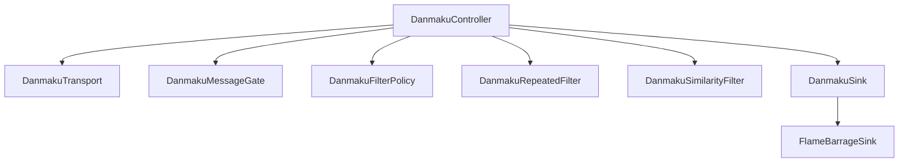
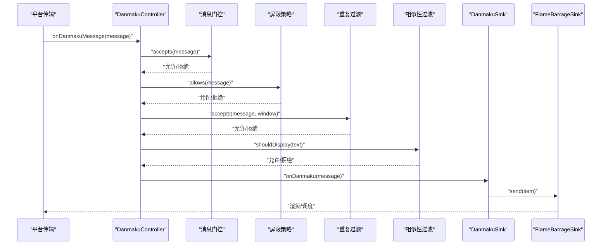
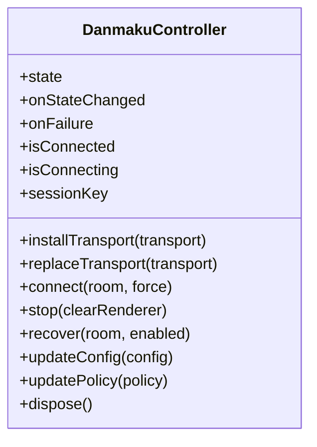
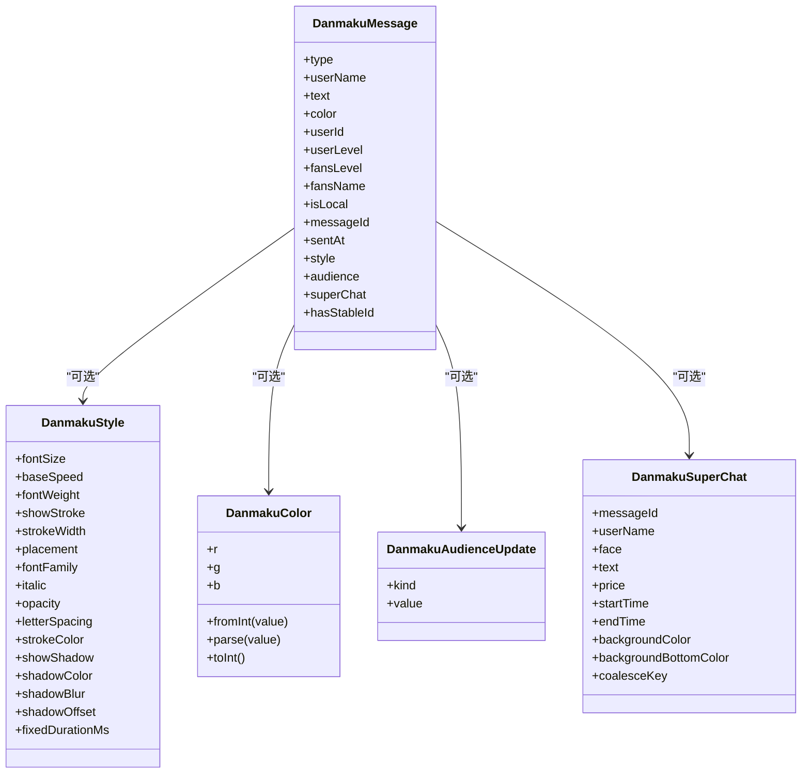
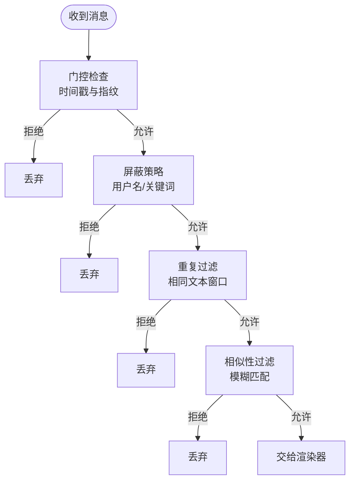
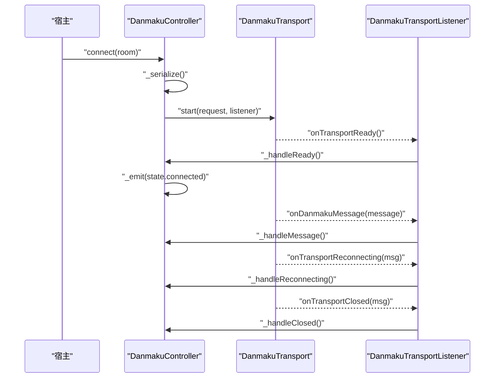
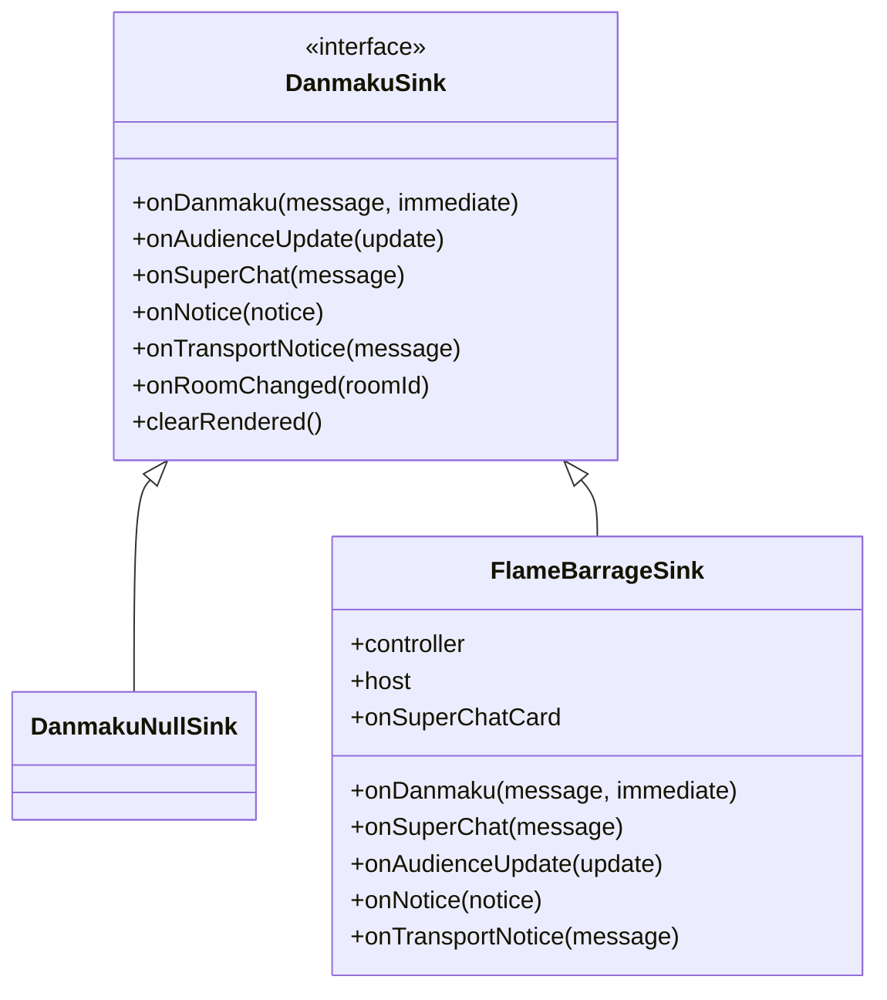
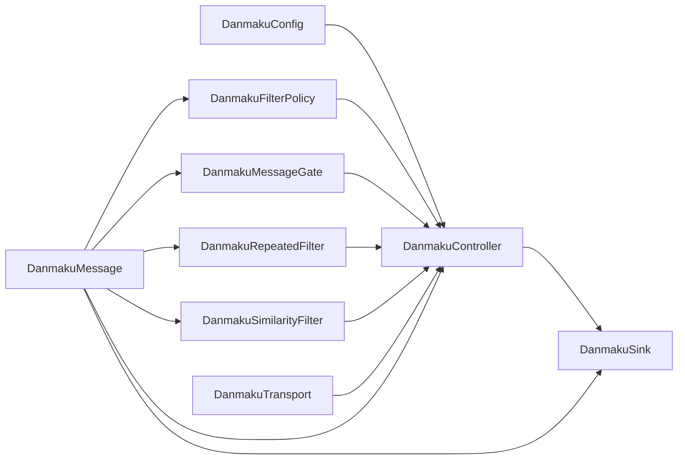

# 弹幕系统 API

<cite>
**本文引用的文件**   
- [danmaku_controller.dart](file://packages/media_core_danmaku/lib/src/danmaku_controller.dart)
- [danmaku_config.dart](file://packages/media_core_danmaku/lib/src/danmaku_config.dart)
- [danmaku_message.dart](file://packages/media_core_danmaku/lib/src/danmaku_message.dart)
- [danmaku_filter_policy.dart](file://packages/media_core_danmaku/lib/src/danmaku_filter_policy.dart)
- [danmaku_sink.dart](file://packages/media_core_danmaku/lib/src/danmaku_sink.dart)
- [danmaku_message_gate.dart](file://packages/media_core_danmaku/lib/src/danmaku_message_gate.dart)
- [danmaku_repeated_filter.dart](file://packages/media_core_danmaku/lib/src/danmaku_repeated_filter.dart)
- [danmaku_similarity_filter.dart](file://packages/media_core_danmaku/lib/src/danmaku_similarity_filter.dart)
- [danmaku_transport.dart](file://packages/media_core_danmaku/lib/src/danmaku_transport.dart)
- [danmaku_session_state.dart](file://packages/media_core_danmaku/lib/src/danmaku_session_state.dart)
- [flame_barrage_sink.dart](file://packages/media_core_danmaku/lib/src/flame_barrage_sink.dart)
- [danmaku_overlay_session_test.dart](file://packages/media_core_danmaku/test/danmaku_overlay_session_test.dart)
</cite>

## 目录
1. [简介](#简介)
2. [项目结构](#项目结构)
3. [核心组件](#核心组件)
4. [架构总览](#架构总览)
5. [详细组件分析](#详细组件分析)
6. [依赖关系分析](#依赖关系分析)
7. [性能与内存管理](#性能与内存管理)
8. [故障排查指南](#故障排查指南)
9. [结论](#结论)

## 简介
本文件面向使用 DanmakuController 的开发者，系统化说明弹幕消息从创建、发送、接收、过滤到显示的完整流程，并重点解释：
- 消息归一化模型与显示样式
- 去重与相似性过滤的配置项和语义
- 传输契约与会话围栏机制
- 连接配置、重连策略与错误处理
- 渲染输出点与性能优化建议

DanmakuController 是“房间级”会话控制器：它安装平台传输层、序列化连接/断开操作、维护会话身份令牌、运行消息管道（门控、策略、重复过滤、相似性过滤），并把通过管道的消息交给宿主提供的 DanmakuSink 进行渲染。它不直接实现任何平台协议，也不负责渲染或持久化消息。

## 项目结构
弹幕模块位于 packages/media_core_danmaku，核心源码集中在 lib/src 下，按职责划分：
- 控制面：DanmakuController、DanmakuSessionState、DanmakuTransport、DanmakuRoomRef、DanmakuAuth、DanmakuTransportRequest
- 数据面：DanmakuMessage、DanmakuStyle、DanmakuColor、DanmakuAudienceUpdate、DanmakuSuperChat
- 过滤面：DanmakuMessageGate、DanmakuRepeatedFilter、DanmakuSimilarityFilter、DanmakuFilterPolicy
- 配置面：DanmakuConfig
- 输出面：DanmakuSink、DanmakuNullSink、FlameBarrageSink
- 测试用例：覆盖会话可见性队列、生命周期等

**图表来源**
- [danmaku_controller.dart:57-79](file://packages/media_core_danmaku/lib/src/danmaku_controller.dart#L57-L79)
- [danmaku_transport.dart:101-143](file://packages/media_core_danmaku/lib/src/danmaku_transport.dart#L101-L143)
- [danmaku_sink.dart:31-82](file://packages/media_core_danmaku/lib/src/danmaku_sink.dart#L31-L82)
- [flame_barrage_sink.dart:28-53](file://packages/media_core_danmaku/lib/src/flame_barrage_sink.dart#L28-L53)

**章节来源**
- [danmaku_controller.dart:16-37](file://packages/media_core_danmaku/lib/src/danmaku_controller.dart#L16-L37)
- [danmaku_transport.dart:1-30](file://packages/media_core_danmaku/lib/src/danmaku_transport.dart#L1-L30)

## 核心组件
- DanmakuController：房间会话控制器，负责安装/替换传输、序列化连接与停止、维护会话令牌、运行消息管道、暴露状态与失败事件。
- DanmakuTransport：平台弹幕连接的抽象，定义 start/stop/heartbeat 及监听回调。
- DanmakuMessage：跨平台统一的消息模型，包含类型、用户名、文本、颜色、用户标识、时间戳、样式、观众指标、付费留言卡片等。
- DanmakuConfig：会话可调参数，包括超时、去重窗口、相似性阈值、缓存大小等。
- DanmakuFilterPolicy：用户级屏蔽策略，支持屏蔽用户名和关键词。
- DanmakuMessageGate：基于时间戳和指纹的门控，拒绝过期消息与重复回放。
- DanmakuRepeatedFilter：对相同文本的短时爆发做折叠。
- DanmakuSimilarityFilter：对高度相似的文本做模糊去重。
- DanmakuSink：渲染输出接口；FlameBarrageSink 是默认引擎适配。

**章节来源**
- [danmaku_controller.dart:57-79](file://packages/media_core_danmaku/lib/src/danmaku_controller.dart#L57-L79)
- [danmaku_transport.dart:101-143](file://packages/media_core_danmaku/lib/src/danmaku_transport.dart#L101-L143)
- [danmaku_message.dart:157-234](file://packages/media_core_danmaku/lib/src/danmaku_message.dart#L157-L234)
- [danmaku_config.dart:14-33](file://packages/media_core_danmaku/lib/src/danmaku_config.dart#L14-L33)
- [danmaku_filter_policy.dart:15-25](file://packages/media_core_danmaku/lib/src/danmaku_filter_policy.dart#L15-L25)
- [danmaku_message_gate.dart:21-33](file://packages/media_core_danmaku/lib/src/danmaku_message_gate.dart#L21-L33)
- [danmaku_repeated_filter.dart:23-30](file://packages/media_core_danmaku/lib/src/danmaku_repeated_filter.dart#L23-L30)
- [danmaku_similarity_filter.dart:24-44](file://packages/media_core_danmaku/lib/src/danmaku_similarity_filter.dart#L24-L44)
- [danmaku_sink.dart:31-82](file://packages/media_core_danmaku/lib/src/danmaku_sink.dart#L31-L82)

## 架构总览
下图展示一次弹幕消息从平台传输到渲染输出的关键路径，以及控制器内部的过滤顺序。

**图表来源**
- [danmaku_controller.dart:416-459](file://packages/media_core_danmaku/lib/src/danmaku_controller.dart#L416-L459)
- [danmaku_message_gate.dart:84-112](file://packages/media_core_danmaku/lib/src/danmaku_message_gate.dart#L84-L112)
- [danmaku_filter_policy.dart:41-67](file://packages/media_core_danmaku/lib/src/danmaku_filter_policy.dart#L41-L67)
- [danmaku_repeated_filter.dart:32-54](file://packages/media_core_danmaku/lib/src/danmaku_repeated_filter.dart#L32-L54)
- [danmaku_similarity_filter.dart:81-120](file://packages/media_core_danmaku/lib/src/danmaku_similarity_filter.dart#L81-L120)
- [flame_barrage_sink.dart:50-53](file://packages/media_core_danmaku/lib/src/flame_barrage_sink.dart#L50-L53)

## 详细组件分析

### DanmakuController：消息管理与显示控制
职责要点：
- 安装/替换传输，并保证连接/停止串行执行，避免多房间切换竞态。
- 为每个会话分配 token，所有回调携带 token 校验，旧 socket 无法污染新房间。
- 运行消息管道：门控 → 屏蔽策略 → 重复过滤 → 相似性过滤 → 渲染。
- 暴露 onStateChanged 与 onFailure，供上层 UI 与重试逻辑消费。
- 心跳由控制器调度，避免后台时累积并行保活。

关键行为：
- connect(room, force): 建立会话，调用 transport.start，并在 startTimeout 内等待就绪。
- stop(clearRenderer): 清理渲染历史并关闭会话。
- replaceTransport(transport): 更换传输并清空过滤器窗口。
- updateConfig(config)/updatePolicy(policy): 动态调整配置与屏蔽策略。
- dispose(): 释放资源并关闭流。

**图表来源**
- [danmaku_controller.dart:57-167](file://packages/media_core_danmaku/lib/src/danmaku_controller.dart#L57-L167)
- [danmaku_controller.dart:168-377](file://packages/media_core_danmaku/lib/src/danmaku_controller.dart#L168-L377)

**章节来源**
- [danmaku_controller.dart:39-56](file://packages/media_core_danmaku/lib/src/danmaku_controller.dart#L39-L56)
- [danmaku_controller.dart:168-377](file://packages/media_core_danmaku/lib/src/danmaku_controller.dart#L168-L377)
- [danmaku_controller.dart:534-567](file://packages/media_core_danmaku/lib/src/danmaku_controller.dart#L534-L567)

### 消息模型与样式：DanmakuMessage、DanmakuStyle、DanmakuColor
- DanmakuMessageType：chat、gift、superChat、audience、system。
- DanmakuMessage：统一消息体，包含 type、userName、text、color、userId、messageId、sentAt、style、audience、superChat 等字段。
- DanmakuStyle：每条消息可覆盖字体大小、速度、粗细、描边、阴影、固定停留时长等。
- DanmakuColor：支持整数与十六进制字符串两种平台常见格式，解析失败回退白色。
- DanmakuAudienceUpdate：观众指标，区分热度、并发观看、累计观看。
- DanmakuSuperChat：付费留言卡片，有独立生命周期与合并键。

**图表来源**
- [danmaku_message.dart:157-290](file://packages/media_core_danmaku/lib/src/danmaku_message.dart#L157-L290)

**章节来源**
- [danmaku_message.dart:1-14](file://packages/media_core_danmaku/lib/src/danmaku_message.dart#L1-L14)
- [danmaku_message.dart:80-129](file://packages/media_core_danmaku/lib/src/danmaku_message.dart#L80-L129)
- [danmaku_message.dart:131-155](file://packages/media_core_danmaku/lib/src/danmaku_message.dart#L131-L155)
- [danmaku_message.dart:236-290](file://packages/media_core_danmaku/lib/src/danmaku_message.dart#L236-L290)

### 过滤与归一化：门控、重复、相似性与屏蔽策略
消息管道顺序严格遵循“最便宜且最具决定性优先”的原则：
1. 门控（DanmakuMessageGate）：拒绝过期消息与重复回放。
2. 屏蔽策略（DanmakuFilterPolicy）：根据用户名与关键词屏蔽。
3. 重复过滤（DanmakuRepeatedFilter）：同一文本短时爆发只保留首次。
4. 相似性过滤（DanmakuSimilarityFilter）：对高度相似文本做模糊去重，本地消息豁免。

**图表来源**
- [danmaku_controller.dart:416-459](file://packages/media_core_danmaku/lib/src/danmaku_controller.dart#L416-L459)
- [danmaku_message_gate.dart:84-112](file://packages/media_core_danmaku/lib/src/danmaku_message_gate.dart#L84-L112)
- [danmaku_filter_policy.dart:41-67](file://packages/media_core_danmaku/lib/src/danmaku_filter_policy.dart#L41-L67)
- [danmaku_repeated_filter.dart:32-54](file://packages/media_core_danmaku/lib/src/danmaku_repeated_filter.dart#L32-L54)
- [danmaku_similarity_filter.dart:81-120](file://packages/media_core_danmaku/lib/src/danmaku_similarity_filter.dart#L81-L120)

#### 门控：时间戳对齐与稳定 ID
- maxMessageAge：拒绝过旧的积压消息，防止后台缓冲被当作实时聊天。
- stableIdWindow：带平台 messageId 的消息使用长窗口去重，因为 id 唯一。
- fallbackDuplicateWindow：无 id 时使用短指纹窗口（类型+用户+文本），避免误吞真实重复。
- maxFutureSkew：容忍轻微时钟偏差，过大未来时间视为畸形。
- maxEntries：指纹表上限，防止长时间高流量房间内存膨胀。

**章节来源**
- [danmaku_message_gate.dart:5-20](file://packages/media_core_danmaku/lib/src/danmaku_message_gate.dart#L5-L20)
- [danmaku_message_gate.dart:21-33](file://packages/media_core_danmaku/lib/src/danmaku_message_gate.dart#L21-L33)
- [danmaku_message_gate.dart:84-112](file://packages/media_core_danmaku/lib/src/danmaku_message_gate.dart#L84-L112)
- [danmaku_message_gate.dart:123-145](file://packages/media_core_danmaku/lib/src/danmaku_message_gate.dart#L123-L145)

#### 重复过滤：短时爆发折叠
- 仅影响 chat 类型，忽略本地消息。
- 比较前对空白进行规范化，但保留原始文本用于渲染。
- 启用时维护最近文本窗口；禁用时清空窗口，重新启用后不再抑制之前已看到的文本。

**章节来源**
- [danmaku_repeated_filter.dart:5-22](file://packages/media_core_danmaku/lib/src/danmaku_repeated_filter.dart#L5-L22)
- [danmaku_repeated_filter.dart:32-54](file://packages/media_core_danmaku/lib/src/danmaku_repeated_filter.dart#L32-L54)
- [danmaku_repeated_filter.dart:62-70](file://packages/media_core_danmaku/lib/src/danmaku_repeated_filter.dart#L62-L70)

#### 相似性过滤：模糊去重
- 使用 partialRatio 计算相似度，超过阈值则视为重复。
- 仅对比最近 maxComparisons 条缓存，避免 UI 线程卡顿。
- 精确命中直接返回 false 并刷新缓存位置。
- 本地消息在控制器层豁免相似性过滤，确保用户自己的回显始终可见。

**章节来源**
- [danmaku_similarity_filter.dart:5-23](file://packages/media_core_danmaku/lib/src/danmaku_similarity_filter.dart#L5-L23)
- [danmaku_similarity_filter.dart:81-120](file://packages/media_core_danmaku/lib/src/danmaku_similarity_filter.dart#L81-L120)
- [danmaku_controller.dart:432-436](file://packages/media_core_danmaku/lib/src/danmaku_controller.dart#L432-L436)

#### 屏蔽策略：敏感词与黑名单
- blockedUsers：按用户名屏蔽（小写、去空白）。
- blockedKeywords：按子串屏蔽（小写）。
- evaluate 返回决策原因，便于上层诊断或展示“已屏蔽”提示。
- 策略对象不可变，更新时应构造新实例，避免在途消息比较规则不一致。

**章节来源**
- [danmaku_filter_policy.dart:3-14](file://packages/media_core_danmaku/lib/src/danmaku_filter_policy.dart#L3-L14)
- [danmaku_filter_policy.dart:41-67](file://packages/media_core_danmaku/lib/src/danmaku_filter_policy.dart#L41-L67)
- [danmaku_filter_policy.dart:78-99](file://packages/media_core_danmaku/lib/src/danmaku_filter_policy.dart#L78-L99)

### 传输契约与会话围栏
- DanmakuRoomRef：平台与房间号组成 key，key 比较时忽略大小写与空白。
- DanmakuAuth：可选的用户标识、token、cookies，匿名读聊场景使用 none。
- DanmakuTransportRequest：封装 room、auth、extras，extras 作为平台握手扩展点。
- DanmakuTransportListener：消息、就绪、重连、关闭回调。
- DanmakuTransport：单房间单实例，start 抛出表示握手启动失败；start 成功后通过 listener 报告后续事件。

会话围栏机制：
- _requestEpoch：序列化请求，避免重复生命周期请求互相失效。
- _sessionToken：每次接受或销毁会话递增，回调携带 token 校验。
- _accepts：同时校验 token、当前 transport 实例与房间 key，旧 socket 一律丢弃。
- 心跳由控制器统一调度，避免后台时产生并行保活。

**图表来源**
- [danmaku_controller.dart:220-310](file://packages/media_core_danmaku/lib/src/danmaku_controller.dart#L220-L310)
- [danmaku_controller.dart:383-414](file://packages/media_core_danmaku/lib/src/danmaku_controller.dart#L383-L414)
- [danmaku_controller.dart:462-481](file://packages/media_core_danmaku/lib/src/danmaku_controller.dart#L462-L481)
- [danmaku_transport.dart:74-99](file://packages/media_core_danmaku/lib/src/danmaku_transport.dart#L74-L99)
- [danmaku_transport.dart:101-143](file://packages/media_core_danmaku/lib/src/danmaku_transport.dart#L101-L143)

**章节来源**
- [danmaku_transport.dart:1-30](file://packages/media_core_danmaku/lib/src/danmaku_transport.dart#L1-L30)
- [danmaku_transport.dart:32-72](file://packages/media_core_danmaku/lib/src/danmaku_transport.dart#L32-L72)
- [danmaku_transport.dart:74-143](file://packages/media_core_danmaku/lib/src/danmaku_transport.dart#L74-L143)
- [danmaku_controller.dart:98-136](file://packages/media_core_danmaku/lib/src/danmaku_controller.dart#L98-L136)
- [danmaku_controller.dart:383-414](file://packages/media_core_danmaku/lib/src/danmaku_controller.dart#L383-L414)

### 渲染输出与显示控制
- DanmakuSink：定义 onDanmaku、onAudienceUpdate、onSuperChat、onNotice、onTransportNotice、onRoomChanged、clearRendered。
- DanmakuNullSink：空实现，适合测试或无需渲染的场景。
- FlameBarrageSink：将 DanmakuMessage 映射为引擎条目并交给 BarrageController；超级留言走 onSuperChatCard 而非普通弹幕行。
- immediate：本地消息或用户回显可通过 immediate=true 绕过队列同步渲染。

**图表来源**
- [danmaku_sink.dart:31-112](file://packages/media_core_danmaku/lib/src/danmaku_sink.dart#L31-L112)
- [flame_barrage_sink.dart:28-80](file://packages/media_core_danmaku/lib/src/flame_barrage_sink.dart#L28-L80)

**章节来源**
- [danmaku_sink.dart:31-82](file://packages/media_core_danmaku/lib/src/danmaku_sink.dart#L31-L82)
- [danmaku_sink.dart:84-112](file://packages/media_core_danmaku/lib/src/danmaku_sink.dart#L84-L112)
- [flame_barrage_sink.dart:8-27](file://packages/media_core_danmaku/lib/src/flame_barrage_sink.dart#L8-L27)
- [flame_barrage_sink.dart:50-80](file://packages/media_core_danmaku/lib/src/flame_barrage_sink.dart#L50-L80)

## 依赖关系分析
- DanmakuController 依赖：
  - DanmakuTransport：平台连接与事件。
  - DanmakuMessageGate/DanmakuRepeatedFilter/DanmakuSimilarityFilter：过滤链。
  - DanmakuFilterPolicy：用户屏蔽策略。
  - DanmakuSink：渲染输出。
  - DanmakuSessionState：会话快照。
- DanmakuMessage 被所有过滤与渲染组件消费。
- DanmakuConfig 驱动控制器与过滤器的行为。

**图表来源**
- [danmaku_controller.dart:57-79](file://packages/media_core_danmaku/lib/src/danmaku_controller.dart#L57-L79)
- [danmaku_config.dart:14-33](file://packages/media_core_danmaku/lib/src/danmaku_config.dart#L14-L33)
- [danmaku_message.dart:157-234](file://packages/media_core_danmaku/lib/src/danmaku_message.dart#L157-L234)

**章节来源**
- [danmaku_controller.dart:57-79](file://packages/media_core_danmaku/lib/src/danmaku_controller.dart#L57-L79)
- [danmaku_message.dart:157-234](file://packages/media_core_danmaku/lib/src/danmaku_message.dart#L157-L234)

## 性能与内存管理
- 门控指纹表：maxEntries 限制最大条目数，按插入顺序淘汰最旧条目，避免长时间高流量房间内存无限增长。
- 重复过滤窗口：window 控制文本记忆时长，maxEntries 限制记忆文本数量；禁用时清空窗口。
- 相似性过滤：
  - cacheDuration 控制缓存存活时间。
  - maxCacheSize 控制缓存规模。
  - maxComparisons 控制每包比较预算，避免 UI 线程抖动。
  - exact hit 直接命中缓存，不触发模糊算法。
- 心跳：由控制器统一调度，避免后台时并行保活堆积。
- 渲染：FlameBarrageSink 将消息交给引擎，布局与绘制由引擎负责；immediate 仅适用于必须即时显示的回显。

最佳实践：
- 合理设置 similarityThreshold 与 similarityMaxComparisons，在高并发房间降低 CPU 占用。
- 使用 DanmakuConfig.defaults 作为基线，再按需调整窗口与阈值。
- 对需要立即显示的用户回显，使用 immediate=true，而不是调低 emitInterval。
- 在房间切换或传输替换时，控制器会清空过滤器窗口，避免旧会话污染新会话。

**章节来源**
- [danmaku_message_gate.dart:54-63](file://packages/media_core_danmaku/lib/src/danmaku_message_gate.dart#L54-L63)
- [danmaku_message_gate.dart:135-145](file://packages/media_core_danmaku/lib/src/danmaku_message_gate.dart#L135-L145)
- [danmaku_repeated_filter.dart:26-30](file://packages/media_core_danmaku/lib/src/danmaku_repeated_filter.dart#L26-L30)
- [danmaku_repeated_filter.dart:62-70](file://packages/media_core_danmaku/lib/src/danmaku_repeated_filter.dart#L62-L70)
- [danmaku_similarity_filter.dart:12-23](file://packages/media_core_danmaku/lib/src/danmaku_similarity_filter.dart#L12-L23)
- [danmaku_similarity_filter.dart:66-79](file://packages/media_core_danmaku/lib/src/danmaku_similarity_filter.dart#L66-L79)
- [danmaku_controller.dart:534-567](file://packages/media_core_danmaku/lib/src/danmaku_controller.dart#L534-L567)

## 故障排查指南
常见问题与定位方法：
- 连接超时：检查 startTimeout 与平台握手是否响应；查看 onFailure 中的 startTimeout 失败。
- 连接被拒绝：检查 authProvider 提供的凭据是否正确；查看 startRejected 失败。
- 传输关闭：onTransportClosed 携带平台关闭原因；注意会话状态变为 closed 并清除房间信息。
- 重连风暴：控制器内部对 notice 与 transportNotice 做了短时间去抖，避免重复刷屏。
- 用户名被屏蔽：检查 DanmakuFilterPolicy 的 blockedUsers 与 blockedKeywords；必要时提供 reason 给上层展示。
- 消息未显示：确认消息已通过门控与过滤；本地消息 bypass 过滤，非本地消息可能因相似性或重复过滤被抑制。

实用示例（以步骤形式描述，不贴代码）：
- 连接配置与重连：
  1. 创建 DanmakuController，传入 sink、config、policy 与 authProvider。
  2. installTransport(transport)。
  3. connect(DanmakuRoomRef(platform, roomId))。
  4. 订阅 onStateChanged 观察 connecting/connected/reconnecting/closed/failed。
  5. 订阅 onFailure 捕获 startTimeout/startRejected/transportClosed 等失败。
  6. 在 onTransportReconnecting 中记录平台提示，但不自行决定重连策略。
- 错误处理：
  - 对 startTimeout：提示“连接超时”，并可尝试 recover。
  - 对 startRejected：提示“认证失败”，引导用户重新登录。
  - 对 transportClosed：提示“连接断开”，由上层决定是否自动重连。
- 显示控制：
  - 使用 DanmakuOverlaySession 绑定可见性流，隐藏时拒绝新消息并限制队列长度。
  - 通过 updateConfig 动态调整 maxVisibleCount 等参数，控制渲染队列。

**章节来源**
- [danmaku_controller.dart:272-310](file://packages/media_core_danmaku/lib/src/danmaku_controller.dart#L272-L310)
- [danmaku_controller.dart:462-481](file://packages/media_core_danmaku/lib/src/danmaku_controller.dart#L462-L481)
- [danmaku_controller.dart:593-616](file://packages/media_core_danmaku/lib/src/danmaku_controller.dart#L593-L616)
- [danmaku_session_state.dart:5-24](file://packages/media_core_danmaku/lib/src/danmaku_session_state.dart#L5-L24)
- [danmaku_session_state.dart:44-90](file://packages/media_core_danmaku/lib/src/danmaku_session_state.dart#L44-L90)
- [danmaku_overlay_session_test.dart:38-153](file://packages/media_core_danmaku/test/danmaku_overlay_session_test.dart#L38-L153)

## 结论
DanmakuController 提供了可靠的房间级弹幕会话管理能力，通过严格的会话围栏与消息管道，确保消息在复杂网络与平台差异下的可靠传输与有序显示。配合 DanmakuConfig、DanmakuFilterPolicy 与三类过滤器，开发者可以在性能与体验之间取得平衡。渲染侧通过 DanmakuSink 解耦，既支持默认引擎，也允许自定义输出。建议在接入时：
- 明确房间与会话生命周期，订阅状态与失败事件。
- 合理配置去重与相似性阈值，避免高流量房间卡顿。
- 使用屏蔽策略保护用户体验，并提供可解释的屏蔽原因。
- 对本地回显使用 immediate，避免延迟感知。
- 在房间切换或传输替换时，信任控制器清理过滤器与渲染历史，避免状态污染。