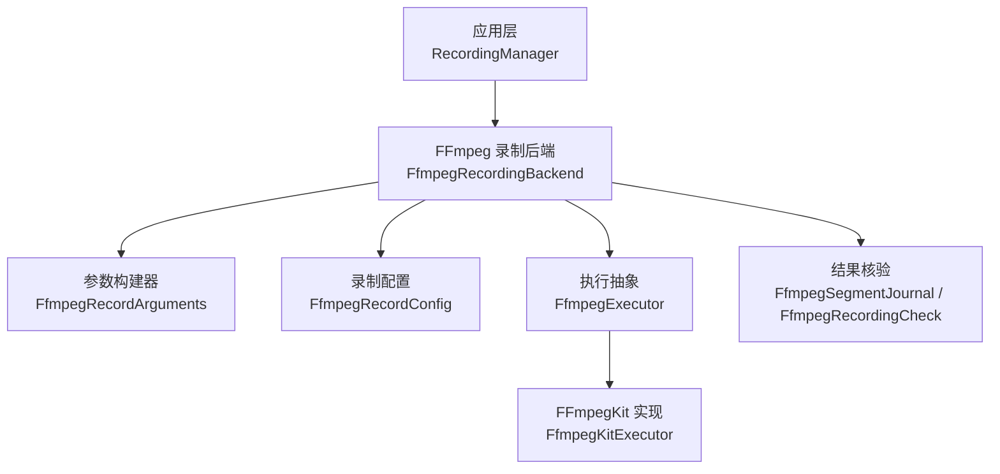
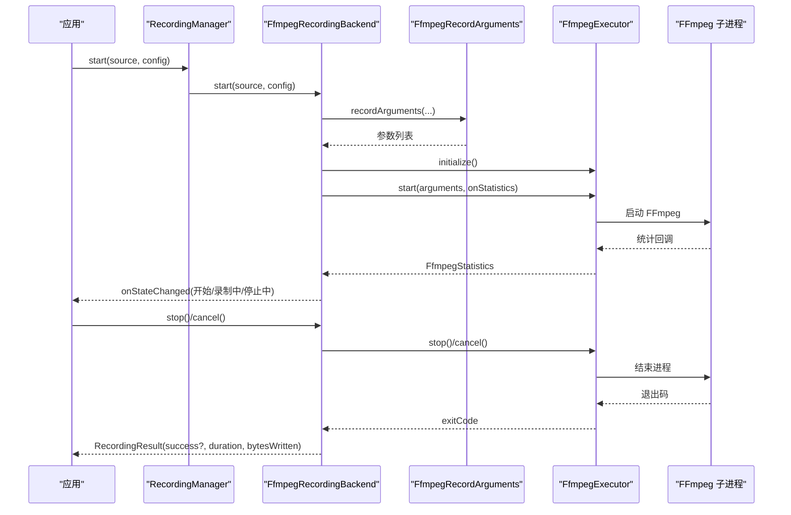
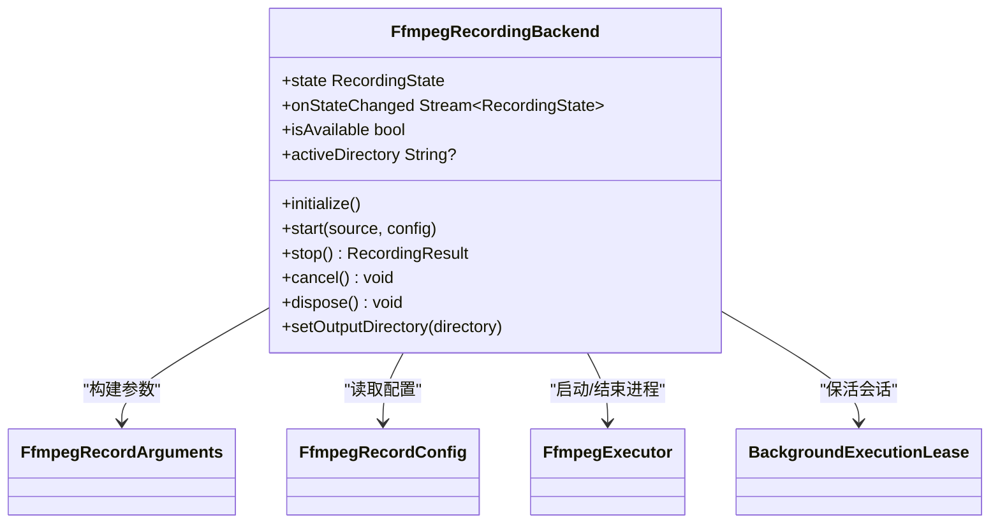
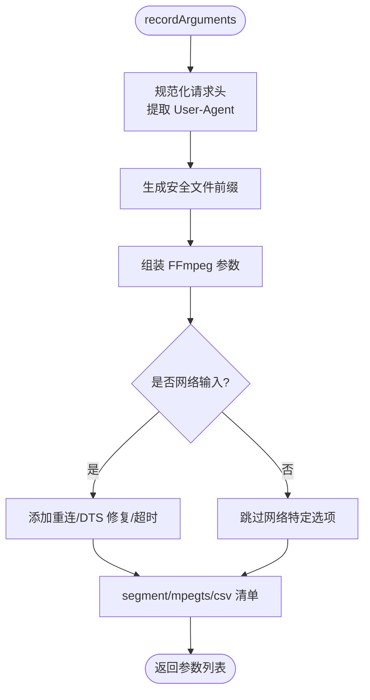
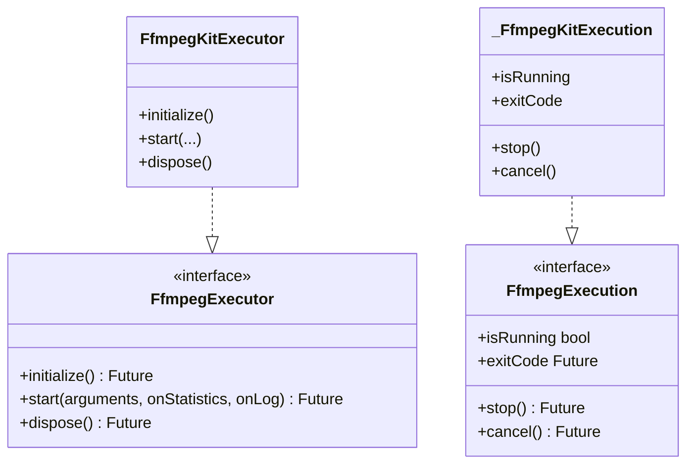
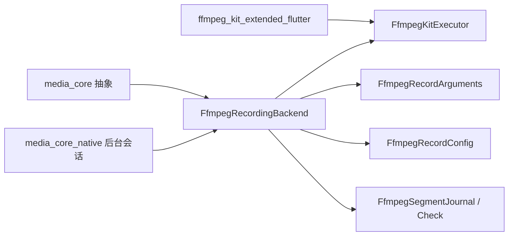
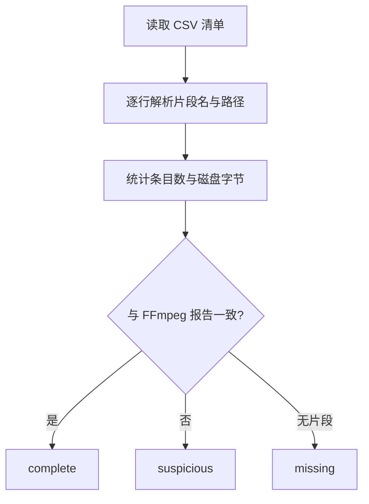

# 录播功能 API

<cite>
**本文引用的文件**   
- [media_core_recording_ffmpeg.dart](file://packages/media_core_recording_ffmpeg/lib/media_core_recording_ffmpeg.dart)
- [ffmpeg_recording_backend.dart](file://packages/media_core_recording_ffmpeg/lib/src/ffmpeg_recording_backend.dart)
- [ffmpeg_record_arguments.dart](file://packages/media_core_recording_ffmpeg/lib/src/ffmpeg_record_arguments.dart)
- [ffmpeg_record_config.dart](file://packages/media_core_recording_ffmpeg/lib/src/ffmpeg_record_config.dart)
- [ffmpeg_executor.dart](file://packages/media_core_recording_ffmpeg/lib/src/ffmpeg_executor.dart)
- [recording_verification.dart](file://packages/media_core_recording_ffmpeg/lib/src/recording_verification.dart)
- [ffmpeg_recording_test.dart](file://packages/media_core_recording_ffmpeg/test/ffmpeg_recording_test.dart)
- [README.md](file://packages/media_core_recording_ffmpeg/README.md)
- [recording.md](file://doc/zh-Hans/recording.md)
- [logging_demo.dart](file://example/lib/demos/console/logging_demo.dart)
</cite>

## 目录
1. [简介](#简介)
2. [项目结构](#项目结构)
3. [核心组件](#核心组件)
4. [架构总览](#架构总览)
5. [详细组件分析](#详细组件分析)
6. [依赖关系分析](#依赖关系分析)
7. [性能与参数调优](#性能与参数调优)
8. [存储管理与分段策略](#存储管理与分段策略)
9. [CSV 日志记录器与结果核验](#csv-日志记录器与结果核验)
10. [完整录播示例](#完整录播示例)
11. [故障排查指南](#故障排查指南)
12. [结论](#结论)

## 简介
本文件面向需要在 Flutter 应用中实现“直播流录制”的开发者，聚焦 FFmpegKit 集成与分段录制机制。文档围绕以下目标展开：
- 解释 RecordingManager 与 FfmpegRecordingBackend 的职责边界与控制流程；
- 说明分段管理器（由参数构建器与配置对象共同实现）的分段大小、文件名生成与文件组织策略；
- 介绍 CSV 清单日志的作用、结构与核验方法；
- 提供实时录制、定时录制、格式转换等场景的落地方案；
- 给出 FFmpeg 参数调优、存储管理与性能优化的最佳实践。

该库通过 ffmpeg_kit_extended_flutter 启动 FFmpeg 子进程，将网络流以“分段 MPEG-TS + CSV 清单”的方式落盘，避免单文件在异常退出时不可播放的问题。

**章节来源**
- [README.md:1-51](file://packages/media_core_recording_ffmpeg/README.md#L1-L51)
- [recording.md:1-30](file://doc/zh-Hans/recording.md#L1-L30)

## 项目结构
FFmpeg 录制后端位于独立包中，对外暴露统一的导出入口，内部按职责拆分为：
- 后端编排与生命周期管理：FfmpegRecordingBackend
- FFmpeg 参数构建：FfmpegRecordArguments
- 录制可调参数：FfmpegRecordConfig
- FFmpeg 执行抽象与实现：FfmpegExecutor / FfmpegKitExecutor
- 录制结果核验与 CSV 清单解析：FfmpegSegmentJournal / FfmpegRecordingCheck

**图表来源**
- [media_core_recording_ffmpeg.dart:1-30](file://packages/media_core_recording_ffmpeg/lib/media_core_recording_ffmpeg.dart#L1-L30)
- [ffmpeg_recording_backend.dart:62-139](file://packages/media_core_recording_ffmpeg/lib/src/ffmpeg_recording_backend.dart#L62-L139)
- [ffmpeg_record_arguments.dart:23-28](file://packages/media_core_recording_ffmpeg/lib/src/ffmpeg_record_arguments.dart#L23-L28)
- [ffmpeg_record_config.dart:6-22](file://packages/media_core_recording_ffmpeg/lib/src/ffmpeg_record_config.dart#L6-L22)
- [ffmpeg_executor.dart:67-88](file://packages/media_core_recording_ffmpeg/lib/src/ffmpeg_executor.dart#L67-L88)
- [recording_verification.dart:15-57](file://packages/media_core_recording_ffmpeg/lib/src/recording_verification.dart#L15-L57)

**章节来源**
- [media_core_recording_ffmpeg.dart:1-30](file://packages/media_core_recording_ffmpeg/lib/media_core_recording_ffmpeg.dart#L1-L30)

## 核心组件
- FfmpegRecordingBackend：实现 RecordingBackend 契约，负责启动/停止/取消 FFmpeg 进程、维护后台保活与会话状态、映射进程结局到录制结果。
- FfmpegRecordArguments：把源地址、输出目录、分段模式、CSV 清单路径等转换为 FFmpeg 命令行参数，并处理协议白名单、头部、重连、DTS 不连续修复等。
- FfmpegRecordConfig：集中定义分段时长、读写超时、输入队列、是否优先最佳流、文件前缀与后缀、保活开关等。
- FfmpegExecutor / FfmpegKitExecutor：对 FFmpeg 子进程的抽象与封装，支持初始化、启动、统计回调、日志回调、释放。
- FfmpegSegmentJournal / FfmpegRecordingCheck：读取 FFmpeg 生成的 CSV 清单，校验实际落盘片段数量与字节数，给出 complete/suspicious/missing 判定。

**章节来源**
- [ffmpeg_recording_backend.dart:33-61](file://packages/media_core_recording_ffmpeg/lib/src/ffmpeg_recording_backend.dart#L33-L61)
- [ffmpeg_record_arguments.dart:5-22](file://packages/media_core_recording_ffmpeg/lib/src/ffmpeg_record_arguments.dart#L5-L22)
- [ffmpeg_record_config.dart:1-22](file://packages/media_core_recording_ffmpeg/lib/src/ffmpeg_record_config.dart#L1-L22)
- [ffmpeg_executor.dart:44-88](file://packages/media_core_recording_ffmpeg/lib/src/ffmpeg_executor.dart#L44-L88)
- [recording_verification.dart:1-14](file://packages/media_core_recording_ffmpeg/lib/src/recording_verification.dart#L1-L14)

## 架构总览
录制控制从上层 RecordingManager 发起，后端根据 RecordingSource 与 RecordingConfig 构造 FFmpeg 参数，启动子进程，并通过统计回调更新进度与内存账户。用户主动 stop 视为成功录制；cancel 或异常退出则标记为失败或取消。

**图表来源**
- [ffmpeg_recording_backend.dart:141-245](file://packages/media_core_recording_ffmpeg/lib/src/ffmpeg_recording_backend.dart#L141-L245)
- [ffmpeg_record_arguments.dart:47-139](file://packages/media_core_recording_ffmpeg/lib/src/ffmpeg_record_arguments.dart#L47-L139)
- [ffmpeg_executor.dart:130-173](file://packages/media_core_recording_ffmpeg/lib/src/ffmpeg_executor.dart#L130-L173)

## 详细组件分析

### FfmpegRecordingBackend：录制控制接口
- 关键能力
  - initialize：预热 FFmpegKit，避免首次录制冷启动延迟。
  - start：校验源类型（不支持本地文件）、创建输出目录、生成安全文件名前缀、组装参数、申请后台保活、启动进程、监听退出码。
  - stop：标记意图为“用户主动停止”，等待进程结束，返回成功结果。
  - cancel：标记意图为“取消”，立即结束进程并返回取消状态。
  - dispose：兜底清理，确保进程被取消、资源释放。
- 状态与事件
  - state：当前录制状态（starting/recording/stopping/completed/error/cancelled）。
  - onStateChanged：状态变更广播。
- 后台保活
  - keepAlive：默认开启，Android 前台服务+通知+唤醒锁，桌面端睡眠断言；iOS 需要应用声明 audio 后台模式。
  - 通知文本每秒刷新一次媒体时间，显示“文件前缀 · 已录时长 · 已写字节”。

**图表来源**
- [ffmpeg_recording_backend.dart:62-139](file://packages/media_core_recording_ffmpeg/lib/src/ffmpeg_recording_backend.dart#L62-L139)
- [ffmpeg_recording_backend.dart:292-401](file://packages/media_core_recording_ffmpeg/lib/src/ffmpeg_recording_backend.dart#L292-L401)

**章节来源**
- [ffmpeg_recording_backend.dart:135-284](file://packages/media_core_recording_ffmpeg/lib/src/ffmpeg_recording_backend.dart#L135-L284)
- [ffmpeg_recording_test.dart:270-364](file://packages/media_core_recording_ffmpeg/test/ffmpeg_recording_test.dart#L270-L364)

### FfmpegRecordArguments：分段参数构建
- 分段录制参数
  - 使用 segment muxer 输出 MPEG-TS 片段，并以 CSV 清单记录片段顺序。
  - 强制 copy 编码，不做转码；保证可回放性。
  - 针对网络输入启用 dts_delta_threshold/dts_error_threshold 修复不连续时间戳。
  - 设置 analyzeduration/probesize/fflags 提升流发现与容错。
  - 使用 protocol_whitelist 限制协议范围。
  - 自动添加 reconnect/reconnect_streamed/reconnect_on_network_error/reconnect_on_http_error/rw_timeout 等网络恢复选项。
- 音频中继参数
  - 仅复制音频流，监听本地 HTTP 端口输出 live.ts，供宿主订阅。
- 头部与安全
  - 通过 HttpHeaderSanitizer 规范化请求头，User-Agent 单独提取。
  - safeFilePrefix 过滤非法字符，防止路径穿越。

**图表来源**
- [ffmpeg_record_arguments.dart:47-139](file://packages/media_core_recording_ffmpeg/lib/src/ffmpeg_record_arguments.dart#L47-L139)
- [ffmpeg_record_arguments.dart:184-226](file://packages/media_core_recording_ffmpeg/lib/src/ffmpeg_record_arguments.dart#L184-L226)
- [ffmpeg_record_arguments.dart:234-252](file://packages/media_core_recording_ffmpeg/lib/src/ffmpeg_record_arguments.dart#L234-L252)

**章节来源**
- [ffmpeg_record_arguments.dart:47-139](file://packages/media_core_recording_ffmpeg/lib/src/ffmpeg_record_arguments.dart#L47-L139)
- [ffmpeg_record_arguments.dart:141-176](file://packages/media_core_recording_ffmpeg/lib/src/ffmpeg_record_arguments.dart#L141-L176)
- [ffmpeg_record_arguments.dart:178-226](file://packages/media_core_recording_ffmpeg/lib/src/ffmpeg_record_arguments.dart#L178-L226)
- [ffmpeg_record_arguments.dart:228-280](file://packages/media_core_recording_ffmpeg/lib/src/ffmpeg_record_arguments.dart#L228-L280)

### FfmpegRecordConfig：分段与保活配置
- 分段时长 segmentTime：默认 300 秒，范围钳制 10..86400。
- 读写超时 rwTimeout：默认 15 秒，避免直播流中断后永久阻塞。
- 输入队列 threadQueueSize：默认 2048，倾向完整性而非低延迟。
- preferBestStream：优先选择首个视频/音频流，容忍缺失。
- filePrefix/includeTimestampPrefix：文件前缀与是否包含时间戳前缀。
- segmentSuffix/journalSuffix：片段与清单后缀，用于版本化命名。
- keepAlive/keepAliveTitle/keepAliveIcon：后台保活开关与通知标题/图标。

**章节来源**
- [ffmpeg_record_config.dart:6-97](file://packages/media_core_recording_ffmpeg/lib/src/ffmpeg_record_config.dart#L6-L97)

### FfmpegExecutor / FfmpegKitExecutor：FFmpeg 进程抽象
- FfmpegExecutor：定义 initialize/start/dispose 接口，以及 statistics/log 回调。
- FfmpegKitExecutor：基于 ffmpeg_kit_extended_flutter 的实现，封装 FFmpegSession，转发统计与日志回调，跟踪 isRunning/exitCode。
- FfmpegStatistics：仅携带录制有用的字段（timeMs/sizeBytes/bitrate/speed/droppedFrames），避免转码语义噪声。

**图表来源**
- [ffmpeg_executor.dart:44-88](file://packages/media_core_recording_ffmpeg/lib/src/ffmpeg_executor.dart#L44-L88)
- [ffmpeg_executor.dart:91-179](file://packages/media_core_recording_ffmpeg/lib/src/ffmpeg_executor.dart#L91-L179)
- [ffmpeg_executor.dart:181-215](file://packages/media_core_recording_ffmpeg/lib/src/ffmpeg_executor.dart#L181-L215)

**章节来源**
- [ffmpeg_executor.dart:44-88](file://packages/media_core_recording_ffmpeg/lib/src/ffmpeg_executor.dart#L44-L88)
- [ffmpeg_executor.dart:91-179](file://packages/media_core_recording_ffmpeg/lib/src/ffmpeg_executor.dart#L91-L179)
- [ffmpeg_executor.dart:181-215](file://packages/media_core_recording_ffmpeg/lib/src/ffmpeg_executor.dart#L181-L215)

## 依赖关系分析
- 外部依赖
  - ffmpeg_kit_extended_flutter：FFmpeg 子进程与统计回调。
  - media_core_native：后台执行会话（前台服务/通知/唤醒锁）。
  - media_core：RecordingBackend/RecordingManager/RecordingConfig 等抽象。
- 内部耦合
  - Backend 强依赖 Arguments 与 Config 完成参数拼装；
  - Executor 屏蔽底层插件差异，便于测试与替换；
  - Verification 独立于运行时，仅依赖文件系统与 CSV 清单。

**图表来源**
- [ffmpeg_recording_backend.dart:1-10](file://packages/media_core_recording_ffmpeg/lib/src/ffmpeg_recording_backend.dart#L1-L10)
- [ffmpeg_executor.dart:1-4](file://packages/media_core_recording_ffmpeg/lib/src/ffmpeg_executor.dart#L1-L4)
- [media_core_recording_ffmpeg.dart:24-29](file://packages/media_core_recording_ffmpeg/lib/media_core_recording_ffmpeg.dart#L24-L29)

**章节来源**
- [ffmpeg_recording_backend.dart:1-10](file://packages/media_core_recording_ffmpeg/lib/src/ffmpeg_recording_backend.dart#L1-L10)
- [ffmpeg_executor.dart:1-4](file://packages/media_core_recording_ffmpeg/lib/src/ffmpeg_executor.dart#L1-L4)
- [media_core_recording_ffmpeg.dart:24-29](file://packages/media_core_recording_ffmpeg/lib/media_core_recording_ffmpeg.dart#L24-L29)

## 性能与参数调优
- 稳定性优先
  - analyzeduration/probesize 提高流发现成功率；fflags +genpts+discardcorrupt 增强容错。
  - threadQueueSize 增大输入队列，避免 HLS 突发丢包。
- 网络健壮性
  - HTTP(S) 启用 reconnect/reconnect_streamed/reconnect_on_network_error/reconnect_on_http_error=5xx，最大重试间隔 5 秒；rw_timeout 控制读超时。
  - RTSP 走 TCP 传输；UDP/RTP 启用 fifo_size 与 overrun_nonfatal。
- 时间戳与拼接
  - 对网络输入启用 dts_delta_threshold/dts_error_threshold，修复 CDN 跳变；避免 use_wallclock_as_timestamps 导致的时间塌陷。
  - segment_format_options 中 flush_packets=1 保证每段可写，output_ts_offset=1.4 保留 TS 预卷，利于后续 concat。
- 转码与复用
  - 录制一律 -c copy，不做转码，降低 CPU 占用与质量损失。
- 保活与 UI
  - keepAlive 默认开启；通知按媒体时间每秒刷新，避免假死。

**章节来源**
- [ffmpeg_record_arguments.dart:63-131](file://packages/media_core_recording_ffmpeg/lib/src/ffmpeg_record_arguments.dart#L63-L131)
- [ffmpeg_record_arguments.dart:184-226](file://packages/media_core_recording_ffmpeg/lib/src/ffmpeg_record_arguments.dart#L184-L226)
- [ffmpeg_record_config.dart:55-75](file://packages/media_core_recording_ffmpeg/lib/src/ffmpeg_record_config.dart#L55-L75)
- [ffmpeg_recording_backend.dart:329-392](file://packages/media_core_recording_ffmpeg/lib/src/ffmpeg_recording_backend.dart#L329-L392)

## 存储管理与分段策略
- 分段大小
  - segmentTime 默认 300 秒，范围钳制 10..86400；过短增加容器开销，过长失去分段意义。
- 文件名与组织
  - 文件前缀来自 filePrefix 或时间戳，经 safeFilePrefix 清洗；片段名 pattern 为 prefix_%06d.segmentSuffix。
  - 清单路径 journalPath 为 prefix.journalSuffix，与片段同目录。
  - 输出目录由 RecordingConfig.outputPath 或后端 setOutputDirectory 决定，不存在时自动创建。
- 覆盖保护
  - 始终带 -n 参数，禁止覆盖已有录制文件，避免重启追加旧数据。

**章节来源**
- [ffmpeg_record_config.dart:55-97](file://packages/media_core_recording_ffmpeg/lib/src/ffmpeg_record_config.dart#L55-L97)
- [ffmpeg_record_arguments.dart:47-139](file://packages/media_core_recording_ffmpeg/lib/src/ffmpeg_record_arguments.dart#L47-L139)
- [ffmpeg_record_arguments.dart:243-260](file://packages/media_core_recording_ffmpeg/lib/src/ffmpeg_record_arguments.dart#L243-L260)
- [ffmpeg_recording_backend.dart:154-176](file://packages/media_core_recording_ffmpeg/lib/src/ffmpeg_recording_backend.dart#L154-L176)

## CSV 日志记录器与结果核验
- CSV 清单
  - FFmpeg 以 -segment_list_type csv 写入清单，记录每个片段的相对路径与引用时间戳。
  - 清单在每次关闭片段时被重写，可能产生半行；解析器忽略无法解析的行。
- 解析与核验
  - FfmpegSegmentJournal.read 读取清单，计算 totalBytes 与 entries。
  - FfmpegRecordingCheck.evaluate 对比 FFmpeg 报告的 claimedBytes/claimedDuration 与磁盘实际字节，得出 complete/suspicious/missing 判定。
- 用途
  - 作为“真实录制产物”的证据，辅助宿主判断是否可用、是否需要告警或重试。

**图表来源**
- [recording_verification.dart:15-57](file://packages/media_core_recording_ffmpeg/lib/src/recording_verification.dart#L15-L57)
- [recording_verification.dart:158-219](file://packages/media_core_recording_ffmpeg/lib/src/recording_verification.dart#L158-L219)

**章节来源**
- [recording_verification.dart:1-14](file://packages/media_core_recording_ffmpeg/lib/src/recording_verification.dart#L1-L14)
- [recording_verification.dart:15-57](file://packages/media_core_recording_ffmpeg/lib/src/recording_verification.dart#L15-L57)
- [recording_verification.dart:158-219](file://packages/media_core_recording_ffmpeg/lib/src/recording_verification.dart#L158-L219)

## 完整录播示例
以下为常见场景的使用思路与要点（不直接粘贴代码，参考对应源码位置）：

- 实时录制（网络流）
  - 步骤：初始化后端 → 调用 RecordingManager.start → 监听 onStateChanged → 用户触发 stop → 得到 RecordingResult。
  - 关键点：source 必须为网络类型；outputPath 需指向有效目录；keepAlive 默认开启。
  - 参考：[ffmpeg_recording_test.dart:270-364](file://packages/media_core_recording_ffmpeg/test/ffmpeg_recording_test.dart#L270-L364)

- 定时录制（轮询/任务调度）
  - 思路：使用定时器或任务队列周期性 start/stop；每次 stop 后核验 CSV 清单，必要时归档或合并。
  - 注意：合理设置 segmentTime，使单次录制时长可控；利用 suffix 区分不同批次。
  - 参考：[ffmpeg_record_config.dart:55-97](file://packages/media_core_recording_ffmpeg/lib/src/ffmpeg_record_config.dart#L55-L97)

- 格式转换（录制后处理）
  - 说明：录制阶段使用 -c copy 保持原码流；如需转码，应在录制完成后进行二次处理（例如用 FFmpeg 将 TS 转为 MP4）。
  - 建议：先核验 CSV 清单与片段完整性，再批量转码，避免损坏文件进入流水线。
  - 参考：[ffmpeg_record_arguments.dart:101-109](file://packages/media_core_recording_ffmpeg/lib/src/ffmpeg_record_arguments.dart#L101-L109)

- 音频中继（仅音频流）
  - 使用 audioRelayArguments 启动本地 HTTP 服务，输出 live.ts，供播放器或其他模块订阅。
  - 参考：[ffmpeg_record_arguments.dart:141-176](file://packages/media_core_recording_ffmpeg/lib/src/ffmpeg_record_arguments.dart#L141-L176)

- 日志与诊断
  - 使用 MediaCoreLog 分级记录录制过程，结合 LogScope 注入 roomId 等上下文；可按分类调整级别、附加 sink 与过滤器。
  - 参考：[logging_demo.dart:56-68](file://example/lib/demos/console/logging_demo.dart#L56-L68)

**章节来源**
- [ffmpeg_recording_test.dart:270-364](file://packages/media_core_recording_ffmpeg/test/ffmpeg_recording_test.dart#L270-L364)
- [ffmpeg_record_arguments.dart:141-176](file://packages/media_core_recording_ffmpeg/lib/src/ffmpeg_record_arguments.dart#L141-L176)
- [logging_demo.dart:56-68](file://example/lib/demos/console/logging_demo.dart#L56-L68)

## 故障排查指南
- 常见问题定位
  - 无法启动录制：检查 source 是否为网络类型、outputPath 是否有效、是否已初始化 executor。
  - 重复录制：同一后端实例不允许并发 start，会抛出 StateError。
  - 本地文件源：后端明确拒绝本地文件源。
  - 后台冻结：确认 keepAlive 已开启；Android 需允许前台服务与通知权限；iOS 需在 Info.plist 声明 audio 后台模式。
  - 明文流失败：Android 9+ 默认禁用明文 HTTP，需配置 network_security_config.xml。
- 退出码与意图
  - FFmpeg 255 既可能是崩溃也可能是用户主动停止；后端通过 _StopIntent 区分意图，stop 视为成功，cancel 视为取消。
- 统计与通知
  - 若通知长时间不动：检查媒体时间回退逻辑；当 out_time_ms 回退时会重置窗口，避免“未到点”卡住。
- 日志与核验
  - 使用 MediaCoreLog 记录参数与错误；核验 CSV 清单与片段字节数，判断 complete/suspicious/missing。

**章节来源**
- [ffmpeg_recording_backend.dart:141-211](file://packages/media_core_recording_ffmpeg/lib/src/ffmpeg_recording_backend.dart#L141-L211)
- [ffmpeg_recording_backend.dart:213-284](file://packages/media_core_recording_ffmpeg/lib/src/ffmpeg_recording_backend.dart#L213-L284)
- [ffmpeg_recording_backend.dart:403-457](file://packages/media_core_recording_ffmpeg/lib/src/ffmpeg_recording_backend.dart#L403-L457)
- [README.md:24-51](file://packages/media_core_recording_ffmpeg/README.md#L24-L51)

## 结论
本库以“分段 + CSV 清单 + 意图驱动”为核心设计，解决了直播录制无自然结尾、异常退出导致单文件不可用的问题。通过 FfmpegRecordingBackend 统一编排生命周期，FfmpegRecordArguments 稳定地生成 FFmpeg 参数，FfmpegRecordConfig 提供可观测、可调节的参数集，配合 FfmpegSegmentJournal/FfmpegRecordingCheck 核验真实产出，形成完整的录播闭环。在生产环境中，建议：
- 保持 -c copy 录制，转码后置；
- 合理设置 segmentTime、threadQueueSize、rwTimeout；
- 开启 keepAlive，并在 Android/iOS 平台补齐必要权限与声明；
- 使用 CSV 清单与日志系统进行产物核验与问题回溯。