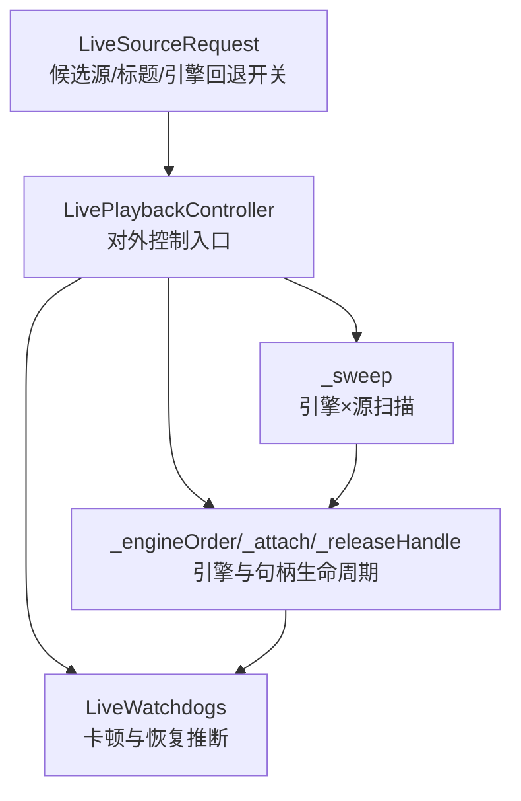
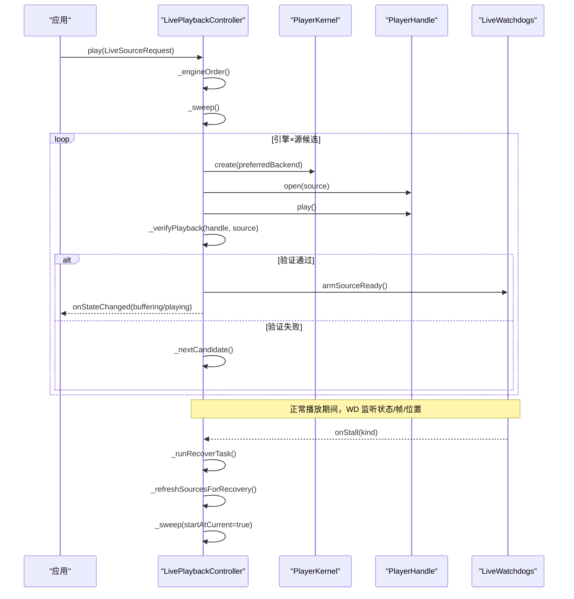
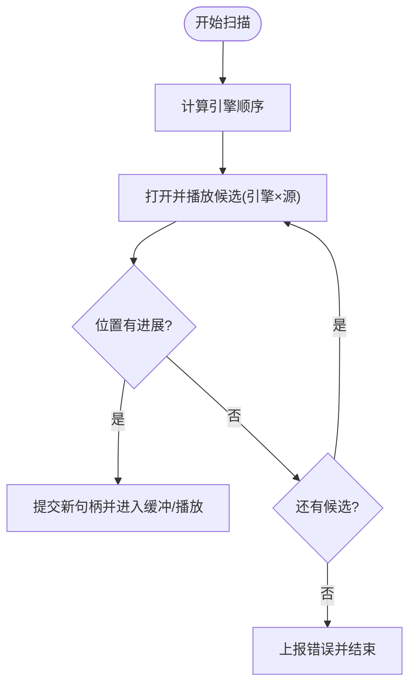
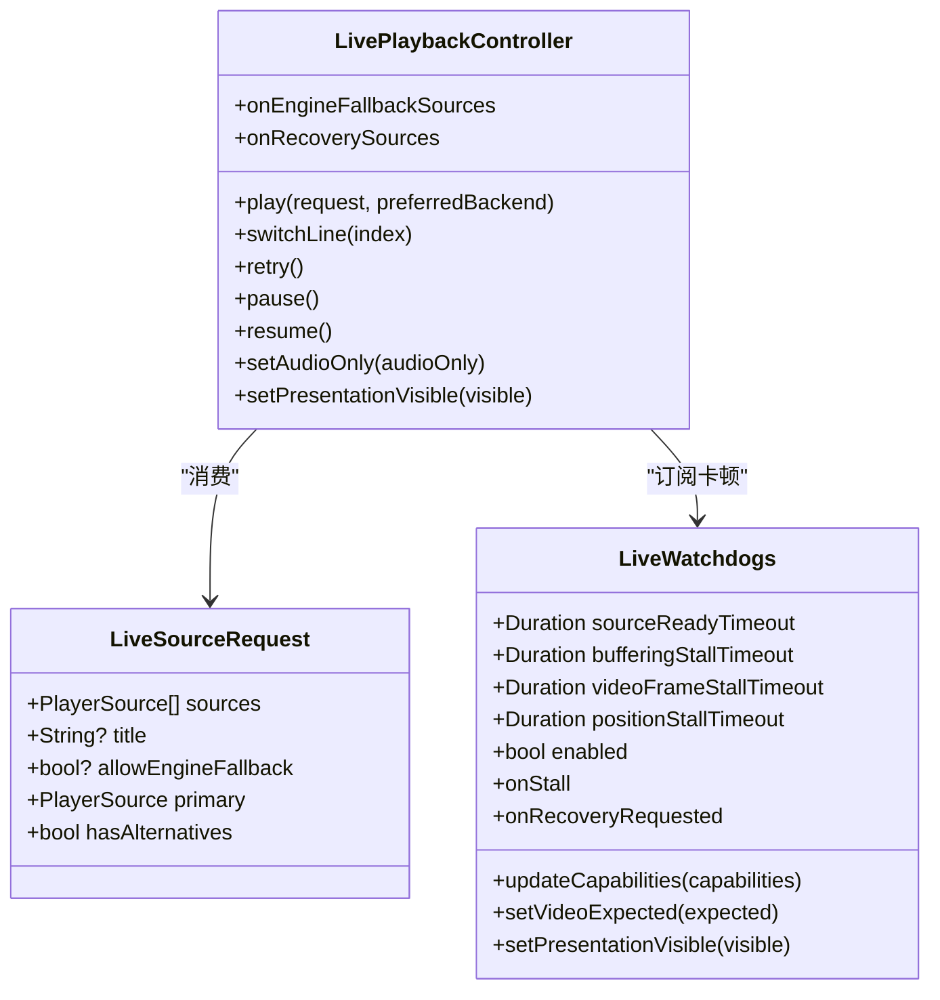
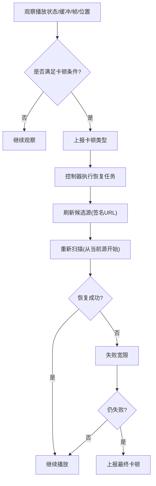
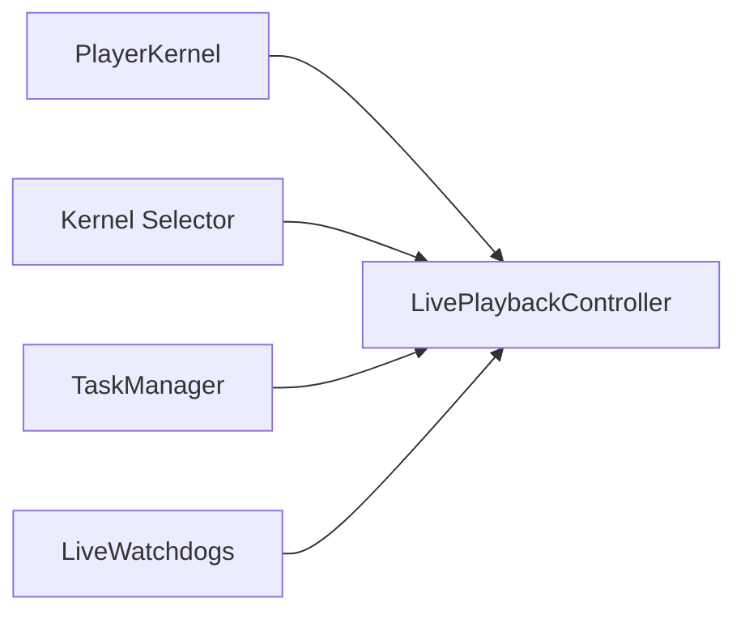

# 直播播放 API

<cite>
**本文引用的文件**   
- [live_playback_controller.dart](file://packages/media_core_live/lib/src/live_playback_controller.dart)
- [live_playback_sweep.dart](file://packages/media_core_live/lib/src/live_playback_sweep.dart)
- [live_playback_pipeline.dart](file://packages/media_core_live/lib/src/live_playback_pipeline.dart)
- [live_watchdogs.dart](file://packages/media_core_live/lib/src/live_watchdogs.dart)
- [live_watchdog_arms.dart](file://packages/media_core_live/lib/src/live_watchdog_arms.dart)
- [live_source_request.dart](file://packages/media_core_live/lib/src/live_source_request.dart)
</cite>

## 目录
1. [简介](#简介)
2. [项目结构](#项目结构)
3. [核心组件](#核心组件)
4. [架构总览](#架构总览)
5. [详细组件分析](#详细组件分析)
6. [依赖关系分析](#依赖关系分析)
7. [性能优化建议](#性能优化建议)
8. [故障排查指南](#故障排查指南)
9. [结论](#结论)

## 简介
本文件面向需要在 Flutter 应用中实现“直播播放”能力的开发者，围绕 `LivePlaybackController` 的核心接口、线路扫描器、自动切换与看门狗机制进行系统化说明。文档重点包括：
- 如何构造直播请求与配置候选线路（URL 列表、协议/格式声明、多码率源）。
- 引擎选择与回退策略（同一引擎内换线、跨引擎回退、签名 URL 刷新）。
- 自动切换逻辑（质量自适应、网络状况检测、故障转移）的实现边界与建议。
- 卡顿看门狗的监控指标、阈值配置与恢复策略。
- 完整的直播播放示例流程（HLS/DASH 支持、多码率切换、实时状态监控）。
- 性能优化建议与常见问题排查方法。

## 项目结构
直播播放能力集中在 `media_core_live` 包中，核心由控制器、扫描器、管线和看门狗组成：
- `LivePlaybackController`：对外暴露的直播播放控制器，统一编排播放、切线、重试、暂停、恢复等动作。
- `LiveSourceRequest`：描述一次直播请求，包含候选源列表、标题、是否允许引擎回退等。
- 扫描器 `_sweep`：按“引擎 × 源”的顺序打开并验证候选，失败则推进到下一个候选。
- 管线 `_engineOrder` / `_attach` / `_releaseHandle`：决定引擎顺序、绑定/释放播放器句柄、将适配器事件转换为恢复任务。
- 看门狗 `LiveWatchdogs`：基于播放状态、缓冲、帧进度、位置变化推断卡顿，触发恢复或上报错误。

**图表来源**
- [live_playback_controller.dart:84-218](file://packages/media_core_live/lib/src/live_playback_controller.dart#L84-L218)
- [live_playback_sweep.dart:64-94](file://packages/media_core_live/lib/src/live_playback_sweep.dart#L64-L94)
- [live_playback_pipeline.dart:14-63](file://packages/media_core_live/lib/src/live_playback_pipeline.dart#L14-L63)
- [live_watchdogs.dart:95-155](file://packages/media_core_live/lib/src/live_watchdogs.dart#L95-L155)
- [live_source_request.dart:26-79](file://packages/media_core_live/lib/src/live_source_request.dart#L26-L79)

**章节来源**
- [live_playback_controller.dart:84-218](file://packages/media_core_live/lib/src/live_playback_controller.dart#L84-L218)
- [live_source_request.dart:26-79](file://packages/media_core_live/lib/src/live_source_request.dart#L26-L79)

## 核心组件
本节聚焦 `LivePlaybackController` 的公开接口与关键属性，帮助快速上手直播播放。

- 构造与依赖
  - 构造函数接收 `PlayerKernel`，可选注入 `LiveWatchdogs`、引擎回退源解析回调、恢复源解析回调。
  - 内部维护单槽任务队列，保证所有用户操作与恢复步骤串行执行，避免竞态。

- 公开状态与流
  - `onStateChanged`：播放核心状态流。
  - `onHandleChanged`：当前播放器句柄变更流（引擎切换后需重新绑定渲染）。
  - `onError`：当所有候选都失败时，仅触发一次的终端错误流。
  - `handle`、`backendId`、`playerId`、`sessionSnapshot`：当前句柄及其会话快照透传。
  - `sources`、`sourceIndex`、`audioOnly`：候选源列表、当前索引、是否仅音频。

- 公开动作
  - `play(request, preferredBackend)`：开始播放，可指定首选后端；内部会构建引擎顺序并启动扫描。
  - `switchLine(index)`：切换到指定索引的源。
  - `retry()`：从头重放当前源。
  - `pause()` / `resume()` / `togglePlayPause()`：暂停、恢复、切换播放/暂停。
  - `setVolume(volume)` / `setMute(muted)` / `setLoop(loop)`：音量、静音、循环。
  - `setAudioOnly(audioOnly)`：仅音频模式，同时更新看门狗的视频期望。
  - `setPresentationVisible(visible)`：标记视频呈现是否可见，影响帧卡顿看门狗。
  - `noteBackgrounded()`：应用后台自动暂停通知，避免误判为网络故障。
  - `close()` / `dispose()`：停止播放、释放资源。

- 重要回调
  - `onEngineFallbackSources(nextEngine, currentSources)`：当当前引擎的所有线路都失败时，在切换到下一引擎前刷新候选源（常用于刷新签名 URL）。
  - `onRecoverySources(currentSources)`：在恢复尝试开始前刷新候选源（用于替换过期的签名 URL）。

**章节来源**
- [live_playback_controller.dart:84-218](file://packages/media_core_live/lib/src/live_playback_controller.dart#L84-L218)
- [live_playback_controller.dart:223-419](file://packages/media_core_live/lib/src/live_playback_controller.dart#L223-L419)

## 架构总览
直播播放的整体流程如下：
1. 调用 `play` 传入 `LiveSourceRequest`，控制器记录请求、候选源、首选后端与引擎回退开关。
2. 通过 `_engineOrder` 计算引擎顺序：优先首选后端，再按内核选择器的评分顺序过滤出能解码该格式的引擎。
3. 进入 `_sweep`：按“引擎 × 源”的顺序打开并验证候选。
4. 若打开成功但无播放进展，通过 `_verifyPlayback` 等待位置前进；超时则视为冻结。
5. 若某候选失败，推进到下一个候选；全部失败则上报 `onError`。
6. 正常播放期间，`LiveWatchdogs` 根据播放状态、缓冲、帧进度、位置变化推断卡顿，触发恢复任务。
7. 恢复任务先尝试刷新候选源（签名 URL），再重新扫描。

**图表来源**
- [live_playback_controller.dart:223-246](file://packages/media_core_live/lib/src/live_playback_controller.dart#L223-L246)
- [live_playback_pipeline.dart:14-63](file://packages/media_core_live/lib/src/live_playback_pipeline.dart#L14-L63)
- [live_playback_sweep.dart:64-94](file://packages/media_core_live/lib/src/live_playback_sweep.dart#L64-L94)
- [live_playback_sweep.dart:228-279](file://packages/media_core_live/lib/src/live_playback_sweep.dart#L228-L279)
- [live_playback_pipeline.dart:135-193](file://packages/media_core_live/lib/src/live_playback_pipeline.dart#L135-L193)

## 详细组件分析

### LivePlaybackController 核心接口与配置
- 构造参数
  - `kernel`：提供播放器与适配器的内核。
  - `watchdogs`：自定义看门狗实例，可调整超时与行为。
  - `onEngineFallbackSources`：引擎回退前刷新候选源。
  - `onRecoverySources`：恢复前刷新候选源。

- 关键属性
  - `sources`：候选源列表（按优先级排序）。
  - `sourceIndex`：当前播放的源索引。
  - `audioOnly`：是否仅音频。
  - `state`：当前核心状态。
  - `handle`：当前播放器句柄。

- 关键方法
  - `play(request, preferredBackend)`：启动播放。
  - `switchLine(index)`：切换线路。
  - `retry()`：重放当前源。
  - `pause()/resume()/togglePlayPause()`：播放控制。
  - `setVolume()/setMute()/setLoop()`：媒体控制。
  - `setAudioOnly(audioOnly)`：仅音频模式。
  - `setPresentationVisible(visible)`：呈现可见性。
  - `noteBackgrounded()`：后台暂停通知。
  - `close()/dispose()`：关闭与销毁。

- 回调
  - `onEngineFallbackSources`：引擎回退前刷新 URL。
  - `onRecoverySources`：恢复前刷新 URL。

**章节来源**
- [live_playback_controller.dart:84-218](file://packages/media_core_live/lib/src/live_playback_controller.dart#L84-L218)
- [live_playback_controller.dart:223-419](file://packages/media_core_live/lib/src/live_playback_controller.dart#L223-L419)

### 线路扫描器（Sweep）使用方法
- 输入
  - `LiveSourceRequest.sources`：候选源列表，首个源优先打开。
  - `preferredBackend`：可选的首选后端 ID。
  - `allowEngineFallback`：是否允许引擎回退（默认自动：多源允许，单源拒绝）。

- 扫描策略
  - 引擎顺序：首选后端优先，其次按内核选择器评分顺序，且过滤掉不支持该格式的引擎。
  - 源顺序：在同一引擎内按 `sources` 顺序尝试。
  - 引擎回退：当当前引擎的所有源都失败时，切换到下一引擎；可在切换前通过 `onEngineFallbackSources` 刷新候选源。

- 超时与验证
  - `_verifyPlayback`：打开后等待位置前进，超时则判定为“打开成功但未播放”。
  - 超时窗口来自 `LiveWatchdogs.sourceReadyTimeout`。

- 失败处理
  - 单个候选失败：继续下一个候选。
  - 所有候选失败：上报 `onError`，携带最后尝试的源与引擎信息。

**图表来源**
- [live_playback_pipeline.dart:14-63](file://packages/media_core_live/lib/src/live_playback_pipeline.dart#L14-L63)
- [live_playback_sweep.dart:64-94](file://packages/media_core_live/lib/src/live_playback_sweep.dart#L64-L94)
- [live_playback_sweep.dart:228-279](file://packages/media_core_live/lib/src/live_playback_sweep.dart#L228-L279)
- [live_playback_sweep.dart:440-486](file://packages/media_core_live/lib/src/live_playback_sweep.dart#L440-L486)

**章节来源**
- [live_playback_sweep.dart:64-94](file://packages/media_core_live/lib/src/live_playback_sweep.dart#L64-L94)
- [live_playback_sweep.dart:228-279](file://packages/media_core_live/lib/src/live_playback_sweep.dart#L228-L279)
- [live_playback_sweep.dart:440-486](file://packages/media_core_live/lib/src/live_playback_sweep.dart#L440-L486)

### 自动切换逻辑：质量自适应、网络状况检测、故障转移
- 质量自适应
  - 控制器本身不直接做码率切换；多码率通常由 HLS/DASH manifest 与底层引擎协商。
  - 控制器通过 `sources` 提供多个候选源（例如不同码率的 master/variant URL），并在引擎回退时允许刷新这些候选。
  - 建议在 `onEngineFallbackSources` 或 `onRecoverySources` 中根据网络状况动态返回更合适的码率源。

- 网络状况检测
  - 控制器未内置网络质量评估；可通过外部网络 SDK 或平台能力获取带宽、丢包等信息。
  - 将检测结果反馈给 `onEngineFallbackSources` / `onRecoverySources`，以决定候选源的优先级或数量。

- 故障转移
  - 引擎回退：当当前引擎的所有源失败时，切换到下一引擎。
  - 源回退：在同一引擎内依次尝试多个源。
  - 恢复路径：看门狗检测到卡滞后，触发恢复任务；恢复前先刷新候选源，再重新扫描。

**图表来源**
- [live_playback_controller.dart:84-218](file://packages/media_core_live/lib/src/live_playback_controller.dart#L84-L218)
- [live_source_request.dart:26-79](file://packages/media_core_live/lib/src/live_source_request.dart#L26-L79)
- [live_watchdogs.dart:95-155](file://packages/media_core_live/lib/src/live_watchdogs.dart#L95-L155)

**章节来源**
- [live_playback_controller.dart:84-218](file://packages/media_core_live/lib/src/live_playback_controller.dart#L84-L218)
- [live_source_request.dart:26-79](file://packages/media_core_live/lib/src/live_source_request.dart#L26-L79)
- [live_watchdogs.dart:95-155](file://packages/media_core_live/lib/src/live_watchdogs.dart#L95-L155)

### 卡顿看门狗：监控指标、阈值配置与恢复策略
- 监控指标
  - 源就绪超时：打开后未在时限内进入播放。
  - 意外暂停连续性：非用户意图的暂停，尝试恢复播放。
  - 缓冲卡顿：缓冲持续时间超过阈值。
  - 视频帧卡顿：播放中无新解码帧。
  - 位置卡顿：播放中位置不再前进（兜底检测）。

- 阈值配置
  - `sourceReadyTimeout`：源就绪超时（默认 18 秒）。
  - `unexpectedPauseGrace`：意外暂停宽限（默认 350ms）。
  - `unexpectedPauseFailureGrace`：恢复失败宽限（默认 5 秒）。
  - `bufferingStallTimeout`：缓冲卡顿超时（默认 12 秒）。
  - `videoFrameStallTimeout`：视频帧卡顿超时（默认 10 秒）。
  - `positionStallTimeout`：位置卡顿超时（默认 15 秒）。
  - `enabled`：总开关。

- 恢复策略
  - 看门狗只报告卡顿类型，不直接操作播放器。
  - 控制器收到卡顿后，先尝试刷新候选源（签名 URL），再重新扫描。
  - 若恢复命令被接受但仍未恢复，进入失败宽限；仍失败则上报卡顿。

**图表来源**
- [live_watchdogs.dart:95-155](file://packages/media_core_live/lib/src/live_watchdogs.dart#L95-L155)
- [live_watchdogs.dart:355-381](file://packages/media_core_live/lib/src/live_watchdogs.dart#L355-L381)
- [live_watchdogs.dart:441-468](file://packages/media_core_live/lib/src/live_watchdogs.dart#L441-L468)
- [live_watchdogs.dart:494-531](file://packages/media_core_live/lib/src/live_watchdogs.dart#L494-L531)
- [live_playback_pipeline.dart:135-193](file://packages/media_core_live/lib/src/live_playback_pipeline.dart#L135-L193)

**章节来源**
- [live_watchdogs.dart:95-155](file://packages/media_core_live/lib/src/live_watchdogs.dart#L95-L155)
- [live_watchdogs.dart:355-381](file://packages/media_core_live/lib/src/live_watchdogs.dart#L355-L381)
- [live_watchdogs.dart:441-468](file://packages/media_core_live/lib/src/live_watchdogs.dart#L441-L468)
- [live_watchdogs.dart:494-531](file://packages/media_core_live/lib/src/live_watchdogs.dart#L494-L531)
- [live_playback_pipeline.dart:135-193](file://packages/media_core_live/lib/src/live_playback_pipeline.dart#L135-L193)

### 完整直播播放示例（HLS/DASH、多码率、实时状态）
- 构造直播请求
  - 使用 `LiveSourceRequest.fromUrls(urls, headers, title, allowEngineFallback)` 快速包装 URL 列表。
  - 或使用 `LiveSourceRequest(sources, title, allowEngineFallback)` 精确声明每个 `PlayerSource` 的协议、格式、头信息。

- 多码率切换
  - 在 `sources` 中提供多个候选源（例如不同码率的 HLS variant 或 DASH adaptation set）。
  - 在 `onEngineFallbackSources` / `onRecoverySources` 中根据网络状况动态返回更合适的码率源。

- 实时状态监控
  - 订阅 `onStateChanged` 获取播放状态（idle/opening/buffering/playing/paused/error）。
  - 订阅 `onHandleChanged` 在引擎切换后重新绑定渲染句柄。
  - 订阅 `onError` 处理所有候选失败的终端错误。

- 典型流程
  1. 创建 `LiveSourceRequest`，设置候选源与标题。
  2. 调用 `controller.play(request, preferredBackend)`。
  3. 监听 `onStateChanged` 更新 UI。
  4. 在 `onHandleChanged` 中重新绑定视频表面。
  5. 在 `onError` 中处理失败并提示用户。
  6. 根据需要调用 `switchLine`、`retry`、`pause`、`resume`。

**章节来源**
- [live_source_request.dart:26-79](file://packages/media_core_live/lib/src/live_source_request.dart#L26-L79)
- [live_playback_controller.dart:180-218](file://packages/media_core_live/lib/src/live_playback_controller.dart#L180-L218)
- [live_playback_controller.dart:223-419](file://packages/media_core_live/lib/src/live_playback_controller.dart#L223-L419)

## 依赖关系分析
- 控制器依赖内核（`PlayerKernel`）来创建/释放引擎与句柄。
- 控制器依赖选择器（`kernel.selector`）来决定引擎顺序。
- 控制器依赖看门狗（`LiveWatchdogs`）来推断卡顿并触发恢复。
- 控制器依赖任务管理器（`TaskManager`）来串行化所有操作。

**图表来源**
- [live_playback_controller.dart:84-111](file://packages/media_core_live/lib/src/live_playback_controller.dart#L84-L111)
- [live_playback_pipeline.dart:14-63](file://packages/media_core_live/lib/src/live_playback_pipeline.dart#L14-L63)
- [live_playback_pipeline.dart:317-394](file://packages/media_core_live/lib/src/live_playback_pipeline.dart#L317-L394)

**章节来源**
- [live_playback_controller.dart:84-111](file://packages/media_core_live/lib/src/live_playback_controller.dart#L84-L111)
- [live_playback_pipeline.dart:14-63](file://packages/media_core_live/lib/src/live_playback_pipeline.dart#L14-L63)
- [live_playback_pipeline.dart:317-394](file://packages/media_core_live/lib/src/live_playback_pipeline.dart#L317-L394)

## 性能优化建议
- 合理设置看门狗阈值
  - `sourceReadyTimeout`：对 HLS master 多变体探测场景保持宽松，避免误判。
  - `bufferingStallTimeout`：在网络波动时适当放宽，减少不必要的恢复。
  - `videoFrameStallTimeout`：仅在引擎支持帧进度且视频可见时启用。
  - `positionStallTimeout`：作为兜底检测，确保即使无帧心跳也能发现卡顿。

- 优化候选源顺序
  - 将最可能成功的源放在 `sources` 首位，减少无效尝试。
  - 在 `onEngineFallbackSources` / `onRecoverySources` 中根据网络状况动态调整候选源。

- 避免重复打开
  - 控制器已去重相同 URI 的重复播放；确保签名 URL 刷新逻辑只在必要时触发。

- 仅音频模式
  - 使用 `setAudioOnly(true)` 禁用视频帧看门狗，减少误报。

- 呈现可见性
  - 使用 `setPresentationVisible(false)` 隐藏视频时，帧看门狗会自动取消，避免后台误判。

[本节为通用指导，不直接分析具体文件]

## 故障排查指南
- 常见卡顿类型
  - 源就绪超时：检查引擎是否能正确打开源，确认 `sourceReadyTimeout` 是否过短。
  - 缓冲卡顿：检查网络状况与 CDN 可用性，适当放宽 `bufferingStallTimeout`。
  - 视频帧卡顿：确认引擎支持帧进度且视频可见，检查 `videoFrameStallTimeout`。
  - 位置卡顿：作为兜底检测，检查引擎是否正确上报位置。

- 恢复失败
  - 检查 `onRecoverySources` 是否正确刷新签名 URL。
  - 确认恢复命令被接受且播放器状态回到 playing/buffering。

- 引擎回退
  - 检查 `allowEngineFallback` 是否允许引擎回退。
  - 检查 `onEngineFallbackSources` 是否返回新的候选源。

- 日志与诊断
  - 关注 recovery/fallback/error 分类日志，定位具体失败点。
  - 使用 `onStateChanged` 与 `onHandleChanged` 跟踪状态与句柄变化。

**章节来源**
- [live_watchdogs.dart:95-155](file://packages/media_core_live/lib/src/live_watchdogs.dart#L95-L155)
- [live_playback_pipeline.dart:135-193](file://packages/media_core_live/lib/src/live_playback_pipeline.dart#L135-L193)
- [live_playback_sweep.dart:488-515](file://packages/media_core_live/lib/src/live_playback_sweep.dart#L488-L515)

## 结论
`LivePlaybackController` 提供了统一的直播播放控制面，结合 `LiveSourceRequest` 的候选源配置、扫描器的引擎×源回退策略、以及 `LiveWatchdogs` 的多维度卡顿检测，构成了一个健壮且可扩展的直播播放体系。开发者应重点关注：
- 候选源的组织与刷新策略（尤其是签名 URL）。
- 看门狗阈值的调优与业务场景匹配。
- 引擎回退与恢复路径的可观测性与可诊断性。
- 多码率切换与网络状况的动态适配。

通过这些机制，可以在复杂网络与多引擎环境下实现稳定、流畅的直播播放体验。