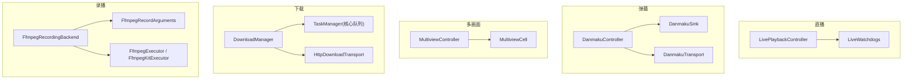
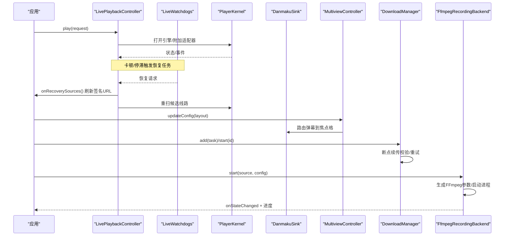
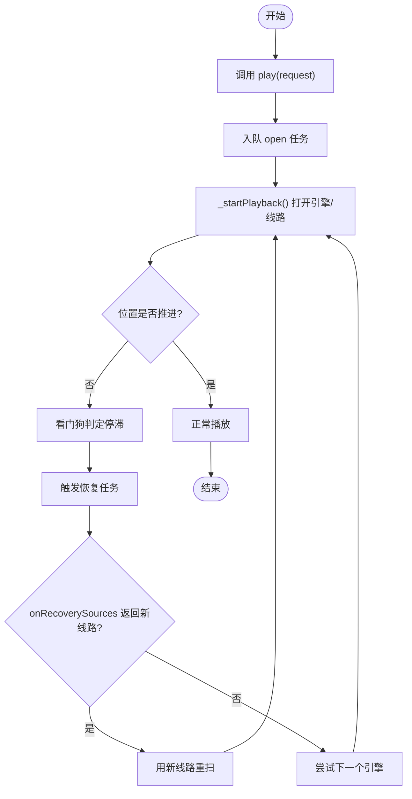
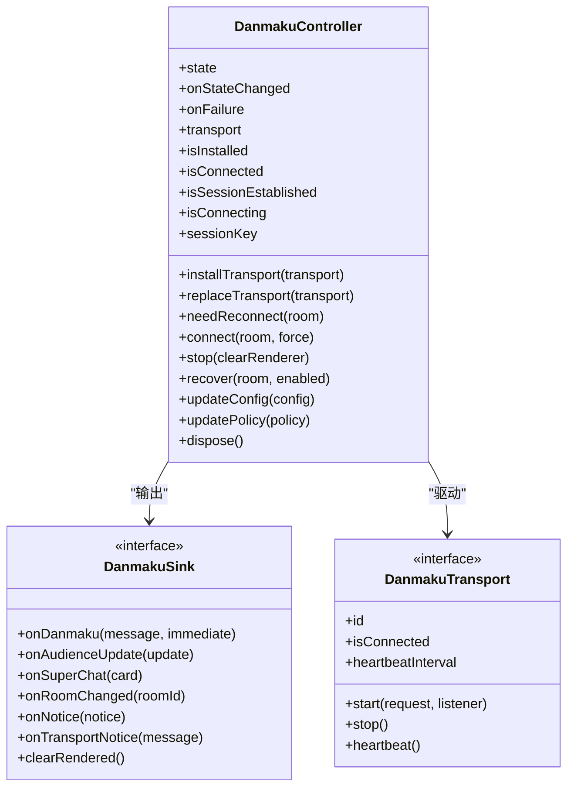
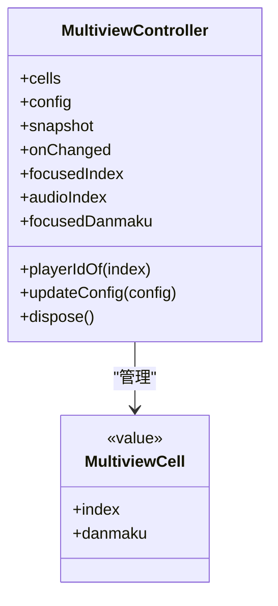
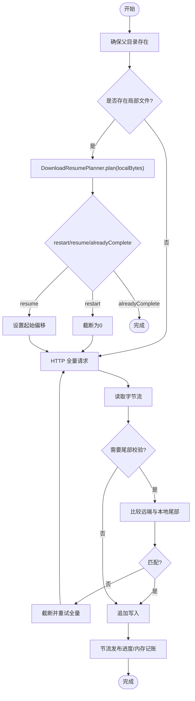
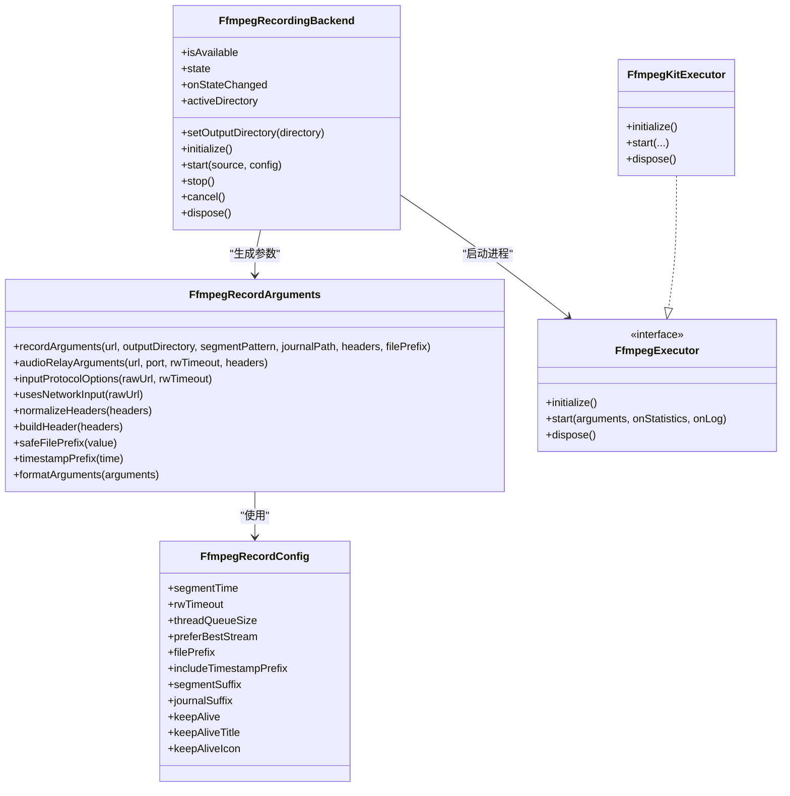
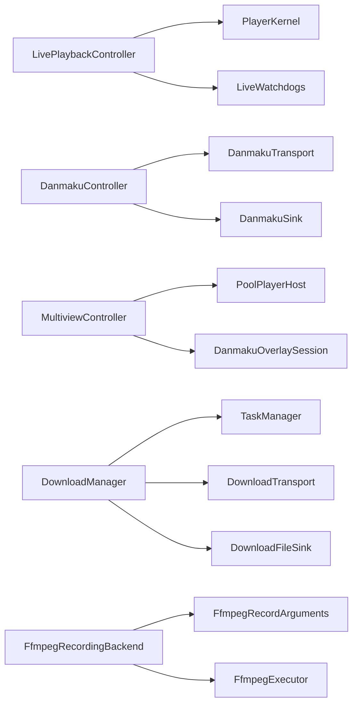

# 高级功能 API

<cite>
**本文引用的文件**
- [live_playback_controller.dart](file://packages/media_core_live/lib/src/live_playback_controller.dart)
- [danmaku_controller.dart](file://packages/media_core_danmaku/lib/src/danmaku_controller.dart)
- [multiview_controller.dart](file://packages/media_core_multiview/lib/src/multiview_controller.dart)
- [download_manager.dart](file://packages/media_core_download/lib/src/download_manager.dart)
- [ffmpeg_record_config.dart](file://packages/media_core_recording_ffmpeg/lib/src/ffmpeg_record_config.dart)
- [ffmpeg_record_arguments.dart](file://packages/media_core_recording_ffmpeg/lib/src/ffmpeg_record_arguments.dart)
- [ffmpeg_executor.dart](file://packages/media_core_recording_ffmpeg/lib/src/ffmpeg_executor.dart)
- [ffmpeg_recording_backend.dart](file://packages/media_core_recording_ffmpeg/lib/src/ffmpeg_recording_backend.dart)
</cite>

## 目录
1. [简介](#简介)
2. [项目结构](#项目结构)
3. [核心组件](#核心组件)
4. [架构总览](#架构总览)
5. [详细组件分析](#详细组件分析)
6. [依赖关系分析](#依赖关系分析)
7. [性能与稳定性](#性能与稳定性)
8. [故障排查指南](#故障排查指南)
9. [结论](#结论)
10. [附录：使用示例与生产建议](#附录使用示例与生产建议)

## 简介
本文件面向“高级功能模块”的 API 文档，覆盖以下能力：
- 直播控制器 LivePlaybackController：线路扫描、自动切换、卡顿看门狗、回放生命周期。
- 弹幕控制器 DanmakuController：消息发送、过滤规则、显示效果、会话状态与失败上报。
- 多画面监控 MultiviewController：健康度检测、异常处理、音频归属管理、解码预算与巡逻轮播。
- 录播 FFmpeg 集成：分段录制、格式转换参数、日志记录、后台保活与结果语义。
- 下载管理器 DownloadManager：并发控制、断点续传、重试策略、进度节流与内存记账。

文档同时给出架构图、时序图、流程图与类图，并提供错误处理、性能调优与生产部署建议。

## 项目结构
本次文档聚焦五个关键包及其核心源文件：
- media_core_live：直播播放编排与看门狗。
- media_core_danmaku：弹幕会话、传输与过滤管线。
- media_core_multiview：多画面墙、焦点与音频归属、资源预算。
- media_core_download：任务队列、断点续传与重试。
- media_core_recording_ffmpeg：FFmpeg 参数构建、执行器与录制后端。

图表来源
- [live_playback_controller.dart:84-177](file://packages/media_core_live/lib/src/live_playback_controller.dart#L84-L177)
- [danmaku_controller.dart:57-149](file://packages/media_core_danmaku/lib/src/danmaku_controller.dart#L57-L149)
- [multiview_controller.dart:74-170](file://packages/media_core_multiview/lib/src/multiview_controller.dart#L74-L170)
- [download_manager.dart:74-149](file://packages/media_core_download/lib/src/download_manager.dart#L74-L149)
- [ffmpeg_recording_backend.dart:62-133](file://packages/media_core_recording_ffmpeg/lib/src/ffmpeg_recording_backend.dart#L62-L133)
- [ffmpeg_record_arguments.dart:23-47](file://packages/media_core_recording_ffmpeg/lib/src/ffmpeg_record_arguments.dart#L23-L47)
- [ffmpeg_executor.dart:44-88](file://packages/media_core_recording_ffmpeg/lib/src/ffmpeg_executor.dart#L44-L88)

章节来源
- [live_playback_controller.dart:84-177](file://packages/media_core_live/lib/src/live_playback_controller.dart#L84-L177)
- [danmaku_controller.dart:57-149](file://packages/media_core_danmaku/lib/src/danmaku_controller.dart#L57-L149)
- [multiview_controller.dart:74-170](file://packages/media_core_multiview/lib/src/multiview_controller.dart#L74-L170)
- [download_manager.dart:74-149](file://packages/media_core_download/lib/src/download_manager.dart#L74-L149)
- [ffmpeg_recording_backend.dart:62-133](file://packages/media_core_recording_ffmpeg/lib/src/ffmpeg_recording_backend.dart#L62-L133)
- [ffmpeg_record_arguments.dart:23-47](file://packages/media_core_recording_ffmpeg/lib/src/ffmpeg_record_arguments.dart#L23-L47)
- [ffmpeg_executor.dart:44-88](file://packages/media_core_recording_ffmpeg/lib/src/ffmpeg_executor.dart#L44-L88)

## 核心组件
- LivePlaybackController：以单槽任务队列串行化所有操作；提供 play、switchLine、retry、pause/resume、setAudioOnly、close/dispose 等接口；暴露 onStateChanged、onHandleChanged、onError 流；内置看门狗与恢复流程，支持引擎回退与恢复时重新解析签名 URL。
- DanmakuController：维护一个房间级弹幕会话；通过 SerialExecutor 序列化连接/停止/替换；提供 installTransport/replaceTransport/connect/recover/stop/updateConfig/updatePolicy/dispose；暴露 onStateChanged/onFailure；内部包含消息门控、重复过滤、相似度过滤与心跳。
- MultiviewController：管理多格画面（MultiviewCell），维护焦点与音频归属、巡逻轮播、解码预算与健康度巡检；暴露 updateConfig/snapshot/onChanged/focusedIndex/audioIndex/focusedDanmaku 等。
- DownloadManager：基于核心 TaskManager 的并发与优先级调度；实现 add/start/pause/resume/cancel/retry/remove/clearCompleted；断点续传由 DownloadResumePlanner 决策；重试使用 RetryUtils；按任务粒度节流进度上报。
- FFmpeg 录播：FfmpegRecordArguments 生成分段录制与音频中继参数；FfmpegKitExecutor 封装 FFmpeg 进程；FfmpegRecordingBackend 负责生命周期、后台保活、统计与结果语义。

章节来源
- [live_playback_controller.dart:84-459](file://packages/media_core_live/lib/src/live_playback_controller.dart#L84-L459)
- [danmaku_controller.dart:57-663](file://packages/media_core_danmaku/lib/src/danmaku_controller.dart#L57-L663)
- [multiview_controller.dart:74-266](file://packages/media_core_multiview/lib/src/multiview_controller.dart#L74-L266)
- [download_manager.dart:74-766](file://packages/media_core_download/lib/src/download_manager.dart#L74-L766)
- [ffmpeg_record_arguments.dart:23-281](file://packages/media_core_recording_ffmpeg/lib/src/ffmpeg_record_arguments.dart#L23-L281)
- [ffmpeg_executor.dart:44-214](file://packages/media_core_recording_ffmpeg/lib/src/ffmpeg_executor.dart#L44-L214)
- [ffmpeg_recording_backend.dart:62-489](file://packages/media_core_recording_ffmpeg/lib/src/ffmpeg_recording_backend.dart#L62-L489)

## 架构总览
直播、弹幕、多画面、下载与录播各自拥有明确职责，并通过核心框架（PlayerKernel、TaskManager、MemoryAccount、MediaCoreLog）协作。

图表来源
- [live_playback_controller.dart:84-177](file://packages/media_core_live/lib/src/live_playback_controller.dart#L84-L177)
- [multiview_controller.dart:74-170](file://packages/media_core_multiview/lib/src/multiview_controller.dart#L74-L170)
- [download_manager.dart:74-149](file://packages/media_core_download/lib/src/download_manager.dart#L74-L149)
- [ffmpeg_recording_backend.dart:141-210](file://packages/media_core_recording_ffmpeg/lib/src/ffmpeg_recording_backend.dart#L141-L210)

## 详细组件分析

### LivePlaybackController：直播控制与看门狗
- 关键能力
  - 线路扫描与引擎回退：当当前引擎所有线路失败时，可调用 onEngineFallbackSources 获取新候选并继续扫描。
  - 恢复流程：看门狗检测到停滞或适配器错误时触发恢复任务，优先尝试同引擎下一线路，再考虑引擎升级；可通过 onRecoverySources 刷新过期签名 URL。
  - 单槽任务队列：play/switchLine/retry/pause/resume/close/dispose 全部入队串行执行，避免竞态。
  - 状态与句柄：onStateChanged/onHandleChanged/onError 流；handle/backendId/playerId/sessionSnapshot 透传。
  - 音频模式：setAudioOnly 影响视频期望与看门狗判定。
- 典型流程（播放与恢复）

图表来源
- [live_playback_controller.dart:227-246](file://packages/media_core_live/lib/src/live_playback_controller.dart#L227-L246)
- [live_playback_controller.dart:248-276](file://packages/media_core_live/lib/src/live_playback_controller.dart#L248-L276)
- [live_playback_controller.dart:278-317](file://packages/media_core_live/lib/src/live_playback_controller.dart#L278-L317)
- [live_playback_controller.dart:350-361](file://packages/media_core_live/lib/src/live_playback_controller.dart#L350-L361)

- 使用要点
  - 在 onRecoverySources 中刷新签名 URL，避免平台时钟过期导致的无效重试。
  - 设置 preferredBackend 固定引擎顺序；allowEngineFallback 控制引擎回退。
  - setAudioOnly(true) 关闭视频期望，避免纯音频场景误判卡顿。
  - noteBackgrounded() 标记系统后台暂停，防止看门狗误报。

章节来源
- [live_playback_controller.dart:84-177](file://packages/media_core_live/lib/src/live_playback_controller.dart#L84-L177)
- [live_playback_controller.dart:227-317](file://packages/media_core_live/lib/src/live_playback_controller.dart#L227-L317)
- [live_playback_controller.dart:350-373](file://packages/media_core_live/lib/src/live_playback_controller.dart#L350-L373)

### DanmakuController：弹幕会话与过滤管线
- 关键能力
  - 传输安装与替换：installTransport/replaceTransport；首次同步安装，替换异步清理旧会话。
  - 会话连接：connect/recover/stop；带 force 强制重建；needReconnect 快速判断是否需要重连。
  - 配置与策略：updateConfig 更新门控窗口与相似度过滤；updatePolicy 更新观众屏蔽策略。
  - 消息管线：gate → policy → repeatedFilter → similarityFilter → sink；本地消息 bypass 过滤。
  - 心跳与通知：根据 transport.heartbeatInterval 定时心跳；notice 去抖；失败统一走 onFailure。
- 类关系图

图表来源
- [danmaku_controller.dart:57-149](file://packages/media_core_danmaku/lib/src/danmaku_controller.dart#L57-L149)
- [danmaku_controller.dart:168-201](file://packages/media_core_danmaku/lib/src/danmaku_controller.dart#L168-L201)
- [danmaku_controller.dart:214-333](file://packages/media_core_danmaku/lib/src/danmaku_controller.dart#L214-L333)
- [danmaku_controller.dart:335-363](file://packages/media_core_danmaku/lib/src/danmaku_controller.dart#L335-L363)
- [danmaku_controller.dart:416-460](file://packages/media_core_danmaku/lib/src/danmaku_controller.dart#L416-L460)

- 使用要点
  - 先 installTransport，再 connect；房间变化时使用 needReconnect 判断。
  - 更新配置后，门控窗口重建，但过滤器缓存保留；关闭相似度过滤需显式 clear。
  - 关注 onFailure 区分 startTimeout/startRejected/transportClosed 等类型。
  - 本地消息直接投递，不受 viewer 策略限制。

章节来源
- [danmaku_controller.dart:57-149](file://packages/media_core_danmaku/lib/src/danmaku_controller.dart#L57-L149)
- [danmaku_controller.dart:168-333](file://packages/media_core_danmaku/lib/src/danmaku_controller.dart#L168-L333)
- [danmaku_controller.dart:335-460](file://packages/media_core_danmaku/lib/src/danmaku_controller.dart#L335-L460)

### MultiviewController：多画面监控
- 关键能力
  - 布局与单元格：updateConfig 动态调整 capacity，新增空单元格，释放多余单元格。
  - 焦点与音频：focusedIndex 与 audioIndex 独立；audioIndex 可为 null；支持巡逻轮播。
  - 弹幕路由：focusedDanmaku 将弹幕定向到焦点格，配合 danmakuOnlyOnFocused 做路由决策。
  - 健康度与预算：周期性 tick 检查进度，结合 ResourcePressure 与 MultiviewBudgetPolicy 控制解码预算；snapshot 暴露决策轨迹。
- 类关系图

图表来源
- [multiview_controller.dart:74-170](file://packages/media_core_multiview/lib/src/multiview_controller.dart#L74-L170)
- [multiview_controller.dart:183-215](file://packages/media_core_multiview/lib/src/multiview_controller.dart#L183-L215)
- [multiview_controller.dart:236-266](file://packages/media_core_multiview/lib/src/multiview_controller.dart#L236-L266)

- 使用要点
  - 通过 qualityResolver 提供质量阶梯；host 决定房间源与质量选择。
  - 注意 focusedIndex 与 audioIndex 可能不一致；静音前记住原音频模式以便恢复。
  - 监听 onChanged 渲染网格；根据 snapshot.decisionTrail 解释为何某格静默。

章节来源
- [multiview_controller.dart:74-170](file://packages/media_core_multiview/lib/src/multiview_controller.dart#L74-L170)
- [multiview_controller.dart:183-266](file://packages/media_core_multiview/lib/src/multiview_controller.dart#L183-L266)

### DownloadManager：下载管理与断点续传
- 关键能力
  - 任务管理：add/start/pause/resume/cancel/retry/remove/clearCompleted；runningCount/canStartMore 暴露队列容量。
  - 并发与优先级：委托核心 TaskManager；maxConcurrent 在构造时固定。
  - 断点续传：DownloadResumePlanner 决策 restart/resume/alreadyComplete；对不支持 Range 的服务自动回退全量。
  - 重试策略：RetryUtils 统一 backoff 与上限；非 _ResumeMismatch 错误才进入重试。
  - 进度节流：每任务 200ms 窗口发布，避免高频 UI 抖动；内存记账精确到已写字节。
- 流程图（一次传输）

图表来源
- [download_manager.dart:497-627](file://packages/media_core_download/lib/src/download_manager.dart#L497-L627)
- [download_manager.dart:641-676](file://packages/media_core_download/lib/src/download_manager.dart#L641-L676)

- 使用要点
  - 不要重复添加同一 id 的非终态任务；pause 会移除核心队列中的任务，resume 需重新注册。
  - 若服务端不支持 Range，会自动降级为全量下载。
  - 观察 onTaskChanged 获取进度与速度；注意 _progressInterval 节流。

章节来源
- [download_manager.dart:74-149](file://packages/media_core_download/lib/src/download_manager.dart#L74-L149)
- [download_manager.dart:157-315](file://packages/media_core_download/lib/src/download_manager.dart#L157-L315)
- [download_manager.dart:497-766](file://packages/media_core_download/lib/src/download_manager.dart#L497-L766)

### FFmpeg 录播：参数、执行与后端
- 关键能力
  - 参数构建：recordArguments 生成 MPEG-TS 分段与 CSV 日志；audioRelayArguments 提供本地音频中继；inputProtocolOptions 按协议注入重连/超时参数。
  - 执行器：FfmpegKitExecutor 封装 FFmpegSession；initialize/start/dispose；statistics/log 回调。
  - 后端：FfmpegRecordingBackend 负责 start/stop/cancel/dispose；后台保活（通知+唤醒锁）；结果语义区分 stop（成功）与 cancel（取消）。
- 类关系图

图表来源
- [ffmpeg_record_config.dart:6-120](file://packages/media_core_recording_ffmpeg/lib/src/ffmpeg_record_config.dart#L6-L120)
- [ffmpeg_record_arguments.dart:23-281](file://packages/media_core_recording_ffmpeg/lib/src/ffmpeg_record_arguments.dart#L23-L281)
- [ffmpeg_executor.dart:44-214](file://packages/media_core_recording_ffmpeg/lib/src/ffmpeg_executor.dart#L44-L214)
- [ffmpeg_recording_backend.dart:62-489](file://packages/media_core_recording_ffmpeg/lib/src/ffmpeg_recording_backend.dart#L62-L489)

- 使用要点
  - keepAlive=true 时，录制期间持有后台执行会话与通知；Android 前台服务+唤醒锁，桌面睡眠断言。
  - 分段长度 clamp 到 10..86400 秒；网络输入启用 dts 不连续修正与 genpts。
  - 仅 HTTP(S) 开启 FFmpeg 侧重连；签名 URL 过期应由上层刷新而非依赖底层重试。
  - stop 返回 success=true；cancel 返回 cancelled；异常退出码视为 error。

章节来源
- [ffmpeg_record_config.dart:6-120](file://packages/media_core_recording_ffmpeg/lib/src/ffmpeg_record_config.dart#L6-L120)
- [ffmpeg_record_arguments.dart:23-281](file://packages/media_core_recording_ffmpeg/lib/src/ffmpeg_record_arguments.dart#L23-L281)
- [ffmpeg_executor.dart:44-214](file://packages/media_core_recording_ffmpeg/lib/src/ffmpeg_executor.dart#L44-L214)
- [ffmpeg_recording_backend.dart:62-489](file://packages/media_core_recording_ffmpeg/lib/src/ffmpeg_recording_backend.dart#L62-L489)

## 依赖关系分析
- LivePlaybackController 依赖 PlayerKernel 与 LiveWatchdogs；通过 TaskManager 串行化用户动作与恢复步骤。
- DanmakuController 依赖 DanmakuTransport/DanmakuSink；通过 SerialExecutor 保证会话过渡安全。
- MultiviewController 依赖 PoolPlayerHost 与 DanmakuOverlaySession；依据 ResourcePressure 调整解码预算。
- DownloadManager 依赖核心 TaskManager、DownloadTransport、DownloadFileSink 与 DownloadResumePlanner；重试策略来自 RetryUtils。
- FFmpeg 录播后端依赖 FfmpegRecordArguments/FfmpegExecutor；可选 BackgroundExecutionStarter 提供跨平台保活。

图表来源
- [live_playback_controller.dart:84-177](file://packages/media_core_live/lib/src/live_playback_controller.dart#L84-L177)
- [danmaku_controller.dart:57-149](file://packages/media_core_danmaku/lib/src/danmaku_controller.dart#L57-L149)
- [multiview_controller.dart:74-170](file://packages/media_core_multiview/lib/src/multiview_controller.dart#L74-L170)
- [download_manager.dart:74-149](file://packages/media_core_download/lib/src/download_manager.dart#L74-L149)
- [ffmpeg_recording_backend.dart:62-133](file://packages/media_core_recording_ffmpeg/lib/src/ffmpeg_recording_backend.dart#L62-L133)

## 性能与稳定性
- 直播
  - 合理设置 source 数量与 allowEngineFallback；避免过多签名 URL 导致内存压力。
  - setAudioOnly 仅在纯音频场景启用；noteBackgrounded 正确标记系统后台暂停。
  - 关注 onError 流，及时降级 UI 与告警。
- 弹幕
  - 使用 updateConfig 调整门控窗口与相似度阈值，平衡去重与展示体验。
  - 心跳间隔由 transport 决定；长时间无响应应依赖 onFailure 与 onStateChanged 进行 UI 提示。
- 多画面
  - 根据设备性能与 ResourcePressure 调整 layout.capacity 与 effectiveMaxCells。
  - 定期 patrol 轮换焦点，避免长期占用单一解码器。
- 下载
  - maxConcurrent 在构造时确定；高并发下注意磁盘 IO 与内存峰值。
  - verifyTailBytes 用于断点续传校验，过大增加 I/O，过小降低安全性。
- 录播
  - threadQueueSize 增大以吸收 HLS 突发；segmentTime 不宜过短以免容器开销放大。
  - keepAlive 在长录制场景开启；注意通知权限与唤醒锁的生命周期。

[本节为通用指导，不直接分析具体文件]

## 故障排查指南
- 直播卡顿/假死
  - 检查 watchdogs 是否被 pause/close/dispose 取消；确认 noteBackgrounded 是否正确调用。
  - 查看 onRecoverySources 是否返回有效新线路；必要时启用 onEngineFallbackSources。
  - 参考路径：[live_playback_controller.dart:278-317](file://packages/media_core_live/lib/src/live_playback_controller.dart#L278-L317)、[live_playback_controller.dart:350-373](file://packages/media_core_live/lib/src/live_playback_controller.dart#L350-L373)。
- 弹幕无法连接/频繁重连
  - 检查 installTransport/replaceTransport 是否成功；connect 是否携带正确的 room key。
  - 关注 onFailure 的 kind 与 message；startTimeout 与 startRejected 的处理不同。
  - 参考路径：[danmaku_controller.dart:214-333](file://packages/media_core_danmaku/lib/src/danmaku_controller.dart#L214-L333)、[danmaku_controller.dart:618-643](file://packages/media_core_danmaku/lib/src/danmaku_controller.dart#L618-L643)。
- 多画面黑屏/无声
  - 检查 focusedIndex 与 audioIndex 是否指向有效 cell；snapshot.decisionTrail 解释预算裁剪原因。
  - 参考路径：[multiview_controller.dart:183-215](file://packages/media_core_multiview/lib/src/multiview_controller.dart#L183-L215)。
- 下载中断/重复下载
  - 确认服务端是否支持 Range；verifyTailBytes 是否足够大；重试次数与 backoff 是否合理。
  - 参考路径：[download_manager.dart:527-627](file://packages/media_core_download/lib/src/download_manager.dart#L527-L627)、[download_manager.dart:701-753](file://packages/media_core_download/lib/src/download_manager.dart#L701-L753)。
- 录播崩溃/文件不可用
  - 检查 keepAlive 是否开启；segmentTime 是否在允许范围；日志中 argv 与 exitCode。
  - stop 成功 vs cancel 取消；异常退出码视为 error。
  - 参考路径：[ffmpeg_recording_backend.dart:141-210](file://packages/media_core_recording_ffmpeg/lib/src/ffmpeg_recording_backend.dart#L141-L210)、[ffmpeg_recording_backend.dart:422-457](file://packages/media_core_recording_ffmpeg/lib/src/ffmpeg_recording_backend.dart#L422-L457)。

章节来源
- [live_playback_controller.dart:278-373](file://packages/media_core_live/lib/src/live_playback_controller.dart#L278-L373)
- [danmaku_controller.dart:214-333](file://packages/media_core_danmaku/lib/src/danmaku_controller.dart#L214-L333)
- [danmaku_controller.dart:618-643](file://packages/media_core_danmaku/lib/src/danmaku_controller.dart#L618-L643)
- [multiview_controller.dart:183-215](file://packages/media_core_multiview/lib/src/multiview_controller.dart#L183-L215)
- [download_manager.dart:527-753](file://packages/media_core_download/lib/src/download_manager.dart#L527-L753)
- [ffmpeg_recording_backend.dart:141-210](file://packages/media_core_recording_ffmpeg/lib/src/ffmpeg_recording_backend.dart#L141-L210)
- [ffmpeg_recording_backend.dart:422-457](file://packages/media_core_recording_ffmpeg/lib/src/ffmpeg_recording_backend.dart#L422-L457)

## 结论
上述高级功能模块围绕“可控、可观测、可恢复”展开：直播以单槽任务与看门狗保障一致性；弹幕以序列化与会话令牌避免竞态；多画面以预算与巡检维持整体可用；下载以核心队列与断点校验保证可靠；录播以分段与后台保活提升鲁棒性。在生产环境中，应结合日志、内存记账与状态流建立监控告警，并根据设备能力与业务需求调优参数。

[本节为总结性内容，不直接分析具体文件]

## 附录：使用示例与生产建议
- 直播
  - 示例流程：创建 LivePlaybackController(kernel) → play(request, preferredBackend?) → 订阅 onStateChanged/onError → 在 onRecoverySources 刷新签名 URL → 结束时 close/dispose。
  - 错误处理：捕获 onError 并降级 UI；在 pause/close 时取消看门狗。
  - 性能建议：限制 sources 数量；按需启用 engine fallback；纯音频场景 setAudioOnly(true)。
  - 生产建议：接入 MediaCoreLog 与 MemoryAccount 监控；在后台暂停时调用 noteBackgrounded。
  - 参考路径：[live_playback_controller.dart:84-177](file://packages/media_core_live/lib/src/live_playback_controller.dart#L84-L177)、[live_playback_controller.dart:227-317](file://packages/media_core_live/lib/src/live_playback_controller.dart#L227-L317)。
- 弹幕
  - 示例流程：DanmakuController(sink, config, policy) → installTransport(transport) → connect(room) → 订阅 onStateChanged/onFailure → 更新策略/配置 → stop/dispose。
  - 错误处理：区分 startTimeout/startRejected/transportClosed；必要时 replaceTransport。
  - 性能建议：合理设置 stableIdWindow/maxMessageAge/similarityThreshold；避免频繁重建过滤器。
  - 生产建议：notice 去抖；心跳失败只记警告，不直接判定会话失败。
  - 参考路径：[danmaku_controller.dart:57-149](file://packages/media_core_danmaku/lib/src/danmaku_controller.dart#L57-L149)、[danmaku_controller.dart:214-333](file://packages/media_core_danmaku/lib/src/danmaku_controller.dart#L214-L333)。
- 多画面
  - 示例流程：MultiviewController(players, config) → updateConfig(layout) → 订阅 onChanged → 设置 focusedIndex/audioIndex → dispose。
  - 错误处理：根据 snapshot.decisionTrail 解释静默原因；必要时缩小 capacity。
  - 性能建议：依据 ResourcePressure 调整 budget；定期 patrol 轮换焦点。
  - 生产建议：将弹幕路由到 focusedDanmaku；保持 audioIndex 与 focusedIndex 一致除非有明确需求。
  - 参考路径：[multiview_controller.dart:74-170](file://packages/media_core_multiview/lib/src/multiview_controller.dart#L74-L170)、[multiview_controller.dart:183-215](file://packages/media_core_multiview/lib/src/multiview_controller.dart#L183-L215)。
- 下载
  - 示例流程：DownloadManager(config) → add(task) → start(id) → 订阅 onTaskChanged → pause/resume/cancel → remove/clearCompleted → dispose。
  - 错误处理：重试超限则标记 failed；非 _ResumeMismatch 错误才重试。
  - 性能建议：maxConcurrent 与 verifyTailBytes 按带宽与磁盘能力调优；利用节流减少 UI 抖动。
  - 生产建议：记录每个任务的 attempt 与 speed；内存记账用于定位峰值。
  - 参考路径：[download_manager.dart:74-149](file://packages/media_core_download/lib/src/download_manager.dart#L74-L149)、[download_manager.dart:497-766](file://packages/media_core_download/lib/src/download_manager.dart#L497-L766)。
- 录播
  - 示例流程：FfmpegRecordingBackend(executor?, config, outputDir) → initialize() → start(source, RecordingConfig) → 订阅 onStateChanged → stop()/cancel() → dispose()。
  - 错误处理：stop 成功；cancel 取消；异常退出码为 error；argv 与日志用于复现。
  - 性能建议：threadQueueSize 提高抗突发；segmentTime 平衡完整性与容错；keepAlive 开启保活。
  - 生产建议：后台通知与唤醒锁生命周期与录制绑定；仅 HTTP(S) 启用 FFmpeg 重连。
  - 参考路径：[ffmpeg_record_config.dart:6-120](file://packages/media_core_recording_ffmpeg/lib/src/ffmpeg_record_config.dart#L6-L120)、[ffmpeg_record_arguments.dart:23-281](file://packages/media_core_recording_ffmpeg/lib/src/ffmpeg_record_arguments.dart#L23-L281)、[ffmpeg_executor.dart:44-214](file://packages/media_core_recording_ffmpeg/lib/src/ffmpeg_executor.dart#L44-L214)、[ffmpeg_recording_backend.dart:62-489](file://packages/media_core_recording_ffmpeg/lib/src/ffmpeg_recording_backend.dart#L62-L489)