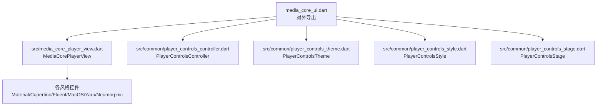
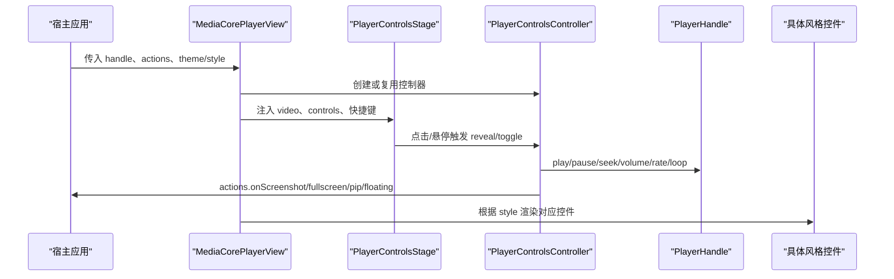
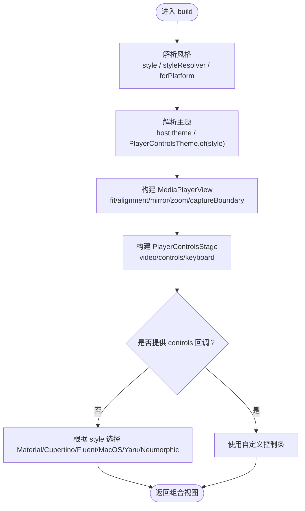
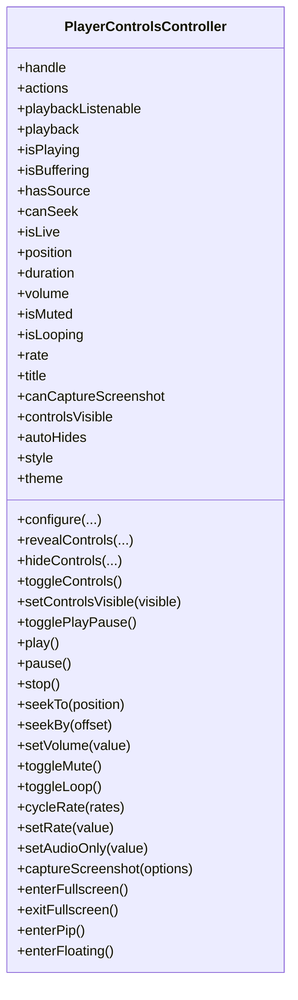
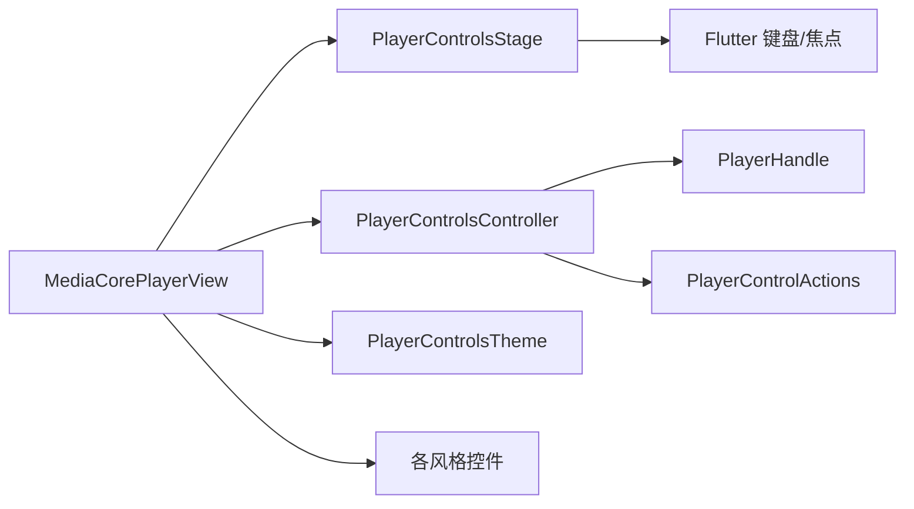

# UI 组件系统

<cite>
**本文引用的文件**   
- [README.md](file://README.md)
- [media_core_ui.dart](file://packages/media_core_ui/lib/media_core_ui.dart)
- [media_core_player_view.dart](file://packages/media_core_ui/lib/src/media_core_player_view.dart)
- [player_controls_controller.dart](file://packages/media_core_ui/lib/src/common/player_controls_controller.dart)
- [player_controls_theme.dart](file://packages/media_core_ui/lib/src/common/player_controls_theme.dart)
- [player_controls_style.dart](file://packages/media_core_ui/lib/src/common/player_controls_style.dart)
- [player_controls_stage.dart](file://packages/media_core_ui/lib/src/common/player_controls_stage.dart)
</cite>

## 目录
1. [引言](#引言)
2. [项目结构](#项目结构)
3. [核心组件](#核心组件)
4. [架构总览](#架构总览)
5. [详细组件分析](#详细组件分析)
6. [依赖关系分析](#依赖关系分析)
7. [性能与响应式最佳实践](#性能与响应式最佳实践)
8. [无障碍访问](#无障碍访问)
9. [故障排查指南](#故障排查指南)
10. [结论](#结论)

## 引言
Media Core UI 是 media_core 的播放器控制层：一套控制逻辑，六种设计语言。所有控件只渲染同一个控制器的状态、调用同一批动作，换皮肤不换行为。它提供：
- 一个“即插即用”的播放器视图 MediaCorePlayerView，组合画面、手势、键盘与六套风格的控制条；
- 可复用的控制控制器 PlayerControlsController，负责播放状态镜像、动作转发与控制条可见性；
- 主题令牌 PlayerControlsTheme，集中颜色、尺寸、动效与图标等视觉令牌；
- 平台默认风格解析 PlayerControlsStyle，以及覆盖策略；
- 通用舞台 PlayerControlsStage，统一处理点击、悬停、键盘与淡入淡出；
- 截图能力、双指缩放、双击全屏/缩放等交互；
- 六种设计语言：material、cupertino、fluent、macos、yaru、neumorphic。

## 项目结构
UI 包采用“公共控制层 + 多风格实现”的组织方式：
- src/common：跨风格共享的控制器、主题、样式、进度条、按钮、图标、键盘映射与舞台；
- src/material、src/cupertino、src/fluent、src/macos、src/yaru、src/neumorphic：每种设计语言一套无状态控件集；
- 顶层导出库 media_core_ui.dart 暴露对外 API，包括主视图、控制器、主题与各风格控件。

图表来源
- [media_core_ui.dart:1-56](file://packages/media_core_ui/lib/media_core_ui.dart#L1-L56)
- [media_core_player_view.dart:46-64](file://packages/media_core_ui/lib/src/media_core_player_view.dart#L46-L64)

章节来源
- [media_core_ui.dart:1-56](file://packages/media_core_ui/lib/media_core_ui.dart#L1-L56)

## 核心组件
- MediaCorePlayerView：宿主直接放入屏幕的播放器装配体，组合 MediaPlayerView（画面）、控制条（按风格选择）与 PlayerControlsStage（可见性与交互）。支持强制风格、外部控制器、自定义控制条、截图边界、缩放、双击行为、自动隐藏、暂停时保留控制条、键盘快捷键等。
- PlayerControlsController：单一播放器的控制中枢，镜像 PlayerHandle 的播放状态、暴露动作（播放/暂停、跳转、音量、速率、循环、截图、全屏/PiP/悬浮），并管理控制条的自动隐藏、悬停显示、暂停保持等可见性策略。
- PlayerControlsTheme：每个风格的视觉令牌集合，包含前景色、强调色、进度条样式、图标尺寸、文本样式、隐藏延迟、阴影/模糊等，并提供 copyWith 与 of(style) 工厂。
- PlayerControlsStyle：设计语言枚举，定义平台默认解析、触摸/指针语义、是否展示音量滑块、是否使用全宽控制条等。
- PlayerControlsStage：视频与控制条的叠加容器，统一处理点击切换、悬停显示、双击回调、键盘快捷键绑定与淡入淡出动画。

章节来源
- [media_core_player_view.dart:46-199](file://packages/media_core_ui/lib/src/media_core_player_view.dart#L46-L199)
- [player_controls_controller.dart:10-30](file://packages/media_core_ui/lib/src/common/player_controls_controller.dart#L10-L30)
- [player_controls_theme.dart:49-64](file://packages/media_core_ui/lib/src/common/player_controls_theme.dart#L49-L64)
- [player_controls_style.dart:4-28](file://packages/media_core_ui/lib/src/common/player_controls_style.dart#L4-L28)
- [player_controls_stage.dart:59-75](file://packages/media_core_ui/lib/src/common/player_controls_stage.dart#L59-L75)

## 架构总览
MediaCorePlayerView 将播放器 UI 解耦为三层：
- 表现层：各风格控件集（Material/Cupertino/Fluent/MacOS/Yaru/Neumorphic），仅消费控制器状态；
- 控制层：PlayerControlsController，桥接 PlayerHandle 与 UI，管理可见性与动作；
- 舞台层：PlayerControlsStage，统一交互协议（点击、悬停、双击、键盘）。

图表来源
- [media_core_player_view.dart:303-355](file://packages/media_core_ui/lib/src/media_core_player_view.dart#L303-L355)
- [player_controls_stage.dart:138-183](file://packages/media_core_ui/lib/src/common/player_controls_stage.dart#L138-L183)
- [player_controls_controller.dart:372-520](file://packages/media_core_ui/lib/src/common/player_controls_controller.dart#L372-L520)

## 详细组件分析

### MediaCorePlayerView 主视图
职责
- 组装 MediaPlayerView（画面）、PlayerControlsStage（舞台）与具体风格控件；
- 解析风格：优先强制 style，否则通过 styleResolver 或 forPlatform 解析；
- 组装主题：优先 host 提供的 theme，否则取 PlayerControlsTheme.of(style)；
- 配置手势：双指缩放 pinchToZoom、双击 doubleTapAction（缩放/全屏/无）；
- 配置控制条：showControls、showTopBar、showOverflowMenu、showSkipButtons、skipStep；
- 配置键盘：keyboardShortcuts 与 shortcuts；
- 截图边界：captureBoundary 决定是否向截图通道暴露画面层；
- 自定义控制条：controls 回调可完全替换内置控制条。

关键参数说明
- handle：要驱动和渲染的播放器标识；
- style/styleResolver：强制风格或按平台解析；
- actions：宿主回调（全屏、PiP、悬浮、截图）；
- theme：主题令牌覆盖；
- zoom：外部 VideoZoomController，用于分享缩放状态；
- pinchToZoom/doubleTapAction：缩放与双击行为；
- autoHideDelay/autoHideControls/keepControlsWhilePaused：控制条可见性策略；
- keyboardShortcuts/shortcuts：键盘快捷键开关与步长；
- showControls/showTopBar/showOverflowMenu/showSkipButtons/skipStep：控制条元素开关；
- controls：自定义控制条构建器；
- controller：外部注入控制器；
- fit/alignment/mirror/background/captureBoundary/onTapVideo：画面布局与交互钩子。

图表来源
- [media_core_player_view.dart:209-247](file://packages/media_core_ui/lib/src/media_core_player_view.dart#L209-L247)
- [media_core_player_view.dart:303-355](file://packages/media_core_ui/lib/src/media_core_player_view.dart#L303-L355)

章节来源
- [media_core_player_view.dart:46-199](file://packages/media_core_ui/lib/src/media_core_player_view.dart#L46-L199)
- [media_core_player_view.dart:209-247](file://packages/media_core_ui/lib/src/media_core_player_view.dart#L209-L247)
- [media_core_player_view.dart:303-355](file://packages/media_core_ui/lib/src/media_core_player_view.dart#L303-L355)

### PlayerControlsController 状态控制
职责
- 镜像 PlayerHandle 的播放状态（位置、时长、音量、静音、速率、循环、源变更）；
- 暴露动作方法（play/pause/stop/seek/setVolume/toggleMute/toggleLoop/cycleRate/setRate/setAudioOnly/captureScreenshot/enterFullscreen/exitFullscreen/enterPip/enterFloating）；
- 管理控制条可见性（自动隐藏、暂停保持、手动 toggle、强制 setControlsVisible）；
- 区分两类通知：ChangeNotifier（结构性变化）与 playbackListenable（高频位置更新）。

关键特性
- canSeek/isLive：基于后端能力与源属性判断是否可拖动进度条；
- captureScreenshot：先尝试引擎抓帧，再交由 actions.onScreenshot 处理；
- 自动隐藏计时器：避免鼠标移动频繁重建 Timer，使用 _activityWhileCounting 合并活动；
- configure：动态更新 style/theme/hideDelay/autoHide/keepVisibleWhenPaused/actions。

图表来源
- [player_controls_controller.dart:41-617](file://packages/media_core_ui/lib/src/common/player_controls_controller.dart#L41-L617)

章节来源
- [player_controls_controller.dart:10-30](file://packages/media_core_ui/lib/src/common/player_controls_controller.dart#L10-L30)
- [player_controls_controller.dart:94-197](file://packages/media_core_ui/lib/src/common/player_controls_controller.dart#L94-L197)
- [player_controls_controller.dart:256-366](file://packages/media_core_ui/lib/src/common/player_controls_controller.dart#L256-L366)
- [player_controls_controller.dart:372-520](file://packages/media_core_ui/lib/src/common/player_controls_controller.dart#L372-L520)

### PlayerControlsTheme 主题定制
职责
- 集中定义前景/背景/强调色、进度条轨道与拖拽态、缩略图形状、图标尺寸、文本样式、隐藏延迟、面板模糊/阴影/边框等；
- 提供六个命名构造器（material/cupertino/fluent/macos/yaru/neumorphic）与 of(style) 工厂；
- 提供 copyWith 以局部覆盖主题。

主题差异要点
- material：不透明遮罩、粗进度条、圆形缩略图、涟漪按钮；
- cupertino：渐变遮罩、发丝级进度条、透明度下沉按钮、倒计时时间；
- fluent：半透明亚克力面板、细进度条、点状缩略图、悬停高亮；
- macos：悬浮半透明药丸、紧凑布局；
- yaru：Ubuntu 风格平直按钮与橙色强调；
- neumorphic：单色表面、凸起/凹陷阴影、内嵌轨道、软按钮。

章节来源
- [player_controls_theme.dart:49-64](file://packages/media_core_ui/lib/src/common/player_controls_theme.dart#L49-L64)
- [player_controls_theme.dart:101-309](file://packages/media_core_ui/lib/src/common/player_controls_theme.dart#L101-L309)
- [player_controls_theme.dart:311-323](file://packages/media_core_ui/lib/src/common/player_controls_theme.dart#L311-L323)
- [player_controls_theme.dart:435-504](file://packages/media_core_ui/lib/src/common/player_controls_theme.dart#L435-L504)

### PlayerControlsStyle 设计语言
职责
- 定义六种设计语言及其平台默认解析；
- 提供 isTouch/revealsOnHover/showsVolumeSlider/usesFullWidthBars/paintsScrim 等风格语义；
- Web 默认 fluent，Linux 默认 yaru。

章节来源
- [player_controls_style.dart:4-28](file://packages/media_core_ui/lib/src/common/player_controls_style.dart#L4-L28)
- [player_controls_style.dart:51-75](file://packages/media_core_ui/lib/src/common/player_controls_style.dart#L51-L75)
- [player_controls_style.dart:77-122](file://packages/media_core_ui/lib/src/common/player_controls_style.dart#L77-L122)

### PlayerControlsStage 舞台与交互
职责
- 将控制条叠加在视频之上；
- 点击视频切换控制条显隐；
- 悬停显示（桌面风格）；
- 双击回调（由上层决定全屏或缩放）；
- 可选启用键盘快捷键（space/k/j/l/up/down/m/f/escape）。

章节来源
- [player_controls_stage.dart:7-57](file://packages/media_core_ui/lib/src/common/player_controls_stage.dart#L7-L57)
- [player_controls_stage.dart:76-123](file://packages/media_core_ui/lib/src/common/player_controls_stage.dart#L76-L123)
- [player_controls_stage.dart:138-183](file://packages/media_core_ui/lib/src/common/player_controls_stage.dart#L138-L183)

## 依赖关系分析
- MediaCorePlayerView 依赖：
  - MediaPlayerView（画面与截图通道）；
  - PlayerControlsStage（交互与可见性）；
  - 具体风格控件（Material/Cupertino/Fluent/MacOS/Yaru/Neumorphic）；
  - PlayerControlsController（状态与动作）；
  - PlayerControlsTheme（视觉令牌）。
- PlayerControlsController 依赖：
  - PlayerHandle（播放状态与操作）；
  - PlayerControlActions（宿主能力回调）；
  - PlayerControlsStyle/Theme（风格与主题）。
- PlayerControlsStage 依赖：
  - Flutter 服务（Keyboard/Focus）；
  - PlayerControlsController（可见性与动作）。

图表来源
- [media_core_ui.dart:41-55](file://packages/media_core_ui/lib/media_core_ui.dart#L41-L55)
- [media_core_player_view.dart:303-355](file://packages/media_core_ui/lib/src/media_core_player_view.dart#L303-L355)
- [player_controls_controller.dart:41-68](file://packages/media_core_ui/lib/src/common/player_controls_controller.dart#L41-L68)
- [player_controls_stage.dart:1-5](file://packages/media_core_ui/lib/src/common/player_controls_stage.dart#L1-L5)

章节来源
- [media_core_ui.dart:41-55](file://packages/media_core_ui/lib/media_core_ui.dart#L41-L55)

## 性能与响应式最佳实践
- 控制条刷新分离：
  - 结构性变化（播放/暂停、音量、速率、循环、源变更）走 ChangeNotifier；
  - 高频位置更新走 playbackListenable，避免整栏重建。
- 自动隐藏优化：
  - 使用单次 Timer 与 _activityWhileCounting 合并鼠标移动，避免每次 hover 都新建定时器；
  - 仅在播放中且未暂停时启动隐藏计时。
- 截图与缩放：
  - 仅在需要时创建 VideoZoomController，避免不必要的对象分配；
  - 通过 captureBoundary 控制截图通道暴露范围。
- 主题与风格：
  - 使用 PlayerControlsTheme.of(style) 获取默认主题，再通过 copyWith 局部覆盖，减少重复定义；
  - 避免在热路径上频繁更换主题。
- 列表/网格场景：
  - 对缩略图或网格单元设置 showControls=false，仅保留画面与手势；
  - 复用 PlayerControlsController 与 VideoZoomController，降低重建成本。

章节来源
- [player_controls_controller.dart:31-40](file://packages/media_core_ui/lib/src/common/player_controls_controller.dart#L31-L40)
- [player_controls_controller.dart:320-366](file://packages/media_core_ui/lib/src/common/player_controls_controller.dart#L320-L366)
- [media_core_player_view.dart:228-235](file://packages/media_core_ui/lib/src/media_core_player_view.dart#L228-L235)
- [player_controls_theme.dart:435-504](file://packages/media_core_ui/lib/src/common/player_controls_theme.dart#L435-L504)

## 无障碍访问
- 键盘导航：
  - PlayerShortcuts 提供 space/k/j/l/up/down/m/f/escape 等键位映射；
  - PlayerControlsStage 在启用 keyboardShortcuts 时包裹 Focus 节点并 autofocus。
- 焦点与可发现性：
  - 舞台拥有独立 FocusNode，便于调试与测试；
  - 宿主可通过 CallbackShortcuts 扩展或替换快捷键。
- 建议：
  - 为自定义控件添加语义标签与可访问名称；
  - 确保键盘顺序符合用户预期；
  - 在高对比度模式下验证主题可读性。

章节来源
- [player_controls_stage.dart:7-57](file://packages/media_core_ui/lib/src/common/player_controls_stage.dart#L7-L57)
- [player_controls_stage.dart:172-180](file://packages/media_core_ui/lib/src/common/player_controls_stage.dart#L172-L180)

## 故障排查指南
常见问题与定位
- 控制条不自动隐藏：
  - 检查 keepControlsWhilePaused 与 autoHideControls；
  - 确认当前处于播放状态；
  - 查看 _scheduleHide/_onHideDeadline 是否被频繁打断。
- 双击无效：
  - 确认 doubleTapAction 是否为 fullscreen 或 zoom；
  - 若为 zoom，需启用 pinchToZoom 或外部 VideoZoomController。
- 截图失败：
  - 检查 canCaptureScreenshot 与 actions.onScreenshot 是否提供；
  - 确认 captureBoundary 已开启。
- 风格未生效：
  - 确认 style 是否被强制覆盖；
  - 检查 styleResolver 返回值；
  - Web 平台默认 fluent。
- 进度条不可拖动：
  - 检查 canSeek 条件（非直播、后端支持 seek、有 duration）。

章节来源
- [player_controls_controller.dart:120-130](file://packages/media_core_ui/lib/src/common/player_controls_controller.dart#L120-L130)
- [player_controls_controller.dart:176-180](file://packages/media_core_ui/lib/src/common/player_controls_controller.dart#L176-L180)
- [media_core_player_view.dart:223-235](file://packages/media_core_ui/lib/src/media_core_player_view.dart#L223-L235)
- [media_core_player_view.dart:339-353](file://packages/media_core_ui/lib/src/media_core_player_view.dart#L339-L353)

## 结论
Media Core UI 通过“控制层 + 多风格实现”的架构，将播放器 UI 的行为与外观彻底解耦。MediaCorePlayerView 提供开箱即用的播放器装配体，PlayerControlsController 统一管理状态与可见性，PlayerControlsTheme 集中视觉令牌，PlayerControlsStyle 定义风格语义，PlayerControlsStage 统一交互协议。借助这套体系，开发者可以：
- 快速接入六套设计语言；
- 按需定制主题与控件；
- 实现截图、缩放、全屏、PiP、悬浮等复杂交互；
- 在多平台保持一致的用户体验；
- 在性能、响应式与无障碍方面获得良好基线。