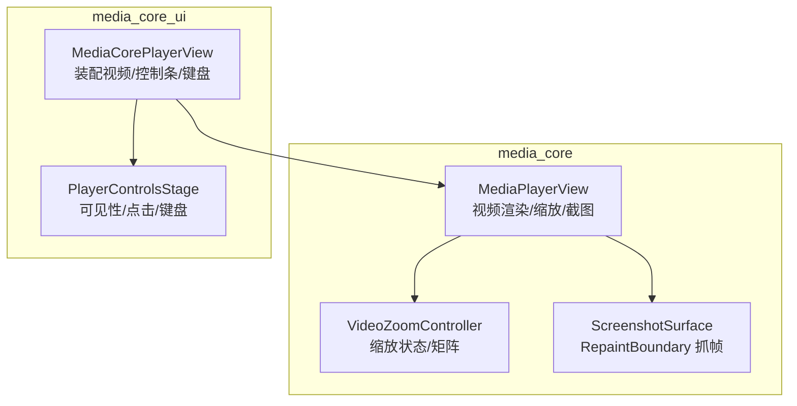
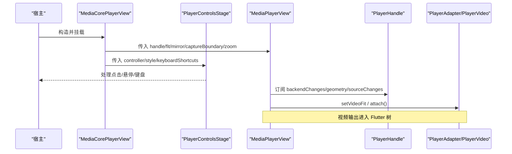
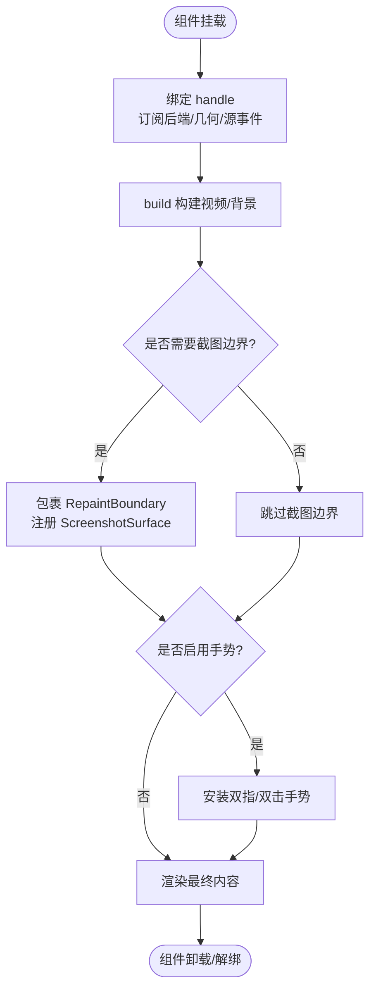
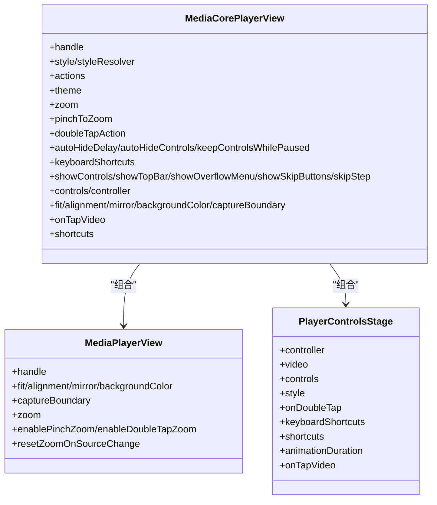
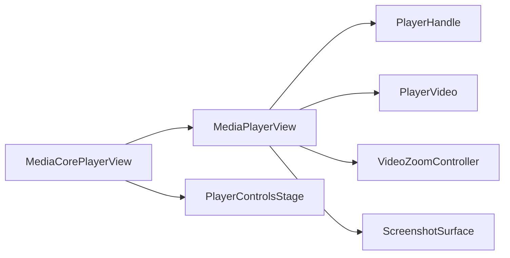
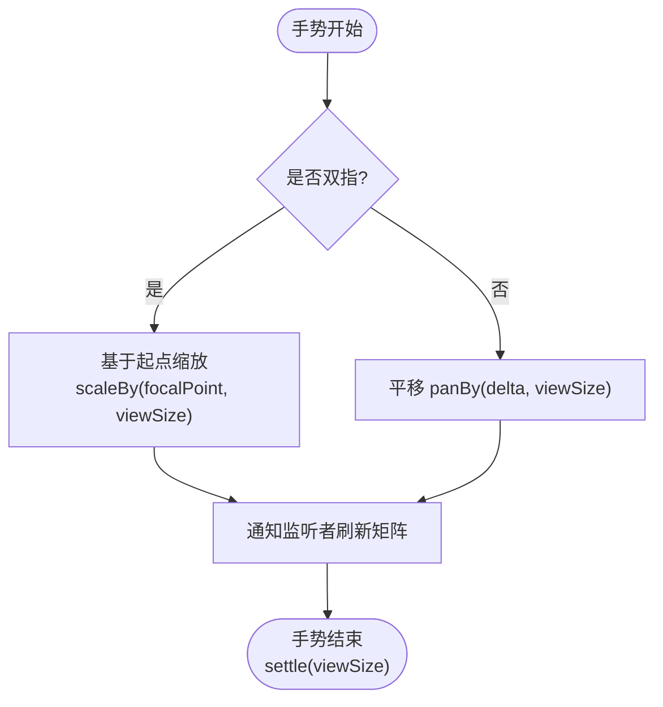
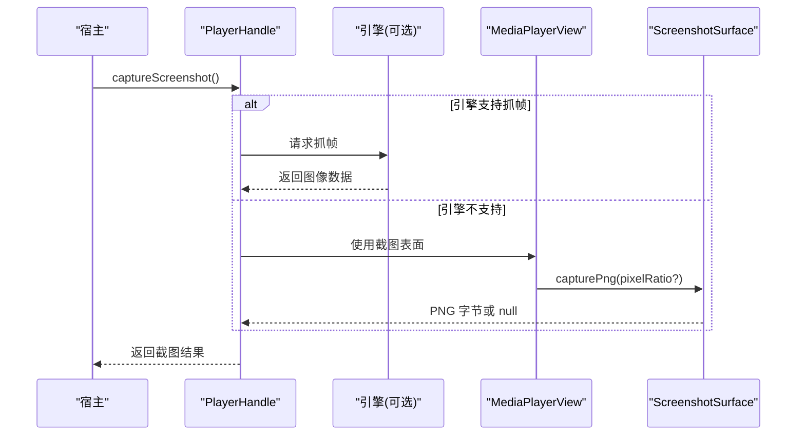
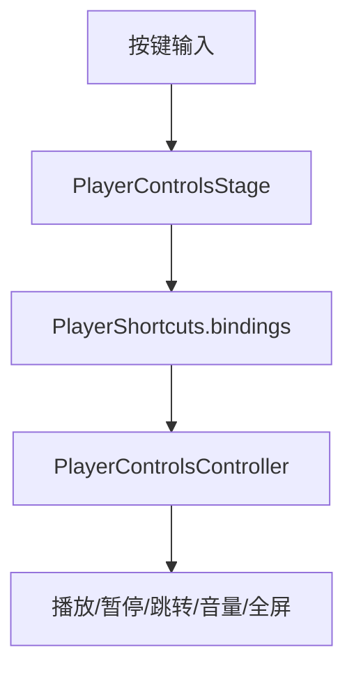

# 主视图组件

<cite>
**本文引用的文件**   
- [packages/media_core/lib/renderer/media_player_view.dart](file://packages/media_core/lib/renderer/media_player_view.dart)
- [packages/media_core_ui/lib/src/media_core_player_view.dart](file://packages/media_core_ui/lib/src/media_core_player_view.dart)
- [packages/media_core/lib/renderer/video_zoom_controller.dart](file://packages/media_core/lib/renderer/video_zoom_controller.dart)
- [packages/media_core/lib/screenshot/screenshot_surface.dart](file://packages/media_core/lib/screenshot/screenshot_surface.dart)
- [packages/media_core_ui/lib/src/common/player_controls_stage.dart](file://packages/media_core_ui/lib/src/common/player_controls_stage.dart)
- [README.md](file://README.md)
</cite>

## 目录
1. [简介](#简介)
2. [项目结构](#项目结构)
3. [核心组件](#核心组件)
4. [架构总览](#架构总览)
5. [详细组件分析](#详细组件分析)
6. [依赖关系分析](#依赖关系分析)
7. [性能与渲染优化](#性能与渲染优化)
8. [手势交互机制](#手势交互机制)
9. [截图功能](#截图功能)
10. [键盘快捷键](#键盘快捷键)
11. [集成示例](#集成示例)
12. [故障排查](#故障排查)
13. [结论](#结论)

## 简介
本文件聚焦 Media Core 的主视图组件，围绕两个核心 UI 组件展开：
- MediaPlayerView：面向 PlayerHandle 的视频渲染视图，负责适配器的视频输出、缩放、镜像、背景、截图边界和手势。
- MediaCorePlayerView：组合型播放器视图，把 MediaPlayerView、控制条、可见性策略、双击行为与键盘快捷键装配在一起，是宿主最常直接使用的“一个 Widget 搞定”的入口。

此外，文档还覆盖：
- 生命周期管理（绑定/解绑 handle、后端切换、几何变化、源切换）
- 渲染机制（适配器视频输出、布局约束、RepaintBoundary 截图边界）
- 性能优化（按需安装手势层、避免在 build 中做平台通道调用、延迟重计算）
- 手势交互（双指缩放、拖拽平移、双击缩放/全屏）
- 截图 API（通过 ScreenshotSurface 抓取 RepaintBoundary）
- 键盘快捷键（默认映射与自定义扩展）

## 项目结构
Media Core 将“视频渲染”与“UI 装配”分层：
- media_core 包提供 MediaPlayerView 与缩放控制器、截图表面等底层能力。
- media_core_ui 包提供 MediaCorePlayerView，按平台风格选择 Material/Cupertino/Fluent/Macos/Yaru/Neumorphic 控制条，并封装可见性与键盘逻辑。

图示来源
- [packages/media_core/lib/renderer/media_player_view.dart:61-139](file://packages/media_core/lib/renderer/media_player_view.dart#L61-L139)
- [packages/media_core_ui/lib/src/media_core_player_view.dart:64-94](file://packages/media_core_ui/lib/src/media_core_player_view.dart#L64-L94)
- [packages/media_core_ui/lib/src/common/player_controls_stage.dart:76-123](file://packages/media_core_ui/lib/src/common/player_controls_stage.dart#L76-L123)

章节来源
- [README.md:14-53](file://README.md#L14-L53)

## 核心组件
本节从使用视角梳理 MediaPlayerView 与 MediaCorePlayerView 的职责、关键属性与配置项。

### MediaPlayerView
- 职责
  - 从 PlayerHandle.adapter 获取 PlayerVideo 并构建视频 widget。
  - 根据 fit/mirror/background 设置渲染外观。
  - 提供截图边界（可选），供引擎无原生抓帧 API 时通过 Flutter 层捕获。
  - 支持缩放（双指/双击/外部驱动）。
  - 不控制播放；播放、恢复、生命周期由 handle 负责。
- 关键属性
  - handle：要渲染的播放器门面。
  - fit：视频填充方式，通过 PlayerVideo.setVideoFit 下发给适配器。
  - alignment：内容对齐。
  - mirror：水平镜像。
  - backgroundColor：无视频时的背景色。
  - captureBoundary：是否包裹 RepaintBoundary 以支持截图。
  - zoom：外部传入的 VideoZoomController；未传入则由视图内部创建。
  - enablePinchZoom：是否启用双指缩放。
  - enableDoubleTapZoom：是否启用双击缩放。
  - resetZoomOnSourceChange：换源后是否重置缩放。

章节来源
- [packages/media_core/lib/renderer/media_player_view.dart:12-33](file://packages/media_core/lib/renderer/media_player_view.dart#L12-L33)
- [packages/media_core/lib/renderer/media_player_view.dart:61-139](file://packages/media_core/lib/renderer/media_player_view.dart#L61-L139)

### MediaCorePlayerView
- 职责
  - 组装 MediaPlayerView、控制条（按风格）、PlayerControlsStage（可见性/点击/键盘）。
  - 解析风格（style/styleResolver），应用主题（theme）。
  - 处理双击动作（zoom/fullscreen/none）。
  - 暴露控制条开关、顶部栏、溢出菜单、快进/后退按钮等 UI 选项。
  - 统一注入 keyboardShortcuts 与 shortcuts。
- 关键属性
  - handle：播放器门面。
  - style/styleResolver：强制风格或按平台解析。
  - actions：宿主回调（全屏/PiP/浮窗/截图等）。
  - theme：主题令牌。
  - zoom：共享缩放控制器。
  - pinchToZoom：是否启用双指缩放。
  - doubleTapAction：双击行为（zoom/fullscreen/none）。
  - autoHideDelay/autoHideControls/keepControlsWhilePaused：控制条自动隐藏策略。
  - keyboardShortcuts：是否启用键盘快捷键。
  - showControls/showTopBar/showOverflowMenu/showSkipButtons/skipStep：控制条显示选项。
  - controls/controller：替换控制条或复用外部控制器。
  - fit/alignment/mirror/backgroundColor/captureBoundary：透传给 MediaPlayerView。
  - onTapVideo：视频区域点击回调（先于控制条显隐切换）。
  - shortcuts：键盘映射对象。

章节来源
- [packages/media_core_ui/lib/src/media_core_player_view.dart:46-94](file://packages/media_core_ui/lib/src/media_core_player_view.dart#L46-L94)
- [packages/media_core_ui/lib/src/media_core_player_view.dart:96-195](file://packages/media_core_ui/lib/src/media_core_player_view.dart#L96-L195)

## 架构总览
MediaCorePlayerView 作为装配器，向下委托 MediaPlayerView 负责视频渲染与截图边界，向上通过 PlayerControlsStage 管理可见性与键盘。MediaPlayerView 再与 PlayerHandle 的适配器交互，必要时借助 VideoZoomController 与 ScreenshotSurface 完成缩放与截图。

图示来源
- [packages/media_core_ui/lib/src/media_core_player_view.dart:298-327](file://packages/media_core_ui/lib/src/media_core_player_view.dart#L298-L327)
- [packages/media_core/lib/renderer/media_player_view.dart:245-274](file://packages/media_core/lib/renderer/media_player_view.dart#L245-L274)
- [packages/media_core/lib/renderer/media_player_view.dart:375-418](file://packages/media_core/lib/renderer/media_player_view.dart#L375-L418)

## 详细组件分析

### MediaPlayerView 生命周期与渲染
- 初始化与绑定
  - initState 中绑定 handle，建立后端切换、几何变化、源变化的订阅。
  - didUpdateWidget 处理 zoom 控制器替换、handle 更换、fit 变更、captureBoundary 切换。
  - dispose 取消所有订阅并释放截图表面与视频输出。
- 视频输出附着
  - build 中根据 handle.adapter 是否为 PlayerVideo 且 available 来决定是否构建视频 widget。
  - 通过 _scheduleSurfaceSync 在帧后执行 attach/detach，避免在 build 阶段触发平台通道。
- 截图边界
  - 当 captureBoundary=true 时包裹 RepaintBoundary，并通过 ScreenshotSurface 注册到 handle，使 PlayerHandle.captureScreenshot 可用。
- 缩放与手势
  - 仅在 enablePinchZoom 或 enableDoubleTapZoom 或传入 zoom 时启用缩放包装。
  - 手势层只在需要时安装，避免不必要的识别器开销。

图示来源
- [packages/media_core/lib/renderer/media_player_view.dart:142-187](file://packages/media_core/lib/renderer/media_player_view.dart#L142-L187)
- [packages/media_core/lib/renderer/media_player_view.dart:245-336](file://packages/media_core/lib/renderer/media_player_view.dart#L245-L336)
- [packages/media_core/lib/renderer/media_player_view.dart:375-418](file://packages/media_core/lib/renderer/media_player_view.dart#L375-L418)
- [packages/media_core/lib/renderer/media_player_view.dart:420-486](file://packages/media_core/lib/renderer/media_player_view.dart#L420-L486)

章节来源
- [packages/media_core/lib/renderer/media_player_view.dart:142-187](file://packages/media_core/lib/renderer/media_player_view.dart#L142-L187)
- [packages/media_core/lib/renderer/media_player_view.dart:245-336](file://packages/media_core/lib/renderer/media_player_view.dart#L245-L336)
- [packages/media_core/lib/renderer/media_player_view.dart:375-418](file://packages/media_core/lib/renderer/media_player_view.dart#L375-L418)

### MediaCorePlayerView 装配与控制条
- 风格与主题
  - 若传入 style 则强制使用；否则通过 styleResolver 或平台默认解析。
  - theme 优先使用宿主提供的，否则取当前风格的默认主题。
- 控制条装配
  - 根据 style 选择 Material/Cupertino/Fluent/Macos/Yaru/Neumorphic 控制条。
  - 支持 controls 完全替换控制条，或 controller 复用外部控制器。
- 双击行为
  - doubleTapAction=zoom：走 MediaPlayerView 的双击缩放。
  - doubleTapAction=fullscreen：通过 controller.enterFullscreen 进入全屏。
  - doubleTapAction=none：交由宿主处理。
- 可见性与键盘
  - 通过 PlayerControlsStage 统一管理控制条显隐、悬停显示、点击切换、键盘快捷键。

图示来源
- [packages/media_core_ui/lib/src/media_core_player_view.dart:64-195](file://packages/media_core_ui/lib/src/media_core_player_view.dart#L64-L195)
- [packages/media_core_ui/lib/src/common/player_controls_stage.dart:76-123](file://packages/media_core_ui/lib/src/common/player_controls_stage.dart#L76-L123)

章节来源
- [packages/media_core_ui/lib/src/media_core_player_view.dart:201-327](file://packages/media_core_ui/lib/src/media_core_player_view.dart#L201-L327)
- [packages/media_core_ui/lib/src/common/player_controls_stage.dart:76-123](file://packages/media_core_ui/lib/src/common/player_controls_stage.dart#L76-L123)

## 依赖关系分析
- MediaPlayerView 依赖
  - PlayerHandle：读取 adapter、订阅后端/几何/源变化、attach/detach 截图表面。
  - PlayerVideo：通过 setVideoFit 传递填充策略，构建视频 widget。
  - VideoZoomController：缩放状态与矩阵。
  - ScreenshotSurface：RepaintBoundary 抓帧。
- MediaCorePlayerView 依赖
  - MediaPlayerView：视频渲染。
  - PlayerControlsStage：可见性/点击/键盘。
  - 各风格控制条实现：Material/Cupertino/Fluent/Macos/Yaru/Neumorphic。

图示来源
- [packages/media_core_ui/lib/src/media_core_player_view.dart:298-327](file://packages/media_core_ui/lib/src/media_core_player_view.dart#L298-L327)
- [packages/media_core/lib/renderer/media_player_view.dart:375-418](file://packages/media_core/lib/renderer/media_player_view.dart#L375-L418)

章节来源
- [packages/media_core/lib/renderer/media_player_view.dart:375-418](file://packages/media_core/lib/renderer/media_player_view.dart#L375-L418)
- [packages/media_core_ui/lib/src/media_core_player_view.dart:298-327](file://packages/media_core_ui/lib/src/media_core_player_view.dart#L298-L327)

## 性能与渲染优化
- 避免在 build 中执行平台通道
  - 视频输出的 attach/detach 通过 addPostFrameCallback 延后执行，防止 build 阶段阻塞。
- 按需安装手势层
  - 仅当 enablePinchZoom 或 enableDoubleTapZoom 为真时才安装 GestureDetector，减少识别器竞争与开销。
- 缩放包装最小化
  - 当缩放未激活时，不包裹 ClipRect/Transform，避免额外合成层。
- 截图边界可关闭
  - captureBoundary=false 时不包裹 RepaintBoundary，适合不需要截图且多播放器场景。
- 尺寸变化后的缩放重夹紧
  - 旋转/全屏/分屏导致视口变化时，延迟 reclamp，保证缩放范围正确且不抖动。

章节来源
- [packages/media_core/lib/renderer/media_player_view.dart:338-373](file://packages/media_core/lib/renderer/media_player_view.dart#L338-L373)
- [packages/media_core/lib/renderer/media_player_view.dart:425-450](file://packages/media_core/lib/renderer/media_player_view.dart#L425-L450)
- [packages/media_core/lib/renderer/media_player_view.dart:488-510](file://packages/media_core/lib/renderer/media_player_view.dart#L488-L510)

## 手势交互机制
- 双指缩放（Pinch Zoom）
  - 记录手势开始时的 scale，后续用相对比例更新，避免累积误差。
  - 多点触控时进行缩放；单点拖动时进行平移。
  - 手势结束时调用 settle，回弹至自然缩放或重新夹紧。
- 双击缩放（Double Tap Zoom）
  - 以点击位置为焦点，在 1x 与 doubleTapScale 之间切换。
- 平移与边界夹紧
  - 平移仅在已放大时生效，确保画面始终覆盖视口，不会出现黑边。
  - 视口变化时通过 reclamp 修正 translation。

图示来源
- [packages/media_core/lib/renderer/media_player_view.dart:457-486](file://packages/media_core/lib/renderer/media_player_view.dart#L457-L486)
- [packages/media_core/lib/renderer/video_zoom_controller.dart:139-191](file://packages/media_core/lib/renderer/video_zoom_controller.dart#L139-L191)
- [packages/media_core/lib/renderer/video_zoom_controller.dart:204-241](file://packages/media_core/lib/renderer/video_zoom_controller.dart#L204-L241)

章节来源
- [packages/media_core/lib/renderer/media_player_view.dart:457-486](file://packages/media_core/lib/renderer/media_player_view.dart#L457-L486)
- [packages/media_core/lib/renderer/video_zoom_controller.dart:139-191](file://packages/media_core/lib/renderer/video_zoom_controller.dart#L139-L191)
- [packages/media_core/lib/renderer/video_zoom_controller.dart:204-241](file://packages/media_core/lib/renderer/video_zoom_controller.dart#L204-L241)

## 截图功能
- 原理
  - MediaPlayerView 在 captureBoundary=true 时包裹 RepaintBoundary，并通过 ScreenshotSurface 将其注册到 PlayerHandle。
  - 当引擎没有原生抓帧 API 时，Flutter 层可从该边界编码 PNG。
- API 使用
  - 通过 PlayerHandle.captureScreenshot 触发截图；底层会尝试引擎抓帧，失败则回退到 ScreenshotSurface 的 PNG 捕获。
  - ScreenshotSurface.capturePng 返回 Uint8List?，若边界不可用或尚未绘制完成则返回 null。
- 自定义处理
  - 宿主可在 actions 中提供截图回调，对返回的字节进行保存、上传或格式转换。
  - 可通过 devicePixelRatio 指定捕获分辨率，或在窗口移动时自动更新密度。

图示来源
- [packages/media_core/lib/renderer/media_player_view.dart:276-293](file://packages/media_core/lib/renderer/media_player_view.dart#L276-L293)
- [packages/media_core/lib/screenshot/screenshot_surface.dart:52-92](file://packages/media_core/lib/screenshot/screenshot_surface.dart#L52-L92)

章节来源
- [packages/media_core/lib/renderer/media_player_view.dart:276-293](file://packages/media_core/lib/renderer/media_player_view.dart#L276-L293)
- [packages/media_core/lib/screenshot/screenshot_surface.dart:52-92](file://packages/media_core/lib/screenshot/screenshot_surface.dart#L52-L92)

## 键盘快捷键
- 默认快捷键
  - 空格/k：播放/暂停
  - 左/右：±5s 跳转
  - j/l：±10s 跳转
  - 上/下：音量 ±5%
  - m：静音切换
  - f：进入全屏
  - escape：退出全屏
- 自定义
  - 通过 PlayerShortcuts.seekStep/largeSeekStep/volumeStep 调整步长。
  - 通过 shortcuts.bindings(controller) 获取完整映射，并在宿主侧扩展或替换。
- 启用方式
  - MediaCorePlayerView.keyboardShortcuts=true 时，PlayerControlsStage 会启用 CallbackShortcuts 并接管焦点。

图示来源
- [packages/media_core_ui/lib/src/common/player_controls_stage.dart:24-57](file://packages/media_core_ui/lib/src/common/player_controls_stage.dart#L24-L57)
- [packages/media_core_ui/lib/src/common/player_controls_stage.dart:176-181](file://packages/media_core_ui/lib/src/common/player_controls_stage.dart#L176-L181)

章节来源
- [packages/media_core_ui/lib/src/common/player_controls_stage.dart:24-57](file://packages/media_core_ui/lib/src/common/player_controls_stage.dart#L24-L57)
- [packages/media_core_ui/lib/src/common/player_controls_stage.dart:176-181](file://packages/media_core_ui/lib/src/common/player_controls_stage.dart#L176-L181)

## 集成示例
以下示例描述如何集成 MediaPlayerView 与 MediaCorePlayerView，涵盖基础用法与高级定制。为避免泄露代码细节，仅提供路径引用。

- 基础用法（使用 MediaCorePlayerView）
  - 创建一个 PlayerKernel，注册后端，创建 PlayerHandle，然后在界面中放入 MediaCorePlayerView。
  - 参考：[README.md:14-53](file://README.md#L14-L53)
- 仅渲染视频（使用 MediaPlayerView）
  - 在已有控制条或宿主 UI 中，直接使用 MediaPlayerView(handle: handle)，并可设置 fit/mirror/captureBoundary/zoom。
  - 参考：[packages/media_core/lib/renderer/media_player_view.dart:61-139](file://packages/media_core/lib/renderer/media_player_view.dart#L61-L139)
- 高级定制（自定义控制条与主题）
  - 通过 MediaCorePlayerView.controls 传入自定义控件函数，或使用 controller/theme 复用外部控制器与主题。
  - 参考：[packages/media_core_ui/lib/src/media_core_player_view.dart:170-174](file://packages/media_core_ui/lib/src/media_core_player_view.dart#L170-L174)
- 高级定制（自定义双击行为）
  - doubleTapAction=fullscreen：双击进入全屏；zoom：双击缩放；none：宿主自行处理。
  - 参考：[packages/media_core_ui/lib/src/media_core_player_view.dart:18-44](file://packages/media_core_ui/lib/src/media_core_player_view.dart#L18-L44)
- 高级定制（键盘快捷键）
  - 修改 PlayerShortcuts 的 seekStep/largeSeekStep/volumeStep，或通过 shortcuts.bindings 扩展。
  - 参考：[packages/media_core_ui/lib/src/common/player_controls_stage.dart:24-57](file://packages/media_core_ui/lib/src/common/player_controls_stage.dart#L24-L57)

## 故障排查
- 截图返回 null
  - 可能原因：RepaintBoundary 不在树中、尚未绘制完成、窗口移动导致像素密度变化。
  - 建议：确保 captureBoundary=true；等待一帧后再截图；检查 MediaQuery.devicePixelRatio 是否正确。
  - 参考：[packages/media_core/lib/screenshot/screenshot_surface.dart:52-92](file://packages/media_core/lib/screenshot/screenshot_surface.dart#L52-L92)
- 缩放异常或画面偏移
  - 可能原因：视口变化后未 reclamp；手势与父级滚动冲突。
  - 建议：在旋转/全屏/分屏后让视图自动 reclamp；在 feed/gallery 中禁用 enablePinchZoom 或阻止父滚动。
  - 参考：[packages/media_core/lib/renderer/media_player_view.dart:488-510](file://packages/media_core/lib/renderer/media_player_view.dart#L488-L510)
- 控制条不显示或不自动隐藏
  - 可能原因：showControls=false；autoHideControls=false；keepControlsWhilePaused=false。
  - 建议：检查 MediaCorePlayerView 的对应布尔参数。
  - 参考：[packages/media_core_ui/lib/src/media_core_player_view.dart:126-145](file://packages/media_core_ui/lib/src/media_core_player_view.dart#L126-L145)

章节来源
- [packages/media_core/lib/screenshot/screenshot_surface.dart:52-92](file://packages/media_core/lib/screenshot/screenshot_surface.dart#L52-L92)
- [packages/media_core/lib/renderer/media_player_view.dart:488-510](file://packages/media_core/lib/renderer/media_player_view.dart#L488-L510)
- [packages/media_core_ui/lib/src/media_core_player_view.dart:126-145](file://packages/media_core_ui/lib/src/media_core_player_view.dart#L126-L145)

## 结论
- MediaPlayerView 是“视频渲染+缩放+截图”的最小可用单元，专注于把 PlayerHandle 的视频输出安全地嵌入 Flutter 树，并提供截图边界与缩放能力。
- MediaCorePlayerView 是“视频+控制条+可见性+键盘”的一体化装配器，按平台风格选择控制条，统一处理双击行为与键盘快捷键。
- 两者共同遵循“渲染与播放分离”的原则：视图只负责呈现与交互，播放、恢复、生命周期由 handle 与内核编排。
- 性能方面，视图通过延迟 attach/detach、按需安装手势层、最小化缩放包装、可关闭截图边界等手段降低开销。
- 截图通过 ScreenshotSurface 桥接 Flutter 层，适用于无原生抓帧 API 的引擎；键盘快捷键遵循通用约定，便于宿主扩展。