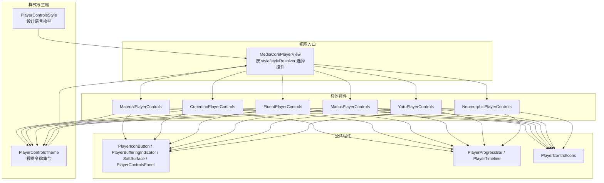
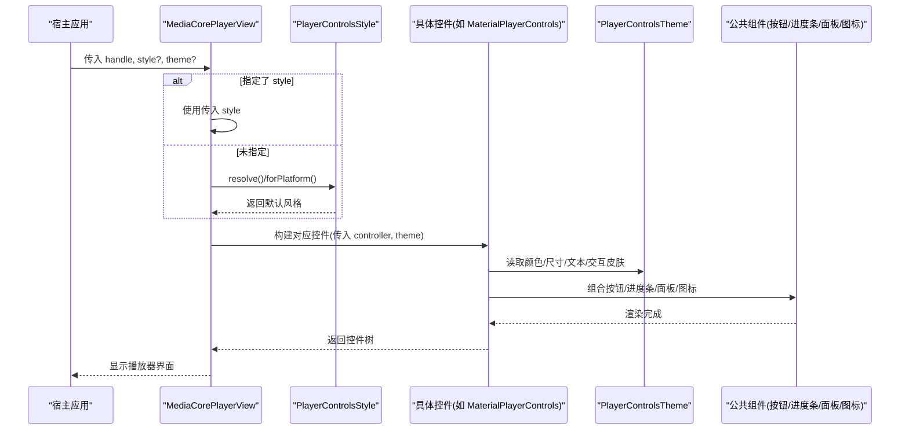
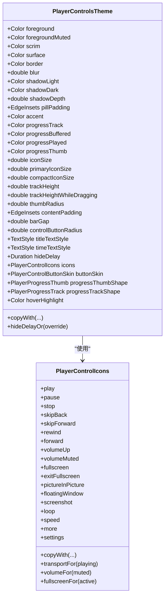
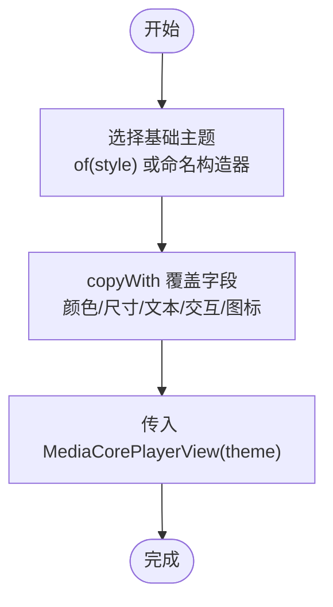
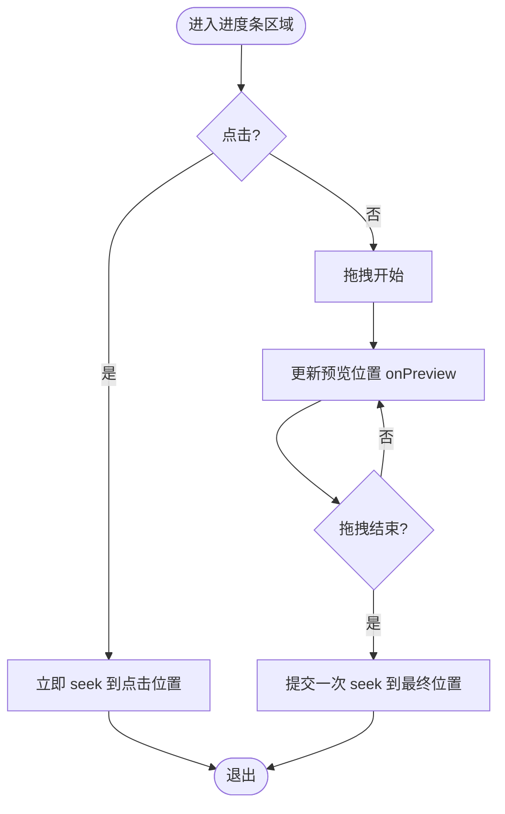
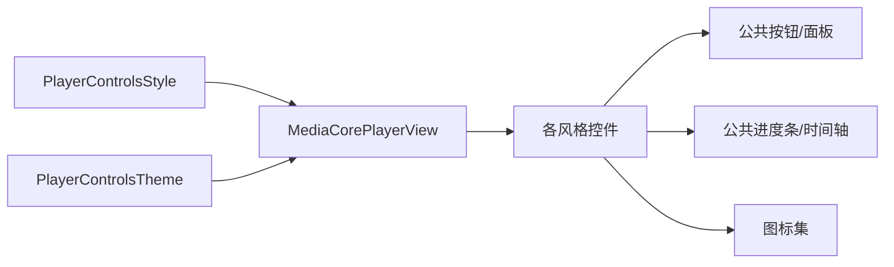

# 主题系统

<cite>
**本文引用的文件**   
- [player_controls_theme.dart](file://packages/media_core_ui/lib/src/common/player_controls_theme.dart)
- [player_controls_style.dart](file://packages/media_core_ui/lib/src/common/player_controls_style.dart)
- [media_core_player_view.dart](file://packages/media_core_ui/lib/src/media_core_player_view.dart)
- [material_player_controls.dart](file://packages/media_core_ui/lib/src/material/material_player_controls.dart)
- [cupertino_player_controls.dart](file://packages/media_core_ui/lib/src/cupertino/cupertino_player_controls.dart)
- [fluent_player_controls.dart](file://packages/media_core_ui/lib/src/fluent/fluent_player_controls.dart)
- [macos_player_controls.dart](file://packages/media_core_ui/lib/src/macos/macos_player_controls.dart)
- [yaru_player_controls.dart](file://packages/media_core_ui/lib/src/yaru/yaru_player_controls.dart)
- [player_control_icons.dart](file://packages/media_core_ui/lib/src/common/player_control_icons.dart)
- [player_progress_bar.dart](file://packages/media_core_ui/lib/src/common/player_progress_bar.dart)
- [player_control_buttons.dart](file://packages/media_core_ui/lib/src/common/player_control_buttons.dart)
</cite>

## 目录
1. [简介](#简介)
2. [项目结构](#项目结构)
3. [核心组件](#核心组件)
4. [架构总览](#架构总览)
5. [详细组件分析](#详细组件分析)
6. [依赖关系分析](#依赖关系分析)
7. [性能与优化](#性能与优化)
8. [故障排查指南](#故障排查指南)
9. [结论](#结论)
10. [附录：定制示例清单](#附录定制示例清单)

## 简介
本文件系统化梳理 Media Core UI 的主题体系，聚焦 PlayerControlsTheme 的设计模式、六种设计语言（Material、Cupertino、Fluent、macOS、Yaru、Neumorphic）的特点与切换方式，以及颜色、字体、间距、动画等视觉属性的配置方法。文档同时给出从继承现有主题到完全自定义主题的完整流程，说明在不同平台与设备上的适配策略，并提供丰富的定制示例与性能优化建议。

## 项目结构
Media Core UI 将“样式”和“主题”解耦：
- PlayerControlsStyle 定义六种设计语言的枚举与平台映射。
- PlayerControlsTheme 集中管理颜色、尺寸、文本样式、交互皮肤、进度条形状等视觉令牌。
- 各风格控件（MaterialPlayerControls、CupertinoPlayerControls、FluentPlayerControls、MacosPlayerControls、YaruPlayerControls、NeumorphicPlayerControls）消费主题进行绘制。
- 公共组件（按钮、进度条、面板）统一由主题驱动，避免重复实现。

图表来源
- [player_controls_style.dart:29-122](file://packages/media_core_ui/lib/src/common/player_controls_style.dart#L29-L122)
- [player_controls_theme.dart:64-505](file://packages/media_core_ui/lib/src/common/player_controls_theme.dart#L64-L505)
- [media_core_player_view.dart:333-353](file://packages/media_core_ui/lib/src/media_core_player_view.dart#L333-L353)
- [material_player_controls.dart:25-108](file://packages/media_core_ui/lib/src/material/material_player_controls.dart#L25-L108)
- [cupertino_player_controls.dart:45-86](file://packages/media_core_ui/lib/src/cupertino/cupertino_player_controls.dart#L45-L86)
- [fluent_player_controls.dart:27-119](file://packages/media_core_ui/lib/src/fluent/fluent_player_controls.dart#L27-L119)
- [macos_player_controls.dart:27-118](file://packages/media_core_ui/lib/src/macos/macos_player_controls.dart#L27-L118)
- [yaru_player_controls.dart:26-150](file://packages/media_core_ui/lib/src/yaru/yaru_player_controls.dart#L26-L150)

章节来源
- [player_controls_style.dart:29-122](file://packages/media_core_ui/lib/src/common/player_controls_style.dart#L29-L122)
- [player_controls_theme.dart:64-505](file://packages/media_core_ui/lib/src/common/player_controls_theme.dart#L64-L505)
- [media_core_player_view.dart:96-130](file://packages/media_core_ui/lib/src/media_core_player_view.dart#L96-L130)

## 核心组件
- PlayerControlsStyle：声明六种设计语言，提供 forPlatform/resolve 的平台自动选择、触摸/悬停揭示、音量滑块、全屏栏等语义属性。
- PlayerControlsTheme：以不可变对象承载所有视觉令牌，提供 copyWith 派生新主题；内置 material/cupertino/fluent/macos/yaru/neumorphic 命名构造器。
- 控件族：每种风格一个 StatelessWidget，通过 theme 渲染，不直接持有颜色或尺寸常量。
- 公共组件：按钮、进度条、面板、图标集，全部受主题驱动，保证一致性与可替换性。

章节来源
- [player_controls_style.dart:4-122](file://packages/media_core_ui/lib/src/common/player_controls_style.dart#L4-L122)
- [player_controls_theme.dart:49-505](file://packages/media_core_ui/lib/src/common/player_controls_theme.dart#L49-L505)
- [player_control_buttons.dart:7-208](file://packages/media_core_ui/lib/src/common/player_control_buttons.dart#L7-L208)
- [player_progress_bar.dart:8-480](file://packages/media_core_ui/lib/src/common/player_progress_bar.dart#L8-L480)
- [player_control_icons.dart:4-295](file://packages/media_core_ui/lib/src/common/player_control_icons.dart#L4-L295)

## 架构总览
MediaCorePlayerView 根据传入的 style 或 platform 解析结果，选择对应控件并注入 theme。控件内部复用公共按钮、进度条、面板与图标集，确保行为一致、外观可定制。

图表来源
- [media_core_player_view.dart:333-353](file://packages/media_core_ui/lib/src/media_core_player_view.dart#L333-L353)
- [player_controls_style.dart:51-75](file://packages/media_core_ui/lib/src/common/player_controls_style.dart#L51-L75)
- [material_player_controls.dart:75-108](file://packages/media_core_ui/lib/src/material/material_player_controls.dart#L75-L108)

## 详细组件分析

### PlayerControlsTheme 主题架构与设计模式
- 不可变主题对象：所有字段为 final，通过 copyWith 生成新主题，便于局部覆盖。
- 命名构造器：material/cupertino/fluent/macos/yaru/neumorphic 分别预置一套视觉令牌。
- 工厂方法：of(style, icons?) 根据风格快速创建主题并可替换图标集。
- 交互皮肤：buttonSkin 控制按钮反馈（ripple/translucent/hover/flat/soft）。
- 进度条形状：progressThumbShape（none/circle/dot）、progressTrackShape（plain/inset）。
- 表面与阴影：surface/border/blur/shadowLight/shadowDark/shadowDepth/pillPadding 控制悬浮面板与软体 UI。
- 文本与尺寸：titleTextStyle/timeTextStyle/iconSize/primaryIconSize/compactIconSize/contentPadding/barGap/controlButtonRadius。
- 隐藏延迟：hideDelay 与 hideDelayOr 支持宿主覆盖。

图表来源
- [player_controls_theme.dart:64-505](file://packages/media_core_ui/lib/src/common/player_controls_theme.dart#L64-L505)
- [player_control_icons.dart:24-295](file://packages/media_core_ui/lib/src/common/player_control_icons.dart#L24-L295)

章节来源
- [player_controls_theme.dart:49-505](file://packages/media_core_ui/lib/src/common/player_controls_theme.dart#L49-L505)
- [player_control_icons.dart:4-295](file://packages/media_core_ui/lib/src/common/player_control_icons.dart#L4-L295)

### 六种设计语言：特点、适用场景与切换
- Material（Android/Web）
  - 特点：实心遮罩顶栏、厚进度条、始终可见拇指、Ripple 反馈、无内嵌音量滑块。
  - 适用：移动端与 Web 通用体验。
  - 切换：style=PlayerControlsStyle.material 或平台自动选择。
- Cupertino（iOS）
  - 特点：渐变遮罩、发丝级进度条、透明度变化、倒计时时间显示。
  - 适用：iOS 原生体验。
  - 切换：style=PlayerControlsStyle.cupertino 或 iOS 平台自动选择。
- Fluent（Windows 11）
  - 特点：半透明亚克力面板、细进度条+圆点拇指、悬停高亮+工具提示、音量滑块、右上角菜单。
  - 适用：桌面鼠标键盘交互。
  - 切换：style=PlayerControlsStyle.fluent 或 Windows 平台自动选择。
- macOS（Big Sur+）
  - 特点：底部悬浮药丸面板、高度半透明模糊、紧凑布局、标题在药丸内。
  - 适用：macOS 桌面体验。
  - 切换：style=PlayerControlsStyle.macos 或 macOS 平台自动选择。
- Yaru（Ubuntu/GNOME）
  - 特点：顶部标题栏+扁平底部栏、细边框、Ubuntu 橙色强调色、同排音量滑块。
  - 适用：Linux Ubuntu/GNOME 生态。
  - 切换：style=PlayerControlsStyle.yaru 或 Linux 平台自动选择。
- Neumorphic（软体 UI）
  - 特点：单背景色+双向阴影、凸起/凹陷表面、嵌入轨道、无纯黑。
  - 适用：品牌化/艺术化界面，非平台约定。
  - 切换：显式 style=PlayerControlsStyle.neumorphic（不会被自动选择）。

章节来源
- [player_controls_style.dart:4-49](file://packages/media_core_ui/lib/src/common/player_controls_style.dart#L4-L49)
- [player_controls_style.dart:51-122](file://packages/media_core_ui/lib/src/common/player_controls_style.dart#L51-L122)
- [material_player_controls.dart:8-24](file://packages/media_core_ui/lib/src/material/material_player_controls.dart#L8-L24)
- [cupertino_player_controls.dart:45-86](file://packages/media_core_ui/lib/src/cupertino/cupertino_player_controls.dart#L45-L86)
- [fluent_player_controls.dart:8-26](file://packages/media_core_ui/lib/src/fluent/fluent_player_controls.dart#L8-L26)
- [macos_player_controls.dart:9-26](file://packages/media_core_ui/lib/src/macos/macos_player_controls.dart#L9-L26)
- [yaru_player_controls.dart:9-25](file://packages/media_core_ui/lib/src/yaru/yaru_player_controls.dart#L9-L25)

### 主题配置选项详解
- 颜色
  - foreground/foregroundMuted：前景与次要文字/图标色。
  - scrim/surface/border：遮罩层、悬浮面板背景、描边。
  - accent/progressTrack/progressBuffered/progressPlayed/progressThumb：强调色与进度条三段色。
  - shadowLight/shadowDark：软体 UI 的双向阴影色。
- 文本与字体
  - titleTextStyle/timeTextStyle：标题与时间标签样式。
- 尺寸与间距
  - iconSize/primaryIconSize/compactIconSize：图标尺寸。
  - trackHeight/trackHeightWhileDragging/thumbRadius：进度条高度与拇指半径。
  - contentPadding/barGap/controlButtonRadius/pillPadding：内边距、行间距、按钮圆角、药丸内边距。
- 交互与动画
  - buttonSkin：ripple/translucent/hover/flat/soft。
  - progressThumbShape：none/circle/dot。
  - progressTrackShape：plain/inset。
  - hoverHighlight：悬停高亮色（null 禁用）。
  - blur：面板模糊强度。
  - shadowDepth：软体 UI 阴影深度。
  - hideDelay：控件自动隐藏延迟。
- 图标集
  - icons：PlayerControlIcons，可按风格替换整套图标。

章节来源
- [player_controls_theme.dart:64-505](file://packages/media_core_ui/lib/src/common/player_controls_theme.dart#L64-L505)
- [player_control_buttons.dart:7-208](file://packages/media_core_ui/lib/src/common/player_control_buttons.dart#L7-L208)
- [player_progress_bar.dart:8-480](file://packages/media_core_ui/lib/src/common/player_progress_bar.dart#L8-L480)

### 创建自定义主题：从继承到完全自定义
- 基于现有主题派生
  - 使用 PlayerControlsTheme.of(style, icons?) 获取基础主题，再用 copyWith 覆盖部分字段（颜色、尺寸、文本、图标等）。
- 完全自定义主题
  - 直接 new PlayerControlsTheme(...) 设置所有必要字段，或基于某个命名构造器（如 neumorphic）再覆盖差异项。
- 替换图标集
  - 通过 PlayerControlIcons.copyWith 或全新实例，替换任意图标字段，保持与宿主图标库一致。
- 应用到播放器
  - 在 MediaCorePlayerView 中传入 theme，或在 PlayerControlsTheme.of 时传入自定义 icons。

图表来源
- [player_controls_theme.dart:311-323](file://packages/media_core_ui/lib/src/common/player_controls_theme.dart#L311-L323)
- [player_controls_theme.dart:435-504](file://packages/media_core_ui/lib/src/common/player_controls_theme.dart#L435-L504)
- [player_control_icons.dart:240-284](file://packages/media_core_ui/lib/src/common/player_control_icons.dart#L240-L284)
- [media_core_player_view.dart:111-112](file://packages/media_core_ui/lib/src/media_core_player_view.dart#L111-L112)

章节来源
- [player_controls_theme.dart:311-504](file://packages/media_core_ui/lib/src/common/player_controls_theme.dart#L311-L504)
- [player_control_icons.dart:240-295](file://packages/media_core_ui/lib/src/common/player_control_icons.dart#L240-L295)
- [media_core_player_view.dart:111-112](file://packages/media_core_ui/lib/src/media_core_player_view.dart#L111-L112)

### 平台与设备适配策略
- 自动选择
  - Android/Fuchsia → Material
  - iOS → Cupertino
  - macOS → macOS
  - Windows → Fluent
  - Linux → Yaru
  - Web（无显式 platform）→ Fluent
- 交互差异
  - isTouch：Material/Cupertino/Neumorphic 为触摸优先。
  - revealsOnHover：Fluent/macOS/Yaru 通过悬停揭示控件。
  - showsVolumeSlider：Fluent/macOS/Yaru 提供音量滑块；触摸平台通常走硬件音量。
  - usesFullWidthBars：除 macOS 外均使用通栏布局。
  - paintsScrim：除 Neumorphic 外均绘制遮罩层。

章节来源
- [player_controls_style.dart:51-122](file://packages/media_core_ui/lib/src/common/player_controls_style.dart#L51-L122)

### 关键流程图：进度条拖拽与预览

图表来源
- [player_progress_bar.dart:191-247](file://packages/media_core_ui/lib/src/common/player_progress_bar.dart#L191-L247)

章节来源
- [player_progress_bar.dart:8-480](file://packages/media_core_ui/lib/src/common/player_progress_bar.dart#L8-L480)

## 依赖关系分析
- 低耦合：控件仅依赖 PlayerControlsTheme 与 PlayerControlsController，不直接持有颜色/尺寸常量。
- 高内聚：公共组件（按钮、进度条、面板、图标）集中在 common 目录，被所有风格复用。
- 外部依赖：Flutter 标准库与 media_core 播放状态监听。

图表来源
- [media_core_player_view.dart:333-353](file://packages/media_core_ui/lib/src/media_core_player_view.dart#L333-L353)
- [player_control_buttons.dart:7-208](file://packages/media_core_ui/lib/src/common/player_control_buttons.dart#L7-L208)
- [player_progress_bar.dart:8-480](file://packages/media_core_ui/lib/src/common/player_progress_bar.dart#L8-L480)
- [player_control_icons.dart:4-295](file://packages/media_core_ui/lib/src/common/player_control_icons.dart#L4-L295)

章节来源
- [media_core_player_view.dart:333-353](file://packages/media_core_ui/lib/src/media_core_player_view.dart#L333-L353)

## 性能与优化
- 进度条拖动优化
  - 仅在拖拽结束时执行一次 seek，避免频繁命令导致卡顿。
  - 拖拽期间通过 onPreview 同步更新时间标签，提升感知流畅度。
- 渲染优化
  - CustomPainter 按需重绘，比较关键字段减少不必要的刷新。
  - 软体 UI 的 Surface 与面板 Blur 仅在需要时启用。
- 主题与图标
  - 使用 copyWith 局部覆盖，避免重建整棵树。
  - 图标集作为数据对象，避免硬编码，降低分支复杂度。
- 平台选择
  - 使用 resolve/forPlatform 避免运行时条件判断分散在各处。

章节来源
- [player_progress_bar.dart:103-131](file://packages/media_core_ui/lib/src/common/player_progress_bar.dart#L103-L131)
- [player_progress_bar.dart:191-247](file://packages/media_core_ui/lib/src/common/player_progress_bar.dart#L191-L247)
- [player_progress_bar.dart:250-341](file://packages/media_core_ui/lib/src/common/player_progress_bar.dart#L250-L341)
- [player_control_buttons.dart:251-319](file://packages/media_core_ui/lib/src/common/player_control_buttons.dart#L251-L319)

## 故障排查指南
- 控件不显示或布局异常
  - 检查是否传入了正确的 PlayerControlsController 与 theme。
  - 确认宿主是否覆盖了 showTopBar/showTitle/showMenu 等开关导致布局缺失。
- 进度条拖拽卡顿
  - 确认未对每次 drag update 调用 seek；应仅在 release 时 seek。
- 颜色/尺寸不生效
  - 确认使用的是 copyWith 生成的新主题，而非修改原主题字段。
- 图标不一致
  - 检查 PlayerControlIcons 是否与宿主图标库匹配，必要时用 copyWith 替换个别图标。
- 平台选择不符合预期
  - 显式传入 style 或自定义 styleResolver，避免自动选择干扰。

章节来源
- [media_core_player_view.dart:96-130](file://packages/media_core_ui/lib/src/media_core_player_view.dart#L96-L130)
- [player_progress_bar.dart:191-247](file://packages/media_core_ui/lib/src/common/player_progress_bar.dart#L191-L247)
- [player_controls_theme.dart:435-504](file://packages/media_core_ui/lib/src/common/player_controls_theme.dart#L435-L504)
- [player_control_icons.dart:240-295](file://packages/media_core_ui/lib/src/common/player_control_icons.dart#L240-L295)

## 结论
Media Core UI 的主题系统通过“样式枚举 + 不可变主题 + 公共组件”的分层设计，实现了跨平台的六套设计语言与高度可定制的视觉体系。开发者可以低成本地替换颜色、字体、间距、交互反馈与图标，并在不同平台上获得一致的交互体验。遵循本文档的配置与最佳实践，可在保证性能的同时，快速落地品牌化播放器界面。

## 附录：定制示例清单
- 简单颜色替换
  - 使用 PlayerControlsTheme.of(style).copyWith(accent: ...) 更换强调色。
- 调整进度条外观
  - 修改 trackHeight/trackHeightWhileDragging/thumbRadius/progressThumbShape/progressTrackShape。
- 改变按钮反馈
  - 设置 buttonSkin 为 hover/flat/soft 等，配合 hoverHighlight 与 border。
- 自定义文本样式
  - 覆盖 titleTextStyle/timeTextStyle 以匹配品牌字体与字号。
- 替换图标集
  - 使用 PlayerControlIcons.copyWith 或全新实例，替换 play/pause/fullscreen 等图标。
- 悬浮面板效果
  - 设置 surface/border/blur 以控制面板背景、描边与模糊。
- 软体 UI 主题
  - 使用 neumorphic 命名构造器，并通过 shadowLight/shadowDark/shadowDepth 调节光影。
- 平台自适应
  - 使用 PlayerControlsStyle.resolve() 或 forPlatform() 自动选择风格，或显式指定 style。
- 隐藏延迟
  - 通过 hideDelay 或 hideDelayOr(override) 控制控件自动隐藏时长。

章节来源
- [player_controls_theme.dart:101-309](file://packages/media_core_ui/lib/src/common/player_controls_theme.dart#L101-L309)
- [player_controls_theme.dart:435-504](file://packages/media_core_ui/lib/src/common/player_controls_theme.dart#L435-L504)
- [player_control_icons.dart:240-295](file://packages/media_core_ui/lib/src/common/player_control_icons.dart#L240-L295)
- [player_controls_style.dart:51-122](file://packages/media_core_ui/lib/src/common/player_controls_style.dart#L51-L122)