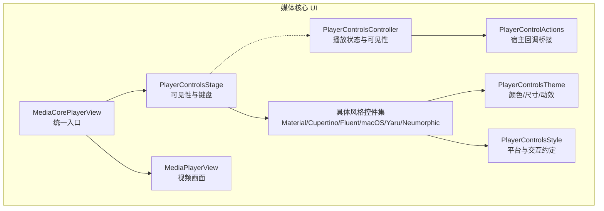
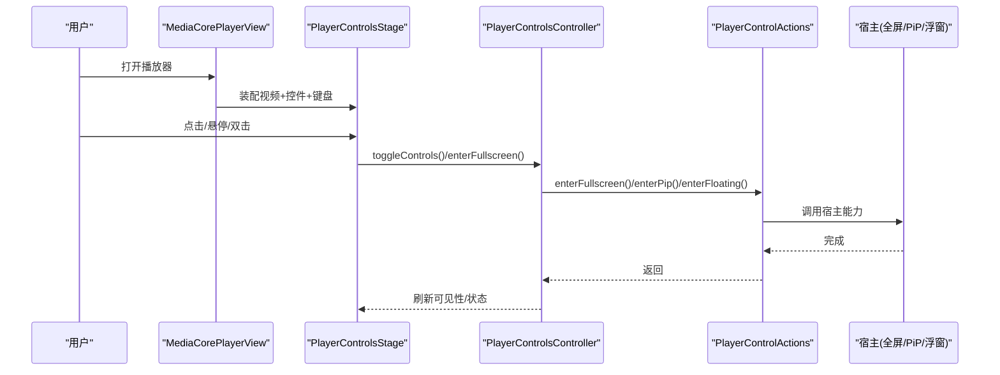
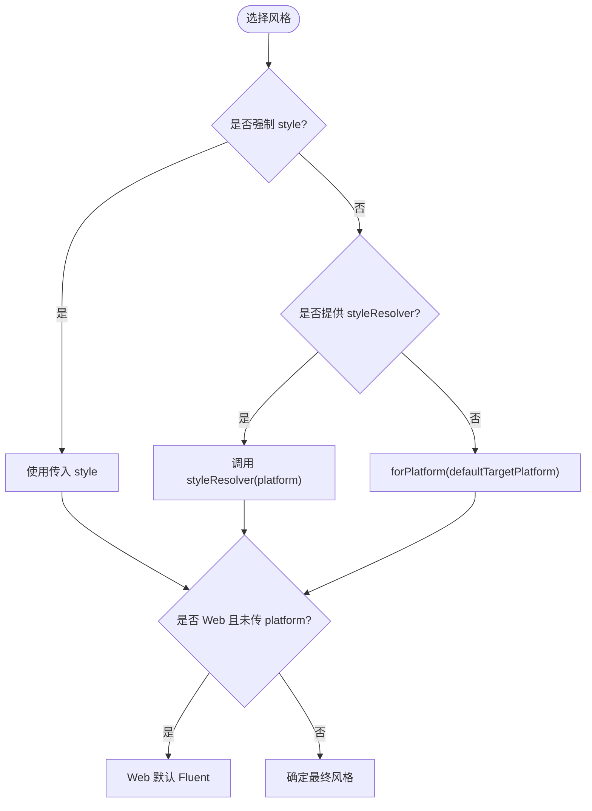
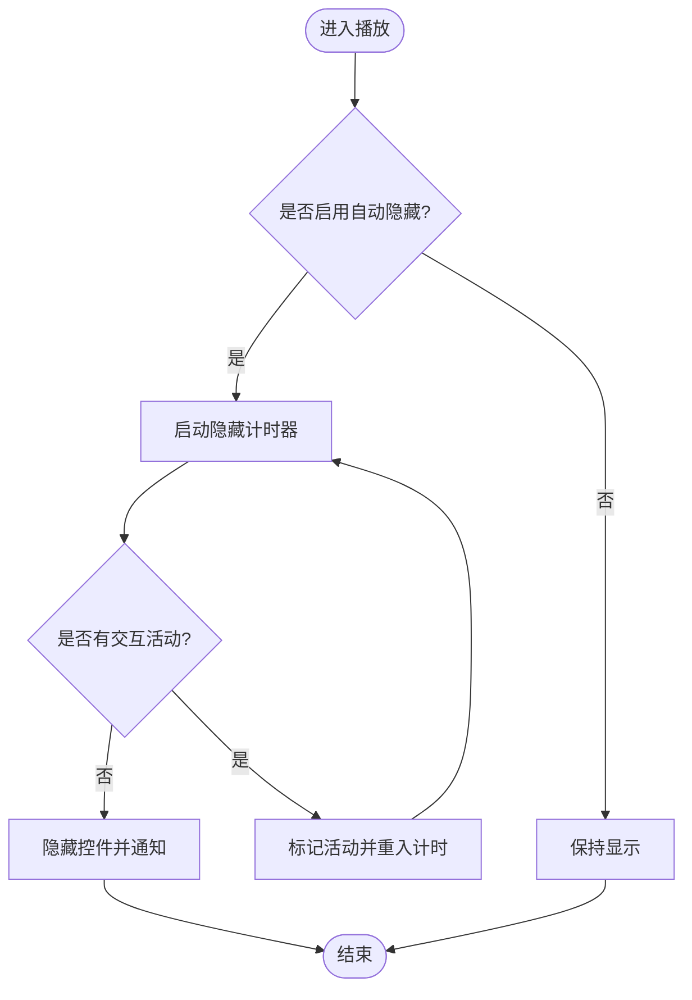
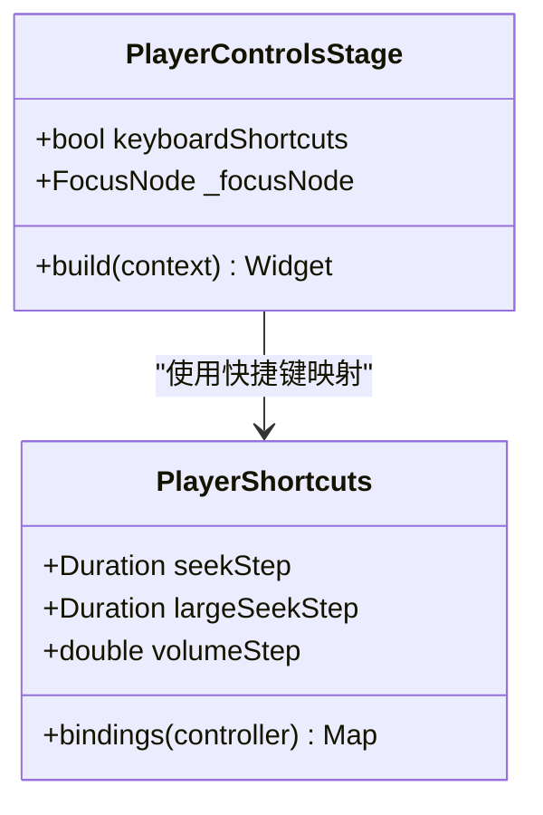
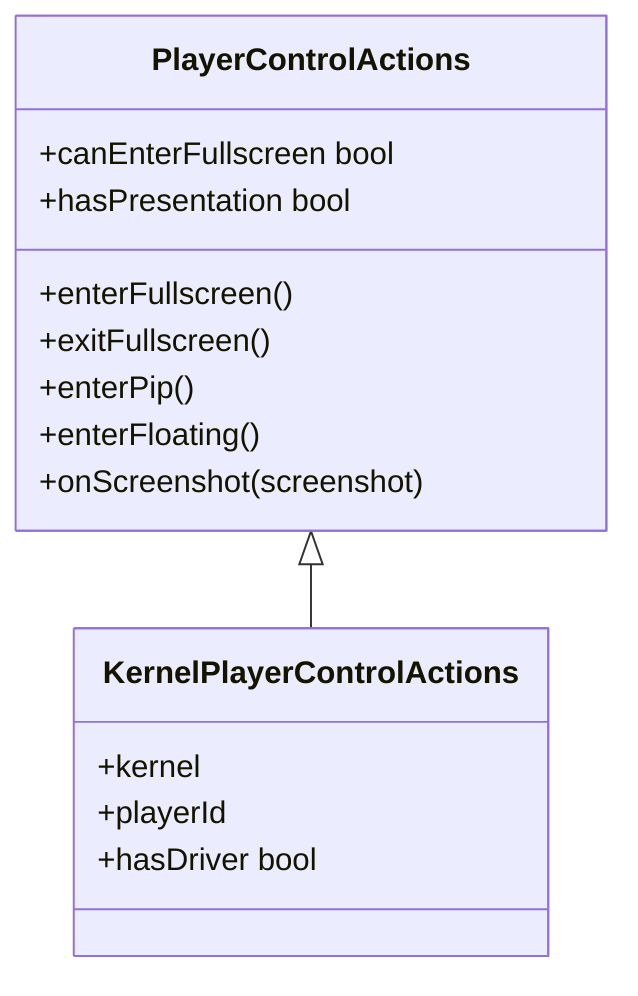
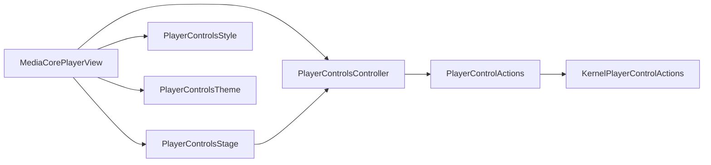

# 响应式设计与无障碍访问

<cite>
**本文引用的文件**   
- [README.md](file://packages/media_core_ui/README.md)
- [media_core_player_view.dart](file://packages/media_core_ui/lib/src/media_core_player_view.dart)
- [player_controls_controller.dart](file://packages/media_core_ui/lib/src/common/player_controls_controller.dart)
- [player_controls_stage.dart](file://packages/media_core_ui/lib/src/common/player_controls_stage.dart)
- [player_control_actions.dart](file://packages/media_core_ui/lib/src/common/player_control_actions.dart)
- [player_controls_style.dart](file://packages/media_core_ui/lib/src/common/player_controls_style.dart)
- [player_controls_theme.dart](file://packages/media_core_ui/lib/src/common/player_controls_theme.dart)
</cite>

## 目录
1. [引言](#引言)
2. [项目结构](#项目结构)
3. [核心组件](#核心组件)
4. [架构总览](#架构总览)
5. [详细组件分析](#详细组件分析)
6. [依赖关系分析](#依赖关系分析)
7. [性能与可访问性考量](#性能与可访问性考量)
8. [横竖屏切换与状态保持](#横竖屏切换与状态保持)
9. [自定义组件的无障碍接入指南](#自定义组件的无障碍接入指南)
10. [常见问题与排错](#常见问题与排错)
11. [结论](#结论)

## 引言
本文件聚焦 media_core_ui 包在响应式设计与无障碍访问方面的实现与最佳实践。该包提供“一套控制逻辑、六种设计语言”的播放器控件层，通过统一的控制器驱动不同风格的界面，并在同一套交互契约下支持触摸、指针与键盘输入。文档将说明：
- 在不同屏幕尺寸和设备类型下的自适应布局策略
- 横竖屏切换时的界面适配与状态保持机制
- 无障碍访问支持（屏幕阅读器兼容、键盘导航、焦点管理）
- 如何为自定义控件添加无障碍能力
- 响应式设计最佳实践与常见问题解决方案
- 不同平台的特殊考虑与适配技巧

## 项目结构
media_core_ui 采用“公共逻辑 + 多风格实现”的分层组织：
- common：所有风格共享的控制逻辑、主题令牌、动作回调、进度条、舞台与样式解析
- material / cupertino / fluent / macos / yaru / neumorphic：各设计语言的无状态控件集
- media_core_player_view.dart：组装视频画面、控件与手势/键盘的统一入口

图表来源
- [media_core_player_view.dart:46-94](file://packages/media_core_ui/lib/src/media_core_player_view.dart#L46-L94)
- [player_controls_stage.dart:76-123](file://packages/media_core_ui/lib/src/common/player_controls_stage.dart#L76-L123)
- [player_controls_controller.dart:10-30](file://packages/media_core_ui/lib/src/common/player_controls_controller.dart#L10-L30)
- [player_control_actions.dart:3-25](file://packages/media_core_ui/lib/src/common/player_control_actions.dart#L3-L25)
- [player_controls_theme.dart:49-64](file://packages/media_core_ui/lib/src/common/player_controls_theme.dart#L49-L64)
- [player_controls_style.dart:4-28](file://packages/media_core_ui/lib/src/common/player_controls_style.dart#L4-L28)

章节来源
- [README.md:5-14](file://packages/media_core_ui/README.md#L5-L14)
- [media_core_player_view.dart:46-94](file://packages/media_core_ui/lib/src/media_core_player_view.dart#L46-L94)

## 核心组件
- MediaCorePlayerView：组合 MediaPlayerView、控件集与 PlayerControlsStage，负责风格选择、主题注入、手势与键盘开关、缩放与截图等装配。
- PlayerControlsController：单一职责地镜像播放器状态、暴露动作、管理控件可见性与自动隐藏计时器；同时区分结构性更新与高频位置更新的监听路径。
- PlayerControlsStage：堆叠视频与控件，处理点击/双击、悬停显示、键盘快捷键绑定与焦点节点。
- PlayerControlActions：以回调表达“宿主能力”，空回调即表示不展示对应按钮，避免“不可用却可见”的控件。
- PlayerControlsStyle：定义六套设计语言及其平台默认、触摸/指针行为差异、是否悬停显示、是否显示音量滑块等约定。
- PlayerControlsTheme：集中颜色、尺寸、圆角、阴影、模糊、图标与隐藏延迟等视觉令牌，按风格提供默认值并支持覆盖。

章节来源
- [media_core_player_view.dart:64-196](file://packages/media_core_ui/lib/src/media_core_player_view.dart#L64-L196)
- [player_controls_controller.dart:10-30](file://packages/media_core_ui/lib/src/common/player_controls_controller.dart#L10-L30)
- [player_controls_stage.dart:59-123](file://packages/media_core_ui/lib/src/common/player_controls_stage.dart#L59-L123)
- [player_control_actions.dart:3-25](file://packages/media_core_ui/lib/src/common/player_control_actions.dart#L3-L25)
- [player_controls_style.dart:4-28](file://packages/media_core_ui/lib/src/common/player_controls_style.dart#L4-L28)
- [player_controls_theme.dart:49-64](file://packages/media_core_ui/lib/src/common/player_controls_theme.dart#L49-L64)

## 架构总览
下图展示了从视图到控制器再到宿主能力的调用链，以及键盘与悬停交互如何进入控制器。

图表来源
- [media_core_player_view.dart:298-353](file://packages/media_core_ui/lib/src/media_core_player_view.dart#L298-L353)
- [player_controls_stage.dart:138-183](file://packages/media_core_ui/lib/src/common/player_controls_stage.dart#L138-L183)
- [player_controls_controller.dart:494-520](file://packages/media_core_ui/lib/src/common/player_controls_controller.dart#L494-L520)
- [player_control_actions.dart:122-155](file://packages/media_core_ui/lib/src/common/player_control_actions.dart#L122-L155)

## 详细组件分析

### 响应式布局与风格选择
- 风格解析优先级：强制 style > styleResolver > forPlatform(defaultTargetPlatform)。Web 环境默认使用 Fluent，因为浏览器由指针与键盘驱动。
- 触摸与指针差异：isTouch 决定双击默认行为（触摸放大 vs 桌面双击全屏），revealsOnHover 决定是否鼠标悬停显示控件。
- 布局宽度：macOS 使用浮动药丸而非全宽栏，其他风格使用全宽栏。
- 主题令牌：每个风格提供默认颜色、尺寸、阴影、模糊、隐藏延迟等，宿主可通过 copyWith 定制。

图表来源
- [media_core_player_view.dart:209-218](file://packages/media_core_ui/lib/src/media_core_player_view.dart#L209-L218)
- [player_controls_style.dart:51-75](file://packages/media_core_ui/lib/src/common/player_controls_style.dart#L51-L75)

章节来源
- [media_core_player_view.dart:209-226](file://packages/media_core_ui/lib/src/media_core_player_view.dart#L209-L226)
- [player_controls_style.dart:51-122](file://packages/media_core_ui/lib/src/common/player_controls_style.dart#L51-L122)
- [player_controls_theme.dart:311-323](file://packages/media_core_ui/lib/src/common/player_controls_theme.dart#L311-L323)

### 控件可见性与自动隐藏
- 控制器维护 controlsVisible 与 autoHide 策略，播放中空闲时自动隐藏，暂停时默认保留。
- 高频位置更新走 playbackListenable，避免频繁重建整条控制栏；结构性变化才触发 ChangeNotifier 通知。
- 悬停设备通过 MouseRegion 显示控件；点击/双击通过 GestureDetector 切换可见性。

图表来源
- [player_controls_controller.dart:330-366](file://packages/media_core_ui/lib/src/common/player_controls_controller.dart#L330-L366)
- [player_controls_stage.dart:172-174](file://packages/media_core_ui/lib/src/common/player_controls_stage.dart#L172-L174)

章节来源
- [player_controls_controller.dart:256-366](file://packages/media_core_ui/lib/src/common/player_controls_controller.dart#L256-L366)
- [player_controls_stage.dart:138-183](file://packages/media_core_ui/lib/src/common/player_controls_stage.dart#L138-L183)

### 键盘导航与快捷键
- PlayerShortcuts 提供标准快捷键映射：播放/暂停、快进/后退、音量调节、静音、全屏、循环、退出全屏。
- PlayerControlsStage 在启用 keyboardShortcuts 时创建 FocusNode 并 autofocus，使用 CallbackShortcuts 绑定按键回调。
- 这些快捷键对屏幕阅读器友好，因为它们基于系统级 LogicalKeyboardKey 与焦点容器。

图表来源
- [player_controls_stage.dart:7-57](file://packages/media_core_ui/lib/src/common/player_controls_stage.dart#L7-L57)
- [player_controls_stage.dart:176-180](file://packages/media_core_ui/lib/src/common/player_controls_stage.dart#L176-L180)

章节来源
- [player_controls_stage.dart:7-57](file://packages/media_core_ui/lib/src/common/player_controls_stage.dart#L7-L57)
- [player_controls_stage.dart:176-180](file://packages/media_core_ui/lib/src/common/player_controls_stage.dart#L176-L180)

### 宿主能力与动作桥接
- PlayerControlActions 以回调表达能力：若回调为空则不渲染对应按钮，保证“所见即可用”。
- KernelPlayerControlActions 将内核的全屏/PiP/浮窗能力包装成回调，并通过 hasDriver 判断是否挂载了呈现驱动。
- 控制器仅调用 actions 中的方法，不直接耦合宿主或内核。

图表来源
- [player_control_actions.dart:26-103](file://packages/media_core_ui/lib/src/common/player_control_actions.dart#L26-L103)
- [player_control_actions.dart:122-155](file://packages/media_core_ui/lib/src/common/player_control_actions.dart#L122-L155)

章节来源
- [player_control_actions.dart:3-25](file://packages/media_core_ui/lib/src/common/player_control_actions.dart#L3-L25)
- [player_control_actions.dart:122-155](file://packages/media_core_ui/lib/src/common/player_control_actions.dart#L122-L155)

## 依赖关系分析
- MediaCorePlayerView 依赖 PlayerControlsStage、MediaPlayerView、PlayerControlsController、PlayerControlsStyle、PlayerControlsTheme 与各风格控件集。
- PlayerControlsStage 依赖 PlayerControlsController 与 Flutter 的焦点/手势/键盘子系统。
- PlayerControlsController 依赖 PlayerHandle（来自 media_core）、PlayerControlActions、PlayerControlsStyle、PlayerControlsTheme。
- PlayerControlActions 与 KernelPlayerControlActions 解耦宿主能力与 UI 表现。
- PlayerControlsStyle 与 PlayerControlsTheme 为所有风格提供一致的视觉与交互约定。

图表来源
- [media_core_player_view.dart:298-353](file://packages/media_core_ui/lib/src/media_core_player_view.dart#L298-L353)
- [player_controls_stage.dart:138-183](file://packages/media_core_ui/lib/src/common/player_controls_stage.dart#L138-L183)
- [player_controls_controller.dart:41-62](file://packages/media_core_ui/lib/src/common/player_controls_controller.dart#L41-L62)
- [player_control_actions.dart:122-155](file://packages/media_core_ui/lib/src/common/player_control_actions.dart#L122-L155)

章节来源
- [media_core_player_view.dart:298-353](file://packages/media_core_ui/lib/src/media_core_player_view.dart#L298-L353)
- [player_controls_controller.dart:41-62](file://packages/media_core_ui/lib/src/common/player_controls_controller.dart#L41-L62)

## 性能与可访问性考量
- 性能
  - 控制器区分结构性更新与高频位置更新：progress 等高频数据通过 playbackListenable 单独订阅，避免每次 tick 都重建控制栏。
  - 自动隐藏计时器复用单个 Timer，避免悬停事件频繁取消/重建定时器。
  - 控件集是无状态的，只消费控制器状态，减少不必要的重建。
- 可访问性
  - 键盘快捷键基于系统键码，配合 FocusNode 与 autofocus，确保键盘可达。
  - 控件可见性通过动画与 IgnorePointer 控制，避免隐藏时拦截手势，也便于辅助技术识别当前可见区域。
  - 通过 PlayerControlActions 的空回调策略，避免渲染不可用的按钮，降低无效交互带来的可访问性问题。

章节来源
- [player_controls_controller.dart:31-40](file://packages/media_core_ui/lib/src/common/player_controls_controller.dart#L31-L40)
- [player_controls_controller.dart:330-366](file://packages/media_core_ui/lib/src/common/player_controls_controller.dart#L330-L366)
- [player_controls_stage.dart:148-158](file://packages/media_core_ui/lib/src/common/player_controls_stage.dart#L148-L158)
- [player_controls_stage.dart:176-180](file://packages/media_core_ui/lib/src/common/player_controls_stage.dart#L176-L180)

## 横竖屏切换与状态保持
- 状态保持
  - 控制器持有 handle.playback 的镜像，播放位置、音量、速率、循环等状态随播放器生命周期保持一致。
  - 当 handle 变更时，视图会释放旧控制器，避免继续驱动已失效的播放器实例。
- 横竖屏适配
  - 风格选择与主题在 didUpdateWidget 中同步到控制器，确保横竖屏切换后控件仍与当前风格一致。
  - 双击行为根据风格与平台默认：触摸风格默认放大，桌面风格默认全屏；宿主可通过 doubleTapAction 覆盖。
- 建议
  - 在横竖屏切换时，优先通过改变布局与主题而不重建控制器，以保持播放状态。
  - 对于需要全屏的场景，使用 actions.enterFullscreen/exitFullscreen，交由宿主处理窗口/系统全屏。

章节来源
- [media_core_player_view.dart:267-284](file://packages/media_core_ui/lib/src/media_core_player_view.dart#L267-L284)
- [media_core_player_view.dart:223-226](file://packages/media_core_ui/lib/src/media_core_player_view.dart#L223-L226)
- [player_controls_controller.dart:494-520](file://packages/media_core_ui/lib/src/common/player_controls_controller.dart#L494-L520)

## 自定义组件的无障碍接入指南
- 使用控制器作为唯一状态源
  - 将自定义控件绑定到 PlayerControlsController，读取 isPlaying、volume、rate、controlsVisible 等属性，避免自行维护状态。
- 提供键盘可达性
  - 为可交互元素包裹 FocusableActionDetector 或 InkWell 等可聚焦控件，并确保在 PlayerControlsStage 的 keyboardShortcuts 开启时能正确接收按键。
- 遵循“空回调即不可见”原则
  - 如果宿主未提供某项能力（如 PiP），不要渲染对应按钮；使用 PlayerControlActions.canXxx 判断可用性。
- 屏幕阅读器友好
  - 为关键控件设置语义标签（例如标题、时间、音量），并使用语义化文本（如“播放/暂停”、“前进10秒”）。
  - 避免在隐藏控件上放置可聚焦元素，防止辅助技术读到不可见内容。
- 示例路径
  - 参考现有控件的实现方式，将自定义按钮接入 controller 的动作方法，并通过 theme 获取一致的图标与尺寸。

章节来源
- [player_control_actions.dart:3-25](file://packages/media_core_ui/lib/src/common/player_control_actions.dart#L3-L25)
- [player_controls_controller.dart:372-492](file://packages/media_core_ui/lib/src/common/player_controls_controller.dart#L372-L492)
- [player_controls_stage.dart:176-180](file://packages/media_core_ui/lib/src/common/player_controls_stage.dart#L176-L180)

## 常见问题与排错
- 问题：控件不自动隐藏
  - 检查 autoHide 是否为 true，且处于播放状态；确认未在外部强制 setControlsVisible(false)。
  - 排查是否频繁触发交互导致 _activityWhileCounting 始终为真。
- 问题：键盘快捷键无效
  - 确认 keyboardShortcuts 为 true，且 PlayerControlsStage 拥有 FocusNode 并 autofocus。
  - 检查宿主是否拦截了系统级焦点或快捷键。
- 问题：全屏/PiP/浮窗按钮不显示
  - 确认 PlayerControlActions 提供了对应回调；若使用 KernelPlayerControlActions，需确保 kernel.presentationDriver 已挂载。
- 问题：横竖屏后控件风格不一致
  - 确认 didUpdateWidget 中已将新的 style/theme/hideDelay 同步到控制器。

章节来源
- [player_controls_controller.dart:330-366](file://packages/media_core_ui/lib/src/common/player_controls_controller.dart#L330-L366)
- [player_controls_stage.dart:176-180](file://packages/media_core_ui/lib/src/common/player_controls_stage.dart#L176-L180)
- [player_control_actions.dart:122-155](file://packages/media_core_ui/lib/src/common/player_control_actions.dart#L122-L155)
- [media_core_player_view.dart:267-284](file://packages/media_core_ui/lib/src/media_core_player_view.dart#L267-L284)

## 结论
media_core_ui 通过“控制器 + 舞台 + 风格/主题”的分层设计，实现了跨平台、跨设备的响应式与可访问性体验。其关键点在于：
- 以控制器为中心的状态与可见性管理，避免 UI 重复构建
- 以回调表达宿主能力，保证“所见即可用”
- 以风格与主题统一视觉与交互约定，同时允许宿主深度定制
- 以键盘与焦点系统为基础，提供完整的无障碍支持

在实际项目中，推荐：
- 使用 MediaCorePlayerView 快速集成，必要时替换 controls 槽位以实现品牌化界面
- 通过 PlayerControlsStyle.resolve/forPlatform 与 PlayerControlsTheme.of/copyWith 进行风格与主题配置
- 借助 PlayerControlActions 与 KernelPlayerControlActions 接入宿主的全屏/PiP/浮窗能力
- 在自定义控件中复用控制器与主题，确保一致的可访问性与响应式行为