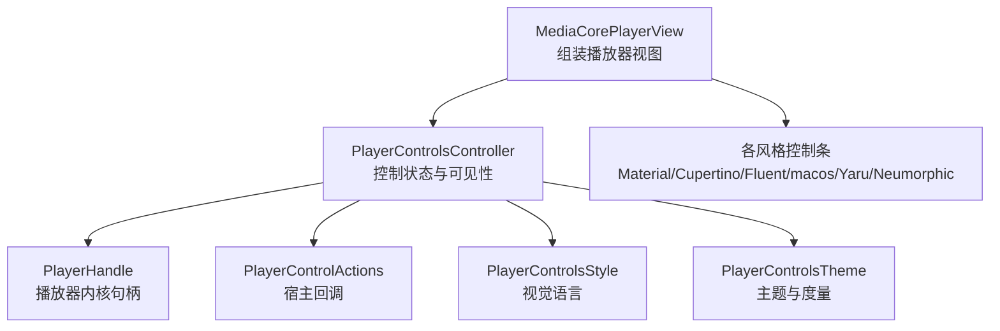
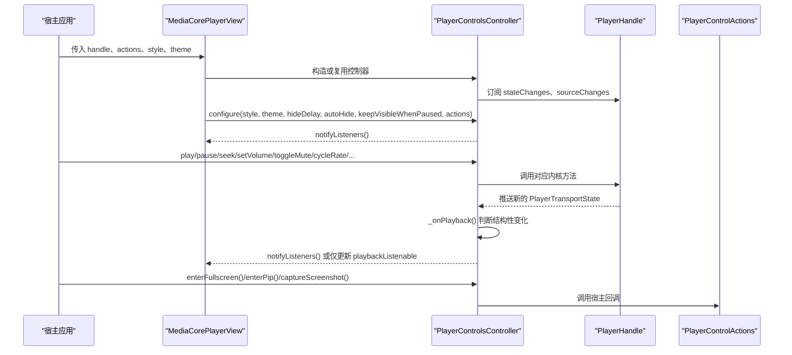
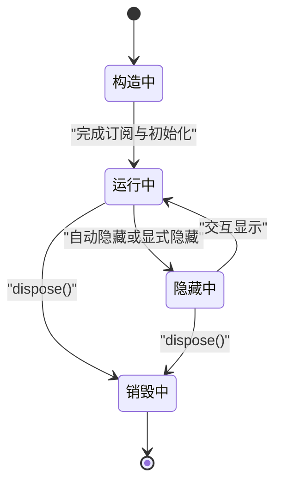
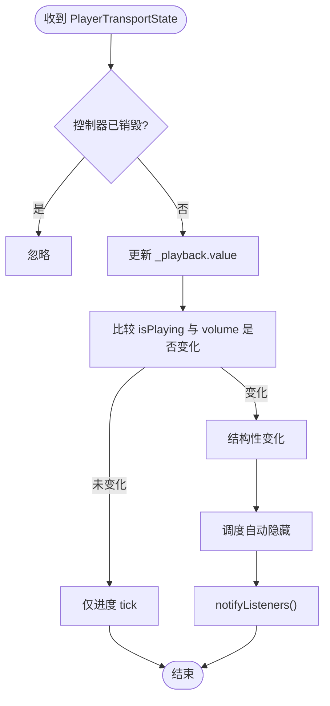
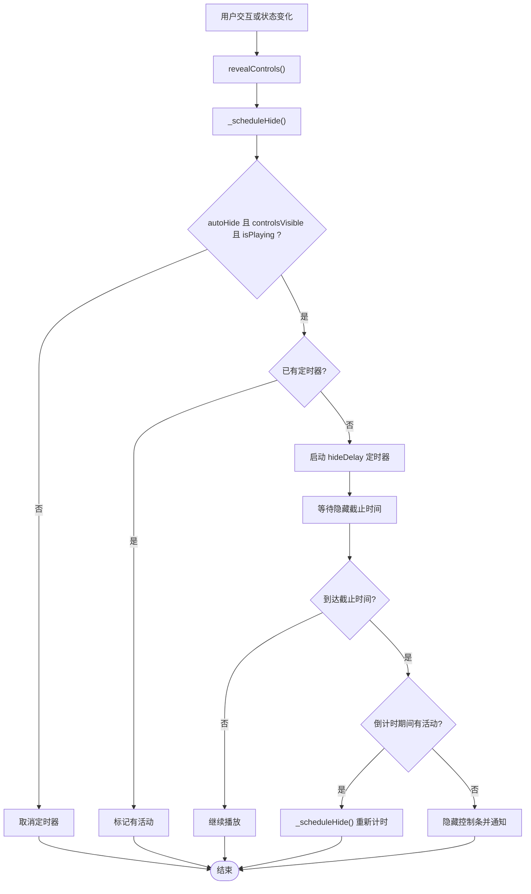
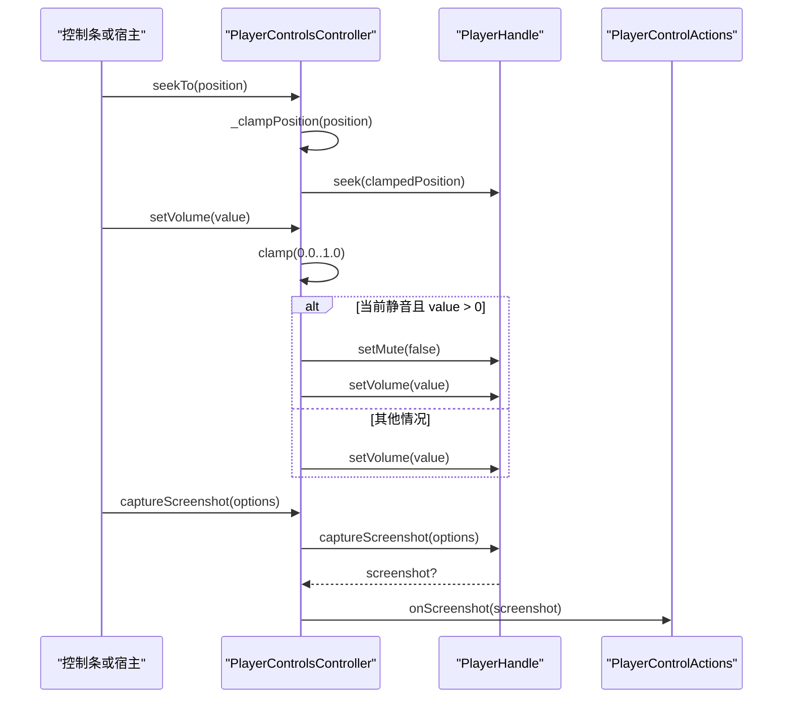
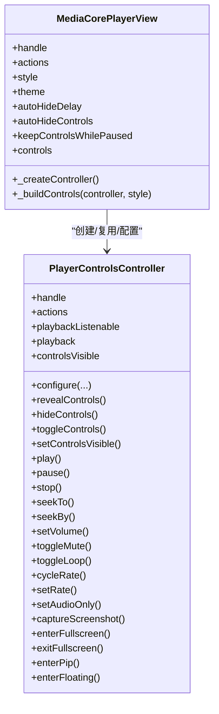
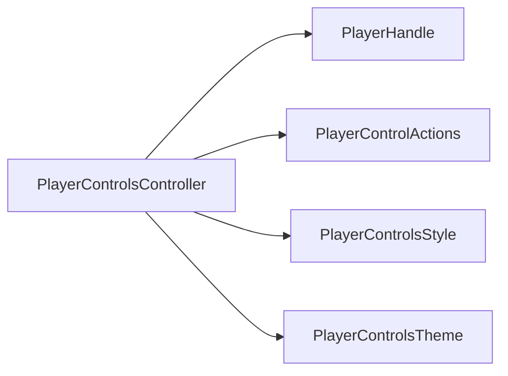

# PlayerControlsController 控制器

<cite>
**本文引用的文件**   
- [player_controls_controller.dart](file://packages/media_core_ui/lib/src/common/player_controls_controller.dart)
- [media_core_player_view.dart](file://packages/media_core_ui/lib/src/media_core_player_view.dart)
- [player_control_actions.dart](file://packages/media_core_ui/lib/src/common/player_control_actions.dart)
- [player_controls_style.dart](file://packages/media_core_ui/lib/src/common/player_controls_style.dart)
- [player_controls_theme.dart](file://packages/media_core_ui/lib/src/common/player_controls_theme.dart)
</cite>

## 目录
1. [简介](#简介)
2. [项目结构定位](#项目结构定位)
3. [核心职责与状态模型](#核心职责与状态模型)
4. [架构总览](#架构总览)
5. [详细组件分析](#详细组件分析)
6. [依赖关系分析](#依赖关系分析)
7. [性能与行为特性](#性能与行为特性)
8. [配置选项与扩展点](#配置选项与扩展点)
9. [使用示例与最佳实践](#使用示例与最佳实践)
10. [故障排查](#故障排查)
11. [总结](#总结)

## 简介
`PlayerControlsController` 是媒体核心 UI 层中负责“播放器控制界面”的控制器。它不直接绘制视频画面，也不拥有播放器内核；它的职责是把播放器内核的状态映射到控件、把用户的交互命令转发给内核，并管理控制条的显示、隐藏和自动隐藏策略。

该控制器同时承担两类通知：
- 结构性变化：播放/暂停、音量、倍速、循环、来源、可见性、能力等变化时，触发 `ChangeNotifier` 通知，用于重建整个控制条。
- 高频进度变化：通过 `playbackListenable` 暴露每帧位置更新，供进度条和时间标签等高频刷新控件订阅。

## 项目结构定位
`PlayerControlsController` 位于 UI 包的公共控制层，被 `MediaCorePlayerView` 创建或复用，并被各平台风格的控制条（Material、Cupertino、Fluent、macOS、Yaru、Neumorphic）消费。

**图表来源**
- [media_core_player_view.dart:237-247](file://packages/media_core_ui/lib/src/media_core_player_view.dart#L237-L247)
- [player_controls_controller.dart:41-62](file://packages/media_core_ui/lib/src/common/player_controls_controller.dart#L41-L62)
- [player_control_actions.dart:26-37](file://packages/media_core_ui/lib/src/common/player_control_actions.dart#L26-L37)
- [player_controls_style.dart:29-49](file://packages/media_core_ui/lib/src/common/player_controls_style.dart#L29-L49)
- [player_controls_theme.dart:64-99](file://packages/media_core_ui/lib/src/common/player_controls_theme.dart#L64-L99)

**章节来源**
- [media_core_player_view.dart:200-356](file://packages/media_core_ui/lib/src/media_core_player_view.dart#L200-L356)
- [player_controls_controller.dart:1-617](file://packages/media_core_ui/lib/src/common/player_controls_controller.dart#L1-L617)

## 核心职责与状态模型
### 主要职责
- 镜像播放器状态：播放状态、缓冲状态、位置、时长、音量、静音、循环、倍速、音频独占模式、截图能力、标题等。
- 转发控制命令：播放、暂停、停止、跳转、设置音量、切换静音、切换循环、切换倍速、截图、全屏、画中画、悬浮窗。
- 管理控制条可见性：空闲自动隐藏、交互后显示、暂停时保持显示、强制显示/隐藏。
- 同步样式与主题：支持运行时更新 style、theme、hideDelay、autoHide、keepVisibleWhenPaused、actions。

### 关键状态字段
- `_playback`：当前播放状态的 ValueNotifier，用于高频进度监听。
- `_controlsVisible`：控制条是否可见。
- `_autoHide`：是否启用自动隐藏。
- `_hideTimer`：自动隐藏定时器。
- `_activityWhileCounting`：在倒计时期间是否有活动，避免鼠标移动频繁打断隐藏逻辑。
- `_style`、`_theme`、`_hideDelay`：控制条外观与行为配置。
- `keepVisibleWhenPaused`：暂停时是否保持控制条可见。
- `actions`：宿主提供的展示类回调集合。

**章节来源**
- [player_controls_controller.dart:41-92](file://packages/media_core_ui/lib/src/common/player_controls_controller.dart#L41-L92)
- [player_controls_controller.dart:98-197](file://packages/media_core_ui/lib/src/common/player_controls_controller.dart#L98-L197)

## 架构总览
`PlayerControlsController` 处于 UI 控制层的核心位置：向上暴露 API 给控制条和宿主代码，向下绑定 `PlayerHandle` 的状态流，并通过 `PlayerControlActions` 将需要宿主实现的能力（全屏、画中画、悬浮窗、截图处理）解耦出去。

**图表来源**
- [media_core_player_view.dart:237-283](file://packages/media_core_ui/lib/src/media_core_player_view.dart#L237-L283)
- [player_controls_controller.dart:41-62](file://packages/media_core_ui/lib/src/common/player_controls_controller.dart#L41-L62)
- [player_controls_controller.dart:543-584](file://packages/media_core_ui/lib/src/common/player_controls_controller.dart#L543-L584)
- [player_control_actions.dart:26-74](file://packages/media_core_ui/lib/src/common/player_control_actions.dart#L26-L74)

## 详细组件分析

### 生命周期管理
控制器的生命周期从构造开始，到销毁结束，贯穿以下阶段：

1. **构造阶段**
   - 保存 `handle`、`actions`、`theme`、`style`、`hideDelay`、`keepVisibleWhenPaused`、`autoHide`、初始可见性。
   - 初始化 `_playback` 为当前 `handle.playback`。
   - 订阅 `handle.stateChanges` 和 `handle.sourceChanges`。
   - 启动自动隐藏计时器。

2. **运行阶段**
   - 接收用户交互命令，转发到 `handle`。
   - 响应内核状态变化，决定是否触发结构性通知。
   - 根据交互和播放状态调度控制条显示与隐藏。
   - 支持运行时 `configure` 更新样式、主题、隐藏策略和行为开关。

3. **销毁阶段**
   - 取消隐藏定时器。
   - 取消状态流订阅。
   - 释放 `ValueNotifier`。
   - 标记已销毁，防止后续回调继续操作。

**图表来源**
- [player_controls_controller.dart:41-62](file://packages/media_core_ui/lib/src/common/player_controls_controller.dart#L41-L62)
- [player_controls_controller.dart:586-605](file://packages/media_core_ui/lib/src/common/player_controls_controller.dart#L586-L605)

**章节来源**
- [player_controls_controller.dart:41-62](file://packages/media_core_ui/lib/src/common/player_controls_controller.dart#L41-L62)
- [player_controls_controller.dart:586-605](file://packages/media_core_ui/lib/src/common/player_controls_controller.dart#L586-L605)

### 播放状态同步机制
控制器通过两条路径同步播放器状态：

- **结构性变化路径**：当播放状态中的 `isPlaying` 或 `volume` 发生变化时，控制器认为发生了结构性变化，会重新调度自动隐藏并触发 `notifyListeners()`，让控制条整体重建。
- **高频进度路径**：每次进度 tick 都会更新 `_playback.value`，但不会触发结构性通知；只有需要显示位置的控件订阅 `playbackListenable`。

**图表来源**
- [player_controls_controller.dart:543-570](file://packages/media_core_ui/lib/src/common/player_controls_controller.dart#L543-L570)

**章节来源**
- [player_controls_controller.dart:98-102](file://packages/media_core_ui/lib/src/common/player_controls_controller.dart#L98-L102)
- [player_controls_controller.dart:543-570](file://packages/media_core_ui/lib/src/common/player_controls_controller.dart#L543-L570)

### 控制条可见性与自动隐藏
控制条的可见性由以下规则决定：

- `revealControls`：显示控制条并重启自动隐藏计时器。
- `hideControls`：隐藏控制条，除非处于暂停且 `keepVisibleWhenPaused` 为真。
- `toggleControls`：点击视频时的切换逻辑，暂停状态下点击也会强制隐藏。
- `setControlsVisible`：宿主强制控制显示/隐藏，绕过自动隐藏策略。
- `_scheduleHide`：根据 `autoHide`、`controlsVisible`、`isPlaying` 决定是否启动定时器。
- `_onHideDeadline`：到达隐藏截止时间后，若仍有活动则重新计时，否则真正隐藏。

**图表来源**
- [player_controls_controller.dart:260-366](file://packages/media_core_ui/lib/src/common/player_controls_controller.dart#L260-L366)

**章节来源**
- [player_controls_controller.dart:260-366](file://packages/media_core_ui/lib/src/common/player_controls_controller.dart#L260-L366)

### 控制命令与内核通信
控制器的控制命令最终都委托给 `PlayerHandle`，例如：

- 播放控制：`play`、`pause`、`stop`、`togglePlayPause`。
- 时间控制：`seekTo`、`seekBy`，内部会对位置进行边界裁剪。
- 音量控制：`setVolume`、`toggleMute`，设置音量时若当前静音且值大于 0，会先取消静音再设置音量。
- 播放模式：`toggleLoop`、`setAudioOnly`。
- 倍速控制：`cycleRate`、`setRate`。
- 截图：`captureScreenshot`，成功后调用 `actions.onScreenshot`。
- 展示能力：`enterFullscreen`、`exitFullscreen`、`enterPip`、`enterFloating`，全部委托给 `actions`。

**图表来源**
- [player_controls_controller.dart:401-491](file://packages/media_core_ui/lib/src/common/player_controls_controller.dart#L401-L491)
- [player_controls_controller.dart:529-541](file://packages/media_core_ui/lib/src/common/player_controls_controller.dart#L529-L541)

**章节来源**
- [player_controls_controller.dart:372-523](file://packages/media_core_ui/lib/src/common/player_controls_controller.dart#L372-L523)
- [player_controls_controller.dart:529-541](file://packages/media_core_ui/lib/src/common/player_controls_controller.dart#L529-L541)

### 与 MediaCorePlayerView 的关系
`MediaCorePlayerView` 负责：
- 创建或复用 `PlayerControlsController`。
- 将 `handle`、`actions`、`style`、`theme`、`hideDelay`、`autoHide`、`keepVisibleWhenPaused` 传递给控制器。
- 在 widget 更新时调用 `controller.configure` 同步最新配置。
- 根据 `style` 选择具体控制条实现。

**图表来源**
- [media_core_player_view.dart:237-283](file://packages/media_core_ui/lib/src/media_core_player_view.dart#L237-L283)
- [media_core_player_view.dart:330-353](file://packages/media_core_ui/lib/src/media_core_player_view.dart#L330-L353)
- [player_controls_controller.dart:41-617](file://packages/media_core_ui/lib/src/common/player_controls_controller.dart#L41-L617)

**章节来源**
- [media_core_player_view.dart:200-356](file://packages/media_core_ui/lib/src/media_core_player_view.dart#L200-L356)

## 依赖关系分析
`PlayerControlsController` 的依赖包括：

- `PlayerHandle`：提供播放状态、源信息、后端能力、控制命令。
- `PlayerControlActions`：承载宿主侧的全屏、画中画、悬浮窗、截图回调。
- `PlayerControlsStyle`：定义视觉语言与平台默认行为。
- `PlayerControlsTheme`：定义颜色、尺寸、文本样式、隐藏延迟等主题参数。

**图表来源**
- [player_controls_controller.dart:41-62](file://packages/media_core_ui/lib/src/common/player_controls_controller.dart#L41-L62)
- [player_control_actions.dart:26-74](file://packages/media_core_ui/lib/src/common/player_control_actions.dart#L26-L74)
- [player_controls_style.dart:29-122](file://packages/media_core_ui/lib/src/common/player_controls_style.dart#L29-L122)
- [player_controls_theme.dart:64-506](file://packages/media_core_ui/lib/src/common/player_controls_theme.dart#L64-L506)

**章节来源**
- [player_controls_controller.dart:41-92](file://packages/media_core_ui/lib/src/common/player_controls_controller.dart#L41-L92)
- [player_control_actions.dart:26-156](file://packages/media_core_ui/lib/src/common/player_control_actions.dart#L26-L156)
- [player_controls_style.dart:29-122](file://packages/media_core_ui/lib/src/common/player_controls_style.dart#L29-L122)
- [player_controls_theme.dart:64-506](file://packages/media_core_ui/lib/src/common/player_controls_theme.dart#L64-L506)

## 性能与行为特性
- **双通知路径**：结构性变化走 `ChangeNotifier`，高频进度走 `playbackListenable`，避免每次进度 tick 都重建整个控制条。
- **自动隐藏优化**：通过 `_activityWhileCounting` 记录倒计时期间的活动，避免鼠标移动频繁取消并重启定时器，保证“用户活动时保持显示，静止一段时间后隐藏”的体验。
- **位置裁剪**：`seekTo` 内部对目标位置进行边界裁剪，防止越界。
- **静音与音量联动**：设置音量时若当前静音且值大于 0，会先取消静音再设置音量，符合用户直觉。
- **生命周期安全**：所有回调和定时器在 `dispose` 中清理，避免内存泄漏和无效状态更新。

**章节来源**
- [player_controls_controller.dart:31-40](file://packages/media_core_ui/lib/src/common/player_controls_controller.dart#L31-L40)
- [player_controls_controller.dart:320-366](file://packages/media_core_ui/lib/src/common/player_controls_controller.dart#L320-L366)
- [player_controls_controller.dart:401-427](file://packages/media_core_ui/lib/src/common/player_controls_controller.dart#L401-L427)
- [player_controls_controller.dart:529-541](file://packages/media_core_ui/lib/src/common/player_controls_controller.dart#L529-L541)
- [player_controls_controller.dart:586-605](file://packages/media_core_ui/lib/src/common/player_controls_controller.dart#L586-L605)

## 配置选项与扩展点
### 构造函数参数
- `handle`：必须，绑定的播放器句柄。
- `actions`：可选，宿主回调集合，默认无能力。
- `theme`：可选，主题对象；未提供时使用 style 对应的默认主题。
- `style`：可选，视觉语言；未提供时由 view 层解析。
- `hideDelay`：可选，自动隐藏延迟；未提供时使用主题默认值。
- `keepVisibleWhenPaused`：可选，暂停时是否保持控制条可见。
- `autoHide`：可选，是否启用自动隐藏。
- `controlsVisible`：可选，初始可见性。

### 运行时配置
`configure` 支持更新：
- `style`
- `theme`
- `hideDelay`
- `autoHide`
- `keepVisibleWhenPaused`
- `actions`

### 扩展点
- **自定义控制条**：通过 `MediaCorePlayerView.controls` 传入自定义 Widget，并使用同一个 `PlayerControlsController`。
- **宿主回调扩展**：通过 `PlayerControlActions` 注入全屏、画中画、悬浮窗、截图处理逻辑。
- **主题扩展**：通过 `PlayerControlsTheme.copyWith` 定制颜色、尺寸、文本样式、隐藏延迟等。
- **样式扩展**：通过 `PlayerControlsStyle` 选择不同视觉语言，或通过 `PlayerControlsTheme.of` 获取默认主题。

**章节来源**
- [player_controls_controller.dart:41-62](file://packages/media_core_ui/lib/src/common/player_controls_controller.dart#L41-L62)
- [player_controls_controller.dart:205-254](file://packages/media_core_ui/lib/src/common/player_controls_controller.dart#L205-L254)
- [player_control_actions.dart:26-91](file://packages/media_core_ui/lib/src/common/player_control_actions.dart#L26-L91)
- [player_controls_theme.dart:64-123](file://packages/media_core_ui/lib/src/common/player_controls_theme.dart#L64-L123)
- [player_controls_theme.dart:436-504](file://packages/media_core_ui/lib/src/common/player_controls_theme.dart#L436-L504)
- [player_controls_style.dart:29-122](file://packages/media_core_ui/lib/src/common/player_controls_style.dart#L29-L122)

## 使用示例与最佳实践

### 基本用法
在宿主应用中，通常不需要直接创建 `PlayerControlsController`，而是通过 `MediaCorePlayerView` 传入 `handle` 和 `actions`，由 view 层创建并管理控制器。

推荐做法：
- 使用 `MediaCorePlayerView.handle` 绑定播放器内核。
- 使用 `MediaCorePlayerView.actions` 注入宿主能力。
- 如需统一外观，传入 `MediaCorePlayerView.style` 和 `MediaCorePlayerView.theme`。
- 如需自定义控制条，传入 `MediaCorePlayerView.controls`，并在回调中使用控制器。

**章节来源**
- [media_core_player_view.dart:237-247](file://packages/media_core_ui/lib/src/media_core_player_view.dart#L237-L247)
- [media_core_player_view.dart:330-353](file://packages/media_core_ui/lib/src/media_core_player_view.dart#L330-L353)

### 手动控制播放器
如果需要从外部控制播放器，可以持有 `PlayerControlsController` 实例，并调用其公开方法：

- 播放控制：`play`、`pause`、`stop`、`togglePlayPause`。
- 时间控制：`seekTo`、`seekBy`。
- 音量控制：`setVolume`、`toggleMute`。
- 播放模式：`toggleLoop`、`setAudioOnly`。
- 倍速控制：`cycleRate`、`setRate`。
- 截图：`captureScreenshot`。
- 展示能力：`enterFullscreen`、`exitFullscreen`、`enterPip`、`enterFloating`。

注意：
- 所有控制命令都会尝试显示控制条。
- 截图成功后会调用 `actions.onScreenshot`。
- 展示能力依赖于 `actions` 是否为空。

**章节来源**
- [player_controls_controller.dart:372-523](file://packages/media_core_ui/lib/src/common/player_controls_controller.dart#L372-L523)

### 监听状态变化
- 使用 `playbackListenable` 监听高频进度变化，适合进度条和时间标签。
- 使用 `ChangeNotifier` 监听结构性变化，适合整个控制条重建。
- 通过 `controlsVisible`、`isPlaying`、`isBuffering`、`canSeek`、`isLive`、`volume`、`isMuted`、`isLooping`、`rate`、`title`、`canCaptureScreenshot` 等属性读取当前状态。

**章节来源**
- [player_controls_controller.dart:98-197](file://packages/media_core_ui/lib/src/common/player_controls_controller.dart#L98-L197)

## 故障排查
### 控制条不自动隐藏
检查：
- `autoHide` 是否为 true。
- `controlsVisible` 是否为 true。
- `isPlaying` 是否为 true。
- `hideDelay` 是否合理。
- 是否在 `_scheduleHide` 中被提前取消。

**章节来源**
- [player_controls_controller.dart:320-366](file://packages/media_core_ui/lib/src/common/player_controls_controller.dart#L320-L366)

### 暂停时控制条消失
检查：
- `keepVisibleWhenPaused` 是否为 true。
- 是否调用了 `hideControls(force: true)`。
- 是否在 `toggleControls` 中触发了强制隐藏。

**章节来源**
- [player_controls_controller.dart:273-305](file://packages/media_core_ui/lib/src/common/player_controls_controller.dart#L273-L305)

### 设置音量无效
检查：
- 当前是否处于静音状态。
- 传入的音量值是否在 0.0 到 1.0 之间。
- `handle.setVolume` 是否成功。

**章节来源**
- [player_controls_controller.dart:413-427](file://packages/media_core_ui/lib/src/common/player_controls_controller.dart#L413-L427)

### 截图回调未触发
检查：
- `actions.onScreenshot` 是否提供。
- `handle.captureScreenshot` 是否返回非空结果。
- 是否启用了截图能力。

**章节来源**
- [player_controls_controller.dart:476-491](file://packages/media_core_ui/lib/src/common/player_controls_controller.dart#L476-L491)
- [player_control_actions.dart:51-71](file://packages/media_core_ui/lib/src/common/player_control_actions.dart#L51-L71)

### 全屏或画中画按钮不可用
检查：
- `actions.enterFullscreen`、`actions.enterPip`、`actions.enterFloating` 是否为空。
- 如果使用 `KernelPlayerControlActions`，确认 kernel 是否挂载了 presentation driver。

**章节来源**
- [player_control_actions.dart:58-74](file://packages/media_core_ui/lib/src/common/player_control_actions.dart#L58-L74)
- [player_control_actions.dart:122-155](file://packages/media_core_ui/lib/src/common/player_control_actions.dart#L122-L155)

## 总结
`PlayerControlsController` 是媒体核心 UI 控制层的枢纽：它把播放器内核的状态映射到控件，把用户的交互命令转发给内核，并管理控制条的显示与隐藏。其设计强调两点：
- **状态分离**：结构性变化与高频进度变化分开通知，兼顾性能与体验。
- **能力解耦**：宿主相关能力通过 `PlayerControlActions` 注入，控制器只负责调用，不关心宿主如何实现。

在实际使用中，推荐优先通过 `MediaCorePlayerView` 集成控制器；如需自定义控制条或外部控制，再直接持有 `PlayerControlsController` 并调用其公开 API。通过合理的配置和扩展点，可以在不同平台和视觉语言下获得一致且可控的播放器控制体验。