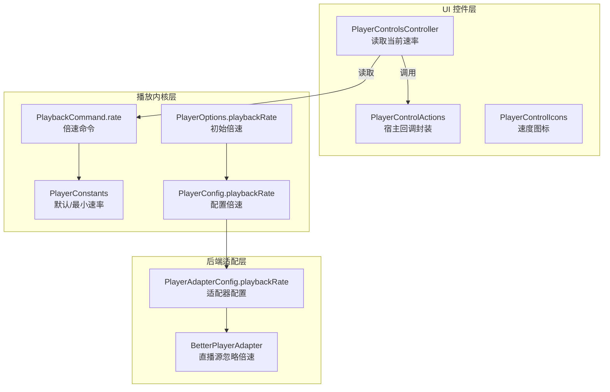
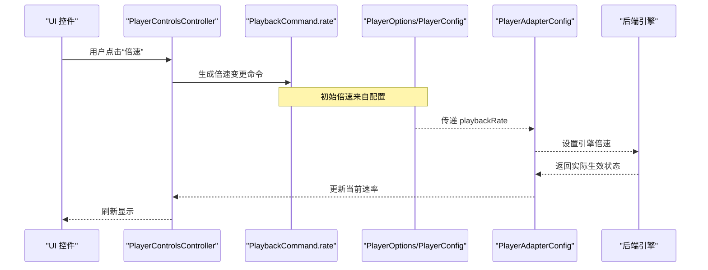
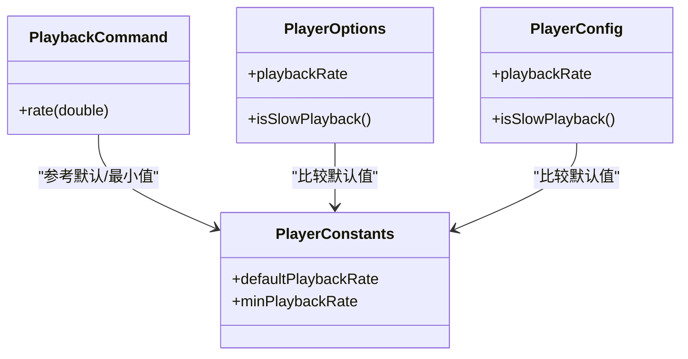
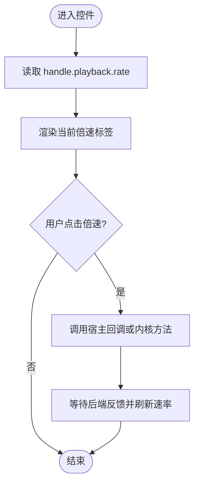
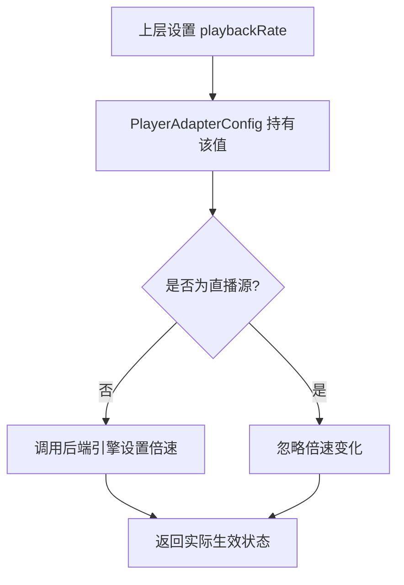
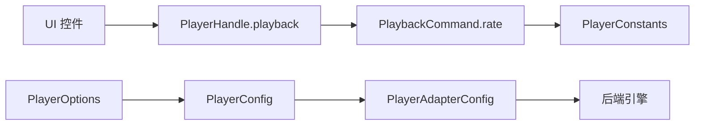
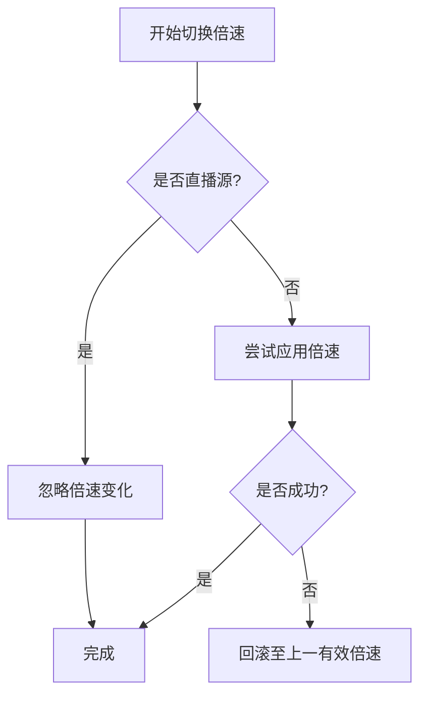

# 倍速控制组件

<cite>
**本文引用的文件**   
- [packages/media_core/lib/playback/playback_command.dart](file://packages/media_core/lib/playback/playback_command.dart)
- [packages/media_core/lib/core/player_constants.dart](file://packages/media_core/lib/core/player_constants.dart)
- [packages/media_core/lib/core/player_options.dart](file://packages/media_core/lib/core/player_options.dart)
- [packages/media_core/lib/core/player_config.dart](file://packages/media_core/lib/core/player_config.dart)
- [packages/media_core/lib/adapter/player_adapter_config.dart](file://packages/media_core/lib/adapter/player_adapter_config.dart)
- [packages/media_core_ui/lib/src/common/player_controls_controller.dart](file://packages/media_core_ui/lib/src/common/player_controls_controller.dart)
- [packages/media_core_ui/lib/src/common/player_control_actions.dart](file://packages/media_core_ui/lib/src/common/player_control_actions.dart)
- [packages/media_core_ui/lib/src/common/player_control_icons.dart](file://packages/media_core_ui/lib/src/common/player_control_icons.dart)
- [packages/media_core_better_player/lib/src/better_player_adapter.dart](file://packages/media_core_better_player/lib/src/better_player_adapter.dart)
- [doc/zh-Hans/playback.md](file://doc/zh-Hans/playback.md)
</cite>

## 目录
1. [简介](#简介)
2. [项目结构](#项目结构)
3. [核心组件](#核心组件)
4. [架构总览](#架构总览)
5. [详细组件分析](#详细组件分析)
6. [依赖关系分析](#依赖关系分析)
7. [性能与音质影响](#性能与音质影响)
8. [自定义与扩展机制](#自定义与扩展机制)
9. [后端差异与降级方案](#后端差异与降级方案)
10. [故障排查指南](#故障排查指南)
11. [结论](#结论)

## 简介
本文件聚焦“倍速控制组件”，系统说明播放速度调节在媒体内核、UI 控件与后端适配器中的实现方式，覆盖以下方面：
- 倍速命令与状态流转
- UI 层如何暴露并切换倍速
- 可选速度值、默认速度与慢速/快速判定
- 倍速切换对播放性能与音质的影响
- 自定义速度菜单与扩展点
- 不同后端引擎对倍速的支持差异与降级策略

## 项目结构
倍速能力贯穿三层：
- 播放内核层：定义倍速命令、常量与配置项
- UI 控件层：提供速率读取、切换动作与图标
- 后端适配层：将上层倍速请求落地到具体播放器引擎

**图表来源**
- [packages/media_core_ui/lib/src/common/player_controls_controller.dart:156-157](file://packages/media_core_ui/lib/src/common/player_controls_controller.dart#L156-L157)
- [packages/media_core_ui/lib/src/common/player_control_actions.dart:1-25](file://packages/media_core_ui/lib/src/common/player_control_actions.dart#L1-L25)
- [packages/media_core_ui/lib/src/common/player_control_icons.dart:231-232](file://packages/media_core_ui/lib/src/common/player_control_icons.dart#L231-L232)
- [packages/media_core/lib/playback/playback_command.dart:47-48](file://packages/media_core/lib/playback/playback_command.dart#L47-L48)
- [packages/media_core/lib/core/player_constants.dart:18-21](file://packages/media_core/lib/core/player_constants.dart#L18-L21)
- [packages/media_core/lib/core/player_options.dart:66-67](file://packages/media_core/lib/core/player_options.dart#L66-L67)
- [packages/media_core/lib/core/player_config.dart:277-278](file://packages/media_core/lib/core/player_config.dart#L277-L278)
- [packages/media_core/lib/adapter/player_adapter_config.dart:43-43](file://packages/media_core/lib/adapter/player_adapter_config.dart#L43-L43)
- [packages/media_core_better_player/lib/src/better_player_adapter.dart:155-157](file://packages/media_core_better_player/lib/src/better_player_adapter.dart#L155-L157)

**章节来源**
- [packages/media_core_ui/lib/src/common/player_controls_controller.dart:156-157](file://packages/media_core_ui/lib/src/common/player_controls_controller.dart#L156-L157)
- [packages/media_core/lib/playback/playback_command.dart:47-48](file://packages/media_core/lib/playback/playback_command.dart#L47-L48)
- [packages/media_core/lib/core/player_constants.dart:18-21](file://packages/media_core/lib/core/player_constants.dart#L18-L21)
- [packages/media_core/lib/core/player_options.dart:66-67](file://packages/media_core/lib/core/player_options.dart#L66-L67)
- [packages/media_core/lib/core/player_config.dart:277-278](file://packages/media_core/lib/core/player_config.dart#L277-L278)
- [packages/media_core/lib/adapter/player_adapter_config.dart:43-43](file://packages/media_core/lib/adapter/player_adapter_config.dart#L43-L43)
- [packages/media_core_better_player/lib/src/better_player_adapter.dart:155-157](file://packages/media_core_better_player/lib/src/better_player_adapter.dart#L155-L157)

## 核心组件
- 倍速命令：通过 sealed 命令表达倍速变更，不直接操作后端。
- 常量与边界：定义默认倍速与最小倍速等常量。
- 选项与配置：PlayerOptions 与 PlayerConfig 均支持初始倍速设置，并提供快速判断是否慢速/快速播放。
- UI 控制器：从 PlayerHandle 暴露的 playback.rate 读取当前速率，供控件展示与交互。
- 适配器配置：将倍速参数传递给底层播放器适配器。
- 后端差异：部分后端（如直播源）会忽略倍速变化。

**章节来源**
- [packages/media_core/lib/playback/playback_command.dart:47-48](file://packages/media_core/lib/playback/playback_command.dart#L47-L48)
- [packages/media_core/lib/core/player_constants.dart:18-21](file://packages/media_core/lib/core/player_constants.dart#L18-L21)
- [packages/media_core/lib/core/player_options.dart:66-67](file://packages/media_core/lib/core/player_options.dart#L66-L67)
- [packages/media_core/lib/core/player_config.dart:277-278](file://packages/media_core/lib/core/player_config.dart#L277-L278)
- [packages/media_core_ui/lib/src/common/player_controls_controller.dart:156-157](file://packages/media_core_ui/lib/src/common/player_controls_controller.dart#L156-L157)
- [packages/media_core/lib/adapter/player_adapter_config.dart:43-43](file://packages/media_core/lib/adapter/player_adapter_config.dart#L43-L43)
- [packages/media_core_better_player/lib/src/better_player_adapter.dart:155-157](file://packages/media_core_better_player/lib/src/better_player_adapter.dart#L155-L157)

## 架构总览
倍速控制的端到端流程如下：
- UI 层通过 PlayerControlsController 读取当前 rate，并在用户选择新速率后触发宿主回调或内核调用。
- 内核侧以 PlaybackCommand.rate 表达倍速变更意图。
- 配置层通过 PlayerOptions/PlayerConfig 指定初始倍速。
- 适配器层将 playbackRate 下发给具体后端。
- 特定后端（如直播流）可能忽略倍速变化。

**图表来源**
- [packages/media_core_ui/lib/src/common/player_controls_controller.dart:156-157](file://packages/media_core_ui/lib/src/common/player_controls_controller.dart#L156-L157)
- [packages/media_core/lib/playback/playback_command.dart:47-48](file://packages/media_core/lib/playback/playback_command.dart#L47-L48)
- [packages/media_core/lib/core/player_options.dart:66-67](file://packages/media_core/lib/core/player_options.dart#L66-L67)
- [packages/media_core/lib/core/player_config.dart:277-278](file://packages/media_core/lib/core/player_config.dart#L277-L278)
- [packages/media_core/lib/adapter/player_adapter_config.dart:43-43](file://packages/media_core/lib/adapter/player_adapter_config.dart#L43-L43)

## 详细组件分析

### 播放内核：倍速命令与常量
- PlaybackCommand.rate 是统一的倍速变更命令，用于驱动状态机与下游消费方。
- PlayerConstants 提供默认倍速与最小倍速等常量，作为校验与 UI 展示的基准。
- PlayerOptions/PlayerConfig 暴露初始 playbackRate，并提供 isSlowPlayback/isFastPlayback 等便捷判断。

**图表来源**
- [packages/media_core/lib/playback/playback_command.dart:47-48](file://packages/media_core/lib/playback/playback_command.dart#L47-L48)
- [packages/media_core/lib/core/player_constants.dart:18-21](file://packages/media_core/lib/core/player_constants.dart#L18-L21)
- [packages/media_core/lib/core/player_options.dart:66-67](file://packages/media_core/lib/core/player_options.dart#L66-L67)
- [packages/media_core/lib/core/player_config.dart:277-278](file://packages/media_core/lib/core/player_config.dart#L277-L278)

**章节来源**
- [packages/media_core/lib/playback/playback_command.dart:47-48](file://packages/media_core/lib/playback/playback_command.dart#L47-L48)
- [packages/media_core/lib/core/player_constants.dart:18-21](file://packages/media_core/lib/core/player_constants.dart#L18-L21)
- [packages/media_core/lib/core/player_options.dart:66-67](file://packages/media_core/lib/core/player_options.dart#L66-L67)
- [packages/media_core/lib/core/player_config.dart:277-278](file://packages/media_core/lib/core/player_config.dart#L277-L278)

### UI 控件：速率读取与交互
- PlayerControlsController 暴露 rate 属性，直接映射到 handle.playback.rate，供进度条、按钮等控件展示。
- PlayerControlActions 负责承载宿主回调（全屏、小窗、截图等），不包含播放逻辑；UI 控件根据回调是否存在决定是否展示对应按钮。
- PlayerControlIcons 为“速度”按钮提供平台化图标资源。

**图表来源**
- [packages/media_core_ui/lib/src/common/player_controls_controller.dart:156-157](file://packages/media_core_ui/lib/src/common/player_controls_controller.dart#L156-L157)
- [packages/media_core_ui/lib/src/common/player_control_actions.dart:1-25](file://packages/media_core_ui/lib/src/common/player_control_actions.dart#L1-L25)
- [packages/media_core_ui/lib/src/common/player_control_icons.dart:231-232](file://packages/media_core_ui/lib/src/common/player_control_icons.dart#L231-L232)

**章节来源**
- [packages/media_core_ui/lib/src/common/player_controls_controller.dart:156-157](file://packages/media_core_ui/lib/src/common/player_controls_controller.dart#L156-L157)
- [packages/media_core_ui/lib/src/common/player_control_actions.dart:1-25](file://packages/media_core_ui/lib/src/common/player_control_actions.dart#L1-L25)
- [packages/media_core_ui/lib/src/common/player_control_icons.dart:231-232](file://packages/media_core_ui/lib/src/common/player_control_icons.dart#L231-L232)

### 后端适配：倍速落地与直播源处理
- PlayerAdapterConfig 包含 playbackRate，用于将倍速参数传递给底层适配器。
- BetterPlayerAdapter 对直播源做了特殊处理：直播流的倍速变化会被忽略，因为直播没有“有意义的播放速度”。

**图表来源**
- [packages/media_core/lib/adapter/player_adapter_config.dart:43-43](file://packages/media_core/lib/adapter/player_adapter_config.dart#L43-L43)
- [packages/media_core_better_player/lib/src/better_player_adapter.dart:155-157](file://packages/media_core_better_player/lib/src/better_player_adapter.dart#L155-L157)

**章节来源**
- [packages/media_core/lib/adapter/player_adapter_config.dart:43-43](file://packages/media_core/lib/adapter/player_adapter_config.dart#L43-L43)
- [packages/media_core_better_player/lib/src/better_player_adapter.dart:155-157](file://packages/media_core_better_player/lib/src/better_player_adapter.dart#L155-L157)

## 依赖关系分析
- UI 控件依赖 PlayerHandle 暴露的 playback 信息，不直接操作后端。
- 播放内核通过 PlaybackCommand 统一表达倍速变更，避免跨模块耦合。
- 配置层（PlayerOptions/PlayerConfig）与适配器层（PlayerAdapterConfig）共同决定初始与运行时倍速。
- 后端适配器根据媒体类型（如直播）进行差异化处理。

**图表来源**
- [packages/media_core_ui/lib/src/common/player_controls_controller.dart:156-157](file://packages/media_core_ui/lib/src/common/player_controls_controller.dart#L156-L157)
- [packages/media_core/lib/playback/playback_command.dart:47-48](file://packages/media_core/lib/playback/playback_command.dart#L47-L48)
- [packages/media_core/lib/core/player_constants.dart:18-21](file://packages/media_core/lib/core/player_constants.dart#L18-L21)
- [packages/media_core/lib/core/player_options.dart:66-67](file://packages/media_core/lib/core/player_options.dart#L66-L67)
- [packages/media_core/lib/core/player_config.dart:277-278](file://packages/media_core/lib/core/player_config.dart#L277-L278)
- [packages/media_core/lib/adapter/player_adapter_config.dart:43-43](file://packages/media_core/lib/adapter/player_adapter_config.dart#L43-L43)

**章节来源**
- [packages/media_core_ui/lib/src/common/player_controls_controller.dart:156-157](file://packages/media_core_ui/lib/src/common/player_controls_controller.dart#L156-L157)
- [packages/media_core/lib/playback/playback_command.dart:47-48](file://packages/media_core/lib/playback/playback_command.dart#L47-L48)
- [packages/media_core/lib/core/player_constants.dart:18-21](file://packages/media_core/lib/core/player_constants.dart#L18-L21)
- [packages/media_core/lib/core/player_options.dart:66-67](file://packages/media_core/lib/core/player_options.dart#L66-L67)
- [packages/media_core/lib/core/player_config.dart:277-278](file://packages/media_core/lib/core/player_config.dart#L277-L278)
- [packages/media_core/lib/adapter/player_adapter_config.dart:43-43](file://packages/media_core/lib/adapter/player_adapter_config.dart#L43-L43)

## 性能与音质影响
- 快速播放（大于默认倍速）会增加解码与渲染压力，可能导致丢帧或卡顿，尤其在低端设备上更明显。
- 慢速播放（小于默认倍速）通常对解码压力较小，但可能带来音频时间拉伸带来的音质变化。
- 建议：
  - 在低性能设备上限制最大倍速范围。
  - 对直播源禁用倍速，避免无意义操作与潜在抖动。
  - 结合缓冲与回退策略，在倍速切换时保持流畅体验。

[本节为通用指导，不直接分析具体文件]

## 自定义与扩展机制
- 可选速度值与默认速度：
  - 默认速度由 PlayerConstants.defaultPlaybackRate 提供。
  - 最小速度由 PlayerConstants.minPlaybackRate 提供。
  - UI 层可通过 PlayerControlsController.rate 读取当前速率，并结合宿主逻辑构建自定义菜单。
- 速度变化动画：
  - 文档未定义统一的“倍速切换动画”规范；可在宿主层自行实现过渡效果（例如淡入淡出、缩放）。
- 扩展点：
  - 使用 PlayerOptions.playbackRate 或 PlayerConfig.playbackRate 设置初始倍速。
  - 通过 PlayerAdapterConfig.playbackRate 将倍速参数传递给后端。
  - 在宿主层监听 PlayerControlsController.rate 的变化，动态调整 UI 菜单与提示。

**章节来源**
- [packages/media_core/lib/core/player_constants.dart:18-21](file://packages/media_core/lib/core/player_constants.dart#L18-L21)
- [packages/media_core_ui/lib/src/common/player_controls_controller.dart:156-157](file://packages/media_core_ui/lib/src/common/player_controls_controller.dart#L156-L157)
- [packages/media_core/lib/core/player_options.dart:66-67](file://packages/media_core/lib/core/player_options.dart#L66-L67)
- [packages/media_core/lib/core/player_config.dart:277-278](file://packages/media_core/lib/core/player_config.dart#L277-L278)
- [packages/media_core/lib/adapter/player_adapter_config.dart:43-43](file://packages/media_core/lib/adapter/player_adapter_config.dart#L43-L43)

## 后端差异与降级方案
- 直播源处理：
  - BetterPlayerAdapter 明确对直播源忽略倍速变化，因为直播不存在“有意义的播放速度”。
- 降级策略建议：
  - 当后端不支持倍速或处于直播模式时，UI 可隐藏倍速按钮或禁用切换。
  - 在切换失败时，回滚到上一个有效倍速，并向用户给出提示。
  - 结合 PlayerConstants 的最小/默认值进行边界保护，避免非法倍速传入。

**图表来源**
- [packages/media_core_better_player/lib/src/better_player_adapter.dart:155-157](file://packages/media_core_better_player/lib/src/better_player_adapter.dart#L155-L157)
- [packages/media_core/lib/core/player_constants.dart:18-21](file://packages/media_core/lib/core/player_constants.dart#L18-L21)

**章节来源**
- [packages/media_core_better_player/lib/src/better_player_adapter.dart:155-157](file://packages/media_core_better_player/lib/src/better_player_adapter.dart#L155-L157)
- [packages/media_core/lib/core/player_constants.dart:18-21](file://packages/media_core/lib/core/player_constants.dart#L18-L21)

## 故障排查指南
- 症状：倍速切换无效
  - 检查是否为直播源：若是，倍速将被忽略。
  - 检查 PlayerAdapterConfig.playbackRate 是否正确传递。
  - 检查 PlayerConstants 的默认/最小值是否被误用导致非法倍速。
- 症状：UI 显示倍速与实际不一致
  - 确认 PlayerControlsController.rate 是否与后端同步。
  - 检查是否有异步回调未及时刷新 UI。
- 症状：切换倍速后卡顿或掉帧
  - 降低最大倍速上限，或在低端设备上禁用快速播放。
  - 观察缓冲与解码日志，定位瓶颈。

**章节来源**
- [packages/media_core_better_player/lib/src/better_player_adapter.dart:155-157](file://packages/media_core_better_player/lib/src/better_player_adapter.dart#L155-L157)
- [packages/media_core/lib/adapter/player_adapter_config.dart:43-43](file://packages/media_core/lib/adapter/player_adapter_config.dart#L43-L43)
- [packages/media_core/lib/core/player_constants.dart:18-21](file://packages/media_core/lib/core/player_constants.dart#L18-L21)
- [packages/media_core_ui/lib/src/common/player_controls_controller.dart:156-157](file://packages/media_core_ui/lib/src/common/player_controls_controller.dart#L156-L157)

## 结论
倍速控制在 media_core 中采用“命令 + 配置 + 适配器”的分层设计：
- 内核层以 PlaybackCommand.rate 统一表达倍速变更。
- UI 层通过 PlayerControlsController 读取并展示当前速率。
- 配置层通过 PlayerOptions/PlayerConfig 设定初始倍速。
- 适配器层将倍速参数传递给后端，并对直播源等特殊场景做降级处理。
在实际使用中，建议结合设备能力与媒体类型，合理限制倍速范围，并在 UI 层提供清晰的反馈与回退路径，以获得稳定一致的播放体验。

[本节为总结性内容，不直接分析具体文件]