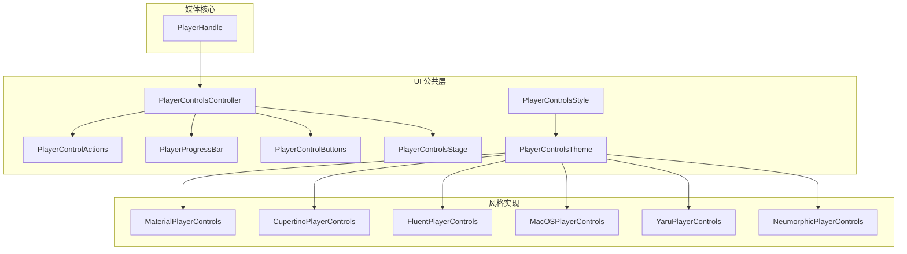
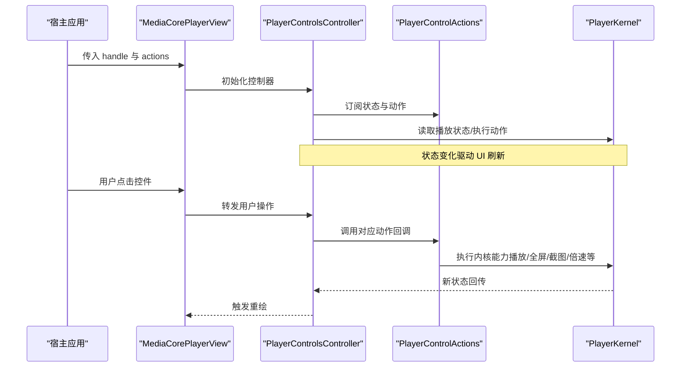
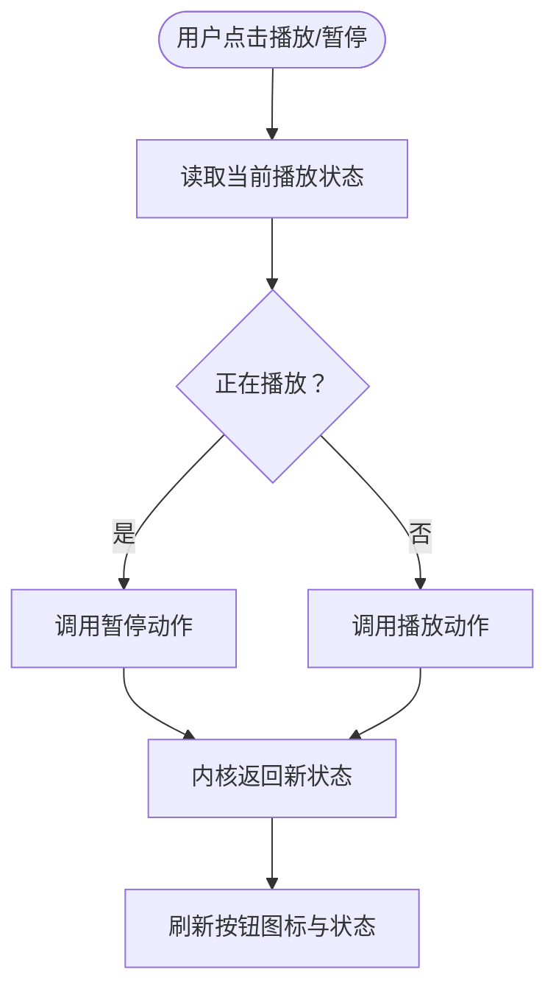
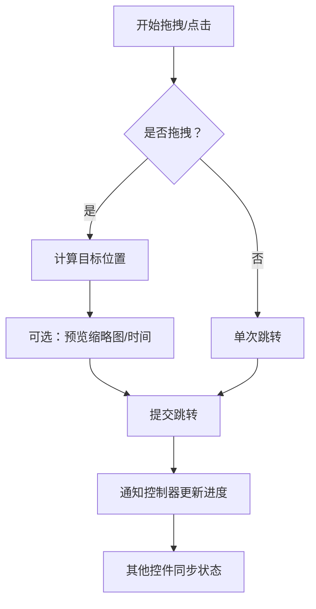
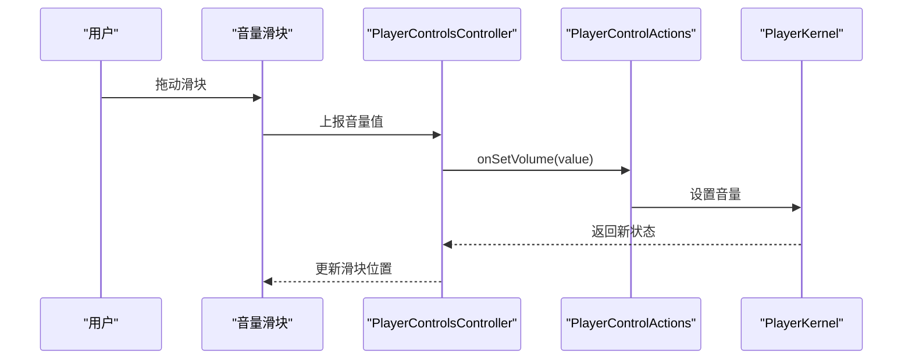
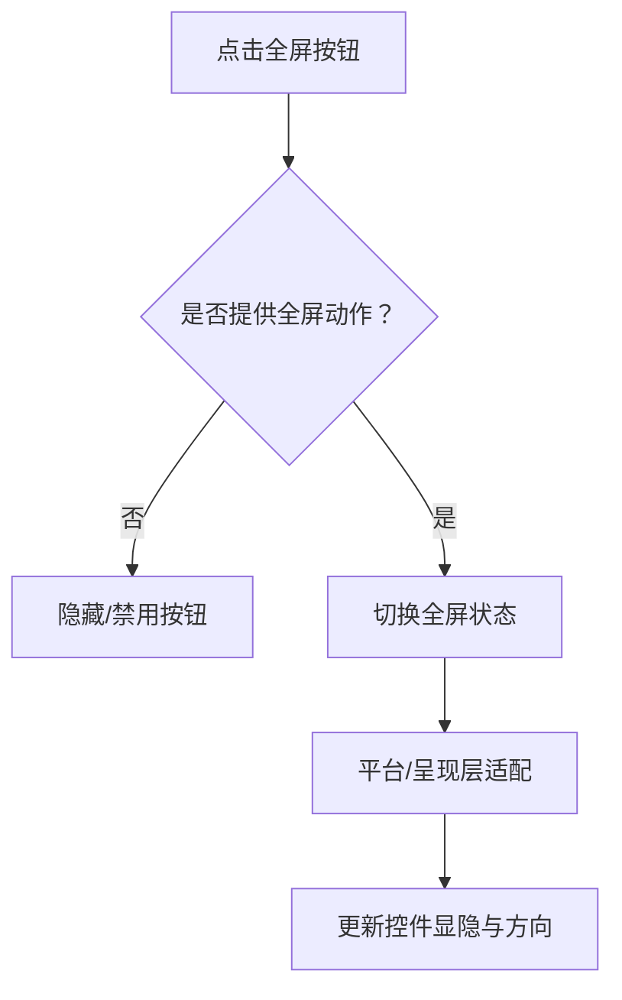
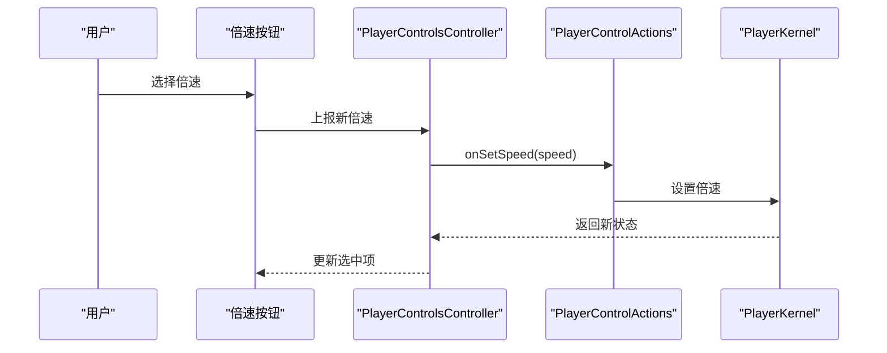
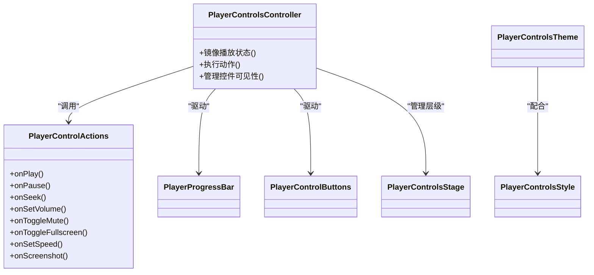

# 内置控制组件

<cite>
**本文引用的文件**   
- [README.md](file://README.md)
- [packages/media_core_ui/README.md](file://packages/media_core_ui/README.md)
- [packages/media_core_ui/lib/src/common/player_controls_controller.dart](file://packages/media_core_ui/lib/src/common/player_controls_controller.dart)
- [packages/media_core_ui/lib/src/common/player_control_actions.dart](file://packages/media_core_ui/lib/src/common/player_control_actions.dart)
- [packages/media_core_ui/lib/src/common/player_progress_bar.dart](file://packages/media_core_ui/lib/src/common/player_progress_bar.dart)
- [packages/media_core_ui/lib/src/common/player_control_buttons.dart](file://packages/media_core_ui/lib/src/common/player_control_buttons.dart)
- [packages/media_core_ui/lib/src/common/player_controls_stage.dart](file://packages/media_core_ui/lib/src/common/player_controls_stage.dart)
- [packages/media_core_ui/lib/src/common/player_controls_theme.dart](file://packages/media_core_ui/lib/src/common/player_controls_theme.dart)
- [packages/media_core_ui/lib/src/common/player_controls_style.dart](file://packages/media_core_ui/lib/src/common/player_controls_style.dart)
- [packages/media_core_ui/lib/src/material/material_player_controls.dart](file://packages/media_core_ui/lib/src/material/material_player_controls.dart)
- [packages/media_core_ui/lib/src/cupertino/cupertino_player_controls.dart](file://packages/media_core_ui/lib/src/cupertino/cupertino_player_controls.dart)
- [packages/media_core_ui/lib/src/fluent/fluent_player_controls.dart](file://packages/media_core_ui/lib/src/fluent/fluent_player_controls.dart)
- [packages/media_core_ui/lib/src/macos/macos_player_controls.dart](file://packages/media_core_ui/lib/src/macos/macos_player_controls.dart)
- [packages/media_core_ui/lib/src/yaru/yaru_player_controls.dart](file://packages/media_core_ui/lib/src/yaru/yaru_player_controls.dart)
- [packages/media_core_ui/lib/src/neumorphic/neumorphic_player_controls.dart](file://packages/media_core_ui/lib/src/neumorphic/neumorphic_player_controls.dart)
</cite>

## 目录
1. [简介](#简介)
2. [项目结构](#项目结构)
3. [核心组件](#核心组件)
4. [架构总览](#架构总览)
5. [详细组件分析](#详细组件分析)
6. [依赖关系分析](#依赖关系分析)
7. [性能与最佳实践](#性能与最佳实践)
8. [故障排查指南](#故障排查指南)
9. [结论](#结论)

## 简介
Media Core 的内置控制组件集中在 `media_core_ui` 包中，提供“一套控制逻辑、六种设计语言”的播放器界面能力。控件只渲染控制器状态并调用统一动作，换皮肤不换行为；通过回调是否存在来决定按钮是否显示，避免“不可用却可见”的交互陷阱。常用入口包括：
- 一键集成：`MediaCorePlayerView`，自动装配画面、手势、键盘与六套风格的控制栏。
- 自定义组合：`PlayerControlsController` + 主题令牌 `PlayerControlsTheme` + 具体风格控件集（如 `MaterialPlayerControls`）。

该文档聚焦播放/暂停、进度条、音量滑块、全屏切换、倍速等核心控件的属性配置、样式定制、事件回调机制、组件协作方式，以及在不同设计语言下的表现差异与适配方案。

## 项目结构
`media_core_ui` 按“公共逻辑 + 多风格实现”组织：
- `src/common`：跨风格共享的控制器、动作契约、进度条、按钮集合、舞台容器、主题与风格枚举。
- `src/{material, cupertino, fluent, macos, yaru, neumorphic}`：各设计语言的无状态控件集，仅消费控制器状态并调用动作。

图表来源
- [packages/media_core_ui/lib/src/common/player_controls_controller.dart](file://packages/media_core_ui/lib/src/common/player_controls_controller.dart)
- [packages/media_core_ui/lib/src/common/player_control_actions.dart](file://packages/media_core_ui/lib/src/common/player_control_actions.dart)
- [packages/media_core_ui/lib/src/common/player_progress_bar.dart](file://packages/media_core_ui/lib/src/common/player_progress_bar.dart)
- [packages/media_core_ui/lib/src/common/player_control_buttons.dart](file://packages/media_core_ui/lib/src/common/player_control_buttons.dart)
- [packages/media_core_ui/lib/src/common/player_controls_stage.dart](file://packages/media_core_ui/lib/src/common/player_controls_stage.dart)
- [packages/media_core_ui/lib/src/common/player_controls_theme.dart](file://packages/media_core_ui/lib/src/common/player_controls_theme.dart)
- [packages/media_core_ui/lib/src/common/player_controls_style.dart](file://packages/media_core_ui/lib/src/common/player_controls_style.dart)
- [packages/media_core_ui/lib/src/material/material_player_controls.dart](file://packages/media_core_ui/lib/src/material/material_player_controls.dart)
- [packages/media_core_ui/lib/src/cupertino/cupertino_player_controls.dart](file://packages/media_core_ui/lib/src/cupertino/cupertino_player_controls.dart)
- [packages/media_core_ui/lib/src/fluent/fluent_player_controls.dart](file://packages/media_core_ui/lib/src/fluent/fluent_player_controls.dart)
- [packages/media_core_ui/lib/src/macos/macos_player_controls.dart](file://packages/media_core_ui/lib/src/macos/macos_player_controls.dart)
- [packages/media_core_ui/lib/src/yaru/yaru_player_controls.dart](file://packages/media_core_ui/lib/src/yaru/yaru_player_controls.dart)
- [packages/media_core_ui/lib/src/neumorphic/neumorphic_player_controls.dart](file://packages/media_core_ui/lib/src/neumorphic/neumorphic_player_controls.dart)

章节来源
- [packages/media_core_ui/README.md:5-14](file://packages/media_core_ui/README.md#L5-L14)

## 核心组件
本节概述控制器的职责、动作契约与各控件的职责边界。

- PlayerControlsController
  - 职责：镜像底层 `PlayerHandle` 的播放状态，暴露统一的控制动作（播放/暂停、跳转、音量、全屏、画中画、截图、倍速等），管理控件可见性与手势响应。
  - 数据流：从内核读取状态 → 驱动 UI 刷新 → 将用户操作转为动作回调。
- PlayerControlActions
  - 职责：定义所有可被控件调用的动作回调；若某回调为 null，对应按钮不渲染，保证“可用才可见”。
  - 典型回调：播放/暂停、前进/后退、跳转、音量调节、静音切换、全屏切换、画中画、截图、倍速设置等。
- PlayerProgressBar
  - 职责：渲染时间轴、缓冲区、当前进度、拖拽与点击跳转；支持缩放与触摸反馈。
- PlayerControlButtons
  - 职责：聚合播放/暂停、上一首/下一首、快进/快退、音量、全屏、画中画、截图、倍速等按钮的布局与交互。
- PlayerControlsStage
  - 职责：把顶部与底部控制栏叠加在视频画面上，处理显隐时机与层级。
- PlayerControlsTheme / PlayerControlsStyle
  - 职责：主题令牌与风格枚举；风格决定视觉外观，主题决定颜色、尺寸、图标等。

章节来源
- [packages/media_core_ui/README.md:5-14](file://packages/media_core_ui/README.md#L5-L14)
- [packages/media_core_ui/lib/src/common/player_controls_controller.dart](file://packages/media_core_ui/lib/src/common/player_controls_controller.dart)
- [packages/media_core_ui/lib/src/common/player_control_actions.dart](file://packages/media_core_ui/lib/src/common/player_control_actions.dart)
- [packages/media_core_ui/lib/src/common/player_progress_bar.dart](file://packages/media_core_ui/lib/src/common/player_progress_bar.dart)
- [packages/media_core_ui/lib/src/common/player_control_buttons.dart](file://packages/media_core_ui/lib/src/common/player_control_buttons.dart)
- [packages/media_core_ui/lib/src/common/player_controls_stage.dart](file://packages/media_core_ui/lib/src/common/player_controls_stage.dart)
- [packages/media_core_ui/lib/src/common/player_controls_theme.dart](file://packages/media_core_ui/lib/src/common/player_controls_theme.dart)
- [packages/media_core_ui/lib/src/common/player_controls_style.dart](file://packages/media_core_ui/lib/src/common/player_controls_style.dart)

## 架构总览
下图展示从宿主到内核的完整调用链：宿主通过 `MediaCorePlayerView` 或“控制器 + 主题 + 风格控件”的方式接入，控制器桥接到内核，动作回调最终落到 `PlayerKernel` 的能力上。

图表来源
- [packages/media_core_ui/lib/src/media_core_player_view.dart](file://packages/media_core_ui/lib/src/media_core_player_view.dart)
- [packages/media_core_ui/lib/src/common/player_controls_controller.dart](file://packages/media_core_ui/lib/src/common/player_controls_controller.dart)
- [packages/media_core_ui/lib/src/common/player_control_actions.dart](file://packages/media_core_ui/lib/src/common/player_control_actions.dart)

章节来源
- [README.md:14-53](file://README.md#L14-L53)
- [packages/media_core_ui/README.md:16-44](file://packages/media_core_ui/README.md#L16-L44)

## 详细组件分析

### 播放/暂停按钮
- 功能要点
  - 根据当前播放状态切换图标与文案。
  - 点击后调用播放/暂停动作回调。
  - 在直播或不可播放状态下禁用。
- 属性与配置
  - 通常由 `PlayerControlButtons` 统一管理，无需单独实例化。
  - 可通过主题调整图标大小、间距与颜色。
- 事件回调
  - 调用 `onPlay` / `onPause`（或统一 `onTogglePlayback`）动作回调。
- 样式定制
  - 通过 `PlayerControlsTheme` 覆盖图标、尺寸、高亮色。
- 与其他组件协作
  - 与进度条联动：播放时更新进度，暂停时冻结。

图表来源
- [packages/media_core_ui/lib/src/common/player_control_buttons.dart](file://packages/media_core_ui/lib/src/common/player_control_buttons.dart)
- [packages/media_core_ui/lib/src/common/player_controls_controller.dart](file://packages/media_core_ui/lib/src/common/player_controls_controller.dart)

章节来源
- [packages/media_core_ui/lib/src/common/player_control_buttons.dart](file://packages/media_core_ui/lib/src/common/player_control_buttons.dart)
- [packages/media_core_ui/lib/src/common/player_controls_controller.dart](file://packages/media_core_ui/lib/src/common/player_controls_controller.dart)

### 进度条（时间轴）
- 功能要点
  - 显示缓冲区间、当前进度、可拖动与点击跳转。
  - 支持缩放、长按预览（由上层手势处理）、时间标签同步。
- 属性与配置
  - 可通过主题设置轨道高度、圆角、拖拽点尺寸与颜色。
  - 可开启/关闭缓冲条显示。
- 事件回调
  - 拖拽结束或点击后触发跳转动作（如 `onSeek`）。
- 与其他组件协作
  - 播放时持续更新位置；暂停时停止推进。
  - 与播放/暂停按钮、音量滑块、全屏切换协同工作。

图表来源
- [packages/media_core_ui/lib/src/common/player_progress_bar.dart](file://packages/media_core_ui/lib/src/common/player_progress_bar.dart)
- [packages/media_core_ui/lib/src/common/player_controls_controller.dart](file://packages/media_core_ui/lib/src/common/player_controls_controller.dart)

章节来源
- [packages/media_core_ui/lib/src/common/player_progress_bar.dart](file://packages/media_core_ui/lib/src/common/player_progress_bar.dart)
- [packages/media_core_ui/lib/src/common/player_controls_controller.dart](file://packages/media_core_ui/lib/src/common/player_controls_controller.dart)

### 音量滑块与静音切换
- 功能要点
  - 滑块调节音量，静音按钮快速切换静音/恢复。
  - 在音频独占或系统限制场景下可能受限。
- 属性与配置
  - 滑块样式、范围、步进值可通过主题或控制器配置。
- 事件回调
  - 滑动结束或实时滑动触发音量设置回调（如 `onSetVolume`）。
  - 静音切换触发 `onToggleMute`。
- 与其他组件协作
  - 与播放状态联动：某些后端在暂停时不改变音量效果。
  - 与全屏/PiP 模式保持音量一致性。

图表来源
- [packages/media_core_ui/lib/src/common/player_control_buttons.dart](file://packages/media_core_ui/lib/src/common/player_control_buttons.dart)
- [packages/media_core_ui/lib/src/common/player_controls_controller.dart](file://packages/media_core_ui/lib/src/common/player_controls_controller.dart)
- [packages/media_core_ui/lib/src/common/player_control_actions.dart](file://packages/media_core_ui/lib/src/common/player_control_actions.dart)

章节来源
- [packages/media_core_ui/lib/src/common/player_control_buttons.dart](file://packages/media_core_ui/lib/src/common/player_control_buttons.dart)
- [packages/media_core_ui/lib/src/common/player_controls_controller.dart](file://packages/media_core_ui/lib/src/common/player_controls_controller.dart)
- [packages/media_core_ui/lib/src/common/player_control_actions.dart](file://packages/media_core_ui/lib/src/common/player_control_actions.dart)

### 全屏切换按钮
- 功能要点
  - 切换系统全屏或窗口级全屏（取决于宿主能力）。
  - 横竖屏适配策略由呈现层与平台能力共同决定。
- 属性与配置
  - 可通过主题设置图标与提示文案。
  - 若未提供全屏动作回调，按钮不显示。
- 事件回调
  - 调用 `onEnterFullscreen` / `onExitFullscreen`（或统一 `onToggleFullscreen`）。
- 与其他组件协作
  - 与画中画、悬浮窗互斥；进入全屏时退出 PiP。
  - 与进度条、控制栏显隐联动。

图表来源
- [packages/media_core_ui/lib/src/common/player_control_buttons.dart](file://packages/media_core_ui/lib/src/common/player_control_buttons.dart)
- [packages/media_core_ui/lib/src/common/player_control_actions.dart](file://packages/media_core_ui/lib/src/common/player_control_actions.dart)

章节来源
- [packages/media_core_ui/lib/src/common/player_control_buttons.dart](file://packages/media_core_ui/lib/src/common/player_control_buttons.dart)
- [packages/media_core_ui/lib/src/common/player_control_actions.dart](file://packages/media_core_ui/lib/src/common/player_control_actions.dart)

### 倍速控制
- 功能要点
  - 提供常见倍速选项（如 0.5x、1.0x、1.5x、2.0x）。
  - 不支持倍速的后端或内容类型应禁用该控件。
- 属性与配置
  - 倍速列表、默认值、动画过渡可由主题或控制器配置。
- 事件回调
  - 选择倍速后调用 `onSetSpeed`。
- 与其他组件协作
  - 与播放状态联动：暂停时仍可切换倍速，但生效于下次播放。
  - 与进度条联动：倍速变化不影响已缓存进度。

图表来源
- [packages/media_core_ui/lib/src/common/player_control_buttons.dart](file://packages/media_core_ui/lib/src/common/player_control_buttons.dart)
- [packages/media_core_ui/lib/src/common/player_controls_controller.dart](file://packages/media_core_ui/lib/src/common/player_controls_controller.dart)
- [packages/media_core_ui/lib/src/common/player_control_actions.dart](file://packages/media_core_ui/lib/src/common/player_control_actions.dart)

章节来源
- [packages/media_core_ui/lib/src/common/player_control_buttons.dart](file://packages/media_core_ui/lib/src/common/player_control_buttons.dart)
- [packages/media_core_ui/lib/src/common/player_controls_controller.dart](file://packages/media_core_ui/lib/src/common/player_controls_controller.dart)
- [packages/media_core_ui/lib/src/common/player_control_actions.dart](file://packages/media_core_ui/lib/src/common/player_control_actions.dart)

### 截图按钮
- 功能要点
  - 捕获当前帧并交由宿主处理（保存、分享等）。
- 属性与配置
  - 图标与提示文案由主题控制。
- 事件回调
  - 调用 `onScreenshot`，返回截图数据给宿主。
- 与其他组件协作
  - 与全屏/PiP 无关，可在任意视图状态触发。

章节来源
- [packages/media_core_ui/lib/src/common/player_control_buttons.dart](file://packages/media_core_ui/lib/src/common/player_control_buttons.dart)
- [packages/media_core_ui/lib/src/common/player_control_actions.dart](file://packages/media_core_ui/lib/src/common/player_control_actions.dart)

### 控制舞台（PlayerControlsStage）
- 职责
  - 将顶部与底部控制栏叠加在视频画面上，处理显隐时机、层级与手势穿透。
- 使用建议
  - 自定义布局时优先复用 `PlayerControlsStage`，避免重复实现遮罩与层级逻辑。

章节来源
- [packages/media_core_ui/lib/src/common/player_controls_stage.dart](file://packages/media_core_ui/lib/src/common/player_controls_stage.dart)

### 主题与风格（PlayerControlsTheme / PlayerControlsStyle）
- 主题令牌
  - 集中管理颜色、尺寸、图标、动效等视觉参数。
- 风格枚举
  - material、cupertino、fluent、macos、yaru、neumorphic。
  - 风格决定控件外观，主题决定配色与细节。
- 平台默认
  - Android→material、iOS→cupertino、macOS→macos、Windows→fluent、Linux→yaru、Web→fluent；neumorphic 永不自动选中。

章节来源
- [packages/media_core_ui/lib/src/common/player_controls_theme.dart](file://packages/media_core_ui/lib/src/common/player_controls_theme.dart)
- [packages/media_core_ui/lib/src/common/player_controls_style.dart](file://packages/media_core_ui/lib/src/common/player_controls_style.dart)
- [packages/media_core_ui/README.md:46-59](file://packages/media_core_ui/README.md#L46-L59)

### 各风格控件集
- MaterialPlayerControls
  - 遵循 Material 规范，适合 Android 与通用场景。
- CupertinoPlayerControls
  - 遵循 iOS 规范，适合 iPhone/iPad。
- FluentPlayerControls
  - 面向 Windows 与 Web 的流畅体验。
- MacOSPlayerControls
  - 适配 macOS 原生体验。
- YaruPlayerControls
  - 适配 Ubuntu/Yaru 风格。
- NeumorphicPlayerControls
  - 柔和阴影风格，需宿主主动选择。

章节来源
- [packages/media_core_ui/lib/src/material/material_player_controls.dart](file://packages/media_core_ui/lib/src/material/material_player_controls.dart)
- [packages/media_core_ui/lib/src/cupertino/cupertino_player_controls.dart](file://packages/media_core_ui/lib/src/cupertino/cupertino_player_controls.dart)
- [packages/media_core_ui/lib/src/fluent/fluent_player_controls.dart](file://packages/media_core_ui/lib/src/fluent/fluent_player_controls.dart)
- [packages/media_core_ui/lib/src/macos/macos_player_controls.dart](file://packages/media_core_ui/lib/src/macos/macos_player_controls.dart)
- [packages/media_core_ui/lib/src/yaru/yaru_player_controls.dart](file://packages/media_core_ui/lib/src/yaru/yaru_player_controls.dart)
- [packages/media_core_ui/lib/src/neumorphic/neumorphic_player_controls.dart](file://packages/media_core_ui/lib/src/neumorphic/neumorphic_player_controls.dart)

## 依赖关系分析
- 控制器依赖内核句柄，动作回调桥接至内核能力。
- 控件集是无状态的，仅消费控制器状态与主题。
- 风格与主题解耦：同一控制器可搭配不同风格与主题。
- 能力通过回调存在性暴露：未提供的回调不会渲染对应按钮。

图表来源
- [packages/media_core_ui/lib/src/common/player_controls_controller.dart](file://packages/media_core_ui/lib/src/common/player_controls_controller.dart)
- [packages/media_core_ui/lib/src/common/player_control_actions.dart](file://packages/media_core_ui/lib/src/common/player_control_actions.dart)
- [packages/media_core_ui/lib/src/common/player_progress_bar.dart](file://packages/media_core_ui/lib/src/common/player_progress_bar.dart)
- [packages/media_core_ui/lib/src/common/player_control_buttons.dart](file://packages/media_core_ui/lib/src/common/player_control_buttons.dart)
- [packages/media_core_ui/lib/src/common/player_controls_stage.dart](file://packages/media_core_ui/lib/src/common/player_controls_stage.dart)
- [packages/media_core_ui/lib/src/common/player_controls_theme.dart](file://packages/media_core_ui/lib/src/common/player_controls_theme.dart)
- [packages/media_core_ui/lib/src/common/player_controls_style.dart](file://packages/media_core_ui/lib/src/common/player_controls_style.dart)

章节来源
- [packages/media_core_ui/README.md:5-14](file://packages/media_core_ui/README.md#L5-L14)

## 性能与最佳实践
- 减少不必要的重建
  - 使用 `PlayerControlsController` 作为单一状态源，避免在每帧重建控件树。
  - 将主题与风格提升到合适层级，避免频繁替换。
- 按需渲染
  - 利用“回调存在即渲染”的原则，隐藏不需要的按钮，降低绘制成本。
- 手势优化
  - 进度条拖拽时使用节流或增量更新，避免高频状态变更。
- 资源压力
  - 在高负载场景（多路播放、高分辨率）下，优先保障播放与进度更新，延迟非关键 UI 更新。
- 主题与图标
  - 使用轻量图标与合理尺寸，避免大图与过度阴影。
- 全屏与 PiP
  - 在进入全屏或 PiP 前释放不必要资源，退出后按需恢复。

[本节为通用指导，不直接分析具体文件]

## 故障排查指南
- 按钮不显示
  - 检查对应动作回调是否为 null；库不会渲染不可用的按钮。
- 进度条不更新
  - 确认控制器正确订阅了内核状态；检查播放状态是否处于有效区间。
- 音量无效
  - 某些后端在暂停或音频独占模式下可能限制音量；检查动作回调是否正确传递。
- 全屏失败
  - 检查宿主是否提供全屏动作回调；确认平台能力与呈现层支持。
- 倍速无效
  - 某些内容或后端不支持倍速；检查回调是否实现与能力探测。
- 截图无响应
  - 确认 `onScreenshot` 回调已实现并正确处理返回数据。

章节来源
- [packages/media_core_ui/README.md:12-14](file://packages/media_core_ui/README.md#L12-L14)
- [packages/media_core_ui/lib/src/common/player_control_actions.dart](file://packages/media_core_ui/lib/src/common/player_control_actions.dart)

## 结论
Media Core 的内置控制组件以“控制器 + 动作 + 主题 + 风格”为核心，将播放控制逻辑与视觉表现解耦。通过统一的 `PlayerControlsController` 与 `PlayerControlActions`，控件可以跨风格复用；通过主题与风格枚举，宿主可以在不同平台上获得一致的交互体验。结合示例中的 `MediaCorePlayerView` 或“控制器 + 主题 + 风格控件”的组合方式，可以快速搭建高质量、可定制的播放器界面。

[本节为总结性内容，不直接分析具体文件]