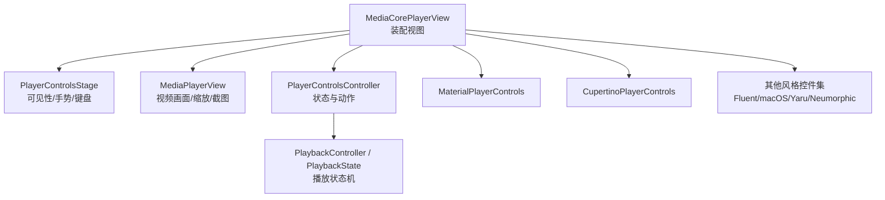
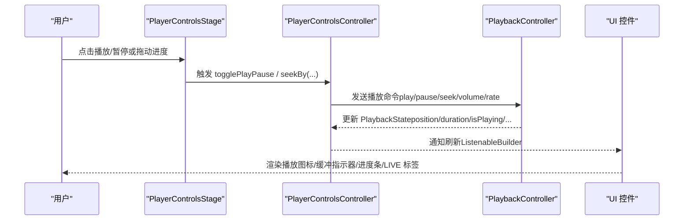
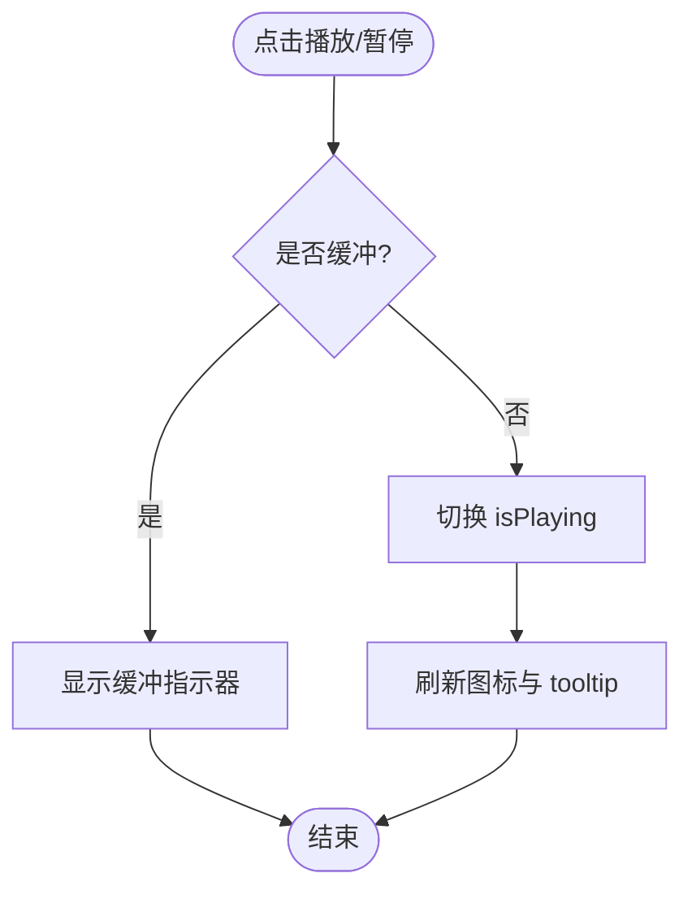
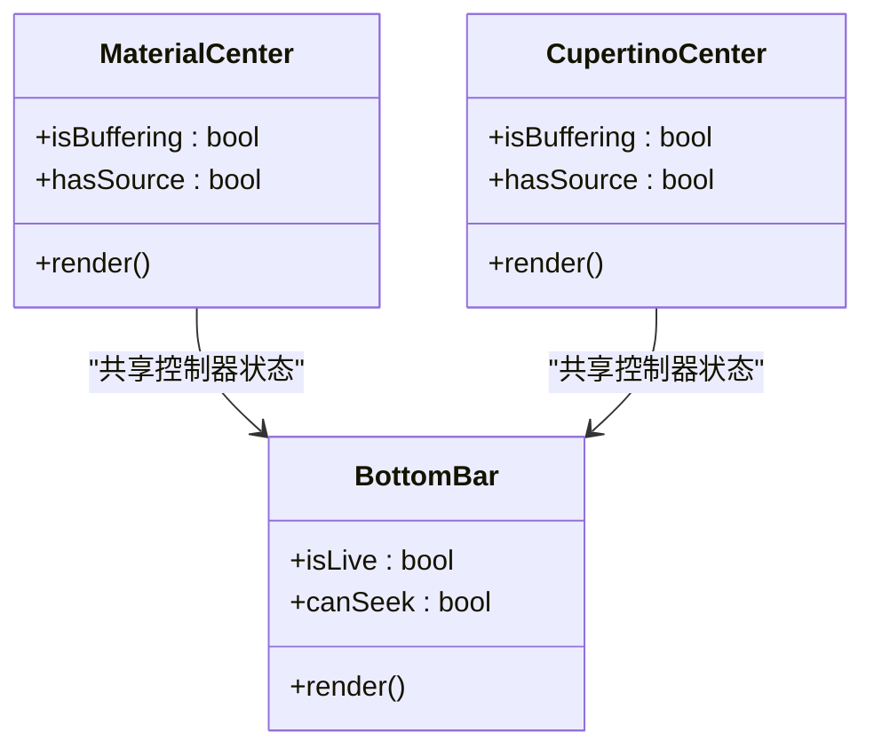
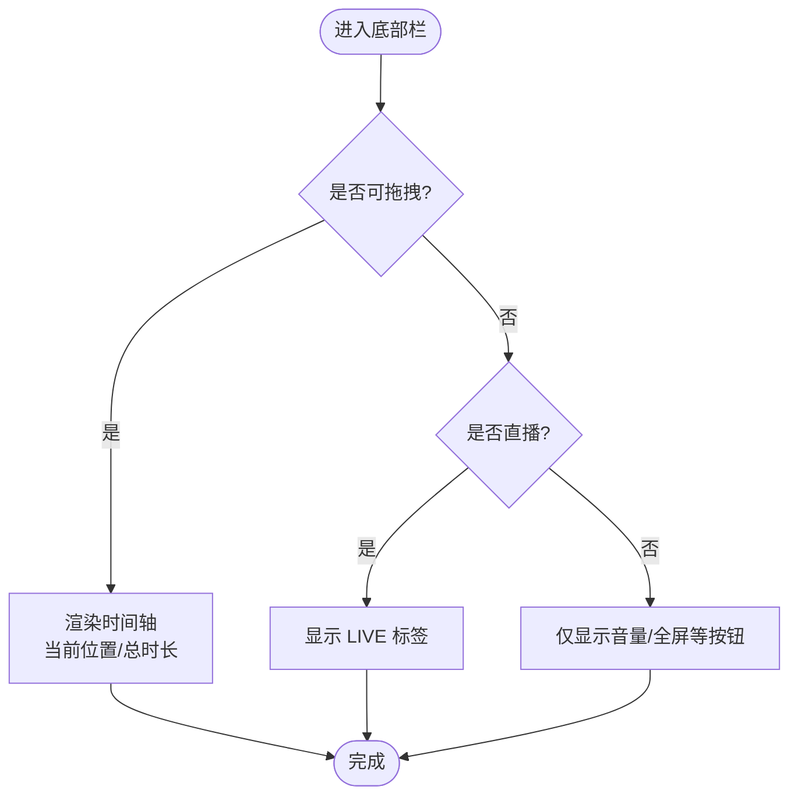
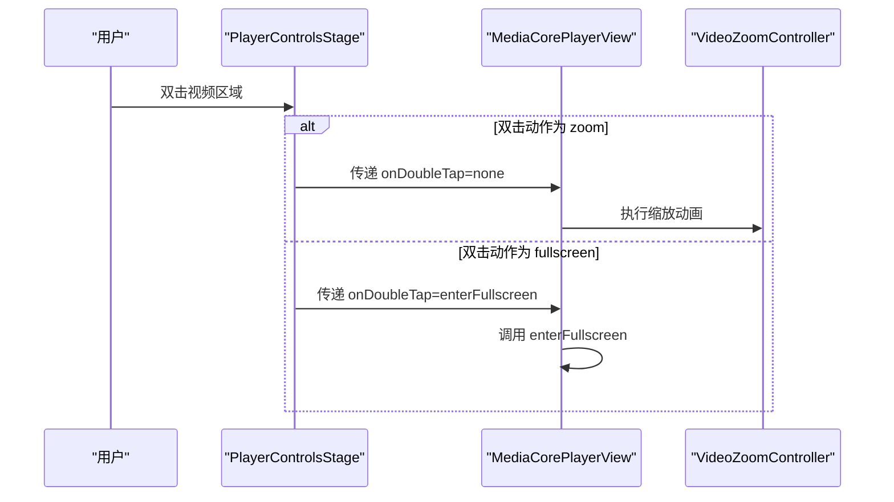
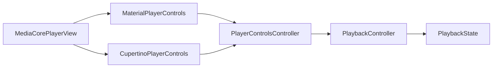

# 播放控制组件

<cite>
**本文引用的文件**   
- [media_core_player_view.dart](file://packages/media_core_ui/lib/src/media_core_player_view.dart)
- [material_player_controls.dart](file://packages/media_core_ui/lib/src/material/material_player_controls.dart)
- [cupertino_player_controls.dart](file://packages/media_core_ui/lib/src/cupertino/cupertino_player_controls.dart)
- [playback.md](file://doc/zh-Hans/playback.md)
</cite>

## 目录
1. [简介](#简介)
2. [项目结构](#项目结构)
3. [核心组件](#核心组件)
4. [架构总览](#架构总览)
5. [详细组件分析](#详细组件分析)
6. [依赖关系分析](#依赖关系分析)
7. [性能与交互特性](#性能与交互特性)
8. [故障排查指南](#故障排查指南)
9. [结论](#结论)

## 简介
本文件聚焦于媒体播放控制 UI 层，围绕以下核心能力展开：
- 播放/暂停按钮、缓冲指示器、进度条（时间轴）等关键控件
- 多设计语言（Material、Cupertino、Fluent、macOS、Yaru、Neumorphic）的统一装配与切换
- 主题与图标定制、尺寸与间距配置
- 播放状态变化逻辑与事件回调机制
- 触摸手势支持（缩放、双击、滑动）与键盘快捷键
- 无障碍访问（工具提示、语义化行为）

该文档以代码仓库中的 UI 实现为依据，结合 playback 模块的状态机说明，帮助读者在不同平台与设计语言下正确集成与定制播放控制。

## 项目结构
UI 层采用“装配视图 + 风格化控件集”的组织方式：
- MediaCorePlayerView：统一装配播放器画面、手势、键盘与控件栏
- 各设计语言的 PlayerControls 实现：MaterialPlayerControls、CupertinoPlayerControls 等
- 公共组件：进度条、按钮、主题、控制器等（由上层装配视图引入）

图表来源
- [media_core_player_view.dart:46-94](file://packages/media_core_ui/lib/src/media_core_player_view.dart#L46-L94)
- [material_player_controls.dart:8-37](file://packages/media_core_ui/lib/src/material/material_player_controls.dart#L8-L37)
- [cupertino_player_controls.dart:8-37](file://packages/media_core_ui/lib/src/cupertino/cupertino_player_controls.dart#L8-L37)

章节来源
- [media_core_player_view.dart:46-94](file://packages/media_core_ui/lib/src/media_core_player_view.dart#L46-L94)

## 核心组件
- MediaCorePlayerView
  - 职责：组合视频画面、控件栏、手势与键盘；按风格选择具体控件集；管理自动隐藏、缩放、截图等
  - 关键属性：handle、style/styleResolver、actions、theme、zoom/pinchToZoom、doubleTapAction、autoHideDelay/autoHideControls/keepControlsWhilePaused、keyboardShortcuts、showControls/showTopBar/showOverflowMenu/showSkipButtons/skipStep、controls/controller、fit/alignment/mirror/backgroundColor/captureBoundary/onTapVideo/shortcuts
- MaterialPlayerControls
  - 职责：Material 风格的顶部栏、中心播放区、底部时间轴与音量/全屏按钮
  - 关键属性：controller、theme、showTitle/showTopBar/showOverflowMenu/showSkipButtons/skipStep/padding
- CupertinoPlayerControls
  - 职责：iOS/HIG 风格的大图标居中、渐变遮罩、剩余时间显示、缓冲替换播放图标
  - 关键属性：controller、theme、showTitle/showSkipButtons/skipStep/padding

章节来源
- [media_core_player_view.dart:64-196](file://packages/media_core_ui/lib/src/media_core_player_view.dart#L64-L196)
- [material_player_controls.dart:25-71](file://packages/media_core_ui/lib/src/material/material_player_controls.dart#L25-L71)
- [cupertino_player_controls.dart:27-57](file://packages/media_core_ui/lib/src/cupertino/cupertino_player_controls.dart#L27-L57)

## 架构总览
播放控制的运行流程如下：
- 用户交互（点击、手势、键盘）进入 PlayerControlsStage
- 通过 PlayerControlsController 调用底层 PlaybackController 的播放命令
- PlaybackController 维护 PlaybackState（播放/暂停/缓冲/位置/时长/速率/音量等）
- UI 根据状态渲染对应控件（播放/暂停图标、缓冲指示器、进度条、LIVE 标签等）

图表来源
- [media_core_player_view.dart:298-327](file://packages/media_core_ui/lib/src/media_core_player_view.dart#L298-L327)
- [material_player_controls.dart:223-284](file://packages/media_core_ui/lib/src/material/material_player_controls.dart#L223-L284)
- [cupertino_player_controls.dart:140-205](file://packages/media_core_ui/lib/src/cupertino/cupertino_player_controls.dart#L140-L205)

## 详细组件分析

### 播放/暂停按钮
- 行为
  - 点击切换播放/暂停；在缓冲状态下不响应或显示缓冲指示器
  - 图标随 isPlaying 状态切换；tooltip 提供可访问性文案
- 样式
  - Material：填充圆形主按钮，尺寸受 theme.primaryIconSize 影响
  - Cupertino：大图标居中，缓冲时替换为活动指示器
- 可定制点
  - 通过 theme.icons.transportFor(playing:) 获取图标
  - 通过 theme.foreground/accent/iconSize/primaryIconSize 调整颜色与尺寸

图表来源
- [material_player_controls.dart:244-283](file://packages/media_core_ui/lib/src/material/material_player_controls.dart#L244-L283)
- [cupertino_player_controls.dart:161-204](file://packages/media_core_ui/lib/src/cupertino/cupertino_player_controls.dart#L161-L204)

章节来源
- [material_player_controls.dart:223-284](file://packages/media_core_ui/lib/src/material/material_player_controls.dart#L223-L284)
- [cupertino_player_controls.dart:140-205](file://packages/media_core_ui/lib/src/cupertino/cupertino_player_controls.dart#L140-L205)

### 播放状态指示器
- 缓冲指示器
  - Material：使用统一的缓冲指示组件
  - Cupertino：用活动指示器替代播放图标，避免误触
- LIVE 标签
  - 当处于直播模式且不可拖拽时，底部栏显示 LIVE 标签

图表来源
- [material_player_controls.dart:223-284](file://packages/media_core_ui/lib/src/material/material_player_controls.dart#L223-L284)
- [material_player_controls.dart:286-354](file://packages/media_core_ui/lib/src/material/material_player_controls.dart#L286-L354)
- [cupertino_player_controls.dart:140-205](file://packages/media_core_ui/lib/src/cupertino/cupertino_player_controls.dart#L140-L205)
- [cupertino_player_controls.dart:207-262](file://packages/media_core_ui/lib/src/cupertino/cupertino_player_controls.dart#L207-L262)

章节来源
- [material_player_controls.dart:223-354](file://packages/media_core_ui/lib/src/material/material_player_controls.dart#L223-L354)
- [cupertino_player_controls.dart:140-262](file://packages/media_core_ui/lib/src/cupertino/cupertino_player_controls.dart#L140-L262)

### 播放进度显示（时间轴）
- 功能
  - 可拖拽进度条，展示当前时间与总时长
  - Cupertino 默认显示剩余时间（右侧带负号前缀）
  - 直播模式下禁用拖拽并显示 LIVE 标签
- 样式
  - 高度可通过 barHeight 调整
  - 颜色与滑块样式由 theme 控制

图表来源
- [material_player_controls.dart:286-354](file://packages/media_core_ui/lib/src/material/material_player_controls.dart#L286-L354)
- [cupertino_player_controls.dart:207-262](file://packages/media_core_ui/lib/src/cupertino/cupertino_player_controls.dart#L207-L262)

章节来源
- [material_player_controls.dart:286-354](file://packages/media_core_ui/lib/src/material/material_player_controls.dart#L286-L354)
- [cupertino_player_controls.dart:207-262](file://packages/media_core_ui/lib/src/cupertino/cupertino_player_controls.dart#L207-L262)

### 主题与图标定制
- 主题对象
  - 提供前景色、强调色、遮罩色、内容内边距、标题文本样式、图标集合、基础与主图标尺寸等
- 图标定制
  - 通过 theme.icons 获取 transportFor、volumeFor、fullscreenFor 等派生图标
  - 不同风格对图标语义一致，但视觉表现遵循各自规范
- 尺寸与间距
  - iconSize/primaryIconSize 控制按钮大小
  - contentPadding 控制整体内边距
  - barHeight 控制时间轴高度

章节来源
- [material_player_controls.dart:73-107](file://packages/media_core_ui/lib/src/material/material_player_controls.dart#L73-L107)
- [cupertino_player_controls.dart:57-85](file://packages/media_core_ui/lib/src/cupertino/cupertino_player_controls.dart#L57-L85)

### 手势与键盘
- 双击行为
  - 触控风格默认放大（zoom），指针风格默认全屏（fullscreen）
  - 可通过 doubleTapAction 覆盖
- 捏合缩放
  - pinchToZoom 开启后启用双指缩放；可传入外部 VideoZoomController 共享缩放状态
- 键盘快捷键
  - keyboardShortcuts 开启后响应预设快捷键映射（PlayerShortcuts）

图表来源
- [media_core_player_view.dart:18-44](file://packages/media_core_ui/lib/src/media_core_player_view.dart#L18-L44)
- [media_core_player_view.dart:223-235](file://packages/media_core_ui/lib/src/media_core_player_view.dart#L223-L235)
- [media_core_player_view.dart:298-327](file://packages/media_core_ui/lib/src/media_core_player_view.dart#L298-L327)

章节来源
- [media_core_player_view.dart:18-44](file://packages/media_core_ui/lib/src/media_core_player_view.dart#L18-L44)
- [media_core_player_view.dart:223-235](file://packages/media_core_ui/lib/src/media_core_player_view.dart#L223-L235)
- [media_core_player_view.dart:298-327](file://packages/media_core_ui/lib/src/media_core_player_view.dart#L298-L327)

### 无障碍访问
- 工具提示
  - 所有主要按钮均提供 tooltip（如 Play/Pause、Mute/Unmute、Fullscreen、Save frame 等）
- 语义化行为
  - 缓冲状态以独立指示器呈现，避免误触
  - 直播模式明确显示 LIVE 标签，减少歧义

章节来源
- [material_player_controls.dart:118-154](file://packages/media_core_ui/lib/src/material/material_player_controls.dart#L118-L154)
- [material_player_controls.dart:286-354](file://packages/media_core_ui/lib/src/material/material_player_controls.dart#L286-L354)
- [cupertino_player_controls.dart:88-137](file://packages/media_core_ui/lib/src/cupertino/cupertino_player_controls.dart#L88-L137)
- [cupertino_player_controls.dart:207-262](file://packages/media_core_ui/lib/src/cupertino/cupertino_player_controls.dart#L207-L262)

## 依赖关系分析
- UI 装配层
  - MediaCorePlayerView 负责选择风格、装配控件、处理手势与键盘
- 控件实现层
  - Material/Cupertino 等控件集消费 PlayerControlsController 暴露的状态与动作
- 状态机层
  - PlaybackController 持有 PlaybackState，对外暴露只读快照与请求队列
- 外部依赖
  - Flutter 框架（Material/Cupertino/Widgets）
  - media_core 核心库（播放器抽象与状态机）

图表来源
- [media_core_player_view.dart:330-353](file://packages/media_core_ui/lib/src/media_core_player_view.dart#L330-L353)
- [material_player_controls.dart:75-107](file://packages/media_core_ui/lib/src/material/material_player_controls.dart#L75-L107)
- [cupertino_player_controls.dart:59-85](file://packages/media_core_ui/lib/src/cupertino/cupertino_player_controls.dart#L59-L85)

章节来源
- [media_core_player_view.dart:330-353](file://packages/media_core_ui/lib/src/media_core_player_view.dart#L330-L353)
- [playback.md:1-29](file://doc/zh-Hans/playback.md#L1-L29)

## 性能与交互特性
- 自动隐藏
  - autoHideControls 控制播放中是否自动隐藏控件
  - keepControlsWhilePaused 控制暂停时是否保持控件可见
  - autoHideDelay 控制最后交互后的隐藏延迟（可按主题或平台差异设置）
- 缩放与截图
  - pinchToZoom 与 enableDoubleTapZoom 控制缩放手势
  - captureBoundary 控制视频层是否允许截图
- 键盘与焦点
  - keyboardShortcuts 控制是否启用快捷键
  - 控件通过 ListenableBuilder 监听控制器状态变更，避免不必要的重建

章节来源
- [media_core_player_view.dart:126-139](file://packages/media_core_ui/lib/src/media_core_player_view.dart#L126-L139)
- [media_core_player_view.dart:228-235](file://packages/media_core_ui/lib/src/media_core_player_view.dart#L228-L235)
- [media_core_player_view.dart:298-327](file://packages/media_core_ui/lib/src/media_core_player_view.dart#L298-L327)

## 故障排查指南
- 问题：点击播放无反应
  - 检查 hasSource 是否为真；若无源则中心控件为空
  - 检查 isBuffering 是否为真；缓冲期间不应直接响应播放
- 问题：进度条不可拖拽
  - 检查 canSeek 是否为真；直播流通常不可拖拽
  - 确认是否处于 LIVE 模式
- 问题：全屏/画中画无效
  - 检查 actions.canEnterFullscreen/canExitFullscreen/canEnterPip 等能力位
- 问题：主题颜色不生效
  - 确认是否传入了自定义 theme；未传入时使用 PlayerControlsTheme.of(style)
- 问题：双击行为不符合预期
  - 检查 doubleTapAction 与 style.isTouch 的默认策略

章节来源
- [material_player_controls.dart:237-246](file://packages/media_core_ui/lib/src/material/material_player_controls.dart#L237-L246)
- [material_player_controls.dart:300-350](file://packages/media_core_ui/lib/src/material/material_player_controls.dart#L300-L350)
- [cupertino_player_controls.dart:154-165](file://packages/media_core_ui/lib/src/cupertino/cupertino_player_controls.dart#L154-L165)
- [cupertino_player_controls.dart:229-255](file://packages/media_core_ui/lib/src/cupertino/cupertino_player_controls.dart#L229-L255)

## 结论
播放控制组件通过 MediaCorePlayerView 将视频画面、手势、键盘与多风格控件集统一装配，借助 PlayerControlsController 与 PlaybackController 的状态机驱动 UI 更新。Material 与 Cupertino 两套实现分别贴合各自平台的交互习惯，同时提供丰富的主题与图标定制能力。开发者可在不同设计语言下保持一致的行为语义，并通过开关与参数精细控制自动隐藏、缩放、截图、快捷键与无障碍体验。