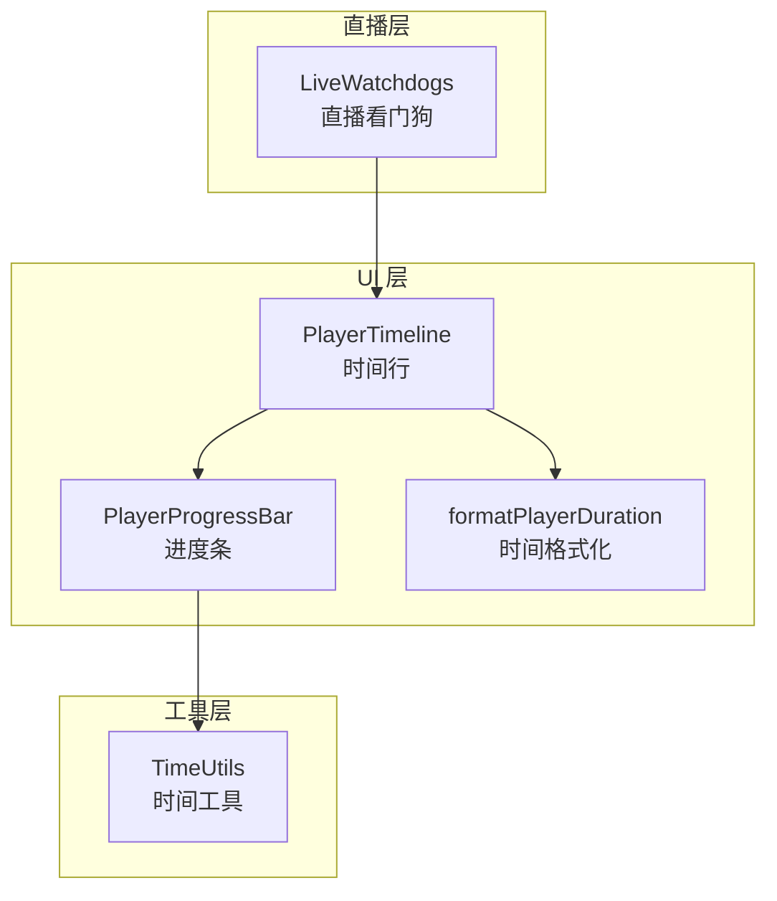
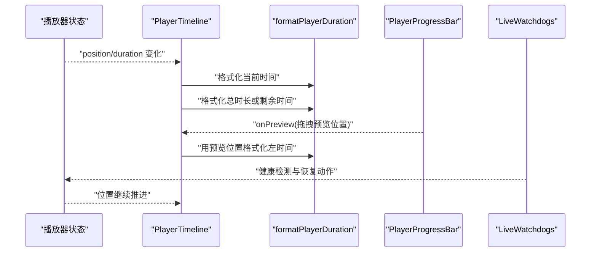
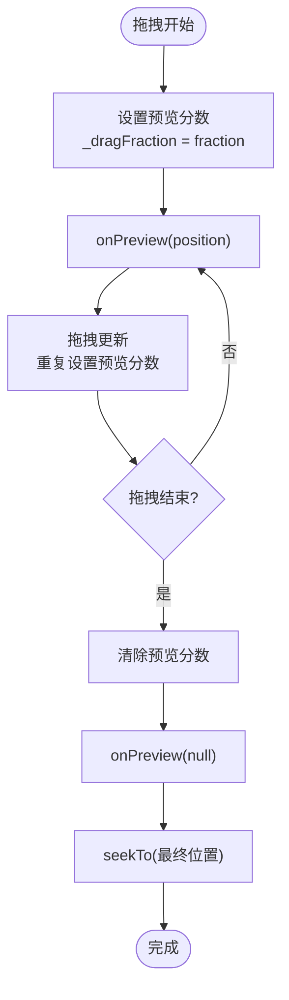
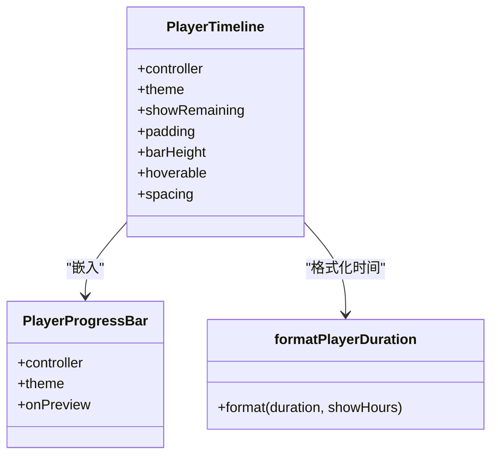
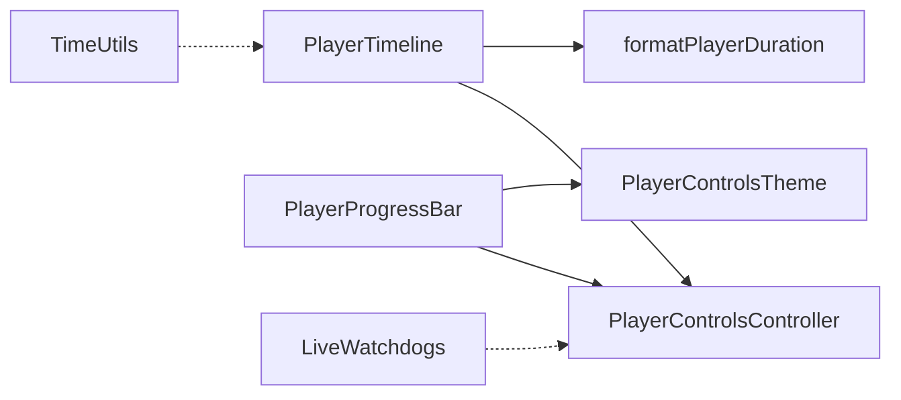
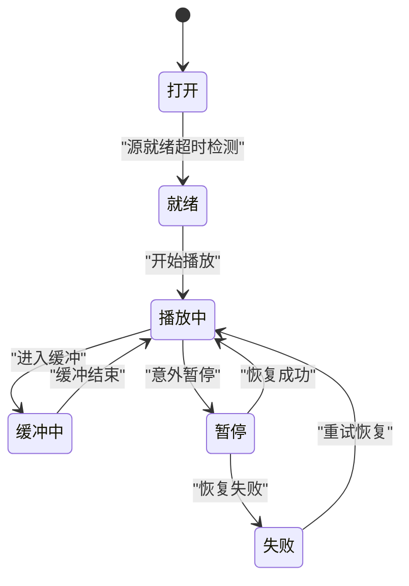

# 时间控制组件

<cite>
**本文引用的文件**   
- [player_progress_bar.dart](file://packages/media_core_ui/lib/src/common/player_progress_bar.dart)
- [time_utils.dart](file://packages/media_core/lib/util/time_utils.dart)
- [live_watchdogs.dart](file://packages/media_core_live/lib/src/live_watchdogs.dart)
- [player_controls_controller_test.dart](file://packages/media_core_ui/test/player_controls_controller_test.dart)
</cite>

## 目录
1. [简介](#简介)
2. [项目结构](#项目结构)
3. [核心组件](#核心组件)
4. [架构总览](#架构总览)
5. [详细组件分析](#详细组件分析)
6. [依赖关系分析](#依赖关系分析)
7. [性能与更新频率](#性能与更新频率)
8. [自定义格式化器与国际化](#自定义格式化器与国际化)
9. [直播场景下的特殊处理](#直播场景下的特殊处理)
10. [故障排查](#故障排查)
11. [结论](#结论)

## 简介
本文件聚焦“时间控制组件”，围绕当前播放时间与总时长显示的格式化、倒计时模式、更新频率控制、性能优化、自定义格式化器与国际化支持，以及直播场景下的特殊时间处理进行系统化说明。该能力由 UI 层的进度条与时间标签、通用时间工具函数，以及直播健康检查机制共同构成：UI 层负责展示与交互，工具层提供基础时间格式化工具，直播模块负责无 seek 流的健康检测与恢复策略，间接影响时间显示语义（例如是否允许拖动、如何解释“剩余时间”）。

## 项目结构
与时间控制直接相关的代码主要分布在以下位置：
- UI 层：进度条与时间标签渲染、拖拽预览、缓冲区间绘制、当前/剩余时间计算与格式化。
- 工具层：通用的 Duration 与时间戳转换、HH:mm:ss 格式化等。
- 直播层：针对不可 seek 的直播流的看门狗机制，决定播放状态、缓冲、帧进度与位置停滞的检测与恢复动作。

**图表来源** 
- [player_progress_bar.dart:31-479](file://packages/media_core_ui/lib/src/common/player_progress_bar.dart#L31-L479)
- [time_utils.dart:4-140](file://packages/media_core/lib/util/time_utils.dart#L4-L140)
- [live_watchdogs.dart:95-776](file://packages/media_core_live/lib/src/live_watchdogs.dart#L95-L776)

**章节来源**
- [player_progress_bar.dart:31-479](file://packages/media_core_ui/lib/src/common/player_progress_bar.dart#L31-L479)
- [time_utils.dart:4-140](file://packages/media_core/lib/util/time_utils.dart#L4-L140)
- [live_watchdogs.dart:95-776](file://packages/media_core_live/lib/src/live_watchdogs.dart#L95-L776)

## 核心组件
- PlayerProgressBar：负责进度条绘制、缓冲区间、拖拽预览、点击跳转；不直接负责时间文本显示，但通过 onPreview 将预览位置传递给上层。
- PlayerTimeline：组合左侧时间、进度条、右侧时间；根据 showRemaining 决定右侧是“总时长”还是“剩余时间”。
- formatPlayerDuration：播放器 UI 专用的 Duration 格式化函数，支持时:分:秒或分:秒两种形式。
- TimeUtils：通用时间工具，包含 HH:mm:ss 格式化、单位转换、时间戳等。
- LiveWatchdogs：直播流健康检测，决定何时触发恢复动作，间接影响可 seek 性、缓冲与位置推进，从而影响时间显示语义。

**章节来源**
- [player_progress_bar.dart:31-479](file://packages/media_core_ui/lib/src/common/player_progress_bar.dart#L31-L479)
- [time_utils.dart:4-140](file://packages/media_core/lib/util/time_utils.dart#L4-L140)
- [live_watchdogs.dart:95-776](file://packages/media_core_live/lib/src/live_watchdogs.dart#L95-L776)

## 架构总览
时间控制的端到端流程如下：
- 播放状态变化驱动 PlayerTimeline 重新构建。
- PlayerTimeline 读取当前 position 与 duration，使用 formatPlayerDuration 生成左/右时间文本。
- 拖拽期间，PlayerProgressBar 通过 onPreview 上报预览位置，使时间标签即时跟随指针。
- 直播模式下，LiveWatchdogs 监控源就绪、缓冲、视频帧与位置停滞，必要时请求恢复动作，从而保证位置持续前进，避免“卡住的时间”。

**图表来源**
- [player_progress_bar.dart:416-470](file://packages/media_core_ui/lib/src/common/player_progress_bar.dart#L416-L470)
- [live_watchdogs.dart:355-531](file://packages/media_core_live/lib/src/live_watchdogs.dart#L355-L531)

## 详细组件分析

### PlayerProgressBar：进度条与拖拽预览
职责与行为：
- 维护拖拽预览 fraction，并在拖拽过程中调用 onPreview 上报对应 Duration。
- 将引擎返回的 buffer 范围标准化为 0..1 分数并绘制缓冲区间。
- 点击立即 seek；拖拽结束时才执行一次 seek，避免频繁命令导致卡顿。
- 当 playback.hasDuration 为 false 或 duration <= 0 时，不绘制缓冲区间，体现“无时长/直播”语义。

关键实现要点：
- 拖拽开始/更新：设置 _dragFraction 并通过 onPreview 通知上层。
- 拖拽结束：清除 _dragFraction，再次调用 onPreview(null)，然后执行一次 seekTo。
- 缓冲区间：基于 playback.buffer.normalize().ranges 映射到分数，过滤空区间后绘制。
- 位置换算：_positionFor(fraction) 将 0..1 转换为 Duration，考虑 duration <= 0 的情况。

**图表来源**
- [player_progress_bar.dart:195-247](file://packages/media_core_ui/lib/src/common/player_progress_bar.dart#L195-L247)

**章节来源**
- [player_progress_bar.dart:81-247](file://packages/media_core_ui/lib/src/common/player_progress_bar.dart#L81-L247)

### PlayerTimeline：时间行与左右时间标签
职责与行为：
- 绑定 PlayerControlsController.playbackListenable，监听播放状态。
- 左侧时间：当前播放位置，使用 formatPlayerDuration 格式化。
- 右侧时间：根据 showRemaining 决定显示“总时长”或“剩余时间”（带负号前缀）。
- 拖拽预览：通过 onPreview 回调更新内部 _preview，使时间标签在拖拽中实时跟随。

关键实现要点：
- hours 判断：duration.inHours > 0 时启用小时显示。
- 剩余时间：showRemaining 为 true 时，右侧显示 "-(duration - position)" 的格式化结果。
- 布局：Row 包含左时间、Expanded 包裹的 PlayerProgressBar、右时间。

**图表来源**
- [player_progress_bar.dart:368-470](file://packages/media_core_ui/lib/src/common/player_progress_bar.dart#L368-L470)

**章节来源**
- [player_progress_bar.dart:368-470](file://packages/media_core_ui/lib/src/common/player_progress_bar.dart#L368-L470)

### formatPlayerDuration：播放器时间格式化
功能：
- 输入 Duration，输出字符串。
- 支持两种格式：
  - 分:秒（默认）
  - 时:分:秒（当 showHours 为 true 或 hours > 0）
- 对负数 Duration 做保护，统一按零处理。

复杂度：
- 时间 O(1)，空间 O(1)。

边界情况：
- 负数 Duration 被归零。
- 分钟/秒补零至两位。

**章节来源**
- [player_progress_bar.dart:455-470](file://packages/media_core_ui/lib/src/common/player_progress_bar.dart#L455-L470)

### TimeUtils：通用时间工具
功能：
- 时间戳与 DateTime 互转。
- Duration 与秒/毫秒/分钟/小时互转。
- HH:mm:ss 格式化（formatDuration），与播放器 UI 的 formatPlayerDuration 不同：始终尝试显示小时，且采用固定两位补齐。
- 过期判断、差值、最小/最大日期、相对年龄等。

典型用法：
- 日志时间戳、缓存过期、调度定时器等非 UI 场景。

**章节来源**
- [time_utils.dart:4-140](file://packages/media_core/lib/util/time_utils.dart#L4-L140)

## 依赖关系分析
- PlayerTimeline 依赖 PlayerControlsController 提供的播放状态与操作接口。
- PlayerProgressBar 依赖 PlayerControlsTheme 与 PlayerProgressThumb 等主题配置。
- formatPlayerDuration 是纯函数，无外部依赖。
- TimeUtils 是独立工具类，供多处复用。
- LiveWatchdogs 与 UI 层解耦，通过播放状态与位置推进间接影响时间显示语义（如直播下不可 seek、缓冲与位置停滞检测）。

**图表来源**
- [player_progress_bar.dart:368-479](file://packages/media_core_ui/lib/src/common/player_progress_bar.dart#L368-L479)
- [time_utils.dart:4-140](file://packages/media_core/lib/util/time_utils.dart#L4-L140)
- [live_watchdogs.dart:95-776](file://packages/media_core_live/lib/src/live_watchdogs.dart#L95-L776)

**章节来源**
- [player_progress_bar.dart:368-479](file://packages/media_core_ui/lib/src/common/player_progress_bar.dart#L368-L479)
- [time_utils.dart:4-140](file://packages/media_core/lib/util/time_utils.dart#L4-L140)
- [live_watchdogs.dart:95-776](file://packages/media_core_live/lib/src/live_watchdogs.dart#L95-L776)

## 性能与更新频率
- 拖拽只 seek 一次：PlayerProgressBar 在拖拽结束时执行一次 seekTo，避免每次拖动都向引擎发送命令，减少卡顿。
- 预览位置本地化：拖拽期间的预览位置保存在 _dragFraction/_preview，UI 即时响应，无需等待引擎 seek 完成。
- 缓冲区间绘制优化：仅绘制非空区间，并对 ranges 做 normalize 与过滤。
- 直播健康检测：LiveWatchdogs 通过多种看门狗（源就绪、缓冲、视频帧、位置）保障位置持续前进，避免长时间停滞导致的 UI 假死。

建议：
- 若需要更平滑的预览体验，可在上层对 onPreview 做节流或防抖，但需权衡“时间标签跟随手指”的即时性。
- 对于低端设备，可减少缓冲区间绘制的刷新频率，或在低电量模式下关闭 hoverable 效果。

**章节来源**
- [player_progress_bar.dart:195-247](file://packages/media_core_ui/lib/src/common/player_progress_bar.dart#L195-L247)
- [player_progress_bar.dart:110-131](file://packages/media_core_ui/lib/src/common/player_progress_bar.dart#L110-L131)
- [live_watchdogs.dart:355-531](file://packages/media_core_live/lib/src/live_watchdogs.dart#L355-L531)

## 自定义格式化器与国际化
现状：
- 播放器 UI 使用 formatPlayerDuration 作为默认时间格式化器，不支持直接注入自定义格式化器。
- TimeUtils.formatDuration 提供 HH:mm:ss 格式化，但与播放器 UI 的 showHours 逻辑不同。

扩展建议：
- 在 PlayerTimeline 外层封装一层时间格式化函数，传入自定义逻辑，以支持：
  - 毫秒精度显示（例如 “mm:ss.mmm”）。
  - 本地化分隔符（如 “时 分 秒”、“hh:mm:ss a”）。
  - 多语言文案（如“剩余”、“总时长”）。
- 若需完全替换 UI 时间显示，可自定义 PlayerTimeline 的子类，重写左右时间文本的构建逻辑。

注意：
- 当前实现未暴露格式化器注入点，因此“自定义格式化器”需要通过继承或组合方式实现，而非参数注入。

**章节来源**
- [player_progress_bar.dart:416-470](file://packages/media_core_ui/lib/src/common/player_progress_bar.dart#L416-L470)
- [time_utils.dart:79-97](file://packages/media_core/lib/util/time_utils.dart#L79-L97)

## 直播场景下的特殊处理
直播（不可 seek）的关键差异：
- 无总时长：当 hasDuration 为 false 或 duration <= 0 时，PlayerProgressBar 不绘制缓冲区间，体现“无时长/直播”语义。
- 不可拖动：测试用例表明，直播墙（live wall）不允许 seek，canSeek 为 false。
- 剩余时间语义：showRemaining 为 true 时，右侧显示“-剩余时间”，常用于直播倒计时风格。
- 健康检测：LiveWatchdogs 监控源就绪、缓冲、视频帧与位置停滞，必要时请求恢复动作，确保位置持续前进，避免“卡住的时间”。

**图表来源**
- [live_watchdogs.dart:355-655](file://packages/media_core_live/lib/src/live_watchdogs.dart#L355-L655)

**章节来源**
- [player_progress_bar.dart:110-131](file://packages/media_core_ui/lib/src/common/player_progress_bar.dart#L110-L131)
- [player_controls_controller_test.dart:323-331](file://packages/media_core_ui/test/player_controls_controller_test.dart#L323-L331)
- [live_watchdogs.dart:355-655](file://packages/media_core_live/lib/src/live_watchdogs.dart#L355-L655)

## 故障排查
常见问题与建议：
- 时间不更新：
  - 检查 PlayerTimeline 是否正确绑定 playbackListenable。
  - 确认 position 事件是否持续上报；直播场景下关注 LiveWatchdogs 的位置停滞检测。
- 拖拽卡顿：
  - 确认是否在拖拽结束时才执行 seekTo，避免每次拖动都 seek。
  - 检查 onPreview 是否过于频繁地触发重建，必要时在上层加节流。
- 直播无法拖动：
  - 这是预期行为；直播墙 canSeek 为 false。
- 缓冲区间不显示：
  - 当 hasDuration 为 false 或 duration <= 0 时，不绘制缓冲区间；检查后端是否报告了有效的 duration。
- 时间格式不符合预期：
  - 使用 formatPlayerDuration 时，hours 显示取决于 showHours 或 duration.inHours > 0。
  - 如需毫秒精度或多语言，需在外层封装自定义格式化逻辑。

**章节来源**
- [player_progress_bar.dart:195-247](file://packages/media_core_ui/lib/src/common/player_progress_bar.dart#L195-L247)
- [player_progress_bar.dart:416-470](file://packages/media_core_ui/lib/src/common/player_progress_bar.dart#L416-L470)
- [player_controls_controller_test.dart:323-331](file://packages/media_core_ui/test/player_controls_controller_test.dart#L323-L331)

## 结论
时间控制组件以 PlayerProgressBar 与 PlayerTimeline 为核心，结合 formatPlayerDuration 与 TimeUtils 提供稳定的时间显示与格式化能力。直播场景下，LiveWatchdogs 保障位置持续前进，避免 UI 假死。当前实现未暴露自定义格式化器注入点，可通过继承或组合方式扩展毫秒精度与国际化。性能方面，拖拽只 seek 一次、预览位置本地化、缓冲区间优化绘制，有效降低 UI 抖动与引擎压力。