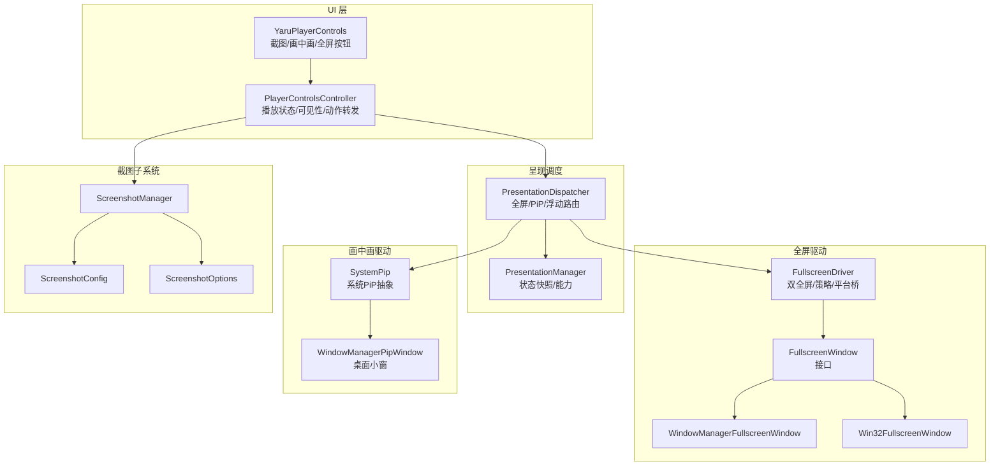
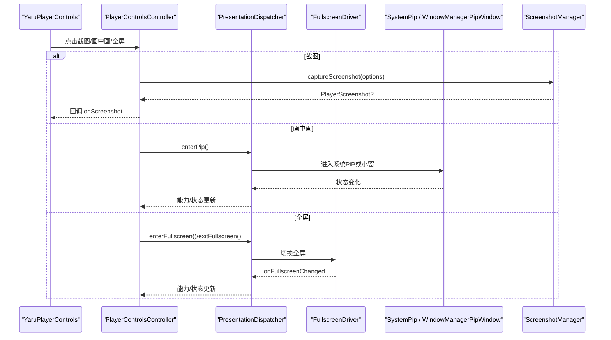
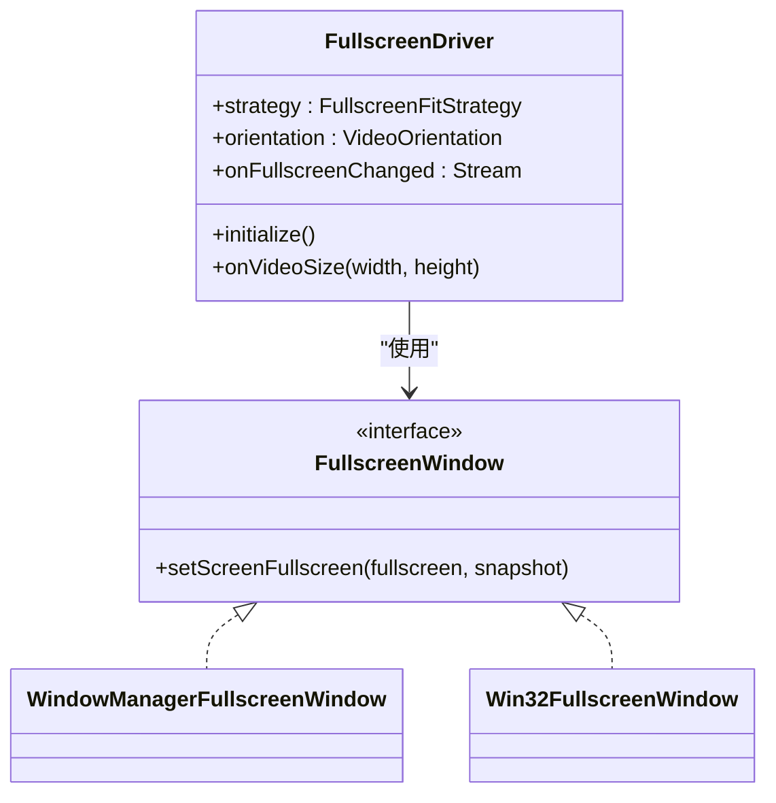
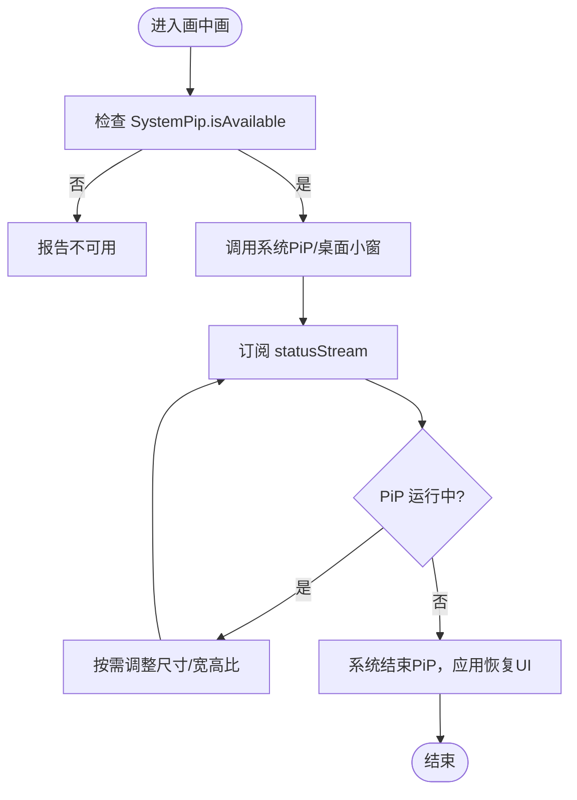
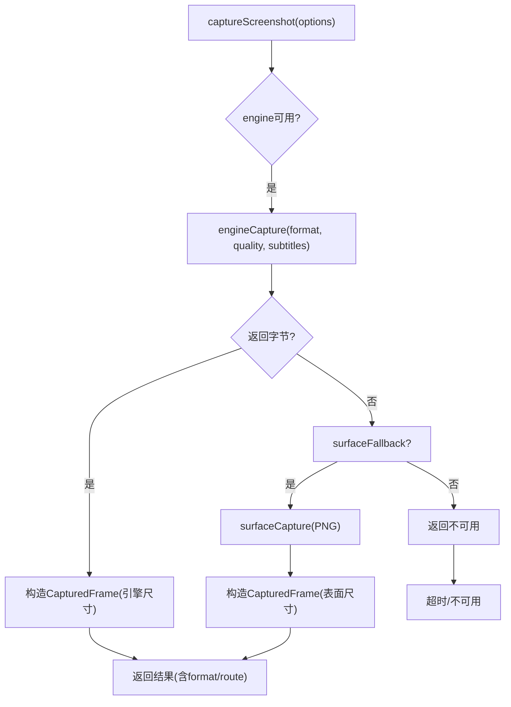
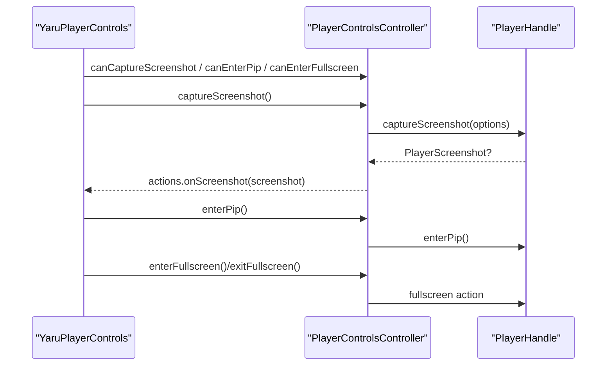
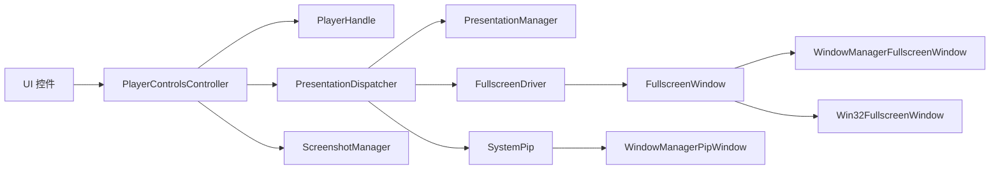

# 显示控制组件

<cite>
**本文引用的文件**   
- [yaru_player_controls.dart](file://packages/media_core_ui/lib/src/yaru/yaru_player_controls.dart)
- [player_controls_controller.dart](file://packages/media_core_ui/lib/src/common/player_controls_controller.dart)
- [fullscreen_driver.dart](file://packages/media_core_fullscreen/lib/src/fullscreen_driver.dart)
- [fullscreen_config.dart](file://packages/media_core_fullscreen/lib/src/fullscreen_config.dart)
- [fullscreen_window.dart](file://packages/media_core_fullscreen/lib/src/fullscreen_window.dart)
- [window_manager_fullscreen_window.dart](file://packages/media_core_fullscreen/lib/src/window_manager_fullscreen_window.dart)
- [win32_fullscreen_window.dart](file://packages/media_core_fullscreen/lib/src/win32_fullscreen_window.dart)
- [win32_window_ffi.dart](file://packages/media_core_win32/lib/src/win32_window_ffi.dart)
- [system_pip.dart](file://packages/media_core_pip/lib/src/system_pip.dart)
- [window_manager_pip_window.dart](file://packages/media_core_pip/lib/src/window_manager_pip_window.dart)
- [presentation_dispatcher.dart](file://packages/media_core/lib/presentation/presentation_dispatcher.dart)
- [presentation_manager.dart](file://packages/media_core/lib/presentation/presentation_manager.dart)
- [screenshot_config.dart](file://packages/media_core/lib/screenshot/screenshot_config.dart)
- [screenshot_options.dart](file://packages/media_core/lib/screenshot/screenshot_options.dart)
- [screenshot_manager.dart](file://packages/media_core/lib/screenshot/screenshot_manager.dart)
</cite>

## 目录
1. [简介](#简介)
2. [项目结构](#项目结构)
3. [核心组件](#核心组件)
4. [架构总览](#架构总览)
5. [详细组件分析](#详细组件分析)
6. [依赖关系分析](#依赖关系分析)
7. [性能与体验考量](#性能与体验考量)
8. [故障排查指南](#故障排查指南)
9. [结论](#结论)

## 简介
本文面向“显示控制组件”，聚焦以下能力：
- 全屏切换：平台全屏与窗口全屏的互斥管理、朝向适配策略、桌面/移动/Web 平台差异。
- 画中画模式：系统级 PiP 可用性探测、进入/退出生命周期、桌面小窗行为。
- 截图功能：引擎帧捕获与渲染表面回退、格式/质量/超时配置、历史缓存与内存控制。
- UI 控件：截图、画中画、全屏按钮的图标定制、状态指示、权限与能力判断。
- 显示模式切换逻辑与状态同步：从 UI 控制器到呈现层调度器再到平台驱动的调用链。

## 项目结构
显示控制相关代码分布在 UI 层、全屏驱动、画中画驱动、截图子系统以及呈现调度模块中：
- UI 层：Yaru 风格播放器控件，封装截图、画中画、全屏按钮，并绑定到 PlayerControlsController。
- 全屏驱动：FullscreenDriver 同时管理 PresentationMode.fullscreen 与 PresentationMode.windowFullscreen，提供策略与平台实现抽象。
- 画中画驱动：SystemPip 抽象系统 PiP 能力与状态流；WindowManager 小窗实现桌面端行为。
- 截图子系统：ScreenshotConfig/ScreenshotOptions/ScreenshotManager 等负责请求编排、引擎/表面回退、结果写入与历史缓存。
- 呈现调度：PresentationDispatcher/PresentationManager 将 UI 动作路由到各模式控制器。

图表来源
- [yaru_player_controls.dart:104-149](file://packages/media_core_ui/lib/src/yaru/yaru_player_controls.dart#L104-L149)
- [player_controls_controller.dart:476-520](file://packages/media_core_ui/lib/src/common/player_controls_controller.dart#L476-L520)
- [presentation_dispatcher.dart:43-101](file://packages/media_core/lib/presentation/presentation_dispatcher.dart#L43-L101)
- [presentation_manager.dart:36-84](file://packages/media_core/lib/presentation/presentation_manager.dart#L36-L84)
- [fullscreen_driver.dart:145-192](file://packages/media_core_fullscreen/lib/src/fullscreen_driver.dart#L145-L192)
- [fullscreen_window.dart:4-4](file://packages/media_core_fullscreen/lib/src/fullscreen_window.dart#L4-L4)
- [window_manager_fullscreen_window.dart:6-6](file://packages/media_core_fullscreen/lib/src/window_manager_fullscreen_window.dart#L6-L6)
- [win32_fullscreen_window.dart:17-17](file://packages/media_core_fullscreen/lib/src/win32_fullscreen_window.dart#L17-L17)
- [system_pip.dart:91-123](file://packages/media_core_pip/lib/src/system_pip.dart#L91-L123)
- [window_manager_pip_window.dart:24-57](file://packages/media_core_pip/lib/src/window_manager_pip_window.dart#L24-L57)
- [screenshot_config.dart:1-39](file://packages/media_core/lib/screenshot/screenshot_config.dart#L1-L39)
- [screenshot_options.dart:27-65](file://packages/media_core/lib/screenshot/screenshot_options.dart#L27-L65)
- [screenshot_manager.dart:1-302](file://packages/media_core/lib/screenshot/screenshot_manager.dart#L1-L302)

章节来源
- [yaru_player_controls.dart:1-258](file://packages/media_core_ui/lib/src/yaru/yaru_player_controls.dart#L1-L258)
- [player_controls_controller.dart:1-617](file://packages/media_core_ui/lib/src/common/player_controls_controller.dart#L1-L617)
- [presentation_dispatcher.dart:43-101](file://packages/media_core/lib/presentation/presentation_dispatcher.dart#L43-L101)
- [presentation_manager.dart:36-84](file://packages/media_core/lib/presentation/presentation_manager.dart#L36-L84)
- [fullscreen_driver.dart:145-192](file://packages/media_core_fullscreen/lib/src/fullscreen_driver.dart#L145-L192)
- [system_pip.dart:91-123](file://packages/media_core_pip/lib/src/system_pip.dart#L91-L123)
- [screenshot_manager.dart:1-302](file://packages/media_core/lib/screenshot/screenshot_manager.dart#L1-L302)

## 核心组件
- YaruPlayerControls：按 Ubuntu/GNOME 风格组织标题栏与传输条，包含截图、画中画、全屏按钮，并通过主题图标与工具提示统一外观。
- PlayerControlsController：聚合播放状态、可见性策略与动作转发（截图、全屏、画中画、浮动），为所有控件样式共享同一份状态源。
- FullscreenDriver：同时持有 PresentationMode.fullscreen 与 PresentationMode.windowFullscreen，保证互斥；根据视频朝向返回铺满策略；暴露 onFullscreenChanged 稳定状态流。
- SystemPip：抽象系统 PiP 能力与状态流，不决定何时进入或退出，由上层驱动编排。
- WindowManagerPipWindow：桌面端小窗实现，设置置顶、可调整大小、跳过任务栏、隐藏标题栏、尺寸与宽高比。
- ScreenshotManager/ScreenshotConfig/ScreenshotOptions：统一截图请求编排，支持引擎捕获与渲染表面回退，限制历史缓存数量与超时。

章节来源
- [yaru_player_controls.dart:104-149](file://packages/media_core_ui/lib/src/yaru/yaru_player_controls.dart#L104-L149)
- [player_controls_controller.dart:176-180](file://packages/media_core_ui/lib/src/common/player_controls_controller.dart#L176-L180)
- [player_controls_controller.dart:476-520](file://packages/media_core_ui/lib/src/common/player_controls_controller.dart#L476-L520)
- [fullscreen_driver.dart:145-192](file://packages/media_core_fullscreen/lib/src/fullscreen_driver.dart#L145-L192)
- [system_pip.dart:91-123](file://packages/media_core_pip/lib/src/system_pip.dart#L91-L123)
- [window_manager_pip_window.dart:24-57](file://packages/media_core_pip/lib/src/window_manager_pip_window.dart#L24-L57)
- [screenshot_config.dart:1-39](file://packages/media_core/lib/screenshot/screenshot_config.dart#L1-L39)
- [screenshot_options.dart:27-65](file://packages/media_core/lib/screenshot/screenshot_options.dart#L27-L65)
- [screenshot_manager.dart:1-302](file://packages/media_core/lib/screenshot/screenshot_manager.dart#L1-L302)

## 架构总览
显示控制从 UI 到平台的调用链如下：
- UI 按钮触发 PlayerControlsController 的动作方法。
- 控制器通过 actions 回调或 PresentationDispatcher 路由到具体模式控制器。
- 全屏走 FullscreenDriver（桌面窗口态/移动端沉浸式 UI）；画中画走 SystemPip（移动端系统 PiP）或 WindowManagerPipWindow（桌面小窗）。
- 截图由控制器委托给 handle.captureScreenshot，底层由 ScreenshotManager 协调引擎/表面回退。

图表来源
- [yaru_player_controls.dart:123-145](file://packages/media_core_ui/lib/src/yaru/yaru_player_controls.dart#L123-L145)
- [player_controls_controller.dart:476-520](file://packages/media_core_ui/lib/src/common/player_controls_controller.dart#L476-L520)
- [presentation_dispatcher.dart:43-101](file://packages/media_core/lib/presentation/presentation_dispatcher.dart#L43-L101)
- [fullscreen_driver.dart:145-192](file://packages/media_core_fullscreen/lib/src/fullscreen_driver.dart#L145-L192)
- [system_pip.dart:91-123](file://packages/media_core_pip/lib/src/system_pip.dart#L91-L123)
- [window_manager_pip_window.dart:24-57](file://packages/media_core_pip/lib/src/window_manager_pip_window.dart#L24-L57)
- [screenshot_manager.dart:264-302](file://packages/media_core/lib/screenshot/screenshot_manager.dart#L264-L302)

## 详细组件分析

### 全屏切换与平台差异
- 双全屏模型：PresentationMode.fullscreen（平台全屏）与 PresentationMode.windowFullscreen（窗口内铺满）由 FullscreenDriver 统一管理，确保互斥。
- 平台差异：
  - 桌面：系统全屏是窗口状态，默认使用 WindowManagerFullscreenWindow；若宿主用隐藏标题栏创建窗口，需替换为 Win32FullscreenWindow，直接操作 user32 进行 placement 快照与 SetWindowPos 铺满。
  - 移动：无窗口可全屏，“全屏”即沉浸式系统 UI（隐藏状态/导航栏），朝向与状态栏样式由宿主策略决定。
  - Web/其他：不支持，抛出 UnsupportedError。
- 朝向与铺法：根据最近一次视频尺寸计算 VideoOrientation，选择 portraitStrategy 或 landscapeStrategy；驱动只回答策略，宿主应用到自身全屏表面。
- 状态流：onFullscreenChanged 在过渡完成后发出稳定状态，避免交接瞬间闪屏。

图表来源
- [fullscreen_driver.dart:145-192](file://packages/media_core_fullscreen/lib/src/fullscreen_driver.dart#L145-L192)
- [fullscreen_window.dart:4-4](file://packages/media_core_fullscreen/lib/src/fullscreen_window.dart#L4-L4)
- [window_manager_fullscreen_window.dart:6-6](file://packages/media_core_fullscreen/lib/src/window_manager_fullscreen_window.dart#L6-L6)
- [win32_fullscreen_window.dart:17-17](file://packages/media_core_fullscreen/lib/src/win32_fullscreen_window.dart#L17-L17)
- [win32_window_ffi.dart:430-464](file://packages/media_core_win32/lib/src/win32_window_ffi.dart#L430-L464)

章节来源
- [fullscreen_driver.dart:145-192](file://packages/media_core_fullscreen/lib/src/fullscreen_driver.dart#L145-L192)
- [win32_window_ffi.dart:430-464](file://packages/media_core_win32/lib/src/win32_window_ffi.dart#L430-L464)

### 画中画模式集成与生命周期
- 能力探测：SystemPip.isAvailable 返回当前设备与系统版本是否支持 PiP。
- 状态流：statusStream 持续上报系统发起的状态变化（包括用户关闭 PiP 回到应用时），上层应订阅而非命令退出。
- 桌面小窗：WindowManagerPipWindow 设置置顶、可调整大小、跳过任务栏、隐藏标题栏、宽高比与尺寸；当 aspectRatio 为 null 时需显式释放 OS 宽高比锁。
- 生命周期：进入 PiP 后，应用 UI 恢复由宿主负责；退出时机由系统决定，上层通过 statusStream 观察。

图表来源
- [system_pip.dart:91-123](file://packages/media_core_pip/lib/src/system_pip.dart#L91-L123)
- [window_manager_pip_window.dart:24-57](file://packages/media_core_pip/lib/src/window_manager_pip_window.dart#L24-L57)

章节来源
- [system_pip.dart:91-123](file://packages/media_core_pip/lib/src/system_pip.dart#L91-L123)
- [window_manager_pip_window.dart:24-57](file://packages/media_core_pip/lib/src/window_manager_pip_window.dart#L24-L57)

### 截图功能实现与存储路径
- 请求选项：ScreenshotOptions 指定格式（PNG/JPEG）、质量、像素比、路由（auto/surface）、是否包含字幕、超时时间。
- 配置项：ScreenshotConfig 控制历史缓存数量 historyLimit 与 surfaceFallback 开关；historyLimit=0 仅保留飞行中的截图，避免内存泄漏。
- 捕获流程：优先尝试引擎捕获；失败或不可用时回退到渲染表面；超时则视为不可用；成功结果携带实际格式与路由。
- 存储路径：仓库未提供默认存储路径实现；上层需在 onScreenshot 回调中将 PlayerScreenshot.bytes 持久化到目标路径。

图表来源
- [screenshot_manager.dart:264-302](file://packages/media_core/lib/screenshot/screenshot_manager.dart#L264-L302)
- [screenshot_options.dart:27-65](file://packages/media_core/lib/screenshot/screenshot_options.dart#L27-L65)
- [screenshot_config.dart:1-39](file://packages/media_core/lib/screenshot/screenshot_config.dart#L1-L39)

章节来源
- [screenshot_manager.dart:264-302](file://packages/media_core/lib/screenshot/screenshot_manager.dart#L264-L302)
- [screenshot_options.dart:27-65](file://packages/media_core/lib/screenshot/screenshot_options.dart#L27-L65)
- [screenshot_config.dart:1-39](file://packages/media_core/lib/screenshot/screenshot_config.dart#L1-L39)

### UI 控件与状态同步
- 截图按钮：仅在 controller.canCaptureScreenshot 为真时显示；点击调用 controller.captureScreenshot，并将结果交给 actions.onScreenshot。
- 画中画按钮：仅在 controller.actions.canEnterPip 为真时显示；点击调用 controller.enterPip。
- 全屏按钮：根据 controller.actions.canExitFullscreen/canEnterFullscreen 动态切换图标与文案；点击调用 exitFullscreen 或 enterFullscreen。
- 状态同步：控制器监听 handle.playback/sourceChanges，区分结构性变更与位置 tick，分别通知 ChangeNotifier 与 playbackListenable，避免频繁重建控件。

图表来源
- [yaru_player_controls.dart:123-145](file://packages/media_core_ui/lib/src/yaru/yaru_player_controls.dart#L123-L145)
- [player_controls_controller.dart:176-180](file://packages/media_core_ui/lib/src/common/player_controls_controller.dart#L176-L180)
- [player_controls_controller.dart:476-520](file://packages/media_core_ui/lib/src/common/player_controls_controller.dart#L476-L520)

章节来源
- [yaru_player_controls.dart:104-149](file://packages/media_core_ui/lib/src/yaru/yaru_player_controls.dart#L104-L149)
- [player_controls_controller.dart:176-180](file://packages/media_core_ui/lib/src/common/player_controls_controller.dart#L176-L180)
- [player_controls_controller.dart:476-520](file://packages/media_core_ui/lib/src/common/player_controls_controller.dart#L476-L520)

## 依赖关系分析
- UI 层依赖 PlayerControlsController 提供的状态与动作；控制器依赖 PlayerHandle 的能力与状态。
- 呈现调度层（PresentationDispatcher/PresentationManager）解耦 UI 与平台驱动，屏蔽全屏/PiP/浮动的平台差异。
- 全屏驱动依赖 FullscreenWindow 接口，默认使用 WindowManagerFullscreenWindow，必要时注入 Win32FullscreenWindow。
- 画中画驱动依赖 SystemPip 抽象，桌面端通过 WindowManagerPipWindow 实现小窗。
- 截图子系统独立于 UI，由控制器委托到底层管理器，上层通过回调处理结果。

图表来源
- [player_controls_controller.dart:1-617](file://packages/media_core_ui/lib/src/common/player_controls_controller.dart#L1-L617)
- [presentation_dispatcher.dart:43-101](file://packages/media_core/lib/presentation/presentation_dispatcher.dart#L43-L101)
- [presentation_manager.dart:36-84](file://packages/media_core/lib/presentation/presentation_manager.dart#L36-L84)
- [fullscreen_driver.dart:145-192](file://packages/media_core_fullscreen/lib/src/fullscreen_driver.dart#L145-L192)
- [fullscreen_window.dart:4-4](file://packages/media_core_fullscreen/lib/src/fullscreen_window.dart#L4-L4)
- [window_manager_fullscreen_window.dart:6-6](file://packages/media_core_fullscreen/lib/src/window_manager_fullscreen_window.dart#L6-L6)
- [win32_fullscreen_window.dart:17-17](file://packages/media_core_fullscreen/lib/src/win32_fullscreen_window.dart#L17-L17)
- [system_pip.dart:91-123](file://packages/media_core_pip/lib/src/system_pip.dart#L91-L123)
- [window_manager_pip_window.dart:24-57](file://packages/media_core_pip/lib/src/window_manager_pip_window.dart#L24-L57)
- [screenshot_manager.dart:1-302](file://packages/media_core/lib/screenshot/screenshot_manager.dart#L1-L302)

章节来源
- [player_controls_controller.dart:1-617](file://packages/media_core_ui/lib/src/common/player_controls_controller.dart#L1-L617)
- [presentation_dispatcher.dart:43-101](file://packages/media_core/lib/presentation/presentation_dispatcher.dart#L43-L101)
- [presentation_manager.dart:36-84](file://packages/media_core/lib/presentation/presentation_manager.dart#L36-L84)
- [fullscreen_driver.dart:145-192](file://packages/media_core_fullscreen/lib/src/fullscreen_driver.dart#L145-L192)
- [system_pip.dart:91-123](file://packages/media_core_pip/lib/src/system_pip.dart#L91-L123)
- [screenshot_manager.dart:1-302](file://packages/media_core/lib/screenshot/screenshot_manager.dart#L1-L302)

## 性能与体验考量
- 控件刷新优化：PlayerControlsController 区分结构性变更与位置 tick，仅对进度条等高频部件使用 playbackListenable，避免整条控件频繁重建。
- 自动隐藏策略：基于 idle 计时器与活动标记，减少鼠标移动导致的重复 Timer 创建，提升桌面交互流畅度。
- 全屏过渡稳定：FullscreenDriver 的 onFullscreenChanged 在过渡完成后发出稳定状态，避免切换瞬间闪出非全屏 chrome。
- 截图内存控制：ScreenshotConfig.historyLimit 限制历史缓存数量，避免长期占用内存；surfaceFallback 可在安全场景下禁用渲染表面读取。
- 画中画宽高比锁：桌面小窗在解锁宽高比时需显式重置为 0，防止旧锁与新布局冲突。

[本节为通用指导，不直接分析具体文件]

## 故障排查指南
- 截图不可用：
  - 检查 controller.canCaptureScreenshot 是否为真；确认 engine 是否支持捕获且未禁用 surfaceFallback。
  - 查看 ScreenshotOptions.timeout 是否过短导致超时；必要时增大超时或改用 shareFriendly 配置。
- 画中画无法进入：
  - 先调用 SystemPip.isAvailable 检测能力；移动端需等待系统状态流变化后再恢复 UI。
  - 桌面小窗注意宽高比锁：传入 null 时应显式 setAspectRatio(0)。
- 全屏异常：
  - 桌面隐藏标题栏窗口请注入 Win32FullscreenWindow；否则 window_manager 无边框快路径可能静默跳过样式更新。
  - 关注 onFullscreenChanged 的稳定状态，不要在过渡期间做二次全屏操作。

章节来源
- [screenshot_manager.dart:264-302](file://packages/media_core/lib/screenshot/screenshot_manager.dart#L264-L302)
- [system_pip.dart:91-123](file://packages/media_core_pip/lib/src/system_pip.dart#L91-L123)
- [window_manager_pip_window.dart:24-57](file://packages/media_core_pip/lib/src/window_manager_pip_window.dart#L24-L57)
- [fullscreen_driver.dart:145-192](file://packages/media_core_fullscreen/lib/src/fullscreen_driver.dart#L145-L192)

## 结论
显示控制组件以 UI 控制器为核心，向上提供一致的截图、画中画、全屏按钮与状态展示，向下通过呈现调度与平台驱动屏蔽多端差异。全屏驱动统一管理双全屏模式并按视频朝向给出铺法策略；画中画通过系统抽象与桌面小窗实现跨平台能力；截图子系统提供灵活的引擎/表面回退与内存控制。结合合理的性能优化与错误处理，可在不同平台上获得一致且稳定的显示体验。