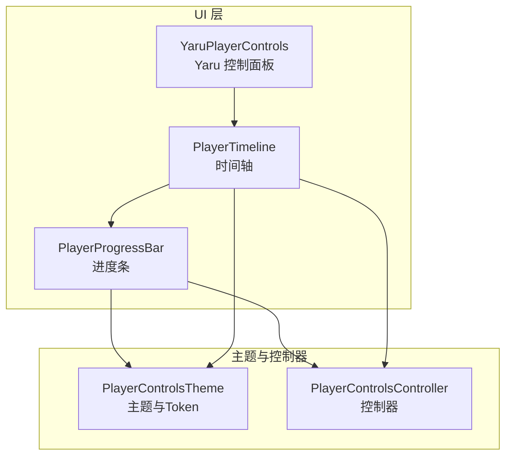
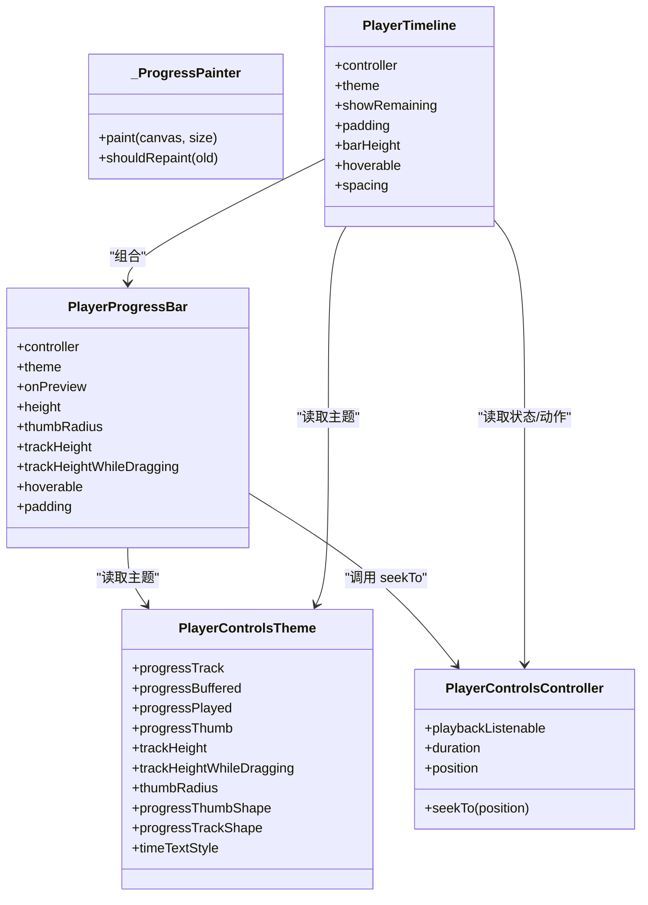
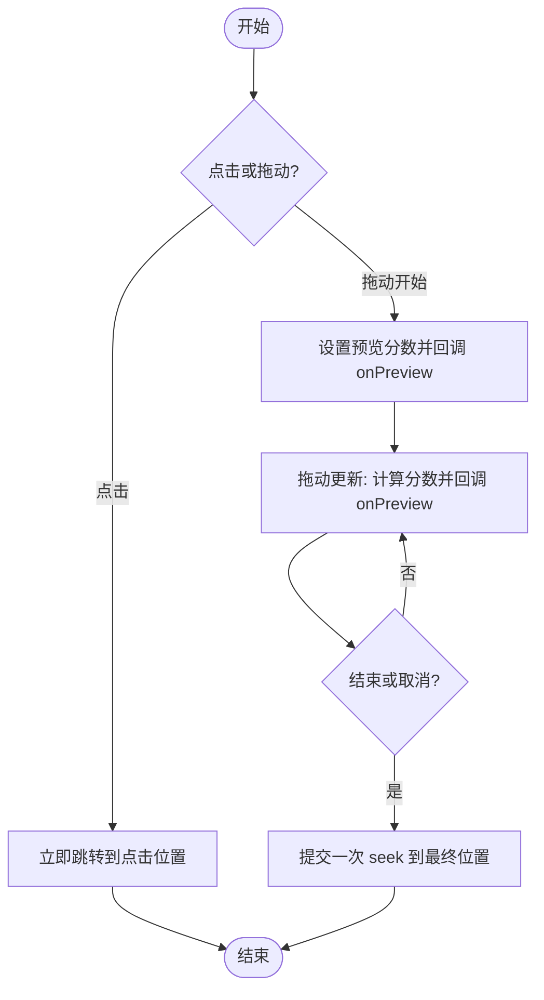
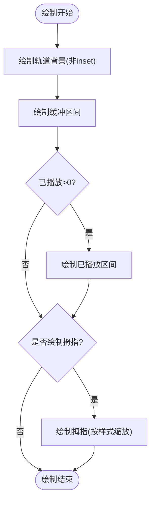
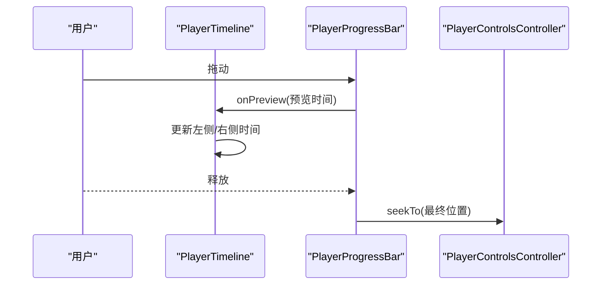
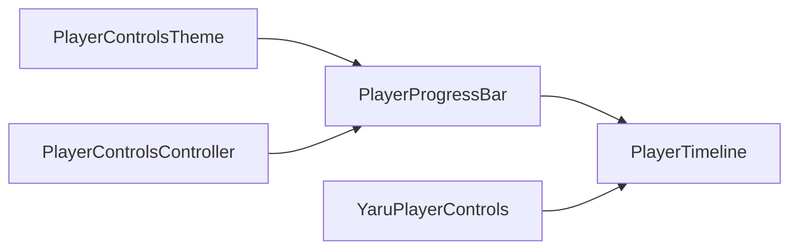

# 进度控制组件

<cite>
**本文引用的文件**   
- [player_progress_bar.dart](file://packages/media_core_ui/lib/src/common/player_progress_bar.dart)
- [player_controls_theme.dart](file://packages/media_core_ui/lib/src/common/player_controls_theme.dart)
- [player_controls_controller.dart](file://packages/media_core_ui/lib/src/common/player_controls_controller.dart)
- [yaru_player_controls.dart](file://packages/media_core_ui/lib/src/yaru/yaru_player_controls.dart)
</cite>

## 目录
1. [简介](#简介)
2. [项目结构](#项目结构)
3. [核心组件](#核心组件)
4. [架构总览](#架构总览)
5. [详细组件分析](#详细组件分析)
6. [依赖关系分析](#依赖关系分析)
7. [性能与交互优化](#性能与交互优化)
8. [样式与主题定制](#样式与主题定制)
9. [多屏幕适配与体验优化](#多屏幕适配与体验优化)
10. [故障排查指南](#故障排查指南)
11. [结论](#结论)

## 简介
本文件面向“进度控制组件”，聚焦以下能力：
- 进度条：主进度、缓冲进度、轨道形状、拇指样式。
- 拖拽滑块：拖动预览、释放跳转、点击跳转。
- 时间轴：左右时间标签与进度条联动，支持倒计时显示。
- 主题化：主进度颜色、缓冲进度颜色、拇指样式、轨道高度等。
- 性能：避免在拖动中频繁 seek，减少重建和重绘。
- 适配：不同平台风格（Material、Cupertino、Fluent、macOS、Yaru、Neumorphic）与多尺寸布局。

## 项目结构
进度控制相关代码集中在 UI 包中，关键文件如下：
- 进度条与时间轴实现：`player_progress_bar.dart`
- 主题与视觉 Token：`player_controls_theme.dart`
- 控制器（播放状态、动作、可见性）：`player_controls_controller.dart`
- 示例控件组合（如 Yaru 面板）：`yaru_player_controls.dart`

图表来源
- [player_progress_bar.dart:31-79](file://packages/media_core_ui/lib/src/common/player_progress_bar.dart#L31-L79)
- [player_progress_bar.dart:368-406](file://packages/media_core_ui/lib/src/common/player_progress_bar.dart#L368-L406)
- [player_controls_theme.dart:64-99](file://packages/media_core_ui/lib/src/common/player_controls_theme.dart#L64-L99)
- [player_controls_controller.dart:41-62](file://packages/media_core_ui/lib/src/common/player_controls_controller.dart#L41-L62)
- [yaru_player_controls.dart:26-43](file://packages/media_core_ui/lib/src/yaru/yaru_player_controls.dart#L26-L43)

章节来源
- [player_progress_bar.dart:1-480](file://packages/media_core_ui/lib/src/common/player_progress_bar.dart#L1-L480)
- [player_controls_theme.dart:1-506](file://packages/media_core_ui/lib/src/common/player_controls_theme.dart#L1-L506)
- [player_controls_controller.dart:1-617](file://packages/media_core_ui/lib/src/common/player_controls_controller.dart#L1-L617)
- [yaru_player_controls.dart:1-150](file://packages/media_core_ui/lib/src/yaru/yaru_player_controls.dart#L1-L150)

## 核心组件
- PlayerProgressBar：负责进度条的绘制、拖拽预览、点击跳转、缓冲范围展示、拇指样式与轨道高度变化。
- PlayerTimeline：将时间标签与 PlayerProgressBar 组合，提供左右时间显示，并在拖动时同步预览位置。
- PlayerControlsTheme：集中定义进度条颜色（轨道、缓冲、已播放、拇指）、尺寸（轨道高、拇指半径）、形状（拇指类型、轨道形状）以及文本样式等。
- PlayerControlsController：暴露播放状态、seek/volume/rate 等动作，并提供 playbackListenable 供进度类组件高频刷新。

章节来源
- [player_progress_bar.dart:31-79](file://packages/media_core_ui/lib/src/common/player_progress_bar.dart#L31-L79)
- [player_progress_bar.dart:368-406](file://packages/media_core_ui/lib/src/common/player_progress_bar.dart#L368-L406)
- [player_controls_theme.dart:64-99](file://packages/media_core_ui/lib/src/common/player_controls_theme.dart#L64-L99)
- [player_controls_controller.dart:41-62](file://packages/media_core_ui/lib/src/common/player_controls_controller.dart#L41-L62)

## 架构总览
进度控制组件采用“视图 + 主题 + 控制器”的分层：
- 视图层：PlayerProgressBar 与 PlayerTimeline 负责绘制与交互。
- 主题层：PlayerControlsTheme 提供所有视觉 Token。
- 控制器层：PlayerControlsController 桥接播放器状态与 UI 动作。

图表来源
- [player_progress_bar.dart:31-79](file://packages/media_core_ui/lib/src/common/player_progress_bar.dart#L31-L79)
- [player_progress_bar.dart:250-341](file://packages/media_core_ui/lib/src/common/player_progress_bar.dart#L250-L341)
- [player_progress_bar.dart:368-406](file://packages/media_core_ui/lib/src/common/player_progress_bar.dart#L368-L406)
- [player_controls_theme.dart:64-99](file://packages/media_core_ui/lib/src/common/player_controls_theme.dart#L64-L99)
- [player_controls_controller.dart:41-62](file://packages/media_core_ui/lib/src/common/player_controls_controller.dart#L41-L62)

## 详细组件分析

### PlayerProgressBar：进度条与拖拽交互
职责：
- 维护拖动预览状态，仅在释放时执行一次 seek，避免拖动卡顿。
- 绘制轨道背景、缓冲区间、已播放区间与拇指。
- 根据主题决定轨道形状（平面或内凹软 UI）与拇指样式（无、圆点、圆形）。
- 支持 hover 时加粗轨道、拖动时放大拇指。

关键属性：
- controller：驱动 seek 的控制器。
- theme：主题 Token（颜色、尺寸、形状）。
- onPreview：拖动期间回调当前预览时间，用于时间标签跟随。
- height：整体命中区域高度。
- thumbRadius：拇指半径。
- trackHeight / trackHeightWhileDragging：静止与拖动时的轨道高度。
- hoverable：是否支持悬停变粗。
- padding：轨道内边距。

图表来源
- [player_progress_bar.dart:191-220](file://packages/media_core_ui/lib/src/common/player_progress_bar.dart#L191-L220)
- [player_progress_bar.dart:234-247](file://packages/media_core_ui/lib/src/common/player_progress_bar.dart#L234-L247)

绘制逻辑要点：
- 先画轨道背景（非内凹模式），再画缓冲区间，最后画已播放区间与拇指。
- 若主题为内凹轨道，使用 SoftSurface 将轨道压入表面，只绘制已播放部分。
- 拇指缩放：dot 类型在悬停/拖动时放大；circle 始终全尺寸；none 不绘制拇指。

图表来源
- [player_progress_bar.dart:271-317](file://packages/media_core_ui/lib/src/common/player_progress_bar.dart#L271-L317)

章节来源
- [player_progress_bar.dart:31-79](file://packages/media_core_ui/lib/src/common/player_progress_bar.dart#L31-L79)
- [player_progress_bar.dart:81-247](file://packages/media_core_ui/lib/src/common/player_progress_bar.dart#L81-L247)
- [player_progress_bar.dart:250-341](file://packages/media_core_ui/lib/src/common/player_progress_bar.dart#L250-L341)

### PlayerTimeline：时间轴与进度条联动
职责：
- 左侧显示当前位置，右侧显示总时长或剩余时间。
- 中间嵌入 PlayerProgressBar，并通过 onPreview 同步拖动预览时间。
- 支持 Cupertino 风格的倒计时显示。

关键属性：
- showRemaining：右侧显示剩余时间。
- spacing：标签与进度条间距。
- barHeight：进度条命中区域高度。
- hoverable：是否支持悬停变粗。

图表来源
- [player_progress_bar.dart:408-452](file://packages/media_core_ui/lib/src/common/player_progress_bar.dart#L408-L452)
- [player_progress_bar.dart:191-220](file://packages/media_core_ui/lib/src/common/player_progress_bar.dart#L191-L220)
- [player_progress_bar.dart:234-247](file://packages/media_core_ui/lib/src/common/player_progress_bar.dart#L234-L247)

章节来源
- [player_progress_bar.dart:368-452](file://packages/media_core_ui/lib/src/common/player_progress_bar.dart#L368-L452)

### PlayerControlsTheme：主题与 Token
职责：
- 统一提供进度条颜色（轨道、缓冲、已播放、拇指）、尺寸（轨道高、拇指半径）、形状（拇指类型、轨道形状）与文本样式。
- 提供多种预设风格：Material、Cupertino、Fluent、macOS、Yaru、Neumorphic。

关键 Token（与进度相关）：
- progressTrack：未播放轨道颜色。
- progressBuffered：缓冲区间颜色。
- progressPlayed：已播放区间颜色。
- progressThumb：拇指颜色。
- trackHeight / trackHeightWhileDragging：轨道高度（静止/拖动）。
- thumbRadius：拇指半径。
- progressThumbShape：拇指样式（none/circle/dot）。
- progressTrackShape：轨道形状（plain/inset）。
- timeTextStyle：时间标签文字样式。

章节来源
- [player_controls_theme.dart:64-99](file://packages/media_core_ui/lib/src/common/player_controls_theme.dart#L64-L99)
- [player_controls_theme.dart:101-309](file://packages/media_core_ui/lib/src/common/player_controls_theme.dart#L101-L309)
- [player_controls_theme.dart:357-418](file://packages/media_core_ui/lib/src/common/player_controls_theme.dart#L357-L418)

### PlayerControlsController：控制器与动作
职责：
- 暴露播放状态（位置、时长、缓冲、音量、速率等）。
- 封装 seek/play/pause/setVolume 等动作，并自动管理控件可见性与自动隐藏。
- 提供 playbackListenable 给进度类组件高频刷新。

与进度相关的接口：
- seekTo(position)：跳转到指定位置。
- duration / position：时长与当前位置。
- playbackListenable：播放状态监听器。

章节来源
- [player_controls_controller.dart:41-62](file://packages/media_core_ui/lib/src/common/player_controls_controller.dart#L41-L62)
- [player_controls_controller.dart:401-406](file://packages/media_core_ui/lib/src/common/player_controls_controller.dart#L401-L406)
- [player_controls_controller.dart:98-102](file://packages/media_core_ui/lib/src/common/player_controls_controller.dart#L98-L102)

## 依赖关系分析
- PlayerProgressBar 依赖 PlayerControlsTheme 获取颜色与尺寸，依赖 PlayerControlsController 执行 seek。
- PlayerTimeline 组合 PlayerProgressBar，并共享同一主题与控制器。
- YaruPlayerControls 作为示例，展示了如何把 PlayerTimeline 放入具体平台的面板中。

图表来源
- [player_progress_bar.dart:31-79](file://packages/media_core_ui/lib/src/common/player_progress_bar.dart#L31-L79)
- [player_progress_bar.dart:368-406](file://packages/media_core_ui/lib/src/common/player_progress_bar.dart#L368-L406)
- [yaru_player_controls.dart:26-43](file://packages/media_core_ui/lib/src/yaru/yaru_player_controls.dart#L26-L43)

章节来源
- [player_progress_bar.dart:1-480](file://packages/media_core_ui/lib/src/common/player_progress_bar.dart#L1-L480)
- [yaru_player_controls.dart:1-150](file://packages/media_core_ui/lib/src/yaru/yaru_player_controls.dart#L1-L150)

## 性能与交互优化
- 拖动不频繁 seek：拖动过程中仅更新预览状态并回调 onPreview，真正 seek 在释放时执行一次，避免引擎被大量命令淹没导致卡顿。
- 双通知路径：结构性变化（播放/暂停、音量、速率等）走 ChangeNotifier；位置驱动的高频刷新走 playbackListenable，避免不必要的整栏重建。
- 智能重绘：CustomPainter.shouldRepaint 精确比较必要字段，减少无效绘制。
- 自动隐藏计时器优化：悬停事件不会每次新建 Timer，而是标记活动并在到期后重新上锁，降低定时器开销。

章节来源
- [player_progress_bar.dart:8-19](file://packages/media_core_ui/lib/src/common/player_progress_bar.dart#L8-L19)
- [player_progress_bar.dart:191-247](file://packages/media_core_ui/lib/src/common/player_progress_bar.dart#L191-L247)
- [player_progress_bar.dart:319-341](file://packages/media_core_ui/lib/src/common/player_progress_bar.dart#L319-L341)
- [player_controls_controller.dart:320-366](file://packages/media_core_ui/lib/src/common/player_controls_controller.dart#L320-L366)
- [player_controls_controller.dart:543-570](file://packages/media_core_ui/lib/src/common/player_controls_controller.dart#L543-L570)

## 样式与主题定制
可通过 PlayerControlsTheme 定制进度指示器的外观：
- 主进度颜色：progressPlayed
- 缓冲进度颜色：progressBuffered
- 轨道底色：progressTrack
- 拇指颜色：progressThumb
- 拇指样式：progressThumbShape（none/circle/dot）
- 轨道形状：progressTrackShape（plain/inset）
- 轨道高度：trackHeight / trackHeightWhileDragging
- 拇指半径：thumbRadius
- 时间标签样式：timeTextStyle

常用预设风格：
- Material：强调色明显、较粗轨道、圆形拇指。
- Cupertino：细轨道、无拇指（圆角端点）、倒计时时间。
- Fluent：半透明面板、细轨道、悬停放大的小圆点拇指。
- macOS：紧凑悬浮面板、圆形拇指。
- Yaru：扁平边框、较粗轨道、圆形拇指。
- Neumorphic：凸起/凹陷软 UI、内凹轨道。

章节来源
- [player_controls_theme.dart:101-309](file://packages/media_core_ui/lib/src/common/player_controls_theme.dart#L101-L309)
- [player_controls_theme.dart:357-418](file://packages/media_core_ui/lib/src/common/player_controls_theme.dart#L357-L418)

## 多屏幕适配与体验优化
- 平台风格自适应：通过 PlayerControlsStyle 选择默认主题，或在 MediaCorePlayerView 中强制指定风格，确保在不同平台获得一致体验。
- 命中区域与触控友好：PlayerProgressBar 提供 height 与 padding，便于在小屏设备上提升可触达性。
- 悬停与拖动反馈：hoverable 与 trackHeightWhileDragging 让桌面端悬停更直观；拖动时放大拇指提升定位感。
- 时间标签可读性：PlayerTimeline 支持 showRemaining，符合 iOS 习惯；formatPlayerDuration 保证分钟/秒格式一致。
- 面板布局示例：YaruPlayerControls 展示了如何将时间轴与按钮、菜单、全屏/PiP 等控件组合为完整面板。

章节来源
- [player_progress_bar.dart:59-75](file://packages/media_core_ui/lib/src/common/player_progress_bar.dart#L59-L75)
- [player_progress_bar.dart:155-189](file://packages/media_core_ui/lib/src/common/player_progress_bar.dart#L155-L189)
- [player_progress_bar.dart:455-470](file://packages/media_core_ui/lib/src/common/player_progress_bar.dart#L455-L470)
- [yaru_player_controls.dart:1-150](file://packages/media_core_ui/lib/src/yaru/yaru_player_controls.dart#L1-L150)

## 故障排查指南
常见问题与定位思路：
- 拖动卡顿：检查是否在拖动中频繁调用 seek；应仅在释放时 seek。参考 PlayerProgressBar 的拖动处理逻辑。
- 缓冲进度不显示：确认播放器是否报告了缓冲区间且媒体有时长；若无时长（直播）或未声明缓冲，则不应显示 ahead fill。
- 主题颜色不生效：确认传入的是正确的 PlayerControlsTheme，且未被子组件覆盖。
- 时间标签不随拖动移动：确保 PlayerTimeline 正确订阅 onPreview 并更新预览时间。
- 自动隐藏失效：检查控制器 autoHide 与 hideDelay 配置，以及是否在播放中持续产生交互事件。

章节来源
- [player_progress_bar.dart:8-19](file://packages/media_core_ui/lib/src/common/player_progress_bar.dart#L8-L19)
- [player_progress_bar.dart:103-131](file://packages/media_core_ui/lib/src/common/player_progress_bar.dart#L103-L131)
- [player_progress_bar.dart:408-452](file://packages/media_core_ui/lib/src/common/player_progress_bar.dart#L408-L452)
- [player_controls_controller.dart:320-366](file://packages/media_core_ui/lib/src/common/player_controls_controller.dart#L320-L366)

## 结论
进度控制组件通过清晰的职责划分与主题化设计，提供了稳定、高性能且可定制的进度条与时间轴。其核心优势在于：
- 拖动预览与释放跳转分离，避免引擎过载。
- 主题 Token 集中管理，易于品牌化与跨平台一致性。
- 灵活的形状与尺寸配置，适配不同平台风格与屏幕尺寸。
- 完善的控制器抽象，使自定义 UI 也能复用一致的交互行为。