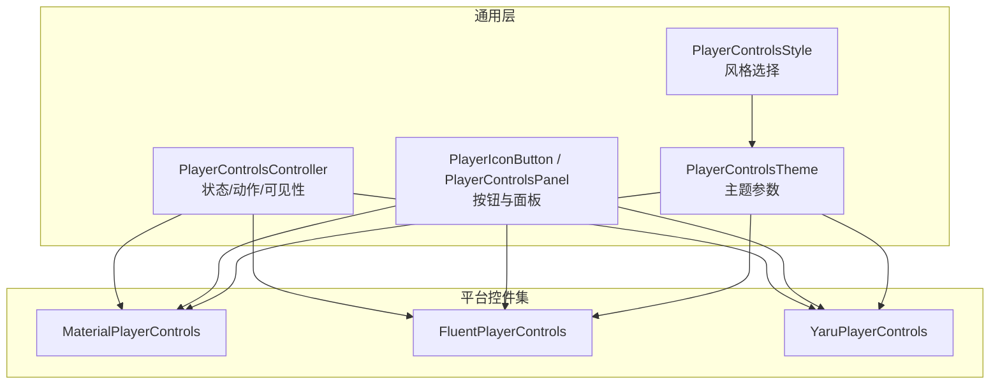
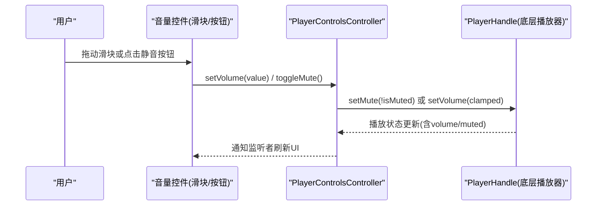
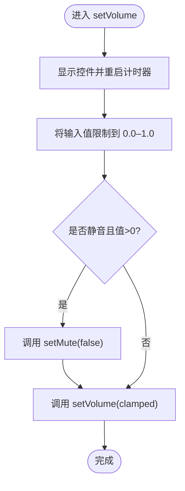
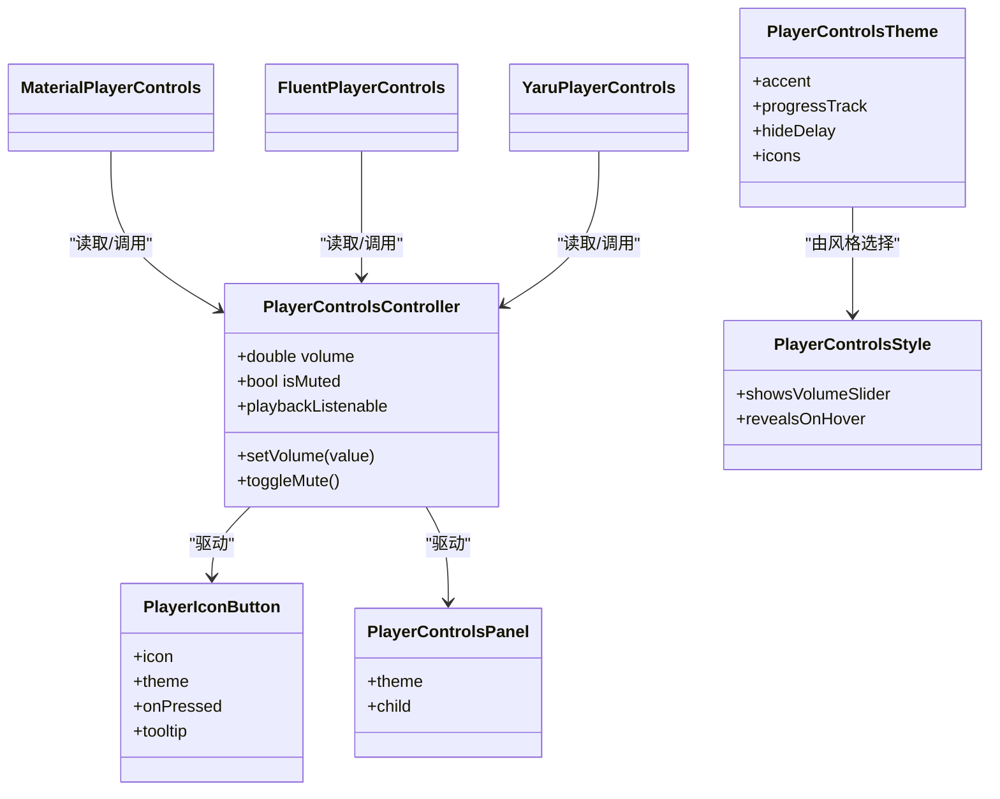

# 音量控制组件

<cite>
**本文引用的文件**   
- [player_controls_controller.dart](file://packages/media_core_ui/lib/src/common/player_controls_controller.dart)
- [player_control_buttons.dart](file://packages/media_core_ui/lib/src/common/player_control_buttons.dart)
- [player_controls_theme.dart](file://packages/media_core_ui/lib/src/common/player_controls_theme.dart)
- [player_controls_style.dart](file://packages/media_core_ui/lib/src/common/player_controls_style.dart)
- [material_player_controls.dart](file://packages/media_core_ui/lib/src/material/material_player_controls.dart)
- [fluent_player_controls.dart](file://packages/media_core_ui/lib/src/fluent/fluent_player_controls.dart)
- [yaru_player_controls.dart](file://packages/media_core_ui/lib/src/yaru/yaru_player_controls.dart)
</cite>

## 目录
1. [简介](#简介)
2. [项目结构](#项目结构)
3. [核心组件](#核心组件)
4. [架构总览](#架构总览)
5. [详细组件分析](#详细组件分析)
6. [依赖关系分析](#依赖关系分析)
7. [性能与动画特性](#性能与动画特性)
8. [交互模式与手势支持](#交互模式与手势支持)
9. [平台差异与适配方案](#平台差异与适配方案)
10. [故障排查](#故障排查)
11. [结论](#结论)

## 简介
本文件聚焦媒体播放界面中的“音量控制”能力，覆盖以下方面：
- 音量滑块、静音切换按钮、音量图标指示器
- 属性配置：滑块样式、音量范围、静音图标、主题与控件风格
- 平滑过渡与动画实现
- 交互模式与手势支持
- 不同平台的音量管理差异与适配策略

该功能由 UI 层的控件集合与控制器共同实现：控制器负责状态与动作（音量、静音、可见性），各平台控件集负责渲染与交互。

## 项目结构
UI 层围绕“控件风格 + 主题 + 控制器 + 具体控件集”组织：
- 通用控制器：统一暴露播放状态、音量、静音等能力
- 通用按钮与面板：提供一致的交互反馈与视觉容器
- 主题与风格：定义颜色、尺寸、动效、是否显示音量滑块等
- 具体控件集：Material、Fluent、Yaru 等平台化呈现

图表来源
- [player_controls_controller.dart:41-194](file://packages/media_core_ui/lib/src/common/player_controls_controller.dart#L41-L194)
- [player_control_buttons.dart:23-77](file://packages/media_core_ui/lib/src/common/player_control_buttons.dart#L23-L77)
- [player_controls_theme.dart:64-134](file://packages/media_core_ui/lib/src/common/player_controls_theme.dart#L64-L134)
- [player_controls_style.dart:29-122](file://packages/media_core_ui/lib/src/common/player_controls_style.dart#L29-L122)
- [material_player_controls.dart:25-107](file://packages/media_core_ui/lib/src/material/material_player_controls.dart#L25-L107)
- [fluent_player_controls.dart:27-118](file://packages/media_core_ui/lib/src/fluent/fluent_player_controls.dart#L27-L118)
- [yaru_player_controls.dart:26-88](file://packages/media_core_ui/lib/src/yaru/yaru_player_controls.dart#L26-L88)

章节来源
- [player_controls_controller.dart:41-194](file://packages/media_core_ui/lib/src/common/player_controls_controller.dart#L41-L194)
- [player_controls_style.dart:29-122](file://packages/media_core_ui/lib/src/common/player_controls_style.dart#L29-L122)

## 核心组件
- PlayerControlsController：封装播放器状态与动作，包括音量、静音、播放进度、速率、循环、截图、全屏、画中画、悬浮窗等；同时管理控件的自动隐藏与可见性。
- PlayerIconButton：统一的控件按钮，承载图标、悬停/按压反馈、工具提示、无障碍标签等。
- PlayerControlsPanel：为 Fluent、macOS、Cupertino 等语言提供带模糊/边框的面板容器。
- PlayerControlsTheme：集中定义颜色、尺寸、进度条形状、按钮皮肤、隐藏延迟、图标集等。
- PlayerControlsStyle：按设计语言选择默认行为，如是否显示音量滑块、是否悬停揭示控件等。
- MaterialPlayerControls / FluentPlayerControls / YaruPlayerControls：平台化的控件布局与交互实现。

章节来源
- [player_controls_controller.dart:41-194](file://packages/media_core_ui/lib/src/common/player_controls_controller.dart#L41-L194)
- [player_control_buttons.dart:23-77](file://packages/media_core_ui/lib/src/common/player_control_buttons.dart#L23-L77)
- [player_control_buttons.dart:325-382](file://packages/media_core_ui/lib/src/common/player_control_buttons.dart#L325-L382)
- [player_controls_theme.dart:64-134](file://packages/media_core_ui/lib/src/common/player_controls_theme.dart#L64-L134)
- [player_controls_style.dart:29-122](file://packages/media_core_ui/lib/src/common/player_controls_style.dart#L29-L122)

## 架构总览
音量控制的调用链从 UI 控件到控制器再到底层播放器：

图表来源
- [player_controls_controller.dart:417-434](file://packages/media_core_ui/lib/src/common/player_controls_controller.dart#L417-L434)
- [fluent_player_controls.dart:263-286](file://packages/media_core_ui/lib/src/fluent/fluent_player_controls.dart#L263-L286)
- [yaru_player_controls.dart:205-228](file://packages/media_core_ui/lib/src/yaru/yaru_player_controls.dart#L205-L228)

## 详细组件分析

### 控制器：PlayerControlsController
职责
- 维护当前音量、静音状态、播放状态、可操作能力
- 对外暴露 setVolume、toggleMute 等方法
- 在音量变化时自动恢复控件可见性并触发 UI 重建
- 将音量值限制在 0.0–1.0，并在从静音恢复时先取消静音再设置音量

关键行为
- setVolume：当处于静音且目标值大于 0 时，先取消静音再设置音量
- toggleMute：切换静音状态
- playbackListenable：高频进度 tick 使用，避免频繁重建整个控件栏

图表来源
- [player_controls_controller.dart:417-427](file://packages/media_core_ui/lib/src/common/player_controls_controller.dart#L417-L427)

章节来源
- [player_controls_controller.dart:147-151](file://packages/media_core_ui/lib/src/common/player_controls_controller.dart#L147-L151)
- [player_controls_controller.dart:417-434](file://packages/media_core_ui/lib/src/common/player_controls_controller.dart#L417-L434)

### 按钮与面板：PlayerIconButton / PlayerControlsPanel
- PlayerIconButton：统一处理悬停、按下、禁用态，并提供 Tooltip、语义标签、主按钮强调等
- PlayerControlsPanel：为需要模糊/半透明背景的平台提供面板容器

章节来源
- [player_control_buttons.dart:23-77](file://packages/media_core_ui/lib/src/common/player_control_buttons.dart#L23-L77)
- [player_control_buttons.dart:325-382](file://packages/media_core_ui/lib/src/common/player_control_buttons.dart#L325-L382)

### 主题与风格：PlayerControlsTheme / PlayerControlsStyle
- PlayerControlsTheme：集中定义颜色、尺寸、进度条形状、按钮皮肤、隐藏延迟、图标集等
- PlayerControlsStyle：按设计语言决定默认行为，例如：
  - showsVolumeSlider：桌面语言（Fluent、macOS、Yaru）默认显示音量滑块
  - revealsOnHover：桌面语言通过悬停揭示控件
  - isTouch：移动语言（Material、Cupertino、Neumorphic）以手指为主

章节来源
- [player_controls_theme.dart:64-134](file://packages/media_core_ui/lib/src/common/player_controls_theme.dart#L64-L134)
- [player_controls_style.dart:51-106](file://packages/media_core_ui/lib/src/common/player_controls_style.dart#L51-L106)

### 平台控件集与音量实现

#### MaterialPlayerControls（Android 风格）
- 不显示音量滑块：Android 音量归系统硬件键，应用内滑块会与系统面板冲突
- 底部栏包含“静音”按钮与全屏按钮
- 通过 icons.volumeFor(muted: controller.isMuted) 动态切换图标

章节来源
- [material_player_controls.dart:8-20](file://packages/media_core_ui/lib/src/material/material_player_controls.dart#L8-L20)
- [material_player_controls.dart:308-341](file://packages/media_core_ui/lib/src/material/material_player_controls.dart#L308-L341)

#### FluentPlayerControls（Windows 11 风格）
- 同一行提供“静音按钮 + 音量滑块”，以及右上角菜单
- 滑块通过 SliderThemeData 定制轨道高度、拇指形状、覆盖层半径、颜色等
- 滑块 value 绑定 controller.volume（静音时为 0），onChanged 调用 controller.setVolume

章节来源
- [fluent_player_controls.dart:8-22](file://packages/media_core_ui/lib/src/fluent/fluent_player_controls.dart#L8-L22)
- [fluent_player_controls.dart:263-286](file://packages/media_core_ui/lib/src/fluent/fluent_player_controls.dart#L263-L286)

#### YaruPlayerControls（Ubuntu/GNOME 风格）
- 顶部标题栏 + 底部传输栏
- 底部栏包含“后退/播放/前进/静音/滑块/循环/倍速”等
- 滑块样式与 Fluent 类似，但整体更扁平、圆角更小

章节来源
- [yaru_player_controls.dart:9-21](file://packages/media_core_ui/lib/src/yaru/yaru_player_controls.dart#L9-L21)
- [yaru_player_controls.dart:205-228](file://packages/media_core_ui/lib/src/yaru/yaru_player_controls.dart#L205-L228)

### 音量图标与指示器
- 图标来自 PlayerControlIcons，按风格提供 volumeUp / volumeMuted
- 控件根据 controller.isMuted 动态选择图标，并通过 Tooltip 提示“静音/取消静音”

章节来源
- [player_control_icons.dart:73-110](file://packages/media_core_ui/lib/src/common/player_control_icons.dart#L73-L110)
- [player_control_icons.dart:141-163](file://packages/media_core_ui/lib/src/common/player_control_icons.dart#L141-L163)
- [fluent_player_controls.dart:263-269](file://packages/media_core_ui/lib/src/fluent/fluent_player_controls.dart#L263-L269)
- [yaru_player_controls.dart:205-211](file://packages/media_core_ui/lib/src/yaru/yaru_player_controls.dart#L205-L211)

## 依赖关系分析
- 控件集依赖控制器获取状态与执行动作
- 控件集依赖主题获取颜色、尺寸、按钮皮肤等
- 控制器订阅底层播放器状态流，将结构变化（播放/暂停、音量）通知 UI
- 按钮与面板作为通用组件被多套控件集复用

图表来源
- [player_controls_controller.dart:41-194](file://packages/media_core_ui/lib/src/common/player_controls_controller.dart#L41-L194)
- [player_control_buttons.dart:23-77](file://packages/media_core_ui/lib/src/common/player_control_buttons.dart#L23-L77)
- [player_control_buttons.dart:325-382](file://packages/media_core_ui/lib/src/common/player_control_buttons.dart#L325-L382)
- [player_controls_theme.dart:64-134](file://packages/media_core_ui/lib/src/common/player_controls_theme.dart#L64-L134)
- [player_controls_style.dart:29-122](file://packages/media_core_ui/lib/src/common/player_controls_style.dart#L29-L122)
- [material_player_controls.dart:25-107](file://packages/media_core_ui/lib/src/material/material_player_controls.dart#L25-L107)
- [fluent_player_controls.dart:27-118](file://packages/media_core_ui/lib/src/fluent/fluent_player_controls.dart#L27-L118)
- [yaru_player_controls.dart:26-88](file://packages/media_core_ui/lib/src/yaru/yaru_player_controls.dart#L26-L88)

## 性能与动画特性
- 控制器区分两类通知路径：
  - ChangeNotifier：结构性变化（播放/暂停、音量、速率、循环、源、可见性、能力）
  - playbackListenable：每帧进度 tick，仅用于时间轴等高频更新
- 自动隐藏逻辑：
  - 仅在播放中且未手动隐藏时启动计时器
  - 悬停/交互会标记活动，计时器到期后若仍有活动则重新计时，避免在鼠标移动时突然隐藏
- 按钮与面板动画：
  - 按钮皮肤使用 AnimatedContainer / AnimatedOpacity 实现淡入淡出、高亮背景、按压态
  - 面板支持 BackdropFilter 模糊效果（Fluent/macOS/Cupertino）
- 音量滑块动画：
  - 通过 Flutter Slider 与 SliderThemeData 控制轨道高度、拇指形状、覆盖层半径与颜色
  - 静音时滑块值为 0，拖动即取消静音并设置音量

章节来源
- [player_controls_controller.dart:31-40](file://packages/media_core_ui/lib/src/common/player_controls_controller.dart#L31-L40)
- [player_controls_controller.dart:330-366](file://packages/media_core_ui/lib/src/common/player_controls_controller.dart#L330-L366)
- [player_control_buttons.dart:157-207](file://packages/media_core_ui/lib/src/common/player_control_buttons.dart#L157-L207)
- [player_control_buttons.dart:294-318](file://packages/media_core_ui/lib/src/common/player_control_buttons.dart#L294-L318)
- [player_control_buttons.dart:370-378](file://packages/media_core_ui/lib/src/common/player_control_buttons.dart#L370-L378)
- [fluent_player_controls.dart:272-285](file://packages/media_core_ui/lib/src/fluent/fluent_player_controls.dart#L272-L285)
- [yaru_player_controls.dart:214-227](file://packages/media_core_ui/lib/src/yaru/yaru_player_controls.dart#L214-L227)

## 交互模式与手势支持
- 鼠标悬停揭示：Fluent、macOS、Yaru 默认通过悬停显示控件
- 点击视频区域：切换控件可见性（显示/隐藏）
- 键盘快捷键（示例）：空格播放/暂停、j/l 快退/快进、m 静音、f 全屏（由控件 Tooltip 提示）
- 音量交互：
  - 点击静音按钮：切换静音
  - 拖动滑块：实时调整音量（静音时拖动即取消静音）

章节来源
- [player_controls_style.dart:85-106](file://packages/media_core_ui/lib/src/common/player_controls_style.dart#L85-L106)
- [player_controls_controller.dart:294-318](file://packages/media_core_ui/lib/src/common/player_controls_controller.dart#L294-L318)
- [fluent_player_controls.dart:244-269](file://packages/media_core_ui/lib/src/fluent/fluent_player_controls.dart#L244-L269)
- [yaru_player_controls.dart:185-211](file://packages/media_core_ui/lib/src/yaru/yaru_player_controls.dart#L185-L211)

## 平台差异与适配方案
- Android（Material）
  - 不显示音量滑块，音量由系统硬件键控制
  - 提供静音按钮，图标随 isMuted 切换
- iOS（Cupertino）
  - 同样遵循“无音量滑块”的设计，音量由系统按键控制
- Windows（Fluent）
  - 提供音量滑块与静音按钮，位于同一行
  - 右上角菜单提供倍速、循环、音频优先、截图、悬浮窗等
- macOS
  - 浮动半透明胶囊式控件，紧凑布局
- Linux（Yaru）
  - 顶部标题栏 + 底部传输栏，包含音量滑块与静音按钮
  - 扁平控件风格，圆角较小

适配建议
- 使用 PlayerControlsStyle.resolve() 或 forPlatform() 选择默认风格
- 通过 showVolumeSlider 控制是否显示滑块（桌面端推荐开启）
- 通过 PlayerControlsTheme 自定义颜色、尺寸、按钮皮肤、隐藏延迟等
- 通过 PlayerControlIcons 替换图标集，保持品牌一致性

章节来源
- [player_controls_style.dart:51-106](file://packages/media_core_ui/lib/src/common/player_controls_style.dart#L51-L106)
- [material_player_controls.dart:8-20](file://packages/media_core_ui/lib/src/material/material_player_controls.dart#L8-L20)
- [fluent_player_controls.dart:8-22](file://packages/media_core_ui/lib/src/fluent/fluent_player_controls.dart#L8-L22)
- [yaru_player_controls.dart:9-21](file://packages/media_core_ui/lib/src/yaru/yaru_player_controls.dart#L9-L21)

## 故障排查
- 拖动滑块无效
  - 检查控制器是否已正确注入 handle，并确保 setVolume/toggleMute 未被上层拦截
  - 确认当前 source 可用且后端支持音量控制
- 静音图标不更新
  - 确认 isMuted 状态与控制器同步，且图标构造使用了 icons.volumeFor(muted: controller.isMuted)
- 滑块位置异常
  - 确保 value 使用 controller.isMuted ? 0 : controller.volume.clamp(0.0, 1.0)
- 控件不自动隐藏
  - 检查 autoHide 与 keepVisibleWhenPaused 配置，以及是否在播放中
- 主题颜色不生效
  - 确认传入的 PlayerControlsTheme 覆盖了所需字段，并使用 style 对应的 Theme.of 工厂方法

章节来源
- [player_controls_controller.dart:417-434](file://packages/media_core_ui/lib/src/common/player_controls_controller.dart#L417-L434)
- [fluent_player_controls.dart:263-286](file://packages/media_core_ui/lib/src/fluent/fluent_player_controls.dart#L263-L286)
- [yaru_player_controls.dart:205-228](file://packages/media_core_ui/lib/src/yaru/yaru_player_controls.dart#L205-L228)

## 结论
音量控制由控制器与平台控件集协同实现：控制器负责状态与动作，控件集负责渲染与交互。桌面平台（Fluent、Yaru）提供直观的音量滑块与静音按钮，移动端（Material、Cupertino）则遵循系统音量键习惯，仅提供静音按钮。通过 PlayerControlsStyle 与 PlayerControlsTheme，开发者可以灵活定制外观、行为与动画，获得一致且符合平台惯例的用户体验。