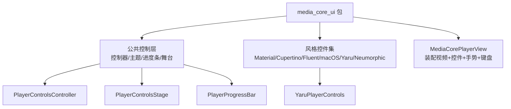
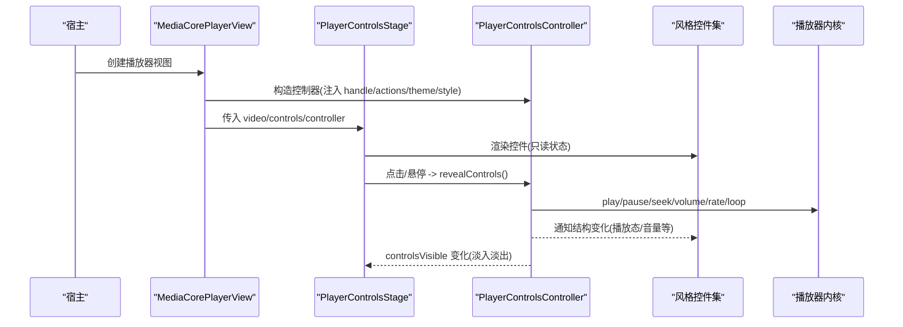
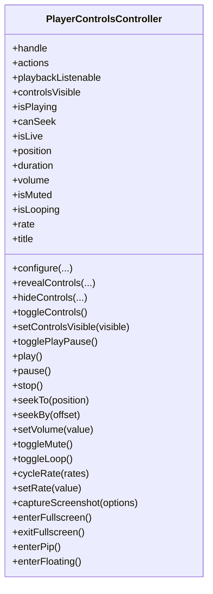
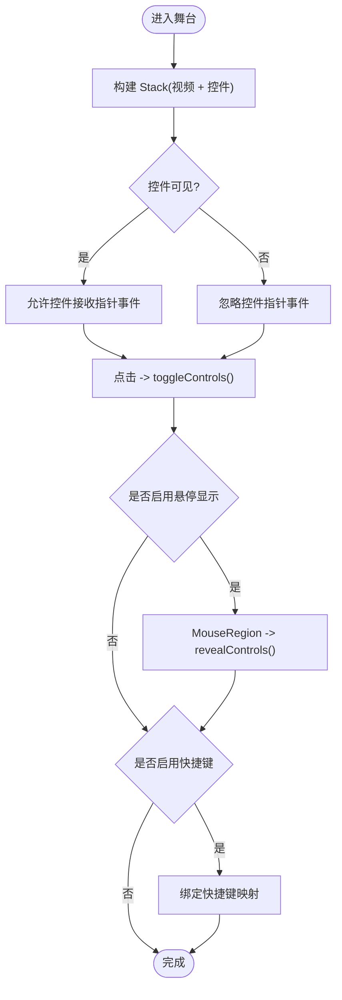
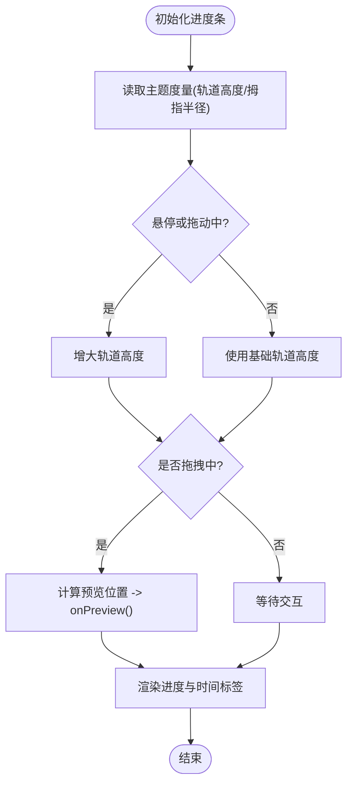
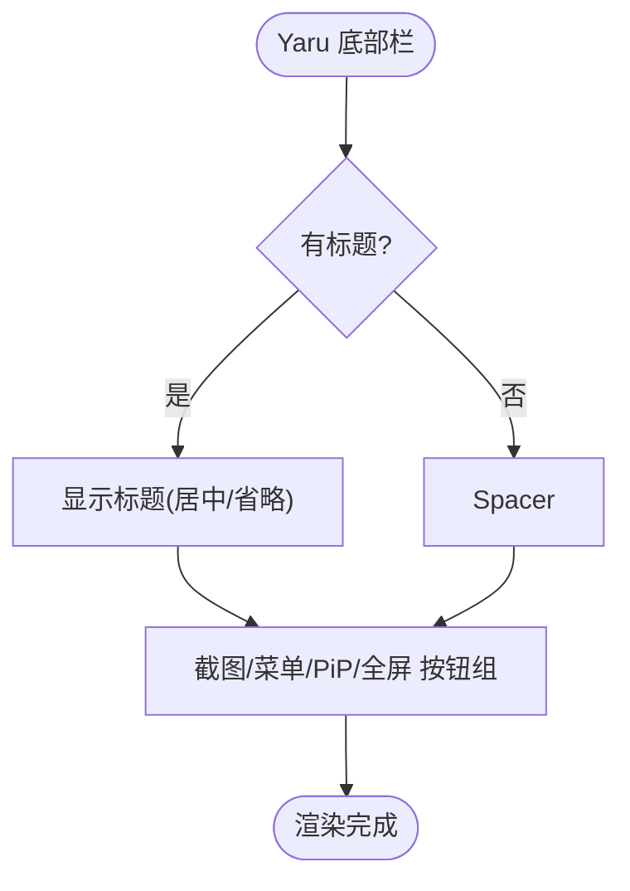
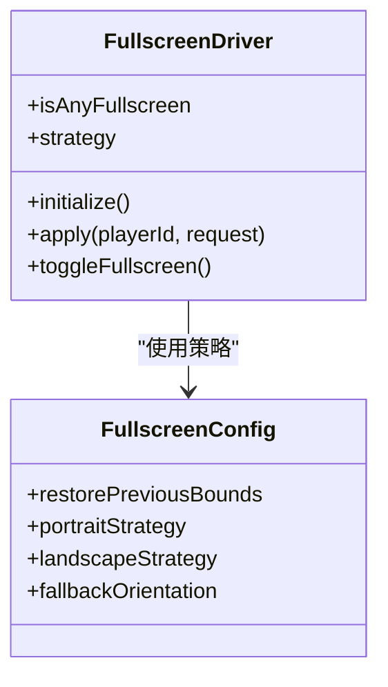
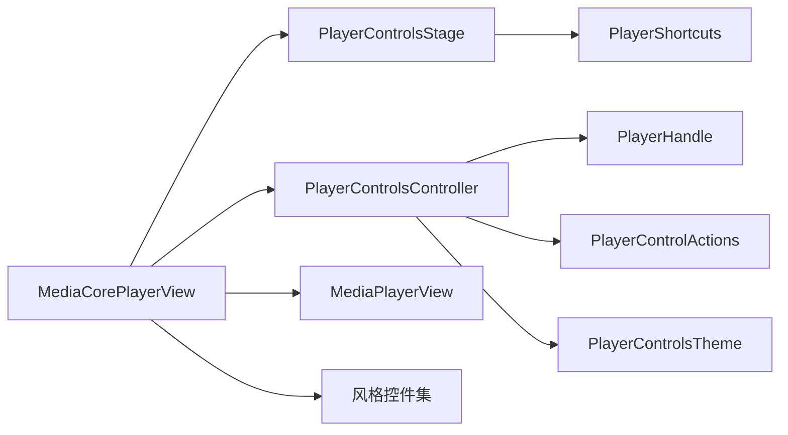
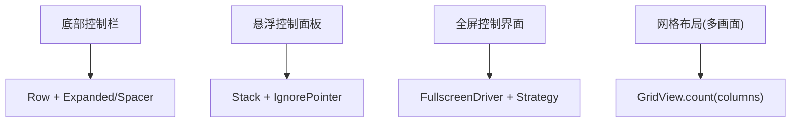

# 控制布局系统

<cite>
**本文引用的文件**   
- [README.md](file://README.md)
- [media_core_ui.dart](file://packages/media_core_ui/lib/media_core_ui.dart)
- [media_core_ui/README.md](file://packages/media_core_ui/README.md)
- [media_core_player_view.dart](file://packages/media_core_ui/lib/src/media_core_player_view.dart)
- [player_controls_controller.dart](file://packages/media_core_ui/lib/src/common/player_controls_controller.dart)
- [player_controls_stage.dart](file://packages/media_core_ui/lib/src/common/player_controls_stage.dart)
- [player_progress_bar.dart](file://packages/media_core_ui/lib/src/common/player_progress_bar.dart)
- [yaru_player_controls.dart](file://packages/media_core_ui/lib/src/yaru/yaru_player_controls.dart)
- [fullscreen_driver.dart](file://packages/media_core_fullscreen/lib/src/fullscreen_driver.dart)
- [fullscreen_config.dart](file://packages/media_core_fullscreen/lib/src/fullscreen_config.dart)
- [multiview_demo_page.dart](file://example/lib/pages/multiview_demo_page.dart)
</cite>

## 目录
1. [引言](#引言)
2. [项目结构](#项目结构)
3. [核心组件](#核心组件)
4. [架构总览](#架构总览)
5. [详细组件分析](#详细组件分析)
6. [依赖关系分析](#依赖关系分析)
7. [性能与交互特性](#性能与交互特性)
8. [故障排查指南](#故障排查指南)
9. [结论](#结论)
10. [附录：布局模式示例](#附录布局模式示例)

## 引言
本文件聚焦媒体播放器的“控制布局系统”，围绕 `media_core_ui` 包展开，解释其如何以一套控制逻辑驱动六种设计语言，并通过组合视频层、控件层与舞台层实现 Flex、网格、绝对/相对定位、流式布局等策略。文档同时覆盖不同屏幕尺寸与设备方向的自适应方案、手势与键盘交互、全屏与画中画等呈现模式，以及跨平台适配与兼容性处理思路。

## 项目结构
`media_core_ui` 采用“公共控制层 + 多风格控件集”的组织方式：
- 公共层：控制器、主题、进度条、快捷键映射、控件舞台等。
- 风格层：Material、Cupertino、Fluent、macOS、Yaru、Neumorphic 各一套无状态控件集。
- 入口组件：`MediaCorePlayerView` 将视频、控件、手势与键盘统一装配。

**图示来源**
- [media_core_ui.dart:1-56](file://packages/media_core_ui/lib/media_core_ui.dart#L1-L56)
- [media_core_player_view.dart:46-94](file://packages/media_core_ui/lib/src/media_core_player_view.dart#L46-L94)

**章节来源**
- [media_core_ui.dart:1-56](file://packages/media_core_ui/lib/media_core_ui.dart#L1-L56)
- [media_core_ui/README.md:1-66](file://packages/media_core_ui/README.md#L1-L66)

## 核心组件
- `MediaCorePlayerView`：播放器装配器，负责选择风格、组装视频与控件、处理双指缩放、双击行为、自动隐藏与键盘快捷键。
- `PlayerControlsController`：控制器的核心，镜像播放器状态、暴露动作（播放/暂停/跳转/音量/循环/速率/截图/全屏/PiP/悬浮）、管理控件可见性与自动隐藏计时。
- `PlayerControlsStage`：控件舞台，负责把控件叠加在视频上，处理点击、悬停、双击、键盘快捷键绑定与淡入淡出动画。
- `PlayerProgressBar`：时间轴与拖拽预览，支持悬停加粗、拖动时轨道变高、实时预览位置。
- 风格控件集（如 `YaruPlayerControls`）：按主题渲染按钮、标题、溢出菜单、全屏/PiP 入口等。

**章节来源**
- [media_core_player_view.dart:46-94](file://packages/media_core_ui/lib/src/media_core_player_view.dart#L46-L94)
- [player_controls_controller.dart:10-30](file://packages/media_core_ui/lib/src/common/player_controls_controller.dart#L10-L30)
- [player_controls_stage.dart:59-76](file://packages/media_core_ui/lib/src/common/player_controls_stage.dart#L59-L76)
- [player_progress_bar.dart:46-79](file://packages/media_core_ui/lib/src/common/player_progress_bar.dart#L46-L79)
- [yaru_player_controls.dart:104-150](file://packages/media_core_ui/lib/src/yaru/yaru_player_controls.dart#L104-L150)

## 架构总览
控制布局系统由三层协作构成：
- 视频层：`MediaPlayerView` 负责画面、缩放、截图边界。
- 控件层：按风格渲染的控件集，只读控制器状态并调用动作。
- 舞台层：负责控件显隐、指针事件穿透、键盘快捷键与双击行为。

**图示来源**
- [media_core_player_view.dart:297-356](file://packages/media_core_ui/lib/src/media_core_player_view.dart#L297-L356)
- [player_controls_stage.dart:137-187](file://packages/media_core_ui/lib/src/common/player_controls_stage.dart#L137-L187)
- [player_controls_controller.dart:372-520](file://packages/media_core_ui/lib/src/common/player_controls_controller.dart#L372-L520)

## 详细组件分析

### 控制器：PlayerControlsController
职责与要点：
- 镜像播放器状态，区分“结构性变化”（播放/暂停/音量/速率/循环/源变更）与“仅位置更新”。
- 暴露动作：播放、暂停、停止、跳转、音量、静音、循环、速率、截图、全屏、PiP、悬浮。
- 可见性策略：空闲自动隐藏、交互显示、暂停时保持显示；悬停/点击触发显示；避免高频 tick 导致计时器抖动。
- 能力判断：直播源不可拖拽、后端不支持 seek 则隐藏进度条。

**图示来源**
- [player_controls_controller.dart:41-617](file://packages/media_core_ui/lib/src/common/player_controls_controller.dart#L41-L617)

**章节来源**
- [player_controls_controller.dart:10-30](file://packages/media_core_ui/lib/src/common/player_controls_controller.dart#L10-L30)
- [player_controls_controller.dart:116-140](file://packages/media_core_ui/lib/src/common/player_controls_controller.dart#L116-L140)
- [player_controls_controller.dart:256-366](file://packages/media_core_ui/lib/src/common/player_controls_controller.dart#L256-L366)
- [player_controls_controller.dart:372-520](file://packages/media_core_ui/lib/src/common/player_controls_controller.dart#L372-L520)

### 舞台：PlayerControlsStage
职责与要点：
- 使用 Stack 将控件叠加在视频之上，控件仅在可见时接收指针事件。
- 支持点击切换控件显示、双击回调、悬停显示（桌面）。
- 可选键盘快捷键绑定，默认遵循常见约定（空格/方向键/音量/全屏等）。

**图示来源**
- [player_controls_stage.dart:137-187](file://packages/media_core_ui/lib/src/common/player_controls_stage.dart#L137-L187)
- [player_controls_stage.dart:7-57](file://packages/media_core_ui/lib/src/common/player_controls_stage.dart#L7-L57)

**章节来源**
- [player_controls_stage.dart:59-76](file://packages/media_core_ui/lib/src/common/player_controls_stage.dart#L59-L76)
- [player_controls_stage.dart:137-187](file://packages/media_core_ui/lib/src/common/player_controls_stage.dart#L137-L187)

### 进度条：PlayerProgressBar
职责与要点：
- 响应控制器状态，提供拖拽预览、悬停加粗、拖动时轨道变高等交互。
- 通过 `onPreview` 回调让时间标签跟随拖拽，提升手感。

**图示来源**
- [player_progress_bar.dart:46-94](file://packages/media_core_ui/lib/src/common/player_progress_bar.dart#L46-L94)

**章节来源**
- [player_progress_bar.dart:46-94](file://packages/media_core_ui/lib/src/common/player_progress_bar.dart#L46-L94)

### 风格控件集：以 Yaru 为例
职责与要点：
- 使用 Row 布局标题、截图按钮、溢出菜单、PiP、全屏按钮。
- 根据控制器能力动态显示/禁用按钮。
- 通过主题令牌统一字体、颜色与圆角。

**图示来源**
- [yaru_player_controls.dart:104-150](file://packages/media_core_ui/lib/src/yaru/yaru_player_controls.dart#L104-L150)

**章节来源**
- [yaru_player_controls.dart:104-150](file://packages/media_core_ui/lib/src/yaru/yaru_player_controls.dart#L104-L150)

### 全屏与呈现：FullscreenDriver 与配置
职责与要点：
- 区分“平台全屏”和“窗口级全屏”，记录决策轨迹。
- 通过 `FullscreenConfig` 为竖屏/横屏分别设置铺满策略（fit/crop/scale 等）。
- 桌面端可恢复上次窗口边界，避免退出全屏后仍最大化。

**图示来源**
- [fullscreen_driver.dart:1-27](file://packages/media_core_fullscreen/lib/src/fullscreen_driver.dart#L1-L27)
- [fullscreen_config.dart:1-33](file://packages/media_core_fullscreen/lib/src/fullscreen_config.dart#L1-L33)

**章节来源**
- [fullscreen_driver.dart:1-27](file://packages/media_core_fullscreen/lib/src/fullscreen_driver.dart#L1-L27)
- [fullscreen_config.dart:1-33](file://packages/media_core_fullscreen/lib/src/fullscreen_config.dart#L1-L33)

## 依赖关系分析
- `MediaCorePlayerView` 依赖：
  - `MediaPlayerView`（视频层）
  - `PlayerControlsStage`（舞台层）
  - 具体风格控件集（Material/Cupertino/Fluent/macOS/Yaru/Neumorphic）
  - `PlayerControlsController`（状态与动作）
- `PlayerControlsController` 依赖：
  - `PlayerHandle`（播放器门面）
  - `PlayerControlActions`（宿主回调：全屏/PiP/悬浮/截图）
  - `PlayerControlsTheme` / `PlayerControlsStyle`（主题与风格）
- `PlayerControlsStage` 依赖：
  - Flutter 手势与焦点系统（GestureDetector、Focus、CallbackShortcuts）
  - `PlayerShortcuts`（快捷键映射）

**图示来源**
- [media_core_player_view.dart:297-356](file://packages/media_core_ui/lib/src/media_core_player_view.dart#L297-L356)
- [player_controls_controller.dart:41-617](file://packages/media_core_ui/lib/src/common/player_controls_controller.dart#L41-L617)
- [player_controls_stage.dart:137-187](file://packages/media_core_ui/lib/src/common/player_controls_stage.dart#L137-L187)

**章节来源**
- [media_core_ui.dart:1-56](file://packages/media_core_ui/lib/media_core_ui.dart#L1-L56)
- [media_core_player_view.dart:297-356](file://packages/media_core_ui/lib/src/media_core_player_view.dart#L297-L356)

## 性能与交互特性
- 两路通知路径：
  - 结构性变化走 `ChangeNotifier`，用于重建控件栏。
  - 位置更新走 `playbackListenable`，仅刷新进度条与时间标签，避免频繁重建。
- 自动隐藏防抖：
  - 使用单 Timer 计数，鼠标移动不重复创建定时器，避免“永远不隐藏”的问题。
- 进度条交互优化：
  - 悬停加粗、拖动时轨道变高，提升触控与鼠标体验。
- 手势与键盘：
  - 双击行为按风格默认：移动端放大、桌面端全屏。
  - 键盘快捷键遵循通用约定，便于桌面用户操作。

**章节来源**
- [player_controls_controller.dart:31-41](file://packages/media_core_ui/lib/src/common/player_controls_controller.dart#L31-L41)
- [player_controls_controller.dart:320-366](file://packages/media_core_ui/lib/src/common/player_controls_controller.dart#L320-L366)
- [player_progress_bar.dart:46-94](file://packages/media_core_ui/lib/src/common/player_progress_bar.dart#L46-L94)
- [media_core_player_view.dart:18-44](file://packages/media_core_ui/lib/src/media_core_player_view.dart#L18-L44)
- [player_controls_stage.dart:7-57](file://packages/media_core_ui/lib/src/common/player_controls_stage.dart#L7-L57)

## 故障排查指南
- 控件不隐藏：
  - 检查是否关闭了自动隐藏（`autoHideControls=false`），或处于暂停且 `keepControlsWhilePaused=true`。
  - 确认 `_scheduleHide` 未被高频 tick 干扰；控制器已对 position-only 更新跳过计时重置。
- 进度条不可拖拽：
  - 直播源或后端不支持 seek 会禁用进度条；检查 `canSeek` 与 `isLive`。
- 双击无效：
  - 若双击行为设为 `none`，需宿主自行处理；若设为 `zoom`，需启用 `pinchToZoom` 或 `enableDoubleTapZoom`。
- 全屏异常：
  - 检查 `FullscreenConfig.strategy` 与当前朝向是否匹配；桌面端注意 `restorePreviousBounds`。

**章节来源**
- [player_controls_controller.dart:116-140](file://packages/media_core_ui/lib/src/common/player_controls_controller.dart#L116-L140)
- [player_controls_controller.dart:320-366](file://packages/media_core_ui/lib/src/common/player_controls_controller.dart#L320-L366)
- [media_core_player_view.dart:114-130](file://packages/media_core_ui/lib/src/media_core_player_view.dart#L114-L130)
- [fullscreen_config.dart:1-33](file://packages/media_core_fullscreen/lib/src/fullscreen_config.dart#L1-L33)

## 结论
控制布局系统通过“控制器 + 舞台 + 风格控件集”的分层设计，实现了统一的控制逻辑与多样的视觉呈现。它以 Flex 与网格为基础，结合 Stack 绝对/相对定位与流式布局，配合手势与键盘交互，在不同屏幕尺寸与设备方向下保持一致的用户体验。全屏与 PiP 等呈现模式通过独立驱动与策略配置解耦，便于宿主按需扩展与适配。

## 附录：布局模式示例
- 底部控制栏：
  - 使用 `Row` 排列标题与按钮，借助 `Expanded` 与 `Spacer` 对齐，参考 Yaru 底部栏。
- 悬浮控制面板：
  - 通过 `Stack` 将控件置于视频上方，利用 `IgnorePointer` 控制事件穿透，参考 `PlayerControlsStage`。
- 全屏控制界面：
  - 使用 `FullscreenDriver` 切换全屏，依据 `FullscreenConfig` 的策略适配竖/横屏铺满方式。
- 网格布局（多画面）：
  - 使用 `GridView.count` 按列数排布单元格，参考示例中的多画面演示页。

**图示来源**
- [yaru_player_controls.dart:104-150](file://packages/media_core_ui/lib/src/yaru/yaru_player_controls.dart#L104-L150)
- [player_controls_stage.dart:137-187](file://packages/media_core_ui/lib/src/common/player_controls_stage.dart#L137-L187)
- [fullscreen_driver.dart:1-27](file://packages/media_core_fullscreen/lib/src/fullscreen_driver.dart#L1-L27)
- [multiview_demo_page.dart:282-326](file://example/lib/pages/multiview_demo_page.dart#L282-L326)

**章节来源**
- [yaru_player_controls.dart:104-150](file://packages/media_core_ui/lib/src/yaru/yaru_player_controls.dart#L104-L150)
- [player_controls_stage.dart:137-187](file://packages/media_core_ui/lib/src/common/player_controls_stage.dart#L137-L187)
- [fullscreen_driver.dart:1-27](file://packages/media_core_fullscreen/lib/src/fullscreen_driver.dart#L1-L27)
- [multiview_demo_page.dart:282-326](file://example/lib/pages/multiview_demo_page.dart#L282-L326)