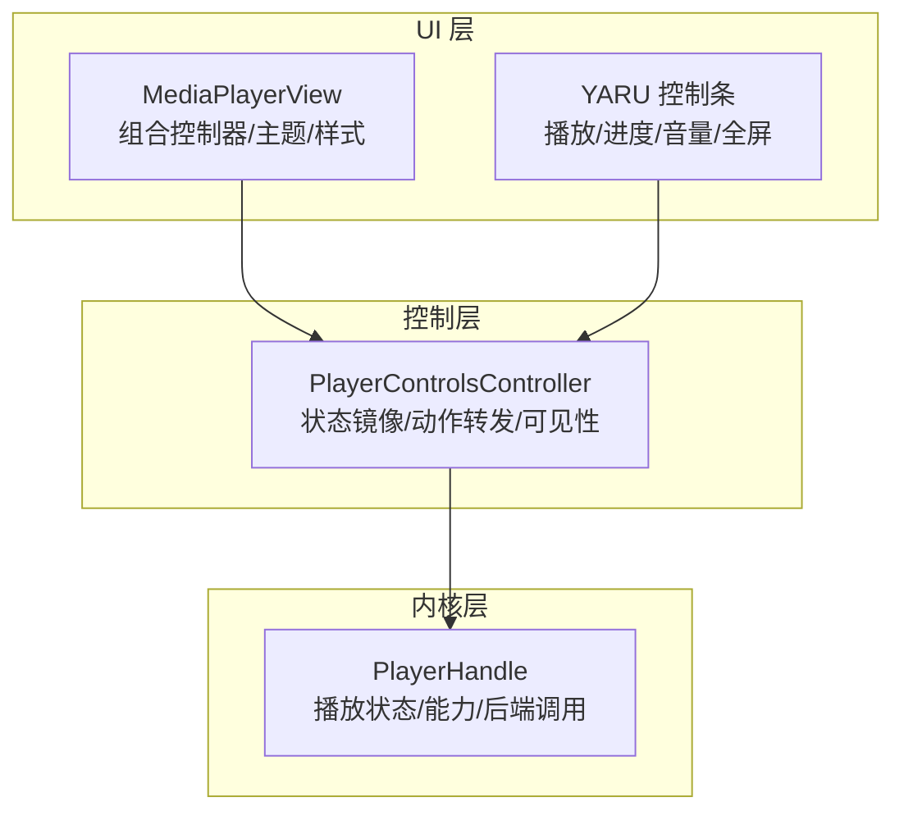
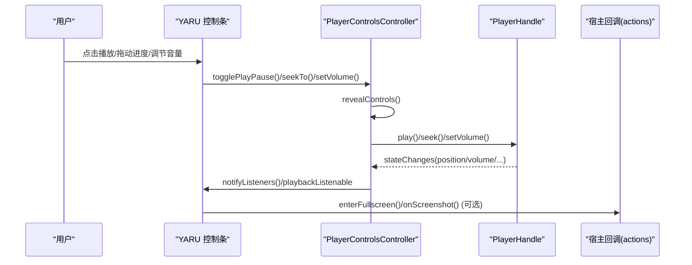
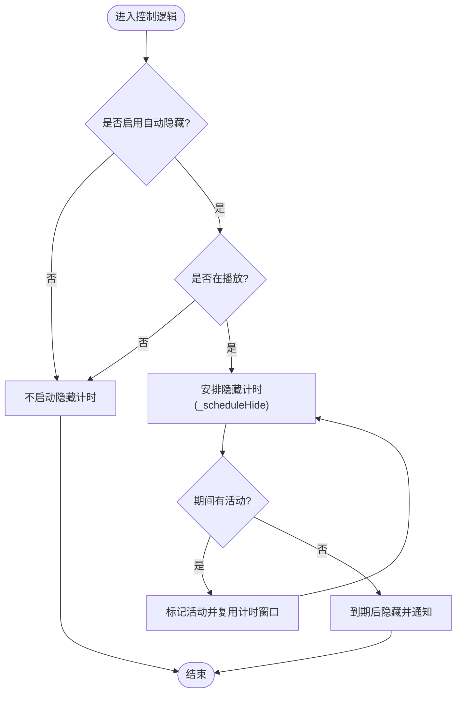
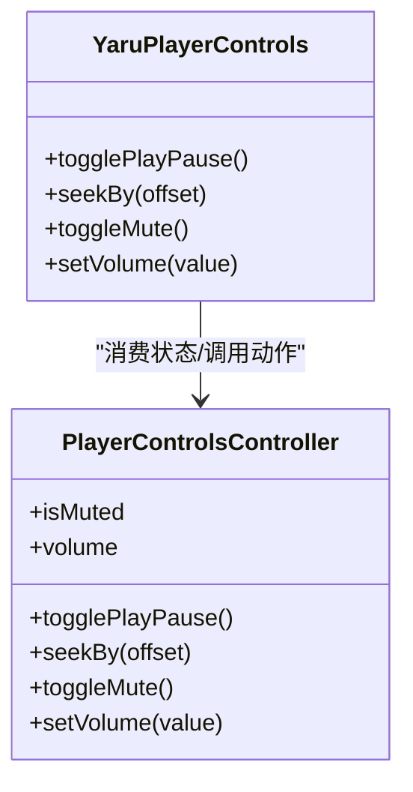
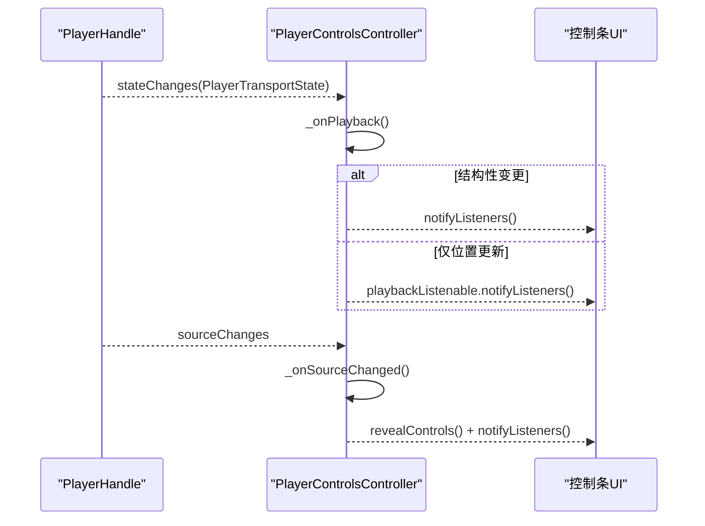
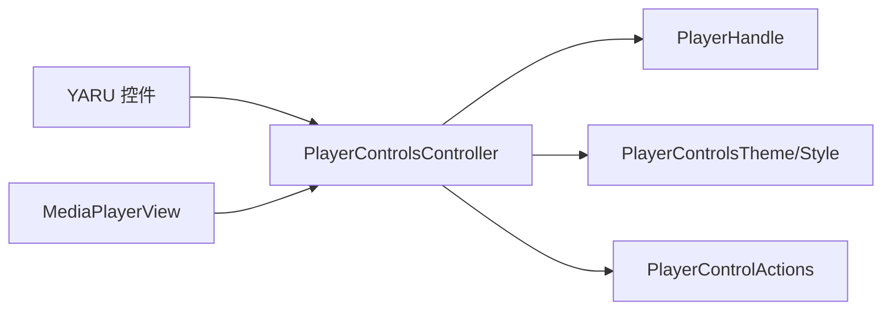

# 控制组件系统

<cite>
**本文引用的文件**   
- [player_controls_controller.dart](file://packages/media_core_ui/lib/src/common/player_controls_controller.dart)
- [media_core_player_view.dart](file://packages/media_core_ui/lib/src/media_core_player_view.dart)
- [yaru_player_controls.dart](file://packages/media_core_ui/lib/src/yaru/yaru_player_controls.dart)
- [player_controls_controller_test.dart](file://packages/media_core_ui/test/player_controls_controller_test.dart)
</cite>

## 目录
1. [简介](#简介)
2. [项目结构](#项目结构)
3. [核心组件](#核心组件)
4. [架构总览](#架构总览)
5. [详细组件分析](#详细组件分析)
6. [依赖关系分析](#依赖关系分析)
7. [性能考量](#性能考量)
8. [故障排查指南](#故障排查指南)
9. [结论](#结论)
10. [附录](#附录)

## 简介
本文件系统性梳理 Media Core UI 的控制组件体系，重点围绕 PlayerControlsController 的状态管理与控制接口，说明内置控件（播放/暂停、进度条、音量、全屏切换等）的使用方式与数据流向；解释控制组件与播放器状态的绑定机制、布局系统与响应式策略；并提供从简单按钮到复杂交互控件的自定义开发指南，以及跨平台适配与兼容性处理建议。

## 项目结构
Media Core UI 将“控制控制器”与“平台风格控件”解耦：
- 控制器层：PlayerControlsController 负责状态镜像、动作转发与控制条可见性管理。
- 视图层：各平台风格控件（如 YARU、Material、Cupertino 等）消费控制器暴露的状态与动作，渲染具体 UI。
- 宿主集成：MediaPlayerView 作为入口，组合控制器、主题、样式与平台行为回调。

图表来源
- [media_core_player_view.dart:96-133](file://packages/media_core_ui/lib/src/media_core_player_view.dart#L96-L133)
- [player_controls_controller.dart:10-30](file://packages/media_core_ui/lib/src/common/player_controls_controller.dart#L10-L30)
- [yaru_player_controls.dart:196-227](file://packages/media_core_ui/lib/src/yaru/yaru_player_controls.dart#L196-L227)

章节来源
- [media_core_player_view.dart:96-133](file://packages/media_core_ui/lib/src/media_core_player_view.dart#L96-L133)
- [player_controls_controller.dart:10-30](file://packages/media_core_ui/lib/src/common/player_controls_controller.dart#L10-L30)

## 核心组件
- PlayerControlsController：控制器的核心，承担以下职责
  - 镜像播放器状态给 UI（播放/缓冲/音量/速率/循环/标题/截图能力等）。
  - 暴露统一动作接口（播放/暂停/停止/跳转/音量/静音/循环/速率/截图/全屏/PiP/悬浮窗）。
  - 管理控制条可见性与自动隐藏策略。
  - 提供两条通知路径：结构性变更通知（ChangeNotifier）与高频位置更新通知（playbackListenable）。

关键属性与方法（节选）
- 状态读取：isPlaying、isBuffering、hasSource、canSeek、isLive、position、duration、volume、isMuted、isLooping、rate、title、canCaptureScreenshot、controlsVisible、autoHides、theme。
- 配置更新：configure(style, theme, hideDelay, autoHide, keepVisibleWhenPaused, actions)。
- 可见性：revealControls/hideControls/toggleControls/setControlsVisible。
- 播放控制：togglePlayPause/play/pause/stop/seekTo/seekBy。
- 音频控制：setVolume/toggleMute/toggleLoop。
- 速率控制：cycleRate/setRate/isAudioOnly。
- 截图与呈现：captureScreenshot/enterFullscreen/exitFullscreen/enterPip/enterFloating。

章节来源
- [player_controls_controller.dart:41-92](file://packages/media_core_ui/lib/src/common/player_controls_controller.dart#L41-L92)
- [player_controls_controller.dart:98-197](file://packages/media_core_ui/lib/src/common/player_controls_controller.dart#L98-L197)
- [player_controls_controller.dart:205-254](file://packages/media_core_ui/lib/src/common/player_controls_controller.dart#L205-L254)
- [player_controls_controller.dart:260-318](file://packages/media_core_ui/lib/src/common/player_controls_controller.dart#L260-L318)
- [player_controls_controller.dart:372-523](file://packages/media_core_ui/lib/src/common/player_controls_controller.dart#L372-L523)

## 架构总览
控制组件的数据流遵循“单向数据流 + 事件驱动”的模式：
- 播放器内核通过 PlayerHandle 暴露状态流与能力。
- PlayerControlsController 订阅状态流，维护本地 ValueNotifier 与计时器，对外暴露只读状态与动作方法。
- 平台控件（如 YARU）消费控制器状态并调用其动作方法，必要时触发宿主回调（全屏、PiP、悬浮窗、截图）。

图表来源
- [yaru_player_controls.dart:196-227](file://packages/media_core_ui/lib/src/yaru/yaru_player_controls.dart#L196-L227)
- [player_controls_controller.dart:372-523](file://packages/media_core_ui/lib/src/common/player_controls_controller.dart#L372-L523)
- [player_controls_controller.dart:543-584](file://packages/media_core_ui/lib/src/common/player_controls_controller.dart#L543-L584)

## 详细组件分析

### PlayerControlsController 状态机与可见性流程
- 状态同步：
  - 构造时订阅 handle.stateChanges 与 handle.sourceChanges。
  - 每次收到状态更新，若发生结构性变化（播放态或音量变化），则调度自动隐藏并通知 ChangeNotifier；否则仅更新 playbackListenable，避免频繁重建整个控制条。
- 可见性策略：
  - 交互（hover/tap/按键）触发 revealControls，重置倒计时。
  - 播放中且无交互达到 hideDelay 后自动隐藏；暂停时默认保持显示（可配置）。
  - 支持强制显示/隐藏（setControlsVisible），供全屏/展厅等场景使用。

图表来源
- [player_controls_controller.dart:320-366](file://packages/media_core_ui/lib/src/common/player_controls_controller.dart#L320-L366)
- [player_controls_controller.dart:543-584](file://packages/media_core_ui/lib/src/common/player_controls_controller.dart#L543-L584)

章节来源
- [player_controls_controller.dart:57-62](file://packages/media_core_ui/lib/src/common/player_controls_controller.dart#L57-L62)
- [player_controls_controller.dart:260-318](file://packages/media_core_ui/lib/src/common/player_controls_controller.dart#L260-L318)
- [player_controls_controller.dart:320-366](file://packages/media_core_ui/lib/src/common/player_controls_controller.dart#L320-L366)
- [player_controls_controller.dart:543-584](file://packages/media_core_ui/lib/src/common/player_controls_controller.dart#L543-L584)

### 内置控制组件（以 YARU 为例）
YARU 控制条展示了典型控件与控制器的绑定方式：
- 播放/暂停按钮：调用 controller.togglePlayPause。
- 快进按钮：调用 controller.seekBy(Duration(seconds: 10))。
- 静音按钮：调用 controller.toggleMute，并根据 isMuted 切换图标与提示。
- 音量滑块：Slider 值绑定 controller.isMuted ? 0 : controller.volume.clamp(0.0, 1.0)， onChanged 调用 controller.setVolume。

图表来源
- [yaru_player_controls.dart:196-227](file://packages/media_core_ui/lib/src/yaru/yaru_player_controls.dart#L196-L227)
- [player_controls_controller.dart:372-474](file://packages/media_core_ui/lib/src/common/player_controls_controller.dart#L372-L474)

章节来源
- [yaru_player_controls.dart:196-227](file://packages/media_core_ui/lib/src/yaru/yaru_player_controls.dart#L196-L227)

### 控制组件与播放器状态的绑定机制
- 双向职责分离：
  - 控制器只读镜像播放器状态，并通过两条通道通知 UI：
    - ChangeNotifier：结构性变更（播放/暂停、音量、速率、循环、源、能力、可见性）。
    - playbackListenable：高频位置更新，专供进度条与时间标签刷新。
- 数据流向：
  - PlayerHandle.stateChanges → Controller._onPlayback → 更新 _playback 与通知。
  - PlayerHandle.sourceChanges → Controller._onSourceChanged → 刷新状态并显示控制条。

图表来源
- [player_controls_controller.dart:543-584](file://packages/media_core_ui/lib/src/common/player_controls_controller.dart#L543-L584)

章节来源
- [player_controls_controller.dart:57-62](file://packages/media_core_ui/lib/src/common/player_controls_controller.dart#L57-L62)
- [player_controls_controller.dart:543-584](file://packages/media_core_ui/lib/src/common/player_controls_controller.dart#L543-L584)

### 布局系统与响应式设计
- 样式与主题：
  - MediaPlayerView 支持 style/styleResolver/theme/autoHideDelay 等参数，按平台选择默认样式，并可覆盖主题与自动隐藏时长。
- 平台差异：
  - 不同平台（iOS/Android/Desktop）对控制条的默认行为与视觉约定不同，可通过 styleResolver 动态解析。
- 响应式策略：
  - 控制条在交互时显示，空闲时自动隐藏；暂停时默认保留显示以提升可用性。
  - 桌面端指针移动频率高，控制器采用“活动窗口”策略，避免每帧重建控制条。

章节来源
- [media_core_player_view.dart:96-133](file://packages/media_core_ui/lib/src/media_core_player_view.dart#L96-L133)
- [player_controls_controller.dart:70-92](file://packages/media_core_ui/lib/src/common/player_controls_controller.dart#L70-L92)
- [player_controls_controller.dart:320-366](file://packages/media_core_ui/lib/src/common/player_controls_controller.dart#L320-L366)

### 自定义控制组件开发指南
- 基础步骤
  - 创建控制器实例：传入 PlayerHandle，按需设置 actions、theme、style、hideDelay、autoHide、keepVisibleWhenPaused。
  - 监听状态：
    - 结构性变更：监听控制器本身（ChangeNotifier）。
    - 高频位置：监听 playbackListenable。
  - 调用动作：通过控制器方法执行播放/暂停/跳转/音量/速率/截图/全屏等操作。
- 简单按钮
  - 例如播放/暂停按钮：调用 controller.togglePlayPause。
  - 例如快退/快进：调用 controller.seekBy(Duration(seconds: ±10))。
- 复杂交互控件
  - 进度条：绑定 position/duration/canSeek，拖动时调用 seekTo；仅在 canSeek 为真时启用。
  - 音量控制：结合 isMuted 与 volume，滑动时调用 setVolume；静音时拖动会取消静音。
  - 速率切换：使用 cycleRate 或 setRate，展示当前速率并在菜单中循环切换。
  - 截图：调用 captureScreenshot，根据 canCaptureScreenshot 决定是否可用。
  - 全屏/PiP/悬浮窗：调用 enterFullscreen/enterPip/enterFloating，由宿主回调实现平台能力。
- 样式定制
  - 通过 theme 与 style 统一色彩、度量与隐藏延迟；可在 MediaPlayerView 层集中配置。
- 事件处理与状态同步
  - 所有动作方法内部都会调用 revealControls，确保交互后控制条可见。
  - 结构性变更与位置更新分别走两条通知路径，避免不必要的重建。

章节来源
- [player_controls_controller.dart:41-92](file://packages/media_core_ui/lib/src/common/player_controls_controller.dart#L41-L92)
- [player_controls_controller.dart:98-197](file://packages/media_core_ui/lib/src/common/player_controls_controller.dart#L98-L197)
- [player_controls_controller.dart:205-254](file://packages/media_core_ui/lib/src/common/player_controls_controller.dart#L205-L254)
- [player_controls_controller.dart:372-523](file://packages/media_core_ui/lib/src/common/player_controls_controller.dart#L372-L523)

### 跨平台适配与兼容性
- 样式解析：
  - 通过 styleResolver 按 TargetPlatform 返回对应 PlayerControlsStyle，保证 iOS/Android/Desktop 的一致体验。
- 能力探测：
  - canSeek 综合 hasSource、isLive、backendCapabilities.supportsSeek、hasDuration 判断，避免在不支持的场景暴露无效控件。
  - canCaptureScreenshot 直接读取 handle.canCaptureScreenshot，避免在无引擎能力时误触。
- 呈现模式：
  - 全屏/PiP/悬浮窗通过 actions 回调交由宿主实现，控制器不直接耦合平台 API。

章节来源
- [media_core_player_view.dart:96-133](file://packages/media_core_ui/lib/src/media_core_player_view.dart#L96-L133)
- [player_controls_controller.dart:116-130](file://packages/media_core_ui/lib/src/common/player_controls_controller.dart#L116-L130)
- [player_controls_controller.dart:176-180](file://packages/media_core_ui/lib/src/common/player_controls_controller.dart#L176-L180)
- [player_controls_controller.dart:494-520](file://packages/media_core_ui/lib/src/common/player_controls_controller.dart#L494-L520)

## 依赖关系分析
- 模块内依赖
  - PlayerControlsController 依赖 media_core 的 PlayerHandle 与状态类型，以及 UI 层的样式/主题/动作定义。
- 组件耦合
  - 控制器与平台控件（如 YARU）松耦合：控件仅消费控制器暴露的只读状态与动作方法。
  - 控制器与内核紧耦合：通过 PlayerHandle 订阅状态与能力，但封装了可见性与交互策略。
- 外部依赖
  - Flutter 框架（ChangeNotifier、Timer、ValueNotifier 等）。
  - media_core 内核（PlayerHandle、PlayerTransportState、PlayerSource 等）。

图表来源
- [yaru_player_controls.dart:196-227](file://packages/media_core_ui/lib/src/yaru/yaru_player_controls.dart#L196-L227)
- [media_core_player_view.dart:96-133](file://packages/media_core_ui/lib/src/media_core_player_view.dart#L96-L133)
- [player_controls_controller.dart:10-30](file://packages/media_core_ui/lib/src/common/player_controls_controller.dart#L10-L30)

章节来源
- [player_controls_controller.dart:10-30](file://packages/media_core_ui/lib/src/common/player_controls_controller.dart#L10-L30)
- [player_controls_controller.dart:41-92](file://packages/media_core_ui/lib/src/common/player_controls_controller.dart#L41-L92)

## 性能考量
- 双通知路径
  - 结构性变更走 ChangeNotifier，避免高频重建。
  - 位置更新走 playbackListenable，仅进度条与时间标签刷新。
- 自动隐藏优化
  - 使用“活动窗口”策略，避免鼠标移动导致每个事件都重启计时器。
- 节流与边界
  - seekTo 内部对位置进行钳制，防止越界请求。
  - setVolume 在静音状态下拖动会自动取消静音，减少额外操作。

章节来源
- [player_controls_controller.dart:32-40](file://packages/media_core_ui/lib/src/common/player_controls_controller.dart#L32-L40)
- [player_controls_controller.dart:320-366](file://packages/media_core_ui/lib/src/common/player_controls_controller.dart#L320-L366)
- [player_controls_controller.dart:529-541](file://packages/media_core_ui/lib/src/common/player_controls_controller.dart#L529-L541)
- [player_controls_controller.dart:417-427](file://packages/media_core_ui/lib/src/common/player_controls_controller.dart#L417-L427)

## 故障排查指南
- 控制条不自动隐藏
  - 检查 autoHide 是否为 false；确认 keepVisibleWhenPaused 是否导致暂停时保持显示。
  - 观察是否有持续的活动事件（如 hover）导致活动窗口不断延长。
- 进度条无法拖动
  - 检查 canSeek 是否为 false（直播源、后端不支持 seek、或尚未获取 duration）。
- 音量滑块异常
  - 当 isMuted 为 true 时，拖动会取消静音；如需保持静音，请先调用 toggleMute。
- 截图不可用
  - 检查 canCaptureScreenshot；若无引擎能力，将无法捕获帧。
- 全屏/PiP/悬浮窗无效
  - 确认 actions 已正确注入宿主回调；控制器仅转发调用，具体实现由宿主完成。

章节来源
- [player_controls_controller.dart:70-92](file://packages/media_core_ui/lib/src/common/player_controls_controller.dart#L70-L92)
- [player_controls_controller.dart:116-130](file://packages/media_core_ui/lib/src/common/player_controls_controller.dart#L116-L130)
- [player_controls_controller.dart:176-180](file://packages/media_core_ui/lib/src/common/player_controls_controller.dart#L176-L180)
- [player_controls_controller.dart:417-427](file://packages/media_core_ui/lib/src/common/player_controls_controller.dart#L417-L427)
- [player_controls_controller.dart:494-520](file://packages/media_core_ui/lib/src/common/player_controls_controller.dart#L494-L520)

## 结论
PlayerControlsController 以清晰的状态镜像、统一的动作接口与稳健的可见性策略，为 Media Core UI 的控制组件提供了稳定可靠的底层支撑。平台控件只需消费控制器暴露的状态与动作，即可快速构建一致的播放体验。通过双通知路径与活动窗口策略，系统在交互流畅度与性能之间取得平衡。借助样式/主题与能力探测，控制组件在不同平台上具备良好的一致性与可扩展性。

## 附录
- 测试要点参考
  - 控制条可见性：交互后显示、空闲后隐藏、暂停时保持显示。
  - 位置更新：高频 tick 仅触发 playbackListenable，不引起整体重建。
  - 能力判定：直播源不可 seek；VOD 可 seek。

章节来源
- [player_controls_controller_test.dart:132-147](file://packages/media_core_ui/test/player_controls_controller_test.dart#L132-L147)
- [player_controls_controller_test.dart:149-163](file://packages/media_core_ui/test/player_controls_controller_test.dart#L149-L163)
- [player_controls_controller_test.dart:294-313](file://packages/media_core_ui/test/player_controls_controller_test.dart#L294-L313)
- [player_controls_controller_test.dart:316-324](file://packages/media_core_ui/test/player_controls_controller_test.dart#L316-L324)