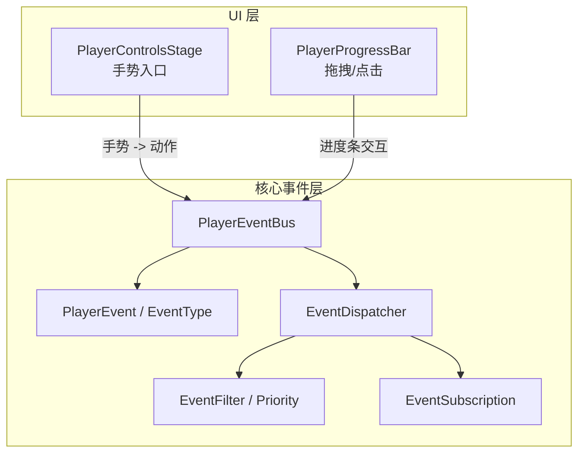
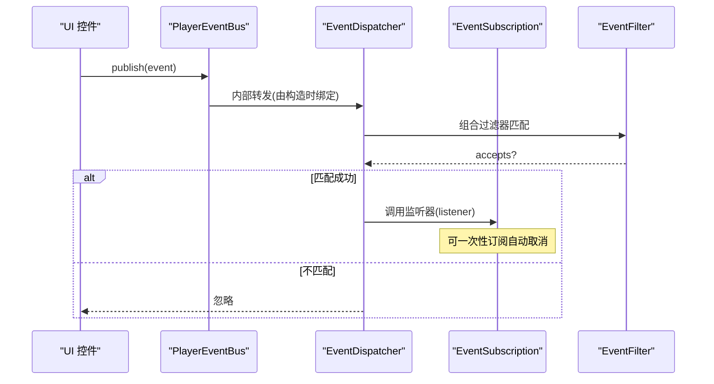
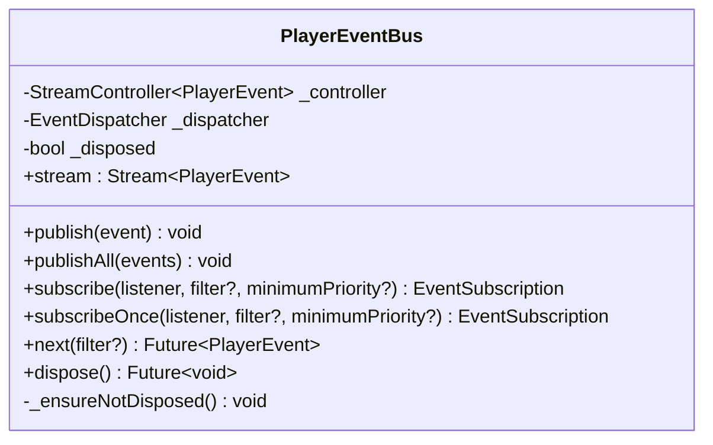
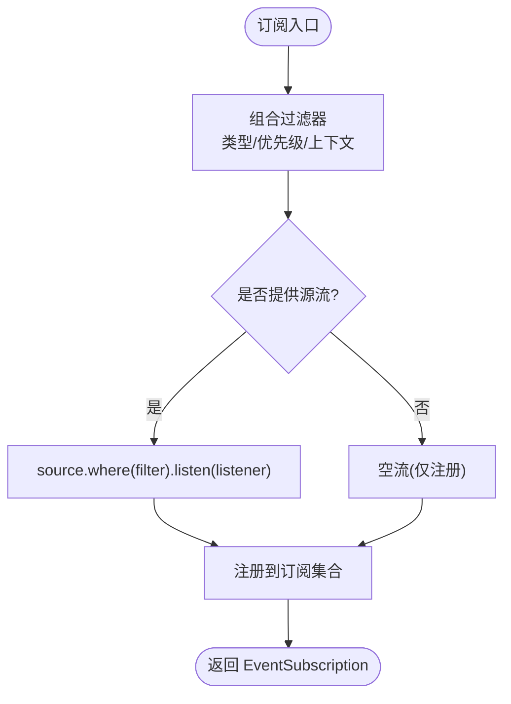
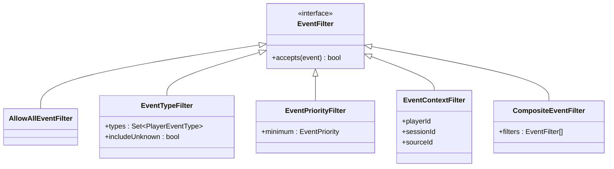
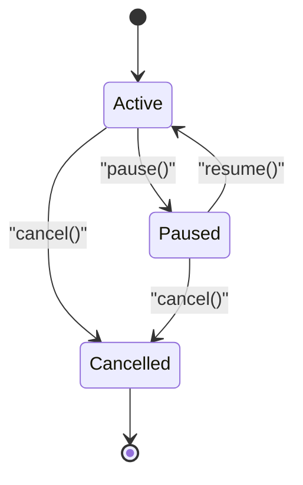
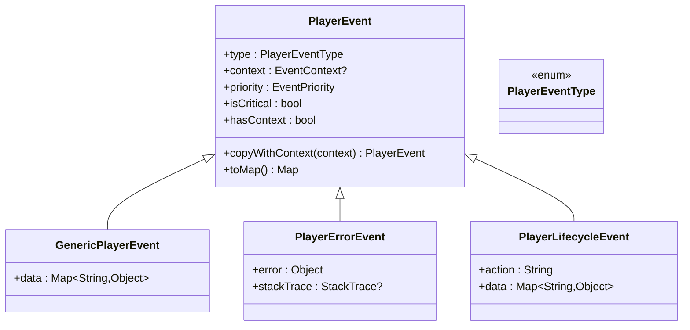
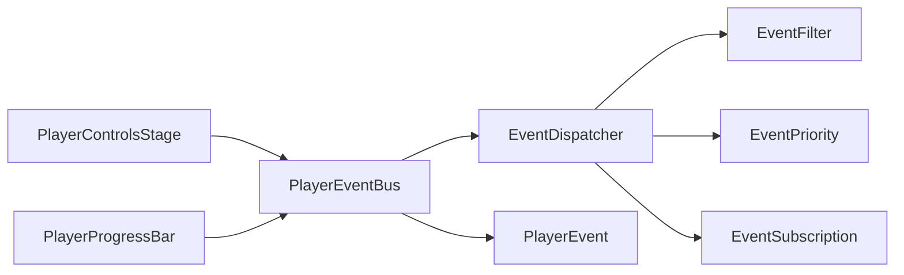
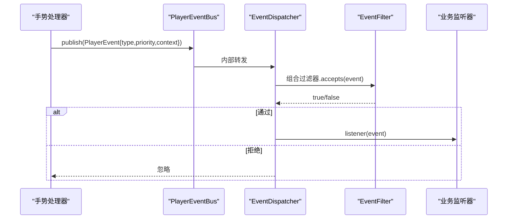

# 事件处理系统

<cite>
**本文引用的文件**   
- [player_event_bus.dart](file://packages/media_core/lib/event/player_event_bus.dart)
- [event_dispatcher.dart](file://packages/media_core/lib/event/event_dispatcher.dart)
- [event_filter.dart](file://packages/media_core/lib/event/event_filter.dart)
- [event_priority.dart](file://packages/media_core/lib/event/event_priority.dart)
- [event_subscription.dart](file://packages/media_core/lib/event/event_subscription.dart)
- [player_event.dart](file://packages/media_core/lib/event/player_event.dart)
- [player_event_type.dart](file://packages/media_core/lib/event/player_event_type.dart)
- [player_kernel.dart](file://packages/media_core/lib/kernel/player_kernel.dart)
- [player_controls_stage.dart](file://packages/media_core_ui/lib/src/common/player_controls_stage.dart)
- [player_progress_bar.dart](file://packages/media_core_ui/lib/src/common/player_progress_bar.dart)
</cite>

## 目录
1. [简介](#简介)
2. [项目结构](#项目结构)
3. [核心组件](#核心组件)
4. [架构总览](#架构总览)
5. [详细组件分析](#详细组件分析)
6. [依赖关系分析](#依赖关系分析)
7. [性能与扩展性](#性能与扩展性)
8. [交互示例与手势处理](#交互示例与手势处理)
9. [故障排查指南](#故障排查指南)
10. [结论](#结论)

## 简介
本文件系统性地梳理媒体核心中的控制组件事件处理机制，重点包括：
- 用户交互事件（点击、滑动、长按、双击等）如何被识别并转化为统一的事件流。
- PlayerEventBus 的发布订阅模型与事件分发流程。
- 过滤器、优先级与上下文在事件路由中的作用。
- 事件冒泡与阻止传播的实践技巧。
- 调试方法与常见问题定位。

该文档面向不同技术背景的读者，既提供高层架构图，也给出代码级关系图与流程图，帮助快速理解与正确使用事件系统。

## 项目结构
事件系统位于 media_core 包中，UI 层通过控件组合将手势转换为业务事件，并通过内核暴露的事件总线进行分发。关键路径如下：
- 事件定义与类型：player_event.dart、player_event_type.dart
- 事件总线与分发器：player_event_bus.dart、event_dispatcher.dart
- 过滤与优先级：event_filter.dart、event_priority.dart
- 订阅对象：event_subscription.dart
- UI 控件与手势入口：player_controls_stage.dart、player_progress_bar.dart

图示来源
- [player_controls_stage.dart](file://packages/media_core_ui/lib/src/common/player_controls_stage.dart)
- [player_progress_bar.dart](file://packages/media_core_ui/lib/src/common/player_progress_bar.dart)
- [player_event_bus.dart](file://packages/media_core/lib/event/player_event_bus.dart)
- [event_dispatcher.dart](file://packages/media_core/lib/event/event_dispatcher.dart)
- [event_filter.dart](file://packages/media_core/lib/event/event_filter.dart)
- [event_priority.dart](file://packages/media_core/lib/event/event_priority.dart)
- [event_subscription.dart](file://packages/media_core/lib/event/event_subscription.dart)
- [player_event.dart](file://packages/media_core/lib/event/player_event.dart)
- [player_event_type.dart](file://packages/media_core/lib/event/player_event_type.dart)

章节来源
- [player_event_bus.dart:1-105](file://packages/media_core/lib/event/player_event_bus.dart#L1-L105)
- [event_dispatcher.dart:1-160](file://packages/media_core/lib/event/event_dispatcher.dart#L1-L160)
- [event_filter.dart:1-118](file://packages/media_core/lib/event/event_filter.dart#L1-L118)
- [event_priority.dart:1-50](file://packages/media_core/lib/event/event_priority.dart#L1-L50)
- [event_subscription.dart:1-56](file://packages/media_core/lib/event/event_subscription.dart#L1-L56)
- [player_event.dart:1-148](file://packages/media_core/lib/event/player_event.dart#L1-L148)
- [player_event_type.dart:1-57](file://packages/media_core/lib/event/player_event_type.dart#L1-L57)
- [player_controls_stage.dart](file://packages/media_core_ui/lib/src/common/player_controls_stage.dart)
- [player_progress_bar.dart:1-47](file://packages/media_core_ui/lib/src/common/player_progress_bar.dart#L1-L47)

## 核心组件
- PlayerEventBus：统一的中央事件总线，负责发布事件、暴露只读流、创建带过滤的订阅、资源释放。
- EventDispatcher：基于流的分发器，负责订阅管理、过滤组合、一次性订阅、直接派发。
- EventFilter：无状态可组合的过滤器，支持按类型、优先级、上下文等维度筛选。
- EventPriority：事件优先级枚举与权重比较工具。
- EventSubscription：订阅句柄，封装取消、暂停/恢复等生命周期操作。
- PlayerEvent / PlayerEventType：事件基类与类别枚举，承载事件元数据与分类。

章节来源
- [player_event_bus.dart:19-104](file://packages/media_core/lib/event/player_event_bus.dart#L19-L104)
- [event_dispatcher.dart:12-159](file://packages/media_core/lib/event/event_dispatcher.dart#L12-L159)
- [event_filter.dart:8-117](file://packages/media_core/lib/event/event_filter.dart#L8-L117)
- [event_priority.dart:1-50](file://packages/media_core/lib/event/event_priority.dart#L1-L50)
- [event_subscription.dart:9-55](file://packages/media_core/lib/event/event_subscription.dart#L9-L55)
- [player_event.dart:6-148](file://packages/media_core/lib/event/player_event.dart#L6-L148)
- [player_event_type.dart:7-57](file://packages/media_core/lib/event/player_event_type.dart#L7-L57)

## 架构总览
事件从 UI 手势进入，经控制器或适配器转换为 PlayerEvent，由 PlayerEventBus 发布，EventDispatcher 根据过滤器和优先级分发给各订阅者。

图示来源
- [player_event_bus.dart:20-46](file://packages/media_core/lib/event/player_event_bus.dart#L20-L46)
- [event_dispatcher.dart:23-46](file://packages/media_core/lib/event/event_dispatcher.dart#L23-L46)
- [event_filter.dart:8-117](file://packages/media_core/lib/event/event_filter.dart#L8-L117)
- [event_subscription.dart:9-55](file://packages/media_core/lib/event/event_subscription.dart#L9-L55)

## 详细组件分析

### PlayerEventBus：发布订阅中枢
职责
- 暴露只读 Stream<PlayerEvent>。
- 提供 publish/publishAll 发布接口。
- 提供 subscribe/subscribeOnce/next 订阅接口。
- 提供 dispose 清理资源。

关键点
- 内部使用广播流 + EventDispatcher，确保多订阅者安全。
- 已释放后继续发布会抛出错误，避免悬挂引用。

图示来源
- [player_event_bus.dart:19-104](file://packages/media_core/lib/event/player_event_bus.dart#L19-L104)

章节来源
- [player_event_bus.dart:19-104](file://packages/media_core/lib/event/player_event_bus.dart#L19-L104)

### EventDispatcher：过滤与订阅编排
职责
- 订阅/取消订阅，支持一次性订阅。
- 组合过滤器（类型、优先级、上下文）。
- 直接 dispatchTo 单次派发。
- 批量取消与销毁。

关键点
- 通过 Stream.where 实现过滤链。
- 组合过滤器逻辑集中，便于扩展。

图示来源
- [event_dispatcher.dart:23-72](file://packages/media_core/lib/event/event_dispatcher.dart#L23-L72)
- [event_dispatcher.dart:138-152](file://packages/media_core/lib/event/event_dispatcher.dart#L138-L152)

章节来源
- [event_dispatcher.dart:12-159](file://packages/media_core/lib/event/event_dispatcher.dart#L12-L159)

### EventFilter 与 EventPriority：过滤与优先级
- AllowAllEventFilter：接受所有事件。
- EventTypeFilter：按事件类型过滤，支持未知类型开关。
- EventPriorityFilter：按最小优先级过滤，低/普通/高/紧急。
- EventContextFilter：按 playerId/sessionId/sourceId 过滤。
- CompositeEventFilter：组合多个过滤器，全部通过才接受。

图示来源
- [event_filter.dart:8-117](file://packages/media_core/lib/event/event_filter.dart#L8-L117)
- [event_priority.dart:1-50](file://packages/media_core/lib/event/event_priority.dart#L1-L50)

章节来源
- [event_filter.dart:8-117](file://packages/media_core/lib/event/event_filter.dart#L8-L117)
- [event_priority.dart:1-50](file://packages/media_core/lib/event/event_priority.dart#L1-L50)

### EventSubscription：订阅生命周期
- 封装底层 StreamSubscription。
- 支持 pause/resume/cancel。
- once 模式在首次回调后自动取消。
- 提供 onCancelled 钩子以移除死订阅。

图示来源
- [event_subscription.dart:9-55](file://packages/media_core/lib/event/event_subscription.dart#L9-L55)

章节来源
- [event_subscription.dart:9-55](file://packages/media_core/lib/event/event_subscription.dart#L9-L55)

### PlayerEvent 与 PlayerEventType：事件模型
- PlayerEvent：不可变事件基类，包含 type、context、priority。
- GenericPlayerEvent：通用事件，携带 data 字典。
- PlayerErrorEvent：错误事件，携带 error 与 stackTrace。
- PlayerLifecycleEvent：生命周期事件，携带 action 与 data。
- PlayerEventType：事件大类枚举，供过滤器与消费者选择。

图示来源
- [player_event.dart:6-148](file://packages/media_core/lib/event/player_event.dart#L6-L148)
- [player_event_type.dart:7-57](file://packages/media_core/lib/event/player_event_type.dart#L7-L57)

章节来源
- [player_event.dart:6-148](file://packages/media_core/lib/event/player_event.dart#L6-L148)
- [player_event_type.dart:7-57](file://packages/media_core/lib/event/player_event_type.dart#L7-L57)

## 依赖关系分析
- PlayerEventBus 依赖 EventDispatcher、EventFilter、EventPriority、EventSubscription、PlayerEvent。
- EventDispatcher 依赖 EventFilter、EventPriority、EventSubscription、PlayerEvent。
- UI 控件通过 PlayerControlsStage 与 PlayerProgressBar 将手势转为动作，最终驱动事件总线。

图示来源
- [player_controls_stage.dart](file://packages/media_core_ui/lib/src/common/player_controls_stage.dart)
- [player_progress_bar.dart:1-47](file://packages/media_core_ui/lib/src/common/player_progress_bar.dart#L1-L47)
- [player_event_bus.dart:19-104](file://packages/media_core/lib/event/player_event_bus.dart#L19-L104)
- [event_dispatcher.dart:12-159](file://packages/media_core/lib/event/event_dispatcher.dart#L12-L159)
- [event_filter.dart:8-117](file://packages/media_core/lib/event/event_filter.dart#L8-L117)
- [event_priority.dart:1-50](file://packages/media_core/lib/event/event_priority.dart#L1-L50)
- [event_subscription.dart:9-55](file://packages/media_core/lib/event/event_subscription.dart#L9-L55)
- [player_event.dart:6-148](file://packages/media_core/lib/event/player_event.dart#L6-L148)

章节来源
- [player_event_bus.dart:19-104](file://packages/media_core/lib/event/player_event_bus.dart#L19-L104)
- [event_dispatcher.dart:12-159](file://packages/media_core/lib/event/event_dispatcher.dart#L12-L159)
- [event_filter.dart:8-117](file://packages/media_core/lib/event/event_filter.dart#L8-L117)
- [event_priority.dart:1-50](file://packages/media_core/lib/event/event_priority.dart#L1-L50)
- [event_subscription.dart:9-55](file://packages/media_core/lib/event/event_subscription.dart#L9-L55)
- [player_event.dart:6-148](file://packages/media_core/lib/event/player_event.dart#L6-L148)

## 性能与扩展性
- 广播流 + 过滤器：事件仅在订阅处进行过滤，减少无效分支；复合过滤器顺序执行，注意复杂度。
- 一次性订阅：适合“等待下一个事件”的场景，避免长期持有订阅导致内存泄漏。
- 优先级：同周期内高优先级先分发，适合关键路径优先保障。
- 可扩展点：新增自定义 EventFilter（如按业务标签、设备类型），或在 UI 层将手势映射为特定 PlayerEventType。

[本节为通用指导，不直接分析具体文件]

## 交互示例与手势处理

### 手势到事件的转换
- 单击/双击：在播放器覆盖层或控件上捕获 Pointer 事件，区分单击与双击，生成对应 PlayerEventType（如 presentation/playback）。
- 长按：记录按下时间，超过阈值触发长按回调，通常用于弹出菜单或显示详情。
- 滑动/拖拽：进度条拖拽更新预览位置，松手再 seek，避免频繁命令风暴。

参考实现要点
- PlayerControlsStage 提供 onTapVideo 等回调入口，便于上层接入手势。
- PlayerProgressBar 明确“拖拽预览、松手 seek”，避免每帧 seek 造成卡顿。

章节来源
- [player_controls_stage.dart](file://packages/media_core_ui/lib/src/common/player_controls_stage.dart)
- [player_progress_bar.dart:1-47](file://packages/media_core_ui/lib/src/common/player_progress_bar.dart#L1-L47)

### 事件发布订阅流程（含过滤与优先级）

图示来源
- [player_event_bus.dart:37-55](file://packages/media_core/lib/event/player_event_bus.dart#L37-L55)
- [event_dispatcher.dart:23-46](file://packages/media_core/lib/event/event_dispatcher.dart#L23-L46)
- [event_filter.dart:8-117](file://packages/media_core/lib/event/event_filter.dart#L8-L117)

### 事件冒泡与阻止传播
- 冒泡：Flutter 手势系统默认自下而上冒泡，可在外层拦截内层事件。
- 阻止传播：在需要时通过手势判定提前 return，或使用独占手势解析器，避免多层同时响应。
- 事件级别：在业务侧可通过 EventContextFilter 精确限定 playerId/sessionId/sourceId，避免跨实例误触。

[本节为通用实践说明，不直接分析具体文件]

### 复杂手势配置建议
- 单击 vs 双击：使用延迟判定或手势冲突策略，保证唯一命中。
- 长按：设置合理阈值，结合视觉反馈（缩放/阴影）。
- 滑动：区分水平/垂直方向，必要时限制拖动范围。
- 多点触控：对缩放/平移分别建立独立手势解析器，避免互相抢占。

[本节为通用实践说明，不直接分析具体文件]

## 故障排查指南
常见问题与定位方法
- 事件未到达订阅者
  - 检查过滤器是否过严（类型/优先级/上下文）。
  - 确认订阅未被 cancel 或 dispose。
- 重复订阅或内存泄漏
  - 使用 subscribeOnce 处理一次性事件。
  - 在组件销毁时主动 cancel 订阅。
- 事件顺序不符合预期
  - 检查 EventPriority 设置，必要时调整优先级。
- 已释放后仍发布事件
  - 捕获 StateError，确保在正确生命周期内发布。

章节来源
- [event_dispatcher.dart:98-127](file://packages/media_core/lib/event/event_dispatcher.dart#L98-L127)
- [event_subscription.dart:44-55](file://packages/media_core/lib/event/event_subscription.dart#L44-L55)
- [player_event_bus.dart:88-104](file://packages/media_core/lib/event/player_event_bus.dart#L88-L104)

## 结论
本事件处理系统以 PlayerEventBus 为核心，结合 EventDispatcher 与可组合的 EventFilter，实现了清晰、可扩展且高性能的发布订阅模型。UI 层通过控件将手势标准化为事件，借助优先级与上下文过滤精准投递。遵循本文的交互设计、过滤策略与生命周期管理建议，可有效提升事件处理的正确性与可维护性。

[本节为总结性内容，不直接分析具体文件]