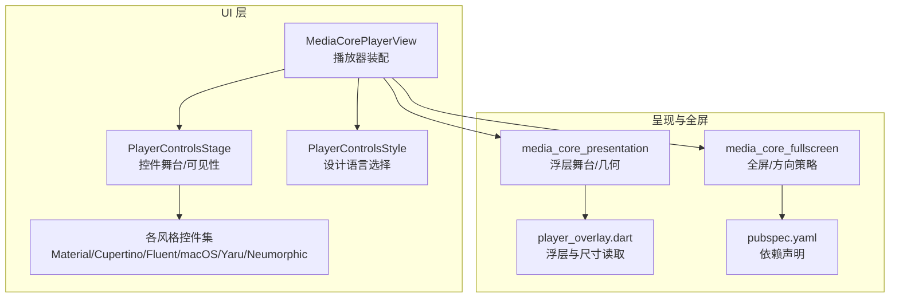
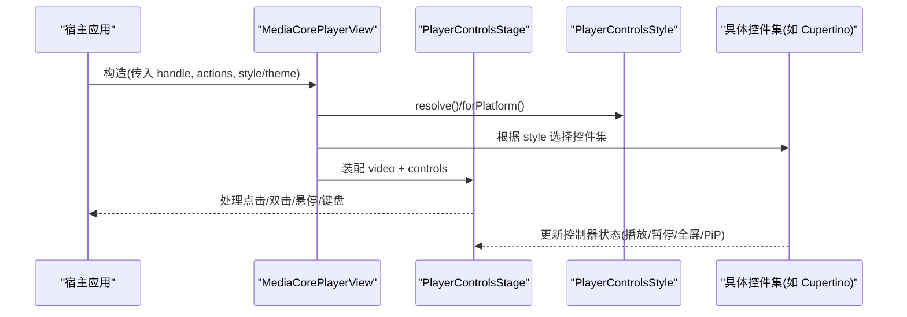
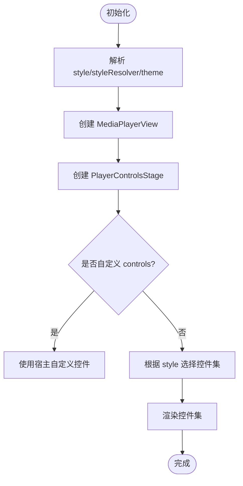
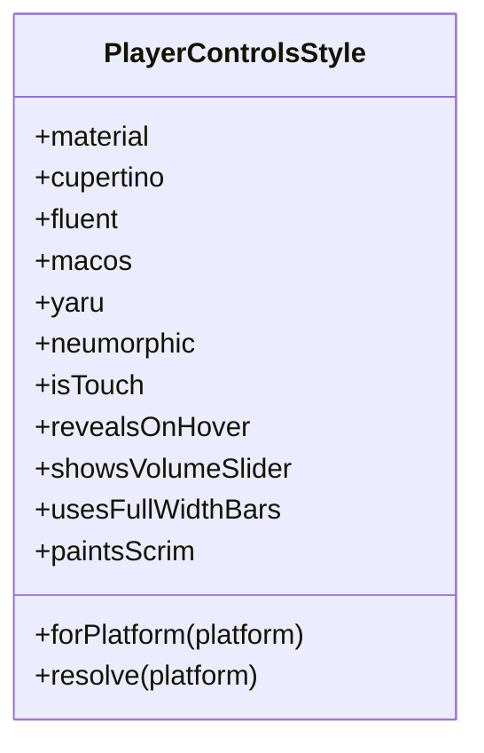
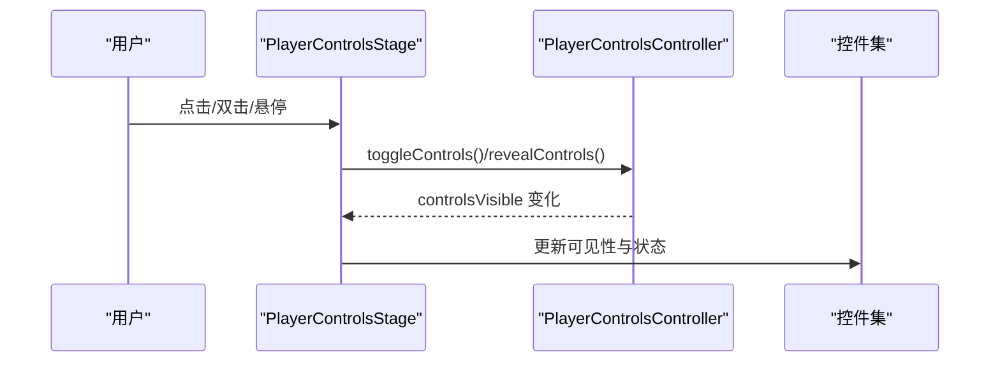
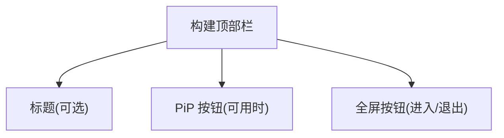
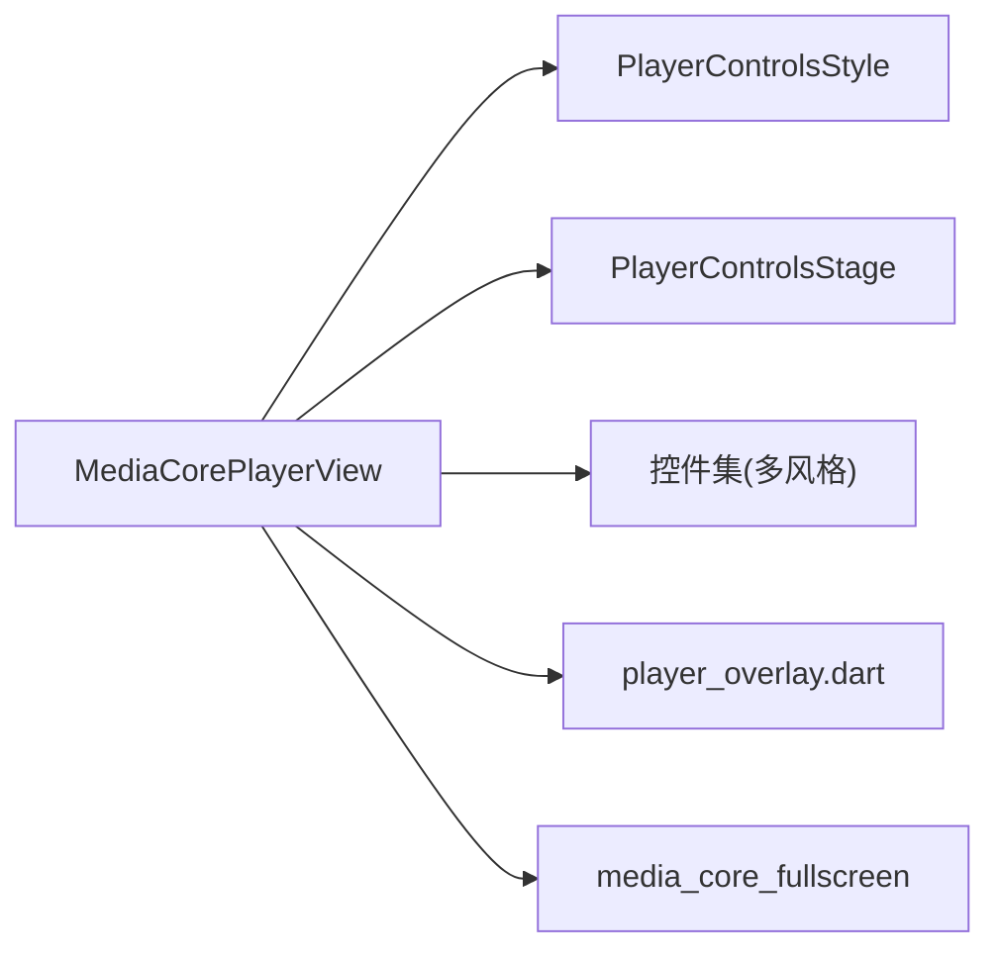

# 响应式布局设计

<cite>
**本文引用的文件**   
- [packages/media_core_ui/lib/src/media_core_player_view.dart](file://packages/media_core_ui/lib/src/media_core_player_view.dart)
- [packages/media_core_ui/lib/src/common/player_controls_style.dart](file://packages/media_core_ui/lib/src/common/player_controls_style.dart)
- [packages/media_core_ui/lib/src/common/player_controls_stage.dart](file://packages/media_core_ui/lib/src/common/player_controls_stage.dart)
- [packages/media_core_ui/lib/src/cupertino/cupertino_player_controls.dart](file://packages/media_core_ui/lib/src/cupertino/cupertino_player_controls.dart)
- [packages/media_core_presentation/lib/src/widgets/player_overlay.dart](file://packages/media_core_presentation/lib/src/widgets/player_overlay.dart)
- [packages/media_core_fullscreen/pubspec.yaml](file://packages/media_core_fullscreen/pubspec.yaml)
- [README.md](file://README.md)
</cite>

## 目录
1. [简介](#简介)
2. [项目结构](#项目结构)
3. [核心组件](#核心组件)
4. [架构总览](#架构总览)
5. [详细组件分析](#详细组件分析)
6. [依赖关系分析](#依赖关系分析)
7. [性能与体验考量](#性能与体验考量)
8. [故障排查指南](#故障排查指南)
9. [结论](#结论)
10. [附录：断点与适配策略清单](#附录断点与适配策略清单)

## 简介
本指南聚焦于媒体播放器的响应式布局设计与实现，围绕以下目标展开：
- 适配不同屏幕尺寸、方向（横竖屏切换）、平板与多分辨率场景。
- 通过样式风格与主题数据驱动一致的视觉与交互体验。
- 提供可复用的布局策略与示例路径，覆盖移动端、桌面端等平台的差异。
- 说明如何基于现有 UI 包能力构建灵活的播放器视图与控件组合。

本项目在 UI 层采用“一套控制逻辑 + 多套设计语言”的架构，通过 PlayerControlsStyle 选择 Material、Cupertino、Fluent、macOS、Yaru、Neumorphic 等风格；MediaCorePlayerView 将视频、控件、手势与键盘行为装配在一起，并交由 PlayerControlsStage 管理可见性与交互。全屏与方向策略由 media_core_fullscreen 提供，呈现层几何与浮层舞台由 media_core_presentation 支撑。

## 项目结构
UI 相关的关键代码集中在 packages/media_core_ui 与 packages/media_core_presentation，同时 README 对整体能力做了概览。

图示来源
- [packages/media_core_ui/lib/src/media_core_player_view.dart:64-356](file://packages/media_core_ui/lib/src/media_core_player_view.dart#L64-L356)
- [packages/media_core_ui/lib/src/common/player_controls_style.dart:29-122](file://packages/media_core_ui/lib/src/common/player_controls_style.dart#L29-L122)
- [packages/media_core_ui/lib/src/common/player_controls_stage.dart:140-187](file://packages/media_core_ui/lib/src/common/player_controls_stage.dart#L140-L187)
- [packages/media_core_presentation/lib/src/widgets/player_overlay.dart:264-264](file://packages/media_core_presentation/lib/src/widgets/player_overlay.dart#L264-L264)
- [packages/media_core_fullscreen/pubspec.yaml:1-28](file://packages/media_core_fullscreen/pubspec.yaml#L1-L28)

章节来源
- [README.md:105-123](file://README.md#L105-L123)
- [README.md:187-213](file://README.md#L187-L213)

## 核心组件
- MediaCorePlayerView：播放器装配器，负责视频、控件、手势、键盘与缩放控制器等的组装，并根据 style/styleResolver/theme 决定渲染风格与主题。
- PlayerControlsStyle：设计语言枚举与平台默认策略，提供 isTouch、revealsOnHover、showsVolumeSlider、usesFullWidthBars 等属性，用于指导布局与交互。
- PlayerControlsStage：控件舞台，负责控件的显隐动画、点击/双击、悬停显示、快捷键绑定等。
- 各风格控件集：Material/Cupertino/Fluent/macOS/Yaru/Neumorphic 的具体实现，遵循统一控制层契约。

章节来源
- [packages/media_core_ui/lib/src/media_core_player_view.dart:64-356](file://packages/media_core_ui/lib/src/media_core_player_view.dart#L64-L356)
- [packages/media_core_ui/lib/src/common/player_controls_style.dart:29-122](file://packages/media_core_ui/lib/src/common/player_controls_style.dart#L29-L122)
- [packages/media_core_ui/lib/src/common/player_controls_stage.dart:140-187](file://packages/media_core_ui/lib/src/common/player_controls_stage.dart#L140-L187)

## 架构总览
下图展示了从宿主到 UI 层的调用链与数据流：宿主传入 PlayerHandle 与 actions，MediaCorePlayerView 根据 style 与 theme 选择具体控件集，并由 PlayerControlsStage 管理控件可见性与交互。

图示来源
- [packages/media_core_ui/lib/src/media_core_player_view.dart:298-356](file://packages/media_core_ui/lib/src/media_core_player_view.dart#L298-L356)
- [packages/media_core_ui/lib/src/common/player_controls_style.dart:51-75](file://packages/media_core_ui/lib/src/common/player_controls_style.dart#L51-L75)
- [packages/media_core_ui/lib/src/common/player_controls_stage.dart:140-187](file://packages/media_core_ui/lib/src/common/player_controls_stage.dart#L140-L187)

## 详细组件分析

### MediaCorePlayerView：播放器装配与响应式入口
- 作用：将 MediaPlayerView（视频）与控件集组合，并通过 PlayerControlsStage 统一管理可见性与交互。
- 响应式要点：
  - style/styleResolver：可按平台或自定义规则选择设计语言，从而改变控件布局与交互（例如触控 vs 指针）。
  - theme：统一颜色、尺寸、动效等主题令牌，保证跨设备一致性。
  - doubleTapAction：触控风格默认放大，桌面风格默认进入全屏，体现平台差异。
  - showTopBar/showOverflowMenu/showSkipButtons：按宿主需求裁剪控件区域，避免重复入口。
- 关键流程：
  - initState/didUpdateWidget：同步 controller 的 style/theme/hideDelay/autoHide/keepVisibleWhenPaused/actions。
  - build：创建 MediaPlayerView，再交给 PlayerControlsStage 包裹。

图示来源
- [packages/media_core_ui/lib/src/media_core_player_view.dart:249-356](file://packages/media_core_ui/lib/src/media_core_player_view.dart#L249-L356)

章节来源
- [packages/media_core_ui/lib/src/media_core_player_view.dart:64-356](file://packages/media_core_ui/lib/src/media_core_player_view.dart#L64-L356)

### PlayerControlsStyle：设计语言与布局策略
- 设计语言：material、cupertino、fluent、macos、yaru、neumorphic。
- 平台默认：forPlatform/resolve 根据 TargetPlatform/kIsWeb 返回预期风格。
- 布局与交互属性：
  - isTouch：决定是否以触控为主（影响双击行为、音量控件展示等）。
  - revealsOnHover：桌面风格支持鼠标悬停显示控件。
  - showsVolumeSlider：桌面风格提供音量滑块。
  - usesFullWidthBars：macOS 不使用全宽条，而是悬浮药丸。
  - paintsScrim：除 neumorphic 外，其他风格会在条带后绘制遮罩。

图示来源
- [packages/media_core_ui/lib/src/common/player_controls_style.dart:29-122](file://packages/media_core_ui/lib/src/common/player_controls_style.dart#L29-L122)

章节来源
- [packages/media_core_ui/lib/src/common/player_controls_style.dart:29-122](file://packages/media_core_ui/lib/src/common/player_controls_style.dart#L29-L122)

### PlayerControlsStage：控件舞台与交互
- 职责：
  - 将控件以 Stack 形式叠加在视频之上，并在不可见时忽略指针事件。
  - 处理单击/双击、悬停显示、键盘快捷键。
  - 根据控制器状态进行淡入淡出动画。
- 响应式要点：
  - revealsOnHover：桌面风格下通过 MouseRegion 触发控件显示。
  - keyboardShortcuts：启用焦点与快捷键绑定。

图示来源
- [packages/media_core_ui/lib/src/common/player_controls_stage.dart:140-187](file://packages/media_core_ui/lib/src/common/player_controls_stage.dart#L140-L187)

章节来源
- [packages/media_core_ui/lib/src/common/player_controls_stage.dart:140-187](file://packages/media_core_ui/lib/src/common/player_controls_stage.dart#L140-L187)

### CupertinoPlayerControls：顶部栏与全屏/PiP 按钮
- 顶部渐变背景、标题、PiP 与全屏按钮。
- 在全屏与 PiP 能力受限时，按钮状态会相应禁用或切换。

图示来源
- [packages/media_core_ui/lib/src/cupertino/cupertino_player_controls.dart:95-138](file://packages/media_core_ui/lib/src/cupertino/cupertino_player_controls.dart#L95-L138)

章节来源
- [packages/media_core_ui/lib/src/cupertino/cupertino_player_controls.dart:95-138](file://packages/media_core_ui/lib/src/cupertino/cupertino_player_controls.dart#L95-L138)

### 呈现层与浮层：player_overlay.dart
- 通过 MediaQuery.of(context).size.height 获取当前高度，用于浮层定位与尺寸计算。
- 结合 PresentationGeometry 与浮层舞台，在不同屏幕尺寸下保持浮层位置与比例一致。

章节来源
- [packages/media_core_presentation/lib/src/widgets/player_overlay.dart:264-264](file://packages/media_core_presentation/lib/src/widgets/player_overlay.dart#L264-L264)

### 全屏与方向策略：media_core_fullscreen
- 提供系统全屏与窗口级全屏两种变体，并包含横竖屏适配策略。
- 依赖 window_manager 等库以支持桌面端窗口级全屏。

章节来源
- [packages/media_core_fullscreen/pubspec.yaml:1-28](file://packages/media_core_fullscreen/pubspec.yaml#L1-L28)
- [README.md:105-123](file://README.md#L105-L123)

## 依赖关系分析
- MediaCorePlayerView 依赖：
  - PlayerControlsStyle：决定控件集与交互策略。
  - PlayerControlsStage：管理控件可见性与交互。
  - 具体控件集：Material/Cupertino/Fluent/macOS/Yaru/Neumorphic。
- 呈现层依赖：
  - player_overlay.dart：读取屏幕尺寸，辅助浮层布局。
- 全屏依赖：
  - media_core_fullscreen：提供全屏与方向策略。

图示来源
- [packages/media_core_ui/lib/src/media_core_player_view.dart:298-356](file://packages/media_core_ui/lib/src/media_core_player_view.dart#L298-L356)
- [packages/media_core_ui/lib/src/common/player_controls_style.dart:51-75](file://packages/media_core_ui/lib/src/common/player_controls_style.dart#L51-L75)
- [packages/media_core_ui/lib/src/common/player_controls_stage.dart:140-187](file://packages/media_core_ui/lib/src/common/player_controls_stage.dart#L140-L187)
- [packages/media_core_presentation/lib/src/widgets/player_overlay.dart:264-264](file://packages/media_core_presentation/lib/src/widgets/player_overlay.dart#L264-L264)
- [packages/media_core_fullscreen/pubspec.yaml:1-28](file://packages/media_core_fullscreen/pubspec.yaml#L1-L28)

## 性能与体验考量
- 控件可见性动画：使用 AnimatedOpacity 与 IgnorePointer 减少无效绘制与误触。
- 悬停显示：仅在桌面风格启用 MouseRegion，避免不必要的监听。
- 键盘快捷键：按需启用，减少焦点树开销。
- 主题与样式：集中管理颜色、尺寸与动效，降低重复计算与不一致风险。

[本节为通用建议，不直接分析具体文件]

## 故障排查指南
- 控件不显示：
  - 检查 PlayerControlsStage 的 visible 状态与 autoHide 配置。
  - 确认 style.revealsOnHover 与宿主交互方式匹配（触控 vs 指针）。
- 双击行为异常：
  - 触控风格默认放大，桌面风格默认全屏；如需调整，请设置 doubleTapAction。
- 全屏/PiP 按钮不可用：
  - 检查控制器 actions 的能力判断与宿主回调是否正确注入。
- 浮层错位：
  - 核对 player_overlay.dart 中尺寸读取与浮层定位逻辑。

章节来源
- [packages/media_core_ui/lib/src/common/player_controls_stage.dart:140-187](file://packages/media_core_ui/lib/src/common/player_controls_stage.dart#L140-L187)
- [packages/media_core_ui/lib/src/media_core_player_view.dart:298-356](file://packages/media_core_ui/lib/src/media_core_player_view.dart#L298-L356)
- [packages/media_core_presentation/lib/src/widgets/player_overlay.dart:264-264](file://packages/media_core_presentation/lib/src/widgets/player_overlay.dart#L264-L264)

## 结论
通过 MediaCorePlayerView 与 PlayerControlsStyle 的组合，项目实现了“一套控制逻辑 + 多套设计语言”的响应式 UI 架构。借助 PlayerControlsStage 的可见性与交互管理，以及 media_core_fullscreen 的全屏与方向策略，可在移动端、平板与桌面端获得一致且自然的观看体验。主题数据与样式属性提供了足够的定制空间，确保在不同设备上保持一致的视觉与交互质量。

[本节为总结，不直接分析具体文件]

## 附录：断点与适配策略清单
- 设计语言选择：
  - 自动：PlayerControlsStyle.resolve()/forPlatform() 根据平台返回默认风格。
  - 强制：通过 style 参数指定任意风格，适用于跨平台统一外观。
- 触控与指针：
  - isTouch：触控风格默认放大，桌面风格默认全屏。
  - revealsOnHover：桌面风格悬停显示控件。
  - showsVolumeSlider：桌面风格提供音量滑块。
- 布局宽度：
  - usesFullWidthBars：macOS 使用悬浮药丸，其他风格使用全宽条。
- 遮罩与背景：
  - paintsScrim：除 neumorphic 外，其他风格在条带后绘制遮罩。
- 全屏与方向：
  - media_core_fullscreen 提供横竖屏适配策略，结合宿主路由与窗口管理实现。
- 浮层与尺寸：
  - player_overlay.dart 读取屏幕尺寸，用于浮层定位与比例控制。

章节来源
- [packages/media_core_ui/lib/src/common/player_controls_style.dart:51-122](file://packages/media_core_ui/lib/src/common/player_controls_style.dart#L51-L122)
- [packages/media_core_fullscreen/pubspec.yaml:1-28](file://packages/media_core_fullscreen/pubspec.yaml#L1-L28)
- [packages/media_core_presentation/lib/src/widgets/player_overlay.dart:264-264](file://packages/media_core_presentation/lib/src/widgets/player_overlay.dart#L264-L264)