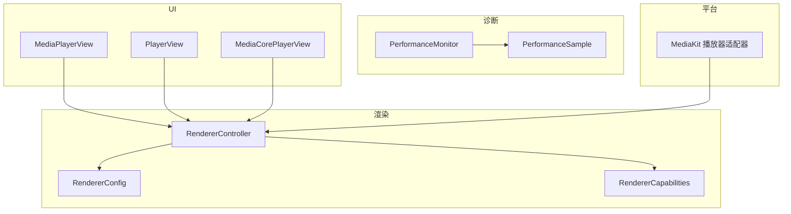
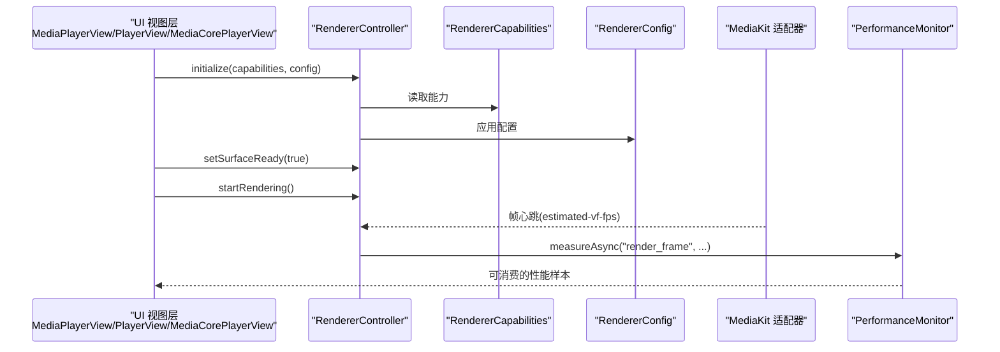
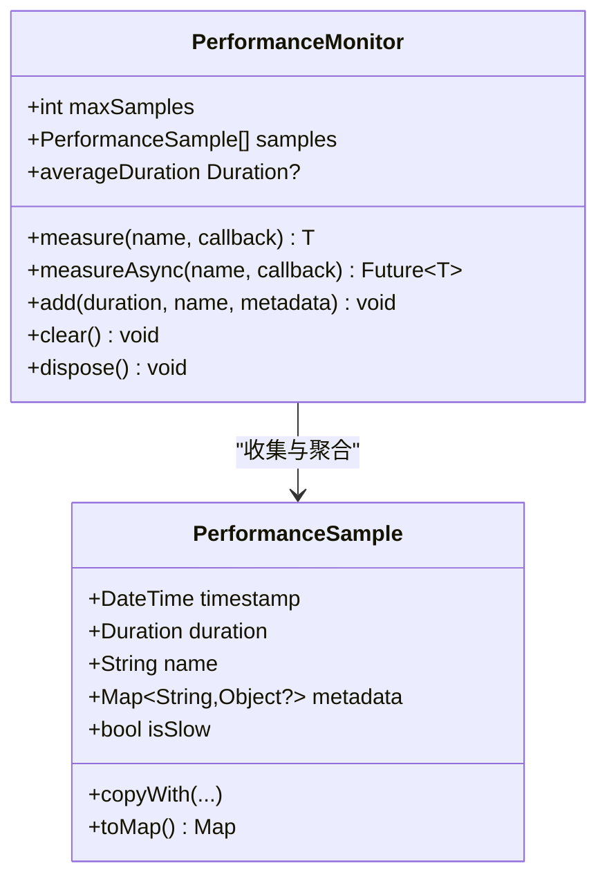
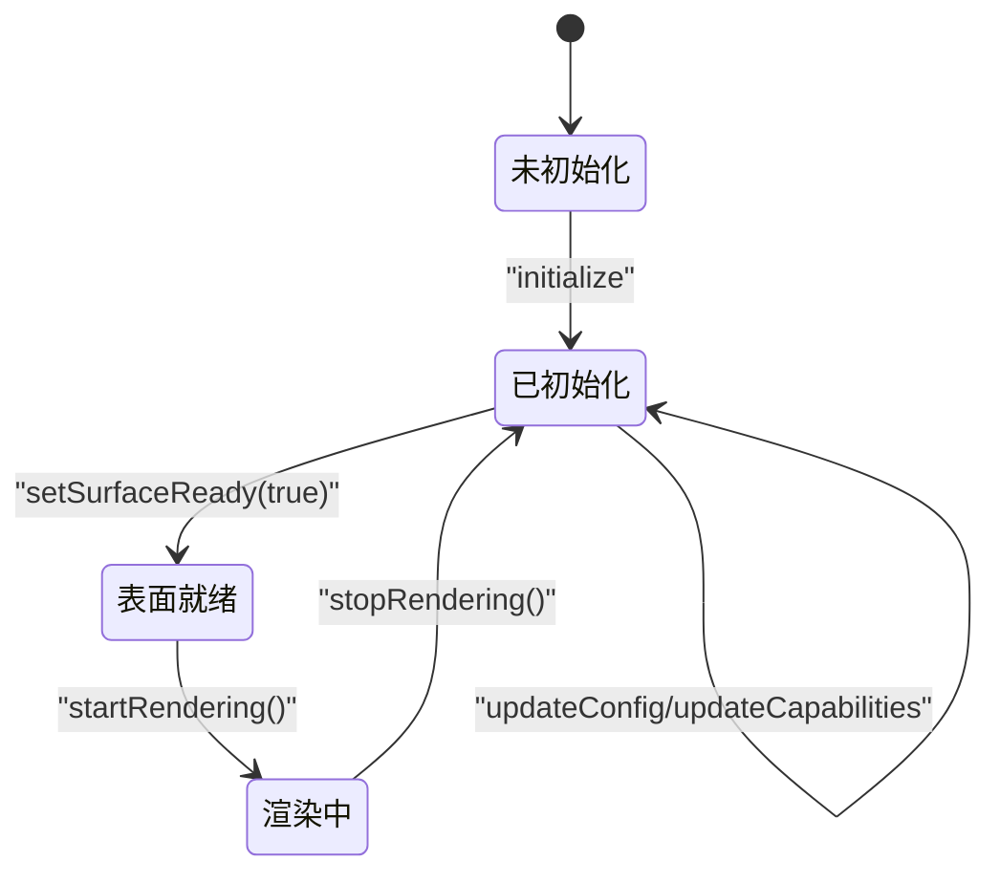
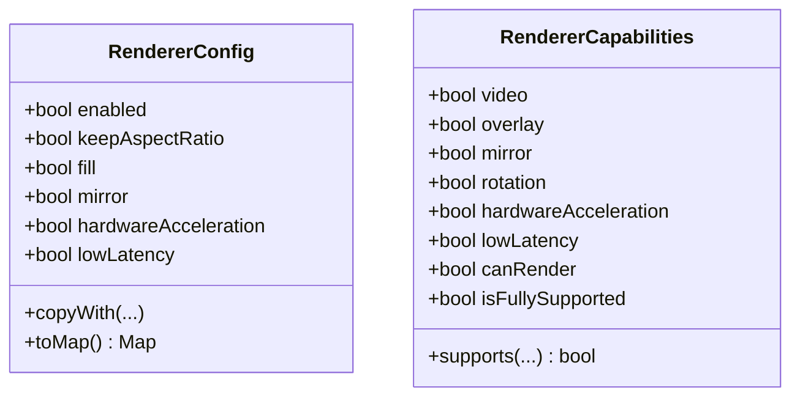
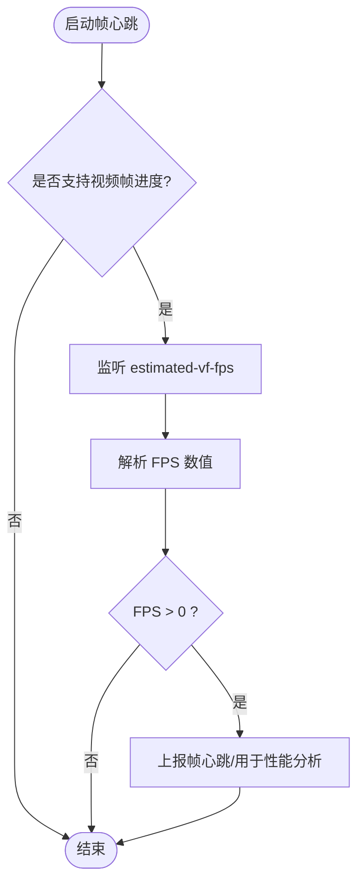
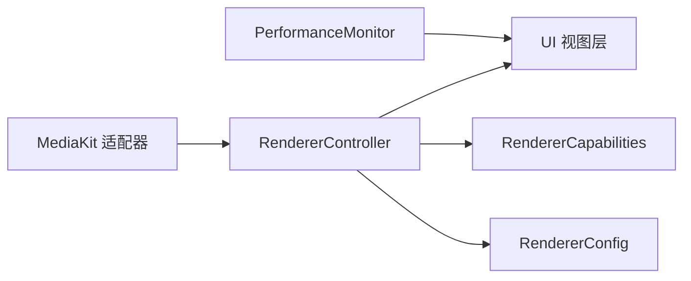
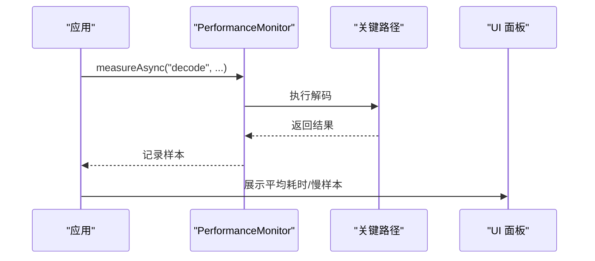

# 性能优化技巧

<cite>
**本文引用的文件**   
- [performance_monitor.dart](file://packages/media_core/lib/diagnostics/performance_monitor.dart)
- [performance_sample.dart](file://packages/media_core/lib/diagnostics/performance_sample.dart)
- [renderer_controller.dart](file://packages/media_core/lib/renderer/renderer_controller.dart)
- [renderer_config.dart](file://packages/media_core/lib/renderer/renderer_config.dart)
- [renderer_capabilities.dart](file://packages/media_core/lib/renderer/renderer_capabilities.dart)
- [media_player_view.dart](file://packages/media_core/lib/renderer/media_player_view.dart)
- [player_view.dart](file://packages/media_core/lib/renderer/player_view.dart)
- [media_core_player_view.dart](file://packages/media_core_ui/lib/src/media_core_player_view.dart)
- [media_kit_player_adapter.dart](file://packages/media_core_media_kit/lib/src/media_kit_player_adapter.dart)
- [player_error_code.dart](file://packages/media_core/lib/error/player_error_code.dart)
</cite>

## 目录
1. [简介](#简介)
2. [项目结构](#项目结构)
3. [核心组件](#核心组件)
4. [架构总览](#架构总览)
5. [详细组件分析](#详细组件分析)
6. [依赖关系分析](#依赖关系分析)
7. [性能优化策略](#性能优化策略)
8. [性能测试与调试](#性能测试与调试)
9. [故障排查指南](#故障排查指南)
10. [结论](#结论)

## 简介
本文面向自定义控制组件的性能优化，聚焦渲染路径、内存管理、CPU 使用率控制与帧率监控。文档基于仓库中的诊断与渲染子系统，系统讲解如何使用性能采样与监视工具、如何配置渲染器能力与行为、如何在 UI 层避免不必要的重建，以及如何通过懒加载、按需渲染和资源复用降低性能瓶颈。同时提供可操作的测试与调试方法，帮助开发者定位并解决性能问题。

## 项目结构
围绕“性能优化”的关键代码集中在以下模块：
- 诊断与性能采样：PerformanceMonitor、PerformanceSample
- 渲染控制器与配置：RendererController、RendererConfig、RendererCapabilities
- UI 视图层：MediaPlayerView、PlayerView、MediaCorePlayerView
- 平台适配器帧心跳：MediaKit 适配器的视频帧进度监听
- 错误码：资源压力、热压等与性能相关的错误分类

图表来源
- [performance_monitor.dart:1-168](file://packages/media_core/lib/diagnostics/performance_monitor.dart#L1-L168)
- [performance_sample.dart:1-81](file://packages/media_core/lib/diagnostics/performance_sample.dart#L1-L81)
- [renderer_controller.dart:1-188](file://packages/media_core/lib/renderer/renderer_controller.dart#L1-L188)
- [renderer_config.dart:1-110](file://packages/media_core/lib/renderer/renderer_config.dart#L1-L110)
- [renderer_capabilities.dart:42-97](file://packages/media_core/lib/renderer/renderer_capabilities.dart#L42-L97)
- [media_player_view.dart:61-142](file://packages/media_core/lib/renderer/media_player_view.dart#L61-L142)
- [player_view.dart:16-16](file://packages/media_core/lib/renderer/player_view.dart#L16-L16)
- [media_core_player_view.dart:64-201](file://packages/media_core_ui/lib/src/media_core_player_view.dart#L64-L201)
- [media_kit_player_adapter.dart:832-880](file://packages/media_core_media_kit/lib/src/media_kit_player_adapter.dart#L832-L880)

章节来源
- [performance_monitor.dart:1-168](file://packages/media_core/lib/diagnostics/performance_monitor.dart#L1-L168)
- [renderer_controller.dart:1-188](file://packages/media_core/lib/renderer/renderer_controller.dart#L1-L188)
- [renderer_config.dart:1-110](file://packages/media_core/lib/renderer/renderer_config.dart#L1-L110)
- [renderer_capabilities.dart:42-97](file://packages/media_core/lib/renderer/renderer_capabilities.dart#L42-L97)
- [media_player_view.dart:61-142](file://packages/media_core/lib/renderer/media_player_view.dart#L61-L142)
- [player_view.dart:16-16](file://packages/media_core/lib/renderer/player_view.dart#L16-L16)
- [media_core_player_view.dart:64-201](file://packages/media_core_ui/lib/src/media_core_player_view.dart#L64-L201)
- [media_kit_player_adapter.dart:832-880](file://packages/media_core_media_kit/lib/src/media_kit_player_adapter.dart#L832-L880)

## 核心组件
- PerformanceMonitor：轻量级计时与样本收集器，支持同步/异步测量、样本上限裁剪、平均时长统计与清理释放。
- PerformanceSample：单次测量的数据载体，包含时间戳、耗时、名称与结构化元数据，并提供“是否慢于单帧预算”的判断。
- RendererController：渲染生命周期与状态控制器，负责初始化、配置更新、表面就绪、开始/停止渲染、能力变更与代数（generation）管理。
- RendererConfig：渲染器配置项，包括启用开关、保持宽高比、填充模式、镜像、硬件加速与低延迟偏好。
- RendererCapabilities：设备/后端能力声明，用于判断是否支持叠加、镜像、旋转、硬件加速与低延迟渲染。
- UI 视图层：MediaPlayerView、PlayerView、MediaCorePlayerView 将 Flutter Widget 与渲染控制器对接，承载可见性与生命周期。
- MediaKit 适配器：在支持的平台上报视频帧心跳（estimated-vf-fps），作为帧进度与健康度信号。

章节来源
- [performance_monitor.dart:1-168](file://packages/media_core/lib/diagnostics/performance_monitor.dart#L1-L168)
- [performance_sample.dart:1-81](file://packages/media_core/lib/diagnostics/performance_sample.dart#L1-L81)
- [renderer_controller.dart:1-188](file://packages/media_core/lib/renderer/renderer_controller.dart#L1-L188)
- [renderer_config.dart:1-110](file://packages/media_core/lib/renderer/renderer_config.dart#L1-L110)
- [renderer_capabilities.dart:42-97](file://packages/media_core/lib/renderer/renderer_capabilities.dart#L42-L97)
- [media_player_view.dart:61-142](file://packages/media_core/lib/renderer/media_player_view.dart#L61-L142)
- [player_view.dart:16-16](file://packages/media_core/lib/renderer/player_view.dart#L16-L16)
- [media_core_player_view.dart:64-201](file://packages/media_core_ui/lib/src/media_core_player_view.dart#L64-L201)
- [media_kit_player_adapter.dart:832-880](file://packages/media_core_media_kit/lib/src/media_kit_player_adapter.dart#L832-L880)

## 架构总览
下图展示从 UI 到渲染与诊断的端到端链路，以及帧心跳对性能监控的支撑作用。

图表来源
- [renderer_controller.dart:60-107](file://packages/media_core/lib/renderer/renderer_controller.dart#L60-L107)
- [renderer_capabilities.dart:42-97](file://packages/media_core/lib/renderer/renderer_capabilities.dart#L42-L97)
- [renderer_config.dart:15-62](file://packages/media_core/lib/renderer/renderer_config.dart#L15-L62)
- [media_kit_player_adapter.dart:832-880](file://packages/media_core_media_kit/lib/src/media_kit_player_adapter.dart#L832-L880)
- [performance_monitor.dart:90-128](file://packages/media_core/lib/diagnostics/performance_monitor.dart#L90-L128)

## 详细组件分析

### 性能采样与监视：PerformanceMonitor 与 PerformanceSample
- 职责边界
  - PerformanceMonitor：采集、裁剪、聚合；不负责业务策略、渲染或持久化。
  - PerformanceSample：记录一次测量结果，提供 isSlow 判定（默认以 16ms 为单帧预算）。
- 关键用法
  - measure / measureAsync：自动捕获同步/异步操作耗时，异常也会计入。
  - samples / averageDuration：获取最近样本与平均耗时，便于绘制趋势图或告警。
  - maxSamples：限制内存占用，超出时丢弃最旧样本。
- 复杂度与内存
  - 添加样本 O(1)，裁剪 O(k)（k 为超出的样本数），通常很小。
  - 建议根据场景设置合理的 maxSamples，避免长时间运行导致内存增长。

图表来源
- [performance_monitor.dart:29-168](file://packages/media_core/lib/diagnostics/performance_monitor.dart#L29-L168)
- [performance_sample.dart:25-81](file://packages/media_core/lib/diagnostics/performance_sample.dart#L25-L81)

章节来源
- [performance_monitor.dart:1-168](file://packages/media_core/lib/diagnostics/performance_monitor.dart#L1-L168)
- [performance_sample.dart:1-81](file://packages/media_core/lib/diagnostics/performance_sample.dart#L1-L81)

### 渲染控制器：RendererController
- 职责边界
  - 维护渲染状态流、生成代数（generation）、能力与配置更新、表面就绪与渲染启停。
  - 不直接创建平台表面、不控制播放几何、不调用平台 API。
- 关键流程
  - initialize：注入能力与配置，推进状态。
  - updateConfig / updateCapabilities：动态调整渲染行为与能力。
  - setSurfaceReady / startRendering / stopRendering：控制渲染生命周期。
  - nextGeneration / restore：处理原生渲染器重建后的代数一致性。
- 性能要点
  - 通过 state 流驱动 UI，避免重复构建。
  - generation 机制确保异步回调不会覆盖新实例的状态。

图表来源
- [renderer_controller.dart:60-138](file://packages/media_core/lib/renderer/renderer_controller.dart#L60-L138)

章节来源
- [renderer_controller.dart:1-188](file://packages/media_core/lib/renderer/renderer_controller.dart#L1-L188)

### 渲染配置与能力：RendererConfig 与 RendererCapabilities
- RendererConfig
  - enabled：是否启用渲染。
  - keepAspectRatio：保持源宽高比。
  - fill：是否填充可用区域。
  - mirror：镜像。
  - hardwareAcceleration：优先硬件加速。
  - lowLatency：优先低延迟。
- RendererCapabilities
  - video/overlay/mirror/rotation/hardwareAcceleration/lowLatency：能力位。
  - supports(...)：校验请求配置是否被能力集支持。
- 性能影响
  - 关闭非必要特性（如 mirror、fill）可减少计算与拷贝。
  - 开启 hardwareAcceleration 可降低 CPU 负载。
  - lowLatency 可能牺牲部分稳定性，需结合场景权衡。

图表来源
- [renderer_config.dart:15-110](file://packages/media_core/lib/renderer/renderer_config.dart#L15-L110)
- [renderer_capabilities.dart:42-97](file://packages/media_core/lib/renderer/renderer_capabilities.dart#L42-L97)

章节来源
- [renderer_config.dart:1-110](file://packages/media_core/lib/renderer/renderer_config.dart#L1-L110)
- [renderer_capabilities.dart:42-97](file://packages/media_core/lib/renderer/renderer_capabilities.dart#L42-L97)

### UI 视图层：MediaPlayerView / PlayerView / MediaCorePlayerView
- MediaPlayerView：Flutter 侧 StatefulWidget，承载渲染控制器与生命周期。
- PlayerView：无状态视图，常用于组合与复用。
- MediaCorePlayerView：UI 包提供的具体实现，封装了控件外观与交互。
- 优化建议
  - 使用 const 构造与不可变配置，减少 rebuild。
  - 仅在 surfaceReady 且 rendering 为真时进行重绘。
  - 将复杂子树包裹在 RepaintBoundary 或 ValueListenableBuilder 中，缩小重绘范围。

章节来源
- [media_player_view.dart:61-142](file://packages/media_core/lib/renderer/media_player_view.dart#L61-L142)
- [player_view.dart:16-16](file://packages/media_core/lib/renderer/player_view.dart#L16-L16)
- [media_core_player_view.dart:64-201](file://packages/media_core_ui/lib/src/media_core_player_view.dart#L64-L201)

### 帧心跳与帧率监控：MediaKit 适配器
- 通过 observeProperty('estimated-vf-fps') 获取视频输出心跳。
- 该值仅作为心跳信号，不代表精确解码帧计数。
- 当 FPS 有效且大于 0 时，可作为帧进度健康指标，辅助性能分析与卡顿检测。

图表来源
- [media_kit_player_adapter.dart:832-880](file://packages/media_core_media_kit/lib/src/media_kit_player_adapter.dart#L832-L880)

章节来源
- [media_kit_player_adapter.dart:832-880](file://packages/media_core_media_kit/lib/src/media_kit_player_adapter.dart#L832-L880)

## 依赖关系分析
- 诊断与渲染解耦：PerformanceMonitor 不感知渲染细节，只接收耗时样本。
- 渲染控制器与 UI 解耦：UI 通过 state 流订阅渲染状态，避免直接耦合平台实现。
- 能力与配置分离：RendererCapabilities 描述“能做什么”，RendererConfig 表达“想怎么做”，由 supports 做兼容性校验。
- 平台适配器作为帧心跳来源，向上游提供健康信号。

图表来源
- [performance_monitor.dart:1-168](file://packages/media_core/lib/diagnostics/performance_monitor.dart#L1-L168)
- [renderer_controller.dart:1-188](file://packages/media_core/lib/renderer/renderer_controller.dart#L1-L188)
- [renderer_capabilities.dart:42-97](file://packages/media_core/lib/renderer/renderer_capabilities.dart#L42-L97)
- [renderer_config.dart:1-110](file://packages/media_core/lib/renderer/renderer_config.dart#L1-L110)
- [media_kit_player_adapter.dart:832-880](file://packages/media_core_media_kit/lib/src/media_kit_player_adapter.dart#L832-L880)

章节来源
- [performance_monitor.dart:1-168](file://packages/media_core/lib/diagnostics/performance_monitor.dart#L1-L168)
- [renderer_controller.dart:1-188](file://packages/media_core/lib/renderer/renderer_controller.dart#L1-L188)
- [renderer_capabilities.dart:42-97](file://packages/media_core/lib/renderer/renderer_capabilities.dart#L42-L97)
- [renderer_config.dart:1-110](file://packages/media_core/lib/renderer/renderer_config.dart#L1-L110)
- [media_kit_player_adapter.dart:832-880](file://packages/media_core_media_kit/lib/src/media_kit_player_adapter.dart#L832-L880)

## 性能优化策略

### 渲染优化
- 条件渲染
  - 仅在 surfaceReady 且 rendering 为真时执行重绘逻辑，避免无效绘制。
  - 使用 RendererController.state 流驱动 UI，减少手动 setState 频率。
- 配置调优
  - 关闭不必要的 mirror/fill，降低像素处理开销。
  - 开启 hardwareAcceleration，利用 GPU 加速。
  - 谨慎开启 lowLatency，结合场景评估稳定性与功耗。
- 重绘范围控制
  - 将稳定子树用 const 或 RepaintBoundary 隔离。
  - 使用 ValueListenableBuilder 精准订阅变化。

章节来源
- [renderer_controller.dart:81-107](file://packages/media_core/lib/renderer/renderer_controller.dart#L81-L107)
- [renderer_config.dart:46-62](file://packages/media_core/lib/renderer/renderer_config.dart#L46-L62)
- [renderer_capabilities.dart:71-97](file://packages/media_core/lib/renderer/renderer_capabilities.dart#L71-L97)

### 内存管理
- 样本上限
  - 合理设置 PerformanceMonitor.maxSamples，防止长时运行内存增长。
- 及时释放
  - 调用 dispose 清理样本与流，避免泄漏。
- 资源压力
  - 关注 memoryPressure 与 thermalPressure 错误码，必要时降级渲染质量或暂停非关键任务。

章节来源
- [performance_monitor.dart:30-36](file://packages/media_core/lib/diagnostics/performance_monitor.dart#L30-L36)
- [performance_monitor.dart:137-148](file://packages/media_core/lib/diagnostics/performance_monitor.dart#L137-L148)
- [player_error_code.dart:213-222](file://packages/media_core/lib/error/player_error_code.dart#L213-L222)

### CPU 使用率控制
- 帧心跳监控
  - 借助 estimated-vf-fps 心跳判断帧进度是否正常，发现停滞及时降级或提示。
- 异步测量
  - 使用 measureAsync 包裹解码、网络、IO 等耗时操作，识别热点。
- 能力回退
  - 若 capabilities.canRender 为假，自动停止渲染，避免空转。

章节来源
- [media_kit_player_adapter.dart:832-880](file://packages/media_core_media_kit/lib/src/media_kit_player_adapter.dart#L832-L880)
- [performance_monitor.dart:108-128](file://packages/media_core/lib/diagnostics/performance_monitor.dart#L108-L128)
- [renderer_controller.dart:113-123](file://packages/media_core/lib/renderer/renderer_controller.dart#L113-L123)

### 懒加载与按需渲染
- 可见性触发
  - 仅在组件进入视口时初始化 RendererController 并启动渲染。
- 预取与缓存
  - 对即将出现的媒体项进行预加载，但限制并发与缓存大小。
- 复用策略
  - 复用播放器实例与纹理，避免频繁创建销毁。

[本节为概念性内容，无需列出具体文件来源]

### 资源复用
- 统一资源预算
  - 通过全局 ResourceManager 控制多路播放的资源分配与降级。
- 池化对象
  - 对解码器、纹理等资源进行池化管理，减少分配抖动。

[本节为概念性内容，无需列出具体文件来源]

## 性能测试与调试

### 帧率监控与性能分析
- 使用 PerformanceMonitor.measureAsync 包裹关键路径（解码、合成、IO）。
- 通过 samples 与 averageDuration 观察趋势，结合 isSlow 阈值筛选慢样本。
- 结合 estimated-vf-fps 心跳，区分“解码慢”和“渲染慢”。

图表来源
- [performance_monitor.dart:108-128](file://packages/media_core/lib/diagnostics/performance_monitor.dart#L108-L128)
- [performance_sample.dart:41-46](file://packages/media_core/lib/diagnostics/performance_sample.dart#L41-L46)

章节来源
- [performance_monitor.dart:108-128](file://packages/media_core/lib/diagnostics/performance_monitor.dart#L108-L128)
- [performance_sample.dart:41-46](file://packages/media_core/lib/diagnostics/performance_sample.dart#L41-L46)

### 定位性能瓶颈
- 分层测量
  - 在 Source、Decoder、Renderer、UI 各层分别埋点，定位瓶颈阶段。
- 能力与配置检查
  - 确认 RendererCapabilities 是否满足需求，必要时回退到软件渲染或降低画质。
- 心跳异常
  - 若 estimated-vf-fps 长期为 0 或波动剧烈，检查网络、解码与渲染管线。

章节来源
- [renderer_capabilities.dart:71-97](file://packages/media_core/lib/renderer/renderer_capabilities.dart#L71-L97)
- [media_kit_player_adapter.dart:832-880](file://packages/media_core_media_kit/lib/src/media_kit_player_adapter.dart#L832-L880)

### 实际优化案例与最佳实践
- 案例一：列表页滑动卡顿
  - 现象：快速滑动时掉帧明显。
  - 措施：关闭 mirror/fill；对离屏项暂停渲染；使用 RepaintBoundary 隔离静态控件；限制每屏同时渲染数量。
  - 验证：观察 averageDuration 下降，isSlow 比例降低。
- 案例二：首帧慢
  - 现象：首次播放首帧时间长。
  - 措施：预热解码器；开启 hardwareAcceleration；对首帧路径单独 measureAsync 埋点。
  - 验证：首帧耗时分布右移改善。
- 案例三：后台恢复后画面停滞
  - 现象：回到前台后画面不更新。
  - 措施：监听 estimated-vf-fps 心跳，若长时间无心跳则重启渲染或重新初始化。
  - 验证：心跳恢复，渲染状态回到“渲染中”。

[本节为实践总结，无需列出具体文件来源]

## 故障排查指南
- 常见错误码
  - resourceUnavailable / resourceLimitExceeded：资源不可用或超限，应降级或释放资源。
  - memoryPressure / thermalPressure：内存或温度压力，应降低画质、暂停非关键任务。
  - rendererInitializationFailed：渲染初始化失败，检查能力与配置是否匹配。
- 排查步骤
  - 查看 PerformanceMonitor 的 lastDuration 与 averageDuration 是否突增。
  - 检查 RendererController 的 rendering 与 surfaceReady 状态是否正确流转。
  - 核对 RendererCapabilities 与 RendererConfig 是否冲突。
  - 观察 estimated-vf-fps 心跳是否持续。

章节来源
- [player_error_code.dart:213-233](file://packages/media_core/lib/error/player_error_code.dart#L213-L233)
- [performance_monitor.dart:56-76](file://packages/media_core/lib/diagnostics/performance_monitor.dart#L56-L76)
- [renderer_controller.dart:95-107](file://packages/media_core/lib/renderer/renderer_controller.dart#L95-L107)
- [renderer_capabilities.dart:71-97](file://packages/media_core/lib/renderer/renderer_capabilities.dart#L71-L97)
- [media_kit_player_adapter.dart:832-880](file://packages/media_core_media_kit/lib/src/media_kit_player_adapter.dart#L832-L880)

## 结论
通过 PerformanceMonitor 与 PerformanceSample 建立统一的性能观测体系，结合 RendererController 的生命周期管理与 RendererConfig/RendererCapabilities 的能力约束，可以在 UI 层实现高效的懒加载、按需渲染与资源复用。配合 MediaKit 适配器的帧心跳，能够准确识别解码与渲染瓶颈，并通过硬件加速、配置回退与重绘范围控制等手段显著降低 CPU 与内存压力。建议在关键路径全面埋点、设定合理的阈值与回退策略，并在不同设备上持续回归验证，以获得稳定流畅的用户体验。