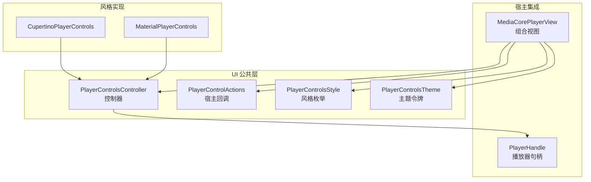
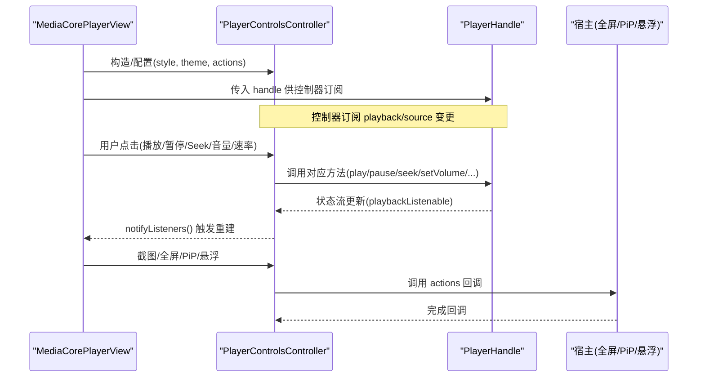
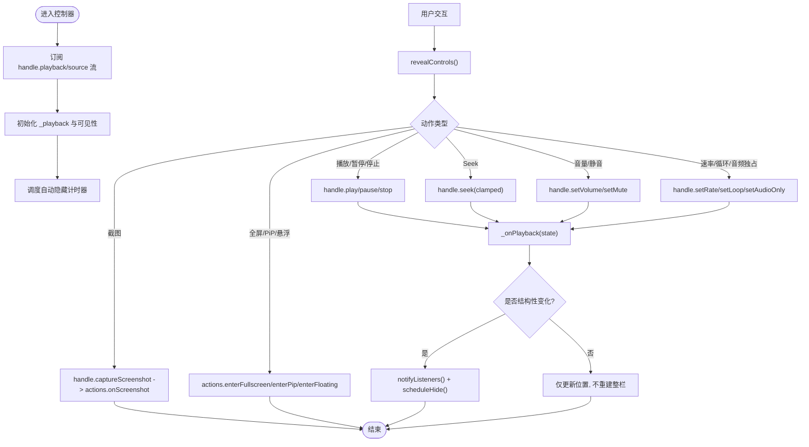
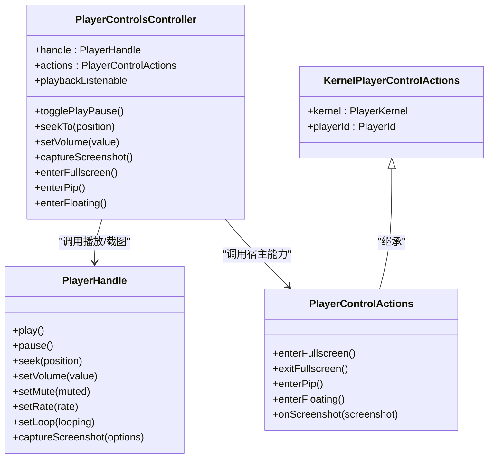
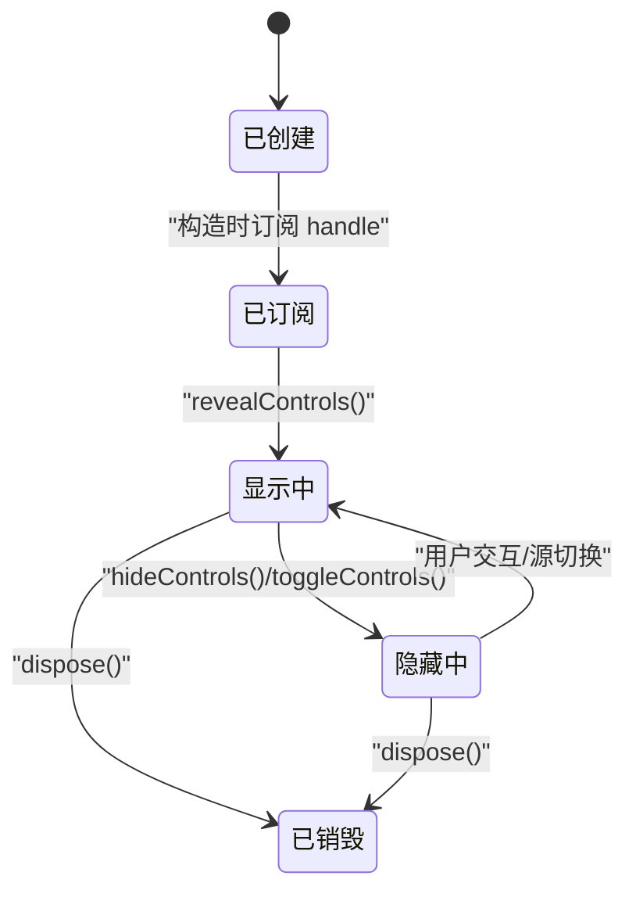
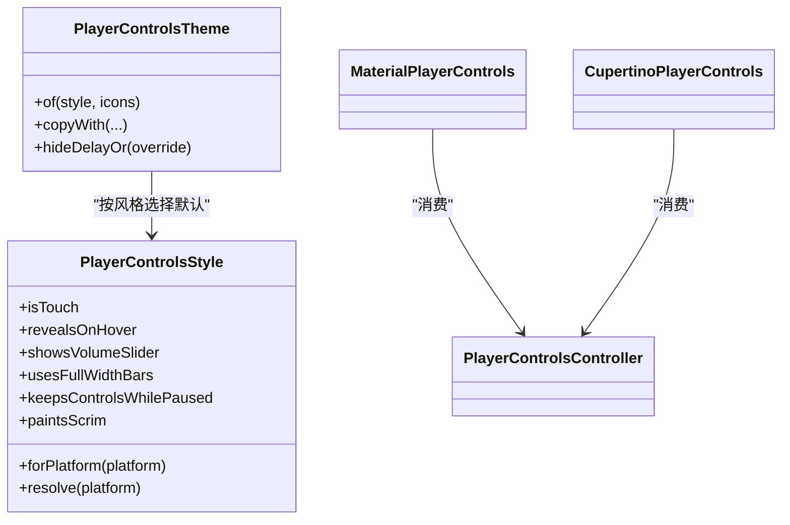
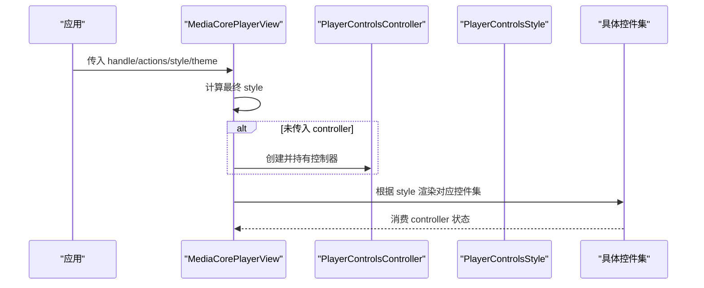
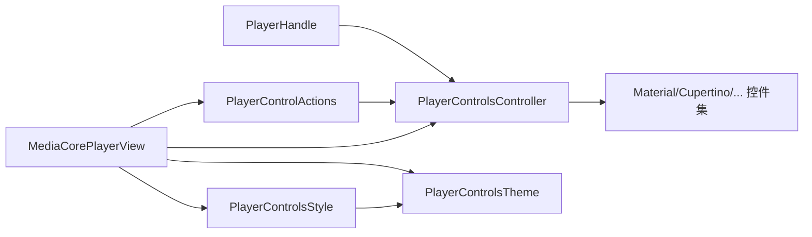

# 控制组件架构设计

<cite>
**本文引用的文件**   
- [player_controls_controller.dart](file://packages/media_core_ui/lib/src/common/player_controls_controller.dart)
- [media_core_player_view.dart](file://packages/media_core_ui/lib/src/media_core_player_view.dart)
- [player_control_actions.dart](file://packages/media_core_ui/lib/src/common/player_control_actions.dart)
- [player_controls_style.dart](file://packages/media_core_ui/lib/src/common/player_controls_style.dart)
- [player_controls_theme.dart](file://packages/media_core_ui/lib/src/common/player_controls_theme.dart)
- [material_player_controls.dart](file://packages/media_core_ui/lib/src/material/material_player_controls.dart)
- [cupertino_player_controls.dart](file://packages/media_core_ui/lib/src/cupertino/cupertino_player_controls.dart)
- [media_core_ui.dart](file://packages/media_core_ui/lib/media_core_ui.dart)
- [player_handle.dart](file://packages/media_core/lib/kernel/player_handle.dart)
</cite>

## 目录
1. [简介](#简介)
2. [项目结构](#项目结构)
3. [核心组件](#核心组件)
4. [架构总览](#架构总览)
5. [详细组件分析](#详细组件分析)
6. [依赖关系分析](#依赖关系分析)
7. [性能与可扩展性](#性能与可扩展性)
8. [故障排查指南](#故障排查指南)
9. [结论](#结论)

## 简介
本文聚焦媒体播放 UI 层的“控制组件”架构，围绕以下目标展开：
- 解释自定义控制组件的整体架构模式：基础控件抽象、控制器驱动、主题与风格解耦。
- 深入讲解 PlayerControlsController 的工作原理、数据流与生命周期管理。
- 说明如何通过控制器与播放器内核通信，以及宿主如何注入全屏、画中画、悬浮窗等能力。
- 梳理继承层次结构与扩展点，帮助开发者正确继承和扩展现有控件。
- 提供架构图表与代码路径示例，总结最佳实践。

## 项目结构
UI 层采用“共享控制层 + 多风格实现”的拆分方式：
- common：控制器、动作、主题、风格、进度条等共享逻辑。
- material/cupertino/fluent/macos/yaru/neumorphic：各视觉风格的无状态控件集。
- media_core_player_view：组合视图，负责选择风格、装配控制器、手势与键盘映射。

图表来源
- [media_core_ui.dart:10-30](file://packages/media_core_ui/lib/media_core_ui.dart#L10-L30)
- [media_core_player_view.dart:96-133](file://packages/media_core_ui/lib/src/media_core_player_view.dart#L96-L133)
- [player_controls_controller.dart:10-30](file://packages/media_core_ui/lib/src/common/player_controls_controller.dart#L10-L30)

章节来源
- [media_core_ui.dart:10-30](file://packages/media_core_ui/lib/media_core_ui.dart#L10-L30)
- [media_core_player_view.dart:96-133](file://packages/media_core_ui/lib/src/media_core_player_view.dart#L96-L133)

## 核心组件
- PlayerControlsController：控制器的核心，桥接播放器状态与 UI 可见性，暴露播放/seek/音量/速率/截图/全屏/PiP/悬浮窗等动作。
- PlayerControlActions：承载宿主侧能力（全屏、PiP、悬浮窗、截图），以回调形式注入，避免 UI 层耦合平台 API。
- PlayerControlsStyle：定义视觉语言（Material/Cupertino/Fluent/macOS/Yaru/Neumorphic），并提供平台默认解析。
- PlayerControlsTheme：颜色、尺寸、交互反馈等主题令牌，按风格提供默认值并可覆盖。
- MaterialPlayerControls / CupertinoPlayerControls：具体风格的无状态控件集，仅消费控制器状态并调用其动作。
- MediaCorePlayerView：组合入口，装配 handle、actions、style/theme、手势与键盘，按需创建或复用控制器。

章节来源
- [player_controls_controller.dart:10-30](file://packages/media_core_ui/lib/src/common/player_controls_controller.dart#L10-L30)
- [player_control_actions.dart:1-26](file://packages/media_core_ui/lib/src/common/player_control_actions.dart#L1-L26)
- [player_controls_style.dart:4-28](file://packages/media_core_ui/lib/src/common/player_controls_style.dart#L4-L28)
- [player_controls_theme.dart:49-63](file://packages/media_core_ui/lib/src/common/player_controls_theme.dart#L49-L63)
- [material_player_controls.dart:8-24](file://packages/media_core_ui/lib/src/material/material_player_controls.dart#L8-L24)
- [cupertino_player_controls.dart:8-26](file://packages/media_core_ui/lib/src/cupertino/cupertino_player_controls.dart#L8-L26)
- [media_core_ui.dart:10-30](file://packages/media_core_ui/lib/media_core_ui.dart#L10-L30)

## 架构总览
控制层遵循“控制器驱动 + 无状态视图 + 主题/风格解耦”的模式：
- 控制器订阅 PlayerHandle 的状态流，维护本地可监听状态与可见性策略。
- 视图只读控制器状态，不直接操作播放器；所有写操作通过控制器转发到 handle。
- 宿主通过 PlayerControlActions 注入跨进程/跨窗口能力，控制器不感知平台细节。
- 风格与主题分别决定“长什么样”和“怎么交互”，彼此独立且可替换。

图表来源
- [media_core_player_view.dart:333-355](file://packages/media_core_ui/lib/src/media_core_player_view.dart#L333-L355)
- [player_controls_controller.dart:42-62](file://packages/media_core_ui/lib/src/common/player_controls_controller.dart#L42-L62)
- [player_control_actions.dart:105-130](file://packages/media_core_ui/lib/src/common/player_control_actions.dart#L105-L130)

## 详细组件分析

### PlayerControlsController：工作原理与数据流
职责边界
- 镜像播放器状态给 UI，暴露控制动作，管理控件可见性与自动隐藏。
- 不构建 UI，不拥有播放器，仅借用 PlayerHandle。

两条通知路径
- ChangeNotifier：结构性变化（播放/暂停、音量、速率、循环、源、可见性、能力）。
- playbackListenable：高频 tick（位置驱动控件如进度条）。

关键流程
- 构造时订阅 handle.stateChanges 与 handle.sourceChanges，初始化 _playback 与定时器。
- 用户交互统一先 revealControls()，再执行底层操作。
- 自动隐藏使用 Timer，结合 isPlaying 与 keepVisibleWhenPaused 策略。

图表来源
- [player_controls_controller.dart:42-62](file://packages/media_core_ui/lib/src/common/player_controls_controller.dart#L42-L62)
- [player_controls_controller.dart:260-318](file://packages/media_core_ui/lib/src/common/player_controls_controller.dart#L260-L318)
- [player_controls_controller.dart:372-523](file://packages/media_core_ui/lib/src/common/player_controls_controller.dart#L372-L523)
- [player_controls_controller.dart:543-584](file://packages/media_core_ui/lib/src/common/player_controls_controller.dart#L543-L584)

章节来源
- [player_controls_controller.dart:10-30](file://packages/media_core_ui/lib/src/common/player_controls_controller.dart#L10-L30)
- [player_controls_controller.dart:42-62](file://packages/media_core_ui/lib/src/common/player_controls_controller.dart#L42-L62)
- [player_controls_controller.dart:260-318](file://packages/media_core_ui/lib/src/common/player_controls_controller.dart#L260-L318)
- [player_controls_controller.dart:372-523](file://packages/media_core_ui/lib/src/common/player_controls_controller.dart#L372-L523)
- [player_controls_controller.dart:543-584](file://packages/media_core_ui/lib/src/common/player_controls_controller.dart#L543-L584)

### 控制器与播放器内核通信
- 控制器持有 PlayerHandle，并通过其公开 API 进行播放控制、截图与能力查询。
- 宿主通过 PlayerControlActions 将全屏、PiP、悬浮窗等能力注入控制器，控制器仅调用回调，不感知平台实现。
- KernelPlayerControlActions 将 PlayerKernel 的 presentation 能力封装为控制器可用的回调集合。

图表来源
- [player_controls_controller.dart:42-62](file://packages/media_core_ui/lib/src/common/player_controls_controller.dart#L42-L62)
- [player_control_actions.dart:26-56](file://packages/media_core_ui/lib/src/common/player_control_actions.dart#L26-L56)
- [player_control_actions.dart:105-130](file://packages/media_core_ui/lib/src/common/player_control_actions.dart#L105-L130)
- [player_handle.dart:111-149](file://packages/media_core/lib/kernel/player_handle.dart#L111-L149)

章节来源
- [player_control_actions.dart:1-26](file://packages/media_core_ui/lib/src/common/player_control_actions.dart#L1-L26)
- [player_control_actions.dart:105-130](file://packages/media_core_ui/lib/src/common/player_control_actions.dart#L105-L130)
- [player_handle.dart:111-149](file://packages/media_core/lib/kernel/player_handle.dart#L111-L149)

### 组件生命周期管理
- 控制器在构造时订阅 handle 的状态与源变更，并在 dispose 中取消订阅、清理定时器与 ValueNotifier。
- 可见性由 revealControls/hideControls/toggleControls/setControlsVisible 统一管理，自动隐藏基于 Timer 与 isPlaying 判断。
- 当 source 切换时，控制器主动 revealControls 并通知 listeners，确保新内容出现时展示控件。

图表来源
- [player_controls_controller.dart:42-62](file://packages/media_core_ui/lib/src/common/player_controls_controller.dart#L42-L62)
- [player_controls_controller.dart:260-318](file://packages/media_core_ui/lib/src/common/player_controls_controller.dart#L260-L318)
- [player_controls_controller.dart:586-605](file://packages/media_core_ui/lib/src/common/player_controls_controller.dart#L586-L605)

章节来源
- [player_controls_controller.dart:260-318](file://packages/media_core_ui/lib/src/common/player_controls_controller.dart#L260-L318)
- [player_controls_controller.dart:586-605](file://packages/media_core_ui/lib/src/common/player_controls_controller.dart#L586-L605)

### 状态同步机制
- 结构性变化（播放/暂停、音量、速率、循环、源、可见性）触发 notifyListeners()，驱动整栏重建。
- 高频位置 tick 仅更新 playbackListenable，避免不必要的整栏重建，提升滚动/拖动体验。
- 自动隐藏逻辑区分“结构性变化”与“纯位置 tick”，避免每次 tick 都重置隐藏计时器。

章节来源
- [player_controls_controller.dart:31-40](file://packages/media_core_ui/lib/src/common/player_controls_controller.dart#L31-L40)
- [player_controls_controller.dart:543-584](file://packages/media_core_ui/lib/src/common/player_controls_controller.dart#L543-L584)

### 继承层次与扩展点
- 风格枚举 PlayerControlsStyle 提供平台默认解析与行为标志（触摸、悬停揭示、音量滑块、全宽条、遮罩绘制等）。
- 主题 PlayerControlsTheme 提供默认样式与 copyWith 覆盖，支持图标、按钮皮肤、进度条形状、模糊/阴影等。
- 具体控件集（Material/Cupertino 等）是无状态的 StatelessWidget，仅消费 controller 与 theme，便于替换与定制。
- 宿主可通过 MediaCorePlayerView 的 controls 参数完全替换默认控件集，或使用 PlayerControlsController + PlayerControlsTheme 自建控件。

图表来源
- [player_controls_style.dart:4-28](file://packages/media_core_ui/lib/src/common/player_controls_style.dart#L4-L28)
- [player_controls_style.dart:51-122](file://packages/media_core_ui/lib/src/common/player_controls_style.dart#L51-L122)
- [player_controls_theme.dart:311-323](file://packages/media_core_ui/lib/src/common/player_controls_theme.dart#L311-L323)
- [material_player_controls.dart:25-37](file://packages/media_core_ui/lib/src/material/material_player_controls.dart#L25-L37)
- [cupertino_player_controls.dart:27-46](file://packages/media_core_ui/lib/src/cupertino/cupertino_player_controls.dart#L27-L46)

章节来源
- [player_controls_style.dart:4-28](file://packages/media_core_ui/lib/src/common/player_controls_style.dart#L4-L28)
- [player_controls_style.dart:51-122](file://packages/media_core_ui/lib/src/common/player_controls_style.dart#L51-L122)
- [player_controls_theme.dart:311-323](file://packages/media_core_ui/lib/src/common/player_controls_theme.dart#L311-L323)
- [material_player_controls.dart:25-37](file://packages/media_core_ui/lib/src/material/material_player_controls.dart#L25-L37)
- [cupertino_player_controls.dart:27-46](file://packages/media_core_ui/lib/src/cupertino/cupertino_player_controls.dart#L27-L46)

### 组合视图装配流程
MediaCorePlayerView 负责：
- 根据 style/styleResolver 确定最终风格。
- 若未传入 controller，则内部创建并持有一个 PlayerControlsController。
- 根据风格渲染对应的控件集（Material/Cupertino/Fluent/macOS/Yaru/Neumorphic），或将自定义 controls 函数作为替代。

图表来源
- [media_core_player_view.dart:333-355](file://packages/media_core_ui/lib/src/media_core_player_view.dart#L333-L355)
- [media_core_player_view.dart:201-215](file://packages/media_core_ui/lib/src/media_core_player_view.dart#L201-L215)

章节来源
- [media_core_player_view.dart:333-355](file://packages/media_core_ui/lib/src/media_core_player_view.dart#L333-L355)
- [media_core_player_view.dart:201-215](file://packages/media_core_ui/lib/src/media_core_player_view.dart#L201-L215)

## 依赖关系分析
- PlayerControlsController 依赖 PlayerHandle 获取播放状态与执行控制命令。
- PlayerControlActions 是控制器与宿主的解耦点，避免 UI 层直接依赖平台 API。
- MediaCorePlayerView 聚合 handle、actions、style/theme，并选择具体控件集。
- 风格与主题相互独立：风格决定行为标志，主题决定视觉令牌。

图表来源
- [player_controls_controller.dart:42-62](file://packages/media_core_ui/lib/src/common/player_controls_controller.dart#L42-L62)
- [player_control_actions.dart:26-56](file://packages/media_core_ui/lib/src/common/player_control_actions.dart#L26-L56)
- [media_core_player_view.dart:96-133](file://packages/media_core_ui/lib/src/media_core_player_view.dart#L96-L133)
- [player_controls_style.dart:4-28](file://packages/media_core_ui/lib/src/common/player_controls_style.dart#L4-L28)
- [player_controls_theme.dart:49-63](file://packages/media_core_ui/lib/src/common/player_controls_theme.dart#L49-L63)

章节来源
- [player_controls_controller.dart:42-62](file://packages/media_core_ui/lib/src/common/player_controls_controller.dart#L42-L62)
- [player_control_actions.dart:26-56](file://packages/media_core_ui/lib/src/common/player_control_actions.dart#L26-L56)
- [media_core_player_view.dart:96-133](file://packages/media_core_ui/lib/src/media_core_player_view.dart#L96-L133)
- [player_controls_style.dart:4-28](file://packages/media_core_ui/lib/src/common/player_controls_style.dart#L4-L28)
- [player_controls_theme.dart:49-63](file://packages/media_core_ui/lib/src/common/player_controls_theme.dart#L49-L63)

## 性能与可扩展性
- 双通道通知：结构性变化走 ChangeNotifier，高频位置走 playbackListenable，避免整栏频繁重建。
- 自动隐藏优化：指针移动期间记录活动状态，到期后重新计时，避免每帧重置导致无法隐藏。
- 主题与风格解耦：无需复制控件逻辑即可更换外观与交互语义。
- 扩展建议：
  - 新增风格：实现对应控件集，保持无状态，仅消费 controller 与 theme。
  - 自定义控件：通过 MediaCorePlayerView.controls 注入，或基于 PlayerControlsController + PlayerControlsTheme 自建。
  - 能力扩展：在 PlayerControlActions 中添加回调，并在控制器中暴露相应方法。

[本节为通用指导，不直接分析具体文件]

## 故障排查指南
常见问题与定位要点：
- 控件不自动隐藏：检查 autoHide 与 keepVisibleWhenPaused 配置，确认 isPlaying 状态与 hideDelay 设置。
- 进度条抖动或卡顿：确认是否误用 ChangeNotifier 而非 playbackListenable 驱动高频刷新。
- 全屏/PiP/悬浮无效：检查 PlayerControlActions 是否正确注入，KernelPlayerControlActions 是否绑定 PresentationDriver。
- 截图失败：确认 canCaptureScreenshot 为 true，且 actions.onScreenshot 已处理返回帧。

章节来源
- [player_controls_controller.dart:260-318](file://packages/media_core_ui/lib/src/common/player_controls_controller.dart#L260-L318)
- [player_controls_controller.dart:476-523](file://packages/media_core_ui/lib/src/common/player_controls_controller.dart#L476-L523)
- [player_control_actions.dart:105-130](file://packages/media_core_ui/lib/src/common/player_control_actions.dart#L105-L130)

## 结论
该控制组件架构通过“控制器驱动 + 无状态视图 + 主题/风格解耦”实现了高内聚、低耦合的可扩展 UI 层。PlayerControlsController 作为中枢，既镜像播放器状态又管理可见性，同时通过 PlayerControlActions 与宿主能力解耦。风格与主题分离使得同一套控制逻辑可在多种视觉语言下运行。开发者可按需替换控件集、注入能力、定制主题，从而快速构建一致且高性能的播放器界面。