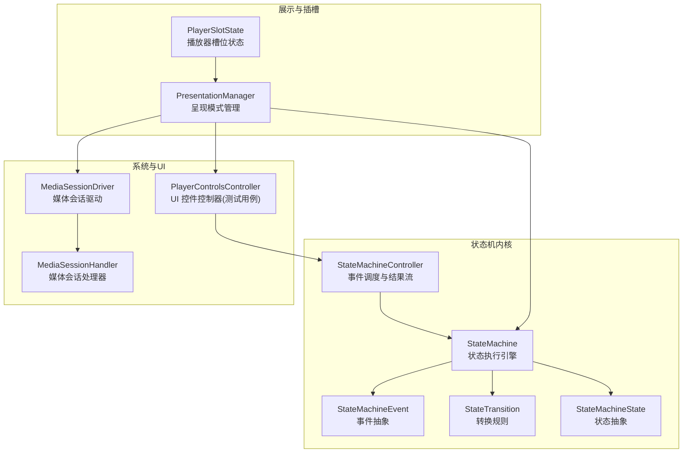
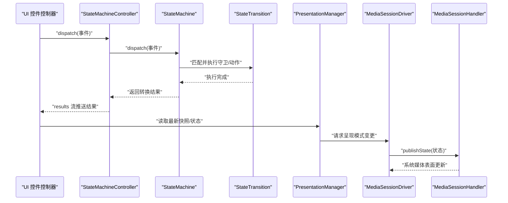
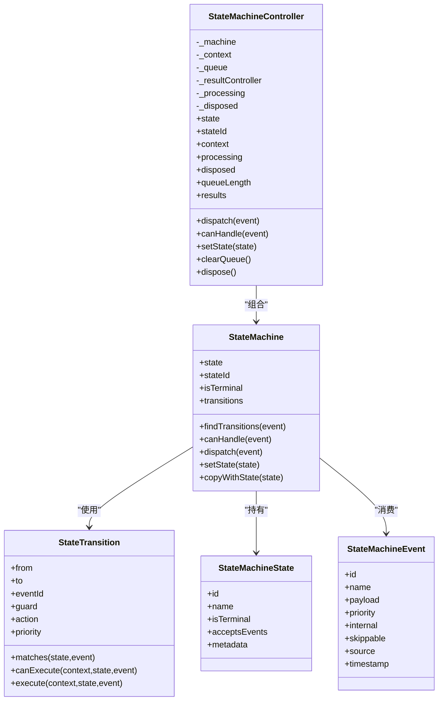
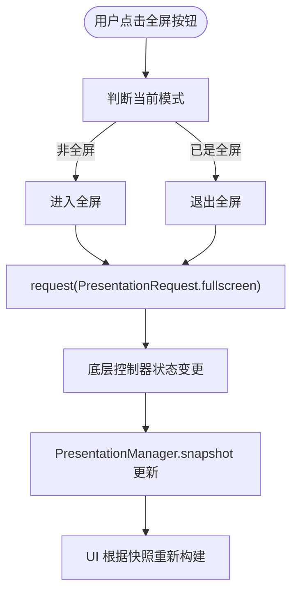
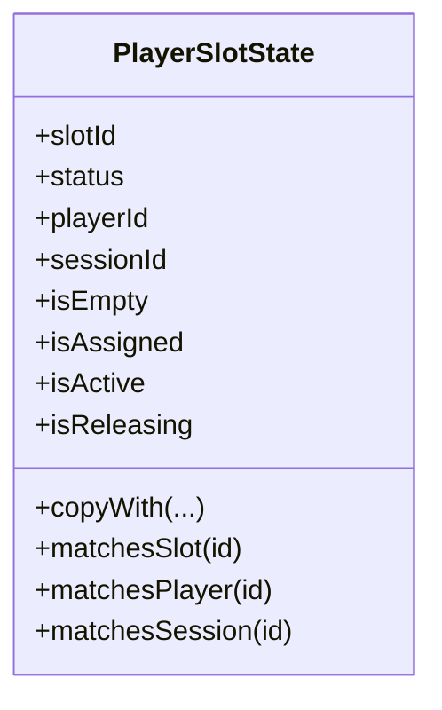
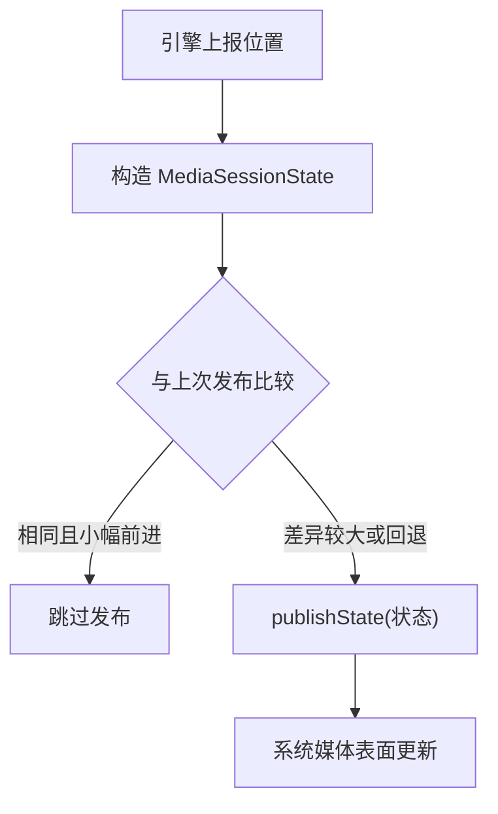
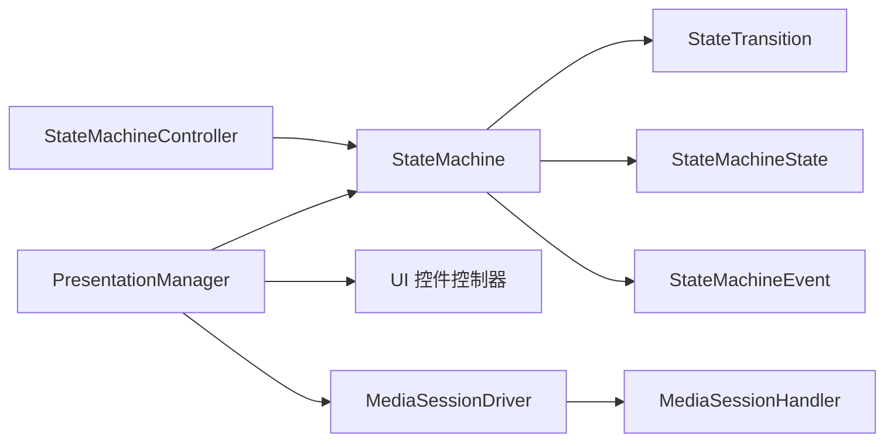

# 状态管理模式

<cite>
**本文引用的文件**   
- [state_machine.dart](file://packages/media_core/lib/state_machine/state_machine.dart)
- [state_machine_controller.dart](file://packages/media_core/lib/state_machine/state_machine_controller.dart)
- [state_machine_event.dart](file://packages/media_core/lib/state_machine/state_machine_event.dart)
- [state_transition.dart](file://packages/media_core/lib/state_machine/state_transition.dart)
- [state.dart](file://packages/media_core/lib/state_machine/state.dart)
- [presentation_manager.dart](file://packages/media_core/lib/presentation/presentation_manager.dart)
- [player_slot_state.dart](file://packages/media_core/lib/slot/player_slot_state.dart)
- [media_session_driver.dart](file://packages/media_core_mediasession/lib/src/media_session_driver.dart)
- [media_session_handler.dart](file://packages/media_core_mediasession/lib/src/media_session_handler.dart)
- [player_controls_controller_test.dart](file://packages/media_core_ui/test/player_controls_controller_test.dart)
</cite>

## 目录
1. [简介](#简介)
2. [项目结构](#项目结构)
3. [核心组件](#核心组件)
4. [架构总览](#架构总览)
5. [详细组件分析](#详细组件分析)
6. [依赖关系分析](#依赖关系分析)
7. [性能与缓存策略](#性能与缓存策略)
8. [故障排查指南](#故障排查指南)
9. [结论](#结论)
10. [附录：常见场景示例索引](#附录常见场景示例索引)

## 简介
本指南面向自定义控制组件开发者，系统讲解如何在媒体播放场景中实现稳定、可观测且高性能的状态管理。重点包括：
- 使用通用状态机引擎进行状态定义、事件分发与转换
- 通过控制器串行化事件、暴露结果流，实现响应式 UI
- 利用不可变快照与订阅机制，实现状态监听与同步
- 设计合理的状态缓存与节流策略，避免不必要的重绘
- 覆盖播放进度、音量控制、全屏切换等常见场景的落地方案

## 项目结构
围绕“状态管理”的核心代码主要分布在以下模块：
- 状态机内核：定义状态、事件、转换规则与执行引擎
- 状态机控制器：负责事件队列、串行执行与结果广播
- 展示层管理器：封装全屏、画中画、悬浮等呈现模式的状态与请求
- 插槽状态：描述播放器槽位生命周期与分配情况
- 媒体会话驱动/处理器：将播放状态发布到系统媒体表面，并进行位置更新节流
- UI 控制器测试：验证高频位置 tick 不触发整条控件栏重建

图示来源
- [state_machine.dart:31-205](file://packages/media_core/lib/state_machine/state_machine.dart#L31-L205)
- [state_machine_controller.dart:33-227](file://packages/media_core/lib/state_machine/state_machine_controller.dart#L33-L227)
- [state_machine_event.dart:24-93](file://packages/media_core/lib/state_machine/state_machine_event.dart#L24-L93)
- [state_transition.dart:24-122](file://packages/media_core/lib/state_machine/state_transition.dart#L24-L122)
- [state.dart:22-72](file://packages/media_core/lib/state_machine/state.dart#L22-L72)
- [presentation_manager.dart:29-249](file://packages/media_core/lib/presentation/presentation_manager.dart#L29-L249)
- [player_slot_state.dart:23-101](file://packages/media_core/lib/slot/player_slot_state.dart#L23-L101)
- [media_session_driver.dart:408-441](file://packages/media_core_mediasession/lib/src/media_session_driver.dart#L408-L441)
- [media_session_handler.dart:131-170](file://packages/media_core_mediasession/lib/src/media_session_handler.dart#L131-L170)
- [player_controls_controller_test.dart:286-313](file://packages/media_core_ui/test/player_controls_controller_test.dart#L286-L313)

章节来源
- [state_machine.dart:31-205](file://packages/media_core/lib/state_machine/state_machine.dart#L31-L205)
- [state_machine_controller.dart:33-227](file://packages/media_core/lib/state_machine/state_machine_controller.dart#L33-L227)
- [presentation_manager.dart:29-249](file://packages/media_core/lib/presentation/presentation_manager.dart#L29-L249)
- [player_slot_state.dart:23-101](file://packages/media_core/lib/slot/player_slot_state.dart#L23-L101)
- [media_session_driver.dart:408-441](file://packages/media_core_mediasession/lib/src/media_session_driver.dart#L408-L441)
- [media_session_handler.dart:131-170](file://packages/media_core_mediasession/lib/src/media_session_handler.dart#L131-L170)
- [player_controls_controller_test.dart:286-313](file://packages/media_core_ui/test/player_controls_controller_test.dart#L286-L313)

## 核心组件
- 状态机引擎 StateMachine
  - 职责：持有当前状态、匹配转换、执行守卫与动作、更新状态并返回执行结果
  - 关键能力：findTransitions、canHandle、dispatch、setState、copyWithState
- 状态机控制器 StateMachineController
  - 职责：串行处理事件、维护待处理队列、暴露结果流、协调异步调度与生命周期
  - 关键能力：dispatch、results、canHandle、clearQueue、dispose
- 事件 StateMachineEvent
  - 职责：提供稳定标识、可选负载、优先级、来源、时间戳等诊断信息
- 转换 StateTransition
  - 职责：定义 from/to 状态、匹配事件、守卫条件、副作用动作、优先级
- 状态 StateMachineState
  - 职责：提供稳定标识、名称、是否终态、是否接受事件、元数据
- 展示管理器 PresentationManager
  - 职责：对外暴露呈现 API、统一呈现状态、提供快照、简化集成
- 插槽状态 PlayerSlotState
  - 职责：描述播放器槽位的运行时快照（空、已分配、活跃、释放中）
- 媒体会话 MediaSessionDriver/Handler
  - 职责：将播放状态发布到系统媒体表面，并对位置更新做节流

章节来源
- [state_machine.dart:31-205](file://packages/media_core/lib/state_machine/state_machine.dart#L31-L205)
- [state_machine_controller.dart:33-227](file://packages/media_core/lib/state_machine/state_machine_controller.dart#L33-L227)
- [state_machine_event.dart:24-93](file://packages/media_core/lib/state_machine/state_machine_event.dart#L24-L93)
- [state_transition.dart:24-122](file://packages/media_core/lib/state_machine/state_transition.dart#L24-L122)
- [state.dart:22-72](file://packages/media_core/lib/state_machine/state.dart#L22-L72)
- [presentation_manager.dart:29-249](file://packages/media_core/lib/presentation/presentation_manager.dart#L29-L249)
- [player_slot_state.dart:23-101](file://packages/media_core/lib/slot/player_slot_state.dart#L23-L101)
- [media_session_driver.dart:408-441](file://packages/media_core_mediasession/lib/src/media_session_driver.dart#L408-L441)
- [media_session_handler.dart:131-170](file://packages/media_core_mediasession/lib/src/media_session_handler.dart#L131-L170)

## 架构总览
下图展示了从 UI 控件到状态机引擎再到系统媒体表面的完整调用链，以及状态快照在展示层的消费方式。

图示来源
- [state_machine_controller.dart:91-136](file://packages/media_core/lib/state_machine/state_machine_controller.dart#L91-L136)
- [state_machine.dart:105-174](file://packages/media_core/lib/state_machine/state_machine.dart#L105-L174)
- [state_transition.dart:62-90](file://packages/media_core/lib/state_machine/state_transition.dart#L62-L90)
- [presentation_manager.dart:127-202](file://packages/media_core/lib/presentation/presentation_manager.dart#L127-L202)
- [media_session_driver.dart:420-441](file://packages/media_core_mediasession/lib/src/media_session_driver.dart#L420-L441)
- [media_session_handler.dart:131-170](file://packages/media_core_mediasession/lib/src/media_session_handler.dart#L131-L170)

## 详细组件分析

### 状态机引擎与控制器
- StateMachine
  - 核心流程：校验当前状态→查找匹配转换→执行守卫→执行动作→更新状态→返回结果
  - 适合用于纯逻辑的状态流转，不包含事件队列、持久化或重试
- StateMachineController
  - 保证事件串行执行，避免并发导致的竞态
  - 暴露 results 流，供 UI 订阅以进行响应式更新
  - 支持 canHandle 预检查、clearQueue 清理、dispose 资源释放

图示来源
- [state_machine.dart:31-205](file://packages/media_core/lib/state_machine/state_machine.dart#L31-L205)
- [state_machine_controller.dart:33-227](file://packages/media_core/lib/state_machine/state_machine_controller.dart#L33-L227)
- [state_machine_event.dart:24-93](file://packages/media_core/lib/state_machine/state_machine_event.dart#L24-L93)
- [state_transition.dart:24-122](file://packages/media_core/lib/state_machine/state_transition.dart#L24-L122)
- [state.dart:22-72](file://packages/media_core/lib/state_machine/state.dart#L22-L72)

章节来源
- [state_machine.dart:31-205](file://packages/media_core/lib/state_machine/state_machine.dart#L31-L205)
- [state_machine_controller.dart:33-227](file://packages/media_core/lib/state_machine/state_machine_controller.dart#L33-L227)

### 展示层状态与全屏切换
- PresentationManager
  - 订阅底层 PresentationController 的状态流，维护 _latestState 快照
  - 提供 isFullscreen、isPip、isFloating、isNormal 等便捷属性
  - 封装 enterFullscreen/exitFullscreen/toggleFullscreen 等请求
- 典型交互：UI 触发全屏→PresentationManager.request→底层控制器状态变化→UI 订阅到新快照→渲染更新

图示来源
- [presentation_manager.dart:62-107](file://packages/media_core/lib/presentation/presentation_manager.dart#L62-L107)
- [presentation_manager.dart:127-202](file://packages/media_core/lib/presentation/presentation_manager.dart#L127-L202)

章节来源
- [presentation_manager.dart:29-249](file://packages/media_core/lib/presentation/presentation_manager.dart#L29-L249)

### 播放器槽位状态
- PlayerSlotState
  - 描述播放器槽位的运行时快照：slotId、status、playerId、sessionId
  - 提供 isEmpty/isAssigned/isActive/isReleasing 等语义化判断
  - 通过 copyWith 生成新的不可变快照，便于响应式更新

图示来源
- [player_slot_state.dart:23-101](file://packages/media_core/lib/slot/player_slot_state.dart#L23-L101)

章节来源
- [player_slot_state.dart:23-101](file://packages/media_core/lib/slot/player_slot_state.dart#L23-L101)

### 媒体会话状态发布与位置节流
- MediaSessionDriver
  - 对位置更新进行节流：仅当位置漂移小于固定间隔且方向向前时跳过发布，减少系统通知重建
- MediaSessionHandler
  - 将播放状态（playing、position、duration、speed）推送到系统媒体表面

图示来源
- [media_session_driver.dart:408-441](file://packages/media_core_mediasession/lib/src/media_session_driver.dart#L408-L441)
- [media_session_handler.dart:131-170](file://packages/media_core_mediasession/lib/src/media_session_handler.dart#L131-L170)

章节来源
- [media_session_driver.dart:408-441](file://packages/media_core_mediasession/lib/src/media_session_driver.dart#L408-L441)
- [media_session_handler.dart:131-170](file://packages/media_core_mediasession/lib/src/media_session_handler.dart#L131-L170)

### 响应式 UI 更新与控件栏优化
- 测试用例表明：高频位置 tick 不应导致整条控件栏重建；只有结构性变化（如暂停）才触发控件栏重建
- 建议实践：
  - 将进度条与时间标签作为独立的可监听部件，订阅 playbackListenable
  - 控件栏整体仅在结构性状态变化时重建
  - 使用不可变快照与 Equatable 比较，避免无意义重建

章节来源
- [player_controls_controller_test.dart:286-313](file://packages/media_core_ui/test/player_controls_controller_test.dart#L286-L313)

## 依赖关系分析
- StateMachineController 依赖 StateMachine 执行具体转换
- StateMachine 依赖 StateTransition、StateMachineState、StateMachineEvent
- PresentationManager 依赖底层 PresentationController（未在本节展开），并通过 state 流暴露状态
- MediaSessionDriver/Handler 负责与系统媒体表面交互，受上层状态驱动

图示来源
- [state_machine_controller.dart:33-227](file://packages/media_core/lib/state_machine/state_machine_controller.dart#L33-L227)
- [state_machine.dart:31-205](file://packages/media_core/lib/state_machine/state_machine.dart#L31-L205)
- [presentation_manager.dart:29-249](file://packages/media_core/lib/presentation/presentation_manager.dart#L29-L249)
- [media_session_driver.dart:408-441](file://packages/media_core_mediasession/lib/src/media_session_driver.dart#L408-L441)
- [media_session_handler.dart:131-170](file://packages/media_core_mediasession/lib/src/media_session_handler.dart#L131-L170)

章节来源
- [state_machine_controller.dart:33-227](file://packages/media_core/lib/state_machine/state_machine_controller.dart#L33-L227)
- [state_machine.dart:31-205](file://packages/media_core/lib/state_machine/state_machine.dart#L31-L205)
- [presentation_manager.dart:29-249](file://packages/media_core/lib/presentation/presentation_manager.dart#L29-L249)
- [media_session_driver.dart:408-441](file://packages/media_core_mediasession/lib/src/media_session_driver.dart#L408-L441)
- [media_session_handler.dart:131-170](file://packages/media_core_mediasession/lib/src/media_session_handler.dart#L131-L170)

## 性能与缓存策略
- 事件串行化
  - StateMachineController 通过内部队列串行执行事件，避免并发冲突与状态不一致
- 状态快照与不可变性
  - PlayerSlotState、PresentationManager.snapshot 等采用不可变快照，配合 Equatable 比较，减少不必要重建
- 位置更新节流
  - MediaSessionDriver 对位置发布进行节流，避免系统通知频繁重建
- UI 细粒度监听
  - 进度条与时间标签单独订阅 playbackListenable，控件栏仅在结构性变化时重建

章节来源
- [state_machine_controller.dart:91-136](file://packages/media_core/lib/state_machine/state_machine_controller.dart#L91-L136)
- [player_slot_state.dart:23-101](file://packages/media_core/lib/slot/player_slot_state.dart#L23-L101)
- [presentation_manager.dart:62-74](file://packages/media_core/lib/presentation/presentation_manager.dart#L62-L74)
- [media_session_driver.dart:408-441](file://packages/media_core_mediasession/lib/src/media_session_driver.dart#L408-L441)
- [player_controls_controller_test.dart:286-313](file://packages/media_core_ui/test/player_controls_controller_test.dart#L286-L313)

## 故障排查指南
- 事件被拒绝
  - 可能原因：当前状态不接受事件、终端状态、无匹配转换、所有守卫拒绝
  - 定位方法：检查 StateMachine.dispatch 返回的 StateTransitionResult.reason
- 队列堆积
  - 现象：queueLength 持续增长
  - 处理：确认 action/guard 是否长时间阻塞；必要时 clearQueue 清理
- 重复重建 UI
  - 现象：控件栏频繁重建
  - 处理：拆分进度条与时间标签为独立监听部件，避免结构性变化触发全量重建
- 全屏切换异常
  - 现象：isFullscreen 与实际不符
  - 处理：检查 PresentationManager.snapshot 与 mode 一致性；确保 request 后等待状态流更新

章节来源
- [state_machine.dart:105-174](file://packages/media_core/lib/state_machine/state_machine.dart#L105-L174)
- [state_machine_controller.dart:162-170](file://packages/media_core/lib/state_machine/state_machine_controller.dart#L162-L170)
- [player_controls_controller_test.dart:286-313](file://packages/media_core_ui/test/player_controls_controller_test.dart#L286-L313)
- [presentation_manager.dart:62-107](file://packages/media_core/lib/presentation/presentation_manager.dart#L62-L107)

## 结论
通过通用状态机引擎与控制器，结合不可变快照与细粒度监听，可以在自定义控制组件中实现稳定、可观测且高性能的状态管理。配合位置节流与 UI 分层订阅，既能保证状态同步的准确性，又能避免不必要的重绘，提升整体体验。

## 附录：常见场景示例索引
- 播放进度
  - 参考：UI 控件控制器测试中对 position tick 的处理与细分监听
  - 路径：[player_controls_controller_test.dart:286-313](file://packages/media_core_ui/test/player_controls_controller_test.dart#L286-L313)
- 音量控制
  - 参考：媒体会话处理器对 speed/volume 等属性的发布
  - 路径：[media_session_handler.dart:131-170](file://packages/media_core_mediasession/lib/src/media_session_handler.dart#L131-L170)
- 全屏切换
  - 参考：PresentationManager 的全屏请求与模式判断
  - 路径：[presentation_manager.dart:127-202](file://packages/media_core/lib/presentation/presentation_manager.dart#L127-L202)