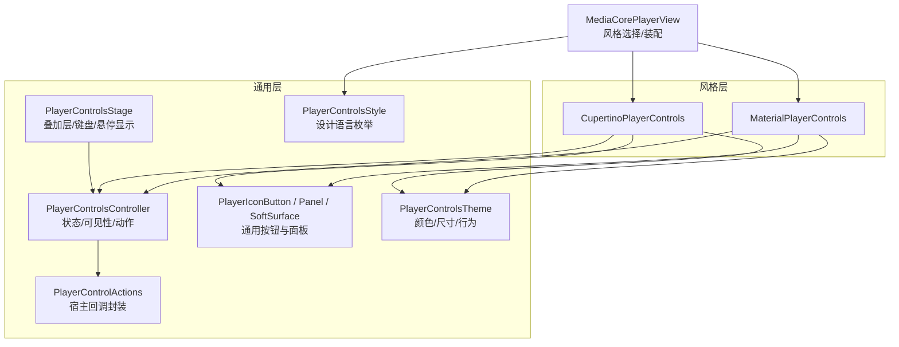
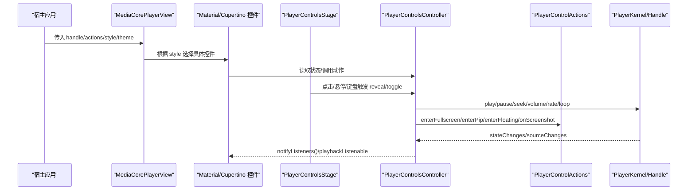
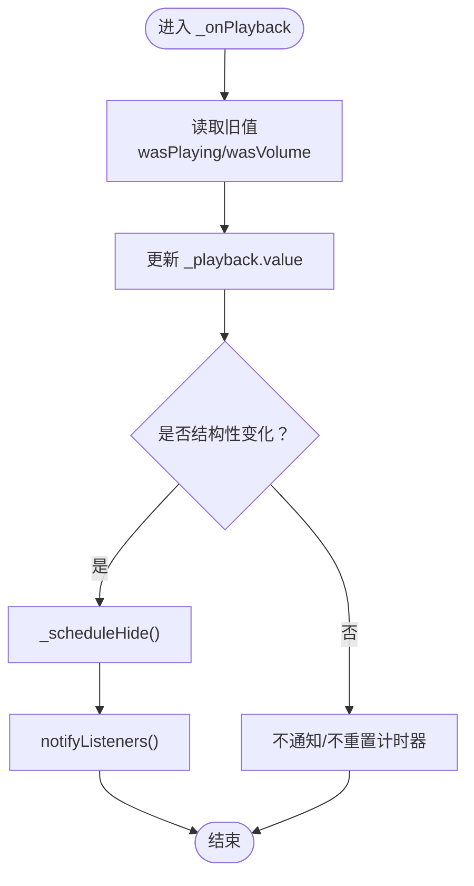
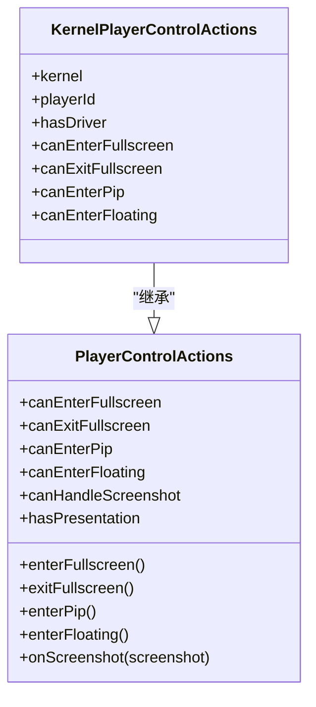
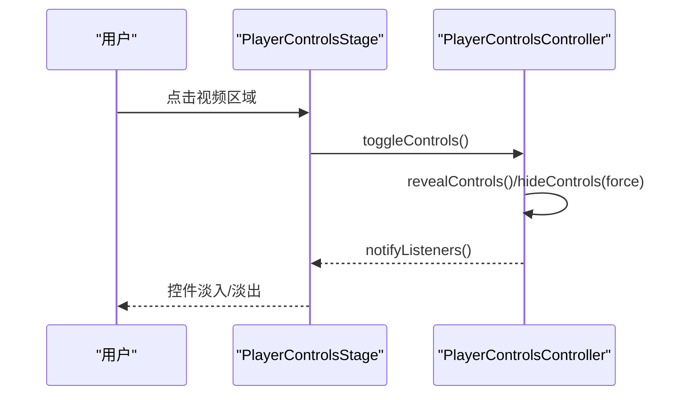
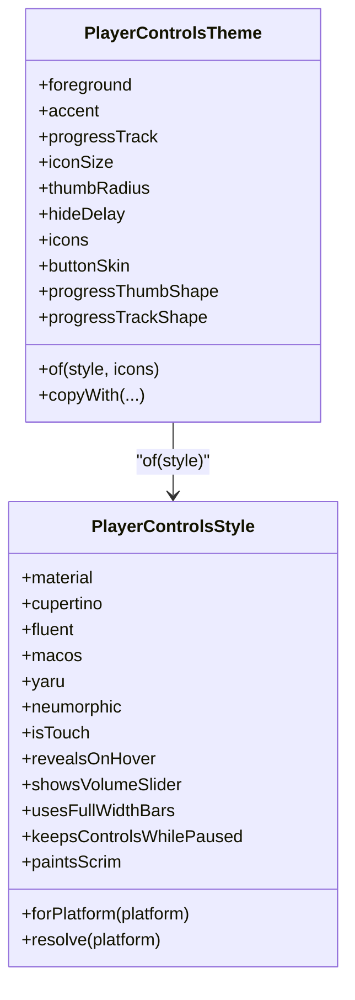
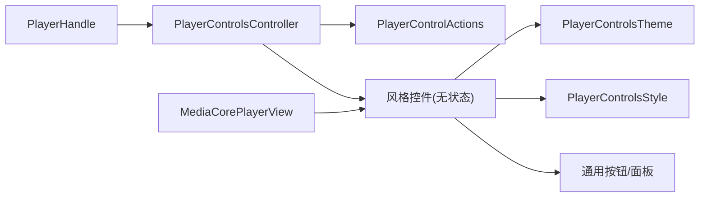
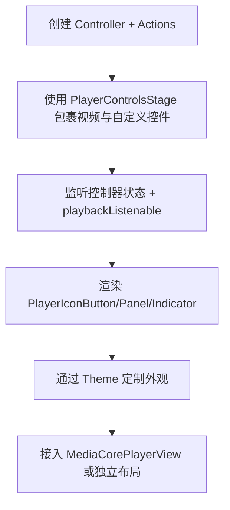

# 自定义控制组件开发

<cite>
**本文引用的文件**   
- [player_controls_controller.dart](file://packages/media_core_ui/lib/src/common/player_controls_controller.dart)
- [player_control_actions.dart](file://packages/media_core_ui/lib/src/common/player_control_actions.dart)
- [player_control_buttons.dart](file://packages/media_core_ui/lib/src/common/player_control_buttons.dart)
- [player_controls_stage.dart](file://packages/media_core_ui/lib/src/common/player_controls_stage.dart)
- [player_controls_style.dart](file://packages/media_core_ui/lib/src/common/player_controls_style.dart)
- [player_controls_theme.dart](file://packages/media_core_ui/lib/src/common/player_controls_theme.dart)
- [material_player_controls.dart](file://packages/media_core_ui/lib/src/material/material_player_controls.dart)
- [cupertino_player_controls.dart](file://packages/media_core_ui/lib/src/cupertino/cupertino_player_controls.dart)
- [media_core_player_view.dart](file://packages/media_core_ui/lib/src/media_core_player_view.dart)
</cite>

## 目录
1. [引言](#引言)
2. [项目结构](#项目结构)
3. [核心组件](#核心组件)
4. [架构总览](#架构总览)
5. [详细组件分析](#详细组件分析)
6. [依赖关系分析](#依赖关系分析)
7. [性能与优化](#性能与优化)
8. [故障排查指南](#故障排查指南)
9. [结论](#结论)
10. [附录：从零构建自定义控制条案例](#附录从零构建自定义控制条案例)

## 引言
本指南面向希望从零开始构建“自定义播放器控制组件”的开发者。你将学习如何基于现有基础控件扩展出符合业务需求的控制条，理解状态管理、事件处理、主题适配、响应式布局和无障碍访问等关键技术，并掌握与 PlayerControlsController 的集成方式与数据绑定机制。文档同时提供从简单按钮组合到复杂交互界面的完整案例路径，以及性能优化与调试方法。

## 项目结构
媒体核心 UI 包将“通用控制层”和“多风格控件集”解耦：
- 通用层（common）：控制器、动作、按钮、舞台、样式、主题等共享能力。
- 风格层（material、cupertino、fluent、macos、yaru、neumorphic）：每种设计语言一套无状态控件，仅消费控制器状态并调用其动作。
- 宿主入口（MediaCorePlayerView）：根据平台或配置选择对应风格，组装视频、手势、键盘与控件。

图表来源
- [media_core_player_view.dart:333-355](file://packages/media_core_ui/lib/src/media_core_player_view.dart#L333-L355)
- [player_controls_controller.dart:41-617](file://packages/media_core_ui/lib/src/common/player_controls_controller.dart#L41-L617)
- [player_control_actions.dart:26-156](file://packages/media_core_ui/lib/src/common/player_control_actions.dart#L26-L156)
- [player_control_buttons.dart:23-383](file://packages/media_core_ui/lib/src/common/player_control_buttons.dart#L23-L383)
- [player_controls_stage.dart:76-188](file://packages/media_core_ui/lib/src/common/player_controls_stage.dart#L76-L188)
- [player_controls_theme.dart:64-506](file://packages/media_core_ui/lib/src/common/player_controls_theme.dart#L64-L506)
- [player_controls_style.dart:29-123](file://packages/media_core_ui/lib/src/common/player_controls_style.dart#L29-L123)

章节来源
- [media_core_player_view.dart:333-355](file://packages/media_core_ui/lib/src/media_core_player_view.dart#L333-L355)
- [player_controls_style.dart:29-123](file://packages/media_core_ui/lib/src/common/player_controls_style.dart#L29-L123)

## 核心组件
- PlayerControlsController：播放状态镜像、动作转发、控件可见性与自动隐藏策略；提供两条通知路径：结构性变化走 ChangeNotifier，进度驱动走 playbackListenable。
- PlayerControlActions：承载宿主侧能力（全屏、画中画、悬浮窗、截图），以回调形式暴露给控件；KernelPlayerControlActions 将其桥接到内核。
- PlayerControlsStage：视频与控件的叠加容器，负责点击/双击、悬停显示、键盘快捷键。
- PlayerControlsTheme：颜色、尺寸、动效、图标等主题令牌，支持 copyWith 覆盖。
- PlayerControlsStyle：设计语言枚举，决定默认主题、是否触摸优先、是否悬停显示、是否展示音量滑块等。
- 通用按钮与面板：PlayerIconButton、PlayerBufferingIndicator、SoftSurface、PlayerControlsPanel，统一交互反馈与视觉风格。

章节来源
- [player_controls_controller.dart:10-617](file://packages/media_core_ui/lib/src/common/player_controls_controller.dart#L10-L617)
- [player_control_actions.dart:1-156](file://packages/media_core_ui/lib/src/common/player_control_actions.dart#L1-L156)
- [player_controls_stage.dart:7-188](file://packages/media_core_ui/lib/src/common/player_controls_stage.dart#L7-L188)
- [player_controls_theme.dart:6-506](file://packages/media_core_ui/lib/src/common/player_controls_theme.dart#L6-L506)
- [player_controls_style.dart:4-123](file://packages/media_core_ui/lib/src/common/player_controls_style.dart#L4-L123)
- [player_control_buttons.dart:7-383](file://packages/media_core_ui/lib/src/common/player_control_buttons.dart#L7-L383)

## 架构总览
下图展示了“宿主视图 → 风格控件 → 控制器 → 动作/内核”的调用链，以及“进度流 → 进度控件”的高频更新路径。

图表来源
- [media_core_player_view.dart:333-355](file://packages/media_core_ui/lib/src/media_core_player_view.dart#L333-L355)
- [player_controls_controller.dart:41-617](file://packages/media_core_ui/lib/src/common/player_controls_controller.dart#L41-L617)
- [player_control_actions.dart:105-156](file://packages/media_core_ui/lib/src/common/player_control_actions.dart#L105-L156)
- [player_controls_stage.dart:125-188](file://packages/media_core_ui/lib/src/common/player_controls_stage.dart#L125-L188)

## 详细组件分析

### PlayerControlsController：状态与可见性中枢
- 职责
  - 镜像 PlayerHandle 的播放状态，向控件暴露 isPlaying、isBuffering、position、duration、volume、rate、isLooping、canSeek、isLive 等属性。
  - 暴露 actions：togglePlayPause、play、pause、stop、seekTo、seekBy、setVolume、toggleMute、toggleLoop、cycleRate/setRate、setAudioOnly、captureScreenshot、enterFullscreen/exitFullscreen、enterPip、enterFloating。
  - 管理控件可见性：idle 自动隐藏、交互时显示、暂停时保持显示（可配置）。
- 两条通知路径
  - ChangeNotifier：结构性变化（播放/暂停、音量、速率、循环、源、可见性、能力）触发重建。
  - playbackListenable：每次进度 tick 触发，供进度条和时间标签高频刷新。
- 关键流程
  - _onPlayback：区分结构性变化与纯位置变化；结构性变化才调度隐藏计时器并 notifyListeners。
  - _scheduleHide/_onHideDeadline：避免在鼠标频繁移动时反复创建 Timer，使用 _activityWhileCounting 合并活动。
  - configure：集中更新 style/theme/hideDelay/autoHide/keepVisibleWhenPaused/actions，并在变更时重新调度隐藏。

图表来源
- [player_controls_controller.dart:543-570](file://packages/media_core_ui/lib/src/common/player_controls_controller.dart#L543-L570)

章节来源
- [player_controls_controller.dart:41-617](file://packages/media_core_ui/lib/src/common/player_controls_controller.dart#L41-L617)

### PlayerControlActions：宿主能力桥接
- 作用：将全屏、画中画、悬浮窗、截图等“离开控件树”的能力以回调暴露给控件；空回调即表示该能力不可用。
- KernelPlayerControlActions：把回调委托给 PlayerKernel 的 presentation driver，并通过 hasDriver 判断可用性，避免无驱动时抛错。

图表来源
- [player_control_actions.dart:26-156](file://packages/media_core_ui/lib/src/common/player_control_actions.dart#L26-L156)

章节来源
- [player_control_actions.dart:1-156](file://packages/media_core_ui/lib/src/common/player_control_actions.dart#L1-L156)

### PlayerControlsStage：叠加层与交互
- 职责：将控件叠加在视频之上，处理点击/双击、悬停显示、键盘快捷键；根据 style.revealsOnHover 决定是否启用悬停显示。
- 键盘快捷键：通过 PlayerShortcuts 提供标准映射（空格/k 播放/暂停、左右键跳转、上下键调音量、m 静音、f 全屏、esc 退出全屏）。

图表来源
- [player_controls_stage.dart:125-188](file://packages/media_core_ui/lib/src/common/player_controls_stage.dart#L125-L188)
- [player_controls_controller.dart:260-318](file://packages/media_core_ui/lib/src/common/player_controls_controller.dart#L260-L318)

章节来源
- [player_controls_stage.dart:7-188](file://packages/media_core_ui/lib/src/common/player_controls_stage.dart#L7-L188)

### PlayerControlsTheme 与 PlayerControlsStyle：主题与设计语言
- PlayerControlsTheme：定义颜色、尺寸、阴影、模糊、圆角、文本样式、隐藏延迟、图标集合、按钮皮肤、进度条形状等；提供 of(style, icons) 工厂与 copyWith 覆盖。
- PlayerControlsStyle：枚举设计语言，决定默认主题、触摸优先、悬停显示、音量滑块、全宽栏、遮罩绘制等。

图表来源
- [player_controls_style.dart:29-123](file://packages/media_core_ui/lib/src/common/player_controls_style.dart#L29-L123)
- [player_controls_theme.dart:64-506](file://packages/media_core_ui/lib/src/common/player_controls_theme.dart#L64-L506)

章节来源
- [player_controls_style.dart:4-123](file://packages/media_core_ui/lib/src/common/player_controls_style.dart#L4-L123)
- [player_controls_theme.dart:6-506](file://packages/media_core_ui/lib/src/common/player_controls_theme.dart#L6-L506)

### 通用按钮与面板：一致交互与视觉
- PlayerIconButton：统一 hover/press/disabled 状态，按 buttonSkin 渲染不同反馈（ripple/translucent/hover/flat/soft），支持 tooltip 与无障碍语义。
- PlayerBufferingIndicator：缓冲指示器，适配 soft 表面。
- SoftSurface：Neumorphism 风格的凸起/凹陷面。
- PlayerControlsPanel：带模糊/边框的面板容器。

章节来源
- [player_control_buttons.dart:7-383](file://packages/media_core_ui/lib/src/common/player_control_buttons.dart#L7-L383)

### 风格控件示例：Material 与 Cupertino
- MaterialPlayerControls：顶部标题栏+溢出菜单、中间大播放按钮、底部时间轴+音量/全屏；无内置音量滑块（遵循 Android 硬件音量）。
- CupertinoPlayerControls：渐变遮罩、中央单一大图标、右侧倒计时、底部时间轴+静音/截图/全屏；无内置音量滑块（遵循 iOS 硬件音量）。

章节来源
- [material_player_controls.dart:8-355](file://packages/media_core_ui/lib/src/material/material_player_controls.dart#L8-L355)
- [cupertino_player_controls.dart:8-263](file://packages/media_core_ui/lib/src/cupertino/cupertino_player_controls.dart#L8-L263)

## 依赖关系分析
- 耦合与内聚
  - 控制器与 PlayerHandle 低耦合，只订阅状态与源变更，不持有播放器实例。
  - 风格控件对控制器单向依赖，无状态，便于替换与测试。
  - 动作回调将宿主能力与控件解耦，避免控件感知路由/窗口系统。
- 外部依赖
  - Flutter 框架（Widgets/Material/Cupertino/Services）。
  - media_core 内核（PlayerHandle/PlayerKernel/PlayerId/PlayerTransportState 等）。

图表来源
- [player_controls_controller.dart:41-617](file://packages/media_core_ui/lib/src/common/player_controls_controller.dart#L41-L617)
- [player_control_actions.dart:26-156](file://packages/media_core_ui/lib/src/common/player_control_actions.dart#L26-L156)
- [player_controls_theme.dart:64-506](file://packages/media_core_ui/lib/src/common/player_controls_theme.dart#L64-L506)
- [player_controls_style.dart:29-123](file://packages/media_core_ui/lib/src/common/player_controls_style.dart#L29-L123)
- [player_control_buttons.dart:23-383](file://packages/media_core_ui/lib/src/common/player_control_buttons.dart#L23-L383)
- [media_core_player_view.dart:333-355](file://packages/media_core_ui/lib/src/media_core_player_view.dart#L333-L355)

章节来源
- [player_controls_controller.dart:41-617](file://packages/media_core_ui/lib/src/common/player_controls_controller.dart#L41-L617)
- [player_control_actions.dart:26-156](file://packages/media_core_ui/lib/src/common/player_control_actions.dart#L26-L156)
- [player_controls_theme.dart:64-506](file://packages/media_core_ui/lib/src/common/player_controls_theme.dart#L64-L506)
- [player_controls_style.dart:29-123](file://packages/media_core_ui/lib/src/common/player_controls_style.dart#L29-L123)
- [player_control_buttons.dart:23-383](file://packages/media_core_ui/lib/src/common/player_control_buttons.dart#L23-L383)
- [media_core_player_view.dart:333-355](file://packages/media_core_ui/lib/src/media_core_player_view.dart#L333-L355)

## 性能与优化
- 双通道通知
  - 结构性变化走 ChangeNotifier，避免每次进度 tick 都重建整条控制栏。
  - 进度相关控件监听 playbackListenable，实现高频刷新而不影响整体。
- 隐藏计时器优化
  - 使用 _activityWhileCounting 合并鼠标移动等高频事件，避免每帧重建 Timer。
- 条件渲染
  - 根据 canSeek/isLive/hasSource 等能力动态显示控件，减少无用绘制。
- 主题与样式
  - 通过 PlayerControlsTheme.copyWith 局部覆盖，避免 fork 整个风格。
- 无障碍与可访问性
  - 为按钮设置 semanticLabel 与 Tooltip，提升屏幕阅读器与桌面工具提示体验。

[本节为通用指导，无需代码引用]

## 故障排查指南
- 控件不自动隐藏
  - 检查 autoHide 是否被关闭；确认 keepVisibleWhenPaused 与当前播放状态。
  - 查看 _scheduleHide 的条件：非自动隐藏、未显示、非播放态会直接取消计时器。
- 进度条不刷新
  - 确保进度控件监听的是 playbackListenable，而非控制器本身。
- 全屏/画中画/悬浮窗无效
  - 检查 PlayerControlActions 回调是否为空；若使用 KernelPlayerControlActions，确认 hasDriver 为真。
- 截屏无响应
  - 确认 controller.canCaptureScreenshot 为真，且 onScreenshot 已提供回调。
- 键盘快捷键无效
  - 确认 keyboardShortcuts 开启，且焦点落在 PlayerControlsStage 上。

章节来源
- [player_controls_controller.dart:260-366](file://packages/media_core_ui/lib/src/common/player_controls_controller.dart#L260-L366)
- [player_control_actions.dart:58-75](file://packages/media_core_ui/lib/src/common/player_control_actions.dart#L58-L75)
- [player_controls_stage.dart:172-181](file://packages/media_core_ui/lib/src/common/player_controls_stage.dart#L172-L181)

## 结论
通过 PlayerControlsController 统一管理状态与可见性，结合 PlayerControlActions 桥接宿主能力，再配合 PlayerControlsTheme/Style 的主题化与多风格控件，你可以快速构建一致的播放器控制体验。在此基础上，你可以按需扩展按钮、面板与交互逻辑，实现从简单到复杂的自定义控制条，同时保持高性能与良好的可维护性。

[本节为总结，无需代码引用]

## 附录：从零构建自定义控制条案例

### 目标
构建一个“自定义控制条”，包含：
- 顶部标题与截图/画中画按钮
- 中央播放/跳过按钮
- 底部时间轴、静音、全屏
- 支持悬停显示、键盘快捷键、主题定制

### 步骤
1. 准备控制器与动作
   - 使用 PlayerControlsController 包装 PlayerHandle。
   - 使用 KernelPlayerControlActions 注入内核能力（全屏/画中画/悬浮窗/截图）。

2. 搭建舞台
   - 使用 PlayerControlsStage 包裹视频与你的自定义控件，开启 keyboardShortcuts 与 revealsOnHover。

3. 编写自定义控件
   - 复用 PlayerIconButton、PlayerControlsPanel、PlayerBufferingIndicator。
   - 通过 PlayerControlsTheme 定制颜色、尺寸、圆角、阴影、模糊等。
   - 通过 PlayerControlsStyle 决定触摸优先、悬停显示、音量滑块等策略。

4. 数据绑定
   - 结构性状态（播放/暂停、静音、速率、循环、全屏）监听控制器。
   - 进度与时间监听 playbackListenable。

5. 事件处理
   - 点击/双击视频区域由 Stage 统一处理，控制器负责显示/隐藏。
   - 键盘快捷键通过 PlayerShortcuts 绑定到控制器方法。

6. 主题与无障碍
   - 使用 copyWith 覆盖 accent、surface、blur、shadowDepth 等。
   - 为按钮添加 tooltip 与 semanticLabel。

7. 接入宿主视图
   - 在 MediaCorePlayerView 中指定 style/theme/actions，或直接使用自定义控件组合。

[本图为概念流程，不直接映射具体源码，故不提供图表来源]

章节来源
- [player_controls_controller.dart:41-617](file://packages/media_core_ui/lib/src/common/player_controls_controller.dart#L41-L617)
- [player_control_actions.dart:105-156](file://packages/media_core_ui/lib/src/common/player_control_actions.dart#L105-L156)
- [player_controls_stage.dart:76-188](file://packages/media_core_ui/lib/src/common/player_controls_stage.dart#L76-L188)
- [player_control_buttons.dart:23-383](file://packages/media_core_ui/lib/src/common/player_control_buttons.dart#L23-L383)
- [player_controls_theme.dart:64-506](file://packages/media_core_ui/lib/src/common/player_controls_theme.dart#L64-L506)
- [player_controls_style.dart:29-123](file://packages/media_core_ui/lib/src/common/player_controls_style.dart#L29-L123)
- [media_core_player_view.dart:333-355](file://packages/media_core_ui/lib/src/media_core_player_view.dart#L333-L355)