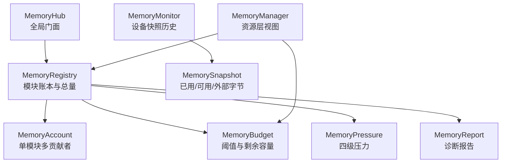
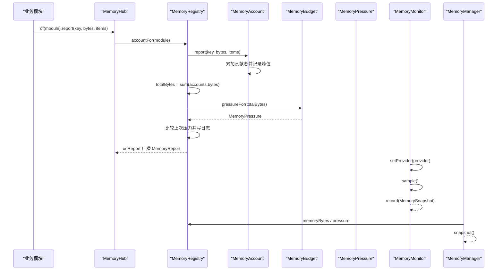
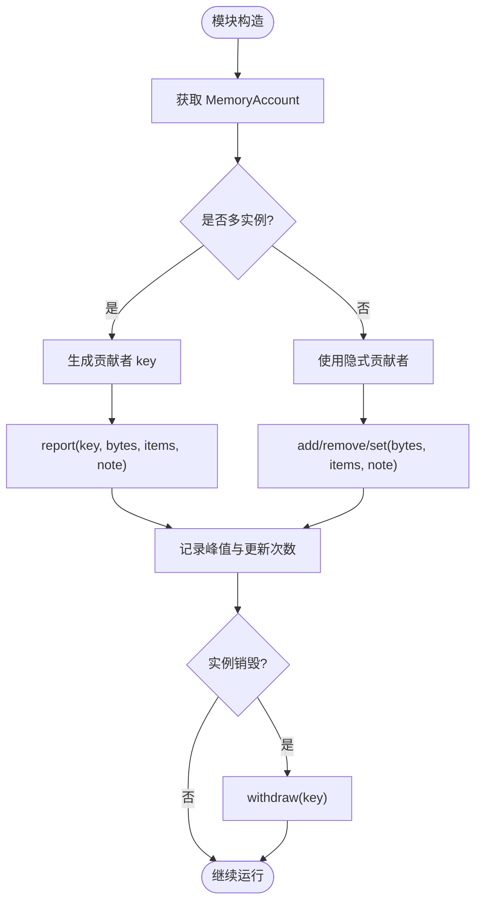
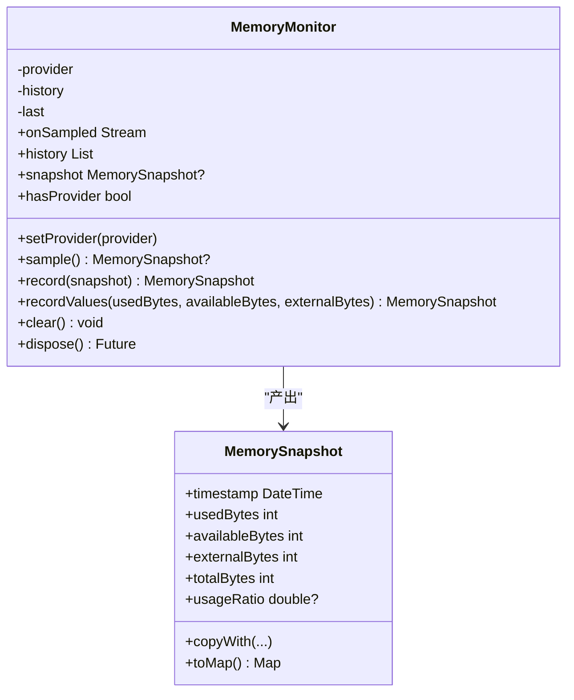
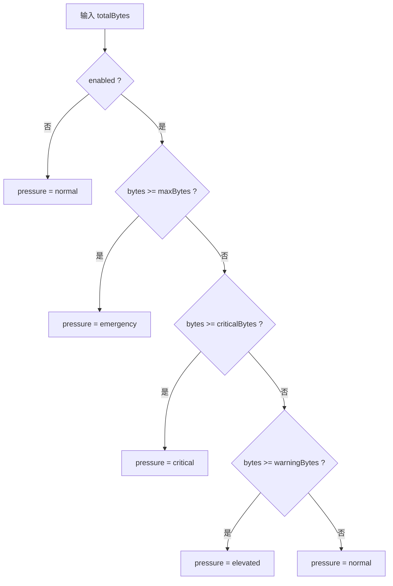
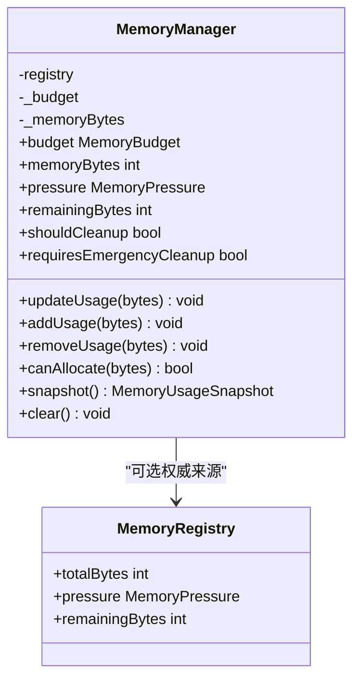
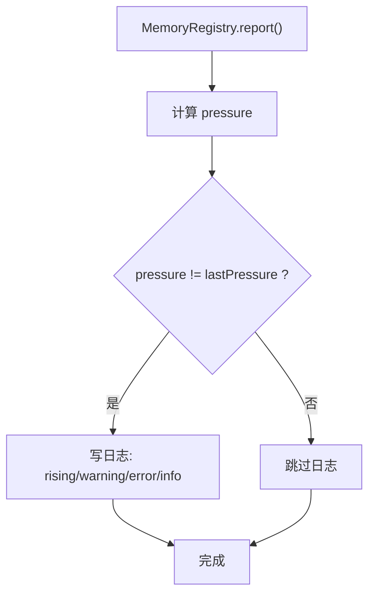
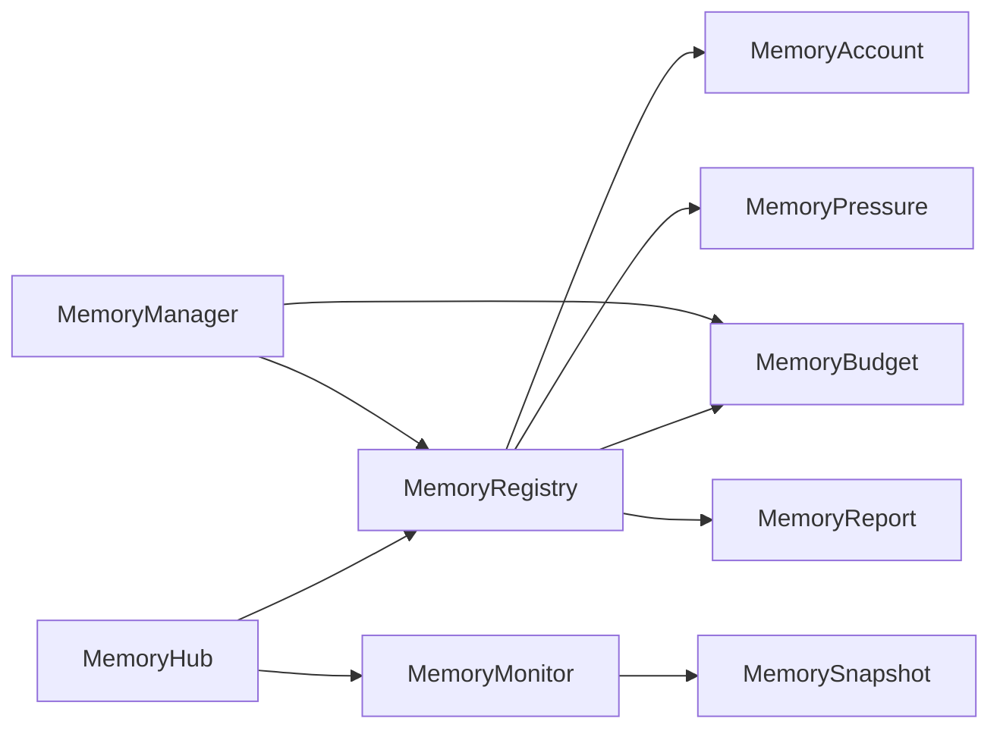

# 内存管理

<cite>
**本文引用的文件**   
- [packages/media_core_memory/lib/src/memory_hub.dart](file://packages/media_core_memory/lib/src/memory_hub.dart)
- [packages/media_core_memory/lib/src/memory_registry.dart](file://packages/media_core_memory/lib/src/memory_registry.dart)
- [packages/media_core_memory/lib/src/memory_account.dart](file://packages/media_core_memory/lib/src/memory_account.dart)
- [packages/media_core_memory/lib/src/memory_budget.dart](file://packages/media_core_memory/lib/src/memory_budget.dart)
- [packages/media_core_memory/lib/src/memory_pressure.dart](file://packages/media_core_memory/lib/src/memory_pressure.dart)
- [packages/media_core_memory/lib/src/memory_monitor.dart](file://packages/media_core_memory/lib/src/memory_monitor.dart)
- [packages/media_core_memory/lib/src/memory_snapshot.dart](file://packages/media_core_memory/lib/src/memory_snapshot.dart)
- [packages/media_core_memory/lib/src/memory_report.dart](file://packages/media_core_memory/lib/src/memory_report.dart)
- [packages/media_core_memory/lib/src/memory_manager.dart](file://packages/media_core_memory/lib/src/memory_manager.dart)
- [packages/media_core_memory/lib/src/memory_module.dart](file://packages/media_core_memory/lib/src/memory_module.dart)
- [packages/media_core_memory/README.md](file://packages/media_core_memory/README.md)
- [example/lib/pages/memory_demo_page.dart](file://example/lib/pages/memory_demo_page.dart)
</cite>

## 目录
1. [引言](#引言)
2. [项目结构](#项目结构)
3. [核心组件](#核心组件)
4. [架构总览](#架构总览)
5. [详细组件分析](#详细组件分析)
6. [依赖关系分析](#依赖关系分析)
7. [性能与预算调优](#性能与预算调优)
8. [故障排查与泄漏检测](#故障排查与泄漏检测)
9. [结论](#结论)

## 引言
本文件面向 Media Core 的内存管理系统，围绕四个目标展开：贡献者申报机制、设备实测快照、四级压力管理与自动降级、以及监控告警与优化诊断。系统由“模块申报 + 设备实测”双视角组成：前者回答“谁在用”，后者回答“进程一共用了多少”。默认预算为 512 MiB，按 70% / 85% / 100% 触发四级压力，驱动预载停止、资源释放和分配拒绝等渐进式降级策略。

## 项目结构
内存子系统位于 `media_core_memory` 包中，采用职责分离的设计：
- 全局门面与默认实例：`MemoryHub`
- 模块账本与求和：`MemoryRegistry`、`MemoryAccount`
- 预算与压力：`MemoryBudget`、`MemoryPressure`
- 设备快照与历史：`MemoryMonitor`、`MemorySnapshot`
- 报告与描述：`MemoryReport`
- 资源层视图：`MemoryManager`
- 模块标识：`MemoryModule`

**图表来源**
- [packages/media_core_memory/lib/src/memory_hub.dart:54-93](file://packages/media_core_memory/lib/src/memory_hub.dart#L54-L93)
- [packages/media_core_memory/lib/src/memory_registry.dart:30-155](file://packages/media_core_memory/lib/src/memory_registry.dart#L30-L155)
- [packages/media_core_memory/lib/src/memory_account.dart:51-289](file://packages/media_core_memory/lib/src/memory_account.dart#L51-L289)
- [packages/media_core_memory/lib/src/memory_budget.dart:35-141](file://packages/media_core_memory/lib/src/memory_budget.dart#L35-L141)
- [packages/media_core_memory/lib/src/memory_pressure.dart:8-60](file://packages/media_core_memory/lib/src/memory_pressure.dart#L8-L60)
- [packages/media_core_memory/lib/src/memory_monitor.dart:22-143](file://packages/media_core_memory/lib/src/memory_monitor.dart#L22-L143)
- [packages/media_core_memory/lib/src/memory_snapshot.dart:21-89](file://packages/media_core_memory/lib/src/memory_snapshot.dart#L21-L89)
- [packages/media_core_memory/lib/src/memory_report.dart:12-151](file://packages/media_core_memory/lib/src/memory_report.dart#L12-L151)
- [packages/media_core_memory/lib/src/memory_manager.dart:25-117](file://packages/media_core_memory/lib/src/memory_manager.dart#L25-L117)

**章节来源**
- [packages/media_core_memory/README.md:1-101](file://packages/media_core_memory/README.md#L1-L101)

## 核心组件
- MemoryHub：提供全局入口，持有默认 `MemoryRegistry` 与 `MemoryMonitor`，并暴露预算、压力、总量、剩余容量、可分配判断等常用能力。
- MemoryRegistry：按模块分发 `MemoryAccount`，汇总所有模块的 bytes/items，计算压力，生成 `MemoryReport`，并在压力变化时记录日志。
- MemoryAccount：维护单个模块的多贡献者账本，支持 add/remove/set/report/withdraw，跟踪峰值、更新次数、是否超限，并提供不可变快照。
- MemoryBudget：定义 maxBytes、warningThreshold、criticalThreshold，将字节总数映射到四级压力，并给出 remainingBytes、usageRatio、canAllocate。
- MemoryPressure：normal/elevated/critical/emergency，附带 shouldStopPreload、shouldReleaseResources、shouldRefuseAllocation 等语义。
- MemoryMonitor：从宿主安装的 provider 采样设备内存，保留最近 historyCapacity 条历史，发布 onSampled 流；provider 抛异常不会破坏观测路径。
- MemorySnapshot：一次设备测量，包含 usedBytes、availableBytes、externalBytes、timestamp，并提供 usageRatio、toMap。
- MemoryReport：聚合账户快照、总量、压力、预算和设备快照，提供 describe、shareOf、forModule 等诊断方法。
- MemoryManager：资源层对内存的单一标量视图，可选择以 registry 的 total 为准，或维护自身计数；对外暴露 pressure、remainingBytes、snapshot、clear。
- MemoryModule：模块身份常量（kernel/pool/preload/cache/danmaku/live/playback/multiview/pip/floating/fullscreen/download/recording/host），用于稳定报告名称。

**章节来源**
- [packages/media_core_memory/lib/src/memory_hub.dart:54-93](file://packages/media_core_memory/lib/src/memory_hub.dart#L54-L93)
- [packages/media_core_memory/lib/src/memory_registry.dart:30-155](file://packages/media_core_memory/lib/src/memory_registry.dart#L30-L155)
- [packages/media_core_memory/lib/src/memory_account.dart:51-289](file://packages/media_core_memory/lib/src/memory_account.dart#L51-L289)
- [packages/media_core_memory/lib/src/memory_budget.dart:35-141](file://packages/media_core_memory/lib/src/memory_budget.dart#L35-L141)
- [packages/media_core_memory/lib/src/memory_pressure.dart:8-60](file://packages/media_core_memory/lib/src/memory_pressure.dart#L8-L60)
- [packages/media_core_memory/lib/src/memory_monitor.dart:22-143](file://packages/media_core_memory/lib/src/memory_monitor.dart#L22-L143)
- [packages/media_core_memory/lib/src/memory_snapshot.dart:21-89](file://packages/media_core_memory/lib/src/memory_snapshot.dart#L21-L89)
- [packages/media_core_memory/lib/src/memory_report.dart:12-151](file://packages/media_core_memory/lib/src/memory_report.dart#L12-L151)
- [packages/media_core_memory/lib/src/memory_manager.dart:25-117](file://packages/media_core_memory/lib/src/memory_manager.dart#L25-L117)
- [packages/media_core_memory/lib/src/memory_module.dart:11-71](file://packages/media_core_memory/lib/src/memory_module.dart#L11-L71)

## 架构总览
下图展示“模块申报 → 预算判定 → 压力事件 → 行为降级”的主流程，以及“设备快照 → 趋势分析”的诊断路径。

**图表来源**
- [packages/media_core_memory/lib/src/memory_hub.dart:54-93](file://packages/media_core_memory/lib/src/memory_hub.dart#L54-L93)
- [packages/media_core_memory/lib/src/memory_registry.dart:98-155](file://packages/media_core_memory/lib/src/memory_registry.dart#L98-L155)
- [packages/media_core_memory/lib/src/memory_account.dart:142-177](file://packages/media_core_memory/lib/src/memory_account.dart#L142-L177)
- [packages/media_core_memory/lib/src/memory_budget.dart:74-88](file://packages/media_core_memory/lib/src/memory_budget.dart#L74-L88)
- [packages/media_core_memory/lib/src/memory_monitor.dart:67-102](file://packages/media_core_memory/lib/src/memory_monitor.dart#L67-L102)
- [packages/media_core_memory/lib/src/memory_manager.dart:54-106](file://packages/media_core_memory/lib/src/memory_manager.dart#L54-L106)

## 详细组件分析

### 贡献者申报机制：注册与注销
- 每个模块通过 `MediaCoreMemory.of(module)` 获取 `MemoryAccount`。
- 多实例模块使用 `memoryContributorKey(this)` 作为 key，调用 `report(key, bytes, items, note)` 上报当前占用；销毁时调用 `withdraw(key)` 撤销该贡献者。
- 单实例模块可使用隐式贡献者的 `add/remove/set`，避免样板代码。
- 同一 key 再次上报是替换而非累加，保证幂等性；负值会被忽略或钳制到 0，防止负数污染总量。
- 模块可设置 `limitBytes` 实现本地上限，结合全局预算做双重保护。

**图表来源**
- [packages/media_core_memory/lib/src/memory_account.dart:142-177](file://packages/media_core_memory/lib/src/memory_account.dart#L142-L177)
- [packages/media_core_memory/lib/src/memory_account.dart:157-199](file://packages/media_core_memory/lib/src/memory_account.dart#L157-L199)
- [packages/media_core_memory/lib/src/memory_account.dart:206-217](file://packages/media_core_memory/lib/src/memory_account.dart#L206-L217)
- [packages/media_core_memory/lib/src/memory_account.dart:276-285](file://packages/media_core_memory/lib/src/memory_account.dart#L276-L285)

**章节来源**
- [packages/media_core_memory/lib/src/memory_account.dart:51-289](file://packages/media_core_memory/lib/src/memory_account.dart#L51-L289)
- [packages/media_core_memory/README.md:48-58](file://packages/media_core_memory/README.md#L48-L58)

### 设备实测快照：采集、存储与分析
- 宿主通过 `MemoryMonitor.setProvider` 安装平台内存读取器；未安装时 `sample()` 返回 null。
- `sample()` 捕获 provider 抛出的异常，确保诊断路径不拖垮播放。
- `record(snapshot)` 为快照打上时间戳，追加到固定长度历史，并广播 onSampled。
- `MemorySnapshot` 提供 usedBytes、availableBytes、externalBytes、usageRatio、toMap，便于导出与可视化。
- 示例页面演示了 attachDeviceProvider、sampleDevice、toggle provider 的完整流程。

**图表来源**
- [packages/media_core_memory/lib/src/memory_monitor.dart:22-143](file://packages/media_core_memory/lib/src/memory_monitor.dart#L22-L143)
- [packages/media_core_memory/lib/src/memory_snapshot.dart:21-89](file://packages/media_core_memory/lib/src/memory_snapshot.dart#L21-L89)
- [example/lib/pages/memory_demo_page.dart:135-161](file://example/lib/pages/memory_demo_page.dart#L135-L161)

**章节来源**
- [packages/media_core_memory/lib/src/memory_monitor.dart:22-143](file://packages/media_core_memory/lib/src/memory_monitor.dart#L22-L143)
- [packages/media_core_memory/lib/src/memory_snapshot.dart:21-89](file://packages/media_core_memory/lib/src/memory_snapshot.dart#L21-L89)
- [example/lib/pages/memory_demo_page.dart:135-161](file://example/lib/pages/memory_demo_page.dart#L135-L161)

### 预算阈值驱动的四级压力管理
- 预算参数：maxBytes（默认 512 MiB）、warningThreshold（默认 70%）、criticalThreshold（默认 85%）。
- 四级压力：
  - normal：正常
  - elevated：≥ warningBytes，应停止增长（预载、热播放器）
  - critical：≥ criticalBytes，开始释放
  - emergency：≥ maxBytes，立即释放并拒绝新分配
- 压力语义：
  - shouldStopPreload：critical/emergency
  - shouldReleaseResources：emergency
  - shouldRefuseAllocation：emergency
- 预算变更会立即重新评估压力，无需等待下一次 update。

**图表来源**
- [packages/media_core_memory/lib/src/memory_budget.dart:35-88](file://packages/media_core_memory/lib/src/memory_budget.dart#L35-L88)
- [packages/media_core_memory/lib/src/memory_pressure.dart:8-60](file://packages/media_core_memory/lib/src/memory_pressure.dart#L8-L60)

**章节来源**
- [packages/media_core_memory/lib/src/memory_budget.dart:35-141](file://packages/media_core_memory/lib/src/memory_budget.dart#L35-L141)
- [packages/media_core_memory/lib/src/memory_pressure.dart:8-60](file://packages/media_core_memory/lib/src/memory_pressure.dart#L8-L60)
- [packages/media_core_memory/README.md:59-70](file://packages/media_core_memory/README.md#L59-L70)

### 资源层视图与自动降级
- `MemoryManager` 提供资源层所需的单一数字：memoryBytes、pressure、remainingBytes、snapshot。
- 当传入 registry 时，manager 直接使用 registry.totalBytes 作为权威值，避免两套记账不一致。
- 可通过 `budget` 属性同步修改预算；`updateUsage/addUsage/removeUsage` 在无 registry 时维护自身计数。
- 上层资源协调器可将内存压力折算进 `ResourcePressure`，与其他压力源（带宽、温度、解码器）取最大值。

**图表来源**
- [packages/media_core_memory/lib/src/memory_manager.dart:25-117](file://packages/media_core_memory/lib/src/memory_manager.dart#L25-L117)
- [packages/media_core_memory/lib/src/memory_registry.dart:63-85](file://packages/media_core_memory/lib/src/memory_registry.dart#L63-L85)

**章节来源**
- [packages/media_core_memory/lib/src/memory_manager.dart:25-117](file://packages/media_core_memory/lib/src/memory_manager.dart#L25-L117)

### 监控指标、告警与自动降级触发条件
- 指标：
  - 申报总量：totalBytes、totalItems
  - 模块分布：accounts（按 bytes 降序）
  - 设备快照：usedBytes、availableBytes、externalBytes、usageRatio
  - 压力等级：normal/elevated/critical/emergency
- 告警：
  - 压力上升：warning（elevated/critical），error（emergency）
  - 压力回落：info
  - debug 级别输出各模块 breakdown
- 自动降级触发：
  - elevated：停止可选工作（预载、预热）
  - critical：开始释放资源
  - emergency：立即释放并拒绝新分配

**图表来源**
- [packages/media_core_memory/lib/src/memory_registry.dart:120-155](file://packages/media_core_memory/lib/src/memory_registry.dart#L120-L155)
- [packages/media_core_memory/lib/src/memory_registry.dart:195-239](file://packages/media_core_memory/lib/src/memory_registry.dart#L195-L239)

**章节来源**
- [packages/media_core_memory/lib/src/memory_registry.dart:120-155](file://packages/media_core_memory/lib/src/memory_registry.dart#L120-L155)
- [packages/media_core_memory/lib/src/memory_registry.dart:195-239](file://packages/media_core_memory/lib/src/memory_registry.dart#L195-L239)

## 依赖关系分析
- 依赖方向：
  - MemoryHub 依赖 MemoryRegistry 与 MemoryMonitor
  - MemoryRegistry 依赖 MemoryAccount、MemoryBudget、MemoryPressure、MemoryReport、MemorySnapshot
  - MemoryManager 依赖 MemoryBudget 与 MemoryRegistry
  - MemoryMonitor 依赖 MemorySnapshot
- 耦合点：
  - 预算与压力在多个组件中被读取，但只有 MemoryBudget 负责判定
  - 设备快照仅由 MemoryMonitor 生产，其他组件消费
  - 报告由 MemoryRegistry 构建，供 UI 与日志消费

**图表来源**
- [packages/media_core_memory/lib/src/memory_hub.dart:54-93](file://packages/media_core_memory/lib/src/memory_hub.dart#L54-L93)
- [packages/media_core_memory/lib/src/memory_registry.dart:30-155](file://packages/media_core_memory/lib/src/memory_registry.dart#L30-L155)
- [packages/media_core_memory/lib/src/memory_manager.dart:25-117](file://packages/media_core_memory/lib/src/memory_manager.dart#L25-L117)

**章节来源**
- [packages/media_core_memory/lib/src/memory_hub.dart:54-93](file://packages/media_core_memory/lib/src/memory_hub.dart#L54-L93)
- [packages/media_core_memory/lib/src/memory_registry.dart:30-155](file://packages/media_core_memory/lib/src/memory_registry.dart#L30-L155)
- [packages/media_core_memory/lib/src/memory_manager.dart:25-117](file://packages/media_core_memory/lib/src/memory_manager.dart#L25-L117)

## 性能与预算调优
- 合理设置预算：
  - 根据设备与场景调整 maxBytes；若应用本身有额外内存占用，可适当降低框架 tracked 预算，留出安全余量。
  - 谨慎调整 warningThreshold 与 criticalThreshold，保持 warning ≤ critical。
- 缓存策略：
  - 对 cache/download/recording 等具备真实字节数的模块，优先使用 set(bytes) 上报实测值，提高准确性。
  - 对 kernel/pool/preload/danmaku 等估算项，使用 MemoryEstimates 提供的单位估算，保持一致排序。
- 资源释放时机：
  - elevated：停止预载与预热
  - critical：主动释放非关键资源（如弹幕队列、多余缓存条目）
  - emergency：立即释放，拒绝新分配
- 模块级限额：
  - 为热点模块设置 limitBytes，避免局部膨胀拖累整体。
- 设备快照与趋势：
  - 安装 provider 后定期 sampleDevice，观察 usedBytes 趋势，识别缓慢泄漏。
  - 结合 MemoryReport.describe 输出，定位最大占用模块。

[本节为通用指导，不直接分析具体文件]

## 故障排查与泄漏检测
- 启用日志：
  - 将 memory 分类日志提升到 debug，查看压力变化与各模块 breakdown。
- 使用报告：
  - 订阅 MediaCoreMemory.onReport，打印 MemoryReport.describe()，关注 largest 模块与 peakBytes。
  - 使用 shareOf(module) 分析各模块占比。
- 设备快照：
  - 通过 MemoryMonitor.onSampled 监听趋势，检查 usedBytes 是否持续上涨。
  - 对比 tracked vs device：tracked 是框架 footprint，device 是进程总量，差异大时需排查原生/GPU 分配。
- 常见症状与对策：
  - 数值永远虚高：确认每个贡献者在销毁时调用 withdraw(key)。
  - 负数导致总量异常：检查 remove 是否重复调用；Account 已钳制到 0，但仍需修复业务逻辑。
  - 压力不变化：确认 budget.enabled 为 true，且预算阈值设置合理。
- 示例页面：
  - memory_demo_page 展示了预算调节、模拟模块上报、切换设备 provider、清理与报告输出的完整流程。

**章节来源**
- [packages/media_core_memory/lib/src/memory_registry.dart:195-239](file://packages/media_core_memory/lib/src/memory_registry.dart#L195-L239)
- [packages/media_core_memory/lib/src/memory_report.dart:86-125](file://packages/media_core_memory/lib/src/memory_report.dart#L86-L125)
- [packages/media_core_memory/lib/src/memory_monitor.dart:67-102](file://packages/media_core_memory/lib/src/memory_monitor.dart#L67-L102)
- [example/lib/pages/memory_demo_page.dart:33-133](file://example/lib/pages/memory_demo_page.dart#L33-L133)

## 结论
Media Core 的内存管理以“模块申报 + 设备实测”双视角为基础，通过 MemoryBudget 的四级压力模型驱动渐进式降级，既保证正常运行时的低开销，又在压力下快速收敛。开发者应遵循贡献者申报规范、合理配置预算与模块限额、安装设备快照 provider 并基于报告与日志进行诊断。对于复杂场景，建议结合示例页面的交互方式验证预算策略与降级行为，确保系统在真实设备上稳定运行。