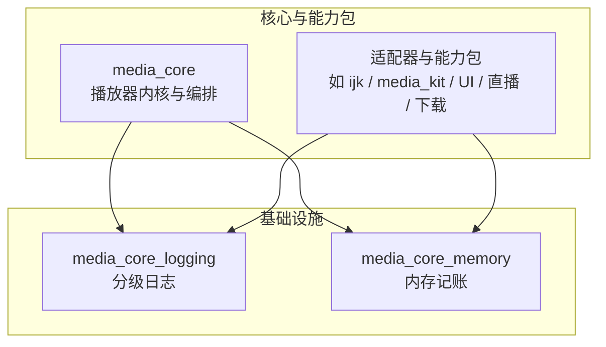
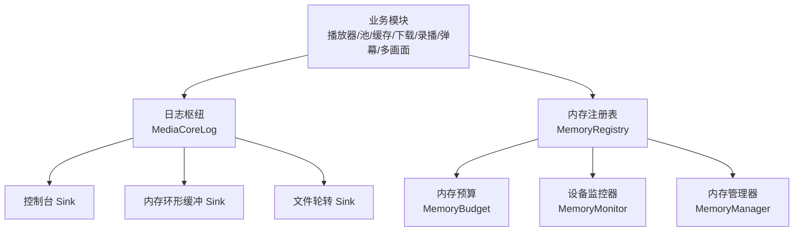
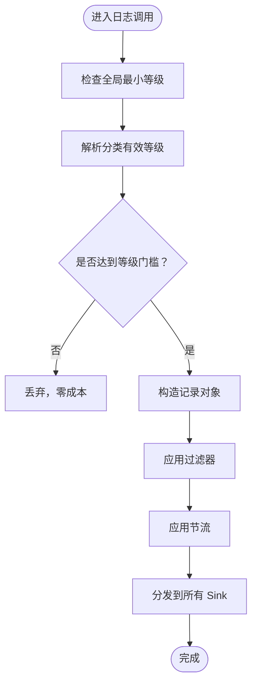
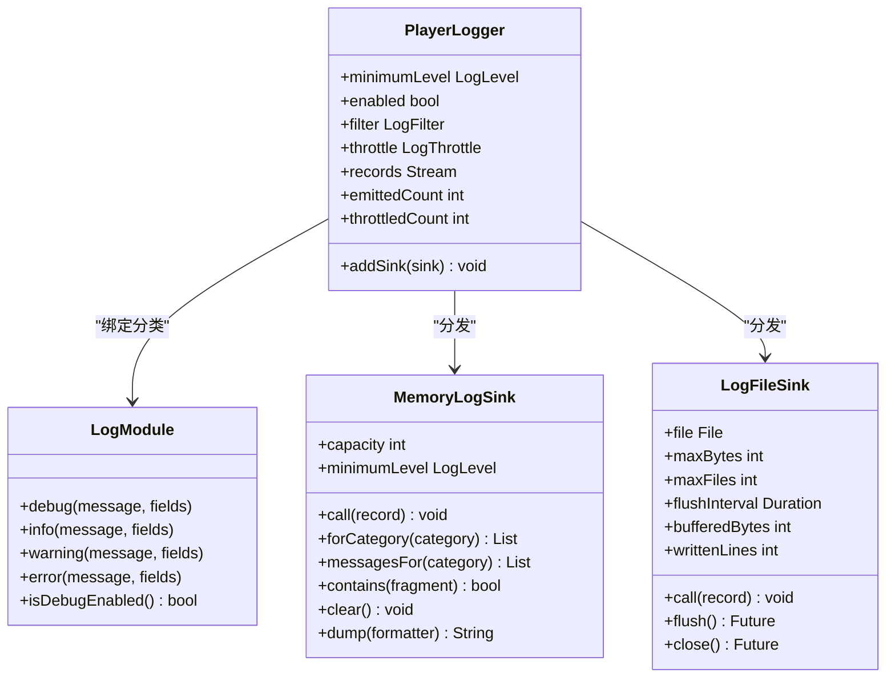
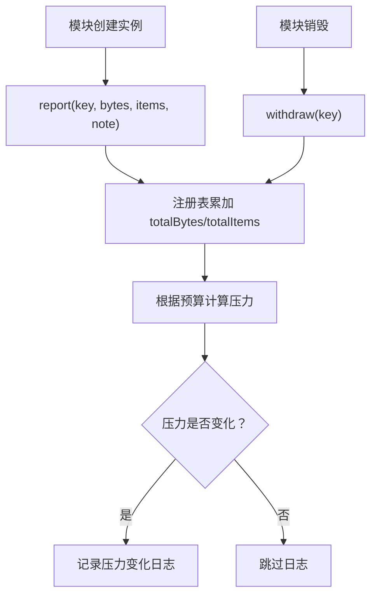
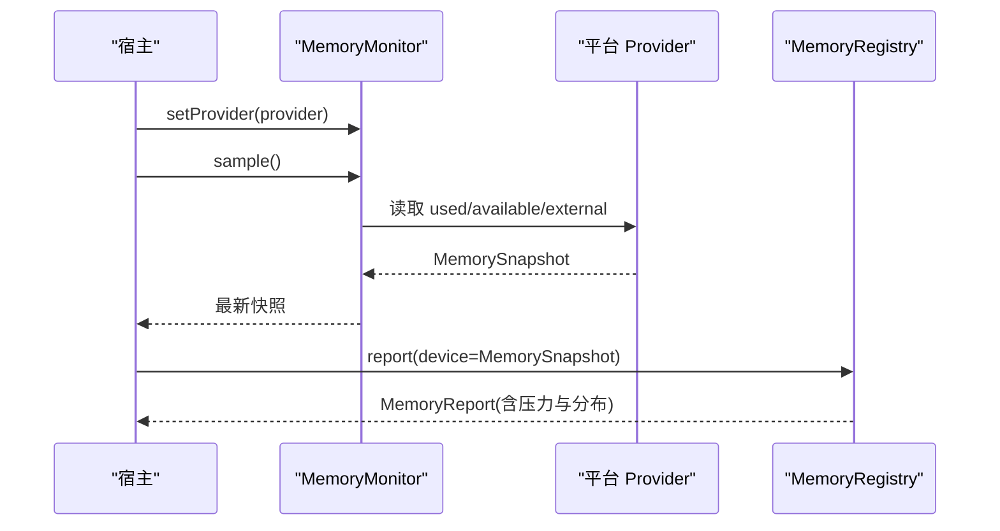
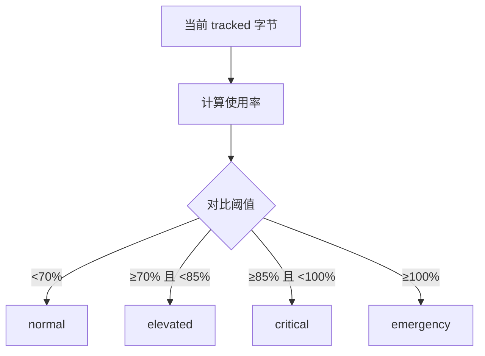
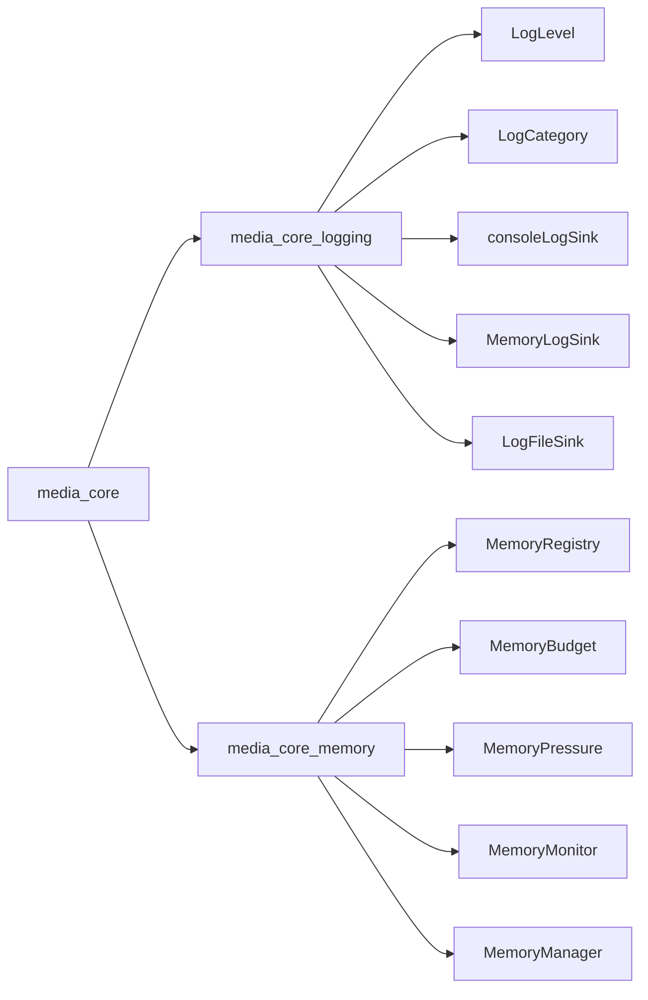

# 基础设施

<cite>
**本文引用的文件**   
- [README.md](file://README.md)
- [logging README.md](file://packages\media_core_logging\README.md)
- [memory README.md](file://packages\media_core_memory\README.md)
- [媒体核心日志入口](file://packages\media_core_logging\lib\src\media_core_log.dart)
- [日志等级定义](file://packages\media_core_logging\lib\src\log_level.dart)
- [日志分类定义](file://packages\media_core_logging\lib\src\log_category.dart)
- [控制台与内存日志出口](file://packages\media_core_logging\lib\src\memory_log_sink.dart)
- [文件轮转日志出口](file://packages\media_core_logging\lib\src\log_file_sink.dart)
- [ijk 引擎日志同步辅助](file://packages\media_core_ijk_player\lib\src\fijk_helper.dart)
- [内存管理器](file://packages\media_core_memory\lib\src\memory_manager.dart)
- [内存预算](file://packages\media_core_memory\lib\src\memory_budget.dart)
- [内存压力枚举](file://packages\media_core_memory\lib\src\memory_pressure.dart)
- [内存注册表](file://packages\media_core_memory\lib\src\memory_registry.dart)
- [设备内存监控器](file://packages\media_core_memory\lib\src\memory_monitor.dart)
</cite>

## 目录
1. [引言](#引言)
2. [项目结构](#项目结构)
3. [核心组件](#核心组件)
4. [架构总览](#架构总览)
5. [详细组件分析](#详细组件分析)
6. [依赖关系分析](#依赖关系分析)
7. [性能考量](#性能考量)
8. [故障排查指南](#故障排查指南)
9. [结论](#结论)
10. [附录：配置最佳实践与调优清单](#附录配置最佳实践与调优清单)

## 引言
本文件聚焦 Media Core 基础设施层的两个关键子系统：**分级日志系统**与**内存管理机制**。目标是帮助开发者在保持播放体验稳定的前提下，获得完整的可观测性与可控的内存行为。文档覆盖以下要点：
- 日志系统的级别设置、分类开关、多 sink（控制台、内存环、文件轮转）、作用域字段、过滤与节流。
- 内存记账的贡献者申报、设备实测快照、预算阈值驱动的四级压力管理。
- 内存压力的监控、告警与自动降级策略，以及与资源层压力模型的桥接思路。
- 日志配置最佳实践、内存优化调优方法、性能分析方法与常见问题诊断路径。

## 项目结构
Media Core 将“日志”和“内存”作为独立的基础设施包，供核心与各能力包共同使用，避免模块间为日志或内存互相耦合。

**图示来源**
- [README.md:105-124](file://README.md#L105-L124)

**章节来源**
- [README.md:105-124](file://README.md#L105-L124)

## 核心组件
本节从“能做什么、怎么配置、对性能有什么影响”三个维度，梳理日志与内存的核心组件。

### 日志核心组件
- **全局日志枢纽**：提供全局最小等级、分类覆盖、sink 注册、作用域字段、记录流、统计计数等。
- **日志等级**：trace < debug < info < warning < error < critical，外加 nothing（默认静默）。
- **日志分类**：按子系统划分，例如 player、playback、buffering、session、source、renderer、audio、presentation、recovery、fallback、cache、recording、danmaku、multiview、pool、download、visibility、lifecycle、network、performance、memory、logging、diagnostics、error。
- **Sink 体系**：
  - 控制台 sink：走 dart:developer，便于 flutter run 与 DevTools 查看。
  - 内存环形缓冲 sink：有界容量，适合应用内日志页或复制诊断。
  - 文件轮转 sink：追加写、定时/定长 flush、按大小轮转并保留若干历史文件。
- **作用域字段**：通过作用域把上下文字段附加到该作用域内的每条日志。
- **过滤与节流**：支持按分类与关键词过滤；支持按类别限流，被丢弃次数会附在下一条通过的记录上。

**章节来源**
- [logging README.md:1-76](file://packages\media_core_logging\README.md#L1-L76)
- [媒体核心日志入口:13-189](file://packages\media_core_logging\lib\src\media_core_log.dart#L13-L189)
- [日志等级定义:25-119](file://packages\media_core_logging\lib\src\log_level.dart#L25-L119)
- [日志分类定义:26-156](file://packages\media_core_logging\lib\src\log_category.dart#L26-L156)
- [控制台与内存日志出口:9-162](file://packages\media_core_logging\lib\src\memory_log_sink.dart#L9-L162)
- [文件轮转日志出口:7-156](file://packages\media_core_logging\lib\src\log_file_sink.dart#L7-L156)

### 内存核心组件
- **内存管理器**：对外暴露当前内存字节数、压力状态、是否需紧急清理、快照、分配判断等。
- **内存预算**：以最大跟踪内存与警告/严重阈值定义四级压力，并提供剩余容量、使用率、能否分配等方法。
- **内存压力枚举**：normal → elevated → critical → emergency，并给出停止预载、释放资源、拒绝新分配等语义。
- **内存注册表**：按模块维护贡献者账户，汇总 totalBytes/totalItems，生成报告、广播报告、记录压力变化日志。
- **设备内存监控器**：由宿主安装 provider，采集 used/available/external 字节，保留最近 N 条历史，异常不抛给调用方。

**章节来源**
- [memory README.md:1-101](file://packages\media_core_memory\README.md#L1-L101)
- [内存管理器:1-135](file://packages\media_core_memory\lib\src\memory_manager.dart#L1-L135)
- [内存预算:1-142](file://packages\media_core_memory\lib\src\memory_budget.dart#L1-L142)
- [内存压力枚举:1-61](file://packages\media_core_memory\lib\src\memory_pressure.dart#L1-L61)
- [内存注册表:1-261](file://packages\media_core_memory\lib\src\memory_registry.dart#L1-L261)
- [设备内存监控器:1-144](file://packages\media_core_memory\lib\src\memory_monitor.dart#L1-L144)

## 架构总览
下图展示日志与内存在 Media Core 中的协作方式：各模块通过统一入口打日志，并通过贡献者上报内存；注册表汇总后计算压力，驱动上层决策。

**图示来源**
- [媒体核心日志入口:13-189](file://packages\media_core_logging\lib\src\media_core_log.dart#L13-L189)
- [控制台与内存日志出口:9-162](file://packages\media_core_logging\lib\src\memory_log_sink.dart#L9-L162)
- [文件轮转日志出口:7-156](file://packages\media_core_logging\lib\src\log_file_sink.dart#L7-L156)
- [内存注册表:1-261](file://packages\media_core_memory\lib\src\memory_registry.dart#L1-L261)
- [内存预算:1-142](file://packages\media_core_memory\lib\src\memory_budget.dart#L1-L142)
- [设备内存监控器:1-144](file://packages\media_core_memory\lib\src\memory_monitor.dart#L1-L144)
- [内存管理器:1-135](file://packages\media_core_memory\lib\src\memory_manager.dart#L1-L135)

## 详细组件分析

### 日志系统：级别、分类与多 Sink
#### 级别与分类
- 默认等级为 nothing，即生产环境完全静默；需要时再开启。
- 分类与模块一一对应，便于只放大出问题的子系统。
- 有效等级 = 分类覆盖值，否则回退到全局最小等级。

**图示来源**
- [媒体核心日志入口:13-189](file://packages\media_core_logging\lib\src\media_core_log.dart#L13-L189)
- [日志等级定义:25-119](file://packages\media_core_logging\lib\src\log_level.dart#L25-L119)
- [日志分类定义:26-156](file://packages\media_core_logging\lib\src\log_category.dart#L26-L156)

#### 多 Sink 支持
- 控制台 Sink：面向 flutter run 与 DevTools，行格式强调“决策轨迹”。
- 内存环形缓冲 Sink：固定容量，按最低等级过滤，支持按分类查询、消息检索、清空与导出。
- 文件轮转 Sink：缓冲写入，按时间或缓冲区大小触发 flush；超过 maxBytes 时轮转文件，最多保留 maxFiles 份；close 等待已排队的写入完成。

**图示来源**
- [媒体核心日志入口:13-189](file://packages\media_core_logging\lib\src\media_core_log.dart#L13-L189)
- [控制台与内存日志出口:9-162](file://packages\media_core_logging\lib\src\memory_log_sink.dart#L9-L162)
- [文件轮转日志出口:7-156](file://packages\media_core_logging\lib\src\log_file_sink.dart#L7-L156)

#### 作用域字段与日志查询
- 作用域字段：通过作用域把上下文字段附加到该作用域内的每条日志，便于跨模块追踪同一请求或会话。
- 日志查询：可通过分类过滤、关键词搜索；内存环形缓冲可按分类取记录或消息；文件轮转用于离线诊断。

**章节来源**
- [logging README.md:15-63](file://packages\media_core_logging\README.md#L15-L63)
- [媒体核心日志入口:154-189](file://packages\media_core_logging\lib\src\media_core_log.dart#L154-L189)
- [控制台与内存日志出口:53-114](file://packages\media_core_logging\lib\src\memory_log_sink.dart#L53-L114)

#### 与平台引擎日志的关系
- 某些后端（如 ijk）有自己的原生日志通道；框架通过适配层把 MediaCoreLog 的等级映射到引擎日志等级，保证“日志枢纽是唯一权威”，避免宿主关闭框架日志却仍看到大量引擎输出。

**章节来源**
- [ijk 引擎日志同步辅助:33-60](file://packages\media_core_ijk_player\lib\src\fijk_helper.dart#L33-L60)

### 内存机制：记账、快照与四级压力
#### 贡献者申报与求和
- 每个模块通过 `MediaCoreMemory.of(...)` 获取账本，持有资源时 report，销毁时 withdraw。
- 同一模块可有多个实例，按贡献者 key 分别记账再求和；单实例模块可直接 add/remove/set。
- 注册表汇总 totalBytes/totalItems，并按模块排序生成报告。

**图示来源**
- [内存注册表:93-155](file://packages\media_core_memory\lib\src\memory_registry.dart#L93-L155)
- [内存注册表:195-248](file://packages\media_core_memory\lib\src\memory_registry.dart#L195-L248)

#### 设备实测快照
- 宿主安装 provider，MemoryMonitor 负责采样、保存最新值与有限历史，异常返回 null，不影响播放。
- 报告可同时携带“申报分布”和“设备真值”，回答“谁在用”和“进程一共用了多少”。

**图示来源**
- [设备内存监控器:22-102](file://packages\media_core_memory\lib\src\memory_monitor.dart#L22-L102)
- [内存注册表:120-155](file://packages\media_core_memory\lib\src\memory_registry.dart#L120-L155)

#### 预算阈值驱动的四级压力
- 默认预算：512 MiB，70% 告警，85% 严重；超过 100% 为紧急。
- 四级压力：
  - normal：正常。
  - elevated：停止增长（预载、热播放器等可选工作）。
  - critical：开始释放。
  - emergency：立即释放，并拒绝新分配。
- 压力变化会写日志；debug 级别下附带模块分布。

**图示来源**
- [内存预算:35-88](file://packages\media_core_memory\lib\src\memory_budget.dart#L35-L88)
- [内存压力枚举:8-56](file://packages\media_core_memory\lib\src\memory_pressure.dart#L8-L56)

#### 内存管理器与资源层桥接
- MemoryManager 对外提供 memoryBytes、pressure、canAllocate、snapshot 等。
- 当 attach registry 时，manager 不再自行记账，直接以 registry 总数为准，避免双写不一致。
- 资源层通过桥接把内存压力折算进 ResourcePressure，与其他压力源一起取最大值。

**章节来源**
- [内存管理器:1-135](file://packages\media_core_memory\lib\src\memory_manager.dart#L1-L135)
- [memory README.md:59-70](file://packages\media_core_memory\README.md#L59-L70)

## 依赖关系分析
- 日志与内存均为基础设施包，核心与各能力包单向依赖它们，避免反向耦合。
- 日志子系统内部：MediaCoreLog 聚合 PlayerLogger，PlayerLogger 分发到多个 Sink；Sink 之间相互独立。
- 内存子系统内部：MemoryRegistry 汇总各模块 MemoryAccount，结合 MemoryBudget 计算压力；MemoryMonitor 提供设备快照；MemoryManager 对外暴露资源层所需视图。

**图示来源**
- [README.md:105-124](file://README.md#L105-L124)
- [日志等级定义:25-119](file://packages\media_core_logging\lib\src\log_level.dart#L25-L119)
- [日志分类定义:26-156](file://packages\media_core_logging\lib\src\log_category.dart#L26-L156)
- [控制台与内存日志出口:9-162](file://packages\media_core_logging\lib\src\memory_log_sink.dart#L9-L162)
- [文件轮转日志出口:7-156](file://packages\media_core_logging\lib\src\log_file_sink.dart#L7-L156)
- [内存注册表:1-261](file://packages\media_core_memory\lib\src\memory_registry.dart#L1-L261)
- [内存预算:1-142](file://packages\media_core_memory\lib\src\memory_budget.dart#L1-L142)
- [内存压力枚举:1-61](file://packages\media_core_memory\lib\src\memory_pressure.dart#L1-L61)
- [设备内存监控器:1-144](file://packages\media_core_memory\lib\src\memory_monitor.dart#L1-L144)
- [内存管理器:1-135](file://packages\media_core_memory\lib\src\memory_manager.dart#L1-L135)

## 性能考量
- 日志默认完全静默，关闭时仅一次枚举比较，不构造字符串或 map；热路径应先判断 isEnabled/isDebugEnabled 再构造参数。
- 文件轮转 Sink 采用缓冲写入，避免逐帧同步落盘造成卡顿；write 失败被吞掉，保证被记录的代码不被日志 sink 拖垮。
- 内存侧：provider 异常不会传播；压力是信号而非动作，释放策略由各模块决定；估算值用于排序与预算，真实值由宿主 provider 或磁盘/录像模块自报。

[本节为通用性能指导，不直接分析具体文件]

## 故障排查指南
### 日志问题
- 现象：看不到任何日志。
  - 检查是否设置了全局等级或分类覆盖；默认 nothing 不会输出。
  - 确认未误用 enabled=false。
- 现象：日志太多，影响性能。
  - 缩小分类范围，只对出问题模块提升到 trace/debug。
  - 启用节流，观察 suppressed 计数。
- 现象：找不到某次回放上下文。
  - 使用作用域字段，把 roomId、engine、uri 等关键字段注入。
  - 使用过滤功能限定分类与关键词。

**章节来源**
- [logging README.md:15-63](file://packages\media_core_logging\README.md#L15-L63)
- [媒体核心日志入口:13-189](file://packages\media_core_logging\lib\src\media_core_log.dart#L13-L189)

### 内存问题
- 现象：内存持续增长。
  - 检查各模块是否正确 withdraw；重复 report 是替换而非累加，但缺失 withdraw 会导致总数虚高。
  - 查看 MemoryRegistry 的报告，定位占用最大的模块。
- 现象：频繁出现 elevated/critical/emergency。
  - 调整 MemoryBudget 的阈值或 maxBytes；注意 512 MiB 是“被记账的内存”上限，不是进程总量。
  - 关注 shouldStopPreload/shouldReleaseResources/shouldRefuseAllocation 分支，确保可选工作及时停止。
- 现象：设备内存读数异常或缺失。
  - 确认宿主已安装 provider；若 provider 抛异常，sample 返回 null，属于预期行为。

**章节来源**
- [memory README.md:14-19](file://packages\media_core_memory\README.md#L14-L19)
- [内存注册表:195-248](file://packages\media_core_memory\lib\src\memory_registry.dart#L195-L248)
- [设备内存监控器:62-80](file://packages\media_core_memory\lib\src\memory_monitor.dart#L62-L80)
- [内存预算:74-120](file://packages\media_core_memory\lib\src\memory_budget.dart#L74-L120)

## 结论
Media Core 的基础设施层通过“日志枢纽 + 多 Sink”和“贡献者记账 + 设备快照 + 预算压力”两套机制，为可观测性与稳定性提供了坚实基础。日志默认静默、按需开启；内存估算保守、真值可插拔。开发者可以据此实现精细的诊断与自动降级，同时避免基础设施成为性能瓶颈。

[本节为总结性内容，不直接分析具体文件]

## 附录：配置最佳实践与调优清单
### 日志配置最佳实践
- 生产默认 nothing；仅在调试构建中打开必要等级。
- 优先使用分类覆盖，而不是整体提升等级。
- 同时挂载控制台与内存环形缓冲；长时间运行或崩溃复现时附加文件轮转。
- 在关键路径使用作用域字段，统一携带会话/房间/引擎等上下文。
- 高频路径启用节流，并关注 suppressed 计数。

**章节来源**
- [logging README.md:15-63](file://packages\media_core_logging\README.md#L15-L63)
- [媒体核心日志入口:13-189](file://packages\media_core_logging\lib\src\media_core_log.dart#L13-L189)

### 内存优化调优方法
- 明确哪些模块是估算值、哪些是实测值；估算值用于排序与预算，不要当作精确剩余。
- 合理设置 MemoryBudget.maxBytes 与阈值；必要时降低 warning/critical 比例。
- 在 elevated 时停止预载与预热；在 critical 时主动释放空闲资源；在 emergency 时拒绝新分配。
- 确保每个贡献者在销毁时 withdraw；单实例模块优先使用 add/remove/set。
- 安装宿主 provider，以便区分“框架 footprint”和“进程总量”。

**章节来源**
- [memory README.md:14-19](file://packages\media_core_memory\README.md#L14-L19)
- [内存预算:35-120](file://packages\media_core_memory\lib\src\memory_budget.dart#L35-L120)
- [内存压力枚举:32-42](file://packages\media_core_memory\lib\src\memory_pressure.dart#L32-L42)
- [内存注册表:120-155](file://packages\media_core_memory\lib\src\memory_registry.dart#L120-L155)

### 性能分析方法
- 先查日志：定位决策链路与错误点，确认是否因频繁重试、换后端、换线路导致资源波动。
- 再看内存报告：按模块排序，找到占用最大的贡献者；结合设备快照判断是否为真实 OOM 风险。
- 最后看行为：是否触发了预载停止、资源释放、分配拒绝；必要时调整预算阈值或模块策略。

[本节为通用方法论，不直接分析具体文件]