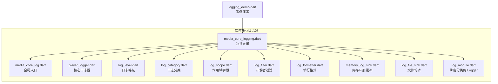
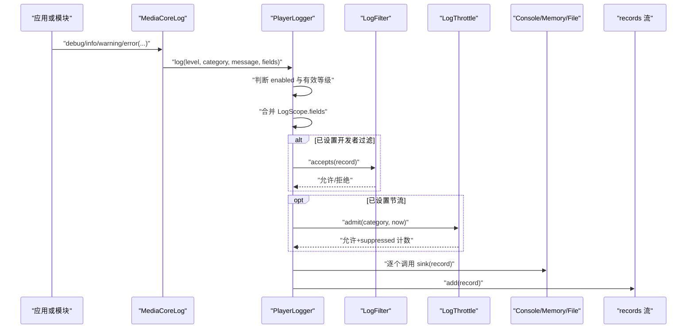
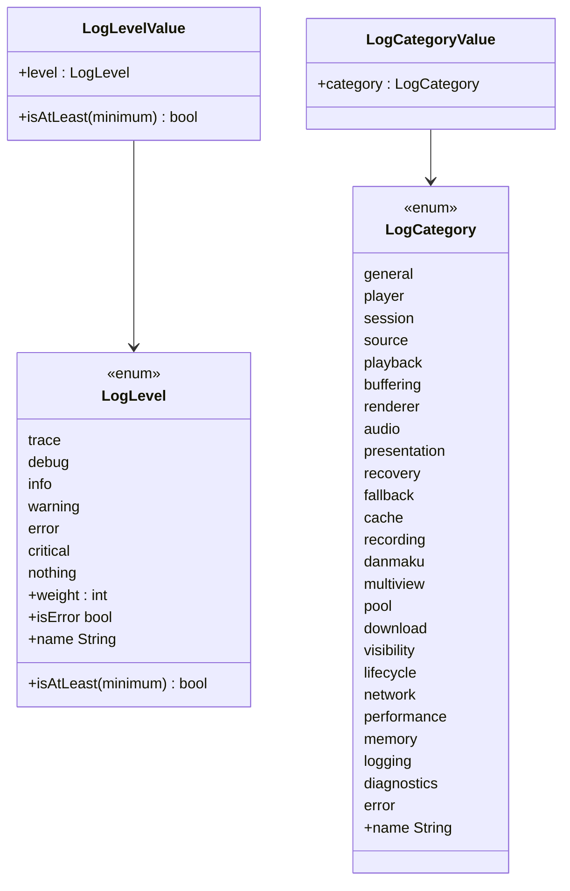
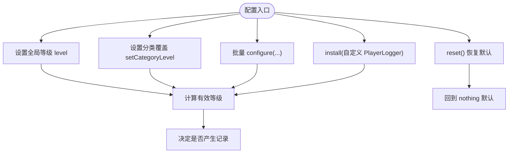
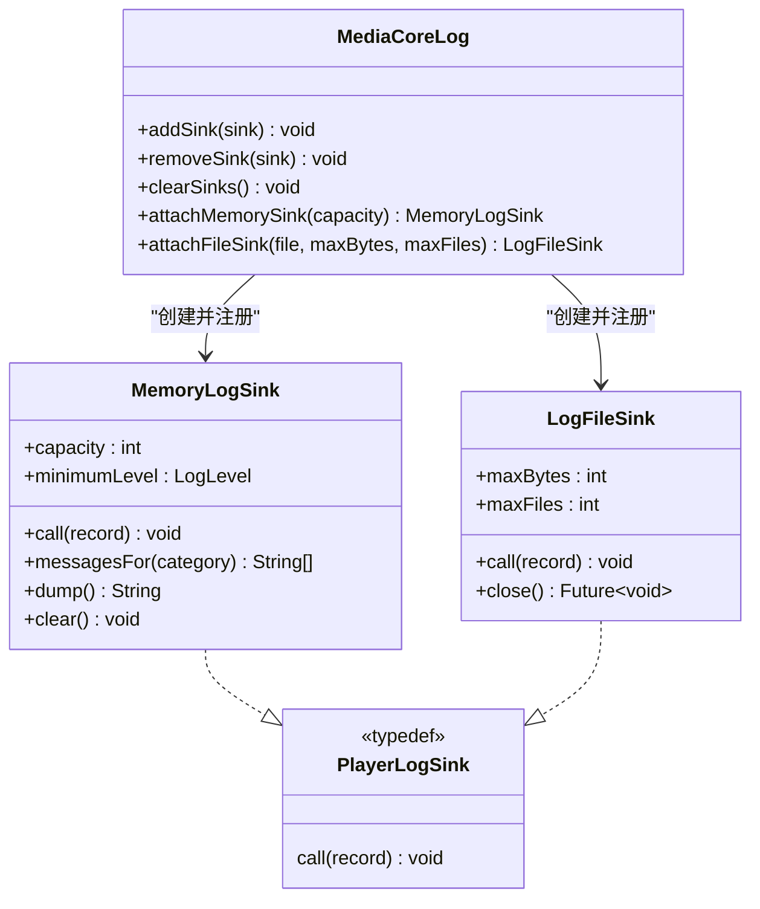
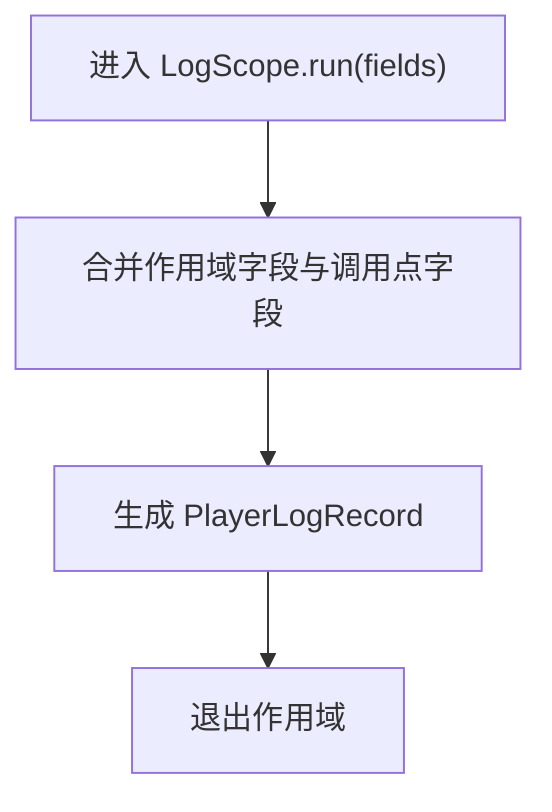
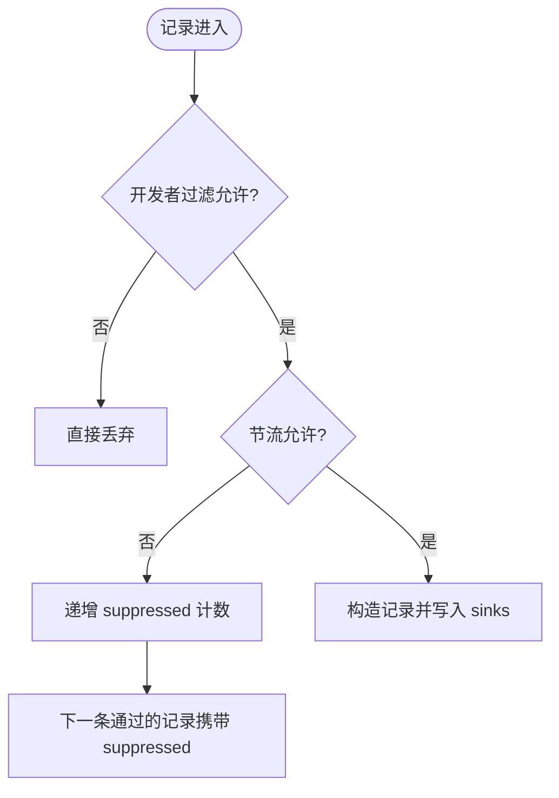
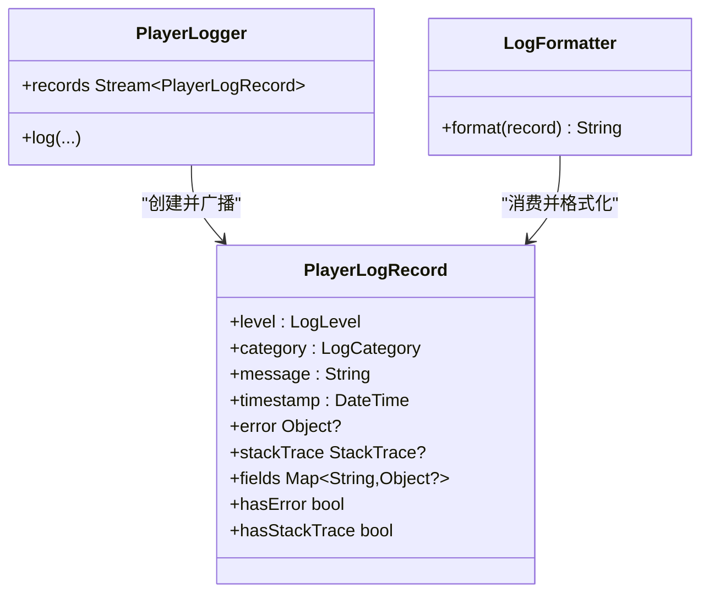
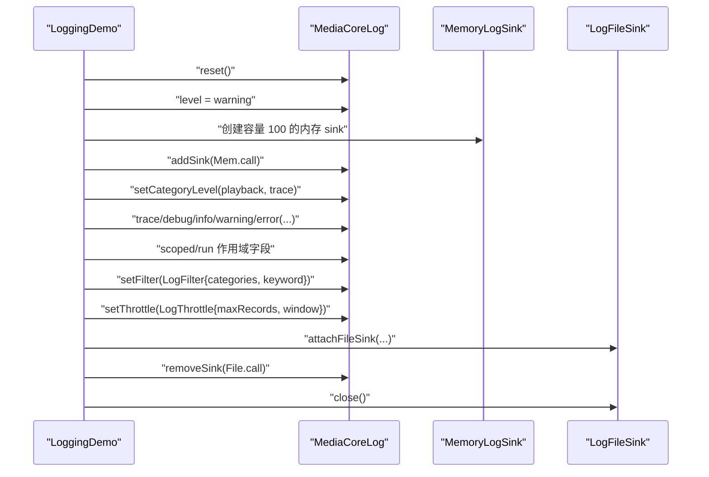
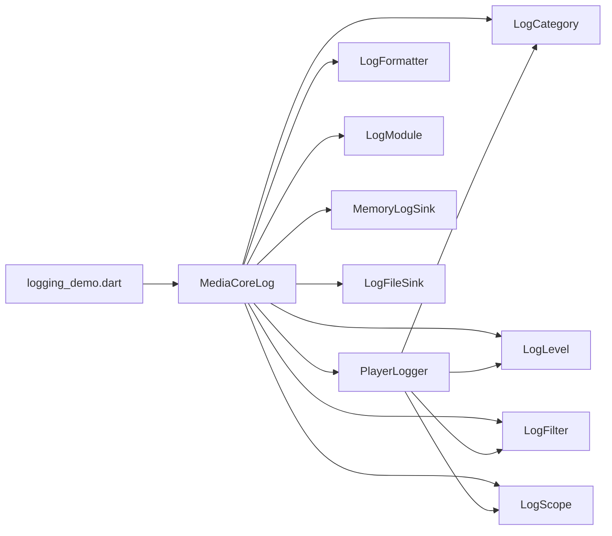

# 日志系统

<cite>
**本文引用的文件**   
- [packages/media_core_logging/lib/media_core_logging.dart](file://packages/media_core_logging/lib/media_core_logging.dart)
- [packages/media_core_logging/README.md](file://packages/media_core_logging/README.md)
- [packages/media_core_logging/lib/src/media_core_log.dart](file://packages/media_core_logging/lib/src/media_core_log.dart)
- [packages/media_core_logging/lib/src/player_logger.dart](file://packages/media_core_logging/lib/src/player_logger.dart)
- [packages/media_core_logging/lib/src/log_level.dart](file://packages/media_core_logging/lib/src/log_level.dart)
- [packages/media_core_logging/lib/src/log_category.dart](file://packages/media_core_logging/lib/src/log_category.dart)
- [packages/media_core_logging/lib/src/log_file_sink.dart](file://packages/media_core_logging/lib/src/log_file_sink.dart)
- [packages/media_core_logging/lib/src/memory_log_sink.dart](file://packages/media_core_logging/lib/src/memory_log_sink.dart)
- [packages/media_core_logging/lib/src/log_filter.dart](file://packages/media_core_logging/lib/src/log_filter.dart)
- [packages/media_core_logging/lib/src/log_formatter.dart](file://packages/media_core_logging/lib/src/log_formatter.dart)
- [packages/media_core_logging/lib/src/log_module.dart](file://packages/media_core_logging/lib/src/log_module.dart)
- [packages/media_core_logging/lib/src/log_scope.dart](file://packages/media_core_logging/lib/src/log_scope.dart)
- [example/lib/demos/console/logging_demo.dart](file://example/lib/demos/console/logging_demo.dart)
</cite>

## 目录
1. [引言](#引言)
2. [项目结构](#项目结构)
3. [核心组件](#核心组件)
4. [架构总览](#架构总览)
5. [详细组件分析](#详细组件分析)
6. [依赖关系分析](#依赖关系分析)
7. [性能与成本](#性能与成本)
8. [配置最佳实践](#配置最佳实践)
9. [日志查询与分析工具](#日志查询与分析工具)
10. [生产环境优化建议](#生产环境优化建议)
11. [故障排查指南](#故障排查指南)
12. [结论](#结论)

## 引言
Media Core 的日志系统是一个“全局枢纽 + 分类开关 + 多 sink”的可插拔分级日志方案。它默认完全静默，宿主按需开启；同一份记录可同时输出到控制台、内存环形缓冲和轮转文件；开发者可按分类调高某个模块的级别，并通过作用域字段为日志附加上下文信息。该设计让跨模块问题（例如“为什么播放最终落在某个后端”）更容易被定位，同时保证未启用时零额外开销。

## 项目结构
日志能力集中在 `media_core_logging` 包中，对外通过顶层库导出统一 API；内部按职责拆分为等级、分类、记录、日志器、作用域、过滤器、格式化器以及多种 sink。示例应用提供可运行的演示，覆盖等级、分类、sink、过滤、节流与作用域等关键特性。

**图示来源**
- [packages/media_core_logging/lib/media_core_logging.dart:1-35](file://packages/media_core_logging/lib/media_core_logging.dart#L1-L35)
- [packages/media_core_logging/lib/src/media_core_log.dart:1-377](file://packages/media_core_logging/lib/src/media_core_log.dart#L1-L377)
- [packages/media_core_logging/lib/src/player_logger.dart:1-361](file://packages/media_core_logging/lib/src/player_logger.dart#L1-L361)
- [packages/media_core_logging/lib/src/log_level.dart:1-119](file://packages/media_core_logging/lib/src/log_level.dart#L1-L119)
- [packages/media_core_logging/lib/src/log_category.dart:1-156](file://packages/media_core_logging/lib/src/log_category.dart#L1-L156)
- [packages/media_core_logging/lib/src/log_scope.dart](file://packages/media_core_logging/lib/src/log_scope.dart)
- [packages/media_core_logging/lib/src/log_filter.dart](file://packages/media_core_logging/lib/src/log_filter.dart)
- [packages/media_core_logging/lib/src/log_formatter.dart](file://packages/media_core_logging/lib/src/log_formatter.dart)
- [packages/media_core_logging/lib/src/memory_log_sink.dart](file://packages/media_core_logging/lib/src/memory_log_sink.dart)
- [packages/media_core_logging/lib/src/log_file_sink.dart](file://packages/media_core_logging/lib/src/log_file_sink.dart)
- [packages/media_core_logging/lib/src/log_module.dart](file://packages/media_core_logging/lib/src/log_module.dart)
- [example/lib/demos/console/logging_demo.dart:1-203](file://example/lib/demos/console/logging_demo.dart#L1-L203)

**章节来源**
- [packages/media_core_logging/lib/media_core_logging.dart:1-35](file://packages/media_core_logging/lib/media_core_logging.dart#L1-L35)
- [packages/media_core_logging/README.md:1-76](file://packages/media_core_logging/README.md#L1-L76)
- [example/lib/demos/console/logging_demo.dart:1-203](file://example/lib/demos/console/logging_demo.dart#L1-L203)

## 核心组件
- 全局入口：`MediaCoreLog`，负责全局等级、分类覆盖、sink 管理、过滤与节流、作用域桥接。
- 核心日志器：`PlayerLogger`，负责等级判定、作用域字段合并、过滤与节流、分发到多个 sink，并暴露记录流。
- 日志记录：`PlayerLogRecord`，承载等级、分类、消息、时间戳、错误、堆栈与结构化字段。
- 等级与分类：`LogLevel` 与 `LogCategory`，分别定义严重度顺序与子系统语义分组。
- 作用域：`LogScope`，在代码块内自动为每条日志附加上下文字段。
- 过滤与节流：`LogFilter` 与 `LogThrottle`，支持按分类与关键词筛选，以及按窗口限流并上报丢弃计数。
- 格式化：`LogFormatter`，为控制台与文件 sink 提供一致的单行格式。
- Sink 实现：控制台 sink、内存环形缓冲 `MemoryLogSink`、文件轮转 `LogFileSink`。
- 模块 Logger：`LogModule`，将分类绑定到调用点，避免重复写分类名。

**章节来源**
- [packages/media_core_logging/lib/src/media_core_log.dart:13-63](file://packages/media_core_logging/lib/src/media_core_log.dart#L13-L63)
- [packages/media_core_logging/lib/src/player_logger.dart:8-123](file://packages/media_core_logging/lib/src/player_logger.dart#L8-L123)
- [packages/media_core_logging/lib/src/log_level.dart:4-47](file://packages/media_core_logging/lib/src/log_level.dart#L4-L47)
- [packages/media_core_logging/lib/src/log_category.dart:3-101](file://packages/media_core_logging/lib/src/log_category.dart#L3-L101)

## 架构总览
日志管线以 `MediaCoreLog` 为门面，内部委托给 `PlayerLogger`。`PlayerLogger` 依次执行以下决策：
1. 是否启用。
2. 计算分类的有效最低等级（分类覆盖优先于全局）。
3. 合并作用域字段。
4. 应用开发者过滤。
5. 应用节流策略，必要时在下一条通过的记录上附带 suppressed 计数。
6. 构造 `PlayerLogRecord`。
7. 同步广播到所有 sink，并推送到记录流。

**图示来源**
- [packages/media_core_logging/lib/src/media_core_log.dart:294-355](file://packages/media_core_logging/lib/src/media_core_log.dart#L294-L355)
- [packages/media_core_logging/lib/src/player_logger.dart:232-290](file://packages/media_core_logging/lib/src/player_logger.dart#L232-L290)

## 详细组件分析

### 日志等级与分类
- 等级从低到高：trace < debug < info < warning < error < critical，另有 nothing 表示静音。
- 等级比较基于权重，提供 isAtLeast、isError、name 等常用操作。
- 分类覆盖每个子系统，如 player、playback、buffering、session、source、renderer、audio、presentation、recovery、fallback、cache、recording、danmaku、multiview、pool、download、visibility、lifecycle、network、performance、memory、logging、diagnostics、error。
- 分类与等级都提供不可变值包装，便于在其他模型中使用值语义。

**图示来源**
- [packages/media_core_logging/lib/src/log_level.dart:25-119](file://packages/media_core_logging/lib/src/log_level.dart#L25-L119)
- [packages/media_core_logging/lib/src/log_category.dart:26-156](file://packages/media_core_logging/lib/src/log_category.dart#L26-L156)

**章节来源**
- [packages/media_core_logging/lib/src/log_level.dart:4-119](file://packages/media_core_logging/lib/src/log_level.dart#L4-L119)
- [packages/media_core_logging/lib/src/log_category.dart:3-156](file://packages/media_core_logging/lib/src/log_category.dart#L3-L156)

### 全局入口与分类开关
- `MediaCoreLog` 是框架级入口，默认使用 `LogLevel.nothing`，保持生产静默。
- 通过 `setCategoryLevel` 对单个分类提升级别，而不影响其他模块。
- `configure` 支持一次性设置全局等级、开关、sink、分类覆盖，并可替换现有覆盖。
- `install` 允许替换底层 logger，但会保留分类覆盖解析逻辑，使 `setCategoryLevel` 继续生效。
- `reset` 恢复默认 logger、清空分类覆盖。

**图示来源**
- [packages/media_core_logging/lib/src/media_core_log.dart:191-237](file://packages/media_core_logging/lib/src/media_core_log.dart#L191-L237)
- [packages/media_core_logging/lib/src/media_core_log.dart:357-375](file://packages/media_core_logging/lib/src/media_core_log.dart#L357-L375)

**章节来源**
- [packages/media_core_logging/lib/src/media_core_log.dart:63-93](file://packages/media_core_logging/lib/src/media_core_log.dart#L63-L93)
- [packages/media_core_logging/lib/src/media_core_log.dart:191-237](file://packages/media_core_logging/lib/src/media_core_log.dart#L191-L237)
- [packages/media_core_logging/lib/src/media_core_log.dart:357-375](file://packages/media_core_logging/lib/src/media_core_log.dart#L357-L375)

### 多 sink 支持
- 控制台 sink：默认出口，走平台开发通道，在 flutter run 与 DevTools 可见。
- 内存环形缓冲：`MemoryLogSink`，仅保留最近 capacity 条记录，适合应用内日志页或复制诊断。
- 文件轮转：`LogFileSink`，追加写文件，按 maxBytes 轮转，保留 maxFiles 份，内部带缓冲避免逐帧落盘。
- 任意 sink 只需满足 `PlayerLogSink` 类型，通过 `addSink` 挂入；`clearSinks` 可移除全部 sink。

**图示来源**
- [packages/media_core_logging/lib/src/player_logger.dart:90-94](file://packages/media_core_logging/lib/src/player_logger.dart#L90-L94)
- [packages/media_core_logging/lib/src/memory_log_sink.dart](file://packages/media_core_logging/lib/src/memory_log_sink.dart)
- [packages/media_core_logging/lib/src/log_file_sink.dart](file://packages/media_core_logging/lib/src/log_file_sink.dart)
- [packages/media_core_logging/lib/src/media_core_log.dart:94-133](file://packages/media_core_logging/lib/src/media_core_log.dart#L94-L133)

**章节来源**
- [packages/media_core_logging/README.md:46-54](file://packages/media_core_logging/README.md#L46-L54)
- [packages/media_core_logging/lib/src/media_core_log.dart:94-133](file://packages/media_core_logging/lib/src/media_core_log.dart#L94-L133)

### 作用域字段与上下文
- `LogScope.run` 与 `scopedAsync` 在代码块内为每条日志附加字段。
- 作用域字段与调用点传入字段会合并，调用点字段优先级更高。
- 典型用法：把 roomId、engine、sessionId 等上下文放入作用域，避免逐层传递。

**图示来源**
- [packages/media_core_logging/lib/src/media_core_log.dart:154-159](file://packages/media_core_logging/lib/src/media_core_log.dart#L154-L159)
- [packages/media_core_logging/lib/src/player_logger.dart:246-249](file://packages/media_core_logging/lib/src/player_logger.dart#L246-L249)

**章节来源**
- [packages/media_core_logging/lib/src/log_scope.dart](file://packages/media_core_logging/lib/src/log_scope.dart)
- [packages/media_core_logging/lib/src/player_logger.dart:246-249](file://packages/media_core_logging/lib/src/player_logger.dart#L246-L249)

### 过滤与节流
- 过滤：`LogFilter` 支持限定分类集合与关键词搜索，消息与字段一起匹配。
- 节流：`LogThrottle` 按分类和时间窗口限制记录数量；被丢弃的记录数会附在下一条通过的记录的 fields.suppressed 中，避免“发生一次”和“发生四千次”无法区分。
- 节流统计：`throttledCount` 暴露被丢弃总数，`emittedCount` 暴露已发出总数。

**图示来源**
- [packages/media_core_logging/lib/src/player_logger.dart:251-279](file://packages/media_core_logging/lib/src/player_logger.dart#L251-L279)
- [packages/media_core_logging/lib/src/player_logger.dart:157-174](file://packages/media_core_logging/lib/src/player_logger.dart#L157-L174)

**章节来源**
- [packages/media_core_logging/lib/src/log_filter.dart](file://packages/media_core_logging/lib/src/log_filter.dart)
- [packages/media_core_logging/lib/src/player_logger.dart:157-174](file://packages/media_core_logging/lib/src/player_logger.dart#L157-L174)
- [packages/media_core_logging/lib/src/player_logger.dart:251-279](file://packages/media_core_logging/lib/src/player_logger.dart#L251-L279)

### 记录与格式化
- `PlayerLogRecord` 包含等级、分类、消息、时间戳、可选错误与堆栈、结构化字段。
- `LogFormatter` 为控制台与文件 sink 提供统一的单行格式，包含时间戳、定宽等级、补齐后的分类、字段与可选堆栈。
- 记录流 `records` 暴露已接受的记录，可用于实时日志界面。

**图示来源**
- [packages/media_core_logging/lib/src/player_logger.dart:8-88](file://packages/media_core_logging/lib/src/player_logger.dart#L8-L88)
- [packages/media_core_logging/lib/src/log_formatter.dart](file://packages/media_core_logging/lib/src/log_formatter.dart)
- [packages/media_core_logging/lib/src/player_logger.dart:179-185](file://packages/media_core_logging/lib/src/player_logger.dart#L179-L185)

**章节来源**
- [packages/media_core_logging/lib/src/player_logger.dart:8-88](file://packages/media_core_logging/lib/src/player_logger.dart#L8-L88)
- [packages/media_core_logging/lib/src/log_formatter.dart](file://packages/media_core_logging/lib/src/log_formatter.dart)

### 示例演示
示例 `logging_demo.dart` 展示了：
- 全局等级与分类覆盖。
- 内存 sink 与文件 sink。
- 作用域字段。
- 过滤与节流。
- 关闭后重置。

**图示来源**
- [example/lib/demos/console/logging_demo.dart:71-187](file://example/lib/demos/console/logging_demo.dart#L71-L187)

**章节来源**
- [example/lib/demos/console/logging_demo.dart:1-203](file://example/lib/demos/console/logging_demo.dart#L1-L203)

## 依赖关系分析
- `MediaCoreLog` 依赖 `PlayerLogger`、`LogCategory`、`LogLevel`、`LogFilter`、`LogFormatter`、`LogModule`、`LogScope`、`MemoryLogSink`、`LogFileSink`。
- `PlayerLogger` 依赖 `LogCategory`、`LogLevel`、`LogFilter`、`LogScope`。
- 示例依赖 `MediaCoreLog` 与 sink 实现。

**图示来源**
- [packages/media_core_logging/lib/src/media_core_log.dart:1-11](file://packages/media_core_logging/lib/src/media_core_log.dart#L1-L11)
- [packages/media_core_logging/lib/src/player_logger.dart:1-6](file://packages/media_core_logging/lib/src/player_logger.dart#L1-L6)
- [example/lib/demos/console/logging_demo.dart:1-4](file://example/lib/demos/console/logging_demo.dart#L1-L4)

**章节来源**
- [packages/media_core_logging/lib/src/media_core_log.dart:1-11](file://packages/media_core_logging/lib/src/media_core_log.dart#L1-L11)
- [packages/media_core_logging/lib/src/player_logger.dart:1-6](file://packages/media_core_logging/lib/src/player_logger.dart#L1-L6)
- [example/lib/demos/console/logging_demo.dart:1-4](file://example/lib/demos/console/logging_demo.dart#L1-L4)

## 性能与成本
- 默认静默：未配置时等级为 nothing，不产生任何输出。
- 关闭路径零成本：被丢弃的记录只进行一次枚举比较，不构造字符串或 map。
- 热路径建议：先通过 `isEnabled` 或 `isDebugEnabled` 判断，再打印细节。
- 节流保护：高频路径使用 `LogThrottle`，避免日志风暴掩盖真实问题。
- 文件 sink 缓冲：避免逐帧同步落盘，降低 IO 抖动。

**章节来源**
- [packages/media_core_logging/lib/src/media_core_log.dart:53-62](file://packages/media_core_logging/lib/src/media_core_log.dart#L53-L62)
- [packages/media_core_logging/lib/src/player_logger.dart:160-174](file://packages/media_core_logging/lib/src/player_logger.dart#L160-L174)
- [packages/media_core_logging/lib/src/player_logger.dart:232-290](file://packages/media_core_logging/lib/src/player_logger.dart#L232-L290)

## 配置最佳实践
- 启动阶段显式开启：在调试构建中设置 `MediaCoreLog.level` 或使用 `configure`。
- 精准调高分类：用 `setCategoryLevel` 只提升出问题的模块，避免全量 trace。
- 多 sink 组合：控制台用于开发观察，内存 sink 用于应用内日志页，文件 sink 用于反馈报告。
- 作用域注入上下文：在播放器打开、会话建立等关键路径包裹 `LogScope.run`。
- 过滤与节流配合：先用分类过滤缩小范围，再用关键词搜索定位具体事件，最后用节流抑制高频噪声。
- 生命周期管理：文件 sink 使用后调用 `close`，并通过 `removeSink` 解除注册。

**章节来源**
- [packages/media_core_logging/README.md:15-38](file://packages/media_core_logging/README.md#L15-L38)
- [packages/media_core_logging/lib/src/media_core_log.dart:94-133](file://packages/media_core_logging/lib/src/media_core_log.dart#L94-L133)
- [example/lib/demos/console/logging_demo.dart:71-187](file://example/lib/demos/console/logging_demo.dart#L71-L187)

## 日志查询与分析工具
- 内存 sink：通过 `messagesFor` 获取某分类的消息列表，或通过 `dump` 查看整体快照。
- 记录流：订阅 `MediaCoreLog.records` 或 `PlayerLogger.records`，实现实时日志界面。
- 过滤：使用 `LogFilter` 限定分类与关键词，快速聚焦问题。
- 节流统计：通过 `throttledCount` 了解被丢弃的数量，结合下一条记录的 `suppressed` 字段还原事件频率。
- 示例参考：`logging_demo.dart` 展示了如何打印实际记录、验证作用域字段、过滤与节流效果。

**章节来源**
- [packages/media_core_logging/lib/src/media_core_log.dart:185-186](file://packages/media_core_logging/lib/src/media_core_log.dart#L185-L186)
- [packages/media_core_logging/lib/src/player_logger.dart:179-185](file://packages/media_core_logging/lib/src/player_logger.dart#L179-L185)
- [packages/media_core_logging/lib/src/player_logger.dart:222-226](file://packages/media_core_logging/lib/src/player_logger.dart#L222-L226)
- [example/lib/demos/console/logging_demo.dart:119-149](file://example/lib/demos/console/logging_demo.dart#L119-L149)

## 生产环境优化建议
- 默认保持静默：不要在生产默认开启 debug/trace。
- 按需开启：仅在需要收集诊断时临时提高等级，并在任务结束后恢复。
- 控制文件大小：合理设置 `maxBytes` 与 `maxFiles`，避免磁盘占用过大。
- 避免敏感信息：不要在 fields 中写入用户隐私或密钥。
- 监控节流：关注 `throttledCount`，过高说明存在高频事件需要业务侧优化。
- 分离关注点：控制台用于交互调试，内存用于应用内展示，文件用于离线分析。

**章节来源**
- [packages/media_core_logging/lib/src/media_core_log.dart:66-72](file://packages/media_core_logging/lib/src/media_core_log.dart#L66-L72)
- [packages/media_core_logging/lib/src/media_core_log.dart:120-133](file://packages/media_core_logging/lib/src/media_core_log.dart#L120-L133)
- [packages/media_core_logging/lib/src/player_logger.dart:160-174](file://packages/media_core_logging/lib/src/player_logger.dart#L160-L174)

## 故障排查指南
- 没有日志输出：检查是否设置了 `level` 或 `enabled`，确认分类覆盖没有被 `nothing` 覆盖。
- 日志过多：使用 `setCategoryLevel` 收窄到问题分类，配合 `LogFilter` 与 `LogThrottle`。
- 文件未落盘：确保调用 `LogFileSink.close()`，并通过 `removeSink` 解除注册。
- 作用域字段缺失：确认日志发生在 `LogScope.run` 内部，且调用点字段不会覆盖作用域字段。
- 高频事件被吞：查看 `throttledCount` 与下一条记录的 `suppressed` 字段，确认节流策略是否过严。

**章节来源**
- [packages/media_core_logging/lib/src/media_core_log.dart:167-183](file://packages/media_core_logging/lib/src/media_core_log.dart#L167-L183)
- [packages/media_core_logging/lib/src/media_core_log.dart:224-237](file://packages/media_core_logging/lib/src/media_core_log.dart#L224-L237)
- [packages/media_core_logging/lib/src/player_logger.dart:251-279](file://packages/media_core_logging/lib/src/player_logger.dart#L251-L279)
- [example/lib/demos/console/logging_demo.dart:153-175](file://example/lib/demos/console/logging_demo.dart#L153-L175)

## 结论
Media Core 日志系统以“全局入口 + 分类开关 + 多 sink”为核心，既能在开发阶段提供丰富的可观测性，又能在生产环境保持零成本静默。通过等级与分类的组合、作用域字段的上下文注入、过滤与节流的降噪机制，开发者可以精准定位跨模块问题，并以稳定的方式收集诊断数据。配合示例与测试，这套日志体系为媒体核心提供了完整、可扩展、易维护的可观测性解决方案。