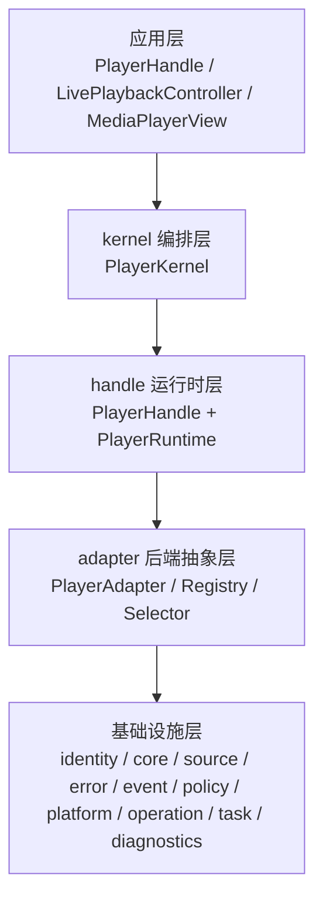
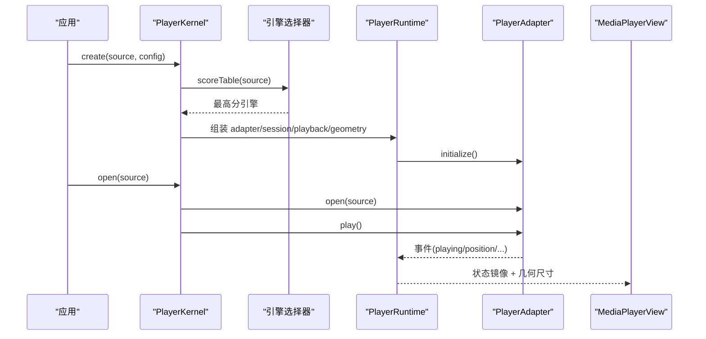
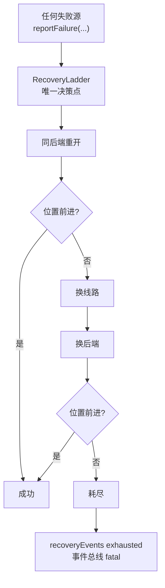
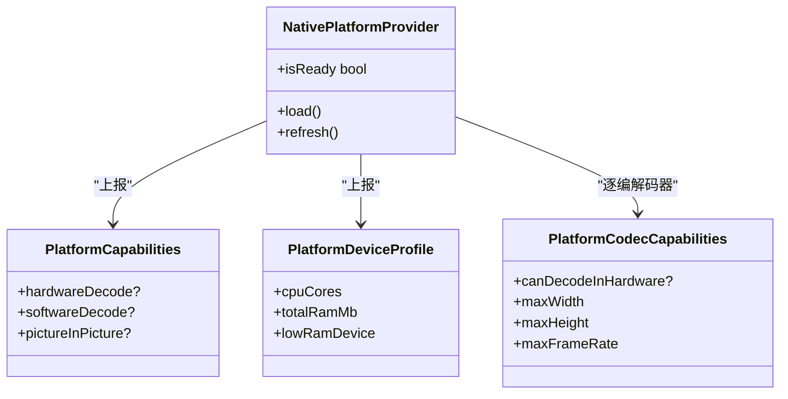
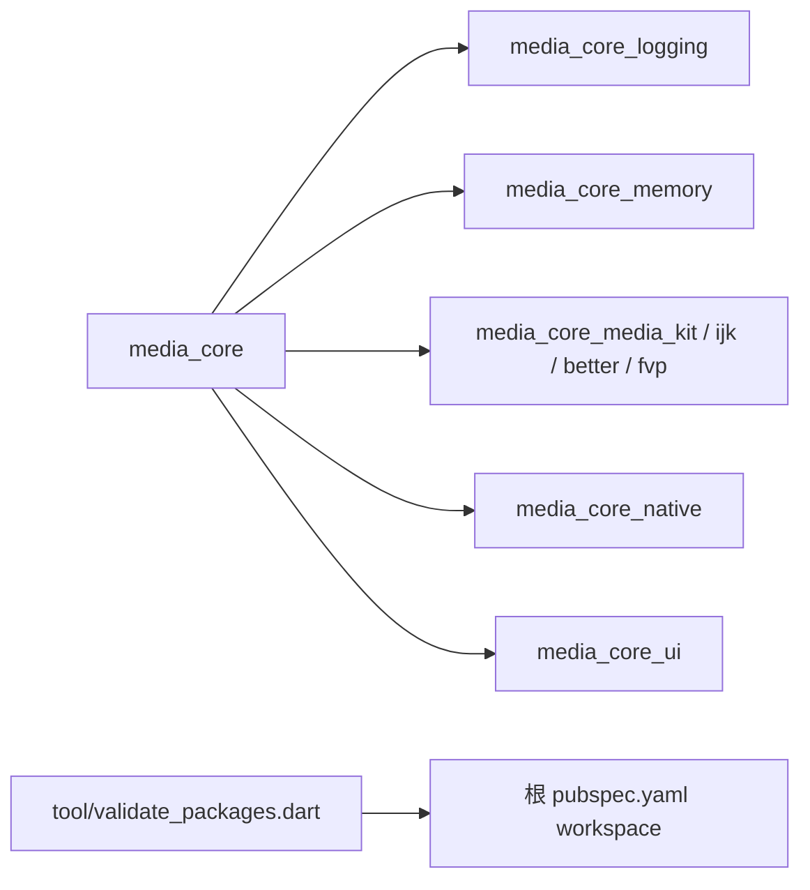

# 开发指南

<cite>
**本文引用的文件**   
- [README.md](file://README.md)
- [pubspec.yaml](file://pubspec.yaml)
- [analysis_options.yaml](file://analysis_options.yaml)
- [tool/validate_packages.dart](file://tool/validate_packages.dart)
- [packages/media_core/README.md](file://packages/media_core/README.md)
- [packages/media_core_ui/README.md](file://packages/media_core_ui/README.md)
- [packages/media_core_native/README.md](file://packages/media_core_native/README.md)
- [example/README.md](file://example/README.md)
- [doc/zh-Hans/architecture.md](file://doc/zh-Hans/architecture.md)
</cite>

## 目录
1. [简介](#简介)
2. [项目结构](#项目结构)
3. [核心组件](#核心组件)
4. [架构总览](#架构总览)
5. [详细组件分析](#详细组件分析)
6. [依赖分析](#依赖分析)
7. [性能与可观测性](#性能与可观测性)
8. [测试策略](#测试策略)
9. [调试与排错](#调试与排错)
10. [插件与适配器开发](#插件与适配器开发)
11. [UI 主题定制](#ui-主题定制)
12. [代码规范与提交规范](#代码规范与提交规范)
13. [工作区、包管理与版本控制](#工作区包管理与版本控制)
14. [代码审查与发布流程](#代码审查与发布流程)
15. [新贡献者入门](#新贡献者入门)
16. [结论](#结论)

## 简介
Media Core 是一个跨平台、可复用的 Flutter 播放器核心：以“与平台无关的编排层 + 按能力拆分的包”组织，把播放中最难的状态机、会话、恢复决策、池化、事件归一化等通用问题抽象出来，具体解码引擎通过适配包接入。仓库包含核心包、多个能力包、四个后端适配包、原生探针包以及示例应用，适合扩展开发者在统一契约之上实现自定义引擎、UI 主题和系统能力。

## 项目结构
仓库采用 Flutter Workspace 管理多包；根 `pubspec.yaml` 声明 workspace 成员与 Melos 脚本，核心逻辑集中在 `packages/media_core`，UI、系统媒体面、直播、下载、录制、内存、日志等能力各自独立成包，示例应用位于 `example/`。

```mermaid
graph TB
Root["根工作区<br/>pubspec.yaml"] --> Core["media_core<br/>编排内核"]
Root --> UI["media_core_ui<br/>控件与主题"]
Root --> Native["media_core_native<br/>平台探针"]
Root --> MediaKit["media_core_media_kit<br/>默认后端"]
Root --> IJK["media_core_ijk_player<br/>后端"]
Root --> Better["media_core_better_player<br/>后端"]
Root --> FVP["media_core_fvp<br/>后端"]
Root --> Live["media_core_live<br/>直播编排"]
Root --> Feed["media_core_feed<br/>上下滑"]
Root --> ListPB["media_core_list_playback<br/>列表续播"]
Root --> Multi["media_core_multiview<br/>视频墙"]
Root --> Audio["media_core_audio<br/>音乐能力"]
Root --> Download["media_core_download<br/>下载"]
Root --> Record["media_core_recording_ffmpeg<br/>录播"]
Root --> Mem["media_core_memory<br/>内存记账"]
Root --> Log["media_core_logging<br/>分级日志"]
Root --> Example["example<br/>示例应用"]
```

**图示来源**
- [pubspec.yaml:10-37](file://pubspec.yaml#L10-L37)
- [README.md:187-213](file://README.md#L187-L213)

**章节来源**
- [pubspec.yaml:1-82](file://pubspec.yaml#L1-L82)
- [README.md:187-213](file://README.md#L187-L213)

## 核心组件
- PlayerKernel：注册后端、创建/释放播放器、汇聚预载、池、协调器与事件总线。
- PlayerHandle：单个播放器的门面，暴露操作与流式状态。
- PlayerRuntime：组合根，持有 adapter、session、playback、geometry 及镜像绑定。
- RecoveryLadder：唯一的恢复决策点，负责同后端重开、换线路、换后端与放弃。
- OperationTracker / TaskManager：操作记录与单槽任务队列，保证序列化正确性。
- PlatformProvider：设备事实（硬解、分辨率上限、内存、PiP 支持）由 native 探针提供。
- MediaPlayerView：渲染 widget，读取 adapter 的视频输出并跟随 backendChanges 重建。

这些组件共同构成“一次播放”的主链路：选择引擎 → 创建 handle → 初始化 → open → play → 事件镜像 → 几何自适应。

**章节来源**
- [packages/media_core/README.md:1-119](file://packages/media_core/README.md#L1-L119)
- [doc/zh-Hans/architecture.md:55-94](file://doc/zh-Hans/architecture.md#L55-L94)

## 架构总览
Media Core 的分层清晰：应用层入口（handle、控制器、渲染 widget）→ kernel 编排层 → handle 运行时层 → adapter 后端抽象层 → 基础设施层（identity、core、source、error、event、policy、platform、operation、task、diagnostics 等）。

**图示来源**
- [doc/zh-Hans/architecture.md:5-53](file://doc/zh-Hans/architecture.md#L5-L53)

**章节来源**
- [doc/zh-Hans/architecture.md:5-53](file://doc/zh-Hans/architecture.md#L5-L53)

## 详细组件分析

### 一次播放的数据流
从 `kernel.create` 到 `MediaPlayerView` 渲染，关键步骤包括源解析、引擎打分选择、runtime 组装、生命周期初始化、open/play、事件镜像与几何自适应。

**图示来源**
- [doc/zh-Hans/architecture.md:96-124](file://doc/zh-Hans/architecture.md#L96-L124)
- [packages/media_core/README.md:14-44](file://packages/media_core/README.md#L14-L44)

**章节来源**
- [doc/zh-Hans/architecture.md:96-124](file://doc/zh-Hans/architecture.md#L96-L124)
- [packages/media_core/README.md:14-44](file://packages/media_core/README.md#L14-L44)

### 故障恢复决策流
所有失败上报到 RecoveryLadder，按梯级推进：同后端重开 → 换线路 → 换后端 → 耗尽。每一步都需要验证“播放真的在走”（位置前进或直播重新基线），否则继续爬梯。

**图示来源**
- [README.md:92-103](file://README.md#L92-L103)
- [doc/zh-Hans/architecture.md:126-144](file://doc/zh-Hans/architecture.md#L126-L144)

**章节来源**
- [README.md:92-103](file://README.md#L92-L103)
- [doc/zh-Hans/architecture.md:126-144](file://doc/zh-Hans/architecture.md#L126-L144)

### 平台能力探针
native 包提供 `PlatformProvider`，一次 probe 后缓存，随 session 与 adapter 下发。缺失字段表示“未知”，不是“不支持”。

**图示来源**
- [packages/media_core_native/README.md:67-107](file://packages/media_core_native/README.md#L67-L107)

**章节来源**
- [packages/media_core_native/README.md:67-107](file://packages/media_core_native/README.md#L67-L107)

## 依赖分析
- 根工作区通过 `workspace:` 列出所有包，使用 Melos 统一运行生成、分析与格式化。
- 核心包仅依赖 Flutter、logging/memory 与少量纯 Dart 库；平台代码全部下沉到能力包与 native。
- 后端适配包通过 `PlayerAdapterRegistration` 注册，selector 根据协议、格式、直播能力打分选择。
- 工具脚本 `tool/validate_packages.dart` 检查命名、必需文件、workspace 成员、内部依赖声明、import 边界、git 依赖例外与循环依赖。

**图示来源**
- [pubspec.yaml:10-37](file://pubspec.yaml#L10-L37)
- [tool/validate_packages.dart:1-10](file://tool/validate_packages.dart#L1-L10)

**章节来源**
- [pubspec.yaml:10-37](file://pubspec.yaml#L10-L37)
- [tool/validate_packages.dart:1-10](file://tool/validate_packages.dart#L1-L10)

## 性能与可观测性
- 分级日志默认完全静默，宿主按需开启级别与分类，支持控制台、内存环与文件轮转 sink。
- 内存模块按贡献者申报求和，结合设备实测快照形成四级压力阈值，驱动资源层降级。
- 回放池用有界池驱动列表/信息流/直播，交换源而非重建，可见性驱动与迟滞避免反复起停。
- 诊断可通过 `onOperation`、`recoveryEvents`、`backendChanges`、`combinedSnapshot` 等流观察。

**章节来源**
- [README.md:133-146](file://README.md#L133-L146)
- [packages/media_core/README.md:69-87](file://packages/media_core/README.md#L69-L87)

## 测试策略
- 单元测试：核心包 test 目录下覆盖代际作废、命令串行化、恢复梯级、池与预载、事件、规划与几何等。
- 集成测试：示例应用页面演示真实媒体播放、直播回退、上下滑、音乐全链路、内存仪表盘与视频墙。
- 端到端测试：示例工程可跨平台运行，用于验证各能力在真实设备上的表现。

建议：
- 新增模块时补充对应 test 目录用例。
- 对恢复路径、任务队列、池调度等并发相关逻辑优先补单测。
- 对 UI 行为优先用 widget 测试与示例页面截图回归。

**章节来源**
- [packages/media_core/README.md:106-110](file://packages/media_core/README.md#L106-L110)
- [example/README.md:15-49](file://example/README.md#L15-L49)

## 调试与排错
- 打开日志：设置全局级别与分类，附加内存 ring 收集最近日志，使用作用域字段关联请求上下文。
- 观察恢复：订阅 `recoveryEvents`，查看是否命中同后端重开、换线路或换后端。
- 定位卡顿：关注 `TaskManager` 的单槽队列与看门狗，确认直播扫描与重试是否被阻塞。
- 排查网络：确认 `NetworkMonitor` 注入与连通性来源，避免只依赖缓存。
- 常见构建问题：Windows 上 ffmpeg 钩子与 code_assets/hook 版本冲突需参考根 `dependency_overrides`；首次构建需要网络拉取 media_kit 与 ffmpeg 原生包。

**章节来源**
- [README.md:133-146](file://README.md#L133-L146)
- [example/README.md:60-76](file://example/README.md#L60-L76)
- [pubspec.yaml:42-54](file://pubspec.yaml#L42-L54)

## 插件与适配器开发
接入新播放引擎的步骤：
1. 实现 `PlayerAdapterBase` 模板方法，将引擎事件翻译为统一事件。
2. 实现 `PlayerVideo`，返回视频 widget。
3. 声明 `PlayerAdapterCapabilities`（协议、格式、直播能力、复合源支持）。
4. 构造 `PlayerAdapterRegistration`，注册到 `PlayerKernel`。
5. selector 自动纳入打分；恢复梯级自动将其作为候选引擎。

注意事项：
- 不要直接依赖 vendor 分支补丁；适配器应基于稳定 API。
- 复合源需遵循 `compositeSupport`，不支持时应抛异常而不是静默无声画面。
- 换引擎必须验活：位置前进才算成功。

**章节来源**
- [doc/zh-Hans/architecture.md:146-167](file://doc/zh-Hans/architecture.md#L146-L167)
- [packages/media_core/README.md:46-67](file://packages/media_core/README.md#L46-L67)

## UI 主题定制
- 控件与控制逻辑分离：`src/common` 提供控制器、主题令牌、时间轴与按钮；每种风格一个无状态控件集。
- 设计语言通过 `PlayerControlsStyle` 指定，不依赖第三方 UI kit，确保宿主树轻量。
- 能力暴露通过回调是否存在决定，避免“不可点击的按钮”。
- 可替换图标、强制风格、覆盖主题、替换整条控制栏，或仅使用控制器自行排版。

**章节来源**
- [packages/media_core_ui/README.md:1-66](file://packages/media_core_ui/README.md#L1-L66)

## 代码规范与提交规范
- 静态分析：继承 `very_good_analysis`，排除 freezed/g 生成文件，行宽 120，启用公共 API 文档规则。
- 包边界：禁止跨包 import `lib/src`；内部包必须在 dependencies 中显式声明；每个包必须有 README、CHANGELOG、analysis_options 与测试目录。
- 命名约定：包目录名与 pubspec name 一致（应用除外）；模块导出由生成的 `library.dart` 维护。
- 提交规范：仓库未定义专用 commit message 规范，建议遵循语义化提交（feat/fix/docs/style/refactor/test/chore），并在 PR 描述中说明影响范围与测试情况。

**章节来源**
- [analysis_options.yaml:1-16](file://analysis_options.yaml#L1-L16)
- [tool/validate_packages.dart:118-168](file://tool/validate_packages.dart#L118-L168)

## 工作区、包管理与版本控制
- 工作区：根 `pubspec.yaml` 的 `workspace:` 列出所有包；Melos 提供 gen/analyze/format/kareki 脚本。
- 依赖管理：核心包保持最小依赖；后端适配与能力包按需引入；`dependency_overrides` 解决三方依赖冲突。
- 版本控制：仓库未内置自动化发布脚本；核心包与能力包各自维护 CHANGELOG，发布前运行 analyze、format、test 与 validate_packages。

**章节来源**
- [pubspec.yaml:1-82](file://pubspec.yaml#L1-L82)
- [README.md:178-186](file://README.md#L178-L186)

## 代码审查与发布流程
- 本地检查：运行 Melos 的 analyze、format、kareki，以及 `dart tool/validate_packages.dart`。
- 变更范围：新增模块需补充 README、CHANGELOG、analysis_options、测试与生成的 barrel 导出。
- 兼容性：新增能力通过接口暴露，核心不反向依赖能力包；未知能力保留“未知”表达，不伪装不支持。
- 发布准备：确认无 git 依赖例外滥用；确保 `publish_to: none` 的包确实不发布；验证示例应用在各平台可运行。

**章节来源**
- [tool/validate_packages.dart:18-26](file://tool/validate_packages.dart#L18-L26)
- [tool/validate_packages.dart:151-168](file://tool/validate_packages.dart#L151-L168)
- [README.md:178-186](file://README.md#L178-L186)

## 新贡献者入门
快速上手：
1. 安装 Flutter SDK（满足根环境要求）。
2. 在根目录执行 `flutter pub get` 获取依赖。
3. 运行示例：`flutter run -d <目标平台>`。
4. 运行测试：`flutter test`（核心包约 290 个用例）。
5. 运行质量检查：`melos analyze`、`melos format`、`melos kareki`。
6. 阅读架构文档与模块文档，理解一次播放数据流与恢复决策。

进阶建议：
- 先改 UI 主题或示例页面，熟悉控件与控制器。
- 再尝试接入一个新的后端适配器，重点练习能力声明与事件映射。
- 最后深入核心模块，完善恢复、池化、任务队列与诊断。

**章节来源**
- [example/README.md:1-13](file://example/README.md#L1-L13)
- [packages/media_core/README.md:106-110](file://packages/media_core/README.md#L106-L110)
- [doc/zh-Hans/architecture.md:5-53](file://doc/zh-Hans/architecture.md#L5-L53)

## 结论
Media Core 通过清晰的分层、统一的适配器契约与严格的恢复决策点，为跨平台媒体播放提供了可扩展、可观测且健壮的基础。贡献者可以从 UI 主题与示例入手，逐步深入到后端适配与核心模块；借助 Melos、静态分析与包边界校验，保证多包协作的质量与一致性。