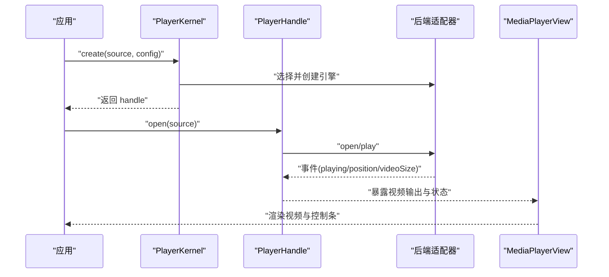
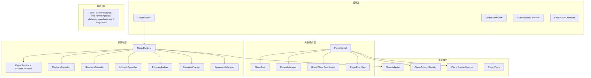
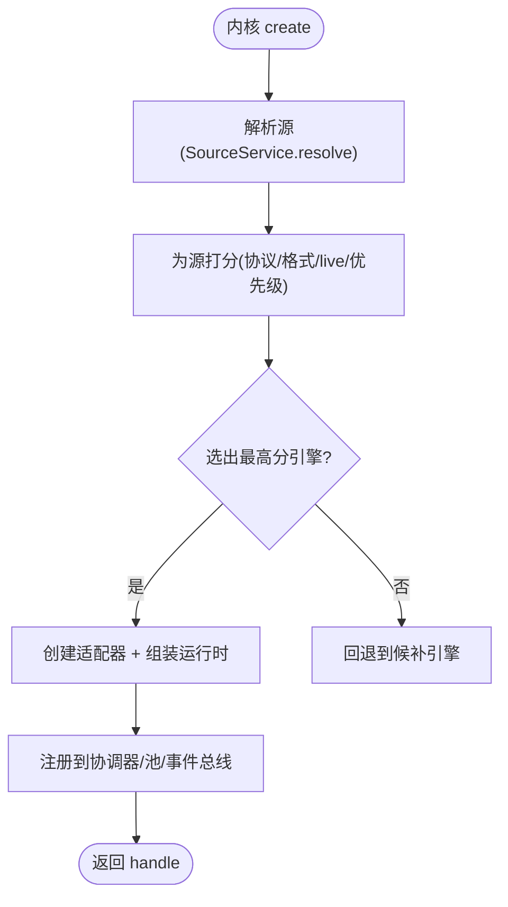
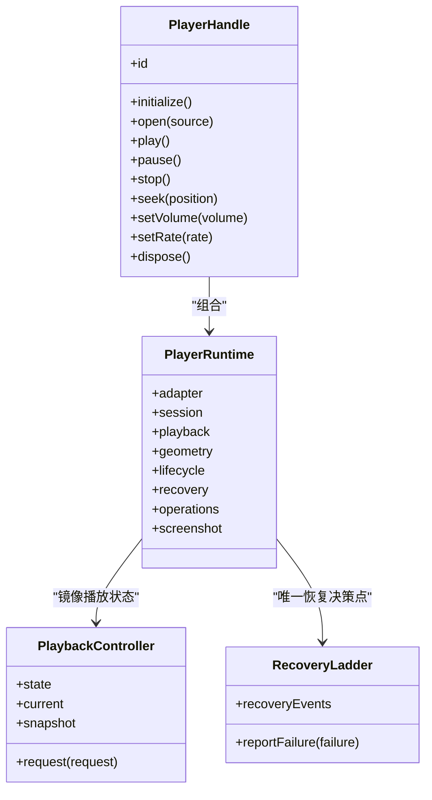
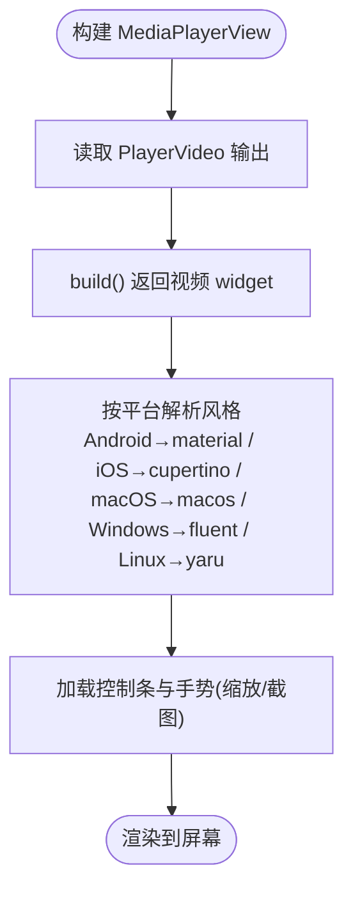
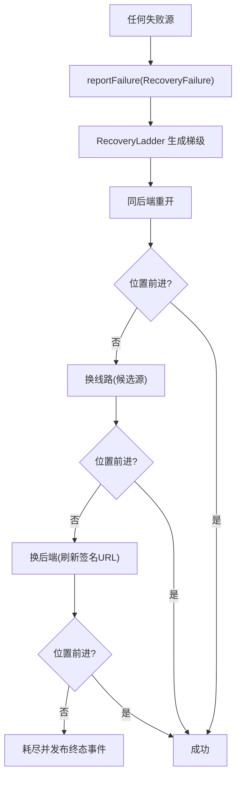
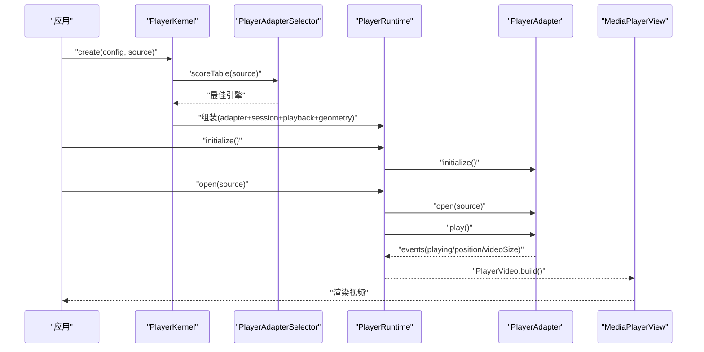
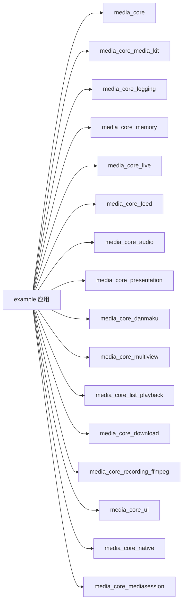

# 快速开始

<cite>
**本文引用的文件**   
- [README.md](file://README.md)
- [doc/zh-Hans/README.md](file://doc/zh-Hans/README.md)
- [doc/zh-Hans/architecture.md](file://doc/zh-Hans/architecture.md)
- [doc/zh-Hans/playback.md](file://doc/zh-Hans/playback.md)
- [doc/zh-Hans/platform.md](file://doc/zh-Hans/platform.md)
- [doc/zh-Hans/adapter.md](file://doc/zh-Hans/adapter.md)
- [doc/zh-Hans/factory.md](file://doc/zh-Hans/factory.md)
- [doc/zh-Hans/presentation.md](file://doc/zh-Hans/presentation.md)
- [example/lib/main.dart](file://example/lib/main.dart)
- [example/pubspec.yaml](file://example/pubspec.yaml)
</cite>

## 目录
1. [简介](#简介)
2. [项目结构](#项目结构)
3. [核心组件](#核心组件)
4. [架构总览](#架构总览)
5. [详细组件分析](#详细组件分析)
6. [依赖关系分析](#依赖关系分析)
7. [性能与可观测性](#性能与可观测性)
8. [故障排查指南](#故障排查指南)
9. [结论](#结论)
10. [附录：从零开始的安装与配置](#附录从零开始的安装与配置)

## 简介
Media Core Flutter 播放器框架是一个面向 Flutter/Dart 的模块化媒体播放核心。它不是单一播放器插件，而是把“后端无关的编排层”和“按能力拆分的包”组合在一起，负责播放最难的部分：会话与代际、命令串行化、恢复决策、池化、事件归一化等，同时不包含任何平台代码、UI 或主题。

核心价值主张：
- 跨平台且后端无关：通过适配器统一 media_kit、ijk、video_player、fvp 等引擎。
- 模块化与可扩展：能力靠声明而非猜测，新增引擎只需实现契约并注册。
- 自愈与可观测：统一的错误恢复梯级、全局日志与内存记账贯穿各模块。
- UI 与逻辑解耦：六套设计语言共用同一控制逻辑，支持自定义界面。

与传统播放器库的区别：
- 传统方案通常把 UI、引擎、系统通知、下载、弹幕等耦合在一个插件里；Media Core 把这些能力拆成独立包，按需引入。
- 传统方案常以布尔标志管理状态；Media Core 用操作队列、代数守卫与唯一恢复决策点保证正确性。
- 传统方案对“未知能力”处理模糊；Media Core 明确表达“未探测/未上报”，由调用方决定是否尝试。

**章节来源**
- [README.md:1-13](file://README.md#L1-L13)
- [doc/zh-Hans/README.md:20-33](file://doc/zh-Hans/README.md#L20-L33)

## 项目结构
仓库采用工作区布局，核心在 `packages/media_core`，能力包分布在 `packages/*`，示例应用位于 `example`。

```mermaid
graph TB
Root["仓库根"] --> Packages["packages/"]
Root --> Example["example/"]
Root --> Docs["docs/"]
Packages --> Core["media_core核心编排层"]
Packages --> BackendKit["media_core_media_kit默认后端"]
Packages --> BackendIjk["media_core_ijk_player"]
Packages --> BackendBetter["media_core_better_player"]
Packages --> BackendFvp["media_core_fvp"]
Packages --> Native["media_core_native平台探针"]
Packages --> Ui["media_core_ui六套设计语言"]
Packages --> MediaSession["media_core_mediasession系统媒体面"]
Packages --> Live["media_core_live直播"]
Packages --> Feed["media_core_feed上下滑"]
Packages --> ListPlayback["media_core_list_playback列表续播"]
Packages --> Multiview["media_core_multiview多画面"]
Packages --> Danmaku["media_core_danmaku弹幕"]
Packages --> Audio["media_core_audio音乐"]
Packages --> Recording["media_core_recording_ffmpeg录播"]
Packages --> Download["media_core_download下载"]
Packages --> Logging["media_core_logging分级日志"]
Packages --> Memory["media_core_memory内存记账"]
Example --> MainDart["example/lib/main.dart"]
Example --> Pubspec["example/pubspec.yaml"]
```

**图表来源**
- [README.md:187-213](file://README.md#L187-L213)
- [example/pubspec.yaml:33-83](file://example/pubspec.yaml#L33-L83)

**章节来源**
- [README.md:187-213](file://README.md#L187-L213)
- [example/pubspec.yaml:1-141](file://example/pubspec.yaml#L1-L141)

## 核心组件
本节聚焦初学者最关心的三个入口：PlayerKernel、PlayerHandle、MediaPlayerView，以及基础播放流程。

- PlayerKernel：内核编排器，负责选择后端、创建播放器实例、注册全局协作对象（池、预载、事件总线、协调器等）。
- PlayerHandle：单个播放器的门面，公开所有操作的唯一入口，内部持有运行时、会话、播放控制、几何控制、生命周期、恢复策略等。
- MediaPlayerView：渲染 Widget，读取适配器的视频输出并随后端变化重建；同时承载六套设计语言的控制条、双指缩放与截图。

典型 30 秒接入要点：
- 初始化后端（例如 MediaKitPlayerAdapter.ensureInitialized）。
- 启用系统媒体面（MediaSessionBootstrap.enable），之后每个播放器自动挂载通知/锁屏/SMTC/MPRIS。
- 创建内核并注册后端工厂。
- 通过 kernel.create 获取 handle，传入 source 与 config。
- 将 handle 交给 MediaCorePlayerView 显示。

**图表来源**
- [README.md:14-53](file://README.md#L14-L53)
- [doc/zh-Hans/architecture.md:96-124](file://doc/zh-Hans/architecture.md#L96-L124)

**章节来源**
- [README.md:14-53](file://README.md#L14-L53)
- [doc/zh-Hans/architecture.md:96-124](file://doc/zh-Hans/architecture.md#L96-L124)

## 架构总览
Media Core 的分层清晰：应用层使用 handle 与视图；内核层做编排；运行时层组合 adapter/session/playback/geometry/lifecycle/recovery；适配器层统一引擎契约；基础设施提供 identity/core/source/error/event/policy/platform/operation/task/diagnostics 等通用能力。

**图表来源**
- [doc/zh-Hans/architecture.md:5-53](file://doc/zh-Hans/architecture.md#L5-L53)
- [README.md:55-80](file://README.md#L55-L80)

**章节来源**
- [doc/zh-Hans/architecture.md:5-53](file://doc/zh-Hans/architecture.md#L5-L53)
- [README.md:55-80](file://README.md#L55-L80)

## 详细组件分析

### PlayerKernel 与后端选择
- 职责：创建 handle、注册后端、汇聚池/预载/协调器/事件总线、挂载能力驱动（音频/呈现/平台）。
- 后端选择：基于协议、格式、直播能力、优先级打分选出最佳引擎；候选顺序用于恢复时换引擎。
- 扩展新引擎：实现适配器契约、声明能力、注册到内核，宿主无需感知差异。

**图表来源**
- [doc/zh-Hans/architecture.md:96-124](file://doc/zh-Hans/architecture.md#L96-L124)
- [doc/zh-Hans/adapter.md:11-20](file://doc/zh-Hans/adapter.md#L11-L20)

**章节来源**
- [doc/zh-Hans/architecture.md:96-124](file://doc/zh-Hans/architecture.md#L96-L124)
- [doc/zh-Hans/adapter.md:1-33](file://doc/zh-Hans/adapter.md#L1-L33)

### PlayerHandle 运行时与播放控制
- 运行时组合根：adapter + session + playback + geometry + bindings。
- 播放控制：命令模式 + sealed 命令集，状态经 BehaviorSubject 暴露，请求串行化。
- 生命周期：create → init → activate → pause → detach，前后台/激活/分离由 LifecycleController 管理。
- 恢复策略：RecoveryLadder 是唯一恢复决策点，按梯级推进并验证位置前进。

**图表来源**
- [doc/zh-Hans/architecture.md:23-38](file://doc/zh-Hans/architecture.md#L23-L38)
- [doc/zh-Hans/playback.md:5-20](file://doc/zh-Hans/playback.md#L5-L20)

**章节来源**
- [doc/zh-Hans/architecture.md:23-38](file://doc/zh-Hans/architecture.md#L23-L38)
- [doc/zh-Hans/playback.md:1-29](file://doc/zh-Hans/playback.md#L1-L29)

### MediaPlayerView 与 UI 设计语言
- 渲染：读取 adapter as PlayerVideo 的 widget，随 backendChanges 重建。
- 控制条：六套设计语言（material/cupertino/fluent/macos/yaru/neumorphic）共用一层控制逻辑。
- 交互：双指/双击缩放、截图按钮；也可用 MediaPlayerView + PlayerControlsController + PlayerControlsTheme 自定义 UI。

**图表来源**
- [README.md:45-53](file://README.md#L45-L53)
- [doc/zh-Hans/architecture.md:115-117](file://doc/zh-Hans/architecture.md#L115-L117)

**章节来源**
- [README.md:45-53](file://README.md#L45-L53)
- [doc/zh-Hans/architecture.md:115-117](file://doc/zh-Hans/architecture.md#L115-L117)

### 错误自愈链路
- 入口：任何失败源通过 reportFailure 上报。
- 梯级：同后端重开 → 换线路 → 换后端 → 放弃。
- 验活：每步必须证明播放位置在前进（8 秒窗口），否则继续爬梯。
- 可观测：recoveryEvents 与事件总线 fatal 事件。

**图表来源**
- [README.md:92-103](file://README.md#L92-L103)
- [doc/zh-Hans/architecture.md:126-144](file://doc/zh-Hans/architecture.md#L126-L144)

**章节来源**
- [README.md:92-103](file://README.md#L92-L103)
- [doc/zh-Hans/architecture.md:126-144](file://doc/zh-Hans/architecture.md#L126-L144)

### 一次播放的数据流
从内核创建到视图渲染的关键步骤：
- SourceService.resolve 解析真实地址。
- selector.scoreTable 选出最高分引擎。
- Player.create + adapter factory.create + PlayerRuntime 组装。
- handle.initialize → adapter.initialize → lifecycle create+initialize。
- handle.open → adapter.open → autoPlay → play → session.play → lifecycle.activate → 事件总线 'play'。
- MediaPlayerView 读取 PlayerVideo.build 的 widget，跟随 VideoSize 事件调整宽高比。

**图表来源**
- [doc/zh-Hans/architecture.md:96-124](file://doc/zh-Hans/architecture.md#L96-L124)

**章节来源**
- [doc/zh-Hans/architecture.md:96-124](file://doc/zh-Hans/architecture.md#L96-L124)

## 依赖关系分析
示例应用展示了如何引入核心、后端、日志、内存、功能模块与 UI。

**图表来源**
- [example/pubspec.yaml:33-83](file://example/pubspec.yaml#L33-L83)

**章节来源**
- [example/pubspec.yaml:33-83](file://example/pubspec.yaml#L33-L83)

## 性能与可观测性
- 池化播放编排：PlaybackPoolOrchestrator 用有界播放器池驱动列表/信息流/直播，交换源而非重建，可见性驱动 + 迟滞，邻居预热，资源压力上升时先放弃预热再释放空闲。
- 分级日志：默认完全静默，宿主开启；分类与模块一一对应，排查单个问题时只调高那一类。
- 内存记账：按贡献者申报求和 + 设备实测快照；预算阈值驱动的四级压力，桥接进资源层的 ResourcePressure。

建议实践：
- 在开发阶段开启 debug 日志，生产环境保持静音。
- 使用 LogScope 给关键路径添加作用域字段（如房间号）。
- 结合 memory 仪表盘观察解码器/纹理占用趋势，配合 pool 配置避免频繁重建。

**章节来源**
- [README.md:126-147](file://README.md#L126-L147)

## 故障排查指南
常见问题与定位思路：
- 系统媒体面不可用：示例中捕获异常并记录警告，确保 demo 不因平台限制而崩溃；检查 Android manifest 与 embedder 支持。
- 日志无输出：确认已设置 MediaCoreLog.level 并打开所需分类。
- 恢复耗尽：查看 recoveryEvents 与事件总线 fatal，确认候选源/后端是否合理，必要时增加候选或优化网络。
- 位置不前进：恢复梯级要求 8 秒内位置前进，若始终不前进需检查网络/签名 URL 过期/引擎兼容性。

参考示例中的启动流程与日志开关：
- 初始化后端与日志级别。
- 启用系统媒体面并捕获异常。
- 运行示例应用展示各模块行为。

**章节来源**
- [example/lib/main.dart:21-54](file://example/lib/main.dart#L21-L54)
- [README.md:92-103](file://README.md#L92-L103)

## 结论
Media Core 通过“后端无关的编排层 + 按能力拆分的包”提供了稳定、可测试、可扩展的媒体播放核心。对于初学者，30 秒即可跑通一个带通知与六套 UI 风格的播放器；对于有经验开发者，清晰的架构、唯一恢复决策点、操作串行化与能力声明机制，为复杂场景（直播、列表、多画面、音乐、录播、下载）提供了坚实基础。

## 附录：从零开始的安装与配置

### 第一步：添加依赖
在 pubspec.yaml 中添加核心与所需能力包。示例应用展示了最小集合与常用功能包的引入方式。

- 核心：media_core
- 后端：media_core_media_kit（默认首选）
- UI：media_core_ui（六套设计语言）
- 系统媒体面：media_core_mediasession
- 日志与内存：media_core_logging、media_core_memory
- 其他能力：live/feed/audio/presentation/danmaku/multiview/list_playback/download/recording_ffmpeg/native

**章节来源**
- [example/pubspec.yaml:33-83](file://example/pubspec.yaml#L33-L83)

### 第二步：初始化后端与系统媒体面
- 调用 MediaKitPlayerAdapter.ensureInitialized 加载底层引擎。
- 调用 MediaSessionBootstrap.enable 启用系统媒体面（通知/锁屏/SMTC/MPRIS），进程内一次 enable，之后每个播放器自动挂载。
- 示例中对 enable 做了异常捕获，避免平台不支持导致应用无法启动。

**章节来源**
- [example/lib/main.dart:21-54](file://example/lib/main.dart#L21-L54)
- [README.md:14-43](file://README.md#L14-L43)

### 第三步：创建内核并注册后端
- 创建 PlayerKernel。
- 注册后端工厂：kernel.registerBackend(const MediaKitAdapterFactory().registration())。

**章节来源**
- [README.md:29-34](file://README.md#L29-L34)

### 第四步：创建播放器并渲染
- 使用 kernel.create 创建 handle，传入 source 与 config（例如 autoPlay）。
- 将 handle 传给 MediaCorePlayerView 显示视频与控制条。
- 如需自定义 UI，可使用 MediaPlayerView + PlayerControlsController + PlayerControlsTheme。

**章节来源**
- [README.md:31-53](file://README.md#L31-L53)

### 第五步：平台权限与清单
- Android/iOS/macOS/Windows/Linux 的平台能力与特性由 media_core_native 探针描述；具体权限与清单请参考各能力包文档。
- 系统 PiP、桌面歌词窗口、后台保活等行为受平台能力影响，需在宿主侧完成相应配置。

**章节来源**
- [README.md:159-176](file://README.md#L159-L176)
- [doc/zh-Hans/platform.md:1-31](file://doc/zh-Hans/platform.md#L1-L31)

### 第六步：运行示例
- 运行 example 应用，体验 player/live/feed/media-session/ui-styles/music/multiview/presentation/memory 等页面。
- 示例展示了完整的端到端接线与可调试行为。

**章节来源**
- [README.md:215-223](file://README.md#L215-L223)
- [example/lib/main.dart:21-54](file://example/lib/main.dart#L21-L54)