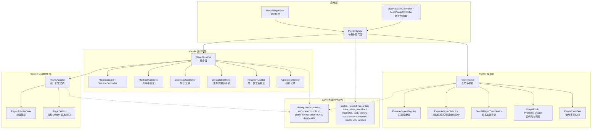
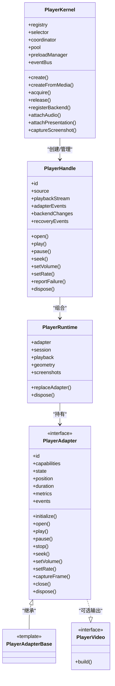
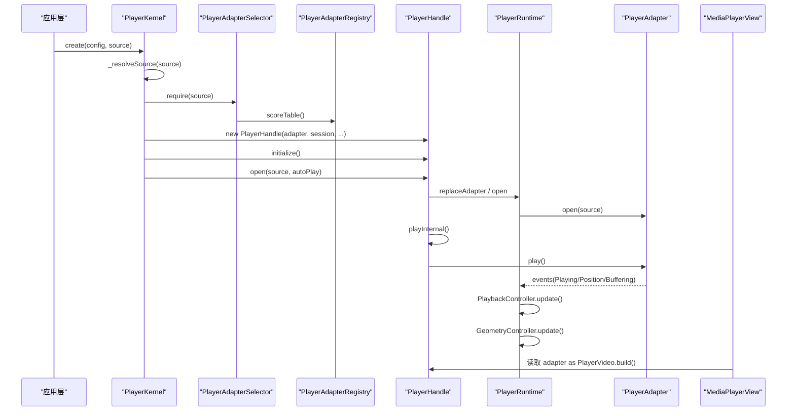
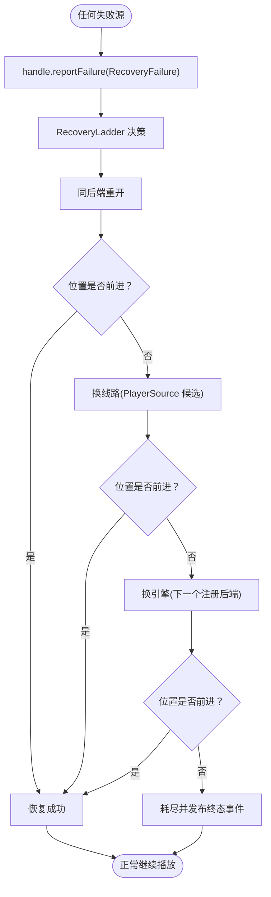

# 分层架构设计

<cite>
**本文引用的文件**   
- [README.md](file://README.md)
- [architecture.md（中文）](file://doc/zh-Hans/architecture.md)
- [architecture.md（英文）](file://doc/en/architecture.md)
- [media_core README.md](file://packages/media_core/README.md)
- [player_kernel.dart](file://packages/media_core/lib/kernel/player_kernel.dart)
- [kernel_options.dart](file://packages/media_core/lib/kernel/kernel_options.dart)
- [player_handle.dart](file://packages/media_core/lib/kernel/player_handle.dart)
- [player_runtime.dart](file://packages/media_core/lib/runtime/player_runtime.dart)
</cite>

## 目录
1. [引言](#引言)
2. [项目结构与分层总览](#项目结构与分层总览)
3. [核心组件与职责边界](#核心组件与职责边界)
4. [四层架构与交互关系](#四层架构与交互关系)
5. [关键流程：一次播放的数据流](#关键流程一次播放的数据流)
6. [故障恢复的单一决策点](#故障恢复的单一决策点)
7. [依赖关系与扩展指南](#依赖关系与扩展指南)
8. [性能与可观测性](#性能与可观测性)
9. [常见问题排查](#常见问题排查)
10. [结论](#结论)

## 引言
Media Core 的分层架构围绕“编排与运行时解耦”展开：应用层只关心播放器门面，内核负责引擎选择与会话协作，handle 运行时组合单播放器状态机，adapter 抽象层屏蔽具体解码引擎差异。文档面向两类读者：初学者通过分层图理解概念；高级开发者通过类图、时序图和流程图定位实现细节、扩展新后端或调整恢复策略。

## 项目结构与分层总览
仓库由核心包 `packages/media_core` 与多个能力包组成。核心包提供播放器编排内核、会话串行化、恢复决策、池化、事件归一化等通用能力，不包含平台代码和 UI 主题；平台相关能力以独立包形式挂载到内核。

图表来源
- [architecture.md（中文）:5-53](file://doc/zh-Hans/architecture.md#L5-L53)
- [README.md:55-81](file://README.md#L55-L81)

章节来源
- [README.md:55-81](file://README.md#L55-L81)
- [architecture.md（中文）:5-53](file://doc/zh-Hans/architecture.md#L5-L53)

## 核心组件与职责边界
- PlayerKernel：全局协调器，负责后端注册、源解析、引擎选择、创建/释放 PlayerHandle、跨播放器协调、全局事件、池化与预载、能力驱动挂载。
- PlayerHandle：单播放器门面，对外暴露 open/play/pause/seek/volume/rate/screenshot 等操作，内部串联 PlayerRuntime、生命周期、恢复梯级、操作序列化与事件发布。
- PlayerRuntime：组合根，持有当前 adapter、session、playback、geometry、截图管理器，并桥接 adapter 事件到 playback 与 geometry 镜像。
- PlayerAdapter / PlayerAdapterBase：后端抽象契约与模板基类，屏蔽 media_kit、ijk、better_player、fvp 等具体引擎差异。

职责边界要点：
- Kernel 不拥有 per-player 播放状态，也不执行恢复决策；它提供 registry、selector、coordinator、eventBus 等横切能力。
- Handle 是恢复的执行侧，但决策只在 RecoveryLadder；消费者通过 reportFailure 上报失败，通过 recoveryEvents 观察结果。
- Runtime 不选择后端、不做恢复、不序列化公开操作；它只做“当前运行时对象”的组合与替换。
- Adapter 层只实现引擎契约，不负责会话代际、命令队列、恢复策略。

章节来源
- [player_kernel.dart:50-101](file://packages/media_core/lib/kernel/player_kernel.dart#L50-L101)
- [player_handle.dart:111-161](file://packages/media_core/lib/kernel/player_handle.dart#L111-L161)
- [player_runtime.dart:16-37](file://packages/media_core/lib/runtime/player_runtime.dart#L16-L37)
- [media_core README.md:5-12](file://packages/media_core/README.md#L5-L12)

## 四层架构与交互关系
四层从外到内依次是：应用层、Kernel 编排层、Handle 运行时层、Adapter 后端抽象层。数据自上而下进入引擎，事件自下而上归一化后分发。

图表来源
- [player_kernel.dart:115-256](file://packages/media_core/lib/kernel/player_kernel.dart#L115-L256)
- [player_handle.dart:162-240](file://packages/media_core/lib/kernel/player_handle.dart#L162-L240)
- [player_runtime.dart:38-122](file://packages/media_core/lib/runtime/player_runtime.dart#L38-L122)
- [architecture.md（英文）:40-46](file://doc/en/architecture.md#L40-L46)

## 关键流程：一次播放的数据流
一次播放从应用调用 kernel.create 开始，经过源解析、引擎选择、handle 初始化、open 打开源、自动起播，再到渲染与事件镜像。

图表来源
- [player_kernel.dart:310-400](file://packages/media_core/lib/kernel/player_kernel.dart#L310-L400)
- [player_handle.dart:111-161](file://packages/media_core/lib/kernel/player_handle.dart#L111-L161)
- [player_runtime.dart:45-80](file://packages/media_core/lib/runtime/player_runtime.dart#L45-L80)
- [architecture.md（中文）:96-124](file://doc/zh-Hans/architecture.md#L96-L124)

## 故障恢复的单一决策点
框架强调“一个决策点”：所有失败都通过 handle.reportFailure 进入 RecoveryLadder，按梯级推进，每一步必须验证播放位置确实在前进，否则继续爬梯直到耗尽。

图表来源
- [player_handle.dart:149-161](file://packages/media_core/lib/kernel/player_handle.dart#L149-L161)
- [player_handle.dart:614-683](file://packages/media_core/lib/kernel/player_handle.dart#L614-L683)
- [architecture.md（中文）:126-144](file://doc/zh-Hans/architecture.md#L126-L144)
- [README.md:92-103](file://README.md#L92-L103)

## 依赖关系与扩展指南
- 基础设施层被上层消费：identity、core、source、error、event、policy、platform、operation、task、diagnostics 等模块贯穿 kernel/handle/runtime/adapter。
- 独立积木按需 import：cache、network、recording、slot、state_machine、reconciler、bug、factory、concurrency、reactive、result、util、fallback 不参与主链路。
- 扩展新引擎的步骤：
  1. 实现 PlayerAdapter 或继承 PlayerAdapterBase，把引擎事件翻译为统一事件。
  2. 若需要渲染，实现 PlayerVideo 并提供 build Widget。
  3. 声明 PlayerAdapterCapabilities（协议、格式、直播能力、compositeSupport）。
  4. 通过 PlayerAdapterRegistration 注册到 PlayerKernel。
  5. selector 会自动纳入打分；RecoveryLadder 自动把它作为候选引擎。

图表来源
- [architecture.md（中文）:146-167](file://doc/zh-Hans/architecture.md#L146-L167)
- [media_core README.md:46-67](file://packages/media_core/README.md#L46-L67)

## 性能与可观测性
- 操作串行化：PlayerHandle 维护操作队列与代数失效，避免旧操作提交新状态。
- 池化与预载：PlayerKernel.pool 与 preloadManager 支持实例复用与预热，降低重复创建成本。
- 内存与日志：内核通过 MemoryAccount 报告玩家数量与估算字节；MediaCoreLog 提供分级分类日志，默认静默，宿主按需开启。
- 事件总线：PlayerEventBus 汇聚全局事件，activeHandle 跟踪最近播放的播放器，便于音频焦点与系统媒体面联动。

章节来源
- [player_handle.dart:281-333](file://packages/media_core/lib/kernel/player_handle.dart#L281-L333)
- [player_kernel.dart:517-549](file://packages/media_core/lib/kernel/player_kernel.dart#L517-L549)
- [player_kernel.dart:718-748](file://packages/media_core/lib/kernel/player_kernel.dart#L718-L748)
- [README.md:133-146](file://README.md#L133-L146)

## 常见问题排查
- 没有后端注册：PlayerKernel.create 会抛 StateError，不会退化为“内置播放器”。检查是否调用 registerBackend。
- 恢复风暴：确保只有一个 RecoveryLadder 在运行；直播模式应关闭 handle 自身梯级，使用 LivePlaybackController 的单槽任务队列。
- 换引擎无效：确认 _verifyPlayback 的位置前进判定；仅 open 返回不等于播放成功。
- 事件丢失：消费方应订阅 handle.adapterEvents/backendChanges/sourceChanges，而不是持有旧 adapter 引用。
- 静音异常：mute 由 handle 维护，切换后端后会重新应用静音状态。

章节来源
- [media_core README.md:12-12](file://packages/media_core/README.md#L12-L12)
- [player_handle.dart:157-161](file://packages/media_core/lib/kernel/player_handle.dart#L157-L161)
- [player_handle.dart:265-275](file://packages/media_core/lib/kernel/player_handle.dart#L265-L275)
- [architecture.md（中文）:169-177](file://doc/zh-Hans/architecture.md#L169-L177)

## 结论
Media Core 的四层架构通过清晰的职责边界与“单一决策点”原则，将复杂的播放器问题拆解为可测试、可扩展的模块：Kernel 负责全局编排，Handle 负责单播放器门面与恢复执行，Runtime 负责运行时组合，Adapter 负责引擎抽象。对初学者而言，先掌握四层图与一次播放数据流；对高级开发者而言，重点阅读 PlayerKernel、PlayerHandle、PlayerRuntime 与 RecoveryLadder 的实现路径，再根据业务需求扩展能力包或接入新后端。