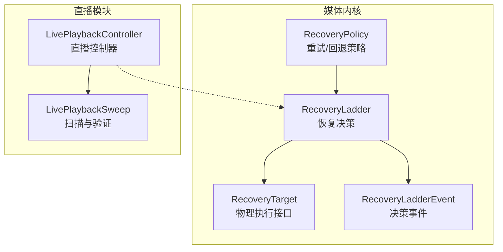
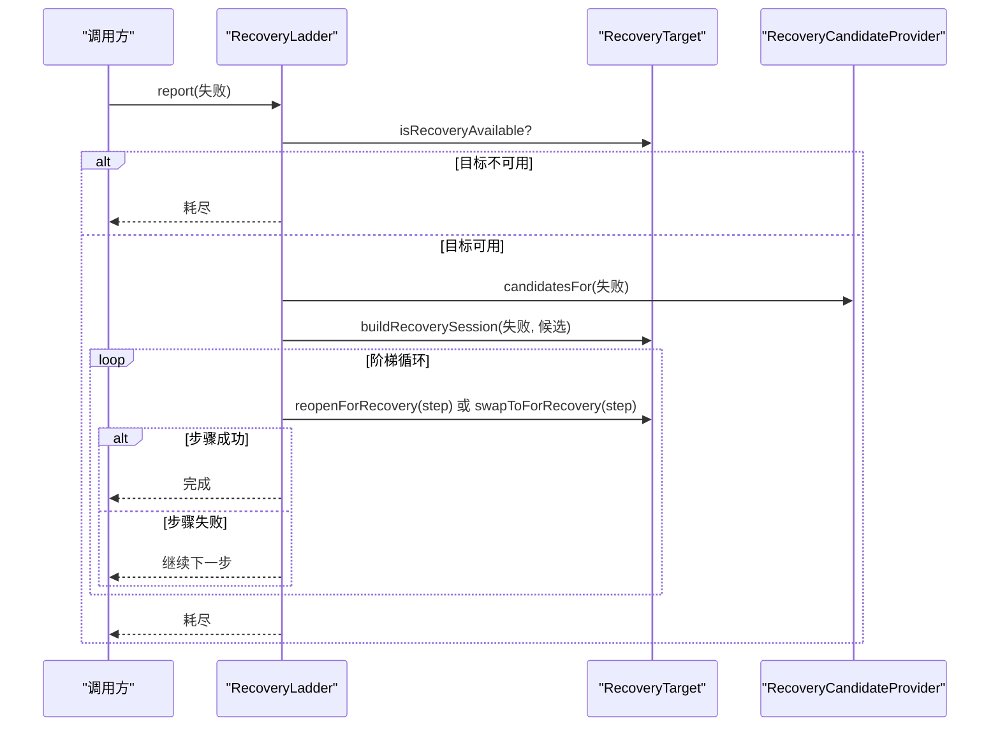
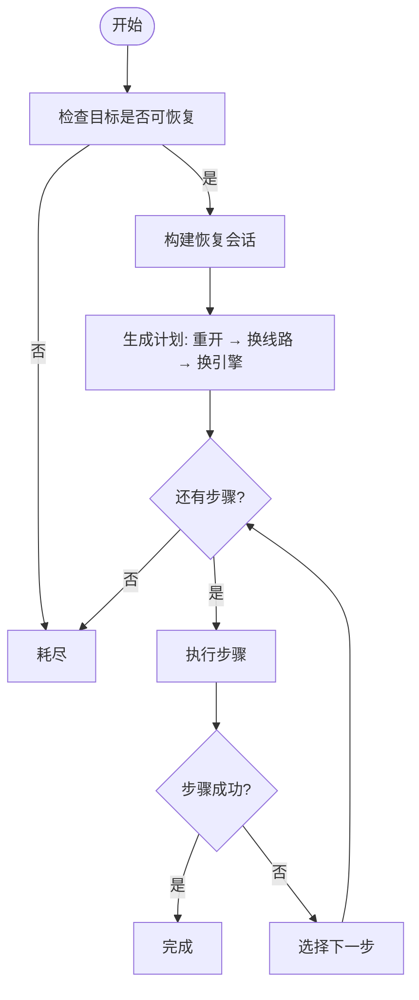
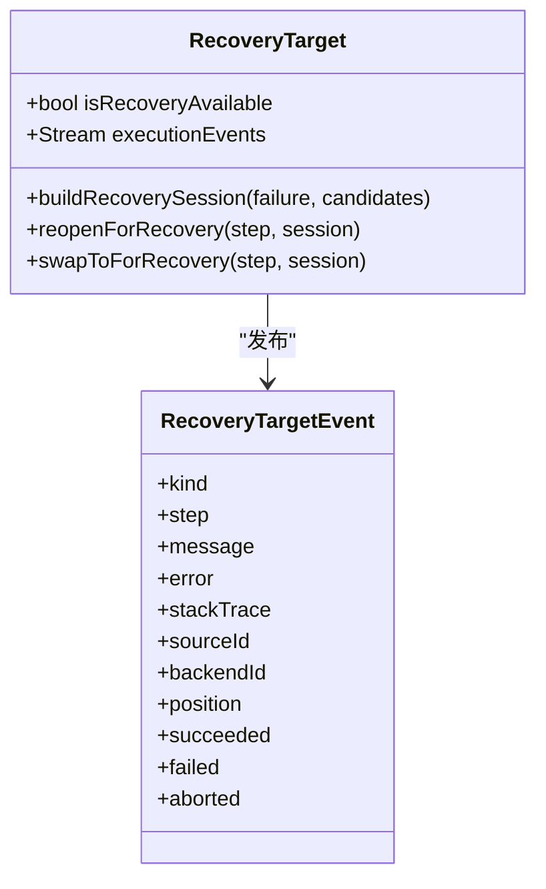
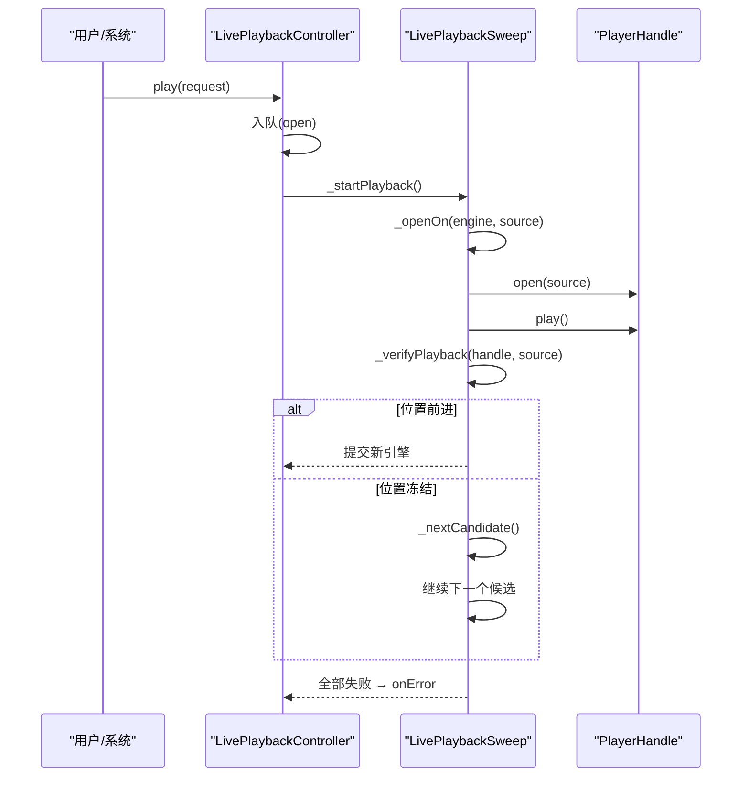
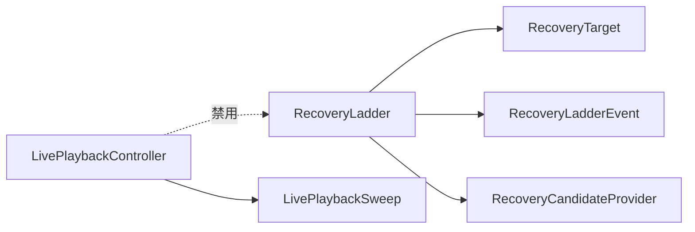

# 恢复决策流程

<cite>
**本文引用的文件**   
- [recovery_ladder.dart](file://packages/media_core/lib/recovery/recovery_ladder.dart)
- [recovery_ladder_event.dart](file://packages/media_core/lib/recovery/recovery_ladder_event.dart)
- [recovery_target.dart](file://packages/media_core/lib/recovery/recovery_target.dart)
- [recovery_policy.dart](file://packages/media_core/lib/policy/recovery_policy.dart)
- [live_playback_controller.dart](file://packages/media_core_live/lib/src/live_playback_controller.dart)
- [live_playback_sweep.dart](file://packages/media_core_live/lib/src/live_playback_sweep.dart)
</cite>

## 目录
1. [引言](#引言)
2. [项目结构](#项目结构)
3. [核心组件](#核心组件)
4. [架构总览](#架构总览)
5. [详细组件分析](#详细组件分析)
6. [依赖关系分析](#依赖关系分析)
7. [性能与资源特性](#性能与资源特性)
8. [故障排查指南](#故障排查指南)
9. [结论](#结论)
10. [附录：自定义恢复策略指南](#附录自定义恢复策略指南)

## 引言
本文聚焦 Media Core 的恢复决策体系，围绕四级恢复策略展开：同引擎原样重开、换线路、换引擎、报告耗尽。RecoveryLadder 作为独立播放器的唯一恢复决策点，负责生成并执行恢复阶梯；DefaultRecoveryLadderPolicy 提供默认梯级生成逻辑。直播模式采用 LivePlaybackController 的单槽任务队列机制，并在内部实现自己的“扫描”流程，同时通过 _verifyPlayback 进行位置前进验证，避免“打开成功但画面冻结”的假成功。

## 项目结构
恢复相关代码主要分布在两个包中：
- media_core：通用恢复框架（RecoveryLadder、RecoveryTarget、事件模型、策略配置）。
- media_core_live：直播播放控制器及其扫描、验证和单槽任务队列。

**图示来源**
- [recovery_ladder.dart:38-69](file://packages/media_core/lib/recovery/recovery_ladder.dart#L38-L69)
- [recovery_target.dart:85-137](file://packages/media_core/lib/recovery/recovery_target.dart#L85-L137)
- [recovery_ladder_event.dart:26-34](file://packages/media_core/lib/recovery/recovery_ladder_event.dart#L26-L34)
- [recovery_policy.dart:1-18](file://packages/media_core/lib/policy/recovery_policy.dart#L1-L18)
- [live_playback_controller.dart:46-82](file://packages/media_core_live/lib/src/live_playback_controller.dart#L46-L82)
- [live_playback_sweep.dart:1-5](file://packages/media_core_live/lib/src/live_playback_sweep.dart#L1-L5)

**章节来源**
- [recovery_ladder.dart:38-69](file://packages/media_core/lib/recovery/recovery_ladder.dart#L38-L69)
- [recovery_target.dart:85-137](file://packages/media_core/lib/recovery/recovery_target.dart#L85-L137)
- [recovery_ladder_event.dart:26-34](file://packages/media_core/lib/recovery/recovery_ladder_event.dart#L26-L34)
- [recovery_policy.dart:1-18](file://packages/media_core/lib/policy/recovery_policy.dart#L1-L18)
- [live_playback_controller.dart:46-82](file://packages/media_core_live/lib/src/live_playback_controller.dart#L46-L82)
- [live_playback_sweep.dart:1-5](file://packages/media_core_live/lib/src/live_playback_sweep.dart#L1-L5)

## 核心组件
- RecoveryLadder：恢复决策中心，维护运行状态、尝试次数、会话上下文，按候选源和后端顺序推进恢复步骤，并通过事件暴露决策过程。
- RecoveryTarget：物理执行抽象，由播放器句柄实现，负责实际的重开、切换后端、构建恢复会话，以及发布执行侧事件。
- RecoveryLadderEvent：决策事件模型，描述开始、步骤开始/失败、完成、耗尽、取消等生命周期。
- RecoveryPolicy：重试与回退策略配置，控制是否允许回退、最大重试次数、延迟与指数退避等。
- LivePlaybackController：直播播放控制器，封装单槽任务队列、引擎×线路扫描、位置验证与错误上报。
- LivePlaybackSweep：直播扫描扩展，实现“打开→验证→提交”的流程，以及 _verifyPlayback 的位置前进校验。

**章节来源**
- [recovery_ladder.dart:69-113](file://packages/media_core/lib/recovery/recovery_ladder.dart#L69-L113)
- [recovery_target.dart:85-137](file://packages/media_core/lib/recovery/recovery_target.dart#L85-L137)
- [recovery_ladder_event.dart:26-34](file://packages/media_core/lib/recovery/recovery_ladder_event.dart#L26-L34)
- [recovery_policy.dart:24-73](file://packages/media_core/lib/policy/recovery_policy.dart#L24-L73)
- [live_playback_controller.dart:84-111](file://packages/media_core_live/lib/src/live_playback_controller.dart#L84-L111)
- [live_playback_sweep.dart:1-5](file://packages/media_core_live/lib/src/live_playback_sweep.dart#L1-L5)

## 架构总览
RecoveryLadder 是独立播放器的唯一恢复决策点。它不直接操作适配器、注册表或会话控制器，而是通过 RecoveryTarget 执行物理操作，并通过 RecoveryCandidateProvider 获取候选源与后端。直播模式下，LivePlaybackController 拥有自己的扫描与验证流程，并将 kernel 侧的恢复阶梯禁用，确保只有一个恢复路径。

**图示来源**
- [recovery_ladder.dart:140-192](file://packages/media_core/lib/recovery/recovery_ladder.dart#L140-L192)
- [recovery_ladder.dart:253-365](file://packages/media_core/lib/recovery/recovery_ladder.dart#L253-L365)
- [recovery_target.dart:102-137](file://packages/media_core/lib/recovery/recovery_target.dart#L102-L137)

**章节来源**
- [recovery_ladder.dart:38-69](file://packages/media_core/lib/recovery/recovery_ladder.dart#L38-L69)
- [recovery_target.dart:85-137](file://packages/media_core/lib/recovery/recovery_target.dart#L85-L137)

## 详细组件分析

### RecoveryLadder：四级恢复策略与梯级生成
RecoveryLadder 的恢复计划遵循固定顺序：
1. 同引擎原样重开：在同一个后端上重新打开当前源一次（仅当失败原因不是“源级别”时）。
2. 换线路：在当前后端上尝试下一个未尝试过的源。
3. 换引擎：切换到下一个未尝试过的后端，并从用户正在观看的线路重新开始扫描。
4. 报告耗尽：所有候选源与后端均尝试完毕，发出耗尽事件。

关键设计要点：
- 每个尝试都通过 target.isRecoveryAvailable 检查，避免向已放弃的后端继续投递步骤。
- 每一步执行后都会由目标层验证：如果打开成功但无法播放，会在目标层抛出异常，被 ladder 捕获为步骤失败。
- 使用 generation 防止旧运行结果覆盖新运行。
- 对“源级别失败”跳过原地重开，因为同一 URL 在同一引擎上会复现故障。

**图示来源**
- [recovery_ladder.dart:253-365](file://packages/media_core/lib/recovery/recovery_ladder.dart#L253-L365)
- [recovery_ladder.dart:406-412](file://packages/media_core/lib/recovery/recovery_ladder.dart#L406-L412)

**章节来源**
- [recovery_ladder.dart:253-365](file://packages/media_core/lib/recovery/recovery_ladder.dart#L253-L365)
- [recovery_ladder.dart:406-412](file://packages/media_core/lib/recovery/recovery_ladder.dart#L406-L412)

### DefaultRecoveryLadderPolicy：默认策略与回退许可
RecoveryPolicy 提供默认行为：
- enabled：是否启用恢复。
- maxRetryCount：最大自动重试次数。
- retryDelay / exponentialBackoff / maxRetryDelay：重试延迟与指数退避。
- allowBackendFallback / allowSourceFallback：是否允许后端与源的回退。

注意：该策略用于上层重试与回退配置，而 RecoveryLadder 的四级阶梯是更具体的恢复执行策略。两者配合使用时，应确保策略允许必要的回退路径。

**章节来源**
- [recovery_policy.dart:24-73](file://packages/media_core/lib/policy/recovery_policy.dart#L24-L73)
- [recovery_policy.dart:76-117](file://packages/media_core/lib/policy/recovery_policy.dart#L76-L117)

### RecoveryTarget：执行机制与位置前进验证
RecoveryTarget 定义：
- isRecoveryAvailable：是否可执行恢复步骤。
- executionEvents：执行侧事件流（步骤开始、成功、失败、中止）。
- buildRecoverySession：根据失败与候选列表构建恢复会话。
- reopenForRecovery：在同后端重开源。
- swapToForRecovery：切换到指定后端并打开源。

直播模式的 _verifyPlayback 位于 LivePlaybackSweep，职责是等待任何正的位置前进信号，避免“打开成功但画面冻结”。其成功门槛是“位置有正向进展”，而非“跳变到某个时间点”。若超时仍未前进，则抛出错误，促使扫描进入下一个候选。

**图示来源**
- [recovery_target.dart:8-83](file://packages/media_core/lib/recovery/recovery_target.dart#L8-L83)
- [recovery_target.dart:85-137](file://packages/media_core/lib/recovery/recovery_target.dart#L85-L137)

**章节来源**
- [recovery_target.dart:8-83](file://packages/media_core/lib/recovery/recovery_target.dart#L8-L83)
- [recovery_target.dart:85-137](file://packages/media_core/lib/recovery/recovery_target.dart#L85-L137)
- [live_playback_sweep.dart:416-486](file://packages/media_core_live/lib/src/live_playback_sweep.dart#L416-L486)

### 直播模式例外处理与单槽任务队列
LivePlaybackController 将每个动作（play、switchLine、retry、pause、resume、close、recover）放入一个容量为 1 的任务队列，保证：
- 用户动作与恢复任务不会交错。
- 重复 play 不会双重打开。
- 引擎切换不会用旧请求覆盖新请求。

此外，直播扫描在每步打开后调用 _verifyPlayback，只有位置前进才认为成功；否则继续下一个候选。当所有候选失败时，统一上报 PlayerFailure。

**图示来源**
- [live_playback_controller.dart:46-82](file://packages/media_core_live/lib/src/live_playback_controller.dart#L46-L82)
- [live_playback_controller.dart:227-246](file://packages/media_core_live/lib/src/live_playback_controller.dart#L227-L246)
- [live_playback_sweep.dart:219-279](file://packages/media_core_live/lib/src/live_playback_sweep.dart#L219-L279)
- [live_playback_sweep.dart:416-486](file://packages/media_core_live/lib/src/live_playback_sweep.dart#L416-L486)

**章节来源**
- [live_playback_controller.dart:46-82](file://packages/media_core_live/lib/src/live_playback_controller.dart#L46-L82)
- [live_playback_controller.dart:227-246](file://packages/media_core_live/lib/src/live_playback_controller.dart#L227-L246)
- [live_playback_sweep.dart:219-279](file://packages/media_core_live/lib/src/live_playback_sweep.dart#L219-L279)
- [live_playback_sweep.dart:416-486](file://packages/media_core_live/lib/src/live_playback_sweep.dart#L416-L486)

## 依赖关系分析
- RecoveryLadder 依赖 RecoveryTarget 与 RecoveryCandidateProvider，但不直接访问适配器或会话控制器，保持决策与执行的解耦。
- RecoveryLadderEvent 与 RecoveryTargetEvent 分别描述决策与执行侧，便于诊断“为什么升级”和“后端做了什么”。
- LivePlaybackController 在直播场景下禁用 kernel 侧的 RecoveryLadder，确保单一恢复路径，避免并发恢复竞争。

**图示来源**
- [recovery_ladder.dart:38-69](file://packages/media_core/lib/recovery/recovery_ladder.dart#L38-L69)
- [recovery_target.dart:85-137](file://packages/media_core/lib/recovery/recovery_target.dart#L85-L137)
- [recovery_ladder_event.dart:26-34](file://packages/media_core/lib/recovery/recovery_ladder_event.dart#L26-L34)
- [live_playback_controller.dart:46-82](file://packages/media_core_live/lib/src/live_playback_controller.dart#L46-L82)

**章节来源**
- [recovery_ladder.dart:38-69](file://packages/media_core/lib/recovery/recovery_ladder.dart#L38-L69)
- [recovery_target.dart:85-137](file://packages/media_core/lib/recovery/recovery_target.dart#L85-L137)
- [recovery_ladder_event.dart:26-34](file://packages/media_core/lib/recovery/recovery_ladder_event.dart#L26-L34)
- [live_playback_controller.dart:46-82](file://packages/media_core_live/lib/src/live_playback_controller.dart#L46-L82)

## 性能与资源特性
- RecoveryLadder 的扫描无预算、无退避、无额外内存分配，仅在候选列表范围内推进，避免无限重试。
- 每一步都通过目标层的 throw/success 语义验证，避免“打开成功但无法播放”的误判。
- LivePlaybackController 的单槽任务队列串行化所有动作，减少并发竞争与资源争用。
- 直播扫描在引擎切换时使用 staged 验证，成功后再提交，缩短黑屏时间。

[本节为通用指导，无需具体文件引用]

## 故障排查指南
常见问题与定位建议：
- 恢复一直耗尽：检查 RecoveryPolicy 是否允许回退；确认 RecoveryCandidateProvider 返回的候选列表是否为空。
- 步骤失败频繁：查看 RecoveryLadderStepFailed 事件中的 error 与 stackTrace，定位是哪一步失败（重开、换线路、换引擎）。
- 直播画面冻结：关注 _verifyPlayback 的超时日志，确认位置是否有任何正向进展；检查 adapter 错误是否在验证期间出现。
- 用户干预导致恢复中断：理解 suspend/resume/reset/dispose 的生命周期边界，用户意图是恢复边界，不应触发新的恢复。

**章节来源**
- [recovery_ladder_event.dart:100-162](file://packages/media_core/lib/recovery/recovery_ladder_event.dart#L100-L162)
- [recovery_ladder.dart:414-470](file://packages/media_core/lib/recovery/recovery_ladder.dart#L414-L470)
- [live_playback_sweep.dart:416-486](file://packages/media_core_live/lib/src/live_playback_sweep.dart#L416-L486)

## 结论
Media Core 的恢复体系以 RecoveryLadder 为核心，明确区分决策与执行，并通过四级恢复策略逐步提升恢复成功率。直播模式通过 LivePlaybackController 的单槽任务队列与 _verifyPlayback 的位置前进验证，确保恢复过程稳定且可观测。开发者可通过 RecoveryPolicy 调整重试与回退策略，或通过自定义 RecoveryTarget 与 RecoveryCandidateProvider 实现更精细的恢复逻辑。

[本节为总结性内容，无需具体文件引用]

## 附录：自定义恢复策略指南
- 自定义 RecoveryCandidateProvider：根据失败类型动态返回候选源与后端，例如针对签名 URL 过期场景优先刷新线路。
- 自定义 RecoveryTarget：在 reopenForRecovery 与 swapToForRecovery 中实现更严格的验证逻辑，或在失败时保留上一个可用后端。
- 结合 RecoveryPolicy：开启/关闭后端与源的回退，设置合理的最大重试次数与延迟，避免过度恢复。
- 观察事件：订阅 RecoveryLadderEvent 与 RecoveryTargetEvent，记录决策与执行轨迹，辅助诊断。

**章节来源**
- [recovery_policy.dart:24-73](file://packages/media_core/lib/policy/recovery_policy.dart#L24-L73)
- [recovery_target.dart:85-137](file://packages/media_core/lib/recovery/recovery_target.dart#L85-L137)
- [recovery_ladder_event.dart:26-34](file://packages/media_core/lib/recovery/recovery_ladder_event.dart#L26-L34)