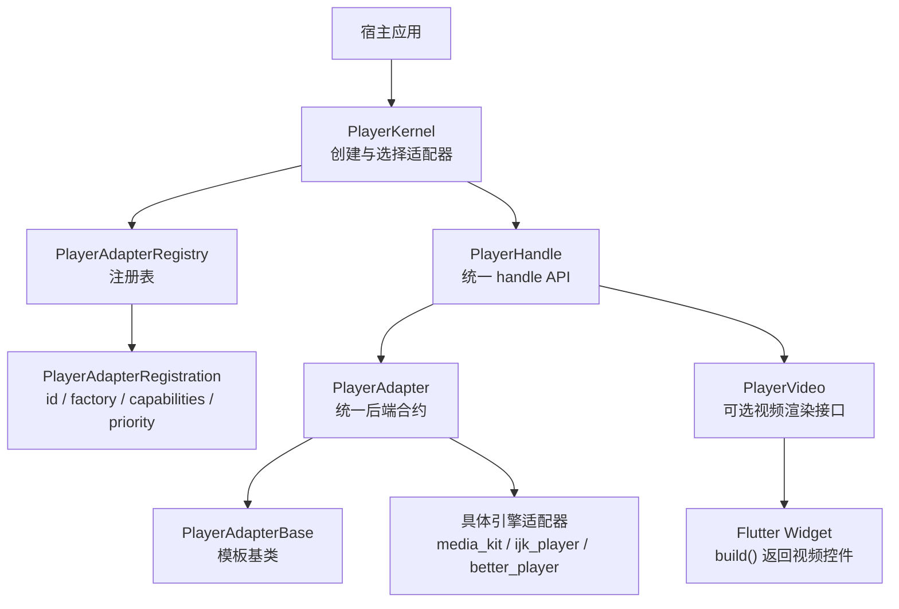
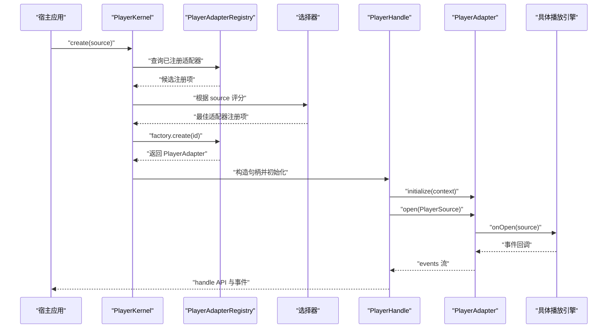
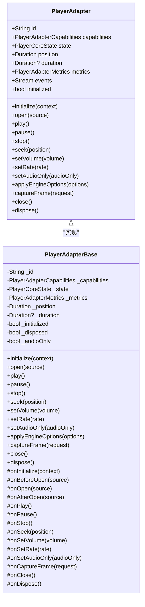
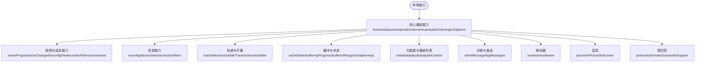
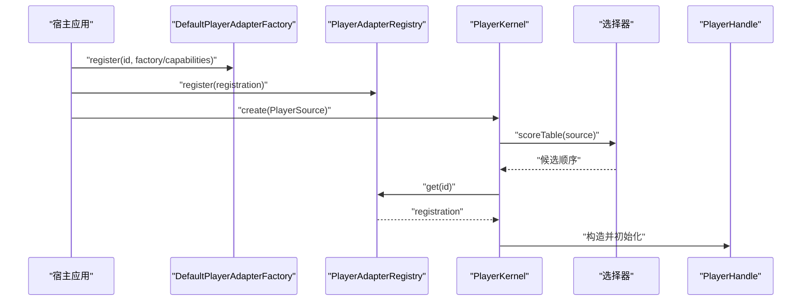
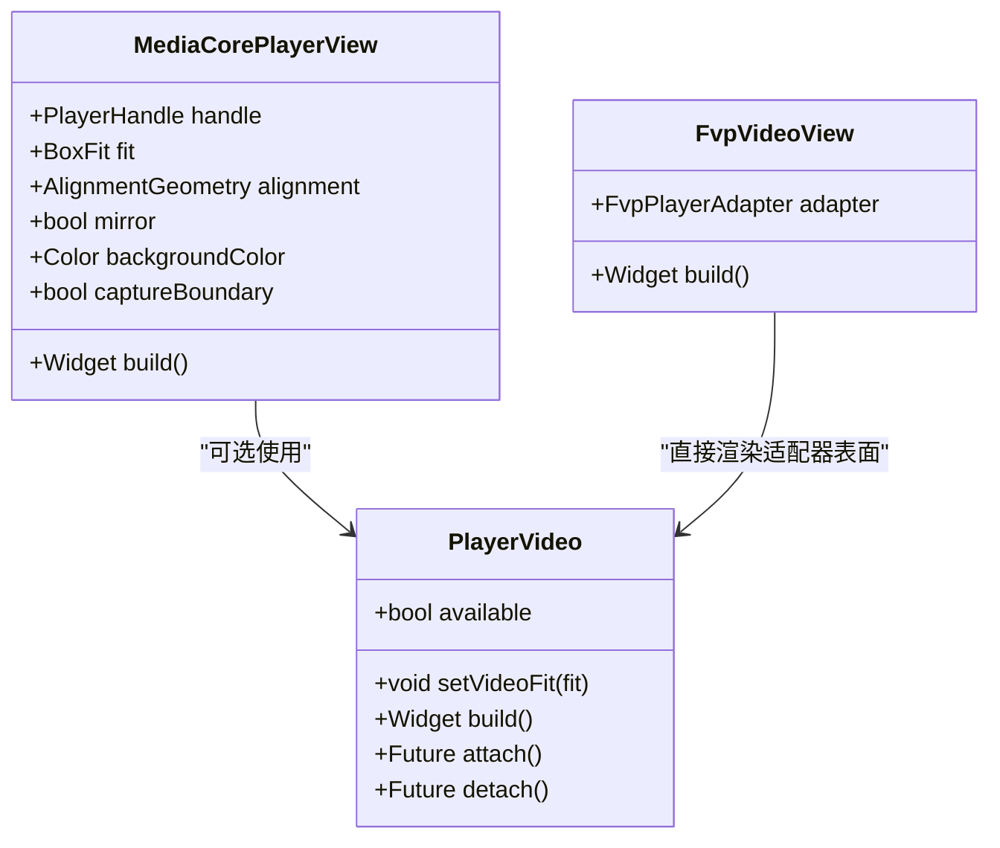
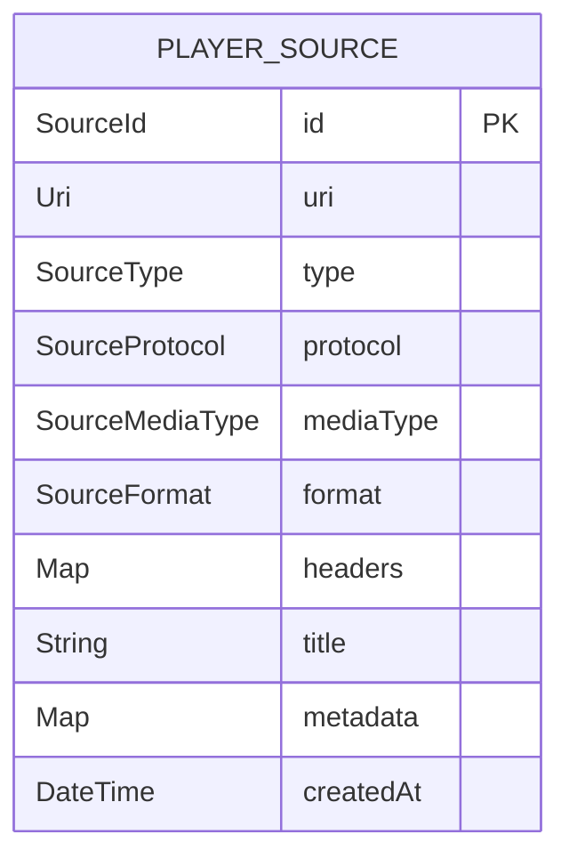
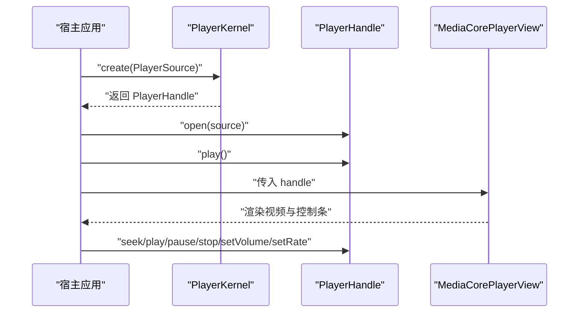
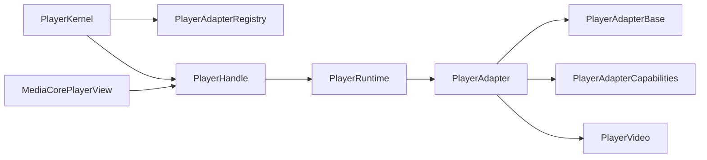

# 扩展点与集成

<cite>
**本文引用的文件**   
- [packages/media_core/lib/adapter/player_adapter.dart](file://packages/media_core/lib/adapter/player_adapter.dart)
- [packages/media_core/lib/adapter/player_adapter_base.dart](file://packages/media_core/lib/adapter/player_adapter_base.dart)
- [packages/media_core/lib/adapter/player_adapter_capabilities.dart](file://packages/media_core/lib/adapter/player_adapter_capabilities.dart)
- [packages/media_core/lib/adapter/player_adapter_registry.dart](file://packages/media_core/lib/adapter/player_adapter_registry.dart)
- [packages/media_core/lib/adapter/player_video.dart](file://packages/media_core/lib/adapter/player_video.dart)
- [packages/media_core/lib/source/player_source.dart](file://packages/media_core/lib/source/player_source.dart)
- [packages/media_core/lib/kernel/player_handle.dart](file://packages/media_core/lib/kernel/player_handle.dart)
- [packages/media_core/lib/kernel/player_kernel.dart](file://packages/media_core/lib/kernel/player_kernel.dart)
- [packages/media_core/lib/runtime/player_playback_binding.dart](file://packages/media_core/lib/runtime/player_playback_binding.dart)
- [packages/media_core_ui/lib/src/media_core_player_view.dart](file://packages/media_core_ui/lib/src/media_core_player_view.dart)
- [packages/media_core_fvp/lib/src/fvp_video_view.dart](file://packages/media_core_fvp/lib/src/fvp_video_view.dart)
- [packages/media_core_media_kit/lib/src/media_kit_player_adapter.dart](file://packages/media_core_media_kit/lib/src/media_kit_player_adapter.dart)
- [packages/media_core_ijk_player/lib/src/flv_lzc_player_adapter.dart](file://packages/media_core_ijk_player/lib/src/flv_lzc_player_adapter.dart)
- [packages/media_core_better_player/lib/src/better_player_adapter_factory.dart](file://packages/media_core_better_player/lib/src/better_player_adapter_factory.dart)
- [doc/zh-Hans/adapter.md](file://doc/zh-Hans/adapter.md)
</cite>

## 目录
1. [引言](#引言)
2. [项目结构](#项目结构)
3. [核心组件](#核心组件)
4. [架构总览](#架构总览)
5. [详细组件分析](#详细组件分析)
6. [依赖关系分析](#依赖关系分析)
7. [性能与稳定性考虑](#性能与稳定性考虑)
8. [故障排查指南](#故障排查指南)
9. [结论](#结论)
10. [附录：自定义适配器完整接入清单](#附录自定义适配器完整接入清单)

## 引言
本文面向需要接入新播放引擎的开发者，系统性说明 Media Core 的扩展点与集成方式。重点包括：
- 如何通过 `PlayerAdapterBase` 模板基类实现新的播放器后端。
- 必须实现的模板方法：`onInitialize`、`onOpen`、`onPlay`、`onPause`、`onStop`、`onSeek`、`onSetVolume`、`onSetRate`、`onClose`、`onDispose` 等。
- `PlayerVideo` 接口的实现要求：通过 `available` + `build()` 返回视频 Widget。
- 能力声明机制：协议、格式、直播、音轨、截图、缓冲进度等能力的配置方式。
- 注册机制：使用 `PlayerAdapterRegistration` 将新引擎注册到框架。
- 宿主 App 如何复用同一份 `PlayerSource` 和 `handle` API 驱动新引擎。
- 最佳实践与常见问题处理建议。

## 项目结构
Media Core 将“播放器抽象”“能力描述”“注册表”“运行时句柄”“UI 视图”解耦为多个模块：
- 适配器层：定义统一合约 `PlayerAdapter`、模板基类 `PlayerAdapterBase`、能力模型 `PlayerAdapterCapabilities`、注册表 `PlayerAdapterRegistry`。
- 源模型：`PlayerSource` 描述可播放媒体来源，不绑定具体后端。
- 内核与句柄：`PlayerKernel` 负责选择并创建适配器，`PlayerHandle` 暴露统一的 handle API。
- UI 层：`MediaCorePlayerView` 组合视频控件与控制条；`PlayerVideo` 允许适配器提供 Flutter 渲染。
- 示例实现：media_kit、ijk_player、better_player 等包提供了具体适配器的参考实现。

**图示来源**
- [packages/media_core/lib/kernel/player_kernel.dart:329-404](file://packages/media_core/lib/kernel/player_kernel.dart#L329-L404)
- [packages/media_core/lib/adapter/player_adapter_registry.dart:26-149](file://packages/media_core/lib/adapter/player_adapter_registry.dart#L26-L149)
- [packages/media_core/lib/adapter/player_adapter_base.dart:22-91](file://packages/media_core/lib/adapter/player_adapter_base.dart#L22-L91)
- [packages/media_core/lib/adapter/player_video.dart:1-39](file://packages/media_core/lib/adapter/player_video.dart#L1-L39)

**章节来源**
- [doc/zh-Hans/adapter.md:1-33](file://doc/zh-Hans/adapter.md#L1-L33)

## 核心组件
本节聚焦扩展新引擎时最需要关注的五个核心对象：

| 组件 | 职责 | 关键要点 |
| --- | --- | --- |
| `PlayerAdapter` | 播放器后端统一合约 | 暴露 `open/play/pause/stop/seek/setVolume/setRate/close/dispose` 以及状态、事件、指标、能力。 |
| `PlayerAdapterBase` | 模板基类 | 管理生命周期、事件流、状态机、错误归一化；子类只需实现引擎钩子。 |
| `PlayerAdapterCapabilities` | 静态能力描述 | 唯一的能力声明入口，包含协议、格式、直播、缓冲、截图、PiP、全屏等字段。 |
| `PlayerAdapterRegistry` / `PlayerAdapterRegistration` | 注册与查找 | 存储 id、工厂、能力、优先级、启用状态；用于选择器与内核创建实例。 |
| `PlayerVideo` | 可选视频渲染接口 | 提供 `available`、`setVideoFit`、`build()`、`attach/detach`，让适配器输出 Flutter Widget。 |

**章节来源**
- [packages/media_core/lib/adapter/player_adapter.dart:12-134](file://packages/media_core/lib/adapter/player_adapter.dart#L12-L134)
- [packages/media_core/lib/adapter/player_adapter_base.dart:22-91](file://packages/media_core/lib/adapter/player_adapter_base.dart#L22-L91)
- [packages/media_core/lib/adapter/player_adapter_capabilities.dart:6-103](file://packages/media_core/lib/adapter/player_adapter_capabilities.dart#L6-L103)
- [packages/media_core/lib/adapter/player_adapter_registry.dart:26-149](file://packages/media_core/lib/adapter/player_adapter_registry.dart#L26-L149)
- [packages/media_core/lib/adapter/player_video.dart:1-39](file://packages/media_core/lib/adapter/player_video.dart#L1-L39)

## 架构总览
Media Core 的扩展点围绕“适配器抽象 + 能力声明 + 注册选择 + 句柄驱动”展开。

**图示来源**
- [packages/media_core/lib/kernel/player_kernel.dart:329-404](file://packages/media_core/lib/kernel/player_kernel.dart#L329-L404)
- [packages/media_core/lib/adapter/player_adapter_registry.dart:26-149](file://packages/media_core/lib/adapter/player_adapter_registry.dart#L26-L149)
- [packages/media_core/lib/adapter/player_adapter_base.dart:183-261](file://packages/media_core/lib/adapter/player_adapter_base.dart#L183-L261)
- [packages/media_core/lib/runtime/player_playback_binding.dart:8-34](file://packages/media_core/lib/runtime/player_playback_binding.dart#L8-L34)

## 详细组件分析

### 播放器适配器抽象与模板基类
`PlayerAdapter` 是后端无关的统一接口；`PlayerAdapterBase` 是推荐实现路径。它封装了：
- 生命周期模板：`initialize` → `open` → `play/pause/stop/seek/setVolume/setRate` → `close` → `dispose`。
- 事件门控：按当前 source 的生命周期接受或丢弃引擎回调。
- 能力门控：信号型事件（如视频帧进度、缓冲进度、尺寸变化）需对应能力才发出。
- 错误归一化：将引擎异常转换为 `PlayerError`，并在 open 窗口内延迟上报。

你需要在子类中覆盖以下受保护模板方法：
- `onInitialize(context)`：创建引擎、绑定监听。
- `onBeforeOpen(source)`：打开前准备。
- `onOpen(source)`：把 `PlayerSource` 交给引擎。
- `onAfterOpen(source)`：打开后调整（例如重新应用 audioOnly）。
- `onPlay/onPause/onStop/onSeek/onSetVolume/onSetRate`：执行播放命令。
- `onSetAudioOnly(audioOnly)`：仅音频模式。
- `onCaptureFrame(request)`：引擎原生截图。
- `onClose/onDispose`：释放资源。

**图示来源**
- [packages/media_core/lib/adapter/player_adapter.dart:12-134](file://packages/media_core/lib/adapter/player_adapter.dart#L12-L134)
- [packages/media_core/lib/adapter/player_adapter_base.dart:83-525](file://packages/media_core/lib/adapter/player_adapter_base.dart#L83-L525)

**章节来源**
- [packages/media_core/lib/adapter/player_adapter_base.dart:22-91](file://packages/media_core/lib/adapter/player_adapter_base.dart#L22-L91)
- [packages/media_core/lib/adapter/player_adapter_base.dart:183-525](file://packages/media_core/lib/adapter/player_adapter_base.dart#L183-L525)

### 能力声明机制
`PlayerAdapterCapabilities` 是所有能力声明的唯一真实来源。默认值保守：除软件解码外，大多数可选能力默认为 false。适配器必须显式 opt-in。

重要能力分组：
- 核心播放：`supportsLive`、`supportsSeek`、`supportsPause`、`supportsStop`、`supportsRateControl`、`supportsVolumeControl`、`supportsMuteControl`、`supportsAudioOnly`、`supportsEngineOptions`。
- 视频与渲染：`supportsVideoFrameProgress`、`supportsVideoSizeChanged`、`supportsVideoReconfig`、`supportsHwdecInfo`、`supportsVideoFilters`、`supportsScreenshot`。
- 音频：`supportsAudioReconfig`、`supportsAudioDeviceSelection`、`supportsAudioFilters`。
- 轨道与字幕：`supportsTrackSelection`、`supportsSubtitleTrack`、`supportsExternalSubtitle`。
- 缓冲与状态：`supportsCacheState`、`supportsBufferingProgress`、`supportsBufferedRanges`、`supportsChapterControl`、`supportsLoop`。
- 元数据与播放列表：`supportsMetadata`、`supportsPlaylist`、`supportsPlaylistControl`。
- 诊断与集成：`supportsClientMessage`、`supportsLogMessages`。
- 解码器：`supportsHardwareDecoder`、`supportsSoftwareDecoder`。
- 呈现：`supportsPictureInPicture`、`supportsFullscreen`。
- 源匹配：`supportedProtocols`、`supportedFormats`、`compositeSupport`。

协议与格式匹配：
- `supportsProtocol(protocol)` 判断是否支持某协议。
- `supportsFormat(format)` 判断是否支持某容器/封装格式。
- `compositeSupport` 决定是否能消费复合源：native、external-audio 或 none。

**图示来源**
- [packages/media_core/lib/adapter/player_adapter_capabilities.dart:40-103](file://packages/media_core/lib/adapter/player_adapter_capabilities.dart#L40-L103)
- [packages/media_core/lib/adapter/player_adapter_capabilities.dart:105-386](file://packages/media_core/lib/adapter/player_adapter_capabilities.dart#L105-L386)
- [packages/media_core/lib/adapter/player_adapter_capabilities.dart:395-403](file://packages/media_core/lib/adapter/player_adapter_capabilities.dart#L395-L403)

**章节来源**
- [packages/media_core/lib/adapter/player_adapter_capabilities.dart:6-103](file://packages/media_core/lib/adapter/player_adapter_capabilities.dart#L6-L103)
- [packages/media_core/lib/adapter/player_adapter_capabilities.dart:105-386](file://packages/media_core/lib/adapter/player_adapter_capabilities.dart#L105-L386)
- [packages/media_core/lib/adapter/player_adapter_capabilities.dart:395-403](file://packages/media_core/lib/adapter/player_adapter_capabilities.dart#L395-L403)

### 注册与选择机制
`PlayerAdapterRegistry` 保存适配器元数据；`PlayerAdapterRegistration` 包含 id、factory、capabilities、priority、enabled。内核在选择适配器时会读取注册项中的能力，无需实例化后端即可做初步筛选。

典型流程：
1. 宿主调用 `registerBetterPlayerFactory` 或 `registerBetterPlayerRegistry` 将新引擎注册到默认工厂或注册表。
2. 内核创建 `PlayerHandle` 时，使用 `PlayerAdapterSelector` 对 `PlayerSource` 进行评分。
3. 选择器依据 `supportedProtocols`、`supportedFormats`、`supportsLive`、`compositeSupport` 等能力排序。
4. 最终由 `factory.create(id)` 创建具体 `PlayerAdapter`。

**图示来源**
- [packages/media_core/lib/adapter/player_adapter_registry.dart:26-149](file://packages/media_core/lib/adapter/player_adapter_registry.dart#L26-L149)
- [packages/media_core/lib/kernel/player_kernel.dart:329-404](file://packages/media_core/lib/kernel/player_kernel.dart#L329-L404)
- [packages/media_core_better_player/lib/src/better_player_adapter_factory.dart:59-105](file://packages/media_core_better_player/lib/src/better_player_adapter_factory.dart#L59-L105)

**章节来源**
- [packages/media_core/lib/adapter/player_adapter_registry.dart:26-149](file://packages/media_core/lib/adapter/player_adapter_registry.dart#L26-L149)
- [packages/media_core_better_player/lib/src/better_player_adapter_factory.dart:59-105](file://packages/media_core_better_player/lib/src/better_player_adapter_factory.dart#L59-L105)

### 视频渲染接口 PlayerVideo
`PlayerVideo` 是可选接口，用于让适配器直接提供 Flutter 视频 Widget。其契约：
- `available`：当前是否有可用视频渲染。
- `setVideoFit(BoxFit fit)`：设置视口适配策略。
- `build()`：返回由适配器拥有的视频 Widget。
- `attach()/detach()`：用于需要显式生命周期的渲染表面。

宿主 UI 通常通过 `MediaCorePlayerView` 组合视频控件与控制条；如果适配器实现了 `PlayerVideo`，上层可以调用 `adapter.build()` 或直接使用适配器提供的视图包装。

**图示来源**
- [packages/media_core/lib/adapter/player_video.dart:1-39](file://packages/media_core/lib/adapter/player_video.dart#L1-L39)
- [packages/media_core_ui/lib/src/media_core_player_view.dart:46-337](file://packages/media_core_ui/lib/src/media_core_player_view.dart#L46-L337)
- [packages/media_core_fvp/lib/src/fvp_video_view.dart:1-34](file://packages/media_core_fvp/lib/src/fvp_video_view.dart#L1-L34)

**章节来源**
- [packages/media_core/lib/adapter/player_video.dart:1-39](file://packages/media_core/lib/adapter/player_video.dart#L1-L39)
- [packages/media_core_ui/lib/src/media_core_player_view.dart:46-337](file://packages/media_core_ui/lib/src/media_core_player_view.dart#L46-L337)
- [packages/media_core_fvp/lib/src/fvp_video_view.dart:1-34](file://packages/media_core_fvp/lib/src/fvp_video_view.dart#L1-L34)

### 源模型 PlayerSource
`PlayerSource` 描述可播放媒体来源，独立于任何播放器后端。它包含：
- `id`：唯一标识。
- `uri`：访问地址。
- `type`：来源类别（如 live）。
- `protocol`：协议（http、hls、dash、rtmp、rtsp、webrtc、udp、file、asset、custom 等）。
- `mediaType`：媒体内容类型。
- `format`：已知媒体格式。
- `headers`：请求头。
- `title`、`metadata`、`createdAt`：附加信息。

适配器在 `onOpen` 中接收 `PlayerSource`，并根据其协议、格式、是否直播等信息决定是否拒绝或降级。

**图示来源**
- [packages/media_core/lib/source/player_source.dart:11-73](file://packages/media_core/lib/source/player_source.dart#L11-L73)
- [packages/media_core/lib/source/player_source.dart:75-174](file://packages/media_core/lib/source/player_source.dart#L75-L174)

**章节来源**
- [packages/media_core/lib/source/player_source.dart:11-73](file://packages/media_core/lib/source/player_source.dart#L11-L73)
- [packages/media_core/lib/source/player_source.dart:75-174](file://packages/media_core/lib/source/player_source.dart#L75-L174)

### 宿主如何使用同一份 PlayerSource 与 handle API
宿主不需要关心底层使用哪个引擎。典型流程：
1. 注册新引擎适配器。
2. 使用 `PlayerKernel.create(PlayerSource)` 创建句柄。
3. 通过 `handle.open(source)`、`handle.play()`、`handle.pause()`、`handle.seek()`、`handle.setVolume()`、`handle.setRate()` 控制播放。
4. 订阅 `handle.adapterEvents` 或 `handle.stateChanges` 更新 UI。
5. 使用 `MediaCorePlayerView(handle: handle)` 显示视频。

**图示来源**
- [packages/media_core/lib/kernel/player_kernel.dart:329-404](file://packages/media_core/lib/kernel/player_kernel.dart#L329-L404)
- [packages/media_core/lib/kernel/player_handle.dart:111-147](file://packages/media_core/lib/kernel/player_handle.dart#L111-L147)
- [packages/media_core_ui/lib/src/media_core_player_view.dart:46-64](file://packages/media_core_ui/lib/src/media_core_player_view.dart#L46-L64)

**章节来源**
- [packages/media_core/lib/kernel/player_kernel.dart:329-404](file://packages/media_core/lib/kernel/player_kernel.dart#L329-L404)
- [packages/media_core/lib/kernel/player_handle.dart:111-147](file://packages/media_core/lib/kernel/player_handle.dart#L111-L147)
- [packages/media_core_ui/lib/src/media_core_player_view.dart:46-64](file://packages/media_core_ui/lib/src/media_core_player_view.dart#L46-L64)

## 依赖关系分析
Media Core 的扩展点耦合度较低，主要依赖方向如下：
- `PlayerKernel` 依赖 `PlayerAdapterRegistry` 与选择器，负责创建 `PlayerHandle`。
- `PlayerHandle` 持有 `PlayerRuntime`、`PlayerSession`、`PlaybackController`、`GeometryController` 等运行时控制器。
- `PlayerAdapterBase` 依赖 `PlayerAdapterCapabilities` 作为能力唯一来源。
- `PlayerVideo` 与 UI 层解耦，适配器可选择实现。
- 具体引擎适配器（media_kit、ijk_player、better_player）遵循相同抽象。

**图示来源**
- [packages/media_core/lib/kernel/player_kernel.dart:329-404](file://packages/media_core/lib/kernel/player_kernel.dart#L329-L404)
- [packages/media_core/lib/kernel/player_handle.dart:111-147](file://packages/media_core/lib/kernel/player_handle.dart#L111-L147)
- [packages/media_core/lib/adapter/player_adapter_base.dart:83-91](file://packages/media_core/lib/adapter/player_adapter_base.dart#L83-L91)
- [packages/media_core/lib/adapter/player_adapter_capabilities.dart:40-103](file://packages/media_core/lib/adapter/player_adapter_capabilities.dart#L40-L103)
- [packages/media_core_ui/lib/src/media_core_player_view.dart:46-64](file://packages/media_core_ui/lib/src/media_core_player_view.dart#L46-L64)

**章节来源**
- [packages/media_core/lib/kernel/player_kernel.dart:329-404](file://packages/media_core/lib/kernel/player_kernel.dart#L329-L404)
- [packages/media_core/lib/kernel/player_handle.dart:111-147](file://packages/media_core/lib/kernel/player_handle.dart#L111-L147)
- [packages/media_core/lib/adapter/player_adapter_base.dart:83-91](file://packages/media_core/lib/adapter/player_adapter_base.dart#L83-L91)
- [packages/media_core/lib/adapter/player_adapter_capabilities.dart:40-103](file://packages/media_core/lib/adapter/player_adapter_capabilities.dart#L40-L103)
- [packages/media_core_ui/lib/src/media_core_player_view.dart:46-64](file://packages/media_core_ui/lib/src/media_core_player_view.dart#L46-L64)

## 性能与稳定性考虑
- 能力声明要诚实：不要声明引擎无法稳定提供的信号能力，否则 watchdog 可能误判卡顿并反复恢复。
- 视频帧进度与几何尺寸不同：`supportsVideoFrameProgress` 表示解码帧心跳，`supportsVideoSizeChanged` 表示分辨率变化；两者不能互相替代。
- 缓冲进度与缓冲区间：`supportsBufferingProgress` 与 `supportsBufferedRanges` 分别对应标量进度与区间范围；UI 应检查能力再绘制 ahead-fill。
- 复合源：若适配器不支持 composite，应避免被分配 CompositeMediaSource，否则会静默丢失音轨或视频。
- 平台能力裁剪：某些能力在不同平台不可用，例如 media_kit 的截图与帧进度需要 native 后端，web 构建不应声明这些能力。

**章节来源**
- [packages/media_core_media_kit/lib/src/media_kit_player_adapter.dart:83-107](file://packages/media_core_media_kit/lib/src/media_kit_player_adapter.dart#L83-L107)
- [packages/media_core/lib/adapter/player_adapter_base.dart:561-754](file://packages/media_core/lib/adapter/player_adapter_base.dart#L561-L754)
- [packages/media_core/lib/adapter/player_adapter_capabilities.dart:155-198](file://packages/media_core/lib/adapter/player_adapter_capabilities.dart#L155-L198)
- [packages/media_core/lib/adapter/player_adapter_capabilities.dart:243-266](file://packages/media_core/lib/adapter/player_adapter_capabilities.dart#L243-L266)
- [packages/media_core/lib/adapter/player_adapter_capabilities.dart:367-393](file://packages/media_core/lib/adapter/player_adapter_capabilities.dart#L367-L393)

## 故障排查指南
常见扩展问题与定位思路：
- 新引擎未生效：检查是否已注册 `PlayerAdapterRegistration`，id 是否重复，priority 是否过低。
- 直播无法识别：确认 `PlayerSource.type == SourceType.live` 且适配器声明 `supportsLive = true`。
- 协议或格式不被选择：检查 `supportedProtocols`、`supportedFormats` 是否包含目标值。
- 视频无画面但音频正常：检查是否误传 CompositeMediaSource 给不支持 composite 的适配器。
- 截图失败：确认 `supportsScreenshot` 与平台能力一致，避免 web 构建声明 native-only 能力。
- 缓冲条不显示：检查 `supportsBufferedRanges`；若为 false，UI 不应假设存在 ahead-fill。
- 事件错乱：确保在 `onOpen` 中正确重置位置、时长、缓冲状态，并通过 `emitPositionChanged`、`emitDurationChanged`、`emitBuffering` 等报告真实状态。

**章节来源**
- [packages/media_core/lib/adapter/player_adapter_registry.dart:32-46](file://packages/media_core/lib/adapter/player_adapter_registry.dart#L32-L46)
- [packages/media_core/lib/source/player_source.dart:92-129](file://packages/media_core/lib/source/player_source.dart#L92-L129)
- [packages/media_core/lib/adapter/player_adapter_capabilities.dart:395-403](file://packages/media_core/lib/adapter/player_adapter_capabilities.dart#L395-L403)
- [packages/media_core/lib/adapter/player_adapter_base.dart:193-261](file://packages/media_core/lib/adapter/player_adapter_base.dart#L193-L261)
- [packages/media_core/lib/adapter/player_adapter_base.dart:604-780](file://packages/media_core/lib/adapter/player_adapter_base.dart#L604-L780)

## 结论
Media Core 通过 `PlayerAdapter` 抽象、`PlayerAdapterBase` 模板、`PlayerAdapterCapabilities` 能力模型、`PlayerAdapterRegistry` 注册机制以及 `PlayerHandle` 统一句柄 API，为接入新播放引擎提供了清晰、可扩展、可测试的路径。开发者只需关注引擎钩子与能力声明，即可让新引擎与现有宿主代码无缝集成。

## 附录：自定义适配器完整接入清单

### 第一步：实现播放器适配器
- 继承 `PlayerAdapterBase`。
- 在构造函数中传入 `id` 与 `PlayerAdapterCapabilities`。
- 实现模板方法：
  - `onInitialize(context)`
  - `onOpen(source)`
  - `onPlay/onPause/onStop/onSeek/onSetVolume/onSetRate`
  - `onClose/onDispose`
  - 可选：`onSetAudioOnly`、`onCaptureFrame`、`onApplyEngineOptions`。
- 通过 `emit*` 方法报告状态与事件：
  - `emitPlaying/emitPaused/emitCompleted`
  - `emitBuffering(buffering, resumePlaying?, progress?)`
  - `emitBufferedRanges(ranges)`
  - `emitVideoSizeChanged(width, height)`
  - `emitVideoFrameProgress()`
  - `emitPositionChanged(position)`
  - `emitDurationChanged(duration)`
  - `emitVolumeChanged(volume)`
  - `reportEngineError(...)`

**章节来源**
- [packages/media_core/lib/adapter/player_adapter_base.dart:183-525](file://packages/media_core/lib/adapter/player_adapter_base.dart#L183-L525)
- [packages/media_core/lib/adapter/player_adapter_base.dart:561-800](file://packages/media_core/lib/adapter/player_adapter_base.dart#L561-L800)

### 第二步：声明能力
- 至少声明基础播放能力：`supportsSeek`、`supportsPause`、`supportsStop`、`supportsVolumeControl`、`supportsRateControl`。
- 若支持直播：声明 `supportsLive = true`。
- 若支持协议/格式：填写 `supportedProtocols`、`supportedFormats`。
- 若支持复合源：设置 `compositeSupport` 为 `native` 或 `external-audio`。
- 若支持截图：声明 `supportsScreenshot`，并确保平台能力一致。
- 若支持缓冲区间：声明 `supportsBufferedRanges`。
- 若支持视频帧心跳：声明 `supportsVideoFrameProgress`。

**章节来源**
- [packages/media_core/lib/adapter/player_adapter_capabilities.dart:40-103](file://packages/media_core/lib/adapter/player_adapter_capabilities.dart#L40-L103)
- [packages/media_core/lib/adapter/player_adapter_capabilities.dart:105-386](file://packages/media_core/lib/adapter/player_adapter_capabilities.dart#L105-L386)
- [packages/media_core/lib/adapter/player_adapter_capabilities.dart:395-403](file://packages/media_core/lib/adapter/player_adapter_capabilities.dart#L395-L403)

### 第三步：注册适配器
- 使用 `PlayerAdapterRegistration` 注册：
  - `id`：唯一标识。
  - `factory`：创建适配器的工厂。
  - `capabilities`：适配器能力。
  - `priority`：选择优先级。
  - `enabled`：是否启用。
- 或通过便捷函数注册到默认工厂或注册表，例如 better_player 的 `registerBetterPlayerFactory`、`registerBetterPlayerRegistry`。

**章节来源**
- [packages/media_core/lib/adapter/player_adapter_registry.dart:84-149](file://packages/media_core/lib/adapter/player_adapter_registry.dart#L84-L149)
- [packages/media_core_better_player/lib/src/better_player_adapter_factory.dart:59-105](file://packages/media_core_better_player/lib/src/better_player_adapter_factory.dart#L59-L105)

### 第四步：宿主使用同一份 PlayerSource 与 handle API
- 创建 `PlayerSource`，包含 `id`、`uri`、`protocol`、`format`、`type` 等。
- 调用 `PlayerKernel.create(PlayerSource)` 获取 `PlayerHandle`。
- 调用 `handle.open(source)`、`handle.play()`、`handle.pause()`、`handle.seek()`、`handle.setVolume()`、`handle.setRate()`。
- 使用 `MediaCorePlayerView(handle: handle)` 显示视频。
- 如需自定义视频渲染，可实现 `PlayerVideo` 并提供 `available`、`setVideoFit`、`build()`。

**章节来源**
- [packages/media_core/lib/source/player_source.dart:11-73](file://packages/media_core/lib/source/player_source.dart#L11-L73)
- [packages/media_core/lib/kernel/player_kernel.dart:329-404](file://packages/media_core/lib/kernel/player_kernel.dart#L329-L404)
- [packages/media_core_ui/lib/src/media_core_player_view.dart:46-64](file://packages/media_core_ui/lib/src/media_core_player_view.dart#L46-L64)
- [packages/media_core/lib/adapter/player_video.dart:1-39](file://packages/media_core/lib/adapter/player_video.dart#L1-L39)

### 第五步：参考现有实现
- media_kit 适配器展示了平台能力裁剪与 beforeOpen 钩子。
- ijk_player 适配器展示了 onInitialize、engineReportsOpenFailure、onOpen 的典型写法。
- better_player 适配器展示了注册工厂与注册表的便捷方式。

**章节来源**
- [packages/media_core_media_kit/lib/src/media_kit_player_adapter.dart:83-107](file://packages/media_core_media_kit/lib/src/media_kit_player_adapter.dart#L83-L107)
- [packages/media_core_ijk_player/lib/src/flv_lzc_player_adapter.dart:184-227](file://packages/media_core_ijk_player/lib/src/flv_lzc_player_adapter.dart#L184-L227)
- [packages/media_core_better_player/lib/src/better_player_adapter_factory.dart:59-105](file://packages/media_core_better_player/lib/src/better_player_adapter_factory.dart#L59-L105)