# 架构总览

<cite>
**本文引用的文件**   
- [README.md](file://README.md)
- [pubspec.yaml](file://pubspec.yaml)
- [packages/media_core/lib/media_core.dart](file://packages/media_core/lib/media_core.dart)
- [packages/media_core/lib/kernel/player_kernel.dart](file://packages/media_core/lib/kernel/player_kernel.dart)
- [packages/media_core/lib/coordinator/global_player_coordinator.dart](file://packages/media_core/lib/coordinator/global_player_coordinator.dart)
- [packages/media_core/lib/audio/global_audio_coordinator.dart](file://packages/media_core/lib/audio/global_audio_coordinator.dart)
- [packages/media_core/lib/core/player_lifecycle_state.dart](file://packages/media_core/lib/core/player_lifecycle_state.dart)
- [doc/zh-Hans/architecture.md](file://doc/zh-Hans/architecture.md)
</cite>

## 更新摘要
**所做更改**   
- 更新了项目结构部分以反映从 melos 到原生 Dart workspace 的迁移
- 增强了核心组件分析以包含新的全局音频协调系统
- 更新了模块导出结构以反映重新组织的生成模块库
- 添加了新的播放器生命周期状态管理说明
- 更新了依赖关系分析以包含新的协调器架构

## 目录
1. [引言](#引言)
2. [项目结构](#项目结构)
3. [核心组件](#核心组件)
4. [架构总览](#架构总览)
5. [关键组件深入分析](#关键组件深入分析)
6. [适配器模式与多后端抽象](#适配器模式与多后端抽象)
7. [事件驱动、状态机与观察者](#事件驱动状态机与观察者)
8. [系统边界图、组件交互图与数据流图](#系统边界图组件交互图与数据流图)
9. [设计原则：能力声明、恢复决策点与序列化正确性](#设计原则能力声明恢复决策点与序列化正确性)
10. [依赖关系分析](#依赖关系分析)
11. [性能与资源特性](#性能与资源特性)
12. [故障排查指南](#故障排查指南)
13. [结论](#结论)
14. [附录：面向初学者与高级开发者的阅读路径](#附录面向初学者与高级开发者的阅读路径)

## 引言
Media Core 是一个跨平台 Flutter 播放器核心：**一个与平台无关的编排层 + 按能力拆分的包**。它不负责"怎么解码"，而是解决播放最难的部分——会话与代际、命令串行化、恢复决策、池化、事件归一化、全局协调。四个后端适配包（`media_kit`、`ijk_player`、`better_player`、`fvp`）通过统一的 `PlayerAdapter` 契约接入，宿主 App 只面对 `PlayerKernel` 和 `PlayerHandle`。

仓库采用**原生 Dart workspace** 布局（从 melos 迁移），共 24 个包：4 个后端适配、15 个能力包（含 UI、系统媒体面与平台探针）、日志与内存两个基础设施包，以及被 vendor 进来的 media_kit。核心包（`packages/media_core`）内含 40+ 模块，负责内核、门面、运行时、会话、回放、几何、恢复、操作记录、事件总线、池化、预载、协调器、规划器等。

**章节来源**
- [README.md:1-13](file://README.md#L1-L13)
- [pubspec.yaml:10-37](file://pubspec.yaml#L10-L37)

## 项目结构
仓库采用**原生 Dart workspace** 布局（已从 melos 迁移）：
- `packages/media_core`：核心编排层，包含 40+ 模块，负责内核、门面、运行时、会话、回放、几何、恢复、操作记录、事件总线、池化、预载、协调器、规划器等。
- 四个后端适配包：`media_core_media_kit`、`media_core_ijk_player`、`media_core_better_player`、`media_core_fvp`。
- 能力包：`media_core_ui`、`media_core_mediasession`、`media_core_native`、`media_core_audio`、`media_core_live`、`media_core_feed`、`media_core_list_playback`、`media_core_multiview`、`media_core_danmaku`、`media_core_recording_ffmpeg`、`media_core_download`、`media_core_presentation`、`media_core_fullscreen`、`media_core_pip` 等。
- 基础设施包：`media_core_logging`、`media_core_memory`。
- `example`：示例应用，演示播放器、直播、上下滑、媒体面、UI 风格、音乐、多画面、呈现、内存等。

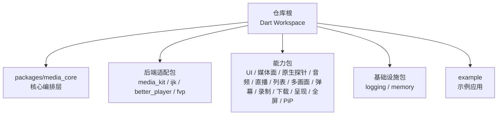

**图表来源**
- [pubspec.yaml:10-37](file://pubspec.yaml#L10-L37)
- [README.md:187-223](file://README.md#L187-L223)

**章节来源**
- [pubspec.yaml:10-37](file://pubspec.yaml#L10-L37)
- [README.md:187-223](file://README.md#L187-L223)

## 核心组件
Media Core 的核心由三层组成：
1. **编排层**：`PlayerKernel`，负责后端注册、源解析、引擎选择、handle 创建与释放、全局事件、池化、预载、跨播放器协调、能力驱动挂载。
2. **门面层**：`PlayerHandle`，单个逻辑播放器的唯一公开入口，封装生命周期、操作串行化、恢复执行、事件桥接。
3. **运行时组合根**：`PlayerRuntime`，持有当前 `PlayerAdapter`、`PlayerSession`、`PlaybackController`、`GeometryController`、截图管理器及事件绑定。

此外，`PlayerAdapterBase` 提供模板方法基类，统一生命周期、事件门控、能力门控、错误归一化；`MediaPlayerView` 是 UI 渲染入口，消费 `PlayerHandle` 暴露的 `PlayerVideo`。

**更新** 新增了全局音频协调系统和增强的生命周期状态管理。

**章节来源**
- [packages/media_core/lib/kernel/player_kernel.dart:48-100](file://packages/media_core/lib/kernel/player_kernel.dart#L48-L100)
- [packages/media_core/lib/coordinator/global_player_coordinator.dart:10-29](file://packages/media_core/lib/coordinator/global_player_coordinator.dart#L10-L29)

## 架构总览
顶层 README 中的架构文本已经给出从 `PlayerSource` → `SourceService` → `PlayerKernel` → `PlayerAdapterSelector` → `PlayerAdapterRegistry` → `PlayerHandle` → `PlayerRuntime` 的主链路，并列出 handle 内各子模块。中文架构文档进一步给出四层分层图、模块职责表、一次播放完整数据流、恢复决策流、扩展新后端步骤与设计不变量。

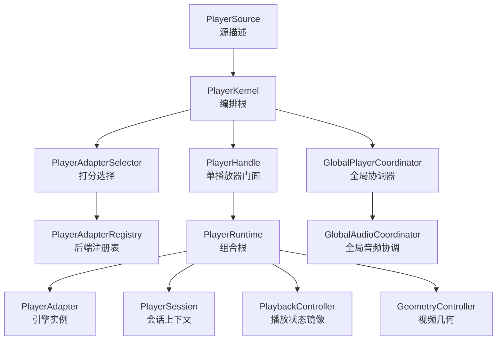

**图表来源**
- [README.md:55-81](file://README.md#L55-L81)
- [packages/media_core/lib/coordinator/global_player_coordinator.dart:10-29](file://packages/media_core/lib/coordinator/global_player_coordinator.dart#L10-L29)
- [packages/media_core/lib/audio/global_audio_coordinator.dart:5-13](file://packages/media_core/lib/audio/global_audio_coordinator.dart#L5-L13)

**章节来源**
- [README.md:55-81](file://README.md#L55-L81)
- [doc/zh-Hans/architecture.md:5-53](file://doc/zh-Hans/architecture.md#L5-L53)

## 关键组件深入分析

### PlayerKernel：全局协调器
`PlayerKernel` 是 Media Core 的编排根。它把独立模块组装成可工作的播放器框架，承担以下职责：
- 创建与释放播放器。
- 为源选择最佳后端。
- 提供 per-player 恢复上下文（注册表、选择器、预算）。
- 暴露全局事件流。
- 管理全局池、预载、跨播放器协调器。
- 挂载音频、呈现、平台能力驱动。

它不解码、不拥有 per-player 播放状态、不直接驱动恢复、不渲染视频。这些职责分别属于 `PlayerAdapter`、`PlayerHandle`/`PlaybackController`、`RecoveryLadder`、呈现控件。

关键行为包括：
- `registerBackend`：注册后端并记录协议、格式、优先级。
- `create`：解析源、选择后端、构造 adapter、构造 `PlayerHandle`、初始化、注册到各处、可选打开源。
- `createFromMedia`：面向形状感知的 `MediaSource`，先规划再桥接到 `PlayerSource`。
- `acquire`/`release`：池化软复用与完全释放。
- `attachAudio`/`attachPresentation`/`attachPlatformProvider`：能力驱动挂载。
- `captureScreenshot`：通过 handle 抓帧。

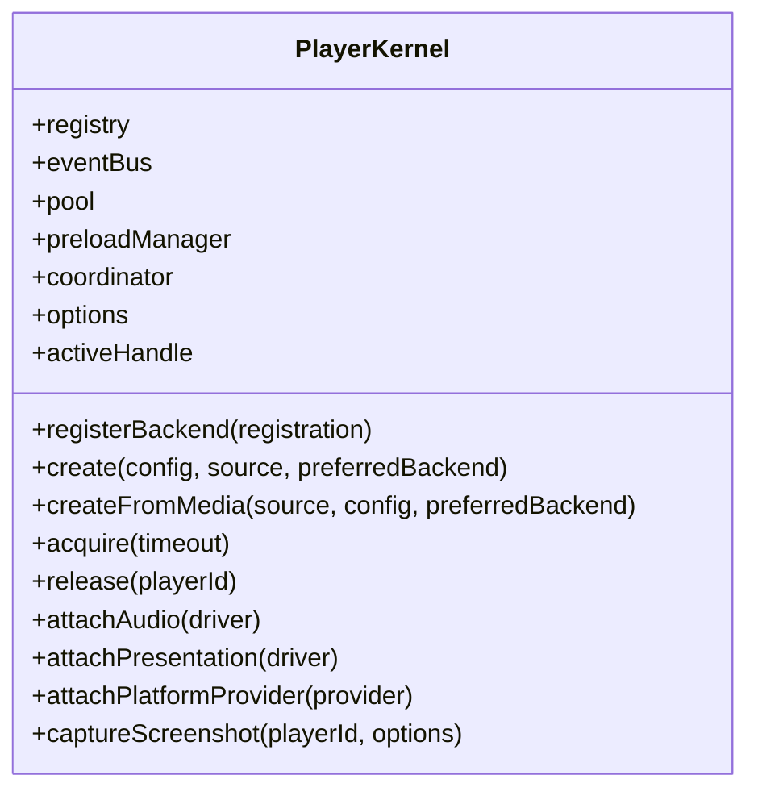

**图表来源**
- [packages/media_core/lib/kernel/player_kernel.dart:48-100](file://packages/media_core/lib/kernel/player_kernel.dart#L48-L100)
- [packages/media_core/lib/kernel/player_kernel.dart:113-157](file://packages/media_core/lib/kernel/player_kernel.dart#L113-L157)

**章节来源**
- [packages/media_core/lib/kernel/player_kernel.dart:48-100](file://packages/media_core/lib/kernel/player_kernel.dart#L48-L100)
- [packages/media_core/lib/kernel/player_kernel.dart:113-157](file://packages/media_core/lib/kernel/player_kernel.dart#L113-L157)

### GlobalPlayerCoordinator：全局协调器
**新增** `GlobalPlayerCoordinator` 是跨模块协调层的根协调器，组合所有播放器相关的协调器：
- `PlayerCoordinator`：播放器身份与会话协调
- `PlaybackCoordinator`：播放协调
- `PageCoordinator`：页面协调
- `PlayerAudioCoordinator`：音频协调
- `ResourceCoordinator`：资源协调
- `PreloadCoordinator`：预载协调
- `LifecycleCoordinator`：生命周期协调
- `PresentationCoordinator`：呈现协调

它不创建播放器、不执行后端命令、不存储播放状态，这些职责属于 `PlayerFactory`、`PlayerAdapter`、`PlaybackController`。

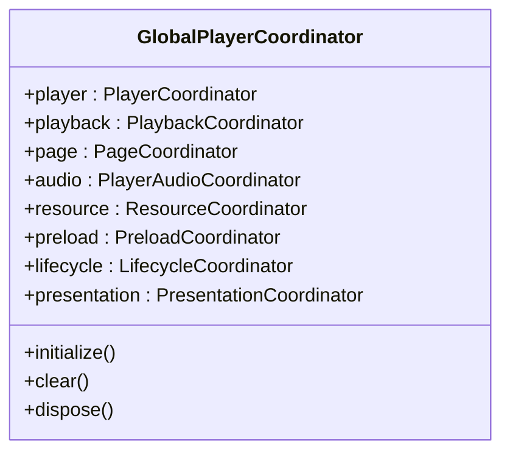

**图表来源**
- [packages/media_core/lib/coordinator/global_player_coordinator.dart:29-47](file://packages/media_core/lib/coordinator/global_player_coordinator.dart#L29-L47)

**章节来源**
- [packages/media_core/lib/coordinator/global_player_coordinator.dart:10-29](file://packages/media_core/lib/coordinator/global_player_coordinator.dart#L10-L29)
- [packages/media_core/lib/coordinator/global_player_coordinator.dart:29-47](file://packages/media_core/lib/coordinator/global_player_coordinator.dart#L29-L47)

### GlobalAudioCoordinator：全局音频协调器
**新增** `GlobalAudioCoordinator` 是多个播放会话之间的音频所有权全局协调器。虽然 `AudioCoordinator` 管理单个会话的焦点生命周期，但 `GlobalAudioCoordinator` 决定哪个会话应该拥有音频焦点。

它默认实现"最后获胜"的所有权策略：最近请求的会话声称音频通道。

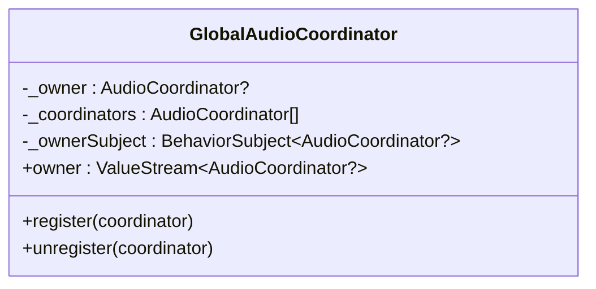

**图表来源**
- [packages/media_core/lib/audio/global_audio_coordinator.dart:13-27](file://packages/media_core/lib/audio/global_audio_coordinator.dart#L13-L27)

**章节来源**
- [packages/media_core/lib/audio/global_audio_coordinator.dart:5-13](file://packages/media_core/lib/audio/global_audio_coordinator.dart#L5-L13)
- [packages/media_core/lib/audio/global_audio_coordinator.dart:13-27](file://packages/media_core/lib/audio/global_audio_coordinator.dart#L13-L27)

### 增强的播放器生命周期状态管理
**新增** 系统现在使用更精细的生命周期状态管理：

- `PlayerLifecycleState`：播放器生命周期状态（idle → initializing → ready → disposing → disposed）
- `PlayerPlaybackState`：播放状态（idle → opening → playing → paused → buffering → seeking → stopping → stopped → completed → error）

这些状态通过 `PlayerLifecycle` 接口和 `LifecycleController` 实现进行管理，提供更细粒度的生命周期控制。

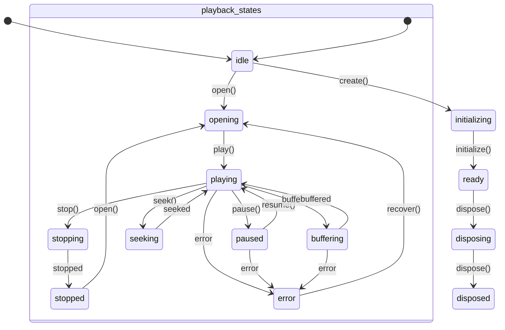

**图表来源**
- [packages/media_core/lib/core/player_lifecycle_state.dart:5-20](file://packages/media_core/lib/core/player_lifecycle_state.dart#L5-L20)

**章节来源**
- [packages/media_core/lib/core/player_lifecycle_state.dart:1-20](file://packages/media_core/lib/core/player_lifecycle_state.dart#L1-L20)

## 适配器模式与多后端抽象
Media Core 使用适配器模式统一四个后端引擎：
- `media_kit`：默认首选，协议/格式覆盖最广。
- `ijk_player`：FLV/H.265，移动端。
- `better_player`：轻量、纯 Flutter 生态。
- `fvp`：另一条桌面/移动解码路径。

所有后端实现 `PlayerAdapter` 接口，并通过 `PlayerAdapterBase` 获得生命周期模板、事件门控、能力门控、错误归一化。具体引擎只需重写 `onInitialize`、`onOpen`、`onPlay`、`onPause`、`onStop`、`onSeek`、`onSetVolume`、`onSetRate`、`onClose`、`onDispose` 等钩子，并通过 `emit*` 助手发布统一事件。

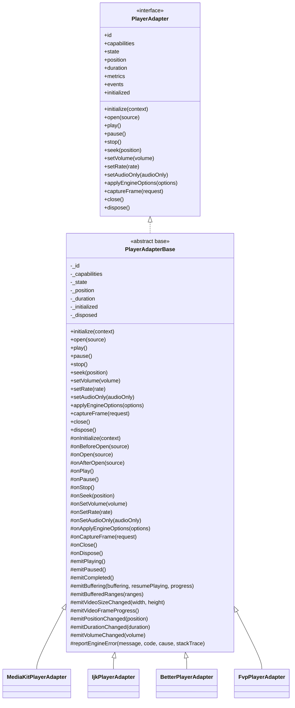

**图表来源**
- [packages/media_core/lib/adapter/player_adapter_base.dart:22-47](file://packages/media_core/lib/adapter/player_adapter_base.dart#L22-L47)
- [packages/media_core/lib/adapter/player_adapter_base.dart:83-91](file://packages/media_core/lib/adapter/player_adapter_base.dart#L83-L91)

**章节来源**
- [README.md:148-157](file://README.md#L148-L157)
- [packages/media_core/lib/adapter/player_adapter_base.dart:22-47](file://packages/media_core/lib/adapter/player_adapter_base.dart#L22-L47)

## 事件驱动、状态机与观察者
系统中三种经典模式贯穿主链路：

1. **事件驱动架构**  
   `PlayerEventBus` 是全局事件枢纽。`PlayerKernel` 持有并暴露 `events` 与 `subscribe`；`PlayerHandle` 将 adapter 事件归一化后发布。UI 层、日志层、协调器、池、预载都订阅事件。

2. **状态机模式**  
   `PlaybackController` 维护播放状态镜像；`LifecycleController` 维护播放器生命周期状态；`SessionController` 维护会话时间线；`PlayerAdapterBase` 内部维护 `PlayerCoreState`。状态转移由命令、引擎事件、恢复步骤共同驱动。

3. **观察者模式**  
   `Stream<PlayerTransportState>`、`Stream<PlayerAdapterEvent>`、`Stream<PlayerEvent>`、`recoveryEvents`、`backendChanges`、`sourceChanges`、`onOperation` 都是观察者接口。UI 通过 `MediaPlayerView(handle)` 观察 `backendChanges` 重建视频 widget；业务通过 `handle.playbackStream` 观察播放状态。

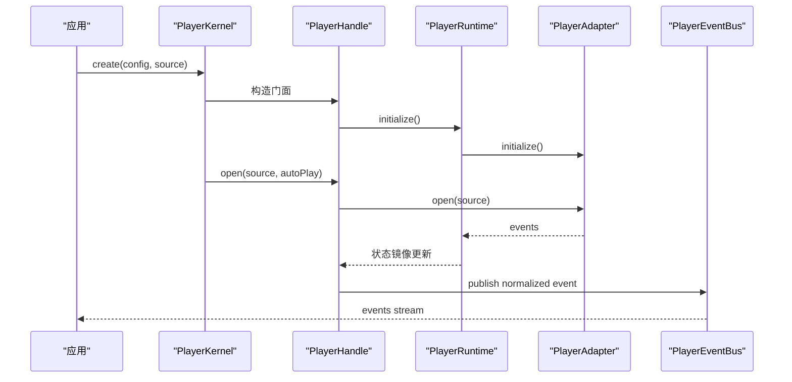

**图表来源**
- [packages/media_core/lib/kernel/player_kernel.dart:304-400](file://packages/media_core/lib/kernel/player_kernel.dart#L304-L400)
- [packages/media_core/lib/runtime/player_runtime.dart:54-80](file://packages/media_core/lib/runtime/player_runtime.dart#L54-L80)

**章节来源**
- [packages/media_core/lib/kernel/player_kernel.dart:246-257](file://packages/media_core/lib/kernel/player_kernel.dart#L246-L257)
- [packages/media_core/lib/runtime/player_runtime.dart:54-80](file://packages/media_core/lib/runtime/player_runtime.dart#L54-L80)

## 系统边界图、组件交互图与数据流图

### 系统边界图
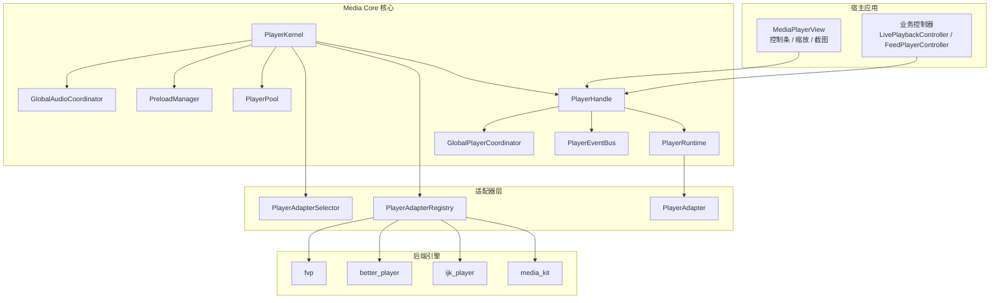

**图表来源**
- [README.md:55-81](file://README.md#L55-L81)
- [packages/media_core/lib/coordinator/global_player_coordinator.dart:10-29](file://packages/media_core/lib/coordinator/global_player_coordinator.dart#L10-L29)

### 组件交互图
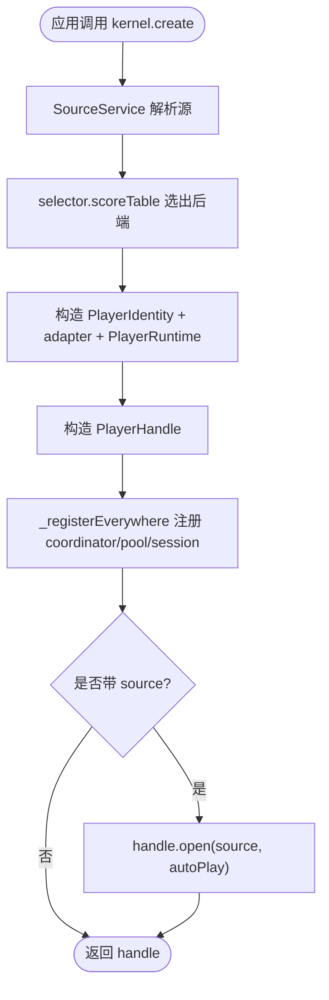

**图表来源**
- [packages/media_core/lib/kernel/player_kernel.dart:304-400](file://packages/media_core/lib/kernel/player_kernel.dart#L304-L400)

### 关键数据流图
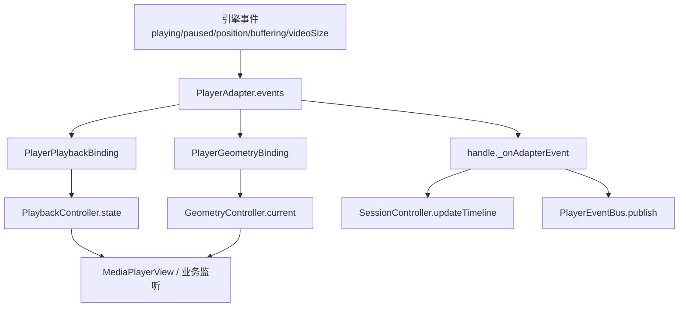

**图表来源**
- [packages/media_core/lib/runtime/player_runtime.dart:54-80](file://packages/media_core/lib/runtime/player_runtime.dart#L54-L80)

## 设计原则：能力声明、恢复决策点与序列化正确性

### 能力靠声明，不靠猜
`PlayerAdapterCapabilities` 是后端能力的唯一来源；`PlatformCapabilities` 与 `PlatformCodecCapabilities` 是设备事实的唯一来源。两者都保留"未知"的表达，未知不等于不支持。`PlayerAdapterBase` 对信号型 emit（如 `videoFrameProgress`、`videoSizeChanged`、`buffering progress`）进行能力门控，对事实型 emit（如 `playing`、`paused`、`positionChanged`）不做能力抑制。

### 一个决策点：恢复只有 RecoveryLadder
任何失败源（适配器错误、看门狗停滞、打开抛错、位置不前进）都通过 `reportFailure` 上报给 `PlayerHandle` 持有的 `RecoveryLadder`。梯级顺序为：
1. 同后端重开。
2. 换线路（候选源列表下一个）。
3. 换后端（注册表下一个，切换前刷新签名 URL）。
4. 放弃（候选耗尽，发布终态事件）。

每一步必须验证播放真的在推进（例如 8 秒内位置前进），否则继续爬梯。直播模式关闭 handle 自身梯级，由 `LivePlaybackController` 在自己的单槽任务队列中实现等价扫描。

### 序列化即正确性
公开操作进入队列按序执行；队列自身状态、代际守卫、操作注册表是唯一的门，不靠散落布尔标志。`PlayerHandle` 的操作记录通过 `onOperation` 可观测；`PlayerRuntime.replaceAdapter` 在换引擎时断开旧绑定、清空几何、停止播放镜像，确保状态一致性。

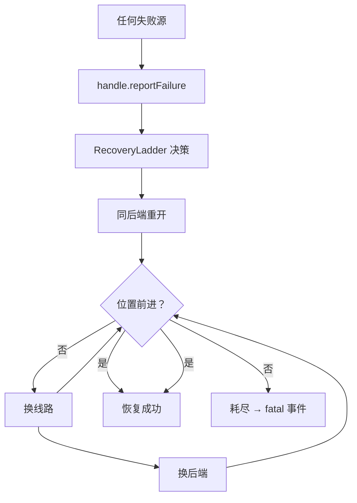

**图表来源**
- [README.md:92-103](file://README.md#L92-L103)

**章节来源**
- [README.md:83-90](file://README.md#L83-L90)
- [packages/media_core/lib/adapter/player_adapter_base.dart:43-65](file://packages/media_core/lib/adapter/player_adapter_base.dart#L43-L65)

## 依赖关系分析
核心依赖方向清晰：
- `PlayerKernel` 依赖 `PlayerAdapterRegistry`、`PlayerAdapterSelector`、`SourceService`、`PlayerEventBus`、`PlayerPool`、`PreloadManager`、`GlobalPlayerCoordinator`、`MediaSourcePlanner`。
- `PlayerHandle` 依赖 `PlayerRuntime`、`RecoveryLadder`、`LifecycleController`、`OperationTracker`、`PlayerEventBus`。
- `PlayerRuntime` 依赖 `PlayerAdapter`、`PlayerSession`、`PlaybackController`、`GeometryController`、`ScreenshotManager`。
- `PlayerAdapterBase` 依赖 `PlayerAdapterCapabilities`、`PlayerError`、`PlayerAdapterEvent`。

**更新** 新增的协调器架构引入了更清晰的依赖层次：
- `GlobalPlayerCoordinator` 作为根协调器，组合所有子协调器
- `GlobalAudioCoordinator` 专门处理跨会话的音频所有权
- 各协调器之间松耦合，通过接口通信

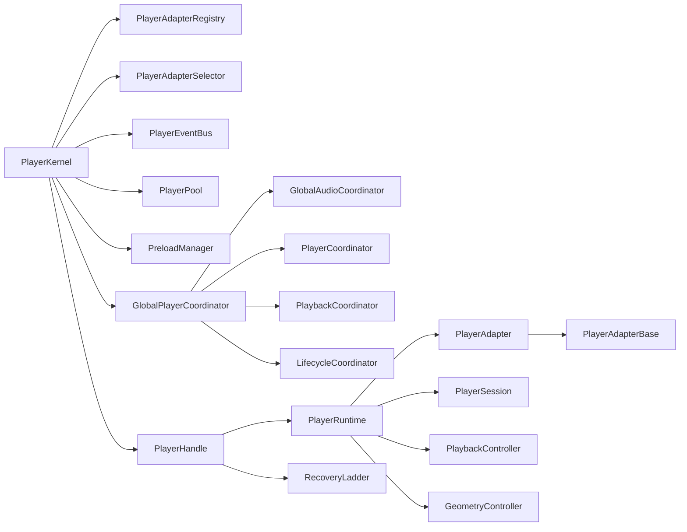

**图表来源**
- [packages/media_core/lib/kernel/player_kernel.dart:48-100](file://packages/media_core/lib/kernel/player_kernel.dart#L48-L100)
- [packages/media_core/lib/coordinator/global_player_coordinator.dart:29-47](file://packages/media_core/lib/coordinator/global_player_coordinator.dart#L29-L47)

**章节来源**
- [packages/media_core/lib/kernel/player_kernel.dart:48-100](file://packages/media_core/lib/kernel/player_kernel.dart#L48-L100)
- [packages/media_core/lib/coordinator/global_player_coordinator.dart:29-47](file://packages/media_core/lib/coordinator/global_player_coordinator.dart#L29-L47)

## 性能与资源特性
- **池化播放编排**：`PlaybackPoolOrchestrator` 使用有界播放器池驱动列表、信息流、直播；交换源而非重建，可见性驱动 + 迟滞，邻居预热，资源压力上升时先放弃预热再释放空闲。
- **分级日志**：默认静默，宿主按需开启；分类与模块对应，排查问题时只调高一类。
- **内存记账**：按贡献者申报求和 + 设备实测快照；预算阈值驱动的四级压力桥接进资源层。
- **截图双通道**：引擎抓帧 + 渲染面抓取；runtime 持有截图管理器，handle 暴露。
- **模块化导出优化**：生成的模块库文件提供优化的导入路径，减少编译依赖。

这些特性使 Media Core 在高并发列表、直播、多画面场景下保持可控的资源占用与可观测性。

**章节来源**
- [README.md:126-146](file://README.md#L126-L146)

## 故障排查指南
常见排查切入点：
1. **没有后端注册**：`PlayerKernel.create` 会抛 `StateError`。检查是否调用 `kernel.registerBackend(...)`。
2. **复合源无声**：`createFromMedia` 对 `UnsupportedPlan` 显式抛异常，避免"有画面没声音"的静默降级。
3. **恢复风暴**：确认失败只通过 `reportFailure` 上报，不要自行写重试循环；恢复决策点唯一。
4. **旧事件泄漏**：检查 `PlayerAdapterBase.gatesSourceEvents` 与 `_acceptSourceEvents`，确保源切换时代际重置。
5. **换引擎后画面错位**：`PlayerRuntime.replaceAdapter` 会清空几何并重建绑定；如果 UI 仍显示旧比例，检查是否持有旧 adapter。
6. **截图为空**：引擎捕获可能返回 null，此时走渲染面抓取；若两者都无结果，可能是尚未解码到帧或引擎不支持截图。
7. **音频冲突**：检查 `GlobalAudioCoordinator` 是否正确管理音频所有权，确保只有一个会话拥有音频焦点。

**章节来源**
- [packages/media_core/lib/audio/global_audio_coordinator.dart:5-13](file://packages/media_core/lib/audio/global_audio_coordinator.dart#L5-L13)

## 结论
Media Core 的架构以 `PlayerKernel` 为编排根、`PlayerHandle` 为门面、`PlayerRuntime` 为组合根，通过 `PlayerAdapter` 抽象统一多后端引擎。**新增的全局协调器架构**（`GlobalPlayerCoordinator` 和 `GlobalAudioCoordinator`）提供了更强大的跨模块协调能力，而**增强的生命周期状态管理**则提供了更精细的状态控制。

系统以事件驱动为主轴，以状态机管理播放与生命周期，以观察者模式连接 UI 与业务。三条核心规则贯穿始终：能力靠声明、恢复只有一个决策点、序列化即正确性。这种设计让初学者可以从 `PlayerKernel.create` 和 `MediaPlayerView` 快速上手，也让高级开发者能深入理解会话代际、命令串行化、恢复梯级、池化编排与能力门控的实现细节。

**更新** 原生 Dart workspace 的引入简化了构建流程，生成的模块库文件提供了更好的模块组织和依赖管理。

## 附录：面向初学者与高级开发者的阅读路径

### 初学者路径
1. 先看顶层 README 的 30 秒接入示例与架构总览。
2. 理解 `PlayerKernel` 创建 handle、`PlayerHandle` 暴露 play/seek/volume/rate、`MediaPlayerView` 渲染视频。
3. 了解四个后端适配包如何统一接入。
4. 掌握事件流：`handle.playbackStream`、`handle.recoveryEvents`、`kernel.events`。
5. 了解新的全局协调器如何管理跨会话的音频和资源。

### 高级开发者路径
1. 精读 `PlayerKernel.create`、`createFromMedia`、`acquire`、`release` 源码。
2. 分析 `PlayerHandle` 的操作串行化、代际失效、恢复执行侧。
3. 研究 `PlayerRuntime.replaceAdapter` 的绑定断开、几何清空、镜像重置。
4. 深入 `PlayerAdapterBase` 的生命周期模板、能力门控、事件门控、错误归一化。
5. 结合 `PlaybackPoolOrchestrator`、`GlobalPlayerCoordinator`、`PreloadManager` 理解高并发场景下的资源调度。
6. 研究新的 `GlobalAudioCoordinator` 如何实现跨会话的音频所有权管理。
7. 分析增强的生命周期状态机如何提供更精细的状态控制。

**章节来源**
- [README.md:14-53](file://README.md#L14-L53)
- [packages/media_core/lib/kernel/player_kernel.dart:48-100](file://packages/media_core/lib/kernel/player_kernel.dart#L48-L100)
- [packages/media_core/lib/coordinator/global_player_coordinator.dart:29-47](file://packages/media_core/lib/coordinator/global_player_coordinator.dart#L29-L47)
- [packages/media_core/lib/audio/global_audio_coordinator.dart:13-27](file://packages/media_core/lib/audio/global_audio_coordinator.dart#L13-L27)