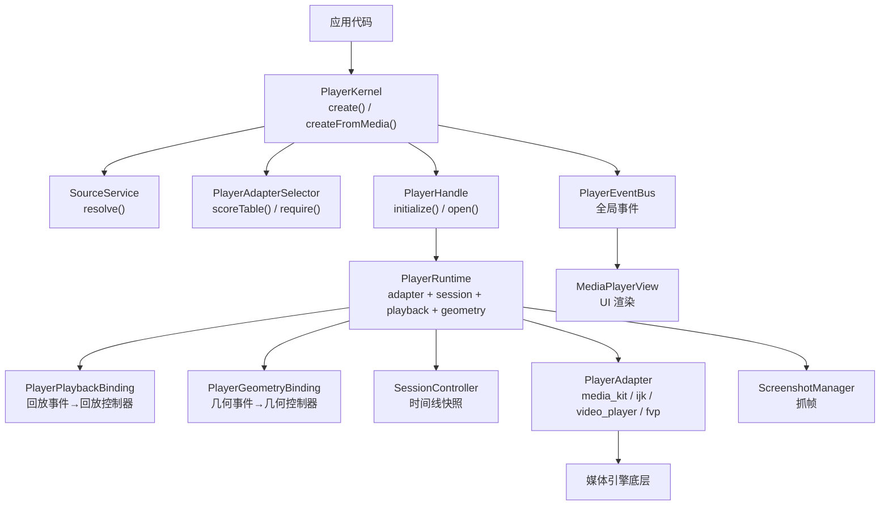
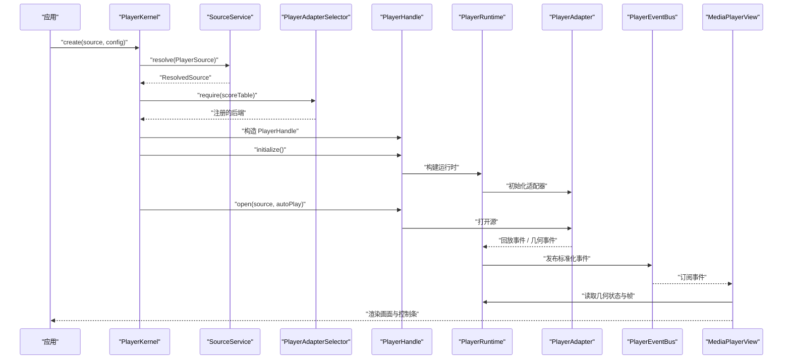
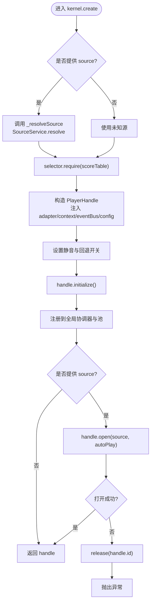
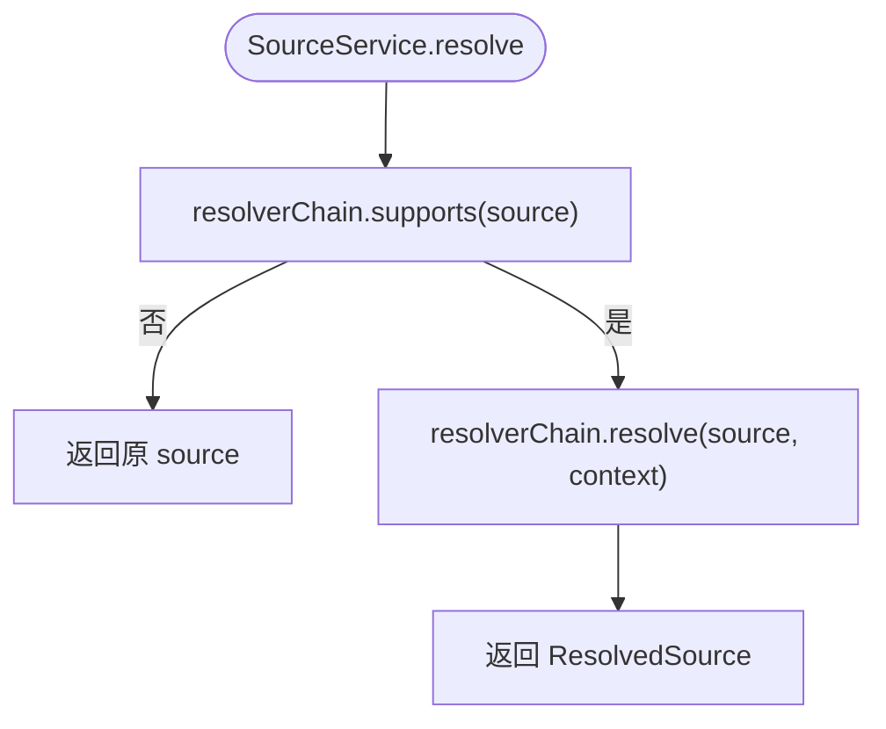
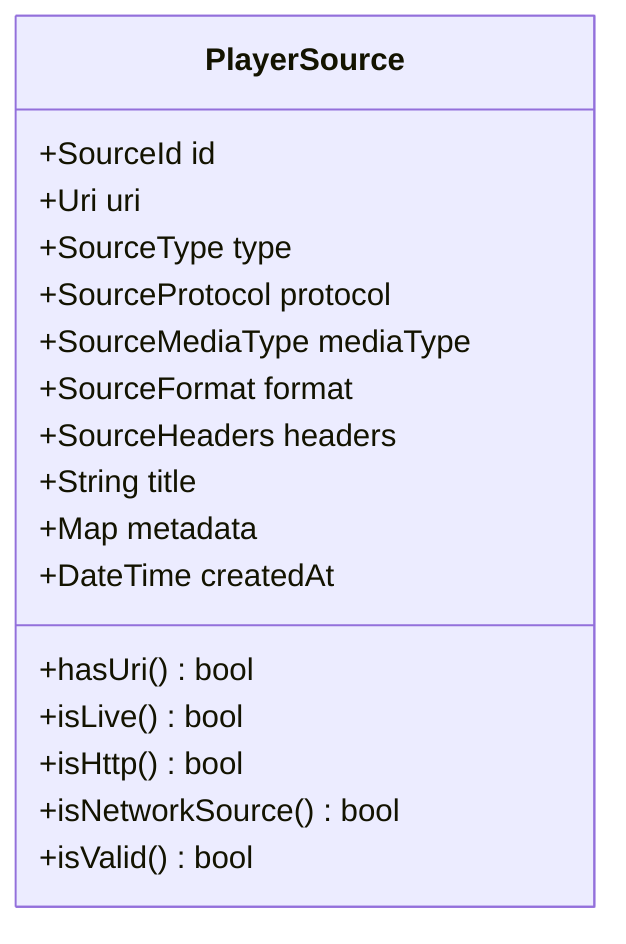
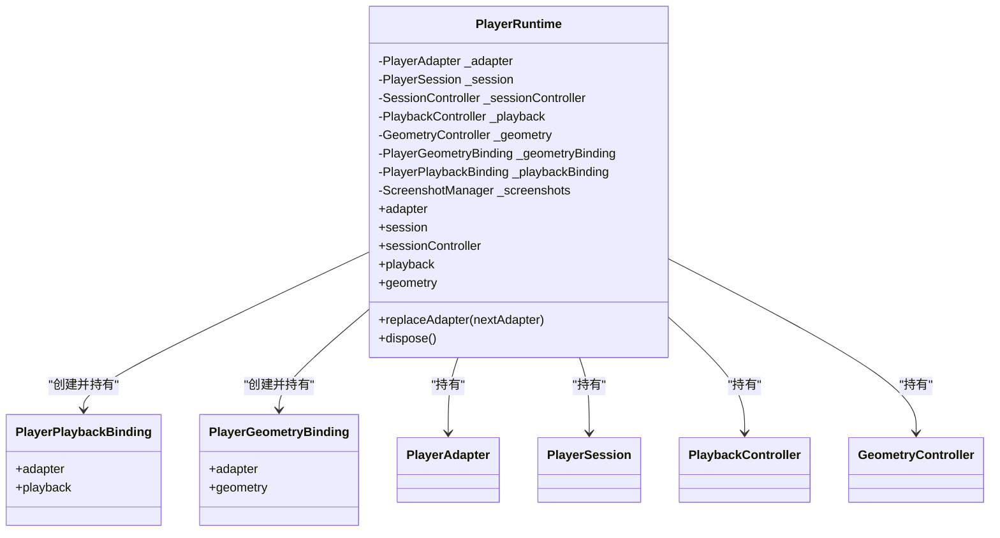
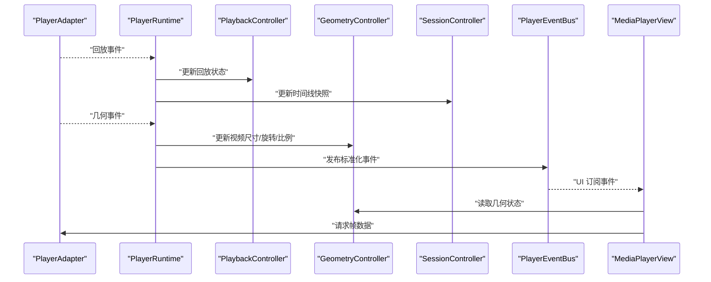
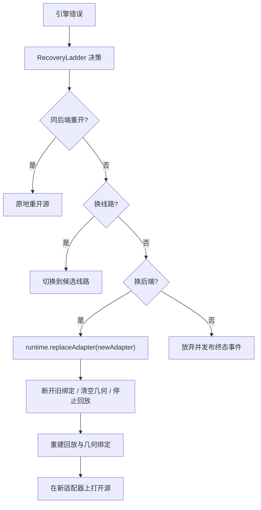
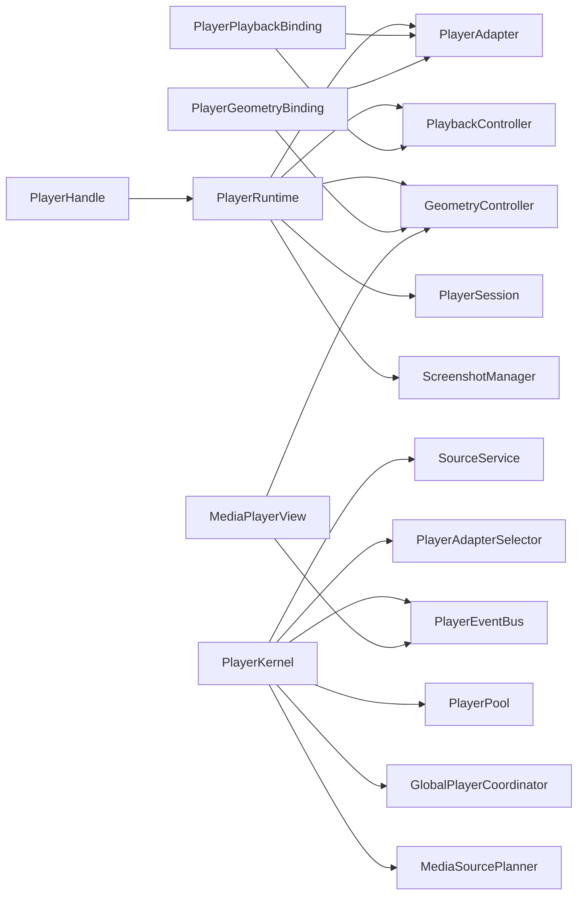

# 核心数据流

<cite>
**本文引用的文件**   
- [README.md](file://README.md)
- [player_kernel.dart](file://packages/media_core/lib/kernel/player_kernel.dart)
- [source_service.dart](file://packages/media_core/lib/source/source_service.dart)
- [player_source.dart](file://packages/media_core/lib/source/player_source.dart)
- [player_runtime.dart](file://packages/media_core/lib/runtime/player_runtime.dart)
- [player_playback_binding.dart](file://packages/media_core/lib/runtime/player_playback_binding.dart)
- [player_geometry_binding.dart](file://packages/media_core/lib/runtime/player_geometry_binding.dart)
</cite>

## 目录
1. [引言](#引言)
2. [项目结构](#项目结构)
3. [核心组件](#核心组件)
4. [架构总览](#架构总览)
5. [详细组件分析](#详细组件分析)
6. [依赖关系分析](#依赖关系分析)
7. [性能与并发特性](#性能与并发特性)
8. [故障排查指南](#故障排查指南)
9. [结论](#结论)

## 引言
本文聚焦 Media Core 的一次完整播放数据流：从应用调用 `kernel.create()` 开始，经过源解析、后端选择、播放器创建与初始化，再到打开源并进入渲染。重点说明以下问题：
- `PlayerSource` 在各个环节中的角色与演进。
- `SourceService.resolve`、`selector.scoreTable`、`Player.create`、`handle.initialize`、`handle.open(source)` 的调用链。
- 引擎事件如何被三个并行消费者消费：`PlaybackBinding`、`GeometryBinding`、以及会话转移（session 转移）。
- `MediaPlayerView` 的渲染流程如何消费几何状态与帧数据。
- 恢复与回退过程中，运行时如何安全替换后端适配器。

## 项目结构
Media Core 的核心编排位于 `packages/media_core`，本次数据流涉及的关键目录与文件如下：
- `kernel/`：内核入口、播放器句柄、生命周期与恢复策略。
- `source/`：源模型、解析服务、协议与格式描述。
- `runtime/`：单播放器运行时容器、回放绑定、几何绑定。
- `adapter/`：后端适配器抽象与注册表。
- `event/`：全局事件总线与标准化事件。
- `session/`：会话与代际管理。
- `presentation/`、`ui/`：呈现与 UI 层，最终由 `MediaPlayerView` 消费状态。

图表来源
- [player_kernel.dart:310-399](file://packages/media_core/lib/kernel/player_kernel.dart#L310-L399)
- [source_service.dart:52-76](file://packages/media_core/lib/source/source_service.dart#L52-L76)
- [player_runtime.dart:38-80](file://packages/media_core/lib/runtime/player_runtime.dart#L38-L80)

章节来源
- [README.md:55-81](file://README.md#L55-L81)

## 核心组件
- `PlayerKernel`：编排根，负责创建播放器、选择后端、注册全局能力驱动、维护池与会话协调器。
- `PlayerSource`：描述可播放源的标识与访问信息，不直接打开连接或控制播放。
- `SourceService`：协调源解析与媒体探测，将 `PlayerSource` 转换为可访问的 `ResolvedSource`，并可进一步得到 `PlayerInfo`。
- `PlayerHandle`：单个播放器的门面，公开操作入口，负责初始化、打开源、序列化命令、暴露截图等。
- `PlayerRuntime`：单逻辑播放器的运行时容器，持有后端适配器、会话、回放控制器、几何控制器，并桥接适配器事件到状态控制器。
- `PlayerPlaybackBinding`：把引擎的回放事件映射为回放状态变化。
- `PlayerGeometryBinding`：把引擎的几何事件映射为视频尺寸、旋转、比例等几何状态。
- `PlayerEventBus`：全局标准化事件总线，供 UI、系统媒体面、日志与诊断消费。

章节来源
- [player_kernel.dart:50-102](file://packages/media_core/lib/kernel/player_kernel.dart#L50-L102)
- [player_source.dart:11-27](file://packages/media_core/lib/source/player_source.dart#L11-L27)
- [source_service.dart:9-27](file://packages/media_core/lib/source/source_service.dart#L9-L27)
- [player_runtime.dart:16-37](file://packages/media_core/lib/runtime/player_runtime.dart#L16-L37)

## 架构总览
一次完整播放的数据流可以概括为：
1. 应用调用 `kernel.create(source, config)`。
2. 内核通过 `SourceService.resolve` 解析源；若未提供源则使用未知源。
3. 内核通过 `selector.require(scoreTable)` 选择最佳后端适配器。
4. 内核构造 `PlayerHandle`，注入适配器、会话、回放、几何、事件总线与配置。
5. 调用 `handle.initialize()` 完成适配器初始化。
6. 若提供了源，调用 `handle.open(source, autoPlay)` 打开源并开始播放。
7. 运行时建立 `PlaybackBinding` 与 `GeometryBinding`，将引擎事件同步到回放与几何状态。
8. UI 层通过 `MediaPlayerView` 消费几何状态与帧数据，完成渲染。

图表来源
- [player_kernel.dart:310-399](file://packages/media_core/lib/kernel/player_kernel.dart#L310-L399)
- [source_service.dart:52-76](file://packages/media_core/lib/source/source_service.dart#L52-L76)
- [player_runtime.dart:38-80](file://packages/media_core/lib/runtime/player_runtime.dart#L38-L80)

## 详细组件分析

### 播放入口：`PlayerKernel.create`
`PlayerKernel.create` 是播放数据流的起点。它的主要职责包括：
- 可选地解析 `PlayerSource`。
- 通过 `selector.require` 选择后端，并记录评分表。
- 构造 `PlayerIdentity`、`SessionId`、`PlayerAdapterContext`。
- 构造 `PlayerHandle`，注入适配器、注册表、选择器、规划器、事件总线与配置。
- 根据配置设置静音与回退开关。
- 调用 `handle.initialize()`。
- 将 handle 注册到全局协调器与池中。
- 若有源，调用 `handle.open(source, autoPlay)`；失败时释放 handle 并抛出异常。

图表来源
- [player_kernel.dart:310-399](file://packages/media_core/lib/kernel/player_kernel.dart#L310-L399)
- [player_kernel.dart:766-800](file://packages/media_core/lib/kernel/player_kernel.dart#L766-L800)

章节来源
- [player_kernel.dart:310-399](file://packages/media_core/lib/kernel/player_kernel.dart#L310-L399)
- [player_kernel.dart:766-800](file://packages/media_core/lib/kernel/player_kernel.dart#L766-L800)

### 源解析：`SourceService.resolve`
`SourceService` 的职责是把 `PlayerSource` 解析为可直接访问的 `ResolvedSource`，并可进一步探测媒体信息。它不创建播放器实例，也不控制播放或处理恢复。

关键流程：
- `canResolve` 判断是否有解析器能处理该源。
- `resolve` 委托给 `SourceResolverChain`。
- `inspect` 委托给 `SourceInspectorChain`。
- `resolveAndInspect` 先解析再探测，返回包含原始源、已解析源与媒体信息的 `SourceInspectionResult`。

图表来源
- [source_service.dart:42-55](file://packages/media_core/lib/source/source_service.dart#L42-L55)

章节来源
- [source_service.dart:9-27](file://packages/media_core/lib/source/source_service.dart#L9-L27)
- [source_service.dart:42-76](file://packages/media_core/lib/source/source_service.dart#L42-L76)

### 源模型：`PlayerSource`
`PlayerSource` 是跨后端的源描述对象，强调“身份与访问信息”，而不是“播放状态”。它包含：
- 唯一标识 `id`。
- 访问地址 `uri`。
- 类型、协议、媒体类型、格式等提示字段。
- 请求头、标题、元数据与创建时间。

扩展方法提供便捷判断，例如是否为网络源、本地源、HLS/DASH/RTMP/RTSP/WebRTC/UDP 等。

图表来源
- [player_source.dart:11-73](file://packages/media_core/lib/source/player_source.dart#L11-L73)
- [player_source.dart:75-173](file://packages/media_core/lib/source/player_source.dart#L75-L173)

章节来源
- [player_source.dart:11-73](file://packages/media_core/lib/source/player_source.dart#L11-L73)
- [player_source.dart:75-173](file://packages/media_core/lib/source/player_source.dart#L75-L173)

### 后端选择：`selector.scoreTable` 与 `selector.require`
`PlayerKernel.selector` 默认懒加载为 `PlayerAdapterSelector(registry)`。选择过程：
- `scoreTable(source)` 计算各后端对当前源的评分，便于调试与 UI 展示。
- `require(source, preferredId)` 根据评分与偏好选择最佳后端。
- 如果传入 `preferredBackend`，则优先使用该后端。

内核在 `create` 中记录后端 ID、优先级、协议、格式与评分表，帮助开发者理解“为什么某个引擎被选中”。

章节来源
- [player_kernel.dart:215-244](file://packages/media_core/lib/kernel/player_kernel.dart#L215-L244)
- [player_kernel.dart:320-334](file://packages/media_core/lib/kernel/player_kernel.dart#L320-L334)

### 播放器创建与初始化：`PlayerHandle.initialize`
`PlayerHandle` 是单个播放器的门面，封装了：
- 后端适配器。
- 会话与代际。
- 回放状态机。
- 几何控制器。
- 恢复决策上下文。
- 全局事件总线。

`initialize` 会完成适配器的初始化，并为后续 `open` 做准备。此时尚未打开具体源，但播放器已经具备执行命令的能力。

章节来源
- [player_kernel.dart:359-382](file://packages/media_core/lib/kernel/player_kernel.dart#L359-L382)

### 打开源：`handle.open(source)`
`handle.open` 负责把 `PlayerSource` 交给后端适配器打开，并根据配置决定是否自动播放。它通常发生在 `kernel.create` 内部，当用户显式提供源时。

打开成功后，引擎开始产生回放事件与几何事件，这些事件会被运行时绑定到状态控制器。

章节来源
- [player_kernel.dart:386-399](file://packages/media_core/lib/kernel/player_kernel.dart#L386-L399)

### 运行时与事件绑定：`PlayerRuntime`
`PlayerRuntime` 是单逻辑播放器的运行时容器，核心职责：
- 持有 `PlayerAdapter`。
- 持有 `PlayerSession` 与其 `SessionController`。
- 持有 `PlaybackController` 与 `GeometryController`。
- 桥接适配器事件到回放与几何状态。
- 在后端回退时安全替换适配器。

构造函数中立即建立两个绑定：
- `PlayerGeometryBinding(adapter, geometry)`。
- `PlayerPlaybackBinding(adapter, playback)`。

同时，运行时监听回放状态，把位置、时长、缓冲进度更新到会话时间线。

图表来源
- [player_runtime.dart:38-80](file://packages/media_core/lib/runtime/player_runtime.dart#L38-L80)
- [player_runtime.dart:127-173](file://packages/media_core/lib/runtime/player_runtime.dart#L127-L173)

章节来源
- [player_runtime.dart:16-37](file://packages/media_core/lib/runtime/player_runtime.dart#L16-L37)
- [player_runtime.dart:38-80](file://packages/media_core/lib/runtime/player_runtime.dart#L38-L80)
- [player_runtime.dart:127-173](file://packages/media_core/lib/runtime/player_runtime.dart#L127-L173)

### 引擎事件的三个并行消费者
引擎事件在运行时被解耦为三条并行消费路径：

1. **回放消费者：`PlayerPlaybackBinding`**
   - 接收引擎回放事件。
   - 驱动 `PlaybackController` 的状态机。
   - 回放状态变化会触发会话时间线更新。

2. **几何消费者：`PlayerGeometryBinding`**
   - 接收引擎几何事件。
   - 驱动 `GeometryController` 的视频尺寸、旋转、比例。
   - UI 层据此调整画面布局与缩放。

3. **会话转移消费者：`SessionController` 与全局协调器**
   - 回放状态变化通过 `_sessionSubscription` 更新会话时间线。
   - 内核跟踪活跃播放器，并通过音频驱动通知系统媒体面。
   - 会话与代际保证异步结果按代际丢弃，避免旧引擎事件污染新引擎。

图表来源
- [player_runtime.dart:54-80](file://packages/media_core/lib/runtime/player_runtime.dart#L54-L80)
- [player_kernel.dart:718-748](file://packages/media_core/lib/kernel/player_kernel.dart#L718-L748)

章节来源
- [player_runtime.dart:54-80](file://packages/media_core/lib/runtime/player_runtime.dart#L54-L80)
- [player_kernel.dart:718-748](file://packages/media_core/lib/kernel/player_kernel.dart#L718-L748)

### `MediaPlayerView` 的渲染流程
`MediaPlayerView` 是 UI 层消费播放状态的入口。它主要做两件事：
- 消费几何状态：根据视频尺寸、旋转、比例决定画面布局。
- 消费帧数据：通过适配器的抓帧能力或渲染面抓取，把视频帧绘制到屏幕。

结合内核文档，`MediaPlayerView` 支持多套设计语言的控制条，并可组合 `MediaPlayerView`（只画视频）与 `PlayerControlsController`（状态与动作）。

章节来源
- [README.md:45-53](file://README.md#L45-L53)

### 后端回退与运行时替换
当引擎报错时，恢复决策点 `RecoveryLadder` 按梯级推进：同后端重开、换线路、换后端、放弃。运行时在替换适配器时：
- 先断开旧绑定，防止旧引擎事件继续影响控制器。
- 清空几何状态，避免旧引擎尺寸污染新引擎。
- 停止回放状态，重建回放与几何绑定到新适配器。
- 保留回放与几何控制器本身，因为它们描述的是“这个播放器”，而不是“某个后端”。

图表来源
- [player_runtime.dart:127-173](file://packages/media_core/lib/runtime/player_runtime.dart#L127-L173)
- [README.md:92-103](file://README.md#L92-L103)

章节来源
- [player_runtime.dart:127-173](file://packages/media_core/lib/runtime/player_runtime.dart#L127-L173)
- [README.md:92-103](file://README.md#L92-L103)

## 依赖关系分析
- `PlayerKernel` 依赖 `SourceService`、`PlayerAdapterSelector`、`PlayerEventBus`、`PlayerPool`、`PreloadManager`、`GlobalPlayerCoordinator`、`MediaSourcePlanner`。
- `PlayerRuntime` 依赖 `PlayerAdapter`、`PlayerSession`、`PlaybackController`、`GeometryController`、`ScreenshotManager`。
- `PlayerPlaybackBinding` 与 `PlayerGeometryBinding` 分别依赖 `PlayerAdapter` 与对应的控制器。
- UI 层通过 `PlayerEventBus` 与运行时状态消费播放事件与几何状态。

图表来源
- [player_kernel.dart:115-170](file://packages/media_core/lib/kernel/player_kernel.dart#L115-L170)
- [player_runtime.dart:38-80](file://packages/media_core/lib/runtime/player_runtime.dart#L38-L80)

章节来源
- [player_kernel.dart:115-170](file://packages/media_core/lib/kernel/player_kernel.dart#L115-L170)
- [player_runtime.dart:38-80](file://packages/media_core/lib/runtime/player_runtime.dart#L38-L80)

## 性能与并发特性
- **池化播放器**：`PlayerPool` 复用播放器实例，交换源而非重建解码器，适合列表、信息流与直播场景。
- **预加载管理器**：`PreloadManager` 按优先级调度预热请求，减少首帧延迟。
- **任务队列**：直播扫描、下载队列等需要“一次只做一件事”的能力包各自持有单槽任务队列，作为编排的序列化权威。
- **事件总线**：全局事件通过 `PlayerEventBus` 标准化传播，避免 UI 与系统媒体面耦合具体引擎实现。
- **代际守卫**：会话与代际确保旧引擎的异步结果不会污染新引擎，提升回退安全性。

[本节为通用指导，不直接分析具体文件]

## 故障排查指南
- **源解析失败**：检查 `SourceService.canResolve` 与 `SourceResolverChain` 是否能处理该协议与格式；查看内核日志中“源解析失败，打开未解析源”的记录。
- **后端选择异常**：检查 `selector.scoreTable` 输出，确认注册的后端是否支持该协议的媒体类型；必要时通过 `preferredBackend` 指定后端。
- **打开源失败**：确认 `handle.open` 是否抛出异常；内核会在失败时释放 handle，避免池中出现僵尸播放器。
- **回放无画面**：检查 `GeometryController` 是否收到视频尺寸事件；确认 `MediaPlayerView` 是否正确消费几何状态。
- **系统媒体面无响应**：确认是否调用 `MediaSessionBootstrap.enable()` 并附加音频驱动；内核会跟踪活跃播放器并通知音频驱动。

章节来源
- [player_kernel.dart:766-800](file://packages/media_core/lib/kernel/player_kernel.dart#L766-L800)
- [README.md:22-43](file://README.md#L22-L43)

## 结论
Media Core 的核心数据流以 `PlayerKernel.create` 为入口，通过 `SourceService.resolve` 解析源，通过 `selector.scoreTable` 选择后端，通过 `PlayerHandle.initialize` 与 `handle.open` 完成播放器初始化与源打开。运行时通过 `PlaybackBinding` 与 `GeometryBinding` 将引擎事件并行分发到回放与几何状态，并由 `SessionController` 与全局协调器维护会话与系统媒体面。UI 层通过 `MediaPlayerView` 消费几何状态与帧数据完成渲染。整个流程强调“能力声明、单一决策点、序列化即正确性”，使复杂的多后端、多平台播放场景具备可观测、可恢复、可扩展的特性。