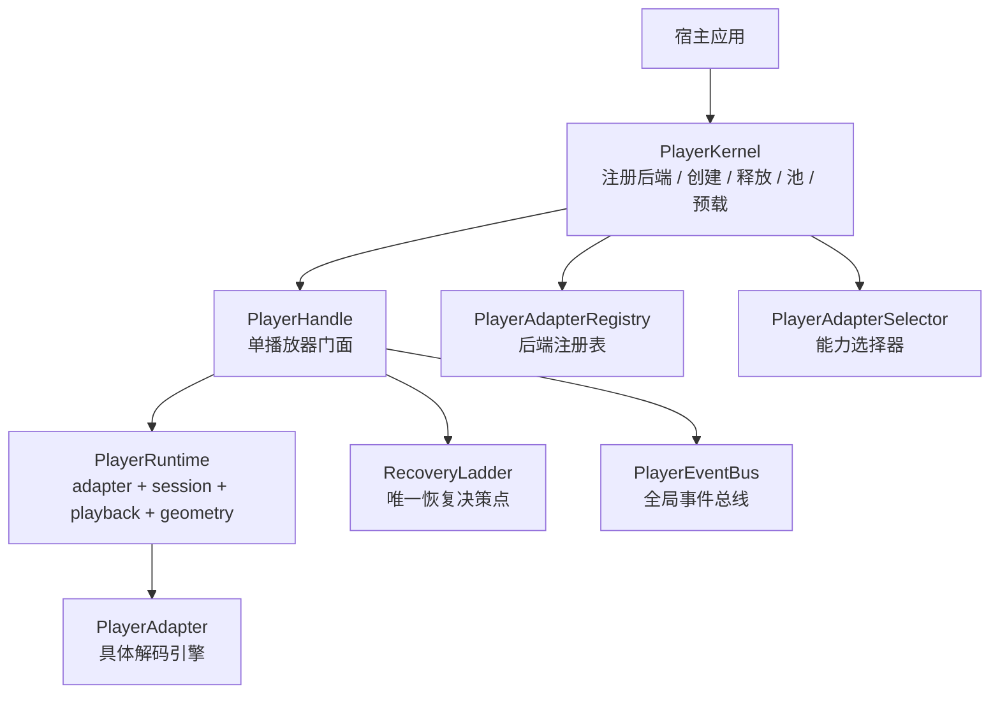
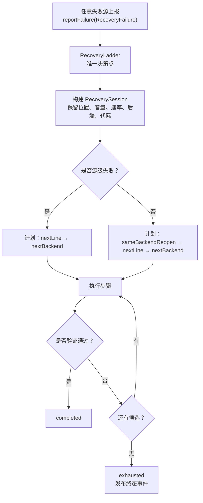
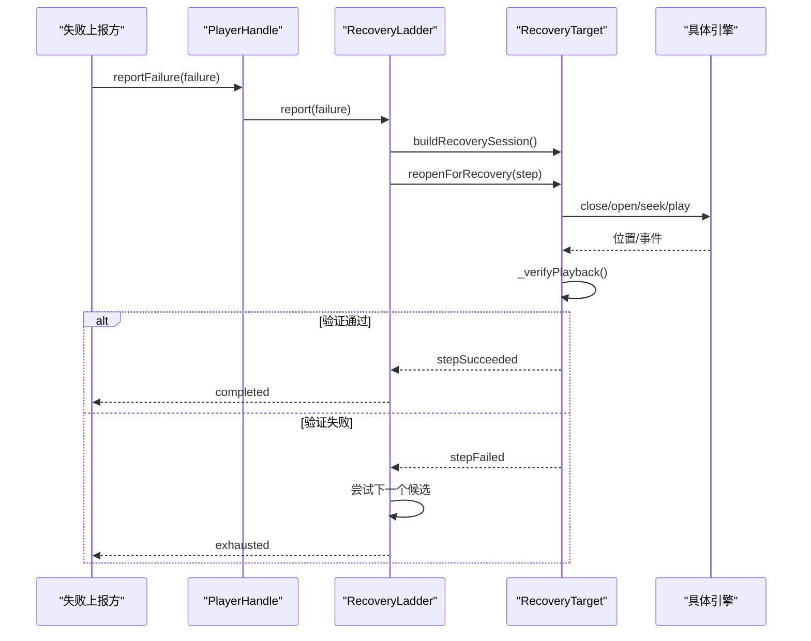
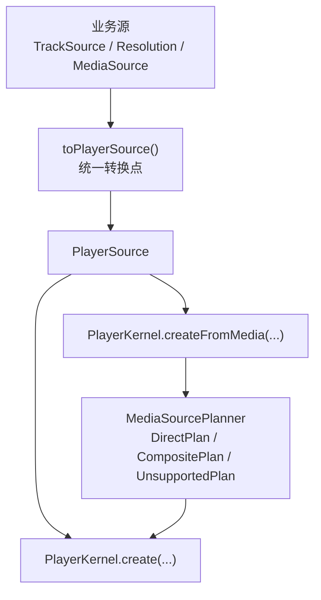
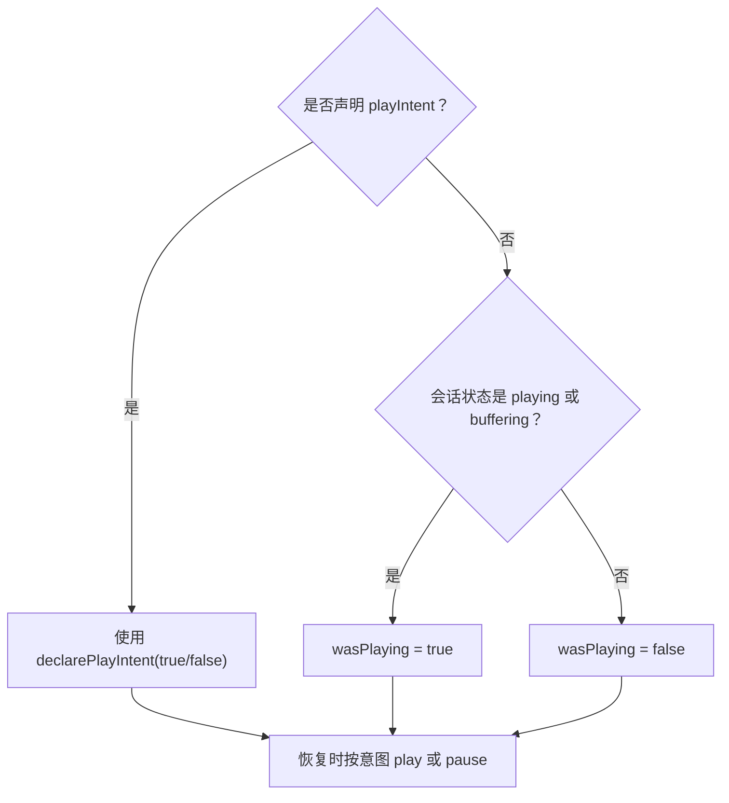
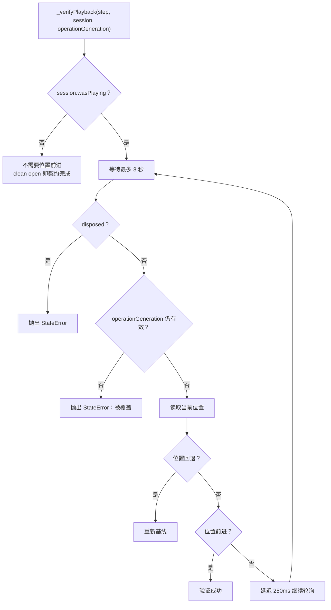
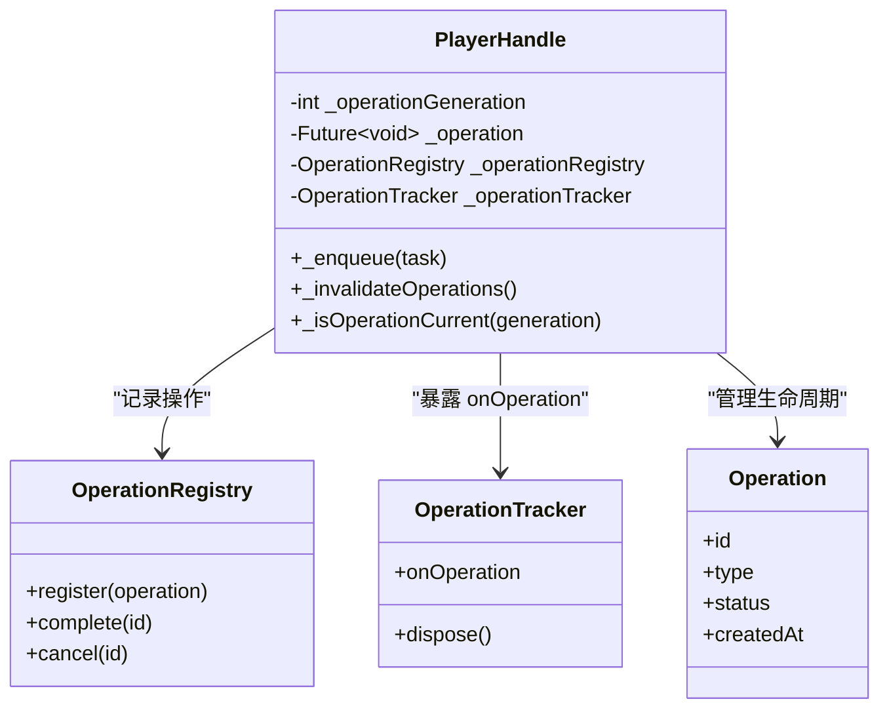
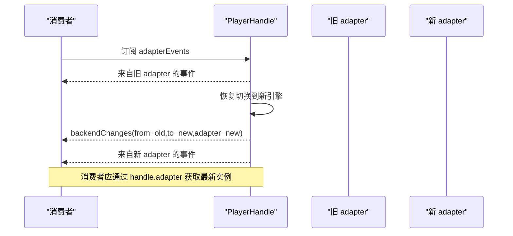
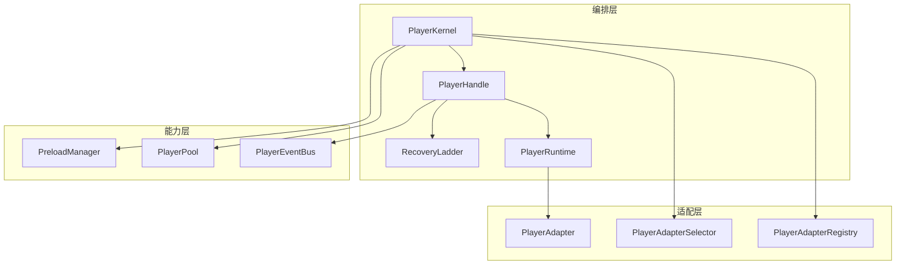
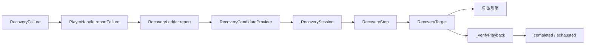

# 设计不变量与原则

<cite>
**本文引用的文件**   
- [README.md](file://README.md)
- [packages/media_core/README.md](file://packages/media_core/README.md)
- [doc/en/architecture.md](file://doc/en/architecture.md)
- [packages/media_core/lib/recovery/recovery_ladder.dart](file://packages/media_core/lib/recovery/recovery_ladder.dart)
- [packages/media_core/lib/kernel/player_handle.dart](file://packages/media_core/lib/kernel/player_handle.dart)
- [packages/media_core/lib/kernel/player_handle_recovery.dart](file://packages/media_core/lib/kernel/player_handle_recovery.dart)
- [packages/media_core/lib/kernel/player_kernel.dart](file://packages/media_core/lib/kernel/player_kernel.dart)
- [example/lib/demos/console/source_demo.dart](file://example/lib/demos/console/source_demo.dart)
- [packages/media_core_live/lib/src/live_playback_sweep.dart](file://packages/media_core_live/lib/src/live_playback_sweep.dart)
</cite>

## 目录
1. [引言](#引言)
2. [项目结构与设计边界](#项目结构与设计边界)
3. [核心设计不变量总览](#核心设计不变量总览)
4. [不变量一：恢复只有一个决策点](#不变量一恢复只有一个决策点)
5. [不变量二：PlayerSource 是选择的唯一输入](#不变量二playersource-是选择的唯一输入)
6. [不变量三：playIntent 高于镜像](#不变量三playintent-高于镜像)
7. [不变量四：换引擎必须验活](#不变量四换引擎必须验活)
8. [不变量五：操作串行 + 代数失效](#不变量五操作串行--代数失效)
9. [不变量六：facade 事件流稳定](#不变量六facade-事件流稳定)
10. [架构与数据流视图](#架构与数据流视图)
11. [稳定性、可维护性与可扩展性分析](#稳定性可维护性与可扩展性分析)
12. [开发者实践指南](#开发者实践指南)
13. [常见陷阱与排错建议](#常见陷阱与排错建议)
14. [结论](#结论)

## 引言

Media Core 是一个跨平台 Flutter 播放器核心：**一个与平台无关的编排层**，加上按能力拆分的包。它不负责解码，而是负责播放最难的部分——会话与代际、命令串行化、恢复决策、池化、事件归一化、诊断与资源压力。

这个仓库的设计哲学可以概括为三句话：

- **能力靠声明，不靠猜。**
- **一个决策点。**
- **序列化即正确性。**

本文聚焦六个关键设计不变量：

1. 恢复只有一个决策点。
2. PlayerSource 是选择的唯一输入。
3. playIntent 高于镜像。
4. 换引擎必须验活。
5. 操作串行 + 代数失效。
6. facade 事件流稳定。

这些不变量不是风格偏好，而是避免“一次故障触发多个恢复循环”“旧操作覆盖新状态”“表面成功但实际冻结”等历史问题的约束。违反它们通常不会立刻报错，而是表现为偶发卡顿、无声画面、重复切换引擎或 UI 状态不一致。

**章节来源**
- [README.md:3-12](file://README.md#L3-L12)
- [packages/media_core/README.md:3-12](file://packages/media_core/README.md#L3-L12)

## 项目结构与设计边界

从顶层看，Media Core 的工作区由核心包、后端适配包、能力包和示例应用组成。核心包 `media_core` 提供播放器编排内核；四个后端适配包分别对接 media_kit、ijk、better_player、fvp；其余包实现系统媒体面、UI、直播、下载、录制、内存、日志等能力。

**图表来源**
- [README.md:55-80](file://README.md#L55-L80)
- [packages/media_core/README.md:69-81](file://packages/media_core/README.md#L69-L81)

核心包内部按职责分目录：编排根（kernel、runtime、core、factory）、会话与串行化（session、playback、operation、task、state_machine、concurrency、reconciler）、恢复与降级（recovery、fallback、error、result）、池化与调度（pool、preload、slot、coordinator、visibility）、能力与设备（adapter、platform、policy、resource、planning、source）、数据面与呈现（renderer、screenshot、recording、casting、composition、quality、geometry、presentation、audio），以及支撑设施（cache、network、diagnostics、event、bug、reactive、util）。

**章节来源**
- [packages/media_core/README.md:69-81](file://packages/media_core/README.md#L69-L81)
- [packages/media_core/README.md:83-87](file://packages/media_core/README.md#L83-L87)

## 核心设计不变量总览

| 编号 | 不变量 | 一句话解释 | 主要责任方 | 违反后果 |
|---|---|---|---|---|
| 1 | 恢复只有一个决策点 | 所有失败最终进入 `RecoveryLadder`，由它决定同后端重开、换线路、换引擎还是放弃。 | `RecoveryLadder`、`PlayerHandle` | 多个恢复循环竞争，反复创建销毁引擎，状态互相覆盖。 |
| 2 | PlayerSource 是选择的唯一输入 | 框架只接受已构造的 `PlayerSource`，不接受让框架重新解析的裸 URL。 | `PlayerKernel`、`PlayerHandle`、上层业务 | 源语义丢失、复合源被误判、签名 URL 过期后行为不可控。 |
| 3 | playIntent 高于镜像 | 恢复时优先使用调用者声明的播放意图，而不是引擎当前镜像。 | `PlayerHandle`、`RecoverySession` | 自动播放的引擎被错误恢复成暂停。 |
| 4 | 换引擎必须验活 | `open()` 返回不等于播放成功；必须在宽限期内看到位置前进。 | `_verifyPlayback`、`LiveWatchdogs` | 表面成功但画面冻结，后续看门狗无法启动。 |
| 5 | 操作串行 + 代数失效 | 公开操作排队执行，生命周期代际使旧操作作废。 | `PlayerHandle`、`OperationTracker`、`GenerationId` | 旧 seek/pause/close 覆盖新 open/play。 |
| 6 | facade 事件流稳定 | `adapterEvents`、`backendChanges`、`sourceChanges` 在引擎切换后仍可用。 | `PlayerHandle`、`PlayerBackendChange` | 消费者持有旧 adapter 导致崩溃或状态错乱。 |

**章节来源**
- [doc/en/architecture.md:160-168](file://doc/en/architecture.md#L160-L168)
- [packages/media_core/README.md:83-87](file://packages/media_core/README.md#L83-L87)

## 不变量一：恢复只有一个决策点

### 设计动机

历史上可能出现三种恢复逻辑同时工作：handle 自己的重试循环、kernel 的回退循环、live controller 的扫描循环。每个循环都可能认为另一个无效，从而对同一个故障发起多次引擎重建。结果不是更健壮，而是“一次故障产生风暴”。

因此，框架把恢复决策收敛到 `RecoveryLadder`，并把执行交给 `PlayerHandle` 实现的 `RecoveryTarget`。其他模块只能上报失败，不能直接重启引擎。

### 决策流程

**图表来源**
- [packages/media_core/lib/recovery/recovery_ladder.dart:38-68](file://packages/media_core/lib/recovery/recovery_ladder.dart#L38-L68)
- [packages/media_core/lib/recovery/recovery_ladder.dart:253-365](file://packages/media_core/lib/recovery/recovery_ladder.dart#L253-L365)
- [doc/en/architecture.md:127-144](file://doc/en/architecture.md#L127-L144)

### 关键实现要点

- `RecoveryLadder.report` 在同一轮运行中拒绝重复报告，防止多个 reporter 并行启动恢复。
- 源级失败会跳过原地重开，因为同一 URL 在同一引擎上很可能复现故障。
- 每步执行都通过 `RecoveryTarget`，ladder 本身不直接操作 adapter、registry 或 session controller。
- 当候选耗尽时，ladder 进入 `exhausted`，并通过事件总线发布致命事件。

**图表来源**
- [packages/media_core/lib/recovery/recovery_ladder.dart:140-192](file://packages/media_core/lib/recovery/recovery_ladder.dart#L140-L192)
- [packages/media_core/lib/recovery/recovery_ladder.dart:414-470](file://packages/media_core/lib/recovery/recovery_ladder.dart#L414-L470)
- [packages/media_core/lib/kernel/player_handle_recovery.dart:67-117](file://packages/media_core/lib/kernel/player_handle_recovery.dart#L67-L117)

### 正确用法

- 让适配器错误、看门狗、open 抛异常、无进度等统一通过 `handle.reportFailure(...)` 上报。
- 不要自己写 `while(true){ try{ reopen(); } catch{ ... } }` 去绕开 ladder。
- 如果需要观察恢复过程，订阅 `handle.recoveryEvents`。

### 错误用法

- 在 live 模块里既运行自己的 sweep，又开启 handle 的 recovery ladder。
- 绕过 `reportFailure`，直接调用底层 adapter 的重启逻辑。
- 假设某个失败一定可恢复，而不处理 `exhausted`。

**章节来源**
- [packages/media_core/lib/recovery/recovery_ladder.dart:38-68](file://packages/media_core/lib/recovery/recovery_ladder.dart#L38-L68)
- [packages/media_core/lib/recovery/recovery_ladder.dart:140-192](file://packages/media_core/lib/recovery/recovery_ladder.dart#L140-L192)
- [packages/media_core/lib/recovery/recovery_ladder.dart:253-365](file://packages/media_core/lib/recovery/recovery_ladder.dart#L253-L365)
- [packages/media_core/lib/kernel/player_handle.dart:149-162](file://packages/media_core/lib/kernel/player_handle.dart#L149-L162)
- [packages/media_core/lib/kernel/player_handle_recovery.dart:67-117](file://packages/media_core/lib/kernel/player_handle_recovery.dart#L67-L117)

## 不变量二：PlayerSource 是选择的唯一输入

### 设计动机

`PlayerSource` 不只是 URL。它是经过解析、校验、探测后的结构化源描述。如果允许上层直接把裸 URL 传给框架重新解析，就会丢失元信息、复合轨道语义、标题、来源标识、签名策略等上下文。

对于多轨源（例如 DASH 视频 + 音频两个 URL），框架还通过 `MediaSourcePlanner` 判断应该走直连、复合还是不支持。如果把复合源塞给只支持单 URL 的引擎，只会得到有画面没声音的结果，而这里的设计选择是显式拒绝。

### 入口路径

**图表来源**
- [packages/media_core/lib/kernel/player_kernel.dart:425-440](file://packages/media_core/lib/kernel/player_kernel.dart#L425-L440)
- [example/lib/demos/console/source_demo.dart:38-68](file://example/lib/demos/console/source_demo.dart#L38-L68)

### 正确用法

- 业务侧先构造领域模型，再通过 `toPlayerSource()` 转换为 `PlayerSource`。
- 需要创建播放器时，优先用 `kernel.create(source: ..., config: ...)` 或 `kernel.createFromMedia(mediaSource)`。
- 在创建前想问“能不能播、由谁播”，使用 `kernel.planFor(source)`。

### 错误用法

- 把字符串 URL 直接传给框架，期望框架自行补全业务语义。
- 把复合媒体源强行交给不支持 composite 的后端。
- 忽略 `UnsupportedPlan`，认为“能打开就是能播”。

**章节来源**
- [packages/media_core/lib/kernel/player_kernel.dart:425-440](file://packages/media_core/lib/kernel/player_kernel.dart#L425-L440)
- [packages/media_core/README.md:67-67](file://packages/media_core/README.md#L67-L67)
- [example/lib/demos/console/source_demo.dart:38-68](file://example/lib/demos/console/source_demo.dart#L38-L68)

## 不变量三：playIntent 高于镜像

### 设计动机

引擎的“镜像”是它当前报告的播放状态，但镜像不一定等于调用者的意图。某些引擎会在打开后立即自动播放，直到收到 play 命令才发出 `Playing` 事件；此时镜像可能显示“未播放”，而画面已经在播放。

如果恢复逻辑只看镜像，就可能把原本要播放的流恢复成暂停。因此，恢复时优先使用调用者通过 `declarePlayIntent` 声明的意图；只有没有声明时才回退到镜像。

### 关键实现

`buildRecoverySession` 中，`wasPlaying` 的计算顺序是：

1. 如果调用者声明了 `playIntent`，用它。
2. 否则检查会话状态是否为 playing 或 buffering。
3. 不直接使用 `current.isPlaying`，因为缓冲通知可能替换传输命令，导致卡住的流读作“未播放”。

**图表来源**
- [packages/media_core/lib/kernel/player_handle.dart:251-263](file://packages/media_core/lib/kernel/player_handle.dart#L251-L263)
- [packages/media_core/lib/kernel/player_handle.dart:624-651](file://packages/media_core/lib/kernel/player_handle.dart#L624-L651)
- [packages/media_core/lib/kernel/player_handle_recovery.dart:33-50](file://packages/media_core/lib/kernel/player_handle_recovery.dart#L33-L50)

### 正确用法

- 如果引擎会自动播放（例如直播打开即播），调用 `handle.declarePlayIntent(true)`。
- 如果希望恢复后保持暂停，调用 `handle.declarePlayIntent(false)`。
- 如果不确定，传 `null`，让框架回退到镜像。

### 错误用法

- 依赖引擎的 `isPlaying` 作为恢复依据。
- 忘记为自动播放引擎声明意图，导致每次恢复后变成暂停。
- 把 UI 上的“用户是否点击播放”和“引擎是否自动播放”混为一谈。

**章节来源**
- [packages/media_core/lib/kernel/player_handle.dart:251-263](file://packages/media_core/lib/kernel/player_handle.dart#L251-L263)
- [packages/media_core/lib/kernel/player_handle.dart:624-651](file://packages/media_core/lib/kernel/player_handle.dart#L624-L651)
- [packages/media_core/lib/kernel/player_handle_recovery.dart:33-50](file://packages/media_core/lib/kernel/player_handle_recovery.dart#L33-L50)

## 不变量四：换引擎必须验活

### 设计动机

`open()` 返回成功不代表正在播放。有些损坏的直播源可以干净打开，但从不推送帧，也不产生位置事件。如果 ladder 把“open 成功”当作成功，恢复就结束在一个永远不动的画面里；看门狗也拿不到第一个位置事件，无法启动。

因此，每个打算恢复播放的步骤都必须验证：在宽限期内，播放位置确实前进。

### 验证逻辑

**图表来源**
- [packages/media_core/lib/kernel/player_handle_recovery.dart:123-194](file://packages/media_core/lib/kernel/player_handle_recovery.dart#L123-L194)

### 正确用法

- 不要只检查 `open().isCompleted`。
- 恢复链路中的每一步都要通过 `_verifyPlayback` 或等价的生命周期验证。
- 直播场景下，注意“任何正向前进”即可，不要求大跳变。

### 错误用法

- 认为引擎初始化完成就等于播放成功。
- 用固定时间窗口硬等某个大位置跳变。
- 在验证过程中忽略生命周期代际，让旧步骤提交到新 source。

**章节来源**
- [packages/media_core/lib/kernel/player_handle_recovery.dart:123-194](file://packages/media_core/lib/kernel/player_handle_recovery.dart#L123-L194)
- [packages/media_core_live/lib/src/live_playback_sweep.dart:416-441](file://packages/media_core_live/lib/src/live_playback_sweep.dart#L416-L441)

## 不变量五：操作串行 + 代数失效

### 设计动机

Dart 的 `Future.cancel` 不能强制中断原生播放器调用。因此，仅靠取消令牌不够。框架用两层保护：

1. **串行队列**：所有后端操作排队执行，保证原生变更顺序确定。
2. **代数失效**：每次破坏性生命周期转换都会递增 `_operationGeneration`，旧操作即使后来完成也不能提交状态。

这避免了“旧的 seek 覆盖新的 open”“旧的 pause 关闭新的 engine”等问题。

### 关键机制

**图表来源**
- [packages/media_core/lib/kernel/player_handle.dart:281-333](file://packages/media_core/lib/kernel/player_handle.dart#L281-L333)
- [packages/media_core/lib/kernel/player_handle.dart:317-324](file://packages/media_core/lib/kernel/player_handle.dart#L317-L324)

### 正确用法

- 所有公开操作都通过 handle 暴露的方法进入队列。
- 不要在 handle 外部直接并发调用底层 adapter。
- 监听 `onOperation` 做诊断，但不要绕过队列修改状态。

### 错误用法

- 手动并发调用 open、close、play、seek。
- 用布尔标志代替队列状态。
- 假设 Future 完成代表原生调用一定生效。

**章节来源**
- [packages/media_core/lib/kernel/player_handle.dart:281-333](file://packages/media_core/lib/kernel/player_handle.dart#L281-L333)
- [packages/media_core/lib/kernel/player_handle.dart:317-324](file://packages/media_core/lib/kernel/player_handle.dart#L317-L324)

## 不变量六：facade 事件流稳定

### 设计动机

恢复可能更换后端：同一个 `PlayerHandle` 背后可能从 media_kit 切换到 ijk，再切换到 fvp。如果消费者直接持有旧 `adapter`，或者订阅的是旧 adapter 的事件流，就会拿到已释放的对象或错过新引擎事件。

因此，`PlayerHandle` 对外暴露稳定的 facade 流：

- `adapterEvents`：始终转发当前 attached adapter 的事件。
- `backendChanges`：引擎切换时通知 from/to 和新 adapter。
- `sourceChanges`：恢复换源时也通知，避免 UI 显示过期的 source。

**图表来源**
- [packages/media_core/lib/kernel/player_handle.dart:87-109](file://packages/media_core/lib/kernel/player_handle.dart#L87-L109)
- [packages/media_core/lib/kernel/player_handle.dart:230-239](file://packages/media_core/lib/kernel/player_handle.dart#L230-L239)
- [packages/media_core/lib/kernel/player_handle.dart:532-546](file://packages/media_core/lib/kernel/player_handle.dart#L532-L546)

### 正确用法

- 订阅 `handle.adapterEvents`，而不是 `adapter.events`。
- 收到 `backendChanges` 后，从 `change.adapter` 取最新 adapter。
- 显示当前源时订阅 `handle.sourceChanges`。

### 错误用法

- 缓存 `handle.adapter` 并在引擎切换后继续使用。
- 假设 `adapterEvents` 在引擎切换后会断开。
- 根据 UI 上次看到的 source 推断当前 source。

**章节来源**
- [packages/media_core/lib/kernel/player_handle.dart:87-109](file://packages/media_core/lib/kernel/player_handle.dart#L87-L109)
- [packages/media_core/lib/kernel/player_handle.dart:230-239](file://packages/media_core/lib/kernel/player_handle.dart#L230-L239)
- [packages/media_core/lib/kernel/player_handle.dart:532-546](file://packages/media_core/lib/kernel/player_handle.dart#L532-L546)

## 架构与数据流视图

### 系统架构

**图表来源**
- [README.md:55-80](file://README.md#L55-L80)
- [packages/media_core/README.md:69-81](file://packages/media_core/README.md#L69-L81)

### 恢复数据流

**图表来源**
- [packages/media_core/lib/recovery/recovery_ladder.dart:253-365](file://packages/media_core/lib/recovery/recovery_ladder.dart#L253-L365)
- [packages/media_core/lib/kernel/player_handle_recovery.dart:123-194](file://packages/media_core/lib/kernel/player_handle_recovery.dart#L123-L194)

## 稳定性、可维护性与可扩展性分析

### 稳定性

六个不变量共同解决三类不稳定问题：

1. **并发冲突**：通过操作串行化和代数失效，避免旧操作覆盖新状态。
2. **决策风暴**：通过单一恢复决策点，避免多个循环竞争。
3. **假成功**：通过 playIntent 和位置验活，避免“看起来成功但实际冻结”。

### 可维护性

- 恢复逻辑集中在 `RecoveryLadder`，新增恢复步骤只需扩展候选提供者或步骤类型。
- 引擎切换逻辑集中在 `PlayerHandle` 的 `_reopenOnCurrentBackend` 和 `_swapTo`。
- 事件出口集中在 facade 流，消费者不必关心背后是哪个引擎。

### 可扩展性

- 新增引擎只需要实现 `PlayerAdapter` 契约并注册。
- 能力选择基于 `PlayerAdapterCapabilities`，未知能力不会直接否定支持。
- 能力包通过接口挂到内核，核心不反向依赖能力包，可按需引入或移除。

**章节来源**
- [packages/media_core/README.md:83-87](file://packages/media_core/README.md#L83-L87)
- [packages/media_core/README.md:95-104](file://packages/media_core/README.md#L95-L104)
- [doc/en/architecture.md:146-158](file://doc/en/architecture.md#L146-L158)

## 开发者实践指南

### 如何正确使用恢复

1. 在适配器错误、看门狗超时、open 抛异常、无进度时调用 `handle.reportFailure(...)`。
2. 订阅 `handle.recoveryEvents` 观察 started、step、completed、exhausted。
3. 如果是直播，设置 `setSourceCandidates` 提供备选线路。
4. 如果引擎自动播放，调用 `declarePlayIntent(true)`。
5. 如果业务决定不再自动回退，关闭 `setEngineFallbackEnabled(false)`。

### 如何正确处理引擎切换

1. 订阅 `backendChanges`。
2. 从 `change.adapter` 获取新 adapter。
3. 不要持有旧 adapter。
4. 如果需要跟踪当前源，订阅 `sourceChanges`。

### 如何避免操作冲突

1. 所有操作通过 `PlayerHandle` 暴露的方法调用。
2. 不要手动并发调用底层 adapter。
3. 使用 `onOperation` 做诊断，不绕过队列。
4. 生命周期变化（open/close/recycle）会生成新的 generation，旧操作自动失效。

### 如何扩展新引擎

1. 实现 `PlayerAdapterBase` 和必要的 `PlayerVideo` / `PlayerAudio`。
2. 将引擎事件映射为统一的 `emitPlaying`、`emitPositionChanged` 等。
3. 声明 `PlayerAdapterCapabilities`。
4. 通过 `kernel.registerBackend(registration)` 注册。
5. 让 selector 根据能力打分，ladder 自动把它纳入候选。

**章节来源**
- [packages/media_core/lib/kernel/player_handle_recovery.dart:9-50](file://packages/media_core/lib/kernel/player_handle_recovery.dart#L9-L50)
- [packages/media_core/lib/kernel/player_handle.dart:532-546](file://packages/media_core/lib/kernel/player_handle.dart#L532-L546)
- [doc/en/architecture.md:146-158](file://doc/en/architecture.md#L146-L158)

## 常见陷阱与排错建议

| 现象 | 可能原因 | 排查方向 | 修复建议 |
|---|---|---|---|
| 恢复后画面静止 | 引擎 open 成功但没有位置前进 | 检查 `_verifyPlayback` 是否超时 | 确认引擎确实在推进位置；必要时调整看门狗超时 |
| 恢复后自动播放变成暂停 | 引擎自动播放但未声明意图 | 检查 `declarePlayIntent` | 对自动播放引擎调用 `declarePlayIntent(true)` |
| 频繁切换引擎 | 多个恢复循环竞争 | 检查是否有自定义重试 loop | 禁用 handle 的 recovery，改用单一 sweep |
| 旧事件导致崩溃 | 持有旧 adapter | 检查是否订阅 `adapter.events` | 改为订阅 `handle.adapterEvents` |
| 旧操作影响新状态 | 并发调用底层 adapter | 检查操作队列 | 全部通过 `PlayerHandle` 方法调用 |
| 复合源没有声音 | 复合源被交给不支持 composite 的引擎 | 检查 `MediaSourcePlanner` 结果 | 使用 `createFromMedia` 或确保后端支持 composite |
| 恢复一直 exhausted | 候选耗尽或验证失败 | 查看 `recoveryEvents.exhausted` | 增加候选源、启用引擎回退、修正验证条件 |

**章节来源**
- [packages/media_core/lib/kernel/player_handle_recovery.dart:123-194](file://packages/media_core/lib/kernel/player_handle_recovery.dart#L123-L194)
- [packages/media_core/lib/kernel/player_handle.dart:230-239](file://packages/media_core/lib/kernel/player_handle.dart#L230-L239)
- [packages/media_core/lib/kernel/player_handle.dart:532-546](file://packages/media_core/lib/kernel/player_handle.dart#L532-L546)
- [packages/media_core/lib/kernel/player_kernel.dart:425-440](file://packages/media_core/lib/kernel/player_kernel.dart#L425-L440)

## 结论

Media Core 的设计不变量不是抽象口号，而是围绕播放器最脆弱的部分建立的约束：

- **恢复只有一个决策点**，避免多循环竞争。
- **PlayerSource 是选择的唯一输入**，保证源语义不被绕过。
- **playIntent 高于镜像**，让恢复尊重调用者意图。
- **换引擎必须验活**，拒绝“表面成功但实际冻结”。
- **操作串行 + 代数失效**，让并发变更有序且可作废。
- **facade 事件流稳定**，让 UI 和业务逻辑不因引擎切换而崩溃。

遵循这些原则，系统会更稳定：故障不会演变成状态风暴；也更易维护：恢复、串行化、事件桥接都有明确归属；也更可扩展：新引擎和能力可以通过契约接入，而不必改写核心决策逻辑。