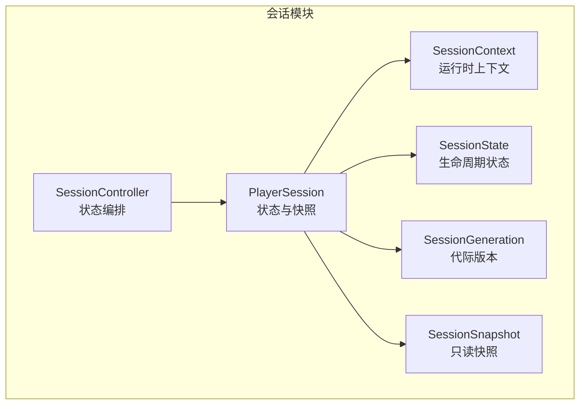
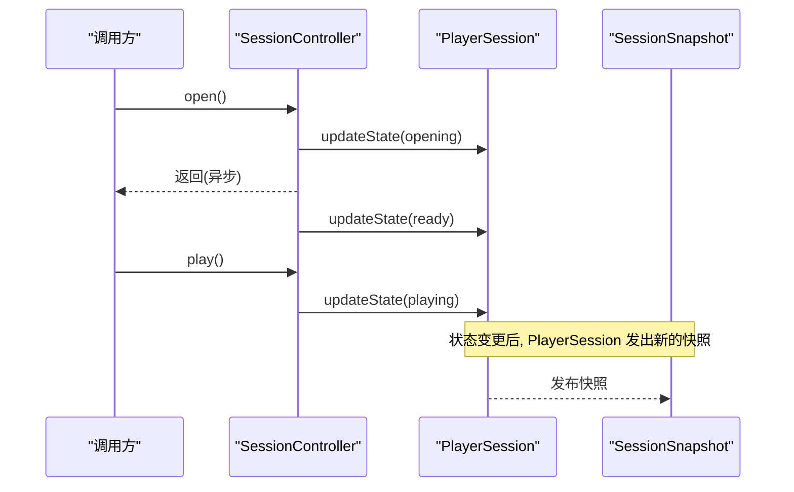
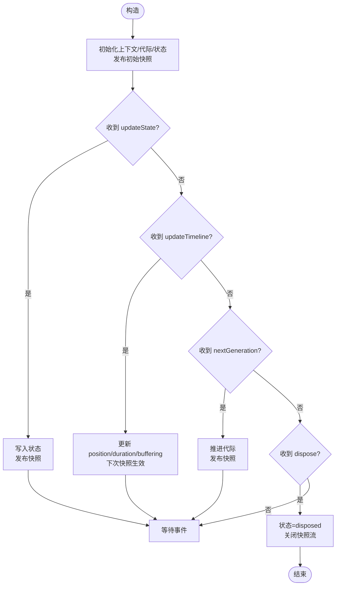
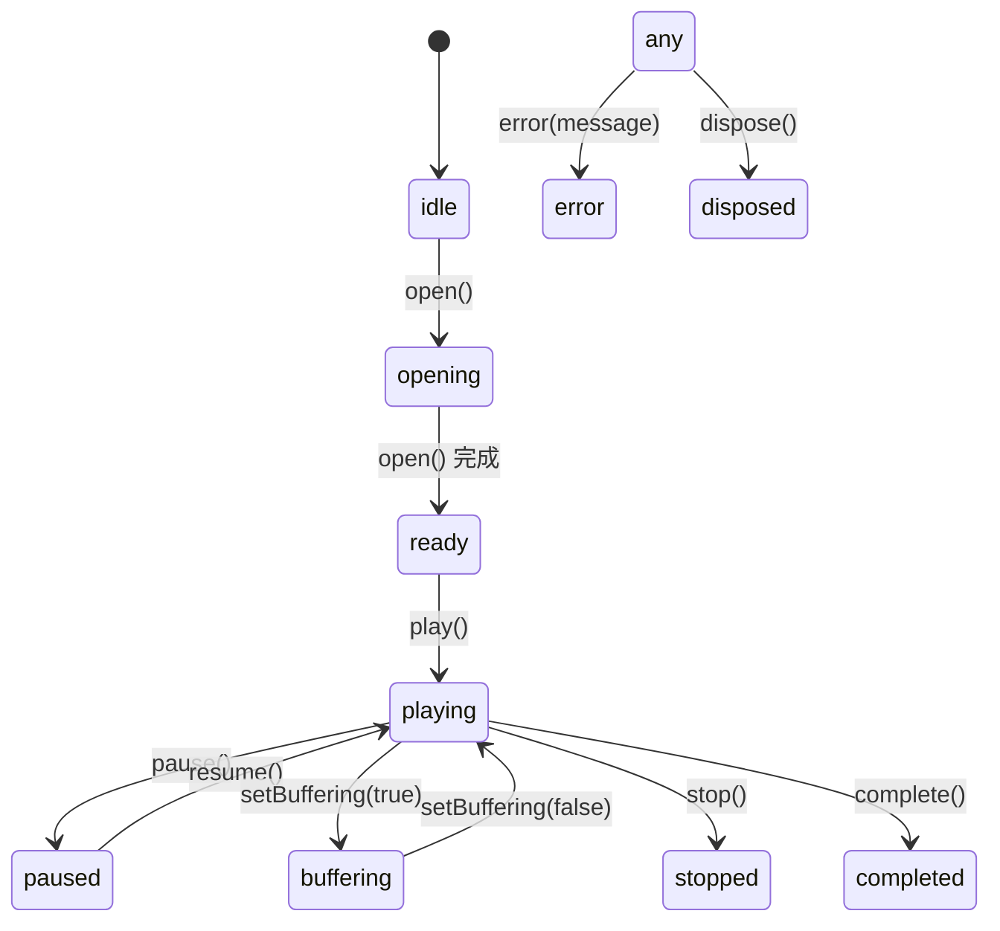
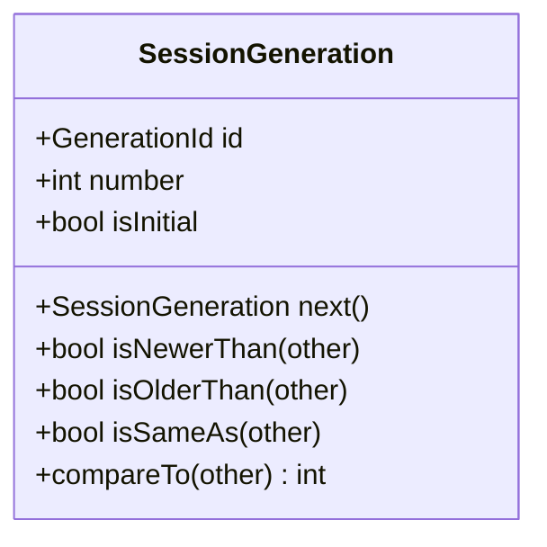
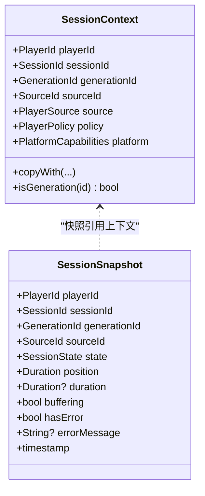
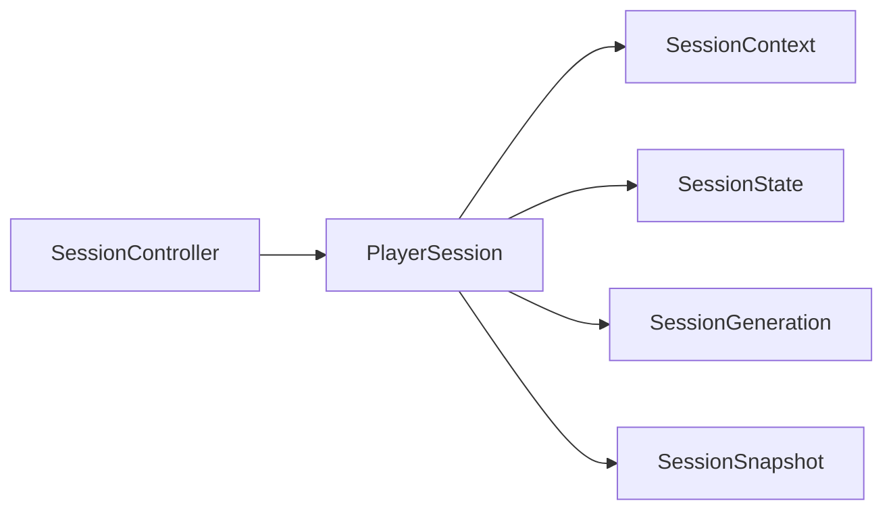

# 会话管理

<cite>
**本文引用的文件**   
- [player_session.dart](file://packages/media_core/lib/session/player_session.dart)
- [session_controller.dart](file://packages/media_core/lib/session/session_controller.dart)
- [session_generation.dart](file://packages/media_core/lib/session/session_generation.dart)
- [session_state.dart](file://packages/media_core/lib/session/session_state.dart)
- [session_context.dart](file://packages/media_core/lib/session/session_context.dart)
- [session_snapshot.dart](file://packages/media_core/lib/session/session_snapshot.dart)
</cite>

## 目录
1. [简介](#简介)
2. [项目结构](#项目结构)
3. [核心组件](#核心组件)
4. [架构总览](#架构总览)
5. [详细组件分析](#详细组件分析)
6. [依赖关系分析](#依赖关系分析)
7. [性能与内存优化](#性能与内存优化)
8. [故障排查指南](#故障排查指南)
9. [结论](#结论)
10. [附录：示例与最佳实践](#附录示例与最佳实践)

## 简介
本文件聚焦 Media Core 的会话管理系统，围绕 PlayerSession 的生命周期、SessionController 的状态同步与一致性、以及 SessionGeneration 的版本控制机制展开。文档以“从概念到实现”的方式，提供状态机图、数据流图和错误处理流程，帮助初学者理解会话概念，同时为高级开发者提供深入实现细节与扩展指南。

## 项目结构
会话相关代码集中在 session 模块中，采用“状态与上下文分离 + 控制器编排”的结构：
- PlayerSession：维护会话状态、代际（generation）与快照流，不直接创建或驱动播放器。
- SessionController：对 PlayerSession 进行生命周期操作编排，负责状态转换、缓冲标记、错误记录与清理。
- SessionContext：不可变的运行时上下文，包含播放器/会话/源标识、策略与平台能力。
- SessionState / SessionStatus：描述会话生命周期的不可变状态与枚举。
- SessionGeneration：单调递增的代际对象，用于并发与重建场景下的过期保护。
- SessionSnapshot：对外暴露的只读视图，聚合上下文、状态、时间线与错误信息。

图表来源
- [session_controller.dart:8-33](file://packages/media_core/lib/session/session_controller.dart#L8-L33)
- [player_session.dart:9-36](file://packages/media_core/lib/session/player_session.dart#L9-L36)
- [session_context.dart:10-47](file://packages/media_core/lib/session/session_context.dart#L10-L47)
- [session_state.dart:3-51](file://packages/media_core/lib/session/session_state.dart#L3-L51)
- [session_generation.dart:4-21](file://packages/media_core/lib/session/session_generation.dart#L4-L21)
- [session_snapshot.dart:1-10](file://packages/media_core/lib/session/session_snapshot.dart#L1-L10)

章节来源
- [player_session.dart:9-36](file://packages/media_core/lib/session/player_session.dart#L9-L36)
- [session_controller.dart:8-33](file://packages/media_core/lib/session/session_controller.dart#L8-L33)
- [session_context.dart:10-47](file://packages/media_core/lib/session/session_context.dart#L10-L47)
- [session_state.dart:3-51](file://packages/media_core/lib/session/session_state.dart#L3-L51)
- [session_generation.dart:4-21](file://packages/media_core/lib/session/session_generation.dart#L4-L21)

## 核心组件
- PlayerSession
  - 职责：维护会话状态、代际变化、上下文替换、播放时间线事实（位置/时长/缓冲）、错误消息、快照发布与销毁。
  - 边界：不负责创建适配器、不执行后端命令；这些由工厂/适配器/播放控制器负责。
- SessionController
  - 职责：会话状态转换、代际管理、生命周期操作（打开/播放/暂停/停止/完成/错误/缓冲）。
  - 边界：不创建播放器实例、不直接访问媒体后端；由工厂/适配器负责。
- SessionContext
  - 职责：提供会话身份、媒体源信息、策略与平台能力；支持 copyWith 生成新上下文。
- SessionState / SessionStatus
  - 职责：定义 idle/opening/ready/playing/paused/buffering/stopped/completed/error/disposed 等状态，并提供 active/playable/loading/hasError 等派生属性。
- SessionGeneration
  - 职责：提供单调递增的代际编号与唯一 ID，支持 isNewerThan/isOlderThan/isSameAs 比较，用于并发与重建后的过期保护。
- SessionSnapshot
  - 职责：聚合 playerId/sessionId/generationId/sourceId/state/timestamp 及 position/duration/buffering/hasError/errorMessage 等只读视图。

章节来源
- [player_session.dart:9-36](file://packages/media_core/lib/session/player_session.dart#L9-L36)
- [session_controller.dart:8-33](file://packages/media_core/lib/session/session_controller.dart#L8-L33)
- [session_context.dart:10-47](file://packages/media_core/lib/session/session_context.dart#L10-L47)
- [session_state.dart:3-51](file://packages/media_core/lib/session/session_state.dart#L3-L51)
- [session_generation.dart:4-21](file://packages/media_core/lib/session/session_generation.dart#L4-L21)

## 架构总览
会话系统通过 SessionController 编排 PlayerSession 的状态流转，PlayerSession 持有 SessionContext、SessionState、SessionGeneration，并持续产出 SessionSnapshot。外部（如播放器适配器、播放控制器）仅通过控制器接口改变状态，避免直接耦合底层实现。

图表来源
- [session_controller.dart:45-56](file://packages/media_core/lib/session/session_controller.dart#L45-L56)
- [session_controller.dart:66-72](file://packages/media_core/lib/session/session_controller.dart#L66-L72)
- [player_session.dart:71-76](file://packages/media_core/lib/session/player_session.dart#L71-L76)
- [player_session.dart:137-167](file://packages/media_core/lib/session/player_session.dart#L137-L167)

## 详细组件分析

### PlayerSession 生命周期与数据流
PlayerSession 是会话状态的载体，内部维护：
- 上下文（SessionContext）
- 代际（SessionGeneration）
- 状态（SessionState）
- 时间线事实（position/duration/buffering）
- 错误消息（errorMessage）
- 快照流（BehaviorSubject<SessionSnapshot>）

关键行为：
- updateState：更新状态并发布快照。
- nextGeneration：推进代际并发布快照。
- updateContext：替换上下文并发布快照。
- updateTimeline：接收来自运行时的时间线事实。
- updateErrorMessage：记录当前错误消息。
- dispose：进入 disposed 状态并关闭快照流。

图表来源
- [player_session.dart:31-36](file://packages/media_core/lib/session/player_session.dart#L31-L36)
- [player_session.dart:71-92](file://packages/media_core/lib/session/player_session.dart#L71-L92)
- [player_session.dart:118-135](file://packages/media_core/lib/session/player_session.dart#L118-L135)
- [player_session.dart:137-167](file://packages/media_core/lib/session/player_session.dart#L137-L167)
- [player_session.dart:169-176](file://packages/media_core/lib/session/player_session.dart#L169-L176)

章节来源
- [player_session.dart:31-36](file://packages/media_core/lib/session/player_session.dart#L31-L36)
- [player_session.dart:71-92](file://packages/media_core/lib/session/player_session.dart#L71-L92)
- [player_session.dart:118-135](file://packages/media_core/lib/session/player_session.dart#L118-L135)
- [player_session.dart:137-167](file://packages/media_core/lib/session/player_session.dart#L137-L167)
- [player_session.dart:169-176](file://packages/media_core/lib/session/player_session.dart#L169-L176)

### SessionController 状态同步与一致性
SessionController 封装了所有可被外部调用的生命周期方法，确保状态转换符合语义约束：
- open：先清除错误，置 opening，再置 ready。
- play：仅在允许进入播放的状态下才切换至 playing。
- pause：仅在 active 状态下暂停。
- setBuffering：true 时若处于 active 且非 disposed，则置 buffering；false 时仅当当前为 buffering 才恢复为 playing。
- complete：置 completed。
- error：记录错误消息并置 error。
- clearError：在打开新源前清理旧错误。
- recreateGeneration：推进代际，供换源/重试/降级使用。
- isCurrentGeneration：校验某 GenerationId 是否仍有效。

图表来源
- [session_controller.dart:45-56](file://packages/media_core/lib/session/session_controller.dart#L45-L56)
- [session_controller.dart:66-103](file://packages/media_core/lib/session/session_controller.dart#L66-L103)
- [session_controller.dart:116-130](file://packages/media_core/lib/session/session_controller.dart#L116-L130)
- [session_controller.dart:132-149](file://packages/media_core/lib/session/session_controller.dart#L132-L149)
- [session_controller.dart:166-169](file://packages/media_core/lib/session/session_controller.dart#L166-L169)
- [session_state.dart:126-156](file://packages/media_core/lib/session/session_state.dart#L126-L156)

章节来源
- [session_controller.dart:45-56](file://packages/media_core/lib/session/session_controller.dart#L45-L56)
- [session_controller.dart:66-103](file://packages/media_core/lib/session/session_controller.dart#L66-L103)
- [session_controller.dart:116-130](file://packages/media_core/lib/session/session_controller.dart#L116-L130)
- [session_controller.dart:132-149](file://packages/media_core/lib/session/session_controller.dart#L132-L149)
- [session_controller.dart:166-169](file://packages/media_core/lib/session/session_controller.dart#L166-L169)
- [session_state.dart:126-156](file://packages/media_core/lib/session/session_state.dart#L126-L156)

### SessionGeneration 并发与冲突处理
SessionGeneration 通过单调递增 number 与唯一 id 保证：
- 换源/重建/重试/降级后，旧代际的任务与回调不会覆盖新代际。
- 通过 isCurrentGeneration 判断某 GenerationId 是否仍为当前代际，从而丢弃过期结果。

图表来源
- [session_generation.dart:14-58](file://packages/media_core/lib/session/session_generation.dart#L14-L58)

章节来源
- [session_generation.dart:14-58](file://packages/media_core/lib/session/session_generation.dart#L14-L58)

### SessionContext 与 SessionSnapshot
- SessionContext 提供不可变的运行时上下文，包括 playerId/sessionId/generationId/sourceId/source/policy/platform，并支持 copyWith 生成新上下文。
- SessionSnapshot 聚合上下文、状态、时间线与错误信息，作为只读视图对外发布。

图表来源
- [session_context.dart:31-106](file://packages/media_core/lib/session/session_context.dart#L31-L106)
- [player_session.dart:137-161](file://packages/media_core/lib/session/player_session.dart#L137-L161)

章节来源
- [session_context.dart:31-106](file://packages/media_core/lib/session/session_context.dart#L31-L106)
- [player_session.dart:137-161](file://packages/media_core/lib/session/player_session.dart#L137-L161)

## 依赖关系分析
- PlayerSession 依赖：
  - SessionContext：提供身份与策略/平台能力。
  - SessionState：描述生命周期状态。
  - SessionGeneration：提供代际版本。
  - SessionSnapshot：对外发布只读视图。
  - rxdart：BehaviorSubject 用于快照流。
- SessionController 依赖：
  - PlayerSession：通过其 API 修改状态与代际。
  - SessionState：用于状态常量与判断。
  - GenerationId：用于代际校验。

图表来源
- [session_controller.dart:1-7](file://packages/media_core/lib/session/session_controller.dart#L1-L7)
- [player_session.dart:1-7](file://packages/media_core/lib/session/player_session.dart#L1-L7)

章节来源
- [session_controller.dart:1-7](file://packages/media_core/lib/session/session_controller.dart#L1-L7)
- [player_session.dart:1-7](file://packages/media_core/lib/session/player_session.dart#L1-L7)

## 性能与内存优化
- 快照流与不可变状态
  - 使用 BehaviorSubject 推送 SessionSnapshot，避免频繁 UI 重建；状态对象不可变，便于比较与缓存。
- 时间线事实与状态解耦
  - position/duration/buffering 作为“事实”单独更新，减少不必要的状态变更与快照开销。
- 代际隔离
  - 通过 SessionGeneration 将不同版本的请求/回调隔离，避免陈旧任务影响最新状态，降低无效计算与竞态风险。
- 缓冲标记的幂等性
  - setBuffering 对 true/false 分别做条件判断，避免误入 buffering 或重复恢复，减少多余状态切换。
- 资源释放
  - dispose 统一进入 disposed 状态并关闭快照流，防止泄漏。

[本节为通用指导，不直接分析具体文件]

## 故障排查指南
- 错误未清理导致健康会话显示失败
  - 现象：新源打开后仍有错误提示。
  - 原因：未在 open 前清理旧错误。
  - 解决：调用 clearError 或在 open 开始时清理。
  - 参考路径：[session_controller.dart:45-56](file://packages/media_core/lib/session/session_controller.dart#L45-L56), [session_controller.dart:143-149](file://packages/media_core/lib/session/session_controller.dart#L143-L149)
- 误入 buffering 状态无法恢复
  - 现象：流恢复后仍停留在 buffering。
  - 原因：盲目转发 ended 事件导致进入 buffering 但未正确恢复。
  - 解决：仅在 active 且非 disposed 时置 buffering；恢复时仅当当前为 buffering 才恢复为 playing。
  - 参考路径：[session_controller.dart:116-130](file://packages/media_core/lib/session/session_controller.dart#L116-L130)
- 过期的代际结果覆盖新会话
  - 现象：换源/重试后旧任务的结果污染了新会话。
  - 原因：未校验 GenerationId。
  - 解决：在回调中使用 isCurrentGeneration 过滤过时结果。
  - 参考路径：[session_controller.dart:156-164](file://packages/media_core/lib/session/session_controller.dart#L156-L164), [player_session.dart:94-97](file://packages/media_core/lib/session/player_session.dart#L94-L97)
- 在 idle/opening/disposed 状态下调用 play 无响应
  - 现象：play 被静默忽略。
  - 原因：状态不允许进入 playing。
  - 解决：确保在 ready/paused/buffering/stopped/completed/error 等允许状态调用 play。
  - 参考路径：[session_controller.dart:83-103](file://packages/media_core/lib/session/session_controller.dart#L83-L103)

章节来源
- [session_controller.dart:45-56](file://packages/media_core/lib/session/session_controller.dart#L45-L56)
- [session_controller.dart:116-130](file://packages/media_core/lib/session/session_controller.dart#L116-L130)
- [session_controller.dart:143-164](file://packages/media_core/lib/session/session_controller.dart#L143-L164)
- [player_session.dart:94-97](file://packages/media_core/lib/session/player_session.dart#L94-L97)

## 结论
Media Core 的会话管理通过 PlayerSession 承载状态与快照，SessionController 编排状态转换，SessionGeneration 提供并发与重建安全。该设计将“状态模型”和“控制逻辑”解耦，既保证了状态机的一致性与可观测性，也为上层提供了清晰的扩展点与排障线索。

[本节为总结性内容，不直接分析具体文件]

## 附录：示例与最佳实践

- 会话创建与配置
  - 步骤：
    1) 准备 SessionContext（包含 playerId/sessionId/generationId/sourceId/source/policy/platform）。
    2) 构造 PlayerSession(context)。
    3) 通过 SessionController(session) 编排 open/play/pause/stop/complete/error。
    4) 订阅 snapshots 流获取 SessionSnapshot。
  - 参考路径：
    - [session_context.dart:31-47](file://packages/media_core/lib/session/session_context.dart#L31-L47)
    - [player_session.dart:31-36](file://packages/media_core/lib/session/player_session.dart#L31-L36)
    - [session_controller.dart:28-33](file://packages/media_core/lib/session/session_controller.dart#L28-L33)

- 生命周期管理
  - 打开：open → opening → ready
  - 播放：play → playing
  - 暂停/恢复：pause → paused；resume（再次 play）→ playing
  - 缓冲：setBuffering(true) → buffering；setBuffering(false) → playing
  - 停止/完成：stop → stopped；complete → completed
  - 错误：error(message) → error
  - 销毁：dispose → disposed
  - 参考路径：
    - [session_controller.dart:45-56](file://packages/media_core/lib/session/session_controller.dart#L45-L56)
    - [session_controller.dart:66-103](file://packages/media_core/lib/session/session_controller.dart#L66-L103)
    - [session_controller.dart:116-130](file://packages/media_core/lib/session/session_controller.dart#L116-L130)
    - [session_controller.dart:132-149](file://packages/media_core/lib/session/session_controller.dart#L132-L149)
    - [session_controller.dart:166-169](file://packages/media_core/lib/session/session_controller.dart#L166-L169)

- 并发与冲突处理
  - 换源/重试/降级时调用 recreateGeneration 推进代际。
  - 在回调中用 isCurrentGeneration 过滤过时结果。
  - 参考路径：
    - [session_controller.dart:156-164](file://packages/media_core/lib/session/session_controller.dart#L156-L164)
    - [player_session.dart:78-85](file://packages/media_core/lib/session/player_session.dart#L78-L85)
    - [player_session.dart:94-97](file://packages/media_core/lib/session/player_session.dart#L94-L97)

- 与播放器的绑定与资源管理
  - PlayerSession 不创建播放器，也不执行后端命令；绑定与资源管理由 PlayerFactory/PlayerAdapter/PlaybackController 负责。
  - 参考路径：
    - [player_session.dart:19-28](file://packages/media_core/lib/session/player_session.dart#L19-L28)
    - [session_controller.dart:19-28](file://packages/media_core/lib/session/session_controller.dart#L19-L28)

- 多线程安全与性能建议
  - 使用不可变状态与快照流，避免跨线程共享可变状态。
  - 通过代际隔离避免陈旧任务竞争。
  - 谨慎使用 setBuffering，确保只在活跃且非 disposed 时进入缓冲，并在恢复时仅从 buffering 回到 playing。
  - 在 dispose 后不再调用任何状态变更方法。
  - 参考路径：
    - [session_state.dart:56-109](file://packages/media_core/lib/session/session_state.dart#L56-L109)
    - [session_controller.dart:116-130](file://packages/media_core/lib/session/session_controller.dart#L116-L130)
    - [player_session.dart:169-176](file://packages/media_core/lib/session/player_session.dart#L169-L176)