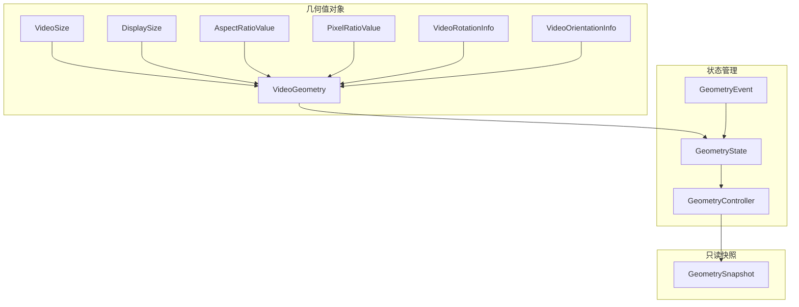
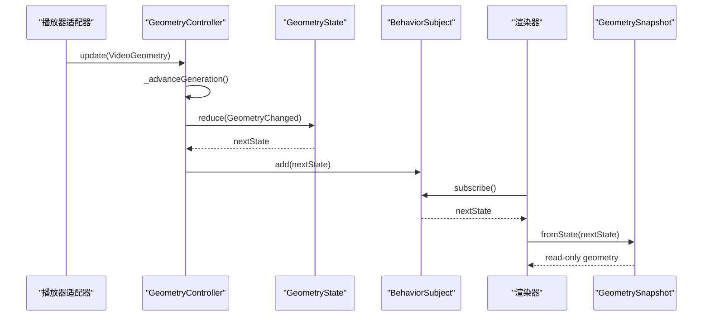
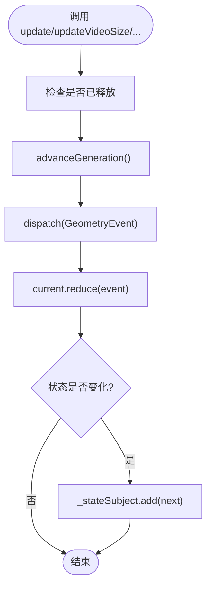
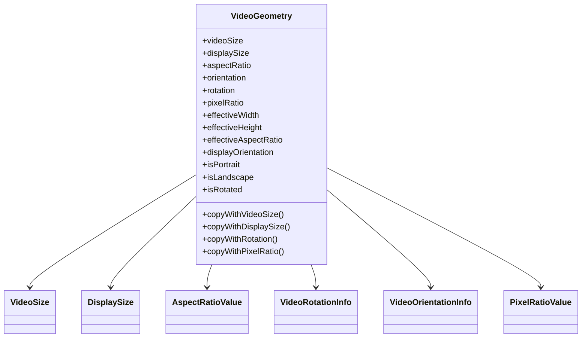
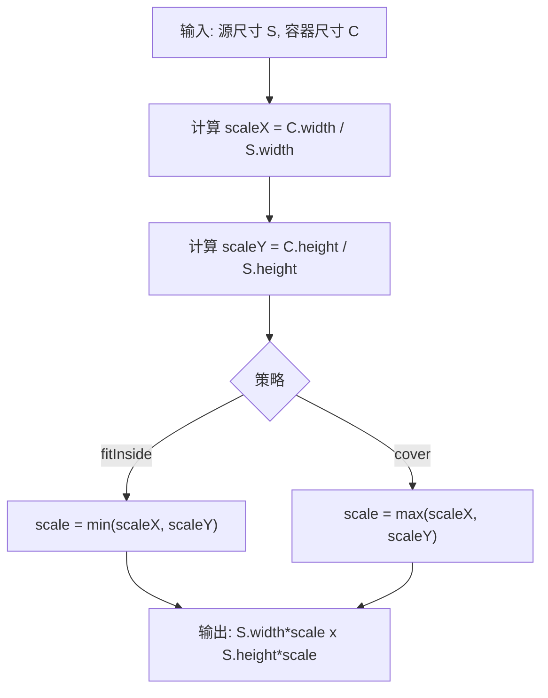
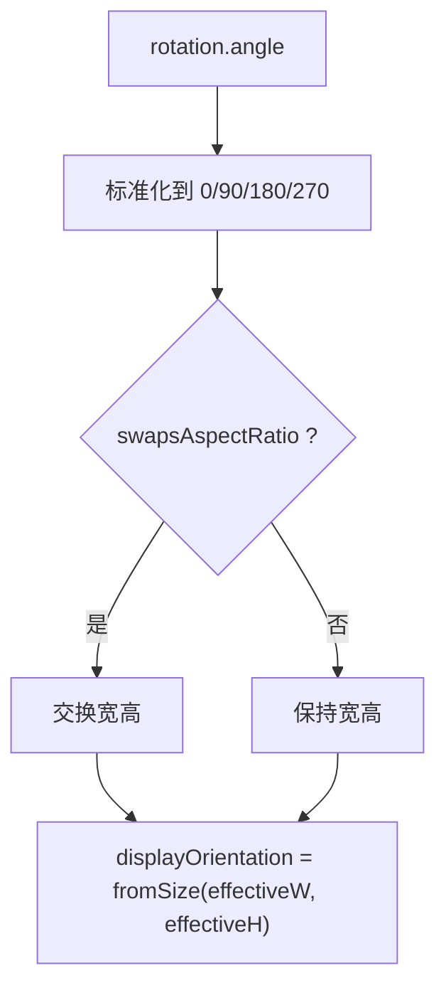
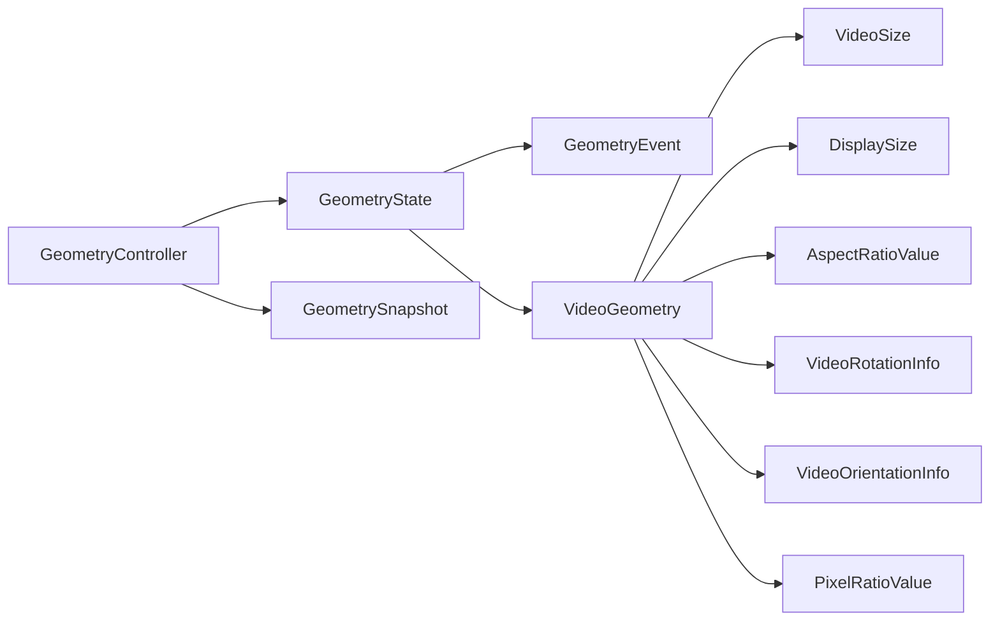

# 几何控制

<cite>
**本文引用的文件**   
- [geometry_controller.dart](file://packages/media_core/lib/geometry/geometry_controller.dart)
- [geometry_state.dart](file://packages/media_core/lib/geometry/geometry_state.dart)
- [geometry_event.dart](file://packages/media_core/lib/geometry/geometry_event.dart)
- [geometry_snapshot.dart](file://packages/media_core/lib/geometry/geometry_snapshot.dart)
- [video_geometry.dart](file://packages/media_core/lib/geometry/video_geometry.dart)
- [video_size.dart](file://packages/media_core/lib/geometry/video_size.dart)
- [display_size.dart](file://packages/media_core/lib/geometry/display_size.dart)
- [aspect_ratio.dart](file://packages/media_core/lib/geometry/aspect_ratio.dart)
- [video_rotation.dart](file://packages/media_core/lib/geometry/video_rotation.dart)
- [video_orientation.dart](file://packages/media_core/lib/geometry/video_orientation.dart)
- [pixel_ratio.dart](file://packages/media_core/lib/geometry/pixel_ratio.dart)
- [geometry.md](file://doc/zh-Hans/geometry.md)
</cite>

## 目录
1. [简介](#简介)
2. [项目结构](#项目结构)
3. [核心组件](#核心组件)
4. [架构总览](#架构总览)
5. [详细组件分析](#详细组件分析)
6. [依赖关系分析](#依赖关系分析)
7. [性能与精度](#性能与精度)
8. [故障排查指南](#故障排查指南)
9. [结论](#结论)
10. [附录：常用几何变换公式与用法示例](#附录常用几何变换公式与用法示例)

## 简介
本章节面向 Media Core 的几何控制系统，重点解释 GeometryController 如何维护视频尺寸、旋转角度与屏幕适配相关的几何状态；说明 GeometrySnapshot 如何封装只读几何快照；并梳理纵横比保持、全屏适配、旋转补偿等数学原理。文档同时给出坐标转换思路、渲染器集成方式以及手势与全屏切换的协同策略，帮助初学者理解概念，也为高级开发者提供可落地的算法与扩展点。

## 项目结构
几何子系统位于 media_core 包的 geometry 目录下，采用“值对象 + 控制器 + 不可变状态”的分层设计：
- 值对象层：VideoSize、DisplaySize、AspectRatioValue、PixelRatioValue、VideoRotationInfo、VideoOrientationInfo、VideoGeometry
- 状态管理层：GeometryState、GeometryEvent、GeometryController
- 只读快照层：GeometrySnapshot
- 文档层：geometry.md

图表来源
- [video_geometry.dart:33-115](file://packages/media_core/lib/geometry/video_geometry.dart#L33-L115)
- [geometry_state.dart:20-122](file://packages/media_core/lib/geometry/geometry_state.dart#L20-L122)
- [geometry_controller.dart:28-149](file://packages/media_core/lib/geometry/geometry_controller.dart#L28-L149)
- [geometry_snapshot.dart:26-58](file://packages/media_core/lib/geometry/geometry_snapshot.dart#L26-L58)

章节来源
- [geometry.md:1-31](file://doc/zh-Hans/geometry.md#L1-L31)

## 核心组件
- VideoSize：表示解码后的源视频像素尺寸，提供宽高比、缩放、fitWidth/fitHeight、transpose 等纯计算能力。
- DisplaySize：表示渲染输出表面尺寸，提供 fitInside/cover 等布局相关但无平台调用的计算。
- AspectRatioValue：归一化宽高比值，支持 clamp、inverted、widthForHeight/heightForWidth 等安全计算。
- PixelRatioValue：逻辑像素与物理像素换算，支持 toPhysical/toLogical/scale。
- VideoRotationInfo：标准化 0/90/180/270 旋转角，提供 swapsAspectRatio、inverse、add 等。
- VideoOrientationInfo：逻辑方向（横/竖/方）+ 旋转 + 镜像标记，支持 effectiveOrientation、rotate、mirror。
- VideoGeometry：聚合上述值，计算显示后有效宽高、有效宽高比、显示方向等，并提供 copyWith* 派生新几何。
- GeometryState：带 generation 的生命周期状态，reduce 事件更新或清空几何。
- GeometryEvent：changed/reset 两类事件，携带 generation 用于丢弃过期异步更新。
- GeometryController：维护 BehaviorSubject<GeometryState>，对外暴露 update/updateVideoSize/updateDisplaySize/updateRotation/clear/restore/nextGeneration 等 API。
- GeometrySnapshot：从 GeometryState 构造的只读视图，供 UI、渲染器、诊断使用。

章节来源
- [video_size.dart:20-165](file://packages/media_core/lib/geometry/video_size.dart#L20-L165)
- [display_size.dart:20-154](file://packages/media_core/lib/geometry/display_size.dart#L20-L154)
- [aspect_ratio.dart:21-177](file://packages/media_core/lib/geometry/aspect_ratio.dart#L21-L177)
- [pixel_ratio.dart:20-121](file://packages/media_core/lib/geometry/pixel_ratio.dart#L20-L121)
- [video_rotation.dart:14-144](file://packages/media_core/lib/geometry/video_rotation.dart#L14-L144)
- [video_orientation.dart:12-189](file://packages/media_core/lib/geometry/video_orientation.dart#L12-L189)
- [video_geometry.dart:33-267](file://packages/media_core/lib/geometry/video_geometry.dart#L33-L267)
- [geometry_state.dart:20-135](file://packages/media_core/lib/geometry/geometry_state.dart#L20-L135)
- [geometry_event.dart:1-27](file://packages/media_core/lib/geometry/geometry_event.dart#L1-L27)
- [geometry_controller.dart:28-181](file://packages/media_core/lib/geometry/geometry_controller.dart#L28-L181)
- [geometry_snapshot.dart:26-161](file://packages/media_core/lib/geometry/geometry_snapshot.dart#L26-L161)

## 架构总览
GeometryController 是几何生命周期入口，负责接收播放器适配器、渲染后端或元数据解析器传来的几何变更，通过 GeometryState.reduce 将事件规约为新的不可变状态，并以 BehaviorSubject 广播。GeometrySnapshot 作为只读快照被 UI 和渲染器消费，避免直接修改状态。

图表来源
- [geometry_controller.dart:67-119](file://packages/media_core/lib/geometry/geometry_controller.dart#L67-L119)
- [geometry_state.dart:106-122](file://packages/media_core/lib/geometry/geometry_state.dart#L106-L122)
- [geometry_snapshot.dart:50-58](file://packages/media_core/lib/geometry/geometry_snapshot.dart#L50-L58)

## 详细组件分析

### GeometryController：几何生命周期与过期防护
职责
- 拥有几何状态，接收几何事件，减少状态变化，提供不可变快照，保护异步过期更新。
- 不执行布局、不调整 widget、不控制渲染器、不调用平台 API。

关键流程
- update/updateVideoSize/updateDisplaySize/updateRotation：先确保未释放，再推进 generation，然后 dispatch 对应事件。
- clear：推进 generation 并发布 reset 事件。
- dispatch：调用 current.reduce(event)，若状态变化则写入流。
- restore：恢复外部状态，仅当 state.generation >= _generation 时生效。
- nextGeneration：在不改变几何的前提下发布新 generation，使后续回调能感知“代际”。

过期防护机制
- 内部维护 _generation，并与当前状态的 generation 取较大者后再加一，保证严格递增。
- GeometryState.reduce 对 event.generation < generation 的事件直接丢弃，避免旧异步结果覆盖新状态。

图表来源
- [geometry_controller.dart:67-119](file://packages/media_core/lib/geometry/geometry_controller.dart#L67-L119)
- [geometry_controller.dart:156-162](file://packages/media_core/lib/geometry/geometry_controller.dart#L156-L162)
- [geometry_state.dart:106-122](file://packages/media_core/lib/geometry/geometry_state.dart#L106-L122)

章节来源
- [geometry_controller.dart:28-181](file://packages/media_core/lib/geometry/geometry_controller.dart#L28-L181)
- [geometry_state.dart:20-135](file://packages/media_core/lib/geometry/geometry_state.dart#L20-L135)

### VideoGeometry：旋转后的有效几何与显示方向
核心要点
- derived 静态方法根据 videoSize、displaySize、rotation、pixelRatio 构建几何，其中 aspectRatio 与 orientation 基于“显示后”的有效尺寸计算，避免原始网格与旋转信息冲突。
- effectiveWidth/effectiveHeight：当 rotation.swapsAspectRatio 为真时交换宽高。
- displayOrientation：基于 effective 尺寸推导显示方向，保证与渲染器布局一致。
- canRender：需要 hasVideo && hasDisplay && aspectRatio.isValid。

图表来源
- [video_geometry.dart:33-115](file://packages/media_core/lib/geometry/video_geometry.dart#L33-L115)
- [video_geometry.dart:132-193](file://packages/media_core/lib/geometry/video_geometry.dart#L132-L193)

章节来源
- [video_geometry.dart:33-267](file://packages/media_core/lib/geometry/video_geometry.dart#L33-L267)

### VideoSize / DisplaySize：纵横比保持与容器适配
- VideoSize.fitWidth/fitHeight：按目标边长反算另一边，保持纵横比。
- VideoSize.transpose：用于 90°/270° 旋转时的宽高互换。
- DisplaySize.fitInside：以较小缩放因子放入容器，留黑边。
- DisplaySize.cover：以较大缩放因子填充容器，可能裁剪。

图表来源
- [display_size.dart:103-135](file://packages/media_core/lib/geometry/display_size.dart#L103-L135)
- [video_size.dart:117-151](file://packages/media_core/lib/geometry/video_size.dart#L117-L151)

章节来源
- [video_size.dart:20-165](file://packages/media_core/lib/geometry/video_size.dart#L20-L165)
- [display_size.dart:20-154](file://packages/media_core/lib/geometry/display_size.dart#L20-L154)

### VideoRotationInfo / VideoOrientationInfo：旋转与方向语义
- VideoRotationInfo.angle 始终标准化到 0/90/180/270；swapsAspectRatio 在 90/270 时为真。
- VideoOrientationInfo.effectiveOrientation：考虑旋转后的逻辑方向；rotate/mirror 提供组合操作。
- VideoGeometry.displayOrientation 基于 effective 尺寸推导，确保与渲染布局一致。

图表来源
- [video_rotation.dart:102-134](file://packages/media_core/lib/geometry/video_rotation.dart#L102-L134)
- [video_orientation.dart:137-152](file://packages/media_core/lib/geometry/video_orientation.dart#L137-L152)
- [video_geometry.dart:132-168](file://packages/media_core/lib/geometry/video_geometry.dart#L132-L168)

章节来源
- [video_rotation.dart:14-144](file://packages/media_core/lib/geometry/video_rotation.dart#L14-L144)
- [video_orientation.dart:12-189](file://packages/media_core/lib/geometry/video_orientation.dart#L12-L189)
- [video_geometry.dart:132-168](file://packages/media_core/lib/geometry/video_geometry.dart#L132-L168)

### GeometrySnapshot：只读几何快照
用途
- 提供给 UI、渲染器、PlayerIdentity 快照与诊断，不触发重算，不修改几何。
- 暴露 hasVideo/hasDisplay/canRender、videoSize/displaySize、aspectRatio/orientation/rotation/pixelRatio 等便捷属性。
- differsFrom 比较 geometry 与 generation，便于增量刷新。

章节来源
- [geometry_snapshot.dart:26-161](file://packages/media_core/lib/geometry/geometry_snapshot.dart#L26-L161)

## 依赖关系分析
- GeometryController 依赖 GeometryState、GeometryEvent、VideoGeometry、VideoRotationInfo、VideoSize、DisplaySize。
- GeometryState 依赖 GeometryEvent、VideoGeometry、VideoOrientationInfo。
- VideoGeometry 聚合所有几何值对象，是渲染器与上层逻辑的统一视图。
- GeometrySnapshot 依赖 GeometryState 与 VideoGeometry，作为只读桥接层。

图表来源
- [geometry_controller.dart:1-10](file://packages/media_core/lib/geometry/geometry_controller.dart#L1-L10)
- [geometry_state.dart:1-6](file://packages/media_core/lib/geometry/geometry_state.dart#L1-L6)
- [video_geometry.dart:1-8](file://packages/media_core/lib/geometry/video_geometry.dart#L1-L8)
- [geometry_snapshot.dart:1-8](file://packages/media_core/lib/geometry/geometry_snapshot.dart#L1-L8)

章节来源
- [geometry_controller.dart:1-181](file://packages/media_core/lib/geometry/geometry_controller.dart#L1-L181)
- [geometry_state.dart:1-135](file://packages/media_core/lib/geometry/geometry_state.dart#L1-L135)
- [video_geometry.dart:1-267](file://packages/media_core/lib/geometry/video_geometry.dart#L1-L267)
- [geometry_snapshot.dart:1-161](file://packages/media_core/lib/geometry/geometry_snapshot.dart#L1-L161)

## 性能与精度
- 不可变值对象：VideoSize/DisplaySize/AspectRatioValue/PixelRatioValue/VideoRotationInfo/VideoOrientationInfo/VideoGeometry 均为不可变对象，避免共享状态导致的竞态与重复计算。
- 生成代计数：GeometryController 与 GeometryState 使用 generation 严格递增，配合 reduce 丢弃过期事件，降低无效重绘与重算。
- 数值边界保护：
  - AspectRatioValue.clamp 限制异常宽高比，防止 UI 布局崩溃。
  - PixelRatioValue.fromDevicePixelRatio 对非正或非有限值回退默认值。
  - VideoRotationInfo._normalize 将任意角度归一化为 0/90/180/270，兼容非标准容器报告。
- 计算复杂度：
  - 几何派生（derived、effectiveWidth/Height、aspectRatio）均为 O(1)。
  - fitInside/cover 缩放计算为 O(1)。
- 渲染器集成建议：
  - 订阅 GeometryController.state 或消费 GeometrySnapshot，仅在 canRender 为真时进行绘制。
  - 使用 DisplaySize.fitInside/cover 计算最终显示尺寸，结合 PixelRatioValue.toPhysical 转换为物理像素。

[本节为通用指导，不直接分析具体文件]

## 故障排查指南
常见问题与定位思路
- 画面拉伸或裁切异常
  - 检查 VideoGeometry.aspectRatio 是否有效，必要时使用 AspectRatioValue.clamp 限制范围。
  - 确认 DisplaySize.fitInside/cover 选择是否符合业务需求。
- 旋转导致方向错误
  - 检查 VideoRotationInfo.angle 是否被正确标准化；确认 rotation.swapsAspectRatio 是否与预期一致。
  - 使用 VideoGeometry.displayOrientation 而非存储的 orientation 判断显示方向。
- 异步更新覆盖旧状态
  - 确认 GeometryController.nextGeneration 与回调中的 generation 匹配；过期的 GeometryEvent 会被 GeometryState.reduce 丢弃。
- 高 DPI 下模糊或错位
  - 使用 PixelRatioValue.toPhysical/toLogical 进行逻辑/物理像素换算，确保渲染目标尺寸与设备像素密度匹配。

章节来源
- [geometry_controller.dart:111-149](file://packages/media_core/lib/geometry/geometry_controller.dart#L111-L149)
- [geometry_state.dart:106-122](file://packages/media_core/lib/geometry/geometry_state.dart#L106-L122)
- [video_geometry.dart:117-193](file://packages/media_core/lib/geometry/video_geometry.dart#L117-L193)
- [aspect_ratio.dart:129-157](file://packages/media_core/lib/geometry/aspect_ratio.dart#L129-L157)
- [pixel_ratio.dart:33-76](file://packages/media_core/lib/geometry/pixel_ratio.dart#L33-L76)
- [video_rotation.dart:102-134](file://packages/media_core/lib/geometry/video_rotation.dart#L102-L134)

## 结论
Media Core 的几何控制系统以不可变值对象为基础，通过 GeometryController 统一维护几何生命周期，借助 generation 机制抵御异步过时更新；VideoGeometry 将源尺寸、显示尺寸、纵横比、旋转与方向聚合为一致的显示视图，确保渲染器获得稳定且自洽的几何信息。该设计既满足初学者的直观理解，也提供了足够的扩展空间与数学严谨性，便于实现自定义几何逻辑与跨平台适配。

[本节为总结性内容，不直接分析具体文件]

## 附录：常用几何变换公式与用法示例

- 纵横比保持
  - 已知宽度求高度：height = width / aspectRatio
  - 已知高度求宽度：width = height * aspectRatio
  - 参考路径
    - [video_size.dart:117-141](file://packages/media_core/lib/geometry/video_size.dart#L117-L141)
    - [aspect_ratio.dart:141-157](file://packages/media_core/lib/geometry/aspect_ratio.dart#L141-L157)

- 容器适配
  - fitInside：scale = min(container.width / source.width, container.height / source.height)
  - cover：scale = max(container.width / source.width, container.height / source.height)
  - 参考路径
    - [display_size.dart:103-135](file://packages/media_core/lib/geometry/display_size.dart#L103-L135)

- 旋转补偿
  - 当 rotation.swapsAspectRatio 为真时，effectiveWidth = originalHeight，effectiveHeight = originalWidth
  - displayOrientation 由 effective 尺寸推导
  - 参考路径
    - [video_geometry.dart:81-115](file://packages/media_core/lib/geometry/video_geometry.dart#L81-L115)
    - [video_geometry.dart:132-168](file://packages/media_core/lib/geometry/video_geometry.dart#L132-L168)
    - [video_rotation.dart:66-86](file://packages/media_core/lib/geometry/video_rotation.dart#L66-L86)

- 像素密度换算
  - 物理像素 = 逻辑像素 × pixelRatio
  - 逻辑像素 = 物理像素 / pixelRatio
  - 参考路径
    - [pixel_ratio.dart:60-76](file://packages/media_core/lib/geometry/pixel_ratio.dart#L60-L76)

- 设置视频比例
  - 使用 VideoSize.fitWidth/fitHeight 或 AspectRatioValue.widthForHeight/heightForWidth 计算目标尺寸
  - 通过 GeometryController.updateVideoSize 推送新几何
  - 参考路径
    - [video_size.dart:117-141](file://packages/media_core/lib/geometry/video_size.dart#L117-L141)
    - [geometry_controller.dart:75-82](file://packages/media_core/lib/geometry/geometry_controller.dart#L75-L82)

- 处理旋转事件
  - 收到旋转元数据后，调用 GeometryController.updateRotation
  - 读取 VideoGeometry.displayOrientation 与 effectiveAspectRatio 进行布局
  - 参考路径
    - [geometry_controller.dart:93-100](file://packages/media_core/lib/geometry/geometry_controller.dart#L93-L100)
    - [video_geometry.dart:132-168](file://packages/media_core/lib/geometry/video_geometry.dart#L132-L168)

- 自适应布局
  - 使用 DisplaySize.fitInside/cover 计算显示区域
  - 结合 PixelRatioValue.toPhysical 转换为物理像素
  - 参考路径
    - [display_size.dart:103-135](file://packages/media_core/lib/geometry/display_size.dart#L103-L135)
    - [pixel_ratio.dart:60-76](file://packages/media_core/lib/geometry/pixel_ratio.dart#L60-L76)

- 与渲染器的集成
  - 渲染器订阅 GeometryController.state 或消费 GeometrySnapshot
  - 仅在 snapshot.canRender 为真时绘制
  - 参考路径
    - [geometry_controller.dart:42-55](file://packages/media_core/lib/geometry/geometry_controller.dart#L42-L55)
    - [geometry_snapshot.dart:72-85](file://packages/media_core/lib/geometry/geometry_snapshot.dart#L72-L85)

- 与系统手势、全屏切换的协同
  - 手势或全屏切换通常改变 DisplaySize 或触发 Presentation 层的全屏策略
  - 几何层通过 updateDisplaySize 更新显示尺寸，渲染层依据新的几何重新计算布局
  - 参考路径
    - [geometry_controller.dart:84-91](file://packages/media_core/lib/geometry/geometry_controller.dart#L84-L91)