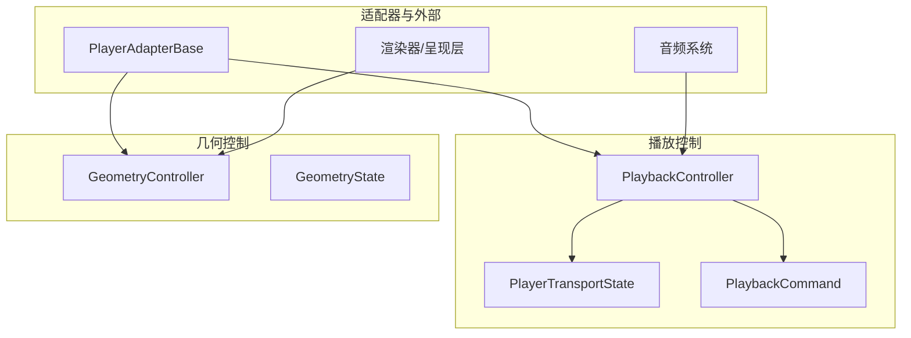
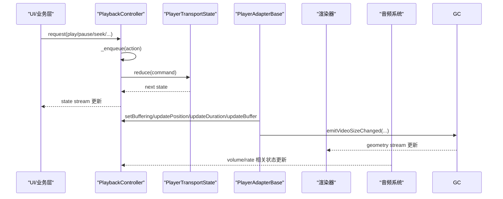
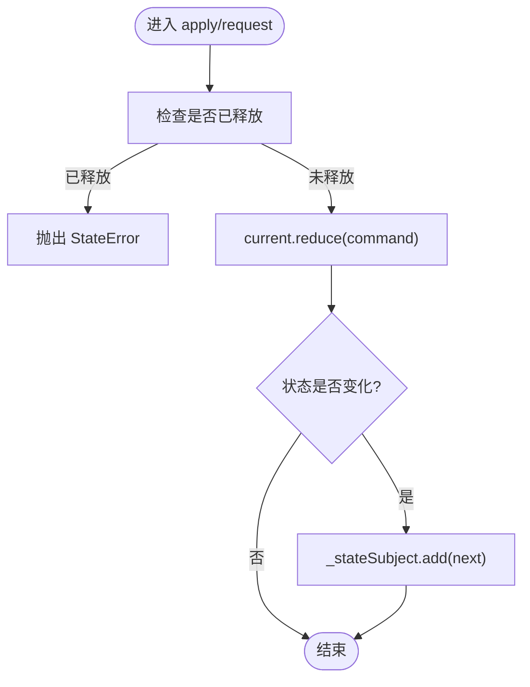
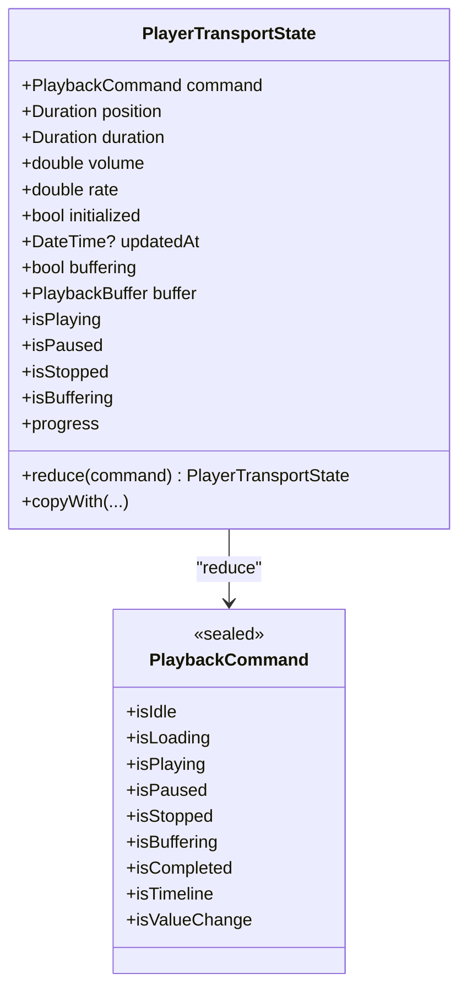
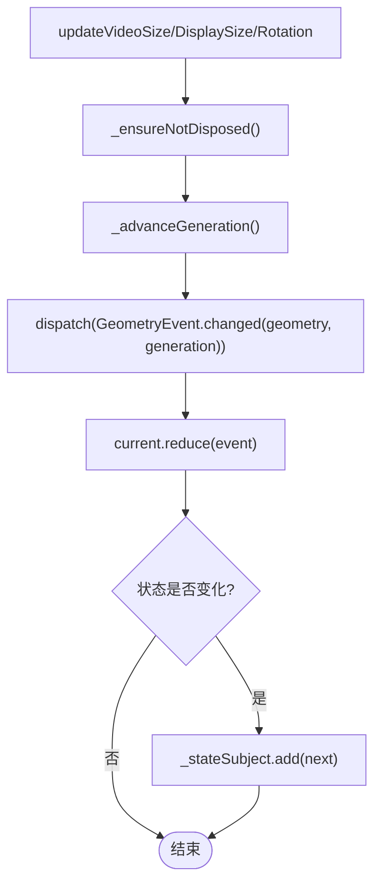
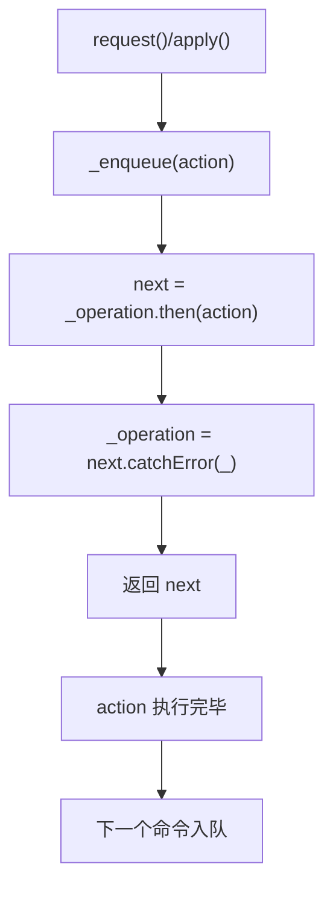
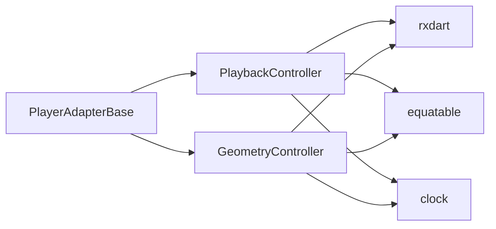

# 播放控制

<cite>
**本文引用的文件**   
- [packages/media_core/lib/playback/playback_controller.dart](file://packages/media_core/lib/playback/playback_controller.dart)
- [packages/media_core/lib/playback/player_transport_state.dart](file://packages/media_core/lib/playback/player_transport_state.dart)
- [packages/media_core/lib/playback/playback_command.dart](file://packages/media_core/lib/playback/playback_command.dart)
- [packages/media_core/lib/geometry/geometry_controller.dart](file://packages/media_core/lib/geometry/geometry_controller.dart)
- [doc/zh-Hans/playback.md](file://doc/zh-Hans/playback.md)
- [doc/zh-Hans/geometry.md](file://doc/zh-Hans/geometry.md)
- [packages/media_core/adapter/player_adapter_base.dart](file://packages/media_core/adapter/player_adapter_base.dart)
</cite>

## 目录
1. [简介](#简介)
2. [项目结构](#项目结构)
3. [核心组件](#核心组件)
4. [架构总览](#架构总览)
5. [详细组件分析](#详细组件分析)
6. [依赖关系分析](#依赖关系分析)
7. [性能与卡顿检测](#性能与卡顿检测)
8. [故障排查指南](#故障排查指南)
9. [结论](#结论)
10. [附录：使用示例路径](#附录使用示例路径)

## 简介
本文件聚焦 Media Core 的播放控制系统，重点解释 PlaybackController 如何实现播放状态的精确控制和命令串行化机制，并说明 GeometryController 如何处理视频尺寸、旋转角度与屏幕适配。文档包含状态转换图、命令队列流程图和几何变换算法说明，同时给出播放控制、状态监听与几何调整的使用方式，以及播放控制与渲染器、音频系统的集成关系。内容兼顾初学者理解与高级开发者深入实现需求。

## 项目结构
Media Core 将“播放控制”和“几何控制”解耦为两个自包含模块：
- playback 模块：以 sealed 命令表达播放状态变更；PlaybackController 通过 BehaviorSubject 持有并暴露状态，所有操作经内部 Future 队列串行化；不解码媒体、不控制后端、不调用平台 API。
- geometry 模块：纯描述层，建模视频几何信息；GeometryController 以响应式流维护几何状态，并用 generation 计数丢弃过期的异步更新；不做布局、不调整 widget、不调用平台 API。



**图示来源**
- [packages/media_core/lib/playback/playback_controller.dart:10-26](file://packages/media_core/lib/playback/playback_controller.dart#L10-L26)
- [packages/media_core/lib/geometry/geometry_controller.dart:12-28](file://packages/media_core/lib/geometry/geometry_controller.dart#L12-L28)
- [packages/media_core/adapter/player_adapter_base.dart:671-707](file://packages/media_core/adapter/player_adapter_base.dart#L671-L707)

**章节来源**
- [doc/zh-Hans/playback.md:1-29](file://doc/zh-Hans/playback.md#L1-L29)
- [doc/zh-Hans/geometry.md:1-31](file://doc/zh-Hans/geometry.md#L1-L31)

## 核心组件
- PlaybackController：拥有播放状态、接收播放命令、更新播放状态、暴露快照、串行化播放操作。对外提供 state/current/snapshot、play/pause/stop/seek/setBuffering/updatePosition/updateDuration/updateBuffer 等方法。
- PlayerTransportState：当前播放运行时状态，包含 command、position、duration、volume、rate、initialized、updatedAt、buffering、buffer；提供 reduce(PlaybackCommand) 进行不可变状态更新。
- PlaybackCommand：sealed 命令集合，包括 idle/play/pause/stop/buffering/position/duration/seek/volume/rate/buffered 等，附带状态判定（isPlaying/isPaused/isStopped/isBuffering 等）。
- GeometryController：拥有几何状态、接收几何事件、减少状态变化、提供不可变快照、保护过期异步更新；支持 updateVideoSize/updateDisplaySize/updateRotation/clear/restore/nextGeneration。
- GeometryState/GeometryEvent/GeometrySnapshot/GeometrySession：不可变状态（含 reduce）、sealed 事件、只读快照、带 generation 校验的生命周期会话。

**章节来源**
- [packages/media_core/lib/playback/playback_controller.dart:10-26](file://packages/media_core/lib/playback/playback_controller.dart#L10-L26)
- [packages/media_core/lib/playback/player_transport_state.dart:6-23](file://packages/media_core/lib/playback/player_transport_state.dart#L6-L23)
- [packages/media_core/lib/playback/playback_command.dart:4-17](file://packages/media_core/lib/playback/playback_command.dart#L4-L17)
- [packages/media_core/lib/geometry/geometry_controller.dart:12-28](file://packages/media_core/lib/geometry/geometry_controller.dart#L12-L28)

## 架构总览
播放控制与几何控制均遵循“控制器 + 不可变状态 + 命令/事件 + 响应式流”的模式：
- 控制器持有 BehaviorSubject，对外暴露 stream/value/snapshot。
- 外部通过命令或事件驱动状态变更，控制器在 reduce 后发布新状态。
- 播放器适配器负责桥接底层引擎事件到上层控制器（如缓冲区间、视频尺寸变化）。



**图示来源**
- [packages/media_core/lib/playback/playback_controller.dart:54-117](file://packages/media_core/lib/playback/playback_controller.dart#L54-L117)
- [packages/media_core/lib/playback/player_transport_state.dart:147-195](file://packages/media_core/lib/playback/player_transport_state.dart#L147-L195)
- [packages/media_core/adapter/player_adapter_base.dart:671-707](file://packages/media_core/adapter/player_adapter_base.dart#L671-L707)

## 详细组件分析

### PlaybackController：播放状态精确控制与命令串行化
- 状态持有与暴露：通过 BehaviorSubject<PlayerTransportState> 管理状态流，提供 state/current/snapshot。
- 命令应用：apply(PlaybackCommand) 调用 current.reduce(command)，若状态变化则发布新状态。
- 请求封装：request(PlaybackRequest) 包装命令并通过 _enqueue 串行执行。
- 常用便捷方法：play/pause/stop/seek/setBuffering/updatePosition/updateDuration/updateBuffer。
- 串行化机制：_operation 链式 Future 队列保证命令顺序执行，错误被吞掉避免中断后续任务；dispose 等待队列完成再关闭流。



**图示来源**
- [packages/media_core/lib/playback/playback_controller.dart:54-72](file://packages/media_core/lib/playback/playback_controller.dart#L54-L72)
- [packages/media_core/lib/playback/playback_controller.dart:119-125](file://packages/media_core/lib/playback/playback_controller.dart#L119-L125)
- [packages/media_core/lib/playback/playback_controller.dart:127-131](file://packages/media_core/lib/playback/playback_controller.dart#L127-L131)

**章节来源**
- [packages/media_core/lib/playback/playback_controller.dart:10-26](file://packages/media_core/lib/playback/playback_controller.dart#L10-L26)
- [packages/media_core/lib/playback/playback_controller.dart:54-117](file://packages/media_core/lib/playback/playback_controller.dart#L54-L117)
- [packages/media_core/lib/playback/playback_controller.dart:119-145](file://packages/media_core/lib/playback/playback_controller.dart#L119-L145)

### PlayerTransportState：状态机与不可变更新
- 字段语义：command 表示意图（play/pause/stop/idle/loading），buffering 表示条件（正在缺数据），二者分离避免状态歧义。
- reduce 规则：
  - play：设置 command=play，initialized=true，更新时间戳。
  - pause：设置 command=pause，更新时间戳。
  - stop：设置 command=stop，position=0，更新时间戳。
  - buffering：仅更新 buffering 标志，不改变 transport command。
  - seek：更新 position。
  - position/duration：分别更新对应时间字段。
  - buffered：对 ranges 做 normalize，得到规范化的缓冲区间。
  - volume/rate：更新音量/倍速。
  - idle：回到空闲态。
- 派生属性：isPlaying/isPaused/isStopped/isBuffering/hasDuration/hasPosition/progress。



**图示来源**
- [packages/media_core/lib/playback/player_transport_state.dart:23-86](file://packages/media_core/lib/playback/player_transport_state.dart#L23-L86)
- [packages/media_core/lib/playback/player_transport_state.dart:147-195](file://packages/media_core/lib/playback/player_transport_state.dart#L147-L195)
- [packages/media_core/lib/playback/playback_command.dart:4-86](file://packages/media_core/lib/playback/playback_command.dart#L4-L86)

**章节来源**
- [packages/media_core/lib/playback/player_transport_state.dart:6-23](file://packages/media_core/lib/playback/player_transport_state.dart#L6-L23)
- [packages/media_core/lib/playback/player_transport_state.dart:147-195](file://packages/media_core/lib/playback/player_transport_state.dart#L147-L195)
- [packages/media_core/lib/playback/playback_command.dart:4-86](file://packages/media_core/lib/playback/playback_command.dart#L4-L86)

### GeometryController：视频尺寸、旋转与屏幕适配
- 职责边界：纯描述层，不做布局、不调整 widget、不调用平台 API。
- 状态管理：BehaviorSubject<GeometryState> 维护几何状态；update/updateVideoSize/updateDisplaySize/updateRotation/clear 触发 reduce 并发布新状态。
- 过期防护：generation 计数器确保异步更新不会覆盖更晚的状态；restore 与 nextGeneration 用于跨生命周期恢复与生成新代次。
- 与适配器协作：PlayerAdapterBase.emitVideoSizeChanged 将底层引擎的视频尺寸信号转换为几何事件，能力开关由 supportsVideoSizeChanged 控制。



**图示来源**
- [packages/media_core/lib/geometry/geometry_controller.dart:67-120](file://packages/media_core/lib/geometry/geometry_controller.dart#L67-L120)
- [packages/media_core/lib/geometry/geometry_controller.dart:151-162](file://packages/media_core/lib/geometry/geometry_controller.dart#L151-L162)
- [packages/media_core/adapter/player_adapter_base.dart:671-707](file://packages/media_core/adapter/player_adapter_base.dart#L671-L707)

**章节来源**
- [packages/media_core/lib/geometry/geometry_controller.dart:12-28](file://packages/media_core/lib/geometry/geometry_controller.dart#L12-L28)
- [packages/media_core/lib/geometry/geometry_controller.dart:60-120](file://packages/media_core/lib/geometry/geometry_controller.dart#L60-L120)
- [packages/media_core/lib/geometry/geometry_controller.dart:122-162](file://packages/media_core/lib/geometry/geometry_controller.dart#L122-L162)
- [packages/media_core/adapter/player_adapter_base.dart:671-707](file://packages/media_core/adapter/player_adapter_base.dart#L671-L707)

### 播放状态机转换图
基于 PlayerTransportState.reduce 的规则，可抽象出以下状态转换（transport command）：
- idle → loading（预留）→ play → pause → stop → idle
- play/pause 过程中可出现 buffering 条件（不影响 transport command）
- seek 会重置 position，但不改变 transport command
- duration/position 为时间线更新，不改变 transport command

```mermaid
stateDiagram-v2
[*] --> Idle
Idle --> Loading : "loading(预留)"
Loading --> Playing : "play"
Idle --> Playing : "play"
Playing --> Paused : "pause"
Paused --> Playing : "play"
Playing --> Stopped : "stop"
Paused --> Stopped : "stop"
Stopped --> Idle : "idle"
Playing --> Buffering : "buffering(true)"
Buffering --> Playing : "buffering(false)"
Note over Playing,Buffering : "buffering 是条件，不替换 transport command"
```

**图示来源**
- [packages/media_core/lib/playback/player_transport_state.dart:147-195](file://packages/media_core/lib/playback/player_transport_state.dart#L147-L195)
- [packages/media_core/lib/playback/playback_command.dart:20-56](file://packages/media_core/lib/playback/playback_command.dart#L20-L56)

### 命令队列流程图
PlaybackController._enqueue 通过 Future 链串行化所有请求，确保命令按序执行且错误不会中断后续任务。



**图示来源**
- [packages/media_core/lib/playback/playback_controller.dart:54-61](file://packages/media_core/lib/playback/playback_controller.dart#L54-L61)
- [packages/media_core/lib/playback/playback_controller.dart:119-125](file://packages/media_core/lib/playback/playback_controller.dart#L119-L125)

## 依赖关系分析
- PlaybackController 依赖 rxdart（BehaviorSubject）、equatable（状态比较）、clock（时间戳）。
- GeometryController 同样依赖 rxdart、clock、equatable。
- PlayerAdapterBase 作为适配器，将底层引擎事件（如缓冲区间、视频尺寸变化）转换为上层控制器可消费的事件或状态更新。



**图示来源**
- [packages/media_core/lib/playback/playback_controller.dart:1-8](file://packages/media_core/lib/playback/playback_controller.dart#L1-L8)
- [packages/media_core/lib/geometry/geometry_controller.dart:1-10](file://packages/media_core/lib/geometry/geometry_controller.dart#L1-L10)
- [packages/media_core/adapter/player_adapter_base.dart:671-707](file://packages/media_core/adapter/player_adapter_base.dart#L671-L707)

**章节来源**
- [doc/zh-Hans/playback.md:22-29](file://doc/zh-Hans/playback.md#L22-L29)
- [doc/zh-Hans/geometry.md:24-31](file://doc/zh-Hans/geometry.md#L24-L31)

## 性能与卡顿检测
- 命令串行化降低并发竞争，避免状态不一致；但长耗时操作可能阻塞后续命令，建议在 action 中尽量轻量，必要时拆分任务。
- buffering 条件与 transport command 分离，UI 可准确显示“正在播放但缓冲中”，避免误判为暂停或停止。
- 几何更新使用 generation 计数丢弃过期回调，防止旧异步结果覆盖新状态，减少无效重绘。
- 卡顿检测建议：
  - 监控 position 更新频率与 buffering 持续时间，超过阈值触发告警。
  - 对比 duration 与 position 进度，长时间无进展视为卡顿。
  - 结合渲染帧率与几何更新频率，评估 UI 流畅度。

[本节为通用指导，无需具体文件引用]

## 故障排查指南
- PlaybackController 已释放后调用：抛出 StateError，需确保在 dispose 前不再调用任何方法。
- GeometryController 已释放后调用：同样抛出 StateError，注意生命周期管理与资源释放。
- 视频尺寸未上报：检查 PlayerAdapterBase 的能力开关 supportsVideoSizeChanged 与 emitVideoSizeChangedIfChanged 的重复过滤逻辑。
- 几何状态异常：确认 generation 计数是否正确推进，避免 restore 或 nextGeneration 使用不当导致状态被拒绝。

**章节来源**
- [packages/media_core/lib/playback/playback_controller.dart:127-131](file://packages/media_core/lib/playback/playback_controller.dart#L127-L131)
- [packages/media_core/lib/geometry/geometry_controller.dart:164-168](file://packages/media_core/lib/geometry/geometry_controller.dart#L164-L168)
- [packages/media_core/adapter/player_adapter_base.dart:671-707](file://packages/media_core/adapter/player_adapter_base.dart#L671-L707)

## 结论
PlaybackController 通过 sealed 命令与不可变状态实现了播放控制的精确性与可预测性，并以 Future 队列保障命令串行化；PlayerTransportState 的 reduce 规则清晰区分了意图与条件，避免状态歧义。GeometryController 以纯描述层与 generation 过期防护，稳健处理视频尺寸、旋转与屏幕适配。两者共同构成 Media Core 播放控制的核心骨架，配合 PlayerAdapterBase 桥接底层引擎事件，形成稳定可扩展的播放体系。

[本节为总结，无需具体文件引用]

## 附录：使用示例路径
- 播放控制与状态监听：参考 PlaybackController 的 request/apply/state/current/snapshot 用法。
- 几何调整与监听：参考 GeometryController 的 updateVideoSize/updateDisplaySize/updateRotation/geometry/state/snapshot 用法。
- 适配器事件桥接：参考 PlayerAdapterBase 的 emitVideoSizeChanged/emitVideoSizeChangedIfChanged 与缓冲区间上报。

**章节来源**
- [packages/media_core/lib/playback/playback_controller.dart:54-117](file://packages/media_core/lib/playback/playback_controller.dart#L54-L117)
- [packages/media_core/lib/geometry/geometry_controller.dart:60-120](file://packages/media_core/lib/geometry/geometry_controller.dart#L60-L120)
- [packages/media_core/adapter/player_adapter_base.dart:671-707](file://packages/media_core/adapter/player_adapter_base.dart#L671-L707)