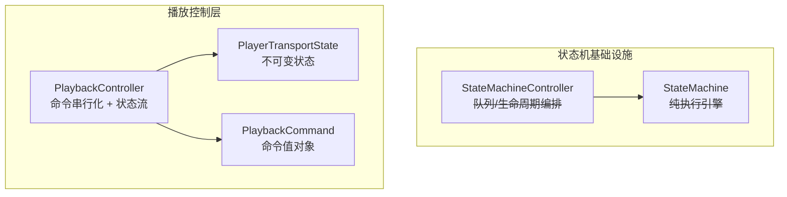
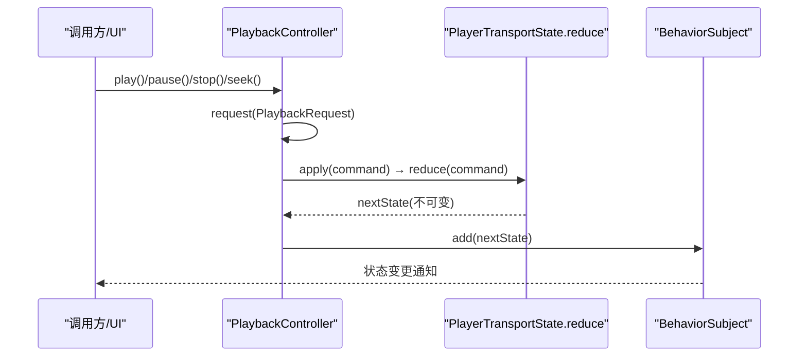
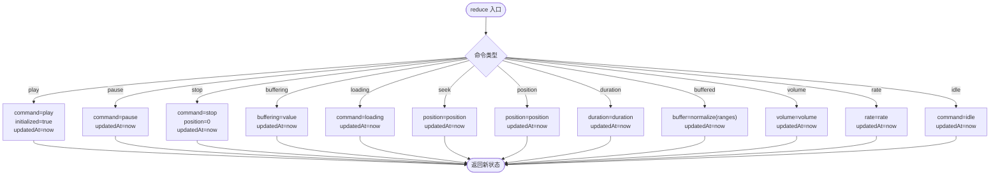
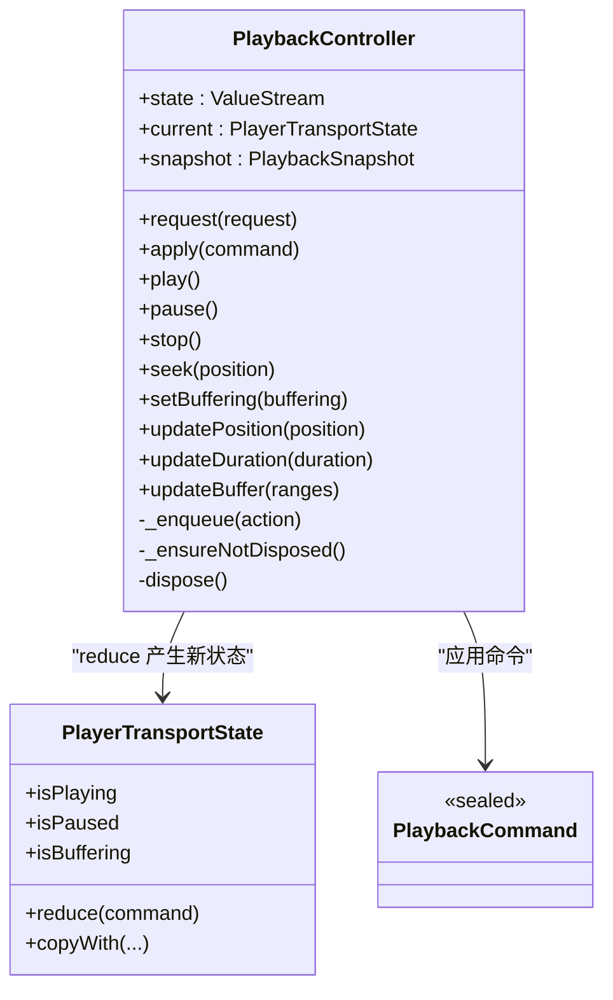
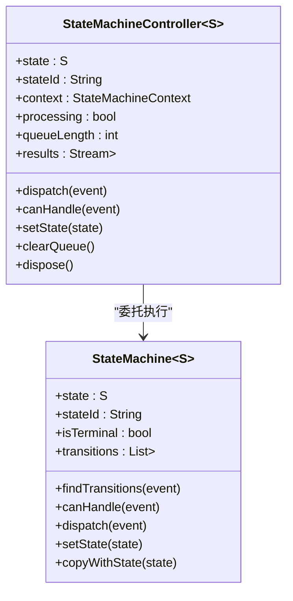
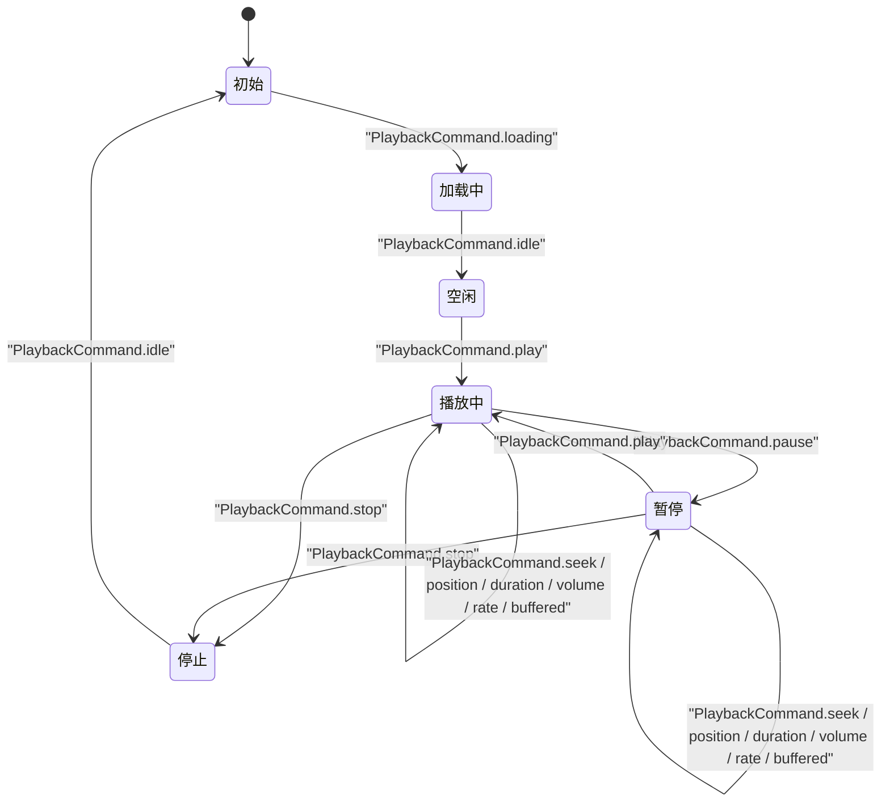
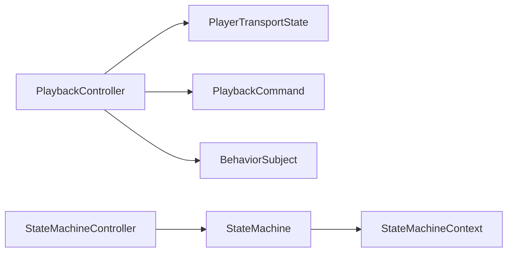

# 播放状态机

<cite>
**本文引用的文件**   
- [player_transport_state.dart](file://packages/media_core/lib/playback/player_transport_state.dart)
- [playback_command.dart](file://packages/media_core/lib/playback/playback_command.dart)
- [playback_controller.dart](file://packages/media_core/lib/playback/playback_controller.dart)
- [state_machine.dart](file://packages/media_core/lib/state_machine/state_machine.dart)
- [state_machine_controller.dart](file://packages/media_core/lib/state_machine/state_machine_controller.dart)
- [state_machine.md（中文）](file://doc/zh-Hans/state_machine.md)
- [architecture.md（英文）](file://doc/en/architecture.md)
- [playback.md（英文）](file://doc/en/playback.md)
</cite>

## 目录
1. [简介](#简介)
2. [项目结构](#项目结构)
3. [核心组件](#核心组件)
4. [架构总览](#架构总览)
5. [详细组件分析](#详细组件分析)
6. [依赖关系分析](#依赖关系分析)
7. [性能与一致性](#性能与一致性)
8. [故障排查指南](#故障排查指南)
9. [结论](#结论)
10. [附录：示例用法与最佳实践](#附录示例用法与最佳实践)

## 简介
本文聚焦 Media Core 的“播放状态机”，围绕以下目标展开：
- 解释 PlayerTransportState 的状态定义、不可变更新语义与 reduce 映射。
- 说明 PlaybackController 如何通过命令模式串行化 play、pause、stop、seek 等操作，并驱动状态变化。
- 阐述通用 StateMachine / StateMachineController 的职责边界：执行引擎 vs 运行时编排。
- 给出完整的状态转换图，覆盖初始、缓冲、播放、暂停等关键阶段。
- 提供监听状态变化、处理错误与自定义行为的实践建议。
- 说明状态机与播放器生命周期、渲染器、音频系统的集成关系。
- 总结并发安全、性能优化与状态一致性保障机制。

## 项目结构
Media Core 将“领域无关的状态机基础设施”与“媒体播放控制层”解耦：
- state_machine 模块：提供泛型状态机引擎与控制器，不包含媒体类型。
- playback 模块：定义播放命令、状态与控制器，负责播放生命周期的编排与状态镜像。

图表来源
- [state_machine.dart:31-59](file://packages/media_core/lib/state_machine/state_machine.dart#L31-L59)
- [state_machine_controller.dart:33-79](file://packages/media_core/lib/state_machine/state_machine_controller.dart#L33-L79)
- [playback_controller.dart:26-43](file://packages/media_core/lib/playback/playback_controller.dart#L26-L43)
- [player_transport_state.dart:23-49](file://packages/media_core/lib/playback/player_transport_state.dart#L23-L49)
- [playback_command.dart:17-56](file://packages/media_core/lib/playback/playback_command.dart#L17-L56)

章节来源
- [state_machine.md（中文）:1-29](file://doc/zh-Hans/state_machine.md#L1-L29)
- [architecture.md（英文）:11-29](file://doc/en/architecture.md#L11-L29)

## 核心组件
- PlayerTransportState：不可变的播放传输状态，包含当前命令、位置、时长、音量、倍速、初始化标志、更新时间、缓冲标记与缓冲区间；提供 copyWith 与 reduce 方法。
- PlaybackCommand：密封的命令集合，表达意图或状态更新（play/pause/stop/seek/buffering/position/duration/volume/rate/idle/loading/buffered）。
- PlaybackController：持有 BehaviorSubject 暴露状态流，对外提供 play/pause/stop/seek 等方法，内部通过 Future 链串行化所有操作，调用 apply 将命令归约到新的不可变状态。
- StateMachine / StateMachineController：通用状态机引擎与控制器，分别承担“转换执行”和“事件队列/生命周期编排”。

章节来源
- [player_transport_state.dart:23-195](file://packages/media_core/lib/playback/player_transport_state.dart#L23-L195)
- [playback_command.dart:17-206](file://packages/media_core/lib/playback/playback_command.dart#L17-L206)
- [playback_controller.dart:26-145](file://packages/media_core/lib/playback/playback_controller.dart#L26-L145)
- [state_machine.dart:8-30](file://packages/media_core/lib/state_machine/state_machine.dart#L8-L30)
- [state_machine_controller.dart:10-32](file://packages/media_core/lib/state_machine/state_machine_controller.dart#L10-L32)

## 架构总览
播放控制层使用“命令 + 不可变状态”的方式实现状态机式更新；通用状态机基础设施则提供可复用的执行与编排模型。二者职责清晰分离：
- PlaybackController 不直接操作后端播放器，而是把请求转换为 PlaybackCommand，并通过 reduce 生成新状态，再推送到状态流。
- StateMachine 仅负责根据转换规则执行守卫与动作；StateMachineController 负责事件排队、结果流与生命周期。

图表来源
- [playback_controller.dart:54-72](file://packages/media_core/lib/playback/playback_controller.dart#L54-L72)
- [player_transport_state.dart:146-195](file://packages/media_core/lib/playback/player_transport_state.dart#L146-L195)

## 详细组件分析

### PlayerTransportState：不可变状态与 reduce 映射
- 字段语义
  - command：当前传输命令（idle/loading/play/pause/stop/...），决定 isPlaying/isPaused/isStopped 等派生属性。
  - position/duration：时间轴信息，用于进度计算。
  - volume/rate：音量与倍速。
  - initialized：是否已完成初始化。
  - buffering：缓冲条件（非命令），避免与 transport 命令混淆。
  - buffer：引擎报告的已缓冲区间，经 normalize 规范化后供消费端使用。
  - updatedAt：最近一次状态更新时间。
- 不可变更新
  - 通过 copyWith 构造新实例，确保旧状态不被修改。
- reduce 映射
  - play：设置命令为 play，标记 initialized=true，更新时间。
  - pause：设置命令为 pause，更新时间。
  - stop：设置命令为 stop，重置 position=0，更新时间。
  - buffering：仅更新 buffering 标记，保留原 transport 命令。
  - loading：设置命令为 loading，更新时间。
  - seek：更新 position，更新时间。
  - position/duration：分别更新时间轴字段。
  - buffered：规范化缓冲区范围，不改变 transport 命令。
  - volume/rate：更新对应值。
  - idle：回到空闲命令。

图表来源
- [player_transport_state.dart:146-195](file://packages/media_core/lib/playback/player_transport_state.dart#L146-L195)

章节来源
- [player_transport_state.dart:23-195](file://packages/media_core/lib/playback/player_transport_state.dart#L23-L195)

### PlaybackController：命令串行化与状态流
- 职责
  - 持有并暴露状态流（ValueStream<PlayerTransportState>）。
  - 接收 PlaybackRequest，将其转为 PlaybackCommand 并 apply。
  - 通过 Future 链 _operation 串行化所有外部操作，保证同一时刻只有一个命令在运行。
  - 提供便捷 API：play/pause/stop/seek/setBuffering/updatePosition/updateDuration/updateBuffer。
- 关键流程
  - request → _enqueue → apply → current.reduce → 若状态变化则 push 到 BehaviorSubject。
  - dispose 会等待队列完成并关闭状态流。

图表来源
- [playback_controller.dart:26-145](file://packages/media_core/lib/playback/playback_controller.dart#L26-L145)
- [player_transport_state.dart:122-195](file://packages/media_core/lib/playback/player_transport_state.dart#L122-L195)
- [playback_command.dart:17-56](file://packages/media_core/lib/playback/playback_command.dart#L17-L56)

章节来源
- [playback_controller.dart:26-145](file://packages/media_core/lib/playback/playback_controller.dart#L26-L145)

### 通用状态机：StateMachine 与 StateMachineController
- StateMachine
  - 纯执行引擎：维护当前状态、查找匹配转换、执行守卫与动作、更新状态。
  - 不提供事件队列、流、持久化、重试等能力。
- StateMachineController
  - 运行时编排：事件串行化、待处理队列、结果流、生命周期管理。
  - 不定义状态转换规则，也不替换 StateMachine。

图表来源
- [state_machine.dart:31-196](file://packages/media_core/lib/state_machine/state_machine.dart#L31-L196)
- [state_machine_controller.dart:33-199](file://packages/media_core/lib/state_machine/state_machine_controller.dart#L33-L199)

章节来源
- [state_machine.dart:8-30](file://packages/media_core/lib/state_machine/state_machine.dart#L8-L30)
- [state_machine_controller.dart:10-32](file://packages/media_core/lib/state_machine/state_machine_controller.dart#L10-L32)
- [state_machine.md（中文）:1-29](file://doc/zh-Hans/state_machine.md#L1-L29)

### 播放状态转换图（基于命令与状态）
下图展示基于 PlaybackCommand 与 PlayerTransportState 的关键状态转换。注意 buffering 是条件而非命令，因此不会覆盖 transport 命令。

图表来源
- [player_transport_state.dart:146-195](file://packages/media_core/lib/playback/player_transport_state.dart#L146-L195)
- [playback_command.dart:20-56](file://packages/media_core/lib/playback/playback_command.dart#L20-L56)

## 依赖关系分析
- PlaybackController 依赖：
  - PlayerTransportState：通过 reduce 进行不可变状态更新。
  - PlaybackCommand：作为命令载体。
  - BehaviorSubject：暴露状态流。
- StateMachine / StateMachineController 依赖：
  - 无媒体特定类型，保持领域无关。
  - 通过 StateMachineContext 扩展运行时上下文。

图表来源
- [playback_controller.dart:1-8](file://packages/media_core/lib/playback/playback_controller.dart#L1-L8)
- [state_machine.dart:1-6](file://packages/media_core/lib/state_machine/state_machine.dart#L1-L6)
- [state_machine_controller.dart:1-8](file://packages/media_core/lib/state_machine/state_machine_controller.dart#L1-L8)

章节来源
- [playback_controller.dart:1-145](file://packages/media_core/lib/playback/playback_controller.dart#L1-L145)
- [state_machine.dart:1-206](file://packages/media_core/lib/state_machine/state_machine.dart#L1-L206)
- [state_machine_controller.dart:1-227](file://packages/media_core/lib/state_machine/state_machine_controller.dart#L1-L227)

## 性能与一致性
- 不可变状态与浅比较
  - PlayerTransportState 继承 Equatable，仅在字段变化时触发 UI 重建，减少不必要的重绘。
- 命令串行化
  - PlaybackController 使用 Future 链串行化所有外部操作，避免竞态与状态错乱。
- 缓冲与时间轴更新分离
  - buffering 作为条件字段，避免与 transport 命令冲突；buffered 命令在 reduce 内统一规范化，保证消费者读取一致。
- 通用状态机的健壮性
  - StateMachine.dispatch 捕获异常并返回失败结果，防止队列卡死。
  - StateMachineController 维护 pending 队列，确保每个事件的结果都能被观察者感知。

[本节为通用指导，不直接分析具体文件]

## 故障排查指南
- 重复 dispose 或已释放控制器
  - PlaybackController 在 dispose 后会拒绝后续操作，抛出状态错误。
- 状态未更新
  - 检查 reduce 分支是否正确处理了对应命令；确认 copyWith 参数传递无误。
- 缓冲显示异常
  - 确认 updateBuffer 传入的是原始 BufferRange 列表，由 reduce 统一规范化；不要在调用侧再次规范化。
- 通用状态机事件被拒绝
  - 检查 canHandle 与 dispatch 返回结果，关注“不接受事件/终态/无匹配转换/守卫全部拒绝”的原因。

章节来源
- [playback_controller.dart:127-144](file://packages/media_core/lib/playback/playback_controller.dart#L127-L144)
- [player_transport_state.dart:146-195](file://packages/media_core/lib/playback/player_transport_state.dart#L146-L195)
- [state_machine.dart:105-174](file://packages/media_core/lib/state_machine/state_machine.dart#L105-L174)

## 结论
Media Core 通过“命令 + 不可变状态”的设计，将播放控制逻辑抽象为可预测、可测试、可组合的状态机。PlaybackController 负责命令串行化与状态流分发；PlayerTransportState 通过 reduce 精确映射命令到状态；通用 StateMachine/StateMachineController 提供跨领域的状态机基础设施。该设计在保证并发安全与状态一致性的同时，也为上层 UI、渲染器与音频系统提供了稳定可靠的播放状态镜像。

[本节为总结性内容，不直接分析具体文件]

## 附录：示例用法与最佳实践

- 监听状态变化
  - 订阅 PlaybackController.state 流，根据 isPlaying/isPaused/isBuffering 等派生属性更新 UI。
  - 参考路径：[playback_controller.dart:36-52](file://packages/media_core/lib/playback/playback_controller.dart#L36-L52)

- 处理状态转换错误
  - 对于通用状态机，订阅 StateMachineController.results，根据 StateTransitionResult 的成功/失败分支处理错误与日志。
  - 参考路径：[state_machine_controller.dart:48-79](file://packages/media_core/lib/state_machine/state_machine_controller.dart#L48-L79), [state_machine.dart:105-174](file://packages/media_core/lib/state_machine/state_machine.dart#L105-L174)

- 自定义状态行为
  - 在 reduce 中新增命令分支，遵循“只返回新状态、不引入副作用”的原则；对需要异步或副作用的场景，应在 PlaybackController 或更高层编排。
  - 参考路径：[player_transport_state.dart:146-195](file://packages/media_core/lib/playback/player_transport_state.dart#L146-L195)

- 与播放器生命周期、渲染器、音频系统集成
  - PlaybackController 不直接解码或控制平台 API，通常由上层协调器（如 PlaybackCoordinator）绑定播放器实例，转发 PlaybackRequest，并在底层回调中调用 setBuffering/updatePosition/updateDuration/updateBuffer 以同步状态。
  - 参考路径：[architecture.md（英文）:11-29](file://doc/en/architecture.md#L11-L29), [playback.md（英文）:8-16](file://doc/en/playback.md#L8-L16)

- 并发安全与一致性保障
  - 使用 PlaybackController.request 提交所有外部操作，避免绕过串行化队列。
  - 使用 immutable 状态与 Equatable 比较，避免共享可变状态导致的竞态。
  - 参考路径：[playback_controller.dart:54-72](file://packages/media_core/lib/playback/playback_controller.dart#L54-L72), [player_transport_state.dart:23-49](file://packages/media_core/lib/playback/player_transport_state.dart#L23-L49)