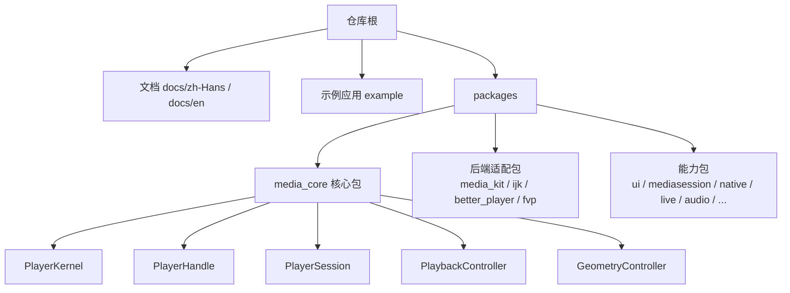
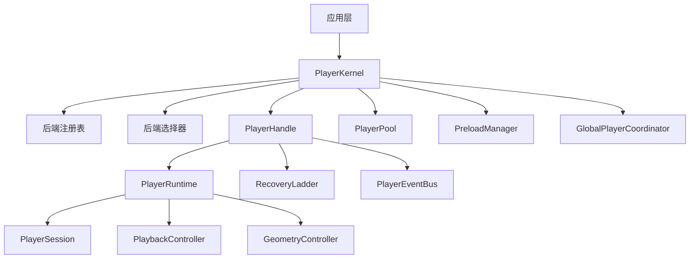
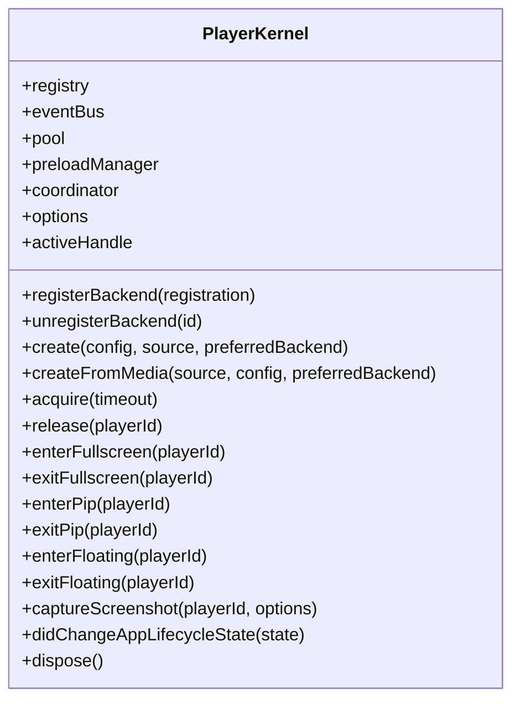
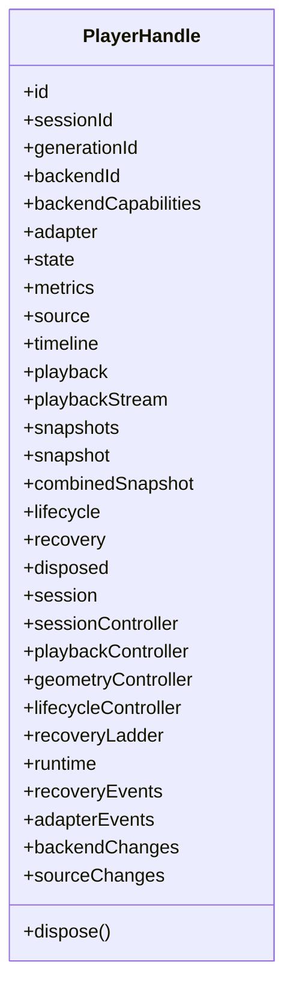
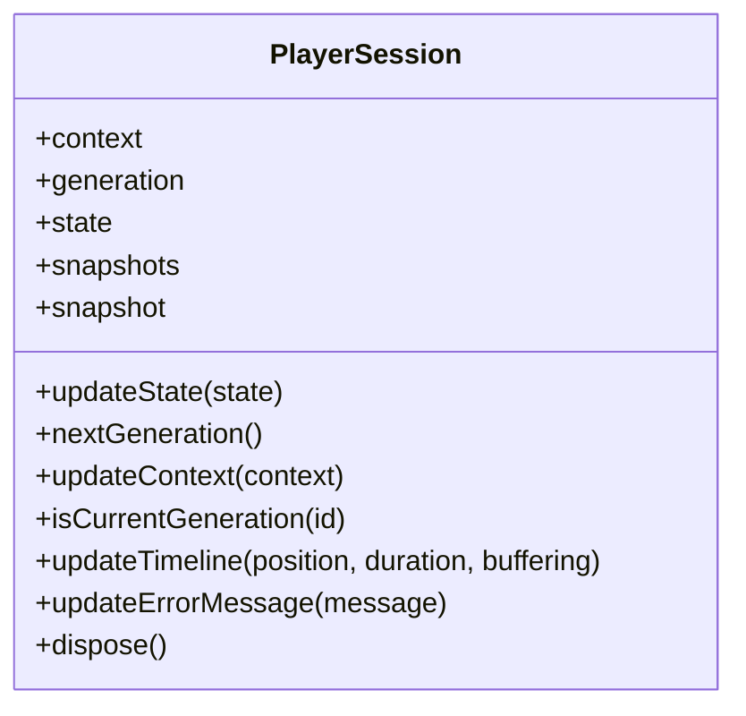
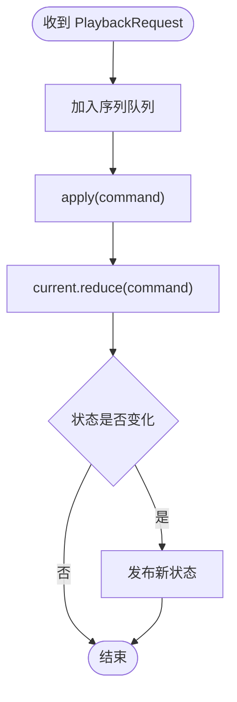
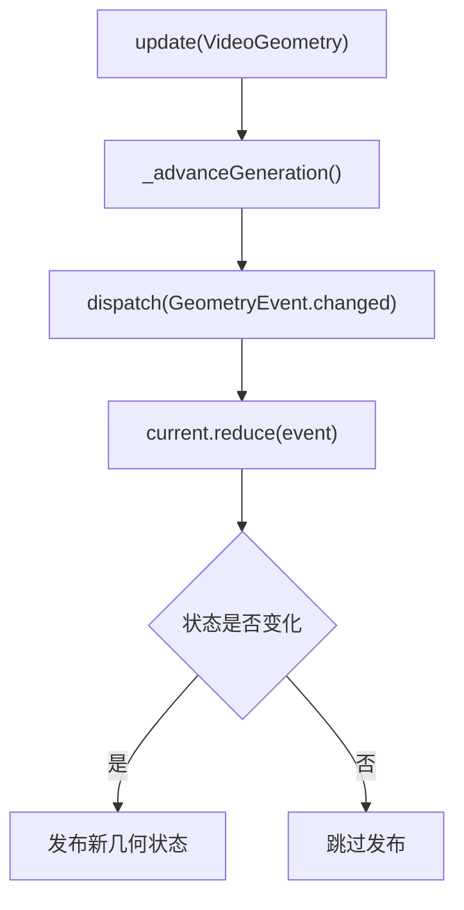
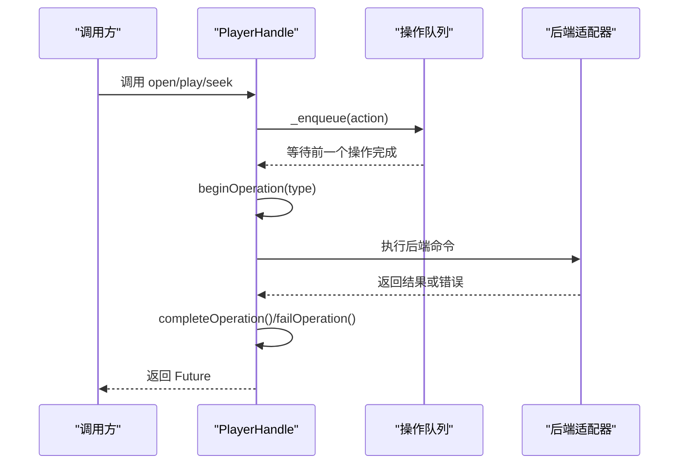
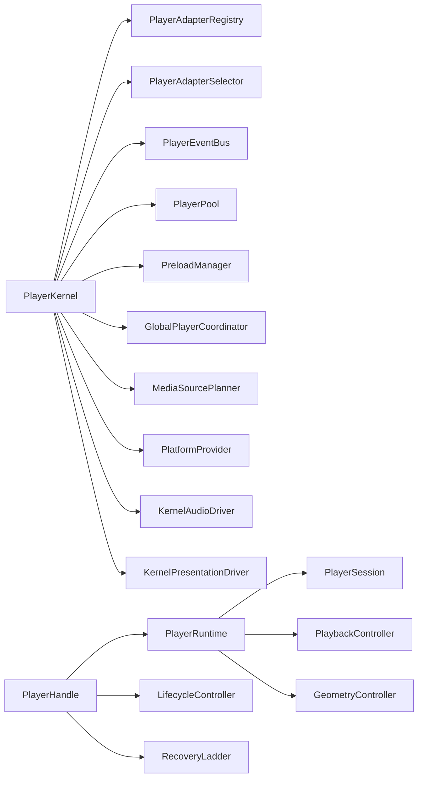

# 核心模块

<cite>
**本文引用的文件**   
- [README.md](file://README.md)
- [player_kernel.dart](file://packages/media_core/lib/kernel/player_kernel.dart)
- [player_handle.dart](file://packages/media_core/lib/kernel/player_handle.dart)
- [player_handle_operations.dart](file://packages/media_core/lib/kernel/player_handle_operations.dart)
- [player_session.dart](file://packages/media_core/lib/session/player_session.dart)
- [playback_controller.dart](file://packages/media_core/lib/playback/playback_controller.dart)
- [geometry_controller.dart](file://packages/media_core/lib/geometry/geometry_controller.dart)
</cite>

## 目录
1. [引言](#引言)
2. [项目结构](#项目结构)
3. [核心组件](#核心组件)
4. [架构总览](#架构总览)
5. [详细组件分析](#详细组件分析)
6. [依赖关系分析](#依赖关系分析)
7. [性能与并发特性](#性能与并发特性)
8. [API 参考](#api-参考)
9. [常见使用场景与最佳实践](#常见使用场景与最佳实践)
10. [错误处理与调试技巧](#错误处理与调试技巧)
11. [结论](#结论)

## 引言
Media Core 的核心目标是提供一套跨平台、可复用、以“会话 + 命令串行化 + 恢复决策”为中心的播放器编排层。它不直接解码媒体，也不渲染视频；它的职责是协调后端适配器、管理播放会话生命周期、序列化操作、统一事件、池化播放器实例，并在出错时按策略进行同后端重开、换线路或换后端的自愈流程。

对于初学者，可以把 Media Core 理解为：
- `PlayerKernel`：全局协调者，负责注册后端、创建和释放播放器、维护全局事件总线、池、预加载和跨播放器协作。
- `PlayerHandle`：单个播放器的门面，所有上层调用都通过它进入，内部串联会话、播放状态机、几何控制器、生命周期控制器和恢复梯子。
- `PlayerSession`：一个逻辑播放生命周期的状态容器，持有会话上下文、代际标识、快照流，并记录位置、时长、缓冲和错误信息。

对于高级开发者，需要重点关注：
- 命令串行化机制如何避免竞态。
- 恢复梯子的唯一决策点设计。
- 几何控制器的尺寸、旋转和代际保护。
- 内核如何把能力探针、音频驱动、呈现驱动和系统媒体面接入到每个会话中。

## 项目结构
Media Core 仓库采用多包工作区布局。核心逻辑位于 `packages/media_core`，包含约 40 个模块，分别覆盖适配层、会话、回放、几何、恢复、池化、预加载、事件、来源规划、平台能力、内存、日志等。示例应用位于 `example`，演示播放器生命周期、直播回退、上下滑 feed、系统媒体面、UI 风格切换、音乐队列、多画面监控、全屏与画中画、内存仪表盘等。

**图表来源**  
- [README.md:55-81](file://README.md#L55-L81)

**章节来源**  
- [README.md:1-223](file://README.md#L1-L223)

## 核心组件
本节聚焦三个关键类：`PlayerKernel`、`PlayerHandle`、`PlayerSession`，以及两个重要子组件：`PlaybackController` 和 `GeometryController`。

| 组件 | 角色 | 主要职责 | 不负责 |
| --- | --- | --- | --- |
| `PlayerKernel` | 全局编排根 | 注册后端、选择引擎、创建/释放播放器、全局事件、池、预加载、跨播放器协调、截图、全屏/PiP/浮窗请求 | 不解码、不拥有单播放器状态、不直接驱动恢复循环 |
| `PlayerHandle` | 播放器门面 | 暴露 open/play/pause/seek/volume/rate/mute/loop 等操作，执行恢复步骤，桥接适配器事件，序列化操作 | 不创建适配器、不决定何时恢复、不选择适配器 |
| `PlayerSession` | 会话生命周期 | 维护会话状态、代际、上下文、快照流，记录位置/时长/缓冲/错误 | 不创建适配器、不执行后端命令 |
| `PlaybackController` | 播放状态机 | 维护 `PlayerTransportState`，接收播放命令，序列化请求，更新缓冲/位置/时长 | 不解码、不调用平台 API、不渲染 |
| `GeometryController` | 几何控制器 | 维护视频尺寸、显示尺寸、旋转、代际，减少几何事件 | 不做布局、不调整 widget、不控制渲染器 |

**章节来源**  
- [player_kernel.dart:50-114](file://packages/media_core/lib/kernel/player_kernel.dart#L50-L114)
- [player_handle.dart:111-162](file://packages/media_core/lib/kernel/player_handle.dart#L111-L162)
- [player_session.dart:9-29](file://packages/media_core/lib/session/player_session.dart#L9-L29)
- [playback_controller.dart:10-26](file://packages/media_core/lib/playback/playback_controller.dart#L10-L26)
- [geometry_controller.dart:12-28](file://packages/media_core/lib/geometry/geometry_controller.dart#L12-L28)

## 架构总览
Media Core 的顶层数据流可以概括为：

1. 宿主调用 `PlayerKernel.create` 或 `createFromMedia`。
2. 内核解析来源、选择后端、创建 `PlayerHandle`。
3. `PlayerHandle` 组合 `PlayerRuntime`，其中包含：
   - `PlayerSession`：会话状态与代际。
   - `PlaybackController`：播放状态机。
   - `GeometryController`：几何状态。
   - 生命周期控制器、恢复梯子、事件总线。
4. 上层 UI 通过 `PlayerHandle` 操作播放器，而不是直接操作底层适配器。
5. 错误发生时，`RecoveryLadder` 是唯一决策点，按“同后端重开 → 换线路 → 换后端 → 放弃”推进。

**图表来源**  
- [README.md:55-81](file://README.md#L55-L81)
- [player_kernel.dart:50-114](file://packages/media_core/lib/kernel/player_kernel.dart#L50-L114)
- [player_handle.dart:111-162](file://packages/media_core/lib/kernel/player_handle.dart#L111-L162)

## 详细组件分析

### PlayerKernel：全局协调者
`PlayerKernel` 是 Media Core 的编排根。它负责：
- 注册和注销后端适配器。
- 根据 `PlayerSource` 或 `MediaSource` 选择最合适的后端。
- 创建 `PlayerHandle`，并把其注册到全局协调器、事件总线、池和预加载管理器。
- 暴露全局事件流、截图、全屏、画中画、浮窗等跨播放器能力。
- 在 Flutter 应用生命周期变化时，按配置暂停或激活正在播放的播放器。

关键点：
- `create` 是 `PlayerSource` 入口，`createFromMedia` 是结构化媒体源入口。
- `planFor` 允许在不真正创建播放器前判断某个媒体是否可播放、由哪个后端播放。
- 内核本身不运行恢复循环；恢复由 `PlayerHandle` 内部的 `RecoveryLadder` 执行，内核只提供候选集合。
- 内核持有活跃播放器引用，用于音频焦点和系统媒体面通知。

**图表来源**  
- [player_kernel.dart:115-138](file://packages/media_core/lib/kernel/player_kernel.dart#L115-L138)
- [player_kernel.dart:268-440](file://packages/media_core/lib/kernel/player_kernel.dart#L268-L440)
- [player_kernel.dart:442-515](file://packages/media_core/lib/kernel/player_kernel.dart#L442-L515)
- [player_kernel.dart:655-716](file://packages/media_core/lib/kernel/player_kernel.dart#L655-L716)
- [player_kernel.dart:873-935](file://packages/media_core/lib/kernel/player_kernel.dart#L873-L935)

**章节来源**  
- [player_kernel.dart:50-114](file://packages/media_core/lib/kernel/player_kernel.dart#L50-L114)
- [player_kernel.dart:268-440](file://packages/media_core/lib/kernel/player_kernel.dart#L268-L440)
- [player_kernel.dart:442-515](file://packages/media_core/lib/kernel/player_kernel.dart#L442-L515)
- [player_kernel.dart:655-716](file://packages/media_core/lib/kernel/player_kernel.dart#L655-L716)
- [player_kernel.dart:873-935](file://packages/media_core/lib/kernel/player_kernel.dart#L873-L935)

### PlayerHandle：播放器操作门面
`PlayerHandle` 是单个逻辑播放器的对外接口。它组合了运行时对象，并负责：
- 将播放命令转发给运行时适配器。
- 执行恢复梯子的步骤。
- 发布标准化事件。
- 序列化后端操作。
- 用生命周期代际保护旧操作不会提交新状态。

它还暴露：
- 当前后端 ID 和能力。
- 当前源、时间线、播放状态、缓冲、音量、速率、进度、静音状态、循环状态。
- 会话、播放控制器、几何控制器、生命周期控制器、恢复梯子。
- 后端变更流、源变更流、适配器事件流、恢复事件流。

**图表来源**  
- [player_handle.dart:162-208](file://packages/media_core/lib/kernel/player_handle.dart#L162-L208)
- [player_handle.dart:399-519](file://packages/media_core/lib/kernel/player_handle.dart#L399-L519)
- [player_handle.dart:521-553](file://packages/media_core/lib/kernel/player_handle.dart#L521-L553)
- [player_handle.dart:689-747](file://packages/media_core/lib/kernel/player_handle.dart#L689-L747)

**章节来源**  
- [player_handle.dart:111-162](file://packages/media_core/lib/kernel/player_handle.dart#L111-L162)
- [player_handle.dart:162-208](file://packages/media_core/lib/kernel/player_handle.dart#L162-L208)
- [player_handle.dart:399-519](file://packages/media_core/lib/kernel/player_handle.dart#L399-L519)
- [player_handle.dart:521-553](file://packages/media_core/lib/kernel/player_handle.dart#L521-L553)
- [player_handle.dart:689-747](file://packages/media_core/lib/kernel/player_handle.dart#L689-L747)

### PlayerSession：会话生命周期管理
`PlayerSession` 表示一次逻辑播放生命周期。它维护：
- 会话上下文：播放器 ID、会话 ID、代际 ID、来源 ID、来源对象、策略、平台能力。
- 会话状态：空闲、打开、播放、暂停、缓冲、错误、释放等。
- 代际：每次重建或切换时递增，用于丢弃旧异步结果。
- 快照流：供 UI 和诊断订阅。
- 时间线事实：位置、时长、缓冲标志、错误消息。

**图表来源**  
- [player_session.dart:29-36](file://packages/media_core/lib/session/player_session.dart#L29-L36)
- [player_session.dart:38-61](file://packages/media_core/lib/session/player_session.dart#L38-L61)
- [player_session.dart:71-97](file://packages/media_core/lib/session/player_session.dart#L71-L97)
- [player_session.dart:118-176](file://packages/media_core/lib/session/player_session.dart#L118-L176)

**章节来源**  
- [player_session.dart:9-29](file://packages/media_core/lib/session/player_session.dart#L9-L29)
- [player_session.dart:29-36](file://packages/media_core/lib/session/player_session.dart#L29-L36)
- [player_session.dart:38-61](file://packages/media_core/lib/session/player_session.dart#L38-L61)
- [player_session.dart:71-97](file://packages/media_core/lib/session/player_session.dart#L71-L97)
- [player_session.dart:118-176](file://packages/media_core/lib/session/player_session.dart#L118-L176)

### 播放状态机：PlaybackController
`PlaybackController` 是播放语义的状态机。它维护 `PlayerTransportState`，并通过命令减少状态变化。它支持：
- play、pause、stop、seek。
- 更新缓冲、位置、时长。
- 序列化请求，避免快速拖动或重复命令导致状态不一致。

**图表来源**  
- [playback_controller.dart:54-72](file://packages/media_core/lib/playback/playback_controller.dart#L54-L72)
- [playback_controller.dart:119-125](file://packages/media_core/lib/playback/playback_controller.dart#L119-L125)

**章节来源**  
- [playback_controller.dart:10-26](file://packages/media_core/lib/playback/playback_controller.dart#L10-L26)
- [playback_controller.dart:54-72](file://packages/media_core/lib/playback/playback_controller.dart#L54-L72)
- [playback_controller.dart:74-117](file://packages/media_core/lib/playback/playback_controller.dart#L74-L117)
- [playback_controller.dart:119-145](file://packages/media_core/lib/playback/playback_controller.dart#L119-L145)

### 几何控制器：大小与旋转处理
`GeometryController` 管理视频几何状态，包括视频尺寸、显示尺寸、旋转、代际和初始化状态。它的特点是：
- 所有几何更新都通过事件减少，保证状态一致性。
- 使用代际防止异步更新覆盖新状态。
- 提供 `updateVideoSize`、`updateDisplaySize`、`updateRotation`、`clear`、`restore`、`nextGeneration` 等方法。

**图表来源**  
- [geometry_controller.dart:67-73](file://packages/media_core/lib/geometry/geometry_controller.dart#L67-L73)
- [geometry_controller.dart:112-120](file://packages/media_core/lib/geometry/geometry_controller.dart#L112-L120)
- [geometry_controller.dart:156-162](file://packages/media_core/lib/geometry/geometry_controller.dart#L156-L162)

**章节来源**  
- [geometry_controller.dart:12-28](file://packages/media_core/lib/geometry/geometry_controller.dart#L12-L28)
- [geometry_controller.dart:60-100](file://packages/media_core/lib/geometry/geometry_controller.dart#L60-L100)
- [geometry_controller.dart:112-162](file://packages/media_core/lib/geometry/geometry_controller.dart#L112-L162)

### 命令串行化与代际守卫
`PlayerHandle` 的命令串行化机制由两部分组成：
1. 操作队列 `_operation`：确保后端操作按顺序执行。
2. 操作代际 `_operationGeneration`：每次破坏性生命周期转换都会递增代际，旧操作无法提交新状态。

此外，还有：
- `OperationRegistry` 和 `OperationTracker`：记录操作的开始、完成、失败。
- `OperationCancelToken`：取消当前播放或恢复延续，但不影响生命周期操作。
- `_enqueue`：把所有动作排入队列，并保留错误给调用方。

**图表来源**  
- [player_handle_operations.dart:26-54](file://packages/media_core/lib/kernel/player_handle_operations.dart#L26-L54)
- [player_handle_operations.dart:106-126](file://packages/media_core/lib/kernel/player_handle_operations.dart#L106-L126)
- [player_handle_operations.dart:200-225](file://packages/media_core/lib/kernel/player_handle_operations.dart#L200-L225)

**章节来源**  
- [player_handle_operations.dart:1-258](file://packages/media_core/lib/kernel/player_handle_operations.dart#L1-L258)

## 依赖关系分析
Media Core 的核心依赖关系如下：

- `PlayerKernel` 依赖：
  - `PlayerAdapterRegistry`：后端注册表。
  - `PlayerAdapterSelector`：后端选择器。
  - `SourceService`：来源解析服务。
  - `PlayerEventBus`：全局事件总线。
  - `PlayerPool`：播放器池。
  - `PreloadManager`：预加载管理器。
  - `GlobalPlayerCoordinator`：跨播放器协调。
  - `MediaSourcePlanner`：媒体来源规划。
  - `PlatformProvider`：平台能力探针。
  - `KernelAudioDriver`：音频能力驱动。
  - `KernelPresentationDriver`：呈现能力驱动。

- `PlayerHandle` 依赖：
  - `PlayerRuntime`：运行时组合根。
  - `PlayerSession`：会话。
  - `PlaybackController`：播放状态机。
  - `GeometryController`：几何控制器。
  - `LifecycleController`：生命周期控制器。
  - `RecoveryLadder`：恢复梯子。
  - `PlayerEventBus`：事件总线。

- `PlayerSession` 依赖：
  - `SessionContext`：会话上下文。
  - `SessionGeneration`：代际。
  - `SessionState`：会话状态。
  - `SessionSnapshot`：会话快照。

**图表来源**  
- [player_kernel.dart:115-138](file://packages/media_core/lib/kernel/player_kernel.dart#L115-L138)
- [player_handle.dart:162-208](file://packages/media_core/lib/kernel/player_handle.dart#L162-L208)
- [player_session.dart:29-36](file://packages/media_core/lib/session/player_session.dart#L29-L36)

**章节来源**  
- [player_kernel.dart:115-138](file://packages/media_core/lib/kernel/player_kernel.dart#L115-L138)
- [player_handle.dart:162-208](file://packages/media_core/lib/kernel/player_handle.dart#L162-L208)
- [player_session.dart:29-36](file://packages/media_core/lib/session/player_session.dart#L29-L36)

## 性能与并发特性
Media Core 在性能和并发方面有几个关键设计：

1. **命令串行化**：`PlayerHandle` 和 `PlaybackController` 都使用 Future 链式队列，避免并发后端操作导致状态错乱。
2. **代际守卫**：`PlayerHandle` 使用 `_operationGeneration`，`PlayerSession` 使用 `SessionGeneration`，`GeometryController` 使用几何代际，确保旧异步结果不会覆盖新状态。
3. **池化播放器**：`PlayerKernel` 提供 `acquire` 和 `release`，配合 `PlayerPool` 复用解码器，减少重建成本。
4. **预加载**：`PreloadManager` 按优先级排队预加载请求，适合列表、feed、直播预热。
5. **内存记账**：内核按打开播放器数量上报内存贡献，便于压力控制和资源回收。
6. **生命周期联动**：应用后台时暂停所有正在播放的播放器，前台时重新激活，避免后台持续解码。

优化建议：
- 对高频 UI 操作（如拖动音量、倍速）优先使用 handle 提供的聚合字段，而不是频繁触发后端命令。
- 使用 `planFor` 或 `createFromMedia` 提前判断媒体能力，避免无效创建。
- 在列表或 feed 场景中启用池化，并合理设置超时和优先级。
- 开启分级日志和内存环，定位具体模块问题。

[本节为通用性能讨论，不直接分析具体代码片段]

## API 参考

### PlayerKernel API

| 方法或属性 | 参数 | 返回值 | 说明 |
| --- | --- | --- | --- |
| `registerBackend` | `registration` | `void` | 注册后端适配器。 |
| `unregisterBackend` | `id` | `void` | 注销后端适配器。 |
| `create` | `config`, `source`, `preferredBackend` | `Future<PlayerHandle>` | 创建播放器并可选打开来源。 |
| `createFromMedia` | `source`, `config`, `preferredBackend` | `Future<PlayerHandle>` | 从结构化媒体源创建播放器。 |
| `planFor` | `source`, `preferredBackend` | `{registration, plan}` | 预飞行检查，判断可播放性和计划。 |
| `acquire` | `timeout` | `Future<PlayerHandle?>` | 从池中获取空闲播放器。 |
| `release` | `playerId` | `Future<void>` | 完全释放播放器。 |
| `events` | 无 | `Stream<PlayerEvent>` | 全局事件流。 |
| `subscribe` | `listener`, `minimumPriority` | `EventSubscription` | 订阅全局事件。 |
| `attachAudio` | `driver` | `void` | 附加音频能力驱动。 |
| `detachAudio` | 无 | `void` | 分离音频能力驱动。 |
| `attachPlatformProvider` | `provider` | `void` | 附加平台能力探针。 |
| `detachPlatformProvider` | 无 | `void` | 分离平台能力探针。 |
| `attachPresentation` | `driver` | `void` | 附加呈现能力驱动。 |
| `detachPresentation` | 无 | `void` | 分离呈现能力驱动。 |
| `enterFullscreen` | `playerId` | `Future<void>` | 请求全屏。 |
| `exitFullscreen` | `playerId` | `Future<void>` | 退出全屏。 |
| `enterPip` | `playerId` | `Future<void>` | 请求画中画。 |
| `exitPip` | `playerId` | `Future<void>` | 退出画中画。 |
| `enterFloating` | `playerId` | `Future<void>` | 请求浮窗。 |
| `exitFloating` | `playerId` | `Future<void>` | 退出浮窗。 |
| `captureScreenshot` | `playerId`, `options` | `Future<PlayerScreenshot?>` | 抓帧。 |

**章节来源**  
- [player_kernel.dart:268-440](file://packages/media_core/lib/kernel/player_kernel.dart#L268-L440)
- [player_kernel.dart:442-515](file://packages/media_core/lib/kernel/player_kernel.dart#L442-L515)
- [player_kernel.dart:543-582](file://packages/media_core/lib/kernel/player_kernel.dart#L543-L582)
- [player_kernel.dart:597-626](file://packages/media_core/lib/kernel/player_kernel.dart#L597-L626)
- [player_kernel.dart:632-716](file://packages/media_core/lib/kernel/player_kernel.dart#L632-L716)

### PlayerHandle API

| 方法或属性 | 类型 | 说明 |
| --- | --- | --- |
| `id` | `PlayerId` | 播放器标识。 |
| `sessionId` | `SessionId` | 会话标识。 |
| `generationId` | `GenerationId` | 播放代际标识。 |
| `backendId` | `String` | 当前后端 ID。 |
| `backendCapabilities` | `PlayerAdapterCapabilities` | 当前后端能力。 |
| `adapter` | `PlayerAdapter` | 当前适配器。 |
| `state` | `PlayerCoreState` | 适配器核心状态。 |
| `metrics` | `PlayerAdapterMetrics` | 适配器指标。 |
| `source` | `PlayerSource?` | 当前打开的来源。 |
| `timeline` | `MediaTimeline?` | 媒体时间线。 |
| `playback` | `PlayerTransportState` | 当前播放状态。 |
| `playbackStream` | `ValueStream<PlayerTransportState>` | 播放状态流。 |
| `snapshots` | `Stream<SessionSnapshot>` | 会话快照流。 |
| `snapshot` | `SessionSnapshot` | 最新会话快照。 |
| `combinedSnapshot` | `PlayerHandleSnapshot` | 聚合快照。 |
| `lifecycle` | `LifecycleSnapshot` | 生命周期快照。 |
| `recovery` | `RecoverySnapshot` | 恢复快照。 |
| `disposed` | `bool` | 是否已释放。 |
| `session` | `PlayerSession` | 会话。 |
| `sessionController` | `SessionController` | 会话控制器。 |
| `playbackController` | `PlaybackController` | 播放控制器。 |
| `geometryController` | `GeometryController` | 几何控制器。 |
| `lifecycleController` | `LifecycleController` | 生命周期控制器。 |
| `recoveryLadder` | `RecoveryLadder` | 恢复梯子。 |
| `runtime` | `PlayerRuntime` | 运行时。 |
| `recoveryEvents` | `Stream<RecoveryLadderEvent>` | 恢复决策事件。 |
| `adapterEvents` | `Stream<PlayerAdapterEvent>` | 适配器事件。 |
| `backendChanges` | `Stream<PlayerBackendChange>` | 后端变更事件。 |
| `sourceChanges` | `Stream<PlayerSource?>` | 来源变更事件。 |
| `dispose` | 方法 | 释放播放器资源。 |

**章节来源**  
- [player_handle.dart:399-519](file://packages/media_core/lib/kernel/player_handle.dart#L399-L519)
- [player_handle.dart:521-553](file://packages/media_core/lib/kernel/player_handle.dart#L521-L553)
- [player_handle.dart:689-747](file://packages/media_core/lib/kernel/player_handle.dart#L689-L747)

### PlayerSession API

| 方法或属性 | 类型 | 说明 |
| --- | --- | --- |
| `context` | `SessionContext` | 会话上下文。 |
| `generation` | `SessionGeneration` | 当前代际。 |
| `state` | `SessionState` | 会话状态。 |
| `snapshots` | `Stream<SessionSnapshot>` | 会话快照流。 |
| `snapshot` | `SessionSnapshot` | 最新会话快照。 |
| `updateState` | 方法 | 更新会话状态。 |
| `nextGeneration` | 方法 | 生成下一代。 |
| `updateContext` | 方法 | 替换会话上下文。 |
| `isCurrentGeneration` | 方法 | 判断代际是否当前。 |
| `updateTimeline` | 方法 | 更新时间线事实。 |
| `updateErrorMessage` | 方法 | 更新错误消息。 |
| `dispose` | 方法 | 释放会话。 |

**章节来源**  
- [player_session.dart:38-61](file://packages/media_core/lib/session/player_session.dart#L38-L61)
- [player_session.dart:71-97](file://packages/media_core/lib/session/player_session.dart#L71-L97)
- [player_session.dart:118-176](file://packages/media_core/lib/session/player_session.dart#L118-L176)

### PlaybackController API

| 方法或属性 | 类型 | 说明 |
| --- | --- | --- |
| `state` | `ValueStream<PlayerTransportState>` | 播放状态流。 |
| `current` | `PlayerTransportState` | 当前播放状态。 |
| `snapshot` | `PlaybackSnapshot` | 播放快照。 |
| `isPlaying` | `bool` | 是否播放中。 |
| `isPaused` | `bool` | 是否暂停。 |
| `isBuffering` | `bool` | 是否缓冲。 |
| `request` | 方法 | 发送播放请求。 |
| `apply` | 方法 | 应用播放命令。 |
| `play` | 方法 | 播放。 |
| `pause` | 方法 | 暂停。 |
| `stop` | 方法 | 停止。 |
| `seek` | 方法 | 跳转。 |
| `setBuffering` | 方法 | 设置缓冲状态。 |
| `updatePosition` | 方法 | 更新位置。 |
| `updateDuration` | 方法 | 更新时长。 |
| `updateBuffer` | 方法 | 更新缓冲区间。 |
| `dispose` | 方法 | 释放控制器。 |

**章节来源**  
- [playback_controller.dart:26-43](file://packages/media_core/lib/playback/playback_controller.dart#L26-L43)
- [playback_controller.dart:54-117](file://packages/media_core/lib/playback/playback_controller.dart#L54-L117)
- [playback_controller.dart:119-145](file://packages/media_core/lib/playback/playback_controller.dart#L119-L145)

### GeometryController API

| 方法或属性 | 类型 | 说明 |
| --- | --- | --- |
| `state` | `ValueStream<GeometryState>` | 几何状态流。 |
| `current` | `GeometryState` | 当前几何状态。 |
| `snapshot` | `GeometrySnapshot` | 几何快照。 |
| `geometry` | `VideoGeometry` | 当前几何。 |
| `generation` | `int` | 几何代际。 |
| `initialized` | `bool` | 是否已初始化。 |
| `update` | 方法 | 更新几何。 |
| `updateVideoSize` | 方法 | 更新视频尺寸。 |
| `updateDisplaySize` | 方法 | 更新显示尺寸。 |
| `updateRotation` | 方法 | 更新旋转。 |
| `clear` | 方法 | 清空几何。 |
| `dispatch` | 方法 | 分发几何事件。 |
| `restore` | 方法 | 恢复几何状态。 |
| `nextGeneration` | 方法 | 生成新代际。 |
| `dispose` | 方法 | 释放控制器。 |

**章节来源**  
- [geometry_controller.dart:28-55](file://packages/media_core/lib/geometry/geometry_controller.dart#L28-L55)
- [geometry_controller.dart:60-100](file://packages/media_core/lib/geometry/geometry_controller.dart#L60-L100)
- [geometry_controller.dart:112-162](file://packages/media_core/lib/geometry/geometry_controller.dart#L112-L162)
- [geometry_controller.dart:171-180](file://packages/media_core/lib/geometry/geometry_controller.dart#L171-L180)

## 常见使用场景与最佳实践

### 基础播放流程
典型流程：
1. 初始化平台适配器。
2. 启用系统媒体面。
3. 创建 `PlayerKernel` 并注册后端。
4. 调用 `kernel.create` 创建播放器。
5. 将 `PlayerHandle` 交给 UI 控件。
6. 监听播放状态、缓冲、进度、错误。
7. 在页面销毁时释放播放器。

最佳实践：
- 不要直接操作底层适配器，始终通过 `PlayerHandle`。
- 使用 `PlayerConfig.autoPlay` 控制自动播放。
- 使用 `PlayerControlsStyle` 指定 UI 风格。
- 使用 `MediaCorePlayerView` 快速集成，或使用 `MediaPlayerView` + `PlayerControlsController` 自定义界面。

**章节来源**  
- [README.md:14-53](file://README.md#L14-L53)

### 列表播放与池化
典型流程：
1. 启用池化。
2. 使用 `KernelPoolPlayerHost` 或推荐预设。
3. 交换源而非重建播放器。
4. 可见性驱动播放，半可见条目延迟起停。
5. 邻居预热，资源压力上升时先放弃预热再释放空闲。

最佳实践：
- 使用 `FeedConfig.recommendedPoolConfig` 或 `LivePoolPolicy.toPoolConfig()`。
- 观察 `ResourcePressure`，动态调整预热策略。
- 使用 `PlayerPool` 的 `reserve` 和 `allocate` 避免把正在播放的播放器误当空闲。

**章节来源**  
- [README.md:126-131](file://README.md#L126-L131)

### 直播回退与多线路
典型流程：
1. 设置候选源列表。
2. 遇到卡顿或失败时上报错误。
3. 恢复梯子尝试同后端重开、换线路、换后端。
4. 观察 `recoveryEvents` 了解恢复进展。
5. 确认播放位置确实在前进才算恢复成功。

最佳实践：
- 只在必要时关闭引擎回退，否则默认会尝试其他后端。
- 直播场景应自行实现任务队列扫描和即时重试。
- 使用 `reportFailure` 上报错误，而不是自己写重试循环。

**章节来源**  
- [README.md:92-103](file://README.md#L92-L103)
- [player_handle.dart:750-800](file://packages/media_core/lib/kernel/player_handle.dart#L750-L800)

### 截图与呈现控制
典型流程：
1. 调用 `kernel.captureScreenshot`。
2. 传入 `ScreenshotOptions`。
3. 如果播放器未知、未打开来源或两条捕获通道都失败，返回 null。
4. 使用 `enterFullscreen`、`enterPip`、`enterFloating` 控制呈现模式。

最佳实践：
- 截图前检查 `handle.source` 是否为空。
- 呈现控制需要先附加 `KernelPresentationDriver`。
- 桌面端 PiP 可用应用内小窗替代系统 PiP。

**章节来源**  
- [player_kernel.dart:688-716](file://packages/media_core/lib/kernel/player_kernel.dart#L688-L716)

## 错误处理与调试技巧

### 错误自愈链路
Media Core 的错误自愈由 `RecoveryLadder` 统一管理：
1. 同后端重开。
2. 换线路。
3. 换后端。
4. 放弃并发布终态事件。

每一步都需要证明“播放真的在走”，例如位置前进或直播换源后重新基线。

### 操作记录与诊断
`PlayerHandle` 暴露 `onOperation`，可以观察：
- 操作类型。
- 开始时间。
- 完成或失败。
- 错误信息。

这比直接看后端日志更容易理解“播放器实际做了什么”。

### 常见问题排查
- 没有后端注册：`selector.require` 会抛出配置错误。
- 来源解析失败：内核会降级打开原始来源，但会记录警告。
- 没有附加呈现驱动：全屏/PiP/浮窗调用抛出 `StateError`。
- 播放器已释放：继续调用会抛出 `StateError`。
- 几何更新过时：几何控制器用代际拒绝旧状态。
- 播放状态不一致：检查是否有多处同时修改状态，或命令未串行化。

### 调试建议
- 开启 `MediaCoreLog.level` 和分类日志。
- 使用内存环保存最近日志。
- 使用 `LogScope.run` 给特定操作添加作用域字段。
- 观察 `combinedSnapshot` 获取完整播放器视图。
- 观察 `recoveryEvents` 了解恢复决策。
- 观察 `onOperation` 了解操作顺序。

**章节来源**  
- [README.md:92-103](file://README.md#L92-L103)
- [player_handle_operations.dart:1-54](file://packages/media_core/lib/kernel/player_handle_operations.dart#L1-L54)
- [player_kernel.dart:792-805](file://packages/media_core/lib/kernel/player_kernel.dart#L792-L805)
- [player_kernel.dart:707-716](file://packages/media_core/lib/kernel/player_kernel.dart#L707-L716)
- [geometry_controller.dart:122-162](file://packages/media_core/lib/geometry/geometry_controller.dart#L122-L162)

## 结论
Media Core 的核心模块围绕“会话生命周期、命令串行化、恢复决策、几何与播放状态机”展开。`PlayerKernel` 提供全局编排能力，`PlayerHandle` 提供稳定的播放器门面，`PlayerSession` 管理逻辑会话状态，`PlaybackController` 管理播放语义，`GeometryController` 管理视频几何。

对于初学者，最重要的是记住：
- 通过 `PlayerKernel` 创建播放器。
- 通过 `PlayerHandle` 操作播放器。
- 通过 `PlayerSession` 观察会话状态。
- 通过 `PlaybackController` 理解播放状态机。
- 通过 `GeometryController` 理解尺寸和旋转。

对于高级开发者，最重要的是理解：
- 为什么恢复只有 `RecoveryLadder` 一个决策点。
- 为什么操作必须串行化并用代际保护。
- 为什么内核不直接解码、不渲染，而是编排能力包。
- 如何通过日志、内存、事件和快照定位复杂问题。