# PlayerHandle 操作门面

<cite>
**本文引用的文件**   
- [player_handle.dart](file://packages/media_core/lib/kernel/player_handle.dart)
- [player_handle_operations.dart](file://packages/media_core/lib/kernel/player_handle_operations.dart)
- [player_handle_playback.dart](file://packages/media_core/lib/kernel/player_handle_playback.dart)
- [player_adapter.dart](file://packages/media_core/lib/adapter/player_adapter.dart)
- [player_runtime.dart](file://packages/media_core/lib/runtime/player_runtime.dart)
- [player_playback_binding.dart](file://packages/media_core/lib/runtime/player_playback_binding.dart)
- [README.md](file://README.md)
</cite>

## 目录
1. [引言](#引言)
2. [项目结构定位](#项目结构定位)
3. [核心组件总览](#核心组件总览)
4. [架构总览](#架构总览)
5. [PlayerHandle 门面职责](#playerhandle-门面职责)
6. [与 PlayerAdapter 的关系](#与-playeradapter-的关系)
7. [详细组件分析](#详细组件分析)
8. [依赖关系分析](#依赖关系分析)
9. [性能与异步处理](#性能与异步处理)
10. [事件订阅、状态同步与错误传播](#事件订阅状态同步与错误传播)
11. [常见操作流程时序图](#常见操作流程时序图)
12. [使用示例与最佳实践](#使用示例与最佳实践)
13. [故障排查指南](#故障排查指南)
14. [结论](#结论)

## 引言
PlayerHandle 是 media_core 中“单个逻辑播放器”的运行时门面。它不直接实现底层播放引擎，而是把 `PlayerRuntime`、会话管理、播放控制、几何调整、截图、生命周期、恢复策略和事件总线组合起来，向上层暴露统一、稳定、可观测的 API。

从架构文档可以看出，PlayerKernel 负责选择并创建后端，而 PlayerHandle 负责一个已选中的后端实例：它协调 `PlayerSession`、`PlaybackController`、`GeometryController`、`LifecycleController`、`RecoveryLadder` 以及 `PlayerEventBus`，并把底层 `PlayerAdapter` 的事件桥接到上层语义状态。

**章节来源**
- [README.md:55-81](file://README.md#L55-L81)

## 项目结构定位
PlayerHandle 位于内核模块中，属于媒体核心库的运行时门面层；PlayerAdapter 位于适配器抽象层，定义所有具体播放引擎必须实现的统一契约。PlayerRuntime 则处于运行时组合根位置，持有当前 adapter、session、playback、geometry 和截图管理器。

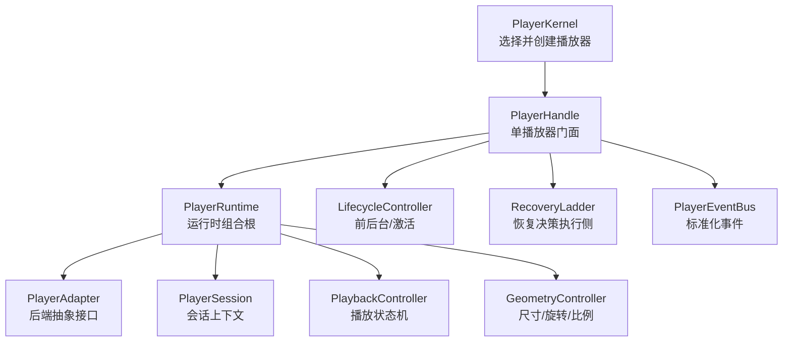

**图表来源**
- [player_handle.dart:111-147](file://packages/media_core/lib/kernel/player_handle.dart#L111-L147)
- [player_runtime.dart:16-37](file://packages/media_core/lib/runtime/player_runtime.dart#L16-L37)
- [player_adapter.dart:12-41](file://packages/media_core/lib/adapter/player_adapter.dart#L12-L41)

**章节来源**
- [player_handle.dart:111-147](file://packages/media_core/lib/kernel/player_handle.dart#L111-L147)
- [player_runtime.dart:16-37](file://packages/media_core/lib/runtime/player_runtime.dart#L16-L37)
- [player_adapter.dart:12-41](file://packages/media_core/lib/adapter/player_adapter.dart#L12-L41)

## 核心组件总览
| 组件 | 角色 | 主要职责 | 是否由 PlayerHandle 拥有 |
|---|---|---|---|
| PlayerHandle | 门面 | 公开统一 API、序列化操作、执行恢复、发布事件、保护生命周期代际 | 是 |
| PlayerRuntime | 运行时容器 | 持有 adapter、session、playback、geometry、截图管理器，并在后端切换时重建绑定 | 否，但由 handle 构造 |
| PlayerAdapter | 后端抽象 | 封装具体引擎（media_kit、ijk、native 等）的 open/play/pause/seek/volume/rate/captureFrame/close/dispose | 否，由 runtime 持有 |
| PlayerSession | 会话 | 维护 playerId、sessionId、generationId、source、policy、platform | 否，由 runtime 持有 |
| PlaybackController | 播放镜像 | 维护 command、position、duration、buffering、volume、rate、isPlaying | 否，由 runtime 持有 |
| GeometryController | 几何状态 | 维护 videoSize、rotation、scale、fit | 否，由 runtime 持有 |
| LifecycleController | 生命周期 | 管理前后台、激活、分离 | 是，由 handle 持有 |
| RecoveryLadder | 恢复阶梯 | 决定重试、换线路、换后端、放弃 | 否，但由 handle 持有并作为执行端 |
| ScreenshotManager | 截图管理器 | 优先走引擎抓帧，失败回退到渲染面抓取 | 否，由 runtime 持有 |

**章节来源**
- [player_handle.dart:111-147](file://packages/media_core/lib/kernel/player_handle.dart#L111-L147)
- [player_runtime.dart:16-37](file://packages/media_core/lib/runtime/player_runtime.dart#L16-L37)

## 架构总览
PlayerHandle 不是“又一个控制器”，而是“一个逻辑播放器的运行期入口”。它把以下关注点解耦：

1. **命令入口**：open、openMedia、play、pause、stop、seek、setVolume、setRate、setMute、setLoop。
2. **后端代理**：所有命令最终通过 `_runtime.adapter` 调用，而不是直接访问具体引擎。
3. **状态镜像**：adapter 的状态通过 `PlayerPlaybackBinding` 映射为 `PlaybackController` 的语义状态。
4. **会话与时间线**：`PlayerSession` 记录 source、generation、policy；playback 的 position/duration/buffering 同步到 session controller。
5. **恢复边界**：handle 是唯一执行恢复的地方，恢复决策由 `RecoveryLadder` 做出。
6. **事件出口**：标准化的 `PlayerEventBus` 事件对外暴露，同时保留 `adapterEvents`、`backendChanges`、`sourceChanges`、`recoveryEvents`、`onOperation` 等诊断流。

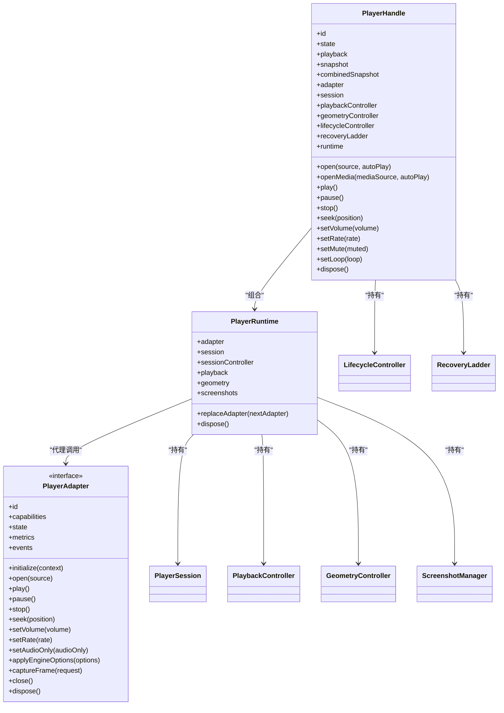

**图表来源**
- [player_handle.dart:162-519](file://packages/media_core/lib/kernel/player_handle.dart#L162-L519)
- [player_runtime.dart:38-122](file://packages/media_core/lib/runtime/player_runtime.dart#L38-L122)
- [player_adapter.dart:41-133](file://packages/media_core/lib/adapter/player_adapter.dart#L41-L133)

**章节来源**
- [player_handle.dart:162-519](file://packages/media_core/lib/kernel/player_handle.dart#L162-L519)
- [player_runtime.dart:38-122](file://packages/media_core/lib/runtime/player_runtime.dart#L38-L122)
- [player_adapter.dart:41-133](file://packages/media_core/lib/adapter/player_adapter.dart#L41-L133)

## PlayerHandle 门面职责
PlayerHandle 的核心设计目标是：**让上层只关心“我要播放什么、怎么播”，而不关心“用哪个引擎、如何恢复、如何序列化、如何保护生命周期”**。

### 门面模式体现
- 上层调用 `open`、`play`、`pause`、`seek`、`setVolume`、`setRate`、`setMute`、`setLoop`、`dispose`。
- 内部把这些调用包装成带类型、开始/完成/失败记录的 Operation。
- 通过 `_enqueue` 串行化所有后端操作，避免并发破坏状态。
- 通过 `_operationGeneration` 防止旧生命周期阶段的异步结果覆盖新状态。
- 通过 `_activeCancelToken` 取消正在进行的播放/恢复延续，但不影响独立的 volume/rate 请求队列。
- 通过 `RecoveryLadder` 集中处理失败，而不是在多个层级各自重试。

### 明确不做的事
PlayerHandle 不负责：
- 选择或创建 adapter（由 `PlayerKernel` / `PlayerAdapterSelector` 负责）。
- 决定何时重开、换源、换后端（由 `RecoveryLadder` 和策略决定）。
- 直接拥有 adapter、session、per-runtime controllers（这些属于 `PlayerRuntime`）。

**章节来源**
- [player_handle.dart:111-147](file://packages/media_core/lib/kernel/player_handle.dart#L111-L147)
- [player_handle_operations.dart:3-8](file://packages/media_core/lib/kernel/player_handle_operations.dart#L3-L8)

## 与 PlayerAdapter 的关系
PlayerAdapter 是“引擎无关”的播放后端契约。PlayerHandle 并不理解 media_kit、ijk、native 或 ffmpeg 的具体实现，它只通过 `PlayerAdapter` 的方法驱动引擎。

### 关键代理路径
| 上层方法 | 内部行为 | 最终代理到 |
|---|---|---|
| `initialize()` | 初始化 adapter 和 lifecycle | `adapter.initialize(context)` |
| `open(source)` | 重置恢复、更新 session、打开 session、打开 adapter、应用配置 | `adapter.open(source)` |
| `play()` | 恢复 ladder、调用引擎 play、更新 playback mirror、激活 lifecycle | `adapter.play()` |
| `pause()` | 暂停 ladder、调用引擎 pause、更新 playback mirror | `adapter.pause()` |
| `stop()` | 停止 ladder、调用引擎 stop、清理 session/playback/lifecycle | `adapter.stop()` |
| `seek(position)` | 校验 generation/source、调用引擎 seek、更新 playback mirror | `adapter.seek(position)` |
| `setVolume(volume)` | 防抖最新请求、必要时排队、调用引擎 setVolume | `adapter.setVolume(volume)` |
| `setRate(rate)` | 防抖最新请求、必要时排队、调用引擎 setRate | `adapter.setRate(rate)` |
| `setMute(muted)` | 通过 volume 记账实现静音/取消静音 | `adapter.setVolume(0)` 或恢复音量 |
| `captureFrame(...)` | 由 `ScreenshotManager` 优先走引擎抓帧 | `adapter.captureFrame(request)` |

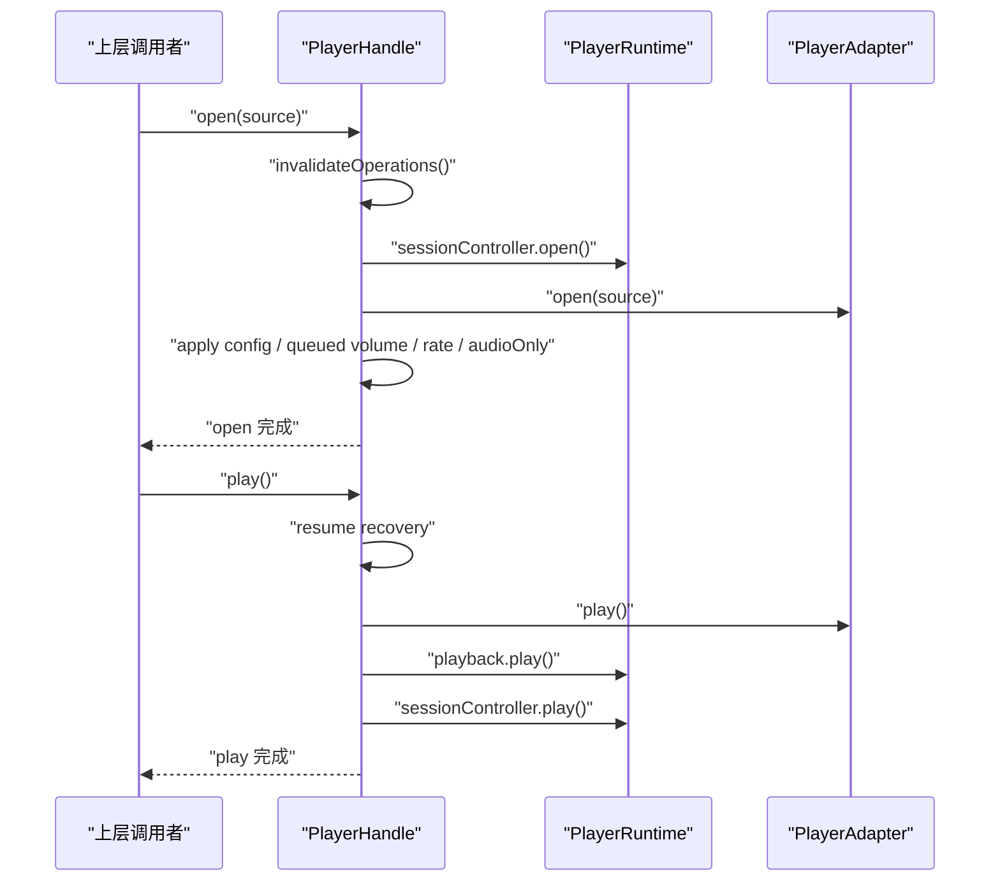

**图表来源**
- [player_handle_playback.dart:96-280](file://packages/media_core/lib/kernel/player_handle_playback.dart#L96-L280)
- [player_handle_playback.dart:309-367](file://packages/media_core/lib/kernel/player_handle_playback.dart#L309-L367)
- [player_adapter.dart:68-126](file://packages/media_core/lib/adapter/player_adapter.dart#L68-L126)

**章节来源**
- [player_handle_playback.dart:96-280](file://packages/media_core/lib/kernel/player_handle_playback.dart#L96-L280)
- [player_handle_playback.dart:309-367](file://packages/media_core/lib/kernel/player_handle_playback.dart#L309-L367)
- [player_adapter.dart:68-126](file://packages/media_core/lib/adapter/player_adapter.dart#L68-L126)

## 详细组件分析

### PlayerHandle：门面与恢复执行端
PlayerHandle 是门面，也是恢复的执行端。它实现 `RecoveryTarget`，提供：
- `isRecoveryAvailable`
- `executionEvents`
- `buildRecoverySession`
- `reopenForRecovery`
- `swapToForRecovery`

这意味着：其他模块可以报告失败，但不能直接启动恢复；只有 handle 能真正 reopen 或 swap backend。

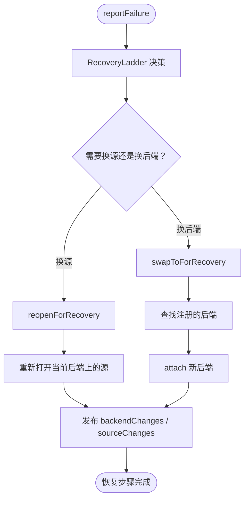

**图表来源**
- [player_handle.dart:614-683](file://packages/media_core/lib/kernel/player_handle.dart#L614-L683)

**章节来源**
- [player_handle.dart:614-683](file://packages/media_core/lib/kernel/player_handle.dart#L614-L683)

### PlayerRuntime：运行时组合根
PlayerRuntime 的职责非常清晰：它拥有当前 adapter 和 per-player 状态模块，并在后端替换时重建绑定。

关键点：
- 构造时创建 `PlayerGeometryBinding` 和 `PlayerPlaybackBinding`。
- 构造时创建 `ScreenshotManager`，并注入 engine capture、geometry size、playback position。
- `replaceAdapter` 先断开旧绑定，清空 geometry，停止 playback，再重建新绑定。
- `dispose` 按顺序释放 binding、subscription、screenshot、playback、geometry、sessionController、adapter。

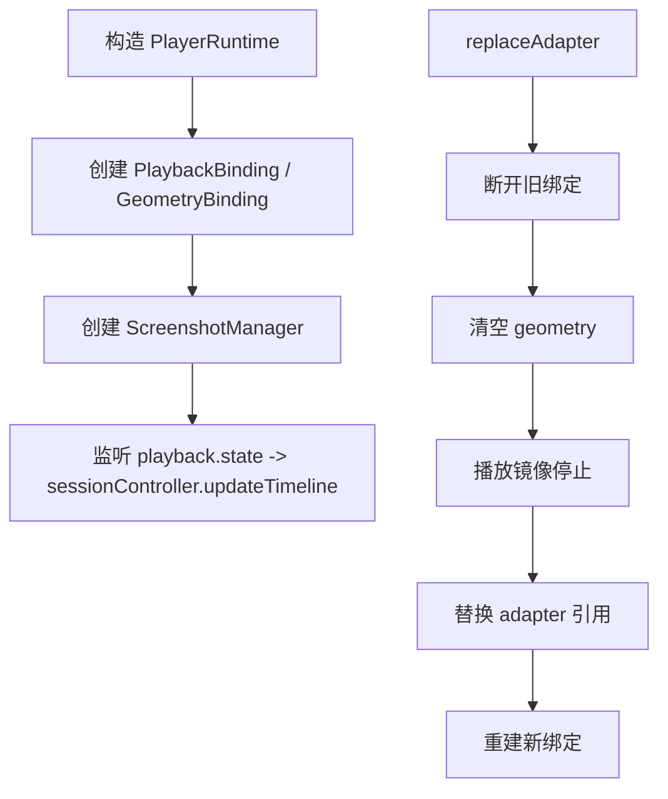

**图表来源**
- [player_runtime.dart:45-80](file://packages/media_core/lib/runtime/player_runtime.dart#L45-L80)
- [player_runtime.dart:142-173](file://packages/media_core/lib/runtime/player_runtime.dart#L142-L173)
- [player_runtime.dart:180-202](file://packages/media_core/lib/runtime/player_runtime.dart#L180-L202)

**章节来源**
- [player_runtime.dart:45-80](file://packages/media_core/lib/runtime/player_runtime.dart#L45-L80)
- [player_runtime.dart:142-173](file://packages/media_core/lib/runtime/player_runtime.dart#L142-L173)
- [player_runtime.dart:180-202](file://packages/media_core/lib/runtime/player_runtime.dart#L180-L202)

### PlayerPlaybackBinding：事件桥接
`PlayerPlaybackBinding` 是一个薄桥接器，把 `PlayerAdapter.events` 映射为 `PlaybackController` 的命令。它没有自己的状态和生命周期，只负责转发 playing/paused/stopped/buffering 等事件。

这解释了为什么 PlayerHandle 不需要手动解析每个 adapter event：adapter 事件已经通过 binding 进入 playback mirror，再由 handle 暴露给上层。

**章节来源**
- [player_playback_binding.dart:8-34](file://packages/media_core/lib/runtime/player_playback_binding.dart#L8-L34)

### 操作记录与序列化：OperationRegistry 与 OperationTracker
PlayerHandle 把所有后端操作都包装成 Operation，并通过 `OperationRegistry` 和 `OperationTracker` 暴露 `onOperation`。

重要特性：
- beginOperation 会取消上一个未完成的操作，避免历史记录永久悬挂。
- completeOperation/failOperation 分别标记成功或失败。
- `_enqueue` 保证操作串行执行。
- `_invalidateOperations` 增加生命周期代际，使旧操作无法提交状态。
- `_cancelActiveOperation` 取消当前播放/恢复延续。
- `_canUseBackend` 检查 disposed、generation、backendReady、source 是否匹配。

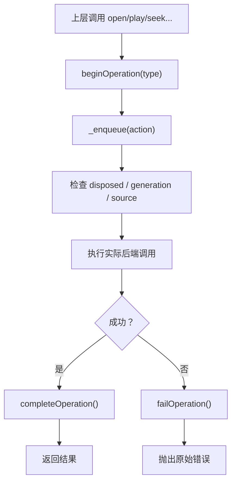

**图表来源**
- [player_handle_operations.dart:26-54](file://packages/media_core/lib/kernel/player_handle_operations.dart#L26-L54)
- [player_handle_operations.dart:106-126](file://packages/media_core/lib/kernel/player_handle_operations.dart#L106-L126)
- [player_handle_operations.dart:200-225](file://packages/media_core/lib/kernel/player_handle_operations.dart#L200-L225)

**章节来源**
- [player_handle_operations.dart:26-54](file://packages/media_core/lib/kernel/player_handle_operations.dart#L26-L54)
- [player_handle_operations.dart:106-126](file://packages/media_core/lib/kernel/player_handle_operations.dart#L106-L126)
- [player_handle_operations.dart:200-225](file://packages/media_core/lib/kernel/player_handle_operations.dart#L200-L225)

## 依赖关系分析
PlayerHandle 的依赖可以分为三层：

1. **门面层**：面向上层 API，包括 open/play/pause/stop/seek/setVolume/setRate/setMute/setLoop/dispose。
2. **运行时层**：PlayerRuntime、PlayerSession、PlaybackController、GeometryController、LifecycleController、RecoveryLadder。
3. **后端层**：PlayerAdapter、PlayerAdapterCapabilities、PlayerAdapterContext、PlayerAdapterEvent。

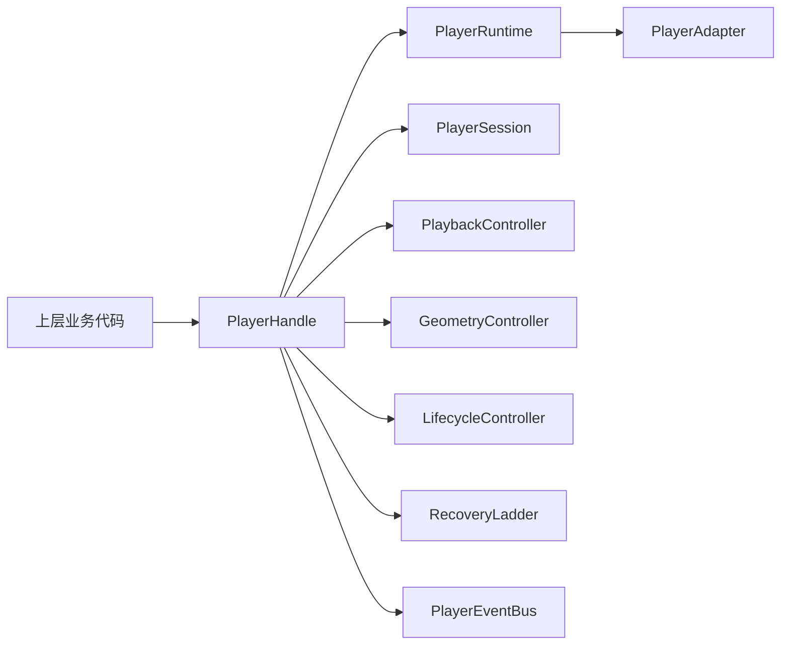

**图表来源**
- [player_handle.dart:162-519](file://packages/media_core/lib/kernel/player_handle.dart#L162-L519)
- [player_runtime.dart:38-122](file://packages/media_core/lib/runtime/player_runtime.dart#L38-L122)
- [player_adapter.dart:41-133](file://packages/media_core/lib/adapter/player_adapter.dart#L41-L133)

**章节来源**
- [player_handle.dart:162-519](file://packages/media_core/lib/kernel/player_handle.dart#L162-L519)
- [player_runtime.dart:38-122](file://packages/media_core/lib/runtime/player_runtime.dart#L38-L122)
- [player_adapter.dart:41-133](file://packages/media_core/lib/adapter/player_adapter.dart#L41-L133)

## 性能与异步处理
PlayerHandle 在性能和异步方面做了多处优化：

### 1. 操作串行化
所有后端操作通过 `_enqueue` 排队，避免并发修改 native 播放器状态。Dart Future 不能强制中断原生调用，因此序列化比“尝试取消 native 调用”更可靠。

### 2. 生命周期代际保护
每次 destructive lifecycle transition 都会递增 `_operationGeneration`，旧操作的 `_isOperationCurrent` 返回 false，从而阻止陈旧结果提交状态。

### 3. 播放/恢复延续取消
`_activeCancelToken` 用于取消 play/seek/recovery 的延续链，但不会抢占 volume/rate 的请求槽，避免用户拖动进度条或音量条时意外取消正在运行的播放。

### 4. Volume 与 Rate 请求合并
滑动条可能每秒产生多个请求，handle 使用 `_volumeRequest` 和 `_rateRequest` 计数，只保留最新请求，中间值被丢弃。

### 5. 前置参数排队
如果 `setVolume` 或 `setRate` 在 source 未 ready 时调用，handle 会记住 `_pendingVolume` / `_pendingRate`，在 `open` 成功后再应用，避免早期调用失败导致整个引擎切换失败。

### 6. 资源释放顺序
dispose 时先取消 adapter 事件订阅，再 detach lifecycle，再 dispose runtime，最后关闭 stream controllers 和 operation registry/tracker，确保订阅者不会被挂起。

**章节来源**
- [player_handle_operations.dart:117-177](file://packages/media_core/lib/kernel/player_handle_operations.dart#L117-L177)
- [player_handle_operations.dart:200-225](file://packages/media_core/lib/kernel/player_handle_operations.dart#L200-L225)
- [player_handle_playback.dart:498-605](file://packages/media_core/lib/kernel/player_handle_playback.dart#L498-L605)
- [player_handle.dart:689-747](file://packages/media_core/lib/kernel/player_handle.dart#L689-L747)

## 事件订阅、状态同步与错误传播

### 事件通道
| 事件流 | 用途 |
|---|---|
| `stateChanges` / `playbackStream` | 播放语义状态，适合 UI 刷新 |
| `snapshots` / `snapshot` | 会话快照，包含 source、generation、policy、platform |
| `adapterEvents` | 当前 adapter 的原始事件，跨后端切换仍稳定 |
| `backendChanges` | 后端切换通知，from → to + 新 adapter |
| `sourceChanges` | 当前打开源变化，包括恢复自动换源 |
| `recoveryEvents` | 恢复阶梯决策事件 |
| `onOperation` | 操作记录流，用于诊断“播放器实际做了什么” |

### 状态同步
- `PlayerPlaybackBinding` 将 adapter 的 playing/paused/stopped/buffering 转换为 playback controller 命令。
- `PlayerRuntime` 监听 `playback.state`，把 position/duration/buffering 同步到 `sessionController.updateTimeline`。
- `PlayerHandle` 暴露 `playback.current.position`、`duration`、`buffered`、`progress`、`volume`、`rate`、`isPlaying`。

### 错误传播
- 普通操作失败会通过 `_record` 的 onError 分支调用 `failOperation()`，然后抛出原始错误。
- 恢复失败通过 `RecoveryLadder` 决策，handle 暴露 `recoveryEvents` 和 `recoveryFailure`。
- 后端能力不足或计划不支持时，`openMedia` 可能抛出 `UnsupportedError`。
- 对已 dispose 的 handle 调用会抛出 `StateError`。
- 对未打开 source 的播放类操作会抛出 `StateError`。

**章节来源**
- [player_handle.dart:420-604](file://packages/media_core/lib/kernel/player_handle.dart#L420-L604)
- [player_handle.dart:614-683](file://packages/media_core/lib/kernel/player_handle.dart#L614-L683)
- [player_handle_playback.dart:295-307](file://packages/media_core/lib/kernel/player_handle_playback.dart#L295-L307)
- [player_handle_operations.dart:106-126](file://packages/media_core/lib/kernel/player_handle_operations.dart#L106-L126)

## 常见操作流程时序图

### 播放流程：open → play
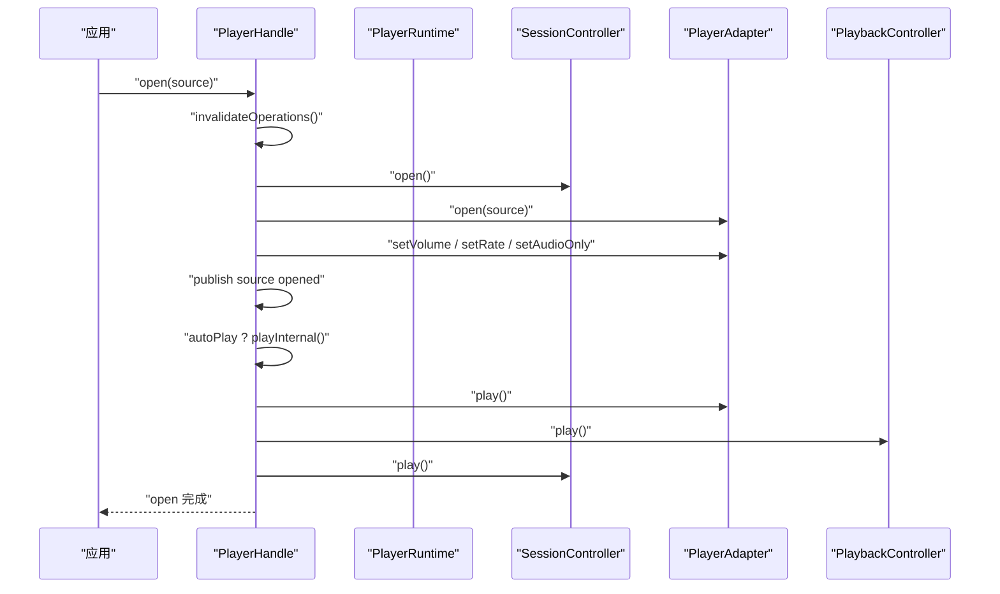

**图表来源**
- [player_handle_playback.dart:96-280](file://packages/media_core/lib/kernel/player_handle_playback.dart#L96-L280)
- [player_handle_playback.dart:309-367](file://packages/media_core/lib/kernel/player_handle_playback.dart#L309-L367)

### 暂停流程：pause
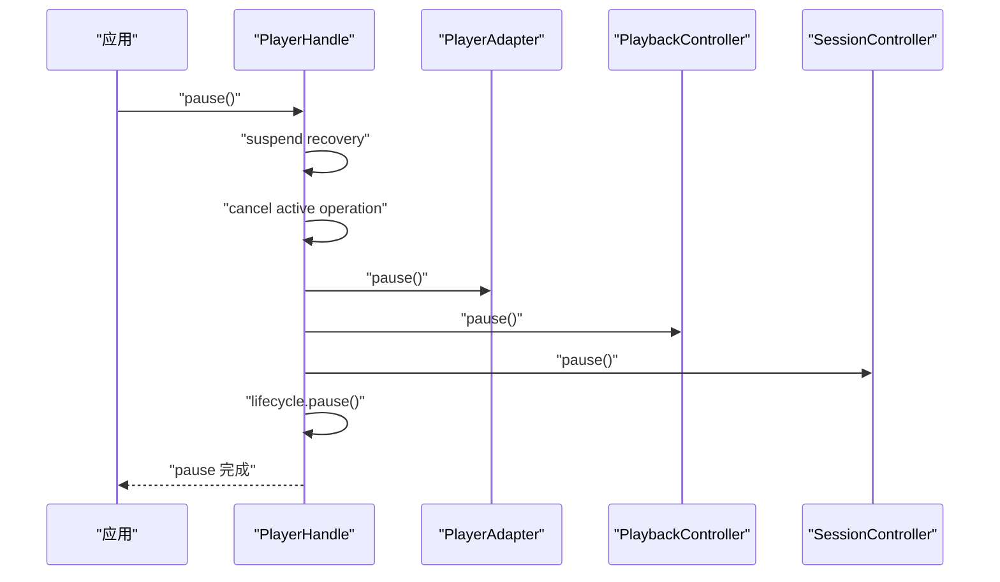

**图表来源**
- [player_handle_playback.dart:369-407](file://packages/media_core/lib/kernel/player_handle_playback.dart#L369-L407)

### 跳转流程：seek
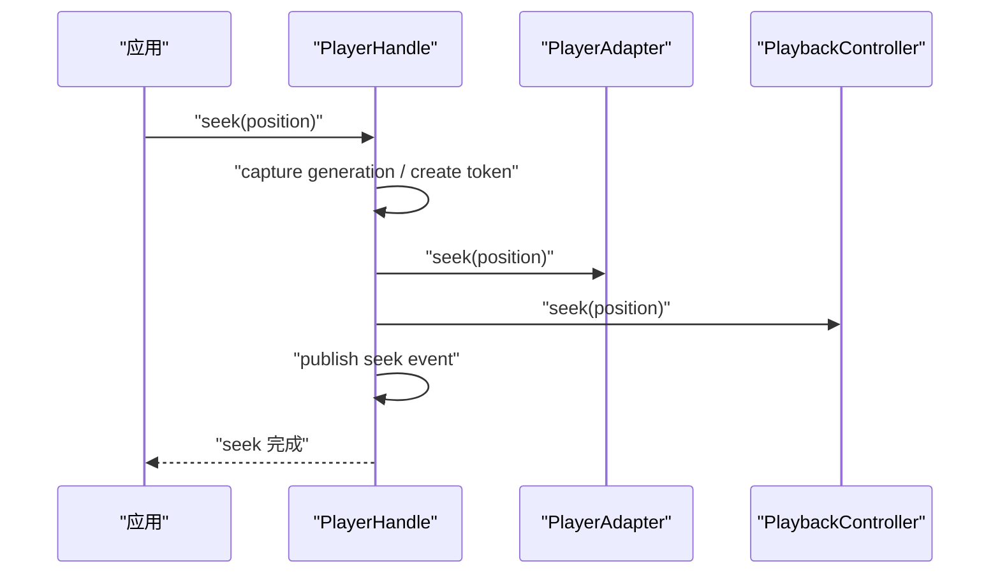

**图表来源**
- [player_handle_playback.dart:457-496](file://packages/media_core/lib/kernel/player_handle_playback.dart#L457-L496)

### 音量调整流程：setVolume
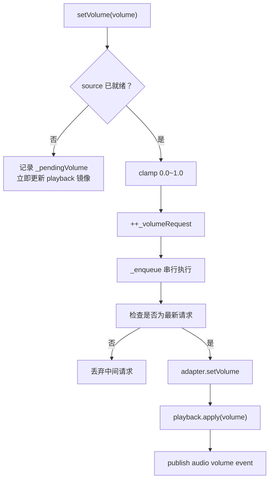

**图表来源**
- [player_handle_playback.dart:498-556](file://packages/media_core/lib/kernel/player_handle_playback.dart#L498-L556)

## 使用示例与最佳实践

### 基本用法
- 通过 `PlayerKernel.create` 获取 `PlayerHandle`。
- 调用 `open` 打开 `PlayerSource`。
- 根据需求调用 `play`、`pause`、`stop`、`seek`。
- 使用 `setVolume`、`setRate`、`setMute`、`setLoop` 调整行为。
- 使用 `dispose` 释放资源。

参考示例路径：
- [presentation_demo_page.dart:67-83](file://example/lib/pages/presentation_demo_page.dart#L67-L83)

### 推荐实践
1. **始终通过 handle 操作，不要直接操作 adapter**  
   handle 负责序列化、生命周期保护、恢复、事件标准化。

2. **订阅 stateChanges 或 playbackStream 做 UI 同步**  
   这是语义化的播放状态，不依赖具体后端。

3. **使用 onOperation 做诊断**  
   当出现“引擎说播放了但 UI 没动”或“恢复风暴”时，onOperation 能回答“handle 实际调用了什么、顺序是什么、哪里失败”。

4. **不要在 dispose 后继续调用 handle**  
   handle 会抛出 `StateError`。

5. **在 source 未 ready 时调用 setVolume/setRate 是安全的**  
   handle 会排队并在 open 完成后应用。

6. **需要观察后端切换时使用 backendChanges**  
   因为恢复可能自动换后端，`adapter` 引用会变。

7. **需要观察自动换源时使用 sourceChanges**  
   恢复可能自动切换到备选线路。

8. **截图优先走引擎抓帧，失败回退渲染面**  
   由 `ScreenshotManager` 处理，上层只需调用 handle 暴露的截图能力。

**章节来源**
- [presentation_demo_page.dart:67-83](file://example/lib/pages/presentation_demo_page.dart#L67-L83)
- [player_handle_playback.dart:498-605](file://packages/media_core/lib/kernel/player_handle_playback.dart#L498-L605)
- [player_handle.dart:420-604](file://packages/media_core/lib/kernel/player_handle.dart#L420-L604)

## 故障排查指南

### 常见问题与定位方式
| 现象 | 可能原因 | 排查建议 |
|---|---|---|
| 调用 open 后立即调用 setVolume 报错 | 旧版本要求 source ready，新版本已支持排队 | 升级到当前实现，或使用 `onOperation` 确认 open 是否完成 |
| 播放状态不一致 | adapter 事件延迟、engine autoplay、缓冲事件覆盖 | 订阅 `stateChanges`，不要只看 `isPlaying` |
| 恢复后声音突然变大 | mute 状态未正确应用到新后端 | 检查 `_applyMute` 和 `backendChanges` |
| 恢复风暴 | 多个恢复循环竞争 | 确认只有一个 `RecoveryLadder`，上层不应自建重复恢复 |
| seek 后位置不更新 | 后端接受 seek 但未上报 positionChanged | 查看 adapter 实现是否正确 emit position |
| dispose 后仍有回调 | 未取消订阅或 stream 未关闭 | 检查 `adapterEvents`、`recoveryEvents`、`onOperation` 订阅 |
| 截图格式不符 | 引擎不支持请求格式 | 让引擎返回 null，由框架回退渲染面抓取 |

### 关键断言点
- `_ensureNotDisposed`：handle 已释放。
- `_ensureSource`：没有打开 source。
- `_canUseBackend`：generation/source/backend 不匹配。
- `isRecoveryAvailable`：disposed 或无 currentSource。
- `openMedia`：planner 返回 UnsupportedPlan。

**章节来源**
- [player_handle_operations.dart:227-256](file://packages/media_core/lib/kernel/player_handle_operations.dart#L227-L256)
- [player_handle.dart:614-683](file://packages/media_core/lib/kernel/player_handle.dart#L614-L683)
- [player_handle_playback.dart:295-307](file://packages/media_core/lib/kernel/player_handle_playback.dart#L295-L307)

## 结论
PlayerHandle 是 media_core 中最重要的门面之一：它把复杂的后端选择、会话管理、播放状态机、几何调整、截图、生命周期、恢复策略和事件系统收敛为一个稳定的单播放器入口。

对初学者来说，最重要的是记住：
- 你只需要关心 `PlayerHandle`。
- 它负责 open/play/pause/stop/seek/volume/rate/mute/loop/dispose。
- 它背后可能有 media_kit、ijk、native 或其他引擎。
- 它会自动处理恢复、事件、状态同步和资源释放。

对高级开发者来说，扩展时应遵循：
- 新增播放相关能力时，尽量通过 `PlayerRuntime` 或现有 controller 扩展，而不是绕过 handle。
- 新增后端能力时，实现 `PlayerAdapter`，并通过 `PlayerAdapterCapabilities` 声明。
- 新增恢复策略时，通过 `RecoveryLadder` 和候选提供者扩展，而不是在 handle 内写硬编码重试。
- 新增诊断能力时，优先使用 `onOperation`、`combinedSnapshot`、`recoveryEvents`、`backendChanges`、`sourceChanges`。