# PlayerKernel 全局协调器

<cite>
**本文引用的文件**   
- [player_kernel.dart](file://packages/media_core/lib/kernel/player_kernel.dart)
- [player_handle.dart](file://packages/media_core/lib/kernel/player_handle.dart)
- [global_player_coordinator.dart](file://packages/media_core/lib/coordinator/global_player_coordinator.dart)
- [kernel_options.dart](file://packages/media_core/lib/kernel/kernel_options.dart)
- [README.md](file://README.md)
</cite>

## 目录
1. [引言](#引言)
2. [项目结构定位](#项目结构定位)
3. [核心职责与边界](#核心职责与边界)
4. [架构总览](#架构总览)
5. [详细组件分析](#详细组件分析)
6. [依赖关系分析](#依赖关系分析)
7. [播放器创建流程](#播放器创建流程)
8. [后端注册与扩展点](#后端注册与扩展点)
9. [生命周期、内存与资源清理](#生命周期内存与资源清理)
10. [错误处理与恢复策略](#错误处理与恢复策略)
11. [性能特性与优化建议](#性能特性与优化建议)
12. [常见问题排查](#常见问题排查)
13. [最佳实践指南](#最佳实践指南)
14. [结论](#结论)

## 引言
PlayerKernel 是 Media Core 框架的编排根节点。它不直接解码媒体，也不渲染视频；它的职责是把“源解析、后端选择、会话管理、播放状态、恢复决策、事件总线、池化、预加载、跨播放器协作”等模块组合成一个可用的工作播放器框架。

从用户视角看，典型流程是：
- 初始化平台能力包（例如系统媒体面）。
- 创建一个 `PlayerKernel`。
- 注册一个或多个后端适配器。
- 调用 `create` 或 `createFromMedia` 获取 `PlayerHandle`。
- 通过 UI 控件或控制器驱动播放。

从实现视角看，PlayerKernel 负责：
- 创建和释放播放器。
- 为源选择后端。
- 提供每播放器的恢复上下文。
- 暴露全局事件流。
- 挂载音频、呈现、平台能力等横切能力。
- 维护活跃播放器、池化实例、预加载队列。

**章节来源**
- [README.md:14-43](file://README.md#L14-L43)
- [README.md:55-81](file://README.md#L55-L81)
- [player_kernel.dart:50-114](file://packages/media_core/lib/kernel/player_kernel.dart#L50-L114)

## 项目结构定位
在仓库中，PlayerKernel 位于核心包 `media_core` 的 kernel 层，是整个框架的入口类之一。它与以下关键概念紧密相关：
- `PlayerSource` / `MediaSource`：输入源。
- `PlayerAdapterRegistry` / `PlayerAdapterSelector`：后端注册与选择。
- `PlayerHandle`：单个逻辑播放器的门面。
- `PlayerRuntime`：组合根，持有 adapter、session、playback、geometry 等。
- `GlobalPlayerCoordinator`：跨播放器协作根。
- `PlayerEventBus`：全局事件流。
- `PlayerPool` / `PreloadManager`：池化与预热。
- `KernelOptions`：内核级默认行为配置。

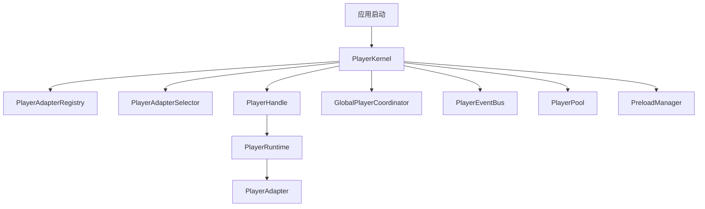

**图表来源**
- [player_kernel.dart:50-114](file://packages/media_core/lib/kernel/player_kernel.dart#L50-L114)
- [README.md:55-81](file://README.md#L55-L81)

**章节来源**
- [README.md:55-81](file://README.md#L55-L81)
- [player_kernel.dart:50-114](file://packages/media_core/lib/kernel/player_kernel.dart#L50-L114)

## 核心职责与边界
PlayerKernel 的核心职责可以概括为四类：

| 类别 | 说明 |
| --- | --- |
| 播放器生命周期 | 创建、查找、回收、释放播放器。 |
| 后端选择 | 根据源、协议、格式、直播能力、优先级选择后端。 |
| 恢复上下文 | 为每个播放器提供恢复所需的注册表、选择器、预算。 |
| 全局事件 | 暴露统一的事件流，供 UI、诊断、能力包订阅。 |

PlayerKernel **不负责**：
- 解码媒体。
- 拥有每播放器的播放状态。
- 跨后端驱动恢复。
- 渲染视频。

这些职责分别属于 `PlayerAdapter`、`PlayerHandle` / `PlaybackController`、`RecoveryLadder`、呈现控件。

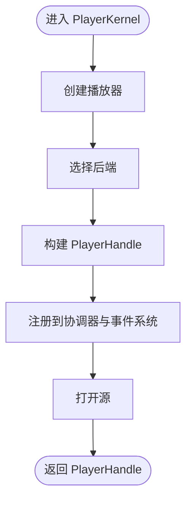

**图表来源**
- [player_kernel.dart:304-400](file://packages/media_core/lib/kernel/player_kernel.dart#L304-L400)

**章节来源**
- [player_kernel.dart:82-114](file://packages/media_core/lib/kernel/player_kernel.dart#L82-L114)
- [player_handle.dart:111-148](file://packages/media_core/lib/kernel/player_handle.dart#L111-L148)

## 架构总览
PlayerKernel 把多个模块串联起来，形成完整的工作播放器框架。其顶层数据流如下：

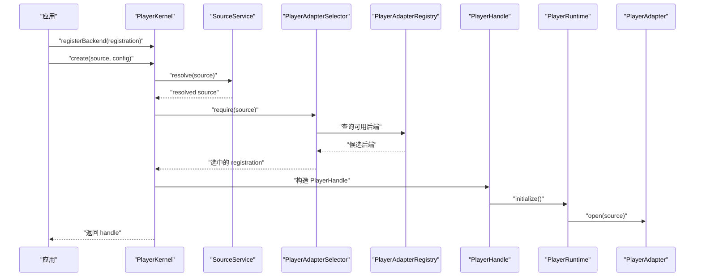

**图表来源**
- [player_kernel.dart:268-400](file://packages/media_core/lib/kernel/player_kernel.dart#L268-L400)
- [player_handle.dart:162-208](file://packages/media_core/lib/kernel/player_handle.dart#L162-L208)

**章节来源**
- [player_kernel.dart:268-400](file://packages/media_core/lib/kernel/player_kernel.dart#L268-L400)
- [player_handle.dart:162-208](file://packages/media_core/lib/kernel/player_handle.dart#L162-L208)

## 详细组件分析

### PlayerKernel：编排根节点
PlayerKernel 是一个可观察应用生命周期的类，内部持有：
- 后端注册表。
- 懒加载的后端选择器。
- 可选的源解析服务。
- 全局事件总线。
- 播放器池。
- 预加载管理器。
- 全局协调器。
- 媒体源规划器。
- 音频、呈现、平台能力驱动。
- 当前活跃播放器。
- 所有活跃 handle 的索引。

它的关键方法包括：
- `registerBackend` / `unregisterBackend`：注册/注销后端。
- `create` / `createFromMedia`：创建播放器。
- `acquire`：从池中获取空闲播放器。
- `release`：彻底释放播放器。
- `preload`：加入预加载队列。
- `events` / `subscribe`：订阅全局事件。
- `attachAudio` / `detachAudio`：挂载音频能力。
- `attachPlatformProvider` / `detachPlatformProvider`：挂载设备能力探针。
- `attachPresentation` / `enterFullscreen` / `enterPip` 等：挂载呈现能力并发起窗口请求。

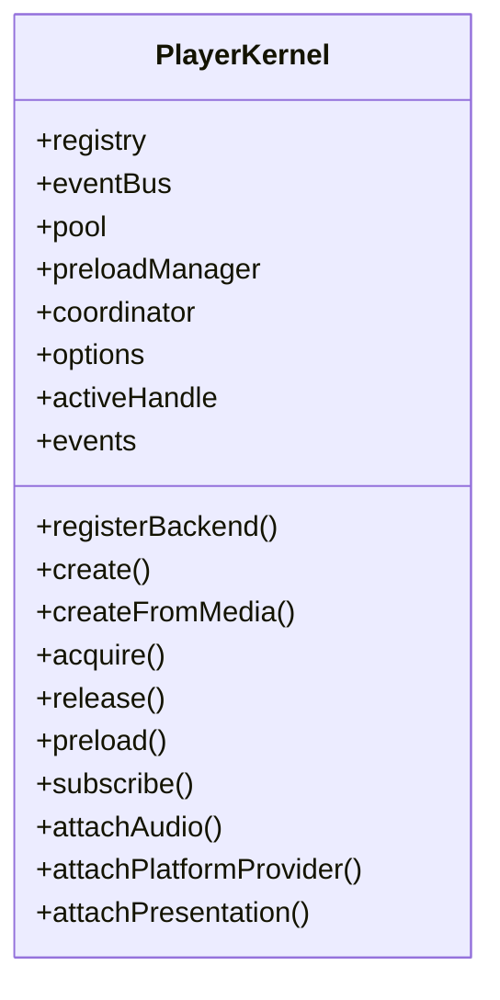

**图表来源**
- [player_kernel.dart:115-256](file://packages/media_core/lib/kernel/player_kernel.dart#L115-L256)
- [player_kernel.dart:268-716](file://packages/media_core/lib/kernel/player_kernel.dart#L268-L716)

**章节来源**
- [player_kernel.dart:115-256](file://packages/media_core/lib/kernel/player_kernel.dart#L115-L256)
- [player_kernel.dart:268-716](file://packages/media_core/lib/kernel/player_kernel.dart#L268-L716)

### GlobalPlayerCoordinator：跨播放器协作根
GlobalPlayerCoordinator 聚合多个子协调器，负责：
- 播放器身份与会话协调。
- 播放状态协调。
- 页面可见性协调。
- 音频焦点协调。
- 资源压力协调。
- 预加载协调。
- 生命周期协调。
- 全屏、画中画、浮窗等呈现协调。

它不创建播放器，也不执行后端命令，也不存储播放状态。

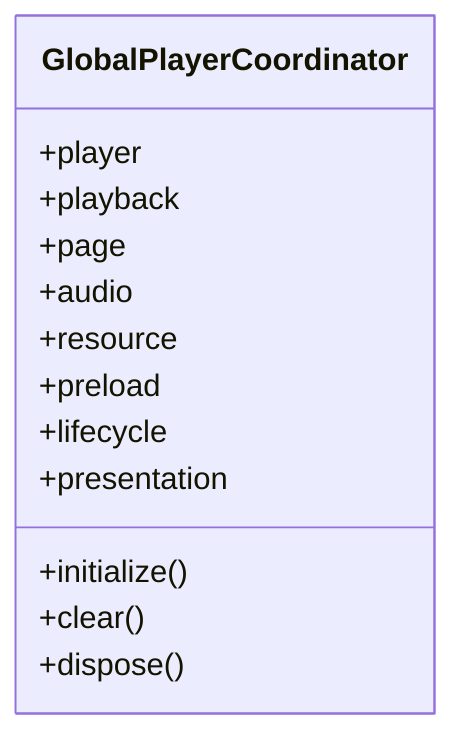

**图表来源**
- [global_player_coordinator.dart:10-47](file://packages/media_core/lib/coordinator/global_player_coordinator.dart#L10-L47)
- [global_player_coordinator.dart:73-112](file://packages/media_core/lib/coordinator/global_player_coordinator.dart#L73-L112)

**章节来源**
- [global_player_coordinator.dart:10-47](file://packages/media_core/lib/coordinator/global_player_coordinator.dart#L10-L47)
- [global_player_coordinator.dart:73-112](file://packages/media_core/lib/coordinator/global_player_coordinator.dart#L73-L112)

### PlayerHandle：单播放器门面
PlayerHandle 是单个逻辑播放器的运行时门面。它组合了：
- `PlayerRuntime`：adapter、session、playback、geometry。
- `LifecycleController`：激活、停用、回收。
- `RecoveryLadder`：恢复决策执行。
- `OperationRegistry` / `OperationTracker`：操作记录与序列化。
- 多个广播流：adapter 事件、后端变更、源变更、恢复事件。

PlayerHandle 的职责是转发播放命令、执行恢复步骤、发布标准化事件、序列化后端操作，并用生命周期代际保护旧操作。

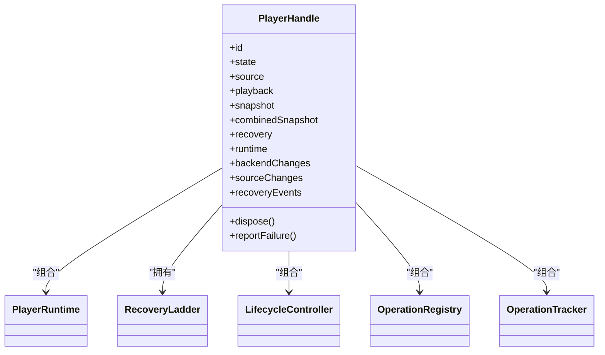

**图表来源**
- [player_handle.dart:111-208](file://packages/media_core/lib/kernel/player_handle.dart#L111-L208)
- [player_handle.dart:281-393](file://packages/media_core/lib/kernel/player_handle.dart#L281-L393)
- [player_handle.dart:689-747](file://packages/media_core/lib/kernel/player_handle.dart#L689-L747)

**章节来源**
- [player_handle.dart:111-208](file://packages/media_core/lib/kernel/player_handle.dart#L111-L208)
- [player_handle.dart:281-393](file://packages/media_core/lib/kernel/player_handle.dart#L281-L393)
- [player_handle.dart:689-747](file://packages/media_core/lib/kernel/player_handle.dart#L689-L747)

### KernelOptions：内核级配置
KernelOptions 描述内核级默认行为，包括：
- 是否启用自动恢复。
- 是否启用后端降级。
- 是否启用播放器池。
- 是否启用事件总线。
- 是否自动挂载音频能力。
- 是否在后台暂停所有播放器。
- 最大恢复次数、最大降级次数。
- 重试基础延迟与上限。

它不存储每播放器状态，也不替单个播放器做决策。

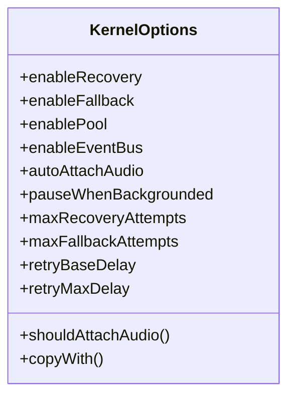

**图表来源**
- [kernel_options.dart:4-34](file://packages/media_core/lib/kernel/kernel_options.dart#L4-L34)
- [kernel_options.dart:86-101](file://packages/media_core/lib/kernel/kernel_options.dart#L86-L101)
- [kernel_options.dart:103-127](file://packages/media_core/lib/kernel/kernel_options.dart#L103-L127)

**章节来源**
- [kernel_options.dart:4-34](file://packages/media_core/lib/kernel/kernel_options.dart#L4-L34)
- [kernel_options.dart:86-101](file://packages/media_core/lib/kernel/kernel_options.dart#L86-L101)
- [kernel_options.dart:103-127](file://packages/media_core/lib/kernel/kernel_options.dart#L103-L127)

## 依赖关系分析
PlayerKernel 的依赖关系体现为“弱耦合、强编排”：
- 后端注册表由外部注入或默认构造。
- 选择器懒加载，绑定注册表。
- 事件总线、池、预加载、协调器默认构造，也可替换。
- 音频、呈现、平台能力通过 attach/detach 挂载。
- PlayerHandle 持有 runtime、ladder、controllers，但不反向决定后端选择。

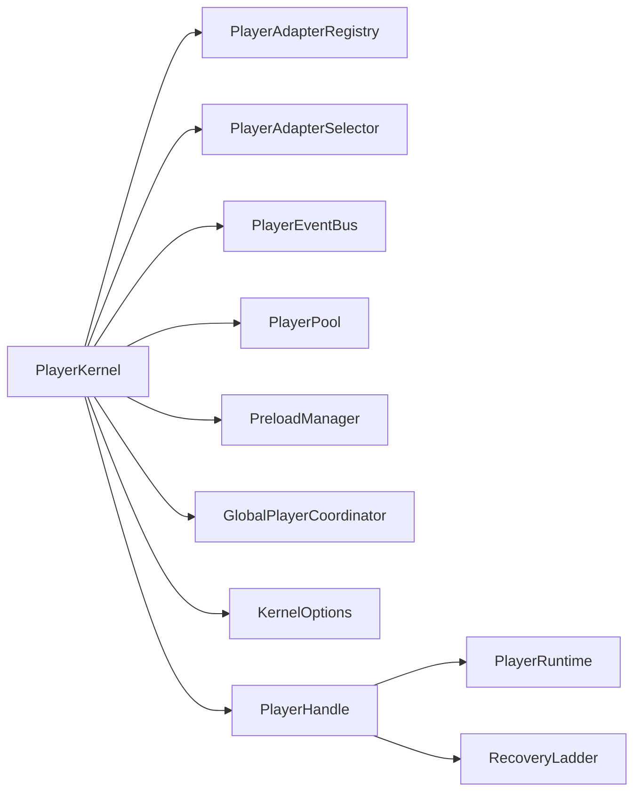

**图表来源**
- [player_kernel.dart:121-170](file://packages/media_core/lib/kernel/player_kernel.dart#L121-L170)
- [player_handle.dart:162-208](file://packages/media_core/lib/kernel/player_handle.dart#L162-L208)

**章节来源**
- [player_kernel.dart:121-170](file://packages/media_core/lib/kernel/player_kernel.dart#L121-L170)
- [player_handle.dart:162-208](file://packages/media_core/lib/kernel/player_handle.dart#L162-L208)

## 播放器创建流程
`PlayerKernel.create` 的典型流程如下：

1. 如果传入 `PlayerSource`，先通过 `SourceService` 解析。
2. 使用 `selector.require` 选择后端。
3. 生成 `PlayerIdentity` 和 `SessionId`。
4. 通过后端工厂创建 `PlayerAdapter`。
5. 构造 `PlayerAdapterContext`，携带音量、速率、硬件加速、音频开关、平台能力。
6. 构造 `PlayerHandle`。
7. 应用静音、降级开关等配置。
8. 调用 `handle.initialize()`。
9. 将 handle 注册到全局协调器。
10. 如果提供了源，则调用 `handle.open`，失败时释放并抛出异常。
11. 返回 `PlayerHandle`。

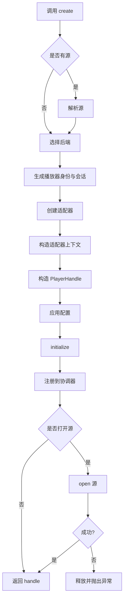

**图表来源**
- [player_kernel.dart:304-400](file://packages/media_core/lib/kernel/player_kernel.dart#L304-L400)

**章节来源**
- [player_kernel.dart:304-400](file://packages/media_core/lib/kernel/player_kernel.dart#L304-L400)

## 后端注册与扩展点
后端注册是扩展 Media Core 播放引擎的关键入口。常见做法：
- 引入后端适配包，例如 media_kit、ijk、better_player、fvp。
- 调用 `kernel.registerBackend(adapterFactory.registration())`。
- 如果需要强制某个后端，可在 `create` 时传入 `preferredBackend`。
- 如果需要提前判断某个源能否播放，可使用 `planFor`。

扩展点设计原则：
- 后端能力声明是唯一来源。
- 选择器按协议、格式、直播能力、优先级打分。
- 不支持的复合源会抛出明确异常，而不是静默回退。
- 能力未知不等于不支持，保留“未探测”表达。

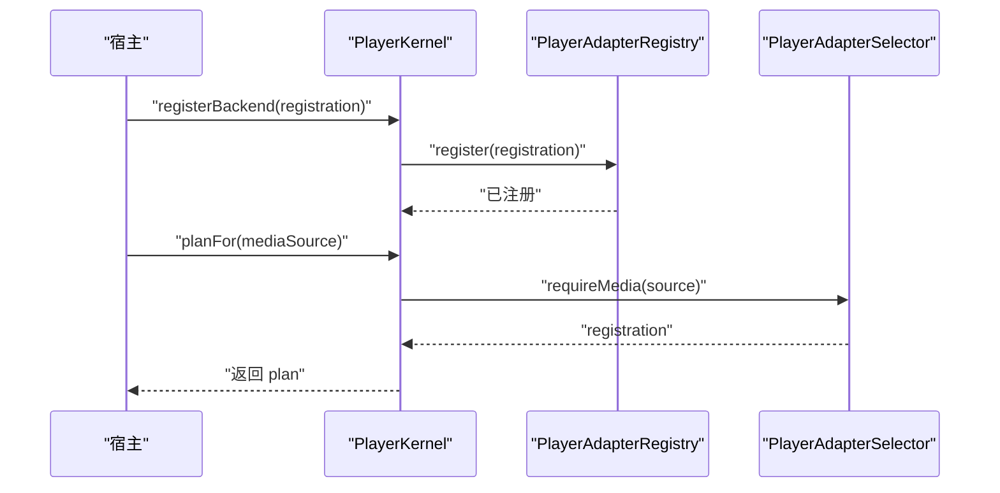

**图表来源**
- [player_kernel.dart:268-287](file://packages/media_core/lib/kernel/player_kernel.dart#L268-L287)
- [player_kernel.dart:236-244](file://packages/media_core/lib/kernel/player_kernel.dart#L236-L244)

**章节来源**
- [player_kernel.dart:236-287](file://packages/media_core/lib/kernel/player_kernel.dart#L236-L287)

## 生命周期、内存与资源清理
PlayerKernel 的生命周期管理包含三层：

| 层级 | 内容 |
| --- | --- |
| 内核级 | 跟踪活跃播放器、挂载生命周期观察者、记录内存贡献者。 |
| 播放器级 | `PlayerHandle.dispose` 取消订阅、关闭控制器、清理恢复阶梯、关闭广播流。 |
| 协调器级 | `GlobalPlayerCoordinator.clear` / `dispose` 清理各子协调器。 |

资源清理关键点：
- `release(playerId)` 会从 `_handles` 移除 handle。
- 更新活跃播放器引用。
- 解绑音频激活状态。
- 从协调器分离会话、注销播放器。
- 从池中移除。
- 调用 `handle.dispose()`。

内存方面，PlayerKernel 使用共享内存账户记录自身贡献，并通过 `MemoryModule.kernel` 标识。

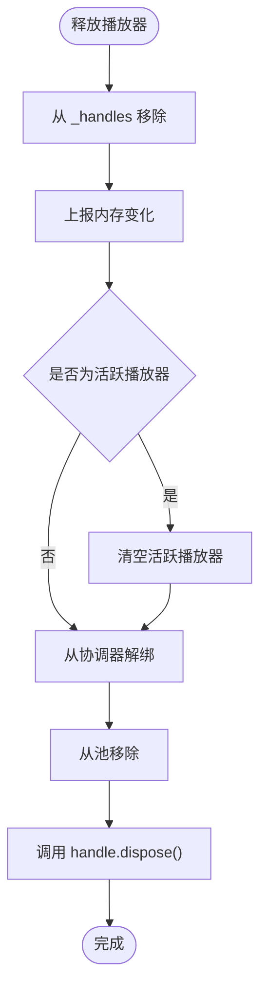

**图表来源**
- [player_kernel.dart:491-515](file://packages/media_core/lib/kernel/player_kernel.dart#L491-L515)
- [player_handle.dart:689-747](file://packages/media_core/lib/kernel/player_handle.dart#L689-L747)

**章节来源**
- [player_kernel.dart:491-515](file://packages/media_core/lib/kernel/player_kernel.dart#L491-L515)
- [player_handle.dart:689-747](file://packages/media_core/lib/kernel/player_handle.dart#L689-L747)

## 错误处理与恢复策略
PlayerKernel 不再运行全局降级循环。它只负责提供恢复上下文：注册表、选择器、预算。真正的恢复决策和执行集中在 `PlayerHandle` 的 `RecoveryLadder`。

恢复梯级顺序：
1. 同后端重开。
2. 换线路。
3. 换后端。
4. 放弃。

每一步都需要证明播放确实在推进，例如位置前进或直播重新基线。

PlayerKernel 的错误处理重点：
- 源解析失败不会阻止打开原始源，但会留下日志。
- `create` 中 `open` 失败会释放 handle 并抛出异常。
- 呈现请求缺少驱动或未找到播放器会抛出 `StateError`。

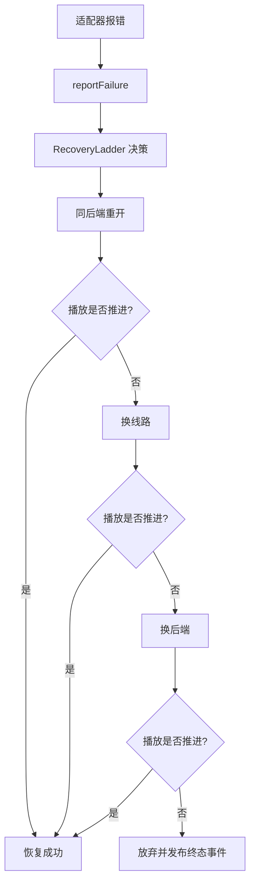

**图表来源**
- [README.md:92-103](file://README.md#L92-L103)
- [player_handle.dart:607-683](file://packages/media_core/lib/kernel/player_handle.dart#L607-L683)

**章节来源**
- [README.md:92-103](file://README.md#L92-L103)
- [player_kernel.dart:750-760](file://packages/media_core/lib/kernel/player_kernel.dart#L750-L760)
- [player_handle.dart:607-683](file://packages/media_core/lib/kernel/player_handle.dart#L607-L683)

## 性能特性与优化建议
PlayerKernel 的性能设计体现在以下几个方面：

| 方面 | 设计 | 优化意义 |
| --- | --- | --- |
| 懒加载依赖 | selector、sourceService、planner 等按需构造 | 减少无谓初始化成本。 |
| 播放器池 | `acquire` / `recycle` | 列表、信息流、直播场景复用解码器。 |
| 预加载 | `PreloadManager` | 提前准备下一个条目。 |
| 事件总线 | 全局归一化事件 | 避免多对多直接耦合。 |
| 活跃播放器追踪 | 基于事件标记 activeHandle | 简化音频焦点与系统媒体面切换。 |
| 平台能力探针 | 非阻塞 attach | 不阻塞播放器启动。 |
| 后台暂停 | 可选 | 避免后台大量解码消耗电量。 |

优化建议：
- 列表播放优先使用池化接口。
- 开启预加载，但注意内存压力。
- 只在需要时挂载系统媒体面。
- 使用 `planFor` 提前判断能力，避免无效创建。
- 合理设置 `KernelOptions.pauseWhenBackgrounded`。

**章节来源**
- [player_kernel.dart:115-159](file://packages/media_core/lib/kernel/player_kernel.dart#L115-L159)
- [player_kernel.dart:442-469](file://packages/media_core/lib/kernel/player_kernel.dart#L442-L469)
- [player_kernel.dart:521-537](file://packages/media_core/lib/kernel/player_kernel.dart#L521-L537)
- [player_kernel.dart:597-626](file://packages/media_core/lib/kernel/player_kernel.dart#L597-L626)
- [kernel_options.dart:48-66](file://packages/media_core/lib/kernel/kernel_options.dart#L48-L66)

## 常见问题排查
| 问题 | 可能原因 | 排查方向 |
| --- | --- | --- |
| 没有后端被选中 | 未注册后端或源不被任何后端支持 | 检查 `registerBackend` 与 `planFor`。 |
| 创建后无法播放 | `open` 失败但未捕获异常 | 检查源解析、签名 URL、权限。 |
| 恢复后声音突然变大 | 新后端未恢复静音状态 | 确认 handle 的 muted 状态与 `_applyTrackPreferences`。 |
| 后台继续播放耗电 | `pauseWhenBackgrounded` 为 false | 调整 `KernelOptions` 或自行管理生命周期。 |
| 截图为空 | 播放器无源、无渲染面、或双通道都失败 | 检查 `captureScreenshot` 条件。 |
| 全屏/画中画报错 | 未挂载呈现驱动或播放器不存在 | 检查 `attachPresentation` 与 playerId。 |

**章节来源**
- [player_kernel.dart:268-287](file://packages/media_core/lib/kernel/player_kernel.dart#L268-L287)
- [player_kernel.dart:304-400](file://packages/media_core/lib/kernel/player_kernel.dart#L304-L400)
- [player_kernel.dart:688-716](file://packages/media_core/lib/kernel/player_kernel.dart#L688-L716)
- [player_handle.dart:265-275](file://packages/media_core/lib/kernel/player_handle.dart#L265-L275)

## 最佳实践指南
面向初学者：
- 先理解“全局协调器”的概念：它像导演，不亲自表演，但安排演员、道具、舞台。
- 记住标准流程：注册后端 → 创建播放器 → 打开源 → 控制播放。
- 不要直接操作底层解码器，而是通过 `PlayerHandle`。

面向高级开发者：
- 自定义后端：实现适配器契约，通过 `registerBackend` 注册。
- 自定义恢复策略：通过 `RecoveryLadder` 与 `RecoveryTarget`，而不是在 kernel 里写降级循环。
- 自定义能力：通过 `KernelAudioDriver`、`KernelPresentationDriver`、`PlatformProvider` 挂载。
- 自定义事件：订阅 `PlayerKernel.events`，或使用 `PlayerEventBus`。
- 自定义池化：结合 `PlayerPool` 与 `acquire` / `recycle`。
- 自定义预加载：使用 `PreloadManager` 与 `preload`。

推荐实践清单：
- 进程内只启用一次系统媒体面。
- 为不同场景使用不同的 `KernelOptions`。
- 对直播使用专用控制器，避免与通用播放器恢复冲突。
- 使用 `combinedSnapshot` 做 UI 快照，避免竞态。
- 使用 `onOperation` 做诊断，而不是散乱日志。

**章节来源**
- [README.md:14-43](file://README.md#L14-L43)
- [player_kernel.dart:115-159](file://packages/media_core/lib/kernel/player_kernel.dart#L115-L159)
- [player_handle.dart:149-161](file://packages/media_core/lib/kernel/player_handle.dart#L149-L161)

## 结论
PlayerKernel 是 Media Core 框架的编排根节点。它把源、后端、会话、播放、恢复、事件、池化、预加载、横切能力整合为一个可工作的播放器框架。它不解码、不渲染、不拥有每播放器状态，也不直接驱动跨后端恢复；这些职责交给 `PlayerAdapter`、`PlayerHandle`、`RecoveryLadder` 和呈现层。

对于初学者，理解 PlayerKernel 的关键是把它看作“创建、选择、协调、暴露”的中心。对于高级开发者，关键在于正确使用扩展点：注册后端、挂载能力、订阅事件、使用池化与预加载、并通过 `KernelOptions` 控制全局行为。