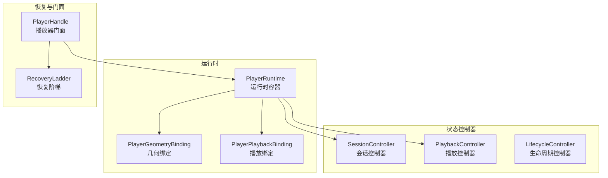
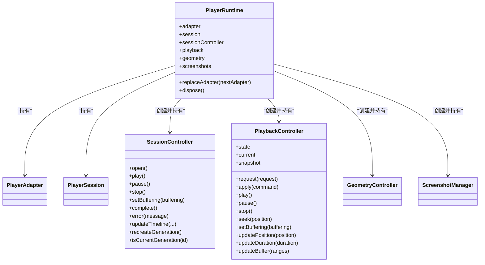
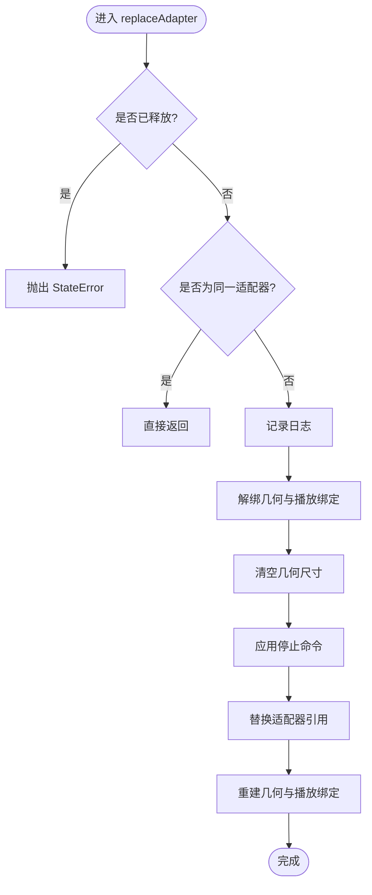
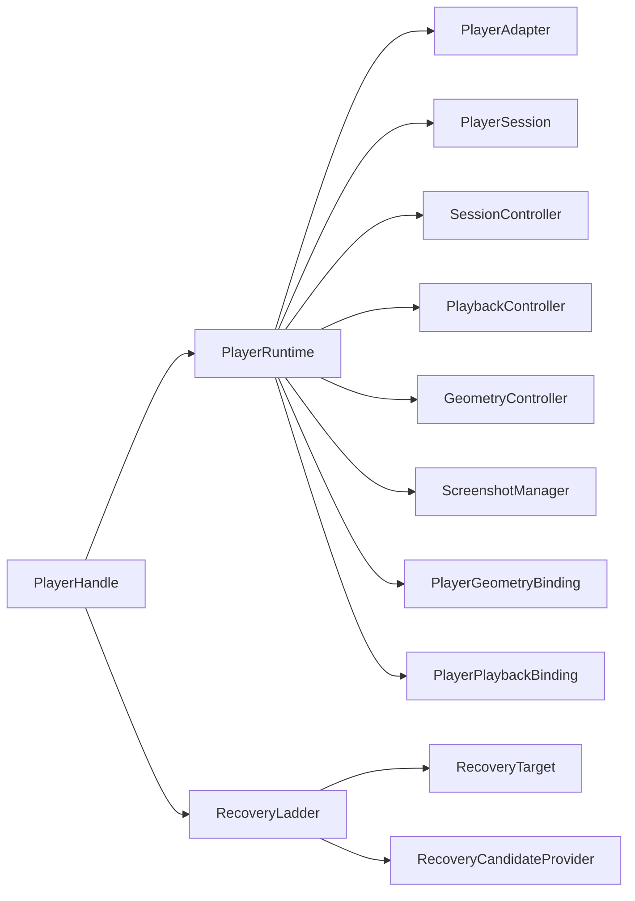
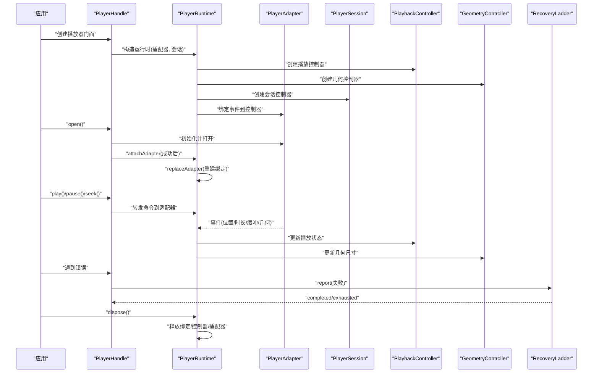

# PlayerRuntime 运行时组合

<cite>
**本文引用的文件**   
- [player_runtime.dart](file://packages/media_core/lib/runtime/player_runtime.dart)
- [session_controller.dart](file://packages/media_core/lib/session/session_controller.dart)
- [playback_controller.dart](file://packages/media_core/lib/playback/playback_controller.dart)
- [lifecycle_controller.dart](file://packages/media_core/lib/lifecycle/lifecycle_controller.dart)
- [recovery_ladder.dart](file://packages/media_core/lib/recovery/recovery_ladder.dart)
- [player_handle.dart](file://packages/media_core/lib/kernel/player_handle.dart)
- [player_geometry_binding.dart](file://packages/media_core/lib/runtime/player_geometry_binding.dart)
- [player_playback_binding.dart](file://packages/media_core/lib/runtime/player_playback_binding.dart)
</cite>

## 目录
1. [引言](#引言)
2. [项目结构](#项目结构)
3. [核心组件](#核心组件)
4. [架构总览](#架构总览)
5. [详细组件分析](#详细组件分析)
6. [依赖关系分析](#依赖关系分析)
7. [性能与内存管理](#性能与内存管理)
8. [故障排查指南](#故障排查指南)
9. [结论](#结论)
10. [附录：配置与启动示例](#附录配置与启动示例)

## 引言
PlayerRuntime 是播放器逻辑实例的“运行时容器”，负责持有并协调后端适配器、会话控制器、播放状态控制器、几何状态控制器以及截图能力等模块。它不是选择适配器的地方，也不是执行恢复策略的地方；这些职责分别由 PlayerHandle 和 RecoveryLadder 承担。PlayerRuntime 的核心价值在于：将一次逻辑播放的生命周期所需的状态与资源集中管理，并通过绑定层把后端事件映射到可观测的状态流，同时支持在恢复过程中安全地替换后端适配器。

本文件面向两类读者：
- 初学者：理解“运行时组合根”的概念，知道如何装配一个可运行的播放器。
- 高级开发者：掌握组件间通信、状态迁移、错误处理、恢复边界、生命周期与资源释放顺序，以及如何扩展或替换某个组件。

## 项目结构
围绕 PlayerRuntime 的相关代码主要分布在以下位置：
- runtime：运行时容器与绑定层（PlayerRuntime、PlayerGeometryBinding、PlayerPlaybackBinding）
- session：会话生命周期与时间线（SessionController、PlayerSession）
- playback：播放状态机与命令（PlaybackController、PlaybackCommand）
- lifecycle：播放器生命周期状态机（LifecycleController）
- recovery：恢复策略与阶梯式重试（RecoveryLadder）
- kernel：播放器门面与恢复执行边界（PlayerHandle）

图表来源
- [player_runtime.dart:38-80](file://packages/media_core/lib/runtime/player_runtime.dart#L38-L80)
- [player_handle.dart:111-147](file://packages/media_core/lib/kernel/player_handle.dart#L111-L147)
- [recovery_ladder.dart:69-113](file://packages/media_core/lib/recovery/recovery_ladder.dart#L69-L113)

章节来源
- [player_runtime.dart:16-37](file://packages/media_core/lib/runtime/player_runtime.dart#L16-L37)
- [player_handle.dart:111-147](file://packages/media_core/lib/kernel/player_handle.dart#L111-L147)

## 核心组件
- PlayerRuntime：运行时组合根，持有并协调适配器、会话、播放、几何、截图等能力，提供 replaceAdapter 与 dispose。
- SessionController：会话状态机，负责 open/play/pause/stop/buffering/completed/error 等状态迁移，并提供 timeline 更新与 generation 管理。
- PlaybackController：播放状态机，维护当前传输状态，序列化请求，暴露 state/snapshot。
- LifecycleController：播放器生命周期状态机，对外发布 LifecycleEvent/LifecycleSnapshot，支持观察者。
- RecoveryLadder：恢复策略引擎，按候选源与候选后端进行阶梯式重试，通过 RecoveryTarget 执行物理步骤。
- PlayerHandle：播放器门面，负责选择适配器、执行恢复、桥接事件到内核，并将恢复的执行面交给 RecoveryLadder。

章节来源
- [player_runtime.dart:38-122](file://packages/media_core/lib/runtime/player_runtime.dart#L38-L122)
- [session_controller.dart:8-30](file://packages/media_core/lib/session/session_controller.dart#L8-L30)
- [playback_controller.dart:10-43](file://packages/media_core/lib/playback/playback_controller.dart#L10-L43)
- [lifecycle_controller.dart:11-35](file://packages/media_core/lib/lifecycle/lifecycle_controller.dart#L11-L35)
- [recovery_ladder.dart:38-113](file://packages/media_core/lib/recovery/recovery_ladder.dart#L38-L113)
- [player_handle.dart:111-147](file://packages/media_core/lib/kernel/player_handle.dart#L111-L147)

## 架构总览
PlayerRuntime 作为运行时组合根，采用“组合根模式”组织依赖：
- 不直接选择适配器，也不决定何时回退；这些决策由 PlayerHandle 与 RecoveryLadder 完成。
- 当发生后端回退时，PlayerHandle 调用 PlayerRuntime.replaceAdapter，仅做绑定解绑与重建，保持控制器不变。
- 截图能力在此处组装，因为需要同时访问适配器、几何与播放镜像，并在后端交换后对上层透明。

图表来源
- [player_runtime.dart:38-122](file://packages/media_core/lib/runtime/player_runtime.dart#L38-L122)
- [session_controller.dart:28-169](file://packages/media_core/lib/session/session_controller.dart#L28-L169)
- [playback_controller.dart:26-145](file://packages/media_core/lib/playback/playback_controller.dart#L26-L145)

## 详细组件分析

### PlayerRuntime：运行时组合根
职责
- 持有活跃的后端适配器与播放器会话。
- 创建并持有会话控制器、播放控制器、几何控制器。
- 通过绑定层将适配器事件桥接到播放与几何状态。
- 在恢复过程中安全替换适配器，保持控制器稳定。
- 组装截图管理器，使其在后端交换后仍可用。

关键流程
- 构造：初始化控制器与绑定，订阅播放状态以同步会话时间线。
- replaceAdapter：先解绑旧适配器，清空几何尺寸，停止播放，再重建绑定到新适配器。
- dispose：按严格顺序释放绑定、订阅、截图、控制器与会话控制器，最后释放适配器。

图表来源
- [player_runtime.dart:127-173](file://packages/media_core/lib/runtime/player_runtime.dart#L127-L173)

章节来源
- [player_runtime.dart:16-37](file://packages/media_core/lib/runtime/player_runtime.dart#L16-L37)
- [player_runtime.dart:38-80](file://packages/media_core/lib/runtime/player_runtime.dart#L38-L80)
- [player_runtime.dart:127-173](file://packages/media_core/lib/runtime/player_runtime.dart#L127-L173)
- [player_runtime.dart:175-202](file://packages/media_core/lib/runtime/player_runtime.dart#L175-L202)

### SessionController：会话控制器
职责
- 管理会话状态迁移（idle/opening/ready/playing/paused/buffering/stopped/completed/error/disposed）。
- 提供 play/pause/stop/buffering/completed/error/clearError 等方法。
- 维护 timeline（position/duration/buffering）与 generation。

要点
- setBuffering(false) 会恢复到之前的活跃状态，避免误入 buffering。
- _canTransitionToPlayback 阻止从 idle/opening/disposed 直接进入 playing。

章节来源
- [session_controller.dart:8-30](file://packages/media_core/lib/session/session_controller.dart#L8-L30)
- [session_controller.dart:45-103](file://packages/media_core/lib/session/session_controller.dart#L45-L103)
- [session_controller.dart:105-169](file://packages/media_core/lib/session/session_controller.dart#L105-L169)

### PlaybackController：播放控制器
职责
- 维护 PlayerTransportState，暴露 state/current/snapshot。
- 序列化播放请求，统一 apply 命令。
- 提供 play/pause/stop/seek/setBuffering/updatePosition/updateDuration/updateBuffer。

要点
- request 内部通过 _enqueue 串行化操作，避免并发状态竞争。
- dispose 等待队列完成后关闭状态流。

章节来源
- [playback_controller.dart:10-43](file://packages/media_core/lib/playback/playback_controller.dart#L10-L43)
- [playback_controller.dart:54-117](file://packages/media_core/lib/playback/playback_controller.dart#L54-L117)
- [playback_controller.dart:119-145](file://packages/media_core/lib/playback/playback_controller.dart#L119-L145)

### LifecycleController：生命周期控制器
职责
- 实现 PlayerLifecycle，维护 LifecycleState 与快照。
- 对外发布 LifecycleEvent 与 LifecycleSnapshot。
- 支持添加/移除观察者，dispose 后清理观察者并关闭流。

要点
- 生命周期单向推进，disposed 后不再接受任何转换。
- 所有状态变更都会广播事件与快照。

章节来源
- [lifecycle_controller.dart:11-35](file://packages/media_core/lib/lifecycle/lifecycle_controller.dart#L11-L35)
- [lifecycle_controller.dart:45-96](file://packages/media_core/lib/lifecycle/lifecycle_controller.dart#L45-L96)
- [lifecycle_controller.dart:98-118](file://packages/media_core/lib/lifecycle/lifecycle_controller.dart#L98-L118)

### RecoveryLadder：恢复阶梯
职责
- 接收失败报告，构建恢复会话，按候选源与候选后端逐步尝试。
- 通过 RecoveryTarget 执行 reopen/swap 等物理步骤。
- 输出事件与快照，支持 suspend/resume/reset/dispose。

要点
- 一次只运行一个恢复任务，防止竞争。
- 源级失败跳过原地重开，直接尝试下一行或下一后端。
- 每步都通过 target 验证成功与否，不会把“打开成功但未播放”误判为成功。

章节来源
- [recovery_ladder.dart:38-113](file://packages/media_core/lib/recovery/recovery_ladder.dart#L38-L113)
- [recovery_ladder.dart:133-192](file://packages/media_core/lib/recovery/recovery_ladder.dart#L133-L192)
- [recovery_ladder.dart:253-365](file://packages/media_core/lib/recovery/recovery_ladder.dart#L253-L365)
- [recovery_ladder.dart:414-470](file://packages/media_core/lib/recovery/recovery_ladder.dart#L414-L470)

### PlayerHandle：播放器门面与恢复边界
职责
- 连接 PlayerRuntime 与 RecoveryLadder。
- 转发播放命令到运行时适配器。
- 执行恢复阶梯的步骤，保护后端操作于生命周期代际。
- 不负责选择适配器、不做恢复决策、不发布内核事件。

章节来源
- [player_handle.dart:111-147](file://packages/media_core/lib/kernel/player_handle.dart#L111-L147)

## 依赖关系分析
- PlayerRuntime 依赖：
  - PlayerAdapter：后端能力与帧捕获。
  - PlayerSession：会话上下文与时间线。
  - SessionController：会话状态与生成号。
  - PlaybackController：播放状态机。
  - GeometryController：几何尺寸与视频大小。
  - ScreenshotManager：截图能力。
  - PlayerGeometryBinding / PlayerPlaybackBinding：适配器事件到控制器的桥接。
- PlayerHandle 依赖：
  - PlayerRuntime：运行时组合根。
  - RecoveryLadder：恢复策略。
- RecoveryLadder 依赖：
  - RecoveryTarget：执行物理步骤。
  - RecoveryCandidateProvider：候选源与候选后端。

图表来源
- [player_handle.dart:111-147](file://packages/media_core/lib/kernel/player_handle.dart#L111-L147)
- [player_runtime.dart:38-122](file://packages/media_core/lib/runtime/player_runtime.dart#L38-L122)
- [recovery_ladder.dart:69-113](file://packages/media_core/lib/recovery/recovery_ladder.dart#L69-L113)

章节来源
- [player_runtime.dart:38-122](file://packages/media_core/lib/runtime/player_runtime.dart#L38-L122)
- [player_handle.dart:111-147](file://packages/media_core/lib/kernel/player_handle.dart#L111-L147)
- [recovery_ladder.dart:69-113](file://packages/media_core/lib/recovery/recovery_ladder.dart#L69-L113)

## 性能与内存管理
- 状态序列化
  - PlaybackController 使用 _operation 链串行化请求，避免并发写状态导致不一致。
- 事件桥接
  - 通过 PlayerGeometryBinding 与 PlayerPlaybackBinding 将适配器事件映射到控制器，减少重复监听与耦合。
- 资源释放顺序
  - PlayerRuntime.dispose 先解绑事件，再取消订阅，再释放截图、控制器、会话控制器与适配器，确保无悬挂回调。
- 几何尺寸重置
  - replaceAdapter 中清空几何尺寸，避免旧引擎尺寸在新引擎上造成画面拉伸。
- 截图能力
  - 在运行时组装截图管理器，保证后端交换后仍可正确读取几何与播放位置。

优化建议
- 避免频繁调用 updateBuffer，尽量批量合并缓冲区间。
- 在长时间空闲时主动 stop 播放，降低解码与渲染压力。
- 合理设置截图缓存与分辨率，避免大图截屏导致的峰值内存。
- 使用 LifecycleController 观察页面可见性变化，暂停非前台播放。

章节来源
- [playback_controller.dart:54-117](file://packages/media_core/lib/playback/playback_controller.dart#L54-L117)
- [player_runtime.dart:127-173](file://packages/media_core/lib/runtime/player_runtime.dart#L127-L173)
- [player_runtime.dart:175-202](file://packages/media_core/lib/runtime/player_runtime.dart#L175-L202)

## 故障排查指南
常见问题与定位思路
- 状态不同步
  - 检查 PlaybackController.state 与 SessionController.timeline 是否一致；PlayerRuntime 构造时会订阅播放状态并更新会话时间线。
- 恢复未触发
  - 确认 RecoveryLadder.report 被调用且失败码可恢复；若目标不可恢复或被挂起，report 会返回 false。
- 后端交换后画面异常
  - 检查 replaceAdapter 是否调用了 geometry.clear 与 playback.stop；确认新适配器已正确初始化与打开。
- 资源泄漏
  - 确认 PlayerRuntime.dispose 被调用；检查绑定与订阅是否被正确释放。

调试技巧
- 启用 RecoveryLadder 日志，观察 sweep 计划与每一步尝试结果。
- 监听 PlaybackController.state 与 SessionController.session.snapshot，对比 position/duration/buffering。
- 使用 LifecycleController.events 观察 create/initialize/activate/deactivate/detach/dispose 序列。

章节来源
- [player_runtime.dart:74-80](file://packages/media_core/lib/runtime/player_runtime.dart#L74-L80)
- [recovery_ladder.dart:133-192](file://packages/media_core/lib/recovery/recovery_ladder.dart#L133-L192)
- [player_runtime.dart:127-173](file://packages/media_core/lib/runtime/player_runtime.dart#L127-L173)
- [lifecycle_controller.dart:45-96](file://packages/media_core/lib/lifecycle/lifecycle_controller.dart#L45-L96)

## 结论
PlayerRuntime 作为运行时组合根，将播放器所需的后端、会话、播放、几何与截图能力有机组合在一起，并通过绑定层将后端事件映射到稳定的状态流。它与 PlayerHandle 和 RecoveryLadder 的职责边界清晰：前者负责门面与恢复执行，后者负责恢复策略与候选选择。这种设计既保证了组件间的低耦合，又提供了清晰的扩展点，便于在不同平台与后端之间切换，同时保持上层 API 的一致性。

## 附录：配置与启动示例
说明
- 以下为概念性步骤，用于帮助初学者理解如何装配与启动运行时环境。实际实现细节请参考对应源码路径。

步骤概览
- 准备后端适配器与播放器会话。
- 创建 PlayerRuntime，传入适配器与会话，可选配置截图参数。
- 通过 PlayerHandle 获取播放器门面，进行 open/play/pause/seek 等操作。
- 当发生错误时，交由 RecoveryLadder 进行恢复；必要时调用 PlayerRuntime.replaceAdapter 进行后端替换。
- 在合适时机调用 PlayerRuntime.dispose 释放资源。

图表来源
- [player_runtime.dart:38-80](file://packages/media_core/lib/runtime/player_runtime.dart#L38-L80)
- [player_runtime.dart:127-173](file://packages/media_core/lib/runtime/player_runtime.dart#L127-L173)
- [player_runtime.dart:175-202](file://packages/media_core/lib/runtime/player_runtime.dart#L175-L202)
- [player_handle.dart:111-147](file://packages/media_core/lib/kernel/player_handle.dart#L111-L147)
- [recovery_ladder.dart:133-192](file://packages/media_core/lib/recovery/recovery_ladder.dart#L133-L192)